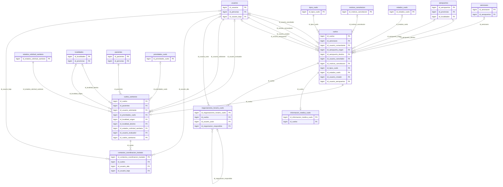
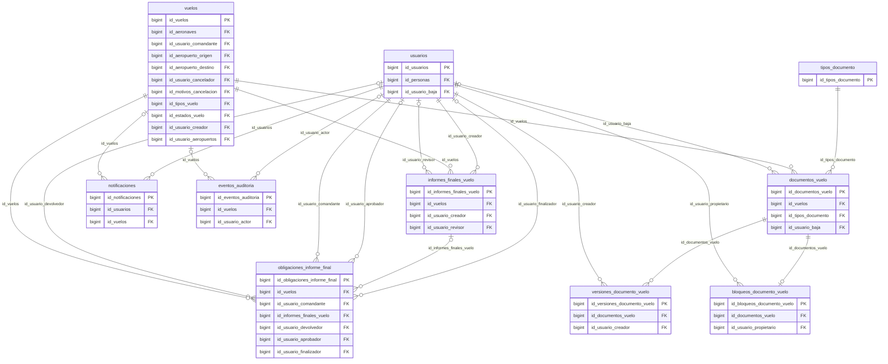
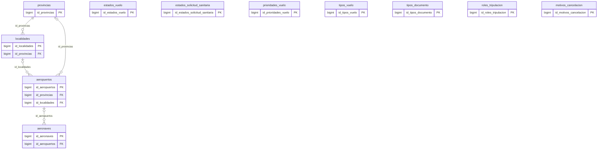
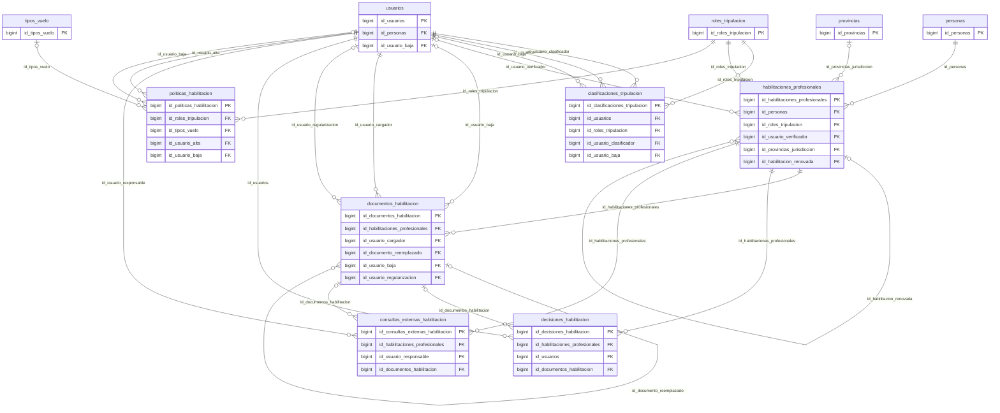

# INFORME COMPLETO DE LA BASE DE DATOS — Sistema Vuelos Sanitarios

> Documentación técnica y funcional de **todas las tablas y columnas** de la base de datos `vuelos_sanitarios`, reconstruida a partir del **esquema vivo de SQL Server (Flyway V66)**, de las 66 migraciones del repositorio y del código fuente del backend (Java 21 / Spring Boot) y del frontend (React / Vite). Rama `codex/auditoria-ux-vuelos`, commit `ef9bb09`. Modo: **solo lectura** — no se modificó código, migraciones, configuración ni datos.

> Revalidación al 2026-11-03 en [la auditoría de ambos informes](AUDITORIA_DOCUMENTACION_ESTADO_ACTUAL.md). Los recuentos de catálogo se contrastaron con la base habitual V66. Las descripciones funcionales se apoyan en análisis estático salvo evidencia de ejecución identificada.

## 1. Resumen ejecutivo

| Concepto | Valor |
|---|---|
| Tablas físicas en el esquema vivo (`dbo`) | **50** = 48 de negocio + `flyway_schema_history` (infraestructura) + `sysdiagrams` (artefacto de SSMS, ajeno a Flyway) |
| Tablas creadas por las migraciones | 49 (las anteriores menos `sysdiagrams`) |
| Columnas | **534** (217 admiten NULL) — todas documentadas individualmente |
| Claves foráneas | 126 (15 con CASCADE; ninguna deshabilitada) |
| Restricciones CHECK | 75 |
| Triggers | 11 (6 de inmutabilidad/integridad y 5 de ciclo de vida) |
| Índices (no PK) | 227, de ellos 56 únicos o restricciones UNIQUE y 42 filtrados |
| Migraciones Flyway | 66 (62 SQL + 4 Java: V16, V17, V26, V65); última aplicada: **V66 «simplificacion tripulacion y personal sanitario»** |
| Filas en la base habitual | muy pocas (base de desarrollo: p. ej. 7 personas, 4 usuarios, 1 solicitud sanitaria) |

**Qué es el sistema, visto desde la base.** Una **persona** (`personas`) puede tener una **cuenta** (`usuarios`) con **roles**, ser **paciente**, ser **comandante** (`perfiles_comandante`) o ser **personal sanitario** de un DTS (`personal_sanitario`). El **DTS** crea **solicitudes sanitarias** (`vuelos` + `vuelos_sanitarios` + datos médicos + contactos) y negocia el horario con **Operaciones**; acordado el horario, Operaciones/Centro de Operaciones proponen aeropuertos y asignan **aeronave, comandante y copiloto** (con la regla geográfica y, si hace falta, una **excepción** autorizada por Centro de Operaciones), y el DTS asigna su **personal sanitario**. El comandante confirma la planificación, registra clima y propone la **ruta**; Operaciones aprueba, inicia y finaliza el vuelo; el comandante presenta el **informe final**, que Operaciones aprueba para **completar** el vuelo. Todo queda en tablas de **historial** (negociaciones, versiones, bajas lógicas) y en la **auditoría** inmutable.

**Cambios desde el informe anterior (V62 → V66).** (1) Tres tablas nuevas: `excepciones_geograficas_comandante` (V63, ajustada en V64 y V66), `personal_sanitario` y `vuelos_personal_sanitario` (V66). (2) Ocho columnas nuevas en tablas existentes: `perfiles_comandante` (`fecha_ubicacion_actual`, `id_usuario_ubicacion`), `vuelos` (`estado_aeropuerto_origen`, `estado_aeropuerto_destino`, `id_usuario_aeropuertos`, `fecha_aeropuertos`) y `localidades` (`latitud`, `longitud`). (3) **Seis tablas quedaron retiradas del flujo funcional** (V66): clasificaciones, habilitaciones, documentos de habilitación, decisiones, consultas externas y políticas; se conservan como historial. (4) Se reescribió el comportamiento de la elegibilidad de la tripulación, la ubicación del comandante, la selección de aeropuertos y la gestión del personal sanitario. (5) La reestructuración del frontend movió todas las pantallas: se actualizaron las referencias de evidencia.

**Principales hallazgos** (detalle en la sección 12): 63 grupos de índices duplicados y 7 índices de migraciones ausentes (confirmados de nuevo contra el esquema vivo); 7 CHECK con nombre generado por el sistema; una columna con CHECK ternario que admite NULL en `vuelos.estado_aeropuerto_*`; `personal_sanitario` asignable sin comparar la capacidad de la aeronave; columnas heredadas sin escritura (`id_localidad_*` de las excepciones, entre otras); `sysdiagrams` ajena al sistema; convenciones de tiempo mezcladas; ausencia de registro de inicios de sesión.

## 2. Cómo está construido este informe

- **Parte I** (secciones 3–5): inventario, módulos, relaciones y diagramas, todo calculado del catálogo `sys.*` de la base viva.
- **Parte II** (sección 6): una ficha por tabla con secciones **A–I** (identificación, funcionalidad, **diccionario técnico y explicación de cada columna**, creación de registros, ejemplo, ciclo de vida, relaciones, restricciones y evidencia). El diccionario de cada tabla se **genera del esquema vivo**; la explicación funcional proviene de la lectura del código y de las migraciones (la base de este texto es el informe previo V62, **revisado y corregido** contra el código V66).
- **Parte III** (secciones 7–13): matriz de acciones y escrituras, procesos completos, trazabilidad pantalla → tabla y tabla → pantalla, campos que se completan después, análisis de normalización y diseño, hallazgos, catálogo de restricciones y **control de cobertura**.

**Fuentes y verificación.** (a) Esquema: consultas **de solo lectura** al catálogo de SQL Server de la base habitual `vuelos_sanitarios` (contenedor Docker local), contrastadas con las migraciones. (b) Código: lectura de entidades, servicios, controladores, DTO, migraciones y componentes React. (c) Datos: sólo recuentos de filas y valores de catálogos; no se leyeron contraseñas, tokens, códigos ni contenido de datos personales. (d) Las afirmaciones de comportamiento citan archivos del repositorio con ruta relativa; los enlaces a código fueron verificados (existen) y las anclas de línea se recalcularon por símbolo cuando fue posible.

**Convenciones del esquema (verificadas).**

| Convención | Evidencia |
|---|---|
| Todas las tablas están en el esquema `dbo`. | `sys.tables` |
| Cada tabla tiene su PK `id_<tabla>` BIGINT IDENTITY(1,1) (V24/V27). Excepciones: `flyway_schema_history` (`installed_rank`), `sysdiagrams` (`diagram_id`) y `perfiles_comandante`/otras con clave propia según su ficha. | Diccionarios C.1 |
| Las FK se nombran `id_<tabla padre>` o llevan el rol (`id_usuario_baja`, `id_usuario_asignador`). | Diccionarios C.1 |
| Baja lógica: `fecha_baja` + `id_usuario_baja` + `motivo_baja`, o `esta_activo`/`esta_activa`. | CHECK de baja |
| Versionado de filas: `version` + `es_version_actual` + índice único filtrado (rutas, hangar, coordinaciones, informes, documentos). | Índices filtrados |
| Concurrencia optimista: `version_identidad`, `version_contacto`, `version_registro` (`@Version`). | Entidades |
| Tiempo: vuelos y solicitudes en hora civil de negocio (`America/Argentina/Tucuman`, DATETIME2); auditoría, obligaciones y bitácora en UTC o DATETIMEOFFSET. | Servicios y V46 |
| Persistencia: JPA/Hibernate (`BaseEntity`, IDENTITY); SQL propio sólo en migraciones y en `ReadinessService`. | Código |
| Transacciones: los métodos públicos de servicio son `@Transactional`; la auditoría exige transacción previa (`Propagation.MANDATORY`). | `AuditService` |

**Limitaciones declaradas.** (1) El esquema vivo proviene de la base habitual local; la comparación con el esquema que producirían las migraciones sobre una base vacía se hizo por lectura de las migraciones y por el informe previo, no recreando una base nueva. (2) La instancia contiene otras bases (`vuelos_sanitarios_auditoria`, `vuelos_sanitarios_auditoria_http`, `vuelos_sanitarios_restore_v47_v60_20261029_095226`) que **no** se analizaron. (3) Con tan pocos datos reales no se pudo observar el comportamiento con volumen; los hechos sobre filas son estructurales. (4) No se ejecutaron flujos de la aplicación; el comportamiento descrito es el que implementa el código (**implementado, sin verificación de ejecución** salvo donde se cita una prueba).

## 3. Inventario completo de tablas

| N.º | Tabla | Módulo | Funcionalidad principal | Relación principal | Columnas | Filas (base habitual) | Migración de origen |
|---|---|---|---|---|---|---|---|
| 1 | `personas` | 1. Identidad, cuentas y contactos | Identidad de toda persona (nombre, apellido, DNI, nacimiento) | raíz; 1—0..1 usuarios, pacientes, perfiles_comandante; 1—N contactos | 8 | 7 | V4 (como `persons`, con id UNIQUEIDENTIFIER) |
| 2 | `usuarios` | 1. Identidad, cuentas y contactos | Cuenta de acceso (credenciales, estado, baja administrativa) | personas (1—0..1); usuarios_roles | 13 | 4 | V1 (como `users`, UNIQUEIDENTIFIER) |
| 3 | `roles` | 1. Identidad, cuentas y contactos | Catálogo de los 5 roles de acceso | usuarios_roles | 6 | 5 | V1 |
| 4 | `usuarios_roles` | 1. Identidad, cuentas y contactos | Asignación de roles a cuentas (N:M) | usuarios, roles | 4 | 4 | V1 (como `user_roles` con PK compuesta) |
| 5 | `perfiles_comandante` | 1. Identidad, cuentas y contactos | Licencia aeronáutica y ubicación operativa (provincia/CABA) del comandante | personas (0..1), provincias, usuarios | 9 | 1 | V12 |
| 6 | `activaciones_cuenta` | 1. Identidad, cuentas y contactos | Códigos OTP de activación de cuentas pendientes | usuarios | 9 | 3 | V11 |
| 7 | `correos_electronicos` | 1. Identidad, cuentas y contactos | Correos de una persona (principal, verificación, baja lógica) | personas, verificaciones_correo | 13 | 4 | V11 |
| 8 | `telefonos` | 1. Identidad, cuentas y contactos | Teléfonos de una persona (formato internacional, principal, baja lógica) | personas | 13 | 3 | V11 |
| 9 | `verificaciones_correo` | 1. Identidad, cuentas y contactos | Códigos OTP de verificación de correo (hash HMAC, intentos, límites) | correos_electronicos, usuarios | 13 | 0 | V54 |
| 10 | `pacientes` | 1. Identidad, cuentas y contactos | Rol de paciente de una persona | personas; vuelos_sanitarios | 4 | 1 | V1 (como `patients`) |
| 11 | `vuelos` | 2. Solicitudes y vuelos | Vuelo (sanitario o no): estado, recursos, horarios y aeropuertos | vuelos_sanitarios (1—0..1), aeronaves, aeropuertos, usuarios, estados/tipos | 24 | 1 | V1 (como `flights`, UNIQUEIDENTIFIER) |
| 12 | `vuelos_sanitarios` | 2. Solicitudes y vuelos | Solicitud sanitaria: paciente, localidades, prioridad, urgencia, estado de la negociación | vuelos (1—1), pacientes, localidades, estados_solicitud_sanitaria | 17 | 1 | V23 |
| 13 | `informacion_medica_vuelo` | 2. Solicitudes y vuelos | Diagnóstico y condición médica del traslado | vuelos (1—1) | 8 | 1 | V4 (como `flight_medical_info`) |
| 14 | `negociaciones_horario_vuelo` | 2. Solicitudes y vuelos | Historial inmutable de propuestas y respuestas de horario | vuelos, usuarios, sí misma (respondida) | 9 | 2 | V20 |
| 15 | `contactos_coordinacion_traslado` | 2. Solicitudes y vuelos | Contactos de coordinación del traslado (familiar, clínica…) | vuelos_sanitarios | 16 | 0 | V51 |
| 16 | `vuelos_tripulantes` | 3. Planificación y ejecución del vuelo | Comandante y copiloto (con cuenta) asignados a un vuelo, con baja lógica | vuelos, usuarios, roles_tripulacion | 9 | 1 | V1 (como `flight_crew`) |
| 17 | `personal_sanitario` | 3. Planificación y ejecución del vuelo | Catálogo de médicos y enfermeros de cada DTS (sin cuenta) | personas, usuarios (DTS) | 10 | 2 | V66 |
| 18 | `vuelos_personal_sanitario` | 3. Planificación y ejecución del vuelo | Participación del personal sanitario en un vuelo, con baja lógica | vuelos, personal_sanitario, usuarios | 8 | 2 | V66 |
| 19 | `excepciones_geograficas_comandante` | 3. Planificación y ejecución del vuelo | Constancia de cada asignación fuera de la jurisdicción de salida | vuelos, usuarios, provincias, aeropuertos | 14 | 0 | V63 |
| 20 | `instantaneas_clima` | 3. Planificación y ejecución del vuelo | Condiciones meteorológicas registradas por el comandante | vuelos, usuarios | 7 | 1 | V1 (como `weather_snapshots`) |
| 21 | `rutas_vuelo` | 3. Planificación y ejecución del vuelo | Ruta planificada por el comandante, versionada y revisada por Operaciones | vuelos, usuarios, aeronaves, aeropuertos | 22 | 1 | V2 (como `flight_routes`) |
| 22 | `informacion_hangar` | 3. Planificación y ejecución del vuelo | Preparación terrestre (hangar) versionada | vuelos, usuarios, aeronaves | 14 | 1 | V2 (como `hangar_info`) |
| 23 | `coordinaciones_aa2000` | 3. Planificación y ejecución del vuelo | Gestiones con el operador aeroportuario, versionadas | vuelos, usuarios, aeropuertos | 21 | 0 | V2 (como `aa2000_coordination`) |
| 24 | `bitacora_vuelos` | 3. Planificación y ejecución del vuelo | Bitácora operativa inmutable (novedades manuales e hitos automáticos) | vuelos, usuarios, sí misma (corrección) | 15 | 2 | V1 (como `flight_audit_log`, auditoría por campo) |
| 25 | `informes_finales_vuelo` | 4. Cierre del vuelo, documentos, notificaciones y auditoría | Informe final versionado y su revisión | vuelos, obligaciones_informe_final, usuarios | 19 | 1 | V2 (como `flight_final_reports`) |
| 26 | `obligaciones_informe_final` | 4. Cierre del vuelo, documentos, notificaciones y auditoría | Obligación y plazos de presentar el informe tras finalizar | vuelos, usuarios | 20 | 1 | V7 (como `final_report_obligations`) |
| 27 | `documentos_vuelo` | 4. Cierre del vuelo, documentos, notificaciones y auditoría | Documento lógico de un vuelo (PDF) | vuelos, tipos_documento; versiones | 10 | 0 | V4 (como `flight_document_items`) |
| 28 | `versiones_documento_vuelo` | 4. Cierre del vuelo, documentos, notificaciones y auditoría | Versiones de archivo de un documento | documentos_vuelo | 9 | 0 | V4 (como `flight_documents`) |
| 29 | `bloqueos_documento_vuelo` | 4. Cierre del vuelo, documentos, notificaciones y auditoría | Arrendamiento temporal para editar un documento | documentos_vuelo, usuarios | 5 | 0 | V31 (ya con id BIGINT IDENTITY) |
| 30 | `notificaciones` | 4. Cierre del vuelo, documentos, notificaciones y auditoría | Avisos dirigidos a usuarios, deduplicados por clave de evento | usuarios, vuelos | 8 | 12 | V1 (como `notifications`) |
| 31 | `eventos_auditoria` | 4. Cierre del vuelo, documentos, notificaciones y auditoría | Auditoría técnica inmutable de las operaciones | vuelos, usuarios (sin FK en entidad_id) | 9 | 42 | V4 (como `audit_events`) |
| 32 | `aeronaves` | 5. Recursos, geografía y catálogos | Flota: capacidades, equipamiento y ubicación actual | aeropuertos; vuelos | 10 | 1 | V1 (como `aircraft`) |
| 33 | `aeropuertos` | 5. Recursos, geografía y catálogos | Catálogo de aeropuertos y aeródromos | provincias, localidades; aeronaves, vuelos | 14 | 566 | V1 (como `airports`) |
| 34 | `provincias` | 5. Recursos, geografía y catálogos | Catálogo de provincias y CABA | localidades, aeropuertos, perfiles_comandante | 4 | 24 | V15 |
| 35 | `localidades` | 5. Recursos, geografía y catálogos | Catálogo de localidades (con coordenadas aproximadas) | provincias; vuelos_sanitarios, aeropuertos | 7 | 4037 | V15 |
| 36 | `estados_vuelo` | 5. Recursos, geografía y catálogos | Catálogo de estados operativos del vuelo | vuelos | 4 | 8 | V1 (como `flight_statuses`) |
| 37 | `estados_solicitud_sanitaria` | 5. Recursos, geografía y catálogos | Catálogo de estados de la solicitud sanitaria | vuelos_sanitarios | 4 | 5 | V23 |
| 38 | `prioridades_vuelo` | 5. Recursos, geografía y catálogos | Catálogo de prioridades | vuelos_sanitarios | 5 | 4 | V5 (como `flight_priorities`) |
| 39 | `tipos_vuelo` | 5. Recursos, geografía y catálogos | Catálogo de tipos de vuelo | vuelos, tipos_documento | 4 | 6 | V23 |
| 40 | `tipos_documento` | 5. Recursos, geografía y catálogos | Catálogo de tipos de documento | documentos_vuelo | 4 | 4 | V1 (como `document_types`) |
| 41 | `roles_tripulacion` | 5. Recursos, geografía y catálogos | Catálogo de funciones a bordo (COMANDANTE, COPILOTO; MEDICO/ENFERMERO históricas) | vuelos_tripulantes | 3 | 4 | V1 (como `crew_roles`) |
| 42 | `motivos_cancelacion` | 5. Recursos, geografía y catálogos | Catálogo de motivos de cancelación y rechazo | vuelos | 7 | 23 | V21 |
| 43 | `clasificaciones_tripulacion` | 6. Habilitaciones y clasificaciones | (Retirada V66) funciones en que una persona estaba clasificada | usuarios, roles_tripulacion | 8 | 2 | V33 |
| 44 | `habilitaciones_profesionales` | 6. Habilitaciones y clasificaciones | (Retirada V66) habilitaciones profesionales verificadas | personas, roles_tripulacion, provincias | 18 | 1 | V35 |
| 45 | `documentos_habilitacion` | 6. Habilitaciones y clasificaciones | (Retirada V66) PDF de respaldo de una habilitación | habilitaciones_profesionales | 24 | 0 | V35 |
| 46 | `decisiones_habilitacion` | 6. Habilitaciones y clasificaciones | (Retirada V66) historial inmutable de decisiones | habilitaciones_profesionales | 8 | 1 | V59 |
| 47 | `consultas_externas_habilitacion` | 6. Habilitaciones y clasificaciones | (Retirada V66) consultas externas manuales | habilitaciones_profesionales | 11 | 0 | V59 |
| 48 | `politicas_habilitacion` | 6. Habilitaciones y clasificaciones | (Retirada V66) política de suficiencia de habilitaciones | roles_tripulacion, tipos_vuelo | 18 | 0 | V59 |
| 49 | `flyway_schema_history` | 7. Infraestructura y tablas técnicas | Historial de migraciones aplicadas (Flyway) | ninguna | 10 | 66 | Flyway la crea al ejecutar la primera migración (V1) |
| 50 | `sysdiagrams` | 7. Infraestructura y tablas técnicas | Diagramas de SSMS (ajena a la aplicación) | ninguna | 5 | 0 | No pertenece a ninguna migración Flyway: la crea SSMS al usar «Diagramas de base de datos» |

**Distinción entre tablas vigentes, históricas y eliminadas.** Vigentes en el flujo: 42 (todas las de los módulos 1 a 5 y la infraestructura). **Retiradas del flujo (V66, sólo historial): 6.** Creada y luego eliminada: `documentos_vuelo_texto_legacy` (V22 → V32). Recreada con otra estructura: `flight_documents` de V1 (V4 la reemplazó por documento lógico + versiones). Renombradas: 24 tablas del esquema inglés de V1–V7 se tradujeron al español en V8. Ajena: `sysdiagrams`.

## 4. Cómo se relacionan los módulos

```text
 personas ──┬─ usuarios ── usuarios_roles ── roles
            ├─ pacientes ───────────────┐
            ├─ perfiles_comandante      │              ┌─ negociaciones_horario_vuelo
            ├─ correos_electronicos ── verificaciones_correo
            ├─ telefonos                ▼              ├─ informacion_medica_vuelo
            └─ personal_sanitario ── vuelos_personal_sanitario ──┐
 vuelos_sanitarios ──(1:0..1)── vuelos ─┬─ vuelos_tripulantes (comandante y copiloto)
   └ contactos_coordinacion_traslado    ├─ excepciones_geograficas_comandante
                                        ├─ rutas_vuelo / informacion_hangar / coordinaciones_aa2000
                                        ├─ instantaneas_clima / bitacora_vuelos
                                        ├─ documentos_vuelo ─ versiones_documento_vuelo / bloqueos_documento_vuelo
                                        ├─ informes_finales_vuelo ─ obligaciones_informe_final
                                        └─ notificaciones / eventos_auditoria (transversales)
 aeronaves ── aeropuertos ── localidades ── provincias      catálogos: estados_vuelo, estados_solicitud_sanitaria,
                                                            tipos_vuelo, prioridades_vuelo, motivos_cancelacion,
                                                            tipos_documento, roles_tripulacion
 (historial retirado en V66: clasificaciones_tripulacion, habilitaciones_profesionales, documentos_habilitacion,
  decisiones_habilitacion, consultas_externas_habilitacion, politicas_habilitacion)
```

## 5. Diagramas entidad-relación por módulo

### Módulo 1 — Identidad, cuentas y contactos

Sólo se dibujan claves (PK/FK); los atributos completos están en las fichas. Las entidades de otros módulos aparecen únicamente como extremo de una relación.



```mermaid
erDiagram
    personas {
        bigint id_personas PK
    }
    usuarios {
        bigint id_usuarios PK
        bigint id_personas FK
        bigint id_usuario_baja FK
    }
    roles {
        bigint id_roles PK
    }
    usuarios_roles {
        bigint id_usuarios FK
        bigint id_roles FK
        bigint id_usuarios_roles PK
    }
    perfiles_comandante {
        bigint id_personas FK
        bigint id_provincias FK
        bigint id_perfiles_comandante PK
        bigint id_usuario_ubicacion FK
    }
    activaciones_cuenta {
        bigint id_activaciones_cuenta PK
        bigint id_usuarios FK
        bigint id_usuario_administrador_creador FK
    }
    correos_electronicos {
        bigint id_correos_electronicos PK
        bigint id_personas FK
        bigint id_usuario_baja FK
    }
    telefonos {
        bigint id_telefonos PK
        bigint id_personas FK
        bigint id_usuario_baja FK
    }
    verificaciones_correo {
        bigint id_verificaciones_correo PK
        bigint id_correos_electronicos FK
        bigint id_usuario_solicitante FK
    }
    pacientes {
        bigint id_pacientes PK
        bigint id_personas FK
    }
    provincias {
        bigint id_provincias PK
    }
    personas ||--o| usuarios : "id_personas"
    usuarios |o--o{ usuarios : "id_usuario_baja"
    roles ||--o{ usuarios_roles : "id_roles"
    usuarios ||--o{ usuarios_roles : "id_usuarios"
    personas ||--o| perfiles_comandante : "id_personas"
    provincias |o--o{ perfiles_comandante : "id_provincias"
    usuarios |o--o{ perfiles_comandante : "id_usuario_ubicacion"
    usuarios |o--o{ activaciones_cuenta : "id_usuario_administrador_creador"
    usuarios ||--o{ activaciones_cuenta : "id_usuarios"
    personas ||--o{ correos_electronicos : "id_personas"
    usuarios |o--o{ correos_electronicos : "id_usuario_baja"
    personas ||--o{ telefonos : "id_personas"
    usuarios |o--o{ telefonos : "id_usuario_baja"
    correos_electronicos ||--o{ verificaciones_correo : "id_correos_electronicos"
    usuarios ||--o{ verificaciones_correo : "id_usuario_solicitante"
    personas ||--o| pacientes : "id_personas"
```

### Módulo 2 — Solicitudes y vuelos

Sólo se dibujan claves (PK/FK); los atributos completos están en las fichas. Las entidades de otros módulos aparecen únicamente como extremo de una relación.



### Módulo 3 — Planificación y ejecución (tripulación, personal sanitario, excepciones, ruta, hangar, coordinaciones, bitácora)

Sólo se dibujan claves (PK/FK); los atributos completos están en las fichas. Las entidades de otros módulos aparecen únicamente como extremo de una relación.



```mermaid
erDiagram
    vuelos_tripulantes {
        bigint id_vuelos_tripulantes PK
        bigint id_vuelos FK
        bigint id_usuarios FK
        bigint id_roles_tripulacion FK
        bigint id_usuario_asignador FK
        bigint id_usuario_baja FK
    }
    personal_sanitario {
        bigint id_personal_sanitario PK
        bigint id_personas FK
        bigint id_usuario_dts FK
    }
    vuelos_personal_sanitario {
        bigint id_vuelos_personal_sanitario PK
        bigint id_vuelos FK
        bigint id_personal_sanitario FK
        bigint id_usuario_asignador FK
        bigint id_usuario_baja FK
    }
    excepciones_geograficas_comandante {
        bigint id_excepciones_geograficas PK
        bigint id_vuelos FK
        bigint id_usuario_comandante FK
        bigint id_localidad_salida FK
        bigint id_localidad_comandante FK
        bigint id_provincia_comandante FK
        bigint id_usuario_autoriza FK
        bigint id_aeropuerto_salida FK
        bigint id_provincia_salida FK
    }
    instantaneas_clima {
        bigint id_instantaneas_clima PK
        bigint id_vuelos FK
        bigint id_usuario_registrador FK
    }
    rutas_vuelo {
        bigint id_rutas_vuelo PK
        bigint id_vuelos FK
        bigint id_usuario_creador FK
        bigint id_aeropuerto_alternativo FK
        bigint id_usuario_presenta FK
        bigint id_usuario_revisor FK
    }
    informacion_hangar {
        bigint id_informacion_hangar PK
        bigint id_vuelos FK
        bigint id_usuario_registrador FK
        bigint id_aeronave_contexto FK
        bigint id_origen_contexto FK
        bigint id_comandante_contexto FK
    }
    coordinaciones_aa2000 {
        bigint id_coordinaciones_aa2000 PK
        bigint id_vuelos FK
        bigint id_usuario_registrador FK
        bigint id_aeropuerto_gestion FK
    }
    bitacora_vuelos {
        bigint id_bitacora_vuelos PK
        bigint id_vuelos FK
        bigint id_usuarios FK
        bigint id_entrada_corregida FK
    }
    roles_tripulacion {
        bigint id_roles_tripulacion PK
    }
    usuarios {
        bigint id_usuarios PK
        bigint id_personas FK
        bigint id_usuario_baja FK
    }
    vuelos {
        bigint id_vuelos PK
        bigint id_aeronaves FK
        bigint id_usuario_comandante FK
        bigint id_aeropuerto_origen FK
        bigint id_aeropuerto_destino FK
        bigint id_usuario_cancelador FK
        bigint id_motivos_cancelacion FK
        bigint id_tipos_vuelo FK
        bigint id_estados_vuelo FK
        bigint id_usuario_creador FK
        bigint id_usuario_aeropuertos FK
    }
    personas {
        bigint id_personas PK
    }
    aeropuertos {
        bigint id_aeropuertos PK
        bigint id_provincias FK
        bigint id_localidades FK
    }
    localidades {
        bigint id_localidades PK
        bigint id_provincias FK
    }
    provincias {
        bigint id_provincias PK
    }
    aeronaves {
        bigint id_aeronaves PK
        bigint id_aeropuertos FK
    }
    roles_tripulacion ||--o{ vuelos_tripulantes : "id_roles_tripulacion"
    usuarios |o--o{ vuelos_tripulantes : "id_usuario_asignador"
    usuarios ||--o{ vuelos_tripulantes : "id_usuarios"
    vuelos ||--o{ vuelos_tripulantes : "id_vuelos"
    usuarios |o--o{ vuelos_tripulantes : "id_usuario_baja"
    usuarios ||--o{ personal_sanitario : "id_usuario_dts"
    personas ||--o{ personal_sanitario : "id_personas"
    usuarios ||--o{ vuelos_personal_sanitario : "id_usuario_asignador"
    usuarios |o--o{ vuelos_personal_sanitario : "id_usuario_baja"
    personal_sanitario ||--o{ vuelos_personal_sanitario : "id_personal_sanitario"
    vuelos ||--o{ vuelos_personal_sanitario : "id_vuelos"
    aeropuertos |o--o{ excepciones_geograficas_comandante : "id_aeropuerto_salida"
    usuarios ||--o{ excepciones_geograficas_comandante : "id_usuario_autoriza"
    usuarios ||--o{ excepciones_geograficas_comandante : "id_usuario_comandante"
    localidades |o--o{ excepciones_geograficas_comandante : "id_localidad_comandante"
    provincias |o--o{ excepciones_geograficas_comandante : "id_provincia_comandante"
    provincias ||--o{ excepciones_geograficas_comandante : "id_provincia_salida"
    localidades |o--o{ excepciones_geograficas_comandante : "id_localidad_salida"
    vuelos ||--o{ excepciones_geograficas_comandante : "id_vuelos"
    usuarios ||--o{ instantaneas_clima : "id_usuario_registrador"
    vuelos ||--o{ instantaneas_clima : "id_vuelos"
    aeropuertos |o--o{ rutas_vuelo : "id_aeropuerto_alternativo"
    usuarios ||--o{ rutas_vuelo : "id_usuario_creador"
    vuelos ||--o{ rutas_vuelo : "id_vuelos"
    usuarios |o--o{ rutas_vuelo : "id_usuario_presenta"
    usuarios |o--o{ rutas_vuelo : "id_usuario_revisor"
    aeronaves |o--o{ informacion_hangar : "id_aeronave_contexto"
    usuarios |o--o{ informacion_hangar : "id_comandante_contexto"
    aeropuertos |o--o{ informacion_hangar : "id_origen_contexto"
    usuarios ||--o{ informacion_hangar : "id_usuario_registrador"
    vuelos ||--o{ informacion_hangar : "id_vuelos"
    aeropuertos |o--o{ coordinaciones_aa2000 : "id_aeropuerto_gestion"
    usuarios ||--o{ coordinaciones_aa2000 : "id_usuario_registrador"
    vuelos ||--o{ coordinaciones_aa2000 : "id_vuelos"
    bitacora_vuelos |o--o{ bitacora_vuelos : "id_entrada_corregida"
    usuarios |o--o{ bitacora_vuelos : "id_usuarios"
    vuelos ||--o{ bitacora_vuelos : "id_vuelos"
```

### Módulo 4 — Cierre, documentos, notificaciones y auditoría

Sólo se dibujan claves (PK/FK); los atributos completos están en las fichas. Las entidades de otros módulos aparecen únicamente como extremo de una relación.



### Módulo 5 — Recursos, geografía y catálogos

Sólo se dibujan claves (PK/FK); los atributos completos están en las fichas. Las entidades de otros módulos aparecen únicamente como extremo de una relación.



### Módulo 6 — Habilitaciones y clasificaciones (historial retirado en V66)

Sólo se dibujan claves (PK/FK); los atributos completos están en las fichas. Las entidades de otros módulos aparecen únicamente como extremo de una relación.



# PARTE II — Fichas por tabla

> Cada ficha usa la misma estructura: **A** identificación · **B** funcionalidad y justificación · **C** diccionario técnico (C.1) y explicación de cada campo (C.2) · **D** creación de registros (quién, desde qué pantalla, endpoint, servicio, validaciones, atomicidad) · **E** ejemplo · **F** ciclo de vida · **G** relaciones · **H** restricciones y decisiones · **I** evidencia. Los ejemplos usan datos ficticios.

## 6. Fichas

# MÓDULO 1. Identidad, cuentas y contactos

## 1. Tabla `personas`

### A. Identificación de la tabla

| Atributo | Detalle |
|---|---|
| Nombre exacto y esquema | `dbo.personas` (esquema `dbo`) |
| Módulo funcional | 1. Identidad, cuentas y contactos |
| Tipo de tabla | Principal — entidad de identidad compartida (supertipo de usuario y paciente) |
| Migración que la creó | V4 (como `persons`, con id UNIQUEIDENTIFIER) |
| Migraciones posteriores que modificaron su estructura | V8 (renombre a `personas` y columnas al español), V11 (DNI único sólo si informado, retira `telefono`), V12/V13 (DNI canónico sólo dígitos), V24/V27 (id BIGINT IDENTITY `id_personas`), V28 (`nombre_persona`/`apellido_persona`), V47 (índice único filtrado de DNI), V48 (`version_identidad`) |
| Estado actual en el esquema | Vigente — 8 columnas, PK `id_personas`, 0 FK salientes, 7 FK entrantes, 1 índice(s) único(s) (sin PK), 1 CHECK, 0 trigger(s), 7 fila(s) en la base habitual (verificado contra `sys.*` de la base `vuelos_sanitarios` en Flyway V66) |
| Tablas relacionadas | usuarios, pacientes, perfiles_comandante, correos_electronicos, telefonos, personal_sanitario, habilitaciones_profesionales (historial) |

### B. Funcionalidad y justificación

`personas` guarda **quién es** alguien: nombre, apellido, DNI y fecha de nacimiento. No dice qué hace esa persona en el sistema: eso lo dicen las tablas que la referencian. Una persona puede ser a la vez **titular de una cuenta** (`usuarios`), **paciente** (`pacientes`), **comandante** (`perfiles_comandante`), **personal sanitario** de un DTS (`personal_sanitario`, V66) y —hasta V65— titular de **habilitaciones profesionales** (`habilitaciones_profesionales`, hoy sólo historial), y todas apuntan a la misma fila.

Resuelve un problema real del negocio: un médico que trabaja en el sistema puede, en otro momento, ser trasladado como paciente. Sin una identidad única habría dos filas con el mismo DNI, sin forma de saber que son la misma persona, y una corrección de apellido en un lado no llegaría al otro.

**Por qué es una tabla independiente.** Es el patrón *supertipo/subtipo*: los datos personales se normalizaron fuera de `usuarios` y `pacientes` en V4 («los atributos personales y clínicos dejan de duplicarse en los subtipos»). La razón está documentada en el encabezado de V4 y en `PersonIdentityService`. Los contactos (correo, teléfono) también se separaron en tablas propias porque una persona puede tener varios.

**Qué dejaría de funcionar sin ella.** No podría crearse ningún usuario ni paciente (ambos exigen `id_personas` NOT NULL); no habría DNI único por persona; el personal sanitario y los contactos no tendrían titular.


### C. Descripción campo por campo

**C.1 Diccionario técnico** (generado del catálogo `sys.*` de SQL Server; el orden es el físico de la tabla):

| # | Campo | Tipo SQL | NULL | Default | Restricciones | Significado |
|---|---|---|---|---|---|---|
| 1 | `nombre_persona` | `nvarchar(100)` | no | — | — | Nombre de pila de la persona. |
| 2 | `apellido_persona` | `nvarchar(100)` | no | — | — | Apellido de la persona. |
| 3 | `dni` | `nvarchar(20)` | sí | — | único filtrado; CHECK ck_personas_dni_solo_digitos | Documento Nacional de Identidad: clave natural de la persona. |
| 4 | `fecha_nacimiento` | `date` | sí | — | — | Fecha de nacimiento de la persona. |
| 5 | `fecha_creacion` | `datetime2(3)` | no | `sysdatetime()` | — | Registra el instante en que la persona se incorporó al sistema. |
| 6 | `fecha_actualizacion` | `datetime2(3)` | no | `sysdatetime()` | — | Instante de la última modificación de los datos de la persona. |
| 7 | `id_personas` | `bigint` | no | IDENTITY(1,1) | PK; IDENTITY | Clave primaria de la tabla: identifica de forma única cada fila y es el valor que otras tablas, la API y la auditoría usan para referirse a ella. |
| 8 | `version_identidad` | `bigint` | no | `(0)` | — | Contador de versión para control de concurrencia optimista. |

**C.2 Explicación funcional de cada campo:**

#### `nombre_persona`

| Atributo | Detalle |
|---|---|
| Nombre | `nombre_persona` |
| Tipo de dato | `nvarchar(100)` |
| Nulabilidad | **NOT NULL.** El valor es siempre necesario para que la fila sea válida (ver «Origen»). |
| Función | Nombre de pila de la persona. |
| Justificación | Es el dato mínimo para identificar a alguien en listados, notificaciones y documentos; se separó de «apellido» para ordenar y buscar por cada uno. |
| Contenido | Texto de hasta 100 caracteres, recortado (`trim`). |
| Origen | Formulario de alta de usuario o de paciente (Administrador o DTS). |
| Momento inicial | En el INSERT de la persona. |
| Modificación | Edición de datos del usuario (Admin), reactivación de la cuenta, corrección de identidad del paciente (Admin). |
| Validaciones | Obligatorio en la API (`@NotBlank`, máx. 100); comparación de identidad ignora tildes y mayúsculas (`sameName`). |

#### `apellido_persona`

| Atributo | Detalle |
|---|---|
| Nombre | `apellido_persona` |
| Tipo de dato | `nvarchar(100)` |
| Nulabilidad | **NOT NULL.** El valor es siempre necesario para que la fila sea válida (ver «Origen»). |
| Función | Apellido de la persona. |
| Justificación | Complementa el nombre para identificar a la persona y para el control «mismo nombre y apellido» al vincular una cuenta a una persona existente. |
| Contenido | Texto de hasta 100 caracteres. |
| Origen | Formulario de alta (Admin/DTS); el bootstrap usa «Inicial». |
| Momento inicial | En el INSERT. |
| Modificación | Mismas operaciones que el nombre. |
| Validaciones | Obligatorio en la API (`@NotBlank`). |

#### `dni`

| Atributo | Detalle |
|---|---|
| Nombre | `dni` |
| Tipo de dato | `nvarchar(20)` |
| Nulabilidad | **Permite NULL.** Opcional por diseño: un paciente puede ingresar sin DNI conocido y el administrador inicial no tiene. Si se desconoce, queda NULL hasta que un Administrador lo asigne por rectificación (`PUT /api/patients/{id}/dni` o `PUT /api/auth/users/{id}/dni`). |
| Función | Documento Nacional de Identidad: clave natural de la persona. |
| Justificación | Es el identificador que ve el negocio para decidir si dos registros son la misma persona (búsqueda de pacientes, bloqueo de duplicados, activación de cuenta por DNI). |
| Contenido | Sólo dígitos, de 7 a 12 en una rectificación (p. ej. `20111222`). |
| Origen | Formulario (Admin/DTS); el sistema elimina puntos, espacios y guiones antes de guardar. |
| Momento inicial | En el INSERT, si fue informado. |
| Modificación | Sólo mediante la rectificación administrativa de DNI (`PersonIdentityService.rectifyDni`), con motivo, cotejo y versión. |
| Validaciones | Índice único `uq_personas_dni` filtrado `dni IS NOT NULL`; CHECK `ck_personas_dni_solo_digitos`; CHECK de sólo dígitos; unicidad por índice filtrado; el alta de usuario lo exige (`@NotBlank`) y el de paciente lo admite vacío. |

#### `fecha_nacimiento`

| Atributo | Detalle |
|---|---|
| Nombre | `fecha_nacimiento` |
| Tipo de dato | `date` |
| Nulabilidad | **Permite NULL.** Opcional: el alta de usuario no la exige y el DTS puede registrar un paciente sin ese dato. Se completa si un Administrador edita la persona; hay personas que permanecen sin ella legítimamente. |
| Función | Fecha de nacimiento de la persona. |
| Justificación | Sirve de dato de contraste de identidad (al vincular un paciente existente se compara) y para mostrar la edad en contextos clínicos. |
| Contenido | Fecha (DATE) sin hora. |
| Origen | Formulario (Admin/DTS). |
| Momento inicial | En el INSERT, si fue informada. |
| Modificación | Edición de usuario (Admin), reactivación (sólo si se envía una nueva), corrección de identidad de paciente. |
| Validaciones | Tipo DATE; sin CHECK de rango. |

#### `fecha_creacion`

| Atributo | Detalle |
|---|---|
| Nombre | `fecha_creacion` |
| Tipo de dato | `datetime2(3)` |
| Nulabilidad | **NOT NULL.** El valor es siempre necesario para que la fila sea válida (ver «Origen»). |
| Función | Registra el instante en que la persona se incorporó al sistema. |
| Justificación | Permite ordenar cronológicamente, reconstruir el historial y aportar trazabilidad sin depender de la auditoría. |
| Contenido | Fecha y hora (DATETIME2) de la inserción. |
| Origen | Automático: DEFAULT `SYSDATETIME()` de SQL Server o `@CreationTimestamp` de Hibernate (según la entidad); el usuario nunca ingresa esta fecha. |
| Momento inicial | En el INSERT. |
| Modificación | Inmutable: ningún flujo la actualiza (`updatable=false` en la entidad). |
| Validaciones | DEFAULT sysdatetime() |

#### `fecha_actualizacion`

| Atributo | Detalle |
|---|---|
| Nombre | `fecha_actualizacion` |
| Tipo de dato | `datetime2(3)` |
| Nulabilidad | **NOT NULL.** El valor es siempre necesario para que la fila sea válida (ver «Origen»). |
| Función | Instante de la última modificación de los datos de la persona. |
| Justificación | Permite detectar rápidamente qué identidades se corrigieron y cuándo. |
| Contenido | Fecha y hora; igual a `fecha_creacion` mientras no hubo cambios. |
| Origen | Automático: `@UpdateTimestamp` de Hibernate (y DEFAULT `SYSDATETIME()` en SQL). |
| Momento inicial | En el INSERT. |
| Modificación | Se actualiza en cada UPDATE de la fila (edición, rectificación de DNI). |
| Validaciones | DEFAULT sysdatetime() |

#### `id_personas`

| Atributo | Detalle |
|---|---|
| Nombre | `id_personas` |
| Tipo de dato | `bigint` — IDENTITY(1,1) |
| Nulabilidad | **NOT NULL.** El valor es siempre necesario para que la fila sea válida (ver «Origen»). |
| Función | Clave primaria de la tabla: identifica de forma única cada fila y es el valor que otras tablas, la API y la auditoría usan para referirse a ella. |
| Justificación | Un identificador técnico numérico, estable y sin significado de negocio evita depender de datos que pueden cambiar (nombres, códigos) y hace eficientes los JOIN y las claves foráneas (decisión V24/V27: «toda tabla de aplicación tiene su propio id_<tabla> BIGINT IDENTITY»). |
| Contenido | Número entero positivo correlativo (1, 2, 3…). No es visible en pantallas de usuario común; el administrador lo ve como identificador de persona en el detalle del paciente (`personaId`). |
| Origen | SQL Server, columna IDENTITY(1,1): se asigna en el propio INSERT. Hibernate lo declara `@GeneratedValue(strategy = IDENTITY)` y lo lee de vuelta tras insertar. |
| Momento inicial | En el INSERT; no existe fila sin identificador. |
| Modificación | Nunca cambia (inmutable; JPA lo declara `updatable=false`). |
| Validaciones | PRIMARY KEY; PRIMARY KEY (unicidad y NOT NULL); no se reutiliza al borrar filas. |

#### `version_identidad`

| Atributo | Detalle |
|---|---|
| Nombre | `version_identidad` |
| Tipo de dato | `bigint` |
| Nulabilidad | **NOT NULL.** El valor es siempre necesario para que la fila sea válida (ver «Origen»). |
| Función | Contador de versión para control de concurrencia optimista. |
| Justificación | Una identidad puede corregirse desde dos pantallas distintas (usuarios y pacientes); la versión impide que una guarde datos leídos antes de que la otra cambiara la fila (V48). |
| Contenido | Entero ≥ 0 (BIGINT); 0 al crear. |
| Origen | Hibernate (`@Version`) y DEFAULT 0. |
| Momento inicial | En el INSERT (valor 0). |
| Modificación | Hibernate lo incrementa en cada UPDATE; la API devuelve la versión actual y exige recibirla (`version`) para editar o rectificar. |
| Validaciones | DEFAULT 0; Si el valor enviado difiere → 409 de versión desactualizada (`stale()`). |

### D. Momento en que se crea un registro

**Escenario 1: El Administrador da de alta un usuario cuya persona todavía no existe**

| Aspecto | Detalle |
|---|---|
| Actor o proceso que inicia | Usuario con rol ADMINISTRADOR |
| Pantalla / componente y acción | Directorio de usuarios → botón «Nuevo usuario» / «Añadir usuario» (`UserDirectory` y `AdminDashboard` en `frontend-react/src/features/`). Se completa el formulario y se envía. |
| Datos que aporta el usuario | Nombre, apellido, DNI, fecha de nacimiento (opcional), roles, licencia (si COMANDANTE), al menos un correo y un teléfono. |
| Endpoint | `POST /api/auth/users` (`AuthController.java`, anotado `@PreAuthorize("hasRole('ADMINISTRADOR')")`) |
| Servicio | `AuthService.createPending` (`@Transactional`) |
| Validaciones y condiciones | Nombre y apellido no vacíos; DNI se reduce a dígitos (`canonicalDni`) y no puede coincidir con una cuenta existente (409 `USER_DNI_ALREADY_EXISTS` / `INACTIVE_USER_WITH_DNI_EXISTS`); si ya hay una persona con ese DNI sin cuenta exige `personaExistenteId` y nombres coincidentes (si no, no se crea otra: se vincula a la existente). |
| Mecanismo que crea el registro | `persons.save(p)` seguido de `persons.flush()` (INSERT de Hibernate). |
| Columnas completadas y de dónde sale cada valor | `nombre_persona` y `apellido_persona` ← formulario (con `trim()`); `dni` ← formulario normalizado a dígitos; `fecha_nacimiento` ← formulario (puede ser NULL); `fecha_creacion`/`fecha_actualizacion` ← @CreationTimestamp/@UpdateTimestamp; `version_identidad` ← 0 (@Version); `id_personas` ← IDENTITY. |
| Columnas que quedan NULL o con valor predeterminado | `fecha_nacimiento` si no se informó. |
| Otros registros creados en la misma operación | En la misma transacción: `usuarios` (PENDIENTE_ACTIVACION), `usuarios_roles`, `perfiles_comandante` (si COMANDANTE), `correos_electronicos`, `telefonos`, `activaciones_cuenta` y un evento `USUARIO_CREADO` en `eventos_auditoria`. |
| Si la operación falla / atomicidad | Todo ocurre en una única transacción: cualquier excepción (p. ej. violación del índice único de DNI en un alta simultánea, que se traduce en 409) revierte la persona, la cuenta, los contactos y el código. |

**Escenario 2: El DTS registra una solicitud con un paciente nuevo**

| Aspecto | Detalle |
|---|---|
| Actor o proceso que inicia | Usuario con rol DTS |
| Pantalla / componente y acción | Pantalla DTS → «Nueva solicitud» (`DTS` en `frontend-react/src/features/`): se carga el paciente nuevo dentro del formulario de la solicitud. |
| Datos que aporta el usuario | Nombre, apellido, DNI (opcional) y fecha de nacimiento del paciente, junto con los datos del traslado. |
| Endpoint | `POST /api/flights/with-patient` (`FlightController.java`) |
| Servicio | `SanitaryRequestRegistrationService.createWithPatient` → `PatientService.registerForSanitaryRequest` |
| Validaciones y condiciones | Nombre y apellido obligatorios; si el DNI ya pertenece a una persona sólo se la vincula con la confirmación expresa de identidad del DTS (`identidadConfirmada`) y coincidencia de nombre/apellido/nacimiento; si no, 409 `PATIENT_IDENTITY_CONFLICT`. No se acepta un `personId` enviado por el cliente. |
| Mecanismo que crea el registro | `persons.saveAndFlush(person)` (sólo cuando el DNI no existía o no se informó). |
| Columnas completadas y de dónde sale cada valor | Igual que el escenario 1 pero `dni` puede quedar NULL si el DTS no lo conoce. |
| Columnas que quedan NULL o con valor predeterminado | `dni` y `fecha_nacimiento` si no se informaron. |
| Otros registros creados en la misma operación | `pacientes`, `vuelos`, `vuelos_sanitarios`, `informacion_medica_vuelo`, `negociaciones_horario_vuelo`, contactos de coordinación, evento de auditoría y notificaciones, todo en una transacción. |
| Si la operación falla / atomicidad | Atómico: si falla la creación del vuelo no queda ni la persona ni el paciente («un fallo en cualquier paso no deja ni ficha de paciente ni vuelo ni contacto»). |

**Escenario 3: Alta directa de paciente**

| Aspecto | Detalle |
|---|---|
| Actor o proceso que inicia | DTS, Operaciones o Centro de Operaciones |
| Pantalla / componente y acción | No se pudo determinar con certeza a partir del código y el esquema analizados qué pantalla invoca este endpoint: el frontend (`patients.jsx`, `frontend-react/src/features/`) sólo usa la búsqueda y el alta dentro de la solicitud. |
| Datos que aporta el usuario | Nombre, apellido, DNI, fecha de nacimiento. |
| Endpoint | `POST /api/patients` (`PatientController.java`) |
| Servicio | `PatientService.create` (sólo identidades realmente nuevas) |
| Validaciones y condiciones | Si el DNI ya existe responde 409 `PATIENT_IDENTITY_CONFLICT` (sin confirmación de identidad no se vincula). |
| Mecanismo que crea el registro | `persons.saveAndFlush`. |
| Columnas completadas y de dónde sale cada valor | Como el escenario 1. |
| Columnas que quedan NULL o con valor predeterminado | `dni`, `fecha_nacimiento` opcionales. |
| Otros registros creados en la misma operación | `pacientes` (1 fila). |
| Si la operación falla / atomicidad | Transacción propia; atómico. |

**Escenario 4: Administrador inicial del sistema (arranque)**

| Aspecto | Detalle |
|---|---|
| Actor o proceso que inicia | Proceso automático (CommandLineRunner) al iniciar el backend |
| Pantalla / componente y acción | Ninguna. |
| Datos que aporta el usuario | Variables de entorno `app.bootstrap-admin.username/password/email`. |
| Endpoint | — |
| Servicio | `BootstrapAdministrator` → `AuthService.createBootstrapAdmin` |
| Validaciones y condiciones | Sólo se ejecuta si las tres propiedades están informadas y todavía no existe ningún usuario con rol ADMINISTRADOR. |
| Mecanismo que crea el registro | `persons.save(p)`. |
| Columnas completadas y de dónde sale cada valor | `nombre_persona` = «Administrador», `apellido_persona` = «Inicial»; resto automático. |
| Columnas que quedan NULL o con valor predeterminado | `dni` y `fecha_nacimiento` (por eso el DNI es único *sólo cuando está informado*). |
| Otros registros creados en la misma operación | `usuarios` (ACTIVO), `usuarios_roles` (ADMINISTRADOR) y `correos_electronicos` (principal). |
| Si la operación falla / atomicidad | Transacción propia; si falla el backend no crea al administrador. |

**Escenario 5: Migración histórica**

| Aspecto | Detalle |
|---|---|
| Actor o proceso que inicia | Flyway (V4) |
| Pantalla / componente y acción | Ninguna. |
| Datos que aporta el usuario | Filas existentes de `users`/`patients`. |
| Endpoint | — |
| Servicio | Script SQL `V4__normalize_identity_clinical_data_and_versioning.sql` |
| Validaciones y condiciones | Un usuario y un paciente con el mismo DNI pasan a compartir la misma persona. |
| Mecanismo que crea el registro | `INSERT INTO persons … SELECT … FROM users` y `FROM patients`. |
| Columnas completadas y de dónde sale cada valor | Copia de nombre, apellido, DNI, teléfono y fecha de nacimiento. |
| Columnas que quedan NULL o con valor predeterminado | Según el dato de origen. |
| Otros registros creados en la misma operación | Actualiza `users.person_id` y `patients.person_id`. |
| Si la operación falla / atomicidad | Una migración Flyway se ejecuta en bloque; si falla no se aplica la versión. |


### E. Ejemplo funcional completo

**Situación (ficticia):** la administradora «Ana Pérez» da de alta al comandante «Luis Gómez».

1. Ana entra al área *Administración → Usuarios* y pulsa **Nuevo usuario**.
2. Completa: nombre «Luis», apellido «Gómez», DNI «20.111.222» (el sistema lo guarda como `20111222`), fecha de nacimiento 1980-05-14, rol COMANDANTE, licencia «ARG1234», un correo y un teléfono.
3. El navegador envía `POST /api/auth/users`. El backend valida, no encuentra otra persona con ese DNI y ejecuta el INSERT.
4. Fila resultante (representación simplificada):

| id_personas | nombre_persona | apellido_persona | dni | fecha_nacimiento | fecha_creacion | fecha_actualizacion | version_identidad |
|---|---|---|---|---|---|---|---|
| 101 | Luis | Gómez | 20111222 | 1980-05-14 | 2026-11-01 10:02:11 | 2026-11-01 10:02:11 | 0 |

5. En la misma transacción se crean `usuarios` (cuenta pendiente), `usuarios_roles`, `perfiles_comandante` (licencia `ARG1234`), un correo, un teléfono y `activaciones_cuenta` (código de 6 dígitos).
6. **Qué queda sin valor:** nada en `personas` salvo que no se hubiera informado la fecha de nacimiento. La cuenta aún no tiene nombre de usuario ni contraseña (están en `usuarios`).
7. **Después:** cuando Luis activa su cuenta no cambia `personas`; si Ana corrige luego su apellido, `fecha_actualizacion` cambia y `version_identidad` pasa a 1; si se rectifica su DNI, cambia `dni` y `version_identidad` vuelve a incrementarse. Al desactivar la cuenta la persona **se conserva** (no hay borrado).


### F. Ciclo de vida del registro

| Transición | Acción que la provoca | Actor | Campos modificados | Antes → después | Validaciones / efectos |
|---|---|---|---|---|---|
| Creación | Alta de usuario, de paciente o arranque | Admin / DTS / sistema | todos (INSERT) | — → fila nueva, `version_identidad`=0 | ver sección D |
| Edición de datos personales | «Guardar» en el detalle del usuario | Admin | `nombre_persona`, `apellido_persona`, `fecha_nacimiento`, `fecha_actualizacion`, `version_identidad` | valores previos → nuevos; versión n → n+1 | `PUT /api/auth/users/{id}` (`AuthService.updateUser`); sólo se audita si algo cambió (`USUARIO_ACTUALIZADO`) |
| Reactivación | «Reactivar» una cuenta desactivada | Admin | los mismos | idem | `AuthService.reactivateUser` puede corregir nombre, apellido y nacimiento |
| Corrección de identidad de paciente | «Mantenimiento de pacientes» | Admin | nombre, apellido, nacimiento | idem | `PUT /api/patients/{id}/identity`, control de versión optimista |
| Rectificación de DNI | Desde el detalle de usuario o de paciente | Admin | `dni`, `version_identidad` | DNI anterior → nuevo | `PersonIdentityService.rectifyDni`: versión vigente, cotejo documental declarado, motivo ≥ 10 caracteres, DNI de 7 a 12 dígitos, sin duplicado; no toca credenciales ni roles |
| Baja | **No existe**: la persona nunca se borra ni se desactiva (no tiene columna de estado) | — | — | — | La baja es lógica en `usuarios` (`esta_activo`/`estado_cuenta`) |


### G. Relaciones con otras tablas

**Clave primaria:** `id_personas`.

**Claves foráneas salientes:** ninguna (tabla raíz).

**Claves foráneas entrantes (tablas hijas):** `correos_electronicos`(id_personas), `habilitaciones_profesionales`(id_personas), `pacientes`(id_personas), `perfiles_comandante`(id_personas), `personal_sanitario`(id_personas), `telefonos`(id_personas), `usuarios`(id_personas).

**Cardinalidades.** `personas` 1 — 0..1 `usuarios` (índice único sobre `usuarios.id_personas`), 1 — 0..1 `pacientes`, 1 — 0..1 `perfiles_comandante` (PK compuesta con la persona), 1 — N `correos_electronicos`, 1 — N `telefonos`, 1 — N `habilitaciones_profesionales`. Todas son obligatorias *desde el hijo*: no existe un usuario/paciente/contacto sin persona. No hay borrado en cascada: una persona con hijos no puede eliminarse (y la aplicación nunca lo intenta).

**Uso real:** el alta de usuarios resuelve el caso «persona ya conocida por otro módulo» pidiendo confirmación expresa antes de asociar la nueva cuenta a la persona existente (`PERSON_EXISTS_WITHOUT_ACCOUNT`); así nunca se fusionan identidades automáticamente.


### H. Restricciones y decisiones de diseño

**Índices (no PK):**

| Índice | Tipo | Columnas | Filtro | Incluye |
|---|---|---|---|---|
| `uq_personas_dni` | único | dni | `(dni IS NOT NULL)` | — |

**Restricciones CHECK:**

- `ck_personas_dni_solo_digitos`: `([dni] IS NULL OR NOT [dni] like N'%[^0-9]%')`

**Triggers:** ninguno.

**DEFAULT / IDENTITY / nulabilidad:** ver el diccionario técnico C.1 (columna «Default»/«NULL») y la ficha de cada campo en C.2.

- **Índice único filtrado `uq_personas_dni`** (V47): el DNI es único sólo cuando está informado. Evita dos personas con el mismo DNI incluso con altas simultáneas, que antes dependían de una consulta previa en Java; los NULL no compiten (personas sin DNI, p. ej. el administrador inicial).
- **CHECK `ck_personas_dni_solo_digitos`** (V13): el DNI se guarda canónico (sólo dígitos), igual que lo calcula la capa Java; impide «20.111.222» vs «20111222» como dos identidades.
- **`version_identidad` (@Version, V48)**: control de concurrencia optimista; dos administradores que editan la misma identidad (desde usuarios y desde pacientes) no se pisan en silencio.
- **Observación:** la tabla no tiene baja lógica propia; es una decisión coherente (la identidad es un hecho), pero implica que el derecho de supresión de datos no está implementado a nivel de `personas` (no se pudo determinar con certeza a partir del código y el esquema analizados si existe un proceso externo).


### I. Evidencia de implementación

- [`V4 (creación)`](../backend-java/src/main/resources/db/migration/V4__normalize_identity_clinical_data_and_versioning.sql#L6)
- [`V13 (DNI sólo dígitos)`](../backend-java/src/main/resources/db/migration/V13__corregir_dni_solo_digitos.sql#L24)
- [`V47 (índice único)`](../backend-java/src/main/resources/db/migration/V47__usuarios_unicidad_identidad_y_baja_administrativa.sql#L14)
- [`V48 (versión)`](../backend-java/src/main/resources/db/migration/V48__version_optimista_identidad_personas.sql#L3)
- [`Entidad Person`](../backend-java/src/main/java/com/vuelossanitarios/backend/domain/person/Person.java#L19)
- [`AuthService.createPending`](../backend-java/src/main/java/com/vuelossanitarios/backend/service/AuthService.java#L30)
- [`PatientService.register`](../backend-java/src/main/java/com/vuelossanitarios/backend/service/PatientService.java#L25)
- [`PersonIdentityService.rectifyDni`](../backend-java/src/main/java/com/vuelossanitarios/backend/service/PersonIdentityService.java#L49)
- [`Bootstrap administrador`](../backend-java/src/main/java/com/vuelossanitarios/backend/security/BootstrapAdministrator.java)
- [`Formulario de usuarios (UI)`](../frontend-react/src/features/users/users.jsx)
- [`Prueba: UserAdministrationIntegrationTest`](../backend-java/src/test/java/com/vuelossanitarios/backend/api/UserAdministrationIntegrationTest.java)
- [`Prueba: PersonIdentityServiceTest`](../backend-java/src/test/java/com/vuelossanitarios/backend/service/PersonIdentityServiceTest.java)

---

## 2. Tabla `usuarios`

### A. Identificación de la tabla

| Atributo | Detalle |
|---|---|
| Nombre exacto y esquema | `dbo.usuarios` (esquema `dbo`) |
| Módulo funcional | 1. Identidad, cuentas y contactos |
| Tipo de tabla | Principal — cuenta de acceso y autenticación |
| Migración que la creó | V1 (como `users`, UNIQUEIDENTIFIER) |
| Migraciones posteriores que modificaron su estructura | V4 (datos personales a `personas`), V8 (renombre), V11 (estado_cuenta, debe_cambiar_contrasena; usuario y hash pasan a NULL), V12 (licencia a `perfiles_comandante`), V14 (nombre de usuario único sólo si informado), V19 (version_credenciales, fecha_baja), V24/V27/V28 (BIGINT IDENTITY, nombres), V47 (id_usuario_baja, motivo_baja, índice único de nombre) |
| Estado actual en el esquema | Vigente — 13 columnas, PK `id_usuarios`, 2 FK salientes, 55 FK entrantes, 2 índice(s) único(s) (sin PK), 2 CHECK, 0 trigger(s), 4 fila(s) en la base habitual (verificado contra `sys.*` de la base `vuelos_sanitarios` en Flyway V66) |
| Tablas relacionadas | personas, usuarios_roles, activaciones_cuenta, y casi todas las tablas operativas (48 FK entrantes: quién creó, evaluó, asignó, firmó, revisó…) |

### B. Funcionalidad y justificación

`usuarios` representa la **cuenta con la que alguien entra al sistema**: nombre de usuario, contraseña (siempre BCrypt, nunca en claro), estado de la cuenta (pendiente de activación, activa, desactivada) y la información necesaria para invalidar sesiones. Es, además, la tabla más referenciada del esquema: cada acción con consecuencias (crear una solicitud, aprobar, asignar, cancelar, revisar un informe) guarda *quién* la hizo con una clave foránea a esta tabla.

El nombre real, el DNI y la fecha de nacimiento **no** están aquí, sino en `personas`: la cuenta es una *capacidad de acceso* de una persona.

**Por qué es una tabla independiente.** Separa autenticación (credenciales, estado, versión de sesión) de identidad (`personas`) y de permisos (`usuarios_roles`/`roles`). Así se puede desactivar una cuenta sin perder a la persona ni los vuelos, informes y auditorías que la citan (V19: «la cuenta se conserva para mantener vuelos, documentos y auditorías»).

**Qué dejaría de funcionar sin ella.** Nadie podría iniciar sesión; no habría autor para las acciones auditadas; las 48 tablas/columnas que referencian a un usuario perderían su referencia.


### C. Descripción campo por campo

**C.1 Diccionario técnico** (generado del catálogo `sys.*` de SQL Server; el orden es el físico de la tabla):

| # | Campo | Tipo SQL | NULL | Default | Restricciones | Significado |
|---|---|---|---|---|---|---|
| 1 | `nombre_usuario` | `nvarchar(50)` | sí | — | único filtrado | Nombre con el que la persona inicia sesión. |
| 2 | `hash_contrasena` | `nvarchar(255)` | sí | — | — | Hash BCrypt de la contraseña. |
| 3 | `esta_activo` | `bit` | no | `(1)` | — | Indicador de si la cuenta puede operar. |
| 4 | `fecha_creacion` | `datetime2(3)` | no | `sysdatetime()` | — | Registra el instante en que la cuenta se incorporó al sistema. |
| 5 | `fecha_actualizacion` | `datetime2(3)` | no | `sysdatetime()` | — | Último cambio de la fila de la cuenta. |
| 6 | `estado_cuenta` | `nvarchar(24)` | no | `N'ACTIVO'` | CHECK ck_usuarios_estado_cuenta | Estado del ciclo de vida de la cuenta. |
| 7 | `debe_cambiar_contrasena` | `bit` | no | `(0)` | — | Marca que obliga a cambiar la contraseña en el próximo ingreso. |
| 8 | `version_credenciales` | `bigint` | no | `(1)` | CHECK ck_usuarios_version_credenciales_positiva | Versión de las credenciales de la cuenta. |
| 9 | `fecha_baja` | `datetime2(3)` | sí | — | — | Momento de la baja administrativa. |
| 10 | `id_usuarios` | `bigint` | no | IDENTITY(1,1) | PK; IDENTITY | Clave primaria de la tabla: identifica de forma única cada fila y es el valor que otras tablas, la API y la auditoría usan para referirse a ella. |
| 11 | `id_personas` | `bigint` | no | — | FK→personas.id_personas; UNIQUE | Referencia a la persona titular de la cuenta. |
| 12 | `id_usuario_baja` | `bigint` | sí | — | FK→usuarios.id_usuarios | Administrador que dio de baja la cuenta. |
| 13 | `motivo_baja` | `nvarchar(500)` | sí | — | — | Texto del motivo de la baja. |

**C.2 Explicación funcional de cada campo:**

#### `nombre_usuario`

| Atributo | Detalle |
|---|---|
| Nombre | `nombre_usuario` |
| Tipo de dato | `nvarchar(50)` |
| Nulabilidad | **Permite NULL.** NULL mientras la cuenta está PENDIENTE_ACTIVACION: el titular todavía no eligió su usuario. Lo completa el propio titular al activar. Una cuenta desactivada conserva su usuario (no se libera). |
| Función | Nombre con el que la persona inicia sesión. |
| Justificación | Separa el «alias de acceso» de los datos personales y permite rotar el modo de ingreso sin tocar la identidad. |
| Contenido | Texto de hasta 50 caracteres (p. ej. `lgomez`). |
| Origen | Lo elige el titular al activar la cuenta (`ActivateAccountRequest.username`). |
| Momento inicial | En la activación de la cuenta (UPDATE); en el bootstrap se inserta ya informado. |
| Modificación | No se modifica después (no existe pantalla de cambio de nombre de usuario). |
| Validaciones | Índice único `uq_usuarios_nombre_usuario` filtrado `nombre_usuario IS NOT NULL`; Único cuando está informado (`uq_usuarios_nombre_usuario`, índice filtrado); comparación sin distinguir mayúsculas según la colación. |

#### `hash_contrasena`

| Atributo | Detalle |
|---|---|
| Nombre | `hash_contrasena` |
| Tipo de dato | `nvarchar(255)` |
| Nulabilidad | **Permite NULL.** NULL mientras la cuenta no se activó. Lo completa la activación; no vuelve a NULL. |
| Función | Hash BCrypt de la contraseña. |
| Justificación | Nunca se guarda la contraseña en claro; BCrypt incluye sal y costo, por lo que una filtración de la tabla no revela contraseñas. |
| Contenido | Cadena de 60 caracteres que comienza con `$2a$` (no se reproduce ningún valor real en este informe). |
| Origen | `BCryptPasswordEncoder.encode(...)` en el backend (activación, cambio, restablecimiento, bootstrap). |
| Momento inicial | En la activación (o en el bootstrap). |
| Modificación | Cambio de contraseña propio; restablecimiento administrativo; reactivación (contraseña temporal). |
| Validaciones | Longitud mínima de la contraseña de 12 caracteres, validada por DTO antes de hashear. |

#### `esta_activo`

| Atributo | Detalle |
|---|---|
| Nombre | `esta_activo` |
| Tipo de dato | `bit` |
| Nulabilidad | **NOT NULL.** El valor es siempre necesario para que la fila sea válida (ver «Origen»). |
| Función | Indicador de si la cuenta puede operar. |
| Justificación | Permite distinguir cuentas operativas de cuentas dadas de baja y conserva la cuenta sin borrarla (el índice `ix_usuarios_activo_estado` que V19 creó para filtrar por este campo ya no existe en el esquema vivo: ver hallazgos). |
| Contenido | 1 = activa, 0 = dada de baja. |
| Origen | Backend: 1 al crear; 0 al desactivar. |
| Momento inicial | En el INSERT (1). |
| Modificación | `deactivateUser` lo pone en 0; `reactivateUser` en 1. |
| Validaciones | DEFAULT 1; NOT NULL DEFAULT 1. |

#### `fecha_creacion`

| Atributo | Detalle |
|---|---|
| Nombre | `fecha_creacion` |
| Tipo de dato | `datetime2(3)` |
| Nulabilidad | **NOT NULL.** El valor es siempre necesario para que la fila sea válida (ver «Origen»). |
| Función | Registra el instante en que la cuenta se incorporó al sistema. |
| Justificación | Permite ordenar cronológicamente, reconstruir el historial y aportar trazabilidad sin depender de la auditoría. |
| Contenido | Fecha y hora (DATETIME2) de la inserción. |
| Origen | Automático: DEFAULT `SYSDATETIME()` de SQL Server o `@CreationTimestamp` de Hibernate (según la entidad); el usuario nunca ingresa esta fecha. |
| Momento inicial | En el INSERT. |
| Modificación | Inmutable: ningún flujo la actualiza (`updatable=false` en la entidad). |
| Validaciones | DEFAULT sysdatetime() |

#### `fecha_actualizacion`

| Atributo | Detalle |
|---|---|
| Nombre | `fecha_actualizacion` |
| Tipo de dato | `datetime2(3)` |
| Nulabilidad | **NOT NULL.** El valor es siempre necesario para que la fila sea válida (ver «Origen»). |
| Función | Último cambio de la fila de la cuenta. |
| Justificación | Trazabilidad mínima de modificaciones sin consultar la auditoría. |
| Contenido | Fecha y hora. |
| Origen | `@UpdateTimestamp`. |
| Momento inicial | En el INSERT. |
| Modificación | En cada UPDATE de la fila (activación, cambio de contraseña, baja…). |
| Validaciones | DEFAULT sysdatetime() |

#### `estado_cuenta`

| Atributo | Detalle |
|---|---|
| Nombre | `estado_cuenta` |
| Tipo de dato | `nvarchar(24)` |
| Nulabilidad | **NOT NULL.** El valor es siempre necesario para que la fila sea válida (ver «Origen»). |
| Función | Estado del ciclo de vida de la cuenta. |
| Justificación | Distingue una cuenta recién creada (aún sin credenciales) de una operativa o dada de baja, lo que cambia lo que el administrador puede hacer. |
| Contenido | PENDIENTE_ACTIVACION, ACTIVO o DESACTIVADO. |
| Origen | Backend según la acción. |
| Momento inicial | En el INSERT: PENDIENTE_ACTIVACION (alta administrativa) o ACTIVO (bootstrap/migración). |
| Modificación | PENDIENTE→ACTIVO (activación), ACTIVO→DESACTIVADO (baja), DESACTIVADO→ACTIVO (reactivación). No hay vuelta a PENDIENTE. |
| Validaciones | CHECK `ck_usuarios_estado_cuenta`; DEFAULT N'ACTIVO'; CHECK `ck_usuarios_estado_cuenta`; DEFAULT 'ACTIVO'. |

#### `debe_cambiar_contrasena`

| Atributo | Detalle |
|---|---|
| Nombre | `debe_cambiar_contrasena` |
| Tipo de dato | `bit` |
| Nulabilidad | **NOT NULL.** El valor es siempre necesario para que la fila sea válida (ver «Origen»). |
| Función | Marca que obliga a cambiar la contraseña en el próximo ingreso. |
| Justificación | Las contraseñas temporales generadas por un administrador no deben seguir en uso. |
| Contenido | 0/1. |
| Origen | Backend. |
| Momento inicial | En el INSERT (0). |
| Modificación | 1 tras restablecimiento o reactivación; 0 tras el cambio voluntario u obligatorio. |
| Validaciones | DEFAULT 0; DEFAULT 0. |

#### `version_credenciales`

| Atributo | Detalle |
|---|---|
| Nombre | `version_credenciales` |
| Tipo de dato | `bigint` |
| Nulabilidad | **NOT NULL.** El valor es siempre necesario para que la fila sea válida (ver «Origen»). |
| Función | Versión de las credenciales de la cuenta. |
| Justificación | El JWT incluye esta versión; incrementarla invalida de inmediato todas las sesiones previas (cambio de roles, de contraseña, baja). |
| Contenido | Entero ≥ 1. |
| Origen | Backend (`User.invalidateCredentials()`). |
| Momento inicial | En el INSERT (1, DEFAULT). |
| Modificación | Se incrementa en cada cambio de contraseña, de roles, restablecimiento, baja o reactivación. |
| Validaciones | CHECK `ck_usuarios_version_credenciales_positiva`; DEFAULT 1; CHECK `ck_usuarios_version_credenciales_positiva` (≥ 1). |

#### `fecha_baja`

| Atributo | Detalle |
|---|---|
| Nombre | `fecha_baja` |
| Tipo de dato | `datetime2(3)` |
| Nulabilidad | **Permite NULL.** NULL mientras la cuenta nunca fue dada de baja o fue reactivada. Lo completa el Administrador al desactivar y lo vacía al reactivar. |
| Función | Momento de la baja administrativa. |
| Justificación | Permite mostrar «desactivado el…» y auditar sin reconstruir desde eventos (V19/V47). |
| Contenido | Fecha y hora. |
| Origen | Backend (`deactivateUser`). |
| Momento inicial | NULL al crear. |
| Modificación | Se completa en la baja y vuelve a NULL en la reactivación. |
| Validaciones | Sin restricción declarada más allá del tipo y la nulabilidad. |

#### `id_usuarios`

| Atributo | Detalle |
|---|---|
| Nombre | `id_usuarios` |
| Tipo de dato | `bigint` — IDENTITY(1,1) |
| Nulabilidad | **NOT NULL.** El valor es siempre necesario para que la fila sea válida (ver «Origen»). |
| Función | Clave primaria de la tabla: identifica de forma única cada fila y es el valor que otras tablas, la API y la auditoría usan para referirse a ella. |
| Justificación | Un identificador técnico numérico, estable y sin significado de negocio evita depender de datos que pueden cambiar (nombres, códigos) y hace eficientes los JOIN y las claves foráneas (decisión V24/V27: «toda tabla de aplicación tiene su propio id_<tabla> BIGINT IDENTITY»). |
| Contenido | Número entero positivo correlativo (1, 2, 3…). El administrador lo ve como identificador del usuario en el detalle. |
| Origen | SQL Server, columna IDENTITY(1,1): se asigna en el propio INSERT. Hibernate lo declara `@GeneratedValue(strategy = IDENTITY)` y lo lee de vuelta tras insertar. |
| Momento inicial | En el INSERT; no existe fila sin identificador. |
| Modificación | Nunca cambia (inmutable; JPA lo declara `updatable=false`). |
| Validaciones | PRIMARY KEY; PRIMARY KEY (unicidad y NOT NULL); no se reutiliza al borrar filas. |

#### `id_personas`

| Atributo | Detalle |
|---|---|
| Nombre | `id_personas` |
| Tipo de dato | `bigint` |
| Nulabilidad | **NOT NULL.** El valor es siempre necesario para que la fila sea válida (ver «Origen»). |
| Función | Referencia a la persona titular de la cuenta. |
| Justificación | Une la cuenta con la identidad (nombre, DNI) sin duplicarlos. |
| Contenido | Identificador de `personas`. |
| Origen | Backend: la persona creada o la existente confirmada por el administrador. |
| Momento inicial | En el INSERT. |
| Modificación | Nunca cambia. |
| Validaciones | FOREIGN KEY → `personas.id_personas` (borrado: NO ACTION); Índice único `uq_usuarios_5`; NOT NULL, FK y único (una persona, una cuenta). |

#### `id_usuario_baja`

| Atributo | Detalle |
|---|---|
| Nombre | `id_usuario_baja` |
| Tipo de dato | `bigint` |
| Nulabilidad | **Permite NULL.** NULL si la cuenta no está dada de baja. Lo completa el Administrador actuante al desactivar. |
| Función | Administrador que dio de baja la cuenta. |
| Justificación | Responsabilidad y trazabilidad de la baja en la propia fila (V47). |
| Contenido | Identificador de `usuarios`. |
| Origen | Backend: el usuario autenticado que ejecuta la baja. |
| Momento inicial | NULL al crear. |
| Modificación | Se completa en la baja; se limpia al reactivar. |
| Validaciones | FOREIGN KEY → `usuarios.id_usuarios` (borrado: NO ACTION); FK autorreferencia. |

#### `motivo_baja`

| Atributo | Detalle |
|---|---|
| Nombre | `motivo_baja` |
| Tipo de dato | `nvarchar(500)` |
| Nulabilidad | **Permite NULL.** Opcional: el motivo puede omitirse (se normaliza a NULL si está en blanco). |
| Función | Texto del motivo de la baja. |
| Justificación | Deja constancia de por qué se retiró el acceso. |
| Contenido | Hasta 500 caracteres. |
| Origen | Formulario «Desactivar cuenta». |
| Momento inicial | NULL al crear. |
| Modificación | Se completa en la baja (puede quedar vacío si el administrador no escribe motivo); se limpia al reactivar. |
| Validaciones | Sin restricción declarada más allá del tipo y la nulabilidad. |

### D. Momento en que se crea un registro

**Escenario 1: El Administrador crea una cuenta pendiente de activación**

| Aspecto | Detalle |
|---|---|
| Actor o proceso que inicia | ADMINISTRADOR |
| Pantalla / componente y acción | «Nuevo usuario» / «Añadir usuario» (`users.jsx`, `AdminDashboard` en `frontend-react/src/features/`). |
| Datos que aporta el usuario | Los del formulario de alta de usuario (ver `personas`). |
| Endpoint | `POST /api/auth/users` |
| Servicio | `AuthService.createPending` |
| Validaciones y condiciones | DNI sin cuenta previa; al menos un correo y un teléfono; licencia obligatoria si el rol es COMANDANTE y no la tiene; roles existentes; ADMINISTRADOR no puede combinarse con roles operativos (regla de negocio de `assignRoles`/V11). |
| Mecanismo que crea el registro | `users.save(u)` con `u.setPerson`, `setActivo(true)`, `setEstadoCuenta("PENDIENTE_ACTIVACION")`. |
| Columnas completadas y de dónde sale cada valor | `id_personas` ← persona creada o vinculada; `esta_activo`=1; `estado_cuenta`='PENDIENTE_ACTIVACION'; `fecha_creacion`/`fecha_actualizacion` ← Hibernate; `version_credenciales`=1 (DEFAULT); `debe_cambiar_contrasena`=0 (DEFAULT). |
| Columnas que quedan NULL o con valor predeterminado | `nombre_usuario`, `hash_contrasena`, `fecha_baja`, `id_usuario_baja`, `motivo_baja`. |
| Otros registros creados en la misma operación | `personas` (si era nueva), `usuarios_roles`, `perfiles_comandante`, `correos_electronicos`, `telefonos`, `activaciones_cuenta`, `eventos_auditoria`. |
| Si la operación falla / atomicidad | Una sola transacción: ante cualquier error no queda cuenta ni persona. |

**Escenario 2: Administrador inicial por configuración**

| Aspecto | Detalle |
|---|---|
| Actor o proceso que inicia | Proceso de arranque |
| Pantalla / componente y acción | — |
| Datos que aporta el usuario | Propiedades de entorno. |
| Endpoint | — |
| Servicio | `AuthService.createBootstrapAdmin` |
| Validaciones y condiciones | Sólo si no existe ningún administrador. |
| Mecanismo que crea el registro | `users.save(u)`. |
| Columnas completadas y de dónde sale cada valor | `nombre_usuario` y `hash_contrasena` (BCrypt) ← propiedades; `estado_cuenta`='ACTIVO'; el resto por defecto. |
| Columnas que quedan NULL o con valor predeterminado | Campos de baja. |
| Otros registros creados en la misma operación | `personas`, `usuarios_roles`, `correos_electronicos`. |
| Si la operación falla / atomicidad | Transacción propia. |

**Escenario 3: Migración histórica**

| Aspecto | Detalle |
|---|---|
| Actor o proceso que inicia | Flyway |
| Pantalla / componente y acción | — |
| Datos que aporta el usuario | — |
| Endpoint | — |
| Servicio | V1 creó la tabla; V4 y V11 migraron datos |
| Validaciones y condiciones | — |
| Mecanismo que crea el registro | Scripts SQL. |
| Columnas completadas y de dónde sale cada valor | — |
| Columnas que quedan NULL o con valor predeterminado | — |
| Otros registros creados en la misma operación | — |
| Si la operación falla / atomicidad | Todo o nada por migración. |


### E. Ejemplo funcional completo

**Situación (ficticia):** alta y activación de «lgomez».

1. La cuenta nace en `usuarios` al enviar el formulario del Administrador:

| id_usuarios | id_personas | nombre_usuario | hash_contrasena | esta_activo | estado_cuenta | debe_cambiar_contrasena | version_credenciales | fecha_baja |
|---|---|---|---|---|---|---|---|---|
| 55 | 101 | NULL | NULL | 1 | PENDIENTE_ACTIVACION | 0 | 1 | NULL |

2. Luis abre la pantalla pública **Activar cuenta**, ingresa su DNI, el código de 6 dígitos que le entregó el administrador, un nombre de usuario y una contraseña de 12 o más caracteres (`POST /api/auth/activar-cuenta`, [`Login`](../frontend-react/src/features/auth/LoginPage.jsx) línea 98).
3. `AuthService.activate` valida el código contra el hash BCrypt de `activaciones_cuenta` y completa **en la misma fila** (UPDATE): `nombre_usuario`='lgomez', `hash_contrasena`=BCrypt(...), `estado_cuenta`='ACTIVO', `debe_cambiar_contrasena`=0.
4. Luego ingresa (`POST /api/auth/login`): el backend compara la contraseña con BCrypt, genera un JWT que incluye `version_credenciales` y los roles.
5. Si el administrador **desactiva** la cuenta: `esta_activo`=0, `estado_cuenta`='DESACTIVADO', `fecha_baja`=ahora, `id_usuario_baja`=administrador, `motivo_baja`=texto, y `version_credenciales` se incrementa (2), con lo cual cualquier JWT emitido deja de ser aceptado.
6. Al **reactivar**: se genera una contraseña temporal (devuelta una sola vez), `debe_cambiar_contrasena`=1, se limpian los campos de baja y `version_credenciales` vuelve a incrementarse.


### F. Ciclo de vida del registro

| Transición | Acción | Actor | Campos modificados | Antes → después | Validaciones / efectos |
|---|---|---|---|---|---|
| Alta | Crear usuario | Admin | INSERT | — → PENDIENTE_ACTIVACION | ver D |
| Regenerar código | «Regenerar código de activación» | Admin | (en `activaciones_cuenta`) | — | sólo si PENDIENTE_ACTIVACION |
| Activación | «Activar cuenta» | Titular (público) | `nombre_usuario`, `hash_contrasena`, `estado_cuenta`, `debe_cambiar_contrasena` | NULL/NULL/PENDIENTE → usuario/hash/ACTIVO | código vigente, no agotado (máx. 5), usuario no repetido (409), contraseña ≥ 12; auditoría `USUARIO_ACTIVADO` |
| Cambio de roles/datos | «Guardar» en el detalle | Admin | (roles en `usuarios_roles`), `version_credenciales` +1 si cambian roles | v→v+1 | no puede editar sus propios roles; no quitar el último administrador; bloquea si hay responsabilidades operativas |
| Restablecer credenciales | «Restablecer credenciales» | Admin | `hash_contrasena`, `debe_cambiar_contrasena`=1, `version_credenciales` +1 | — | no sobre sí mismo; cuenta activa con usuario |
| Cambio de contraseña propio | «Mi cuenta → Cambiar contraseña» | Titular | `hash_contrasena`, `debe_cambiar_contrasena`=0, `version_credenciales` +1 | — | contraseña actual correcta, distinta de la nueva |
| Desactivación | «Desactivar cuenta» | Admin | `esta_activo`=0, `estado_cuenta`=DESACTIVADO, `fecha_baja`, `id_usuario_baja`, `motivo_baja`, `version_credenciales` +1 | ACTIVO → DESACTIVADO | no a sí mismo, no al último admin, sin responsabilidades vigentes (vuelos, informes, solicitudes); libera bloqueos documentales |
| Reactivación | «Reactivar» | Admin | `esta_activo`=1, `estado_cuenta`=ACTIVO, campos de baja a NULL, `hash_contrasena` nuevo, `debe_cambiar_contrasena`=1, `version_credenciales` +1 | DESACTIVADO → ACTIVO | cuenta con nombre de usuario (si estaba pendiente debe regenerarse el código) |
| Eliminación física | **No existe** | — | — | — | Las FK sin cascada lo impedirían |


### G. Relaciones con otras tablas

**Clave primaria:** `id_usuarios`.

**Claves foráneas salientes (tabla hija → padre):**

| Columna | Referencia | Borrado | Obligatoria |
|---|---|---|---|
| `id_personas` | `personas.id_personas` (`fk_usuarios_id_personas`) | NO ACTION | Obligatoria |
| `id_usuario_baja` | `usuarios.id_usuarios` (`fk_usuarios_usuario_baja`) | NO ACTION | Opcional (NULL) |

**Claves foráneas entrantes (tablas hijas):** `activaciones_cuenta`(id_usuario_administrador_creador), `activaciones_cuenta`(id_usuarios), `bitacora_vuelos`(id_usuarios), `bloqueos_documento_vuelo`(id_usuario_propietario), `clasificaciones_tripulacion`(id_usuario_baja), `clasificaciones_tripulacion`(id_usuario_clasificador), `clasificaciones_tripulacion`(id_usuarios), `consultas_externas_habilitacion`(id_usuario_responsable), `contactos_coordinacion_traslado`(id_usuario_alta), `contactos_coordinacion_traslado`(id_usuario_baja), `coordinaciones_aa2000`(id_usuario_registrador), `correos_electronicos`(id_usuario_baja), `decisiones_habilitacion`(id_usuarios), `documentos_habilitacion`(id_usuario_baja), `documentos_habilitacion`(id_usuario_cargador), `documentos_habilitacion`(id_usuario_regularizacion), `documentos_vuelo`(id_usuario_baja), `eventos_auditoria`(id_usuario_actor), `excepciones_geograficas_comandante`(id_usuario_autoriza), `excepciones_geograficas_comandante`(id_usuario_comandante), `habilitaciones_profesionales`(id_usuario_verificador), `informacion_hangar`(id_comandante_contexto), `informacion_hangar`(id_usuario_registrador), `informes_finales_vuelo`(id_usuario_creador), `informes_finales_vuelo`(id_usuario_revisor), `instantaneas_clima`(id_usuario_registrador), `negociaciones_horario_vuelo`(id_usuario_actor), `notificaciones`(id_usuarios), `obligaciones_informe_final`(id_usuario_aprobador), `obligaciones_informe_final`(id_usuario_comandante), `obligaciones_informe_final`(id_usuario_devolvedor), `obligaciones_informe_final`(id_usuario_finalizador), `perfiles_comandante`(id_usuario_ubicacion), `personal_sanitario`(id_usuario_dts), `politicas_habilitacion`(id_usuario_alta), `politicas_habilitacion`(id_usuario_baja), `rutas_vuelo`(id_usuario_creador), `rutas_vuelo`(id_usuario_presenta), `rutas_vuelo`(id_usuario_revisor), `telefonos`(id_usuario_baja), `usuarios_roles`(id_usuarios), `usuarios`(id_usuario_baja), `verificaciones_correo`(id_usuario_solicitante), `versiones_documento_vuelo`(id_usuario_creador), `vuelos_personal_sanitario`(id_usuario_asignador), `vuelos_personal_sanitario`(id_usuario_baja), `vuelos_sanitarios`(id_usuario_evaluador), `vuelos_sanitarios`(id_usuario_solicitante), `vuelos_tripulantes`(id_usuario_asignador), `vuelos_tripulantes`(id_usuario_baja), `vuelos_tripulantes`(id_usuarios), `vuelos`(id_usuario_aeropuertos), `vuelos`(id_usuario_cancelador), `vuelos`(id_usuario_comandante), `vuelos`(id_usuario_creador).

`usuarios` es la tabla central: **FK entrantes** desde casi todos los módulos (vuelos: creador/comandante/cancelador; solicitudes: solicitante/evaluador; tripulación, rutas, hangar, informes, documentos, contactos, habilitaciones, políticas, auditoría…). Cada relación significa «quién hizo o a quién corresponde». Las FK hacia usuarios son todas **NO ACTION** salvo `notificaciones` y `usuarios_roles` (CASCADE): la baja es lógica y la aplicación nunca borra usuarios, de modo que ese CASCADE no se ejerce en el uso normal.

Salientes: `id_personas` (obligatoria, única: una persona tiene como máximo una cuenta) y `id_usuario_baja` (autorreferencia opcional: el administrador que dio de baja).


### H. Restricciones y decisiones de diseño

**Índices (no PK):**

| Índice | Tipo | Columnas | Filtro | Incluye |
|---|---|---|---|---|
| `idx_usuarios_id_personas` | no único | id_personas | — | — |
| `idx_usuarios_id_usuario_baja` | no único | id_usuario_baja | `(id_usuario_baja IS NOT NULL)` | — |
| `idx_usuarios_persona_id` | no único | id_personas | — | — |
| `uq_usuarios_5` | restricción UNIQUE | id_personas | — | — |
| `uq_usuarios_nombre_usuario` | único | nombre_usuario | `(nombre_usuario IS NOT NULL)` | — |

**Restricciones CHECK:**

- `ck_usuarios_estado_cuenta`: `([estado_cuenta]=N'DESACTIVADO' OR [estado_cuenta]=N'ACTIVO' OR [estado_cuenta]=N'PENDIENTE_ACTIVACION')`
- `ck_usuarios_version_credenciales_positiva`: `([version_credenciales]>=(1))`

**Triggers:** ninguno.

**DEFAULT / IDENTITY / nulabilidad:** ver el diccionario técnico C.1 (columna «Default»/«NULL») y la ficha de cada campo en C.2.

- **`uq_usuarios_nombre_usuario` (índice único filtrado, V14/V47):** SQL Server trata los NULL como valores iguales en un UNIQUE normal; como las cuentas pendientes no tienen nombre de usuario, se filtra `WHERE nombre_usuario IS NOT NULL`.
- **`ck_usuarios_estado_cuenta`:** sólo PENDIENTE_ACTIVACION, ACTIVO, DESACTIVADO.
- **`version_credenciales` ≥ 1:** el JWT lleva la versión; subirla invalida todas las sesiones de esa cuenta sin lista negra de tokens.
- **Doble marca de estado (`esta_activo` y `estado_cuenta`):** *Observación:* son parcialmente redundantes (DESACTIVADO ⇔ esta_activo=0 en el código actual); el código exige ambas coherentes pero el esquema no tiene un CHECK que las ate.
- **Bloqueos de concurrencia:** las operaciones administrativas toman el bloqueo de la fila (`users.lockById`/`lockWithPersonAndRolesById`) y el recuento de administradores activos (`lockActiveAdministrators`) para no dejar al sistema sin administrador.


### I. Evidencia de implementación

- [`V1 (creación)`](../backend-java/src/main/resources/db/migration/V1__init_sanitary_flights_schema.sql#L20)
- [`V11 (estado_cuenta)`](../backend-java/src/main/resources/db/migration/V11__cuentas_contactos_y_activaciones.sql#L48)
- [`V19 (version_credenciales)`](../backend-java/src/main/resources/db/migration/V19__baja_logica_usuarios_e_invalidez_credenciales.sql#L4)
- [`V47 (baja administrativa)`](../backend-java/src/main/resources/db/migration/V47__usuarios_unicidad_identidad_y_baja_administrativa.sql#L19)
- [`Entidad User`](../backend-java/src/main/java/com/vuelossanitarios/backend/domain/user/User.java#L22)
- [`AuthService.activate`](../backend-java/src/main/java/com/vuelossanitarios/backend/service/AuthService.java#L54)
- [`AuthService.deactivateUser`](../backend-java/src/main/java/com/vuelossanitarios/backend/service/AuthService.java#L91)
- [`AuthService.login`](../backend-java/src/main/java/com/vuelossanitarios/backend/service/AuthService.java#L29)
- [`Endpoints`](../backend-java/src/main/java/com/vuelossanitarios/backend/api/AuthController.java)
- [`Pantalla de activación/login`](../frontend-react/src/features/auth/LoginPage.jsx)
- [`Directorio de usuarios`](../frontend-react/src/features/users/users.jsx)
- [`Prueba: AccountActivationIntegrationTest`](../backend-java/src/test/java/com/vuelossanitarios/backend/api/AccountActivationIntegrationTest.java)
- [`Prueba: UserAdministrationServiceTest`](../backend-java/src/test/java/com/vuelossanitarios/backend/service/UserAdministrationServiceTest.java)

---

## 3. Tabla `roles`

### A. Identificación de la tabla

| Atributo | Detalle |
|---|---|
| Nombre exacto y esquema | `dbo.roles` (esquema `dbo`) |
| Módulo funcional | 1. Identidad, cuentas y contactos |
| Tipo de tabla | Catálogo — roles de acceso (autorización) |
| Migración que la creó | V1 |
| Migraciones posteriores que modificaron su estructura | V5 (ADMINISTRADOR), V12 (CENTRO_OPERACIONES), V8/V24/V27/V28 (nombres e identificadores), V25 (resiembra tras el corte V24) |
| Estado actual en el esquema | Vigente — 6 columnas, PK `id_roles`, 0 FK salientes, 1 FK entrantes, 1 índice(s) único(s) (sin PK), 0 CHECK, 0 trigger(s), 5 fila(s) en la base habitual (verificado contra `sys.*` de la base `vuelos_sanitarios` en Flyway V66) |
| Tablas relacionadas | usuarios_roles |

### B. Funcionalidad y justificación

`roles` lista los **perfiles de acceso** que Spring Security usa en las anotaciones `@PreAuthorize`: DTS, OPERACIONES, CENTRO_OPERACIONES, COMANDANTE y ADMINISTRADOR. Cada fila define un código estable y un nombre legible. Qué puede hacer cada rol no está en la tabla sino en el código de los controladores.

Es un catálogo sembrado por migración: la aplicación no tiene pantalla ni endpoint para crear o editar roles.

**Por qué es una tabla independiente.** Es una tabla de catálogo para no escribir los nombres de rol sueltos en cada cuenta y poder asignar varios roles por usuario (relación N:M mediante `usuarios_roles`). Los IDs son técnicos; el `codigo_rol` es la referencia estable (comentario de V25).

**Qué dejaría de funcionar sin ella.** No se podrían asignar roles ni autorizar endpoints; el login no devolvería roles.


### C. Descripción campo por campo

**C.1 Diccionario técnico** (generado del catálogo `sys.*` de SQL Server; el orden es el físico de la tabla):

| # | Campo | Tipo SQL | NULL | Default | Restricciones | Significado |
|---|---|---|---|---|---|---|
| 1 | `codigo_rol` | `nvarchar(30)` | no | — | UNIQUE | Código estable del rol. |
| 2 | `nombre_rol` | `nvarchar(100)` | no | — | — | Nombre legible del rol para pantallas. |
| 3 | `descripcion_rol` | `nvarchar(MAX)` | sí | — | — | Descripción libre del rol. |
| 4 | `esta_activo` | `bit` | no | `(1)` | — | Indica si el rol está disponible para asignarse. |
| 5 | `fecha_creacion` | `datetime2(3)` | no | `sysdatetime()` | — | Registra el instante en que el rol se incorporó al sistema. |
| 6 | `id_roles` | `bigint` | no | IDENTITY(1,1) | PK; IDENTITY | Clave primaria de la tabla: identifica de forma única cada fila y es el valor que otras tablas, la API y la auditoría usan para referirse a ella. |

**C.2 Explicación funcional de cada campo:**

#### `codigo_rol`

| Atributo | Detalle |
|---|---|
| Nombre | `codigo_rol` |
| Tipo de dato | `nvarchar(30)` |
| Nulabilidad | **NOT NULL.** El valor es siempre necesario para que la fila sea válida (ver «Origen»). |
| Función | Código estable del rol. |
| Justificación | Es lo que usan las reglas de autorización; el nombre visible puede cambiar sin afectar permisos. |
| Contenido | DTS, OPERACIONES, CENTRO_OPERACIONES, COMANDANTE o ADMINISTRADOR. |
| Origen | Migración (V1/V5/V12/V25). |
| Momento inicial | En el INSERT de la migración. |
| Modificación | No cambia. |
| Validaciones | Índice único `uq_roles_2`; UNIQUE (`uq_roles_2`). |

#### `nombre_rol`

| Atributo | Detalle |
|---|---|
| Nombre | `nombre_rol` |
| Tipo de dato | `nvarchar(100)` |
| Nulabilidad | **NOT NULL.** El valor es siempre necesario para que la fila sea válida (ver «Origen»). |
| Función | Nombre legible del rol para pantallas. |
| Justificación | Evita mostrar códigos técnicos al usuario. |
| Contenido | Texto. |
| Origen | Migración. |
| Momento inicial | En el INSERT. |
| Modificación | No cambia. |
| Validaciones | Sin restricción declarada más allá del tipo y la nulabilidad. |

#### `descripcion_rol`

| Atributo | Detalle |
|---|---|
| Nombre | `descripcion_rol` |
| Tipo de dato | `nvarchar(max)` |
| Nulabilidad | **Permite NULL.** Columna prevista pero sin uso: ninguna migración ni servicio la completa (hallazgo: campo nunca escrito). |
| Función | Descripción libre del rol. |
| Justificación | Previsto para documentar el alcance de cada rol. |
| Contenido | NULL en todas las filas actuales. |
| Origen | Migración (no informada). |
| Momento inicial | NULL. |
| Modificación | No se modifica. |
| Validaciones | Sin restricción declarada más allá del tipo y la nulabilidad. |

#### `esta_activo`

| Atributo | Detalle |
|---|---|
| Nombre | `esta_activo` |
| Tipo de dato | `bit` |
| Nulabilidad | **NOT NULL.** El valor es siempre necesario para que la fila sea válida (ver «Origen»). |
| Función | Indica si el rol está disponible para asignarse. |
| Justificación | Permite retirar un rol de las opciones sin borrar asignaciones históricas. |
| Contenido | 1 = disponible. |
| Origen | Migración (DEFAULT 1). |
| Momento inicial | En el INSERT. |
| Modificación | No se modifica por la aplicación. |
| Validaciones | DEFAULT 1; DEFAULT 1. |

#### `fecha_creacion`

| Atributo | Detalle |
|---|---|
| Nombre | `fecha_creacion` |
| Tipo de dato | `datetime2(3)` |
| Nulabilidad | **NOT NULL.** El valor es siempre necesario para que la fila sea válida (ver «Origen»). |
| Función | Registra el instante en que el rol se incorporó al sistema. |
| Justificación | Permite ordenar cronológicamente, reconstruir el historial y aportar trazabilidad sin depender de la auditoría. |
| Contenido | Fecha y hora (DATETIME2) de la inserción. |
| Origen | Automático: DEFAULT `SYSDATETIME()` de SQL Server o `@CreationTimestamp` de Hibernate (según la entidad); el usuario nunca ingresa esta fecha. |
| Momento inicial | En el INSERT. |
| Modificación | Inmutable: ningún flujo la actualiza (`updatable=false` en la entidad). |
| Validaciones | DEFAULT sysdatetime() |

#### `id_roles`

| Atributo | Detalle |
|---|---|
| Nombre | `id_roles` |
| Tipo de dato | `bigint` — IDENTITY(1,1) |
| Nulabilidad | **NOT NULL.** El valor es siempre necesario para que la fila sea válida (ver «Origen»). |
| Función | Clave primaria de la tabla: identifica de forma única cada fila y es el valor que otras tablas, la API y la auditoría usan para referirse a ella. |
| Justificación | Un identificador técnico numérico, estable y sin significado de negocio evita depender de datos que pueden cambiar (nombres, códigos) y hace eficientes los JOIN y las claves foráneas (decisión V24/V27: «toda tabla de aplicación tiene su propio id_<tabla> BIGINT IDENTITY»). |
| Contenido | Número entero positivo correlativo (1, 2, 3…). No lo ingresa el usuario. |
| Origen | SQL Server, columna IDENTITY(1,1): se asigna en el propio INSERT. Hibernate lo declara `@GeneratedValue(strategy = IDENTITY)` y lo lee de vuelta tras insertar. |
| Momento inicial | En el INSERT; no existe fila sin identificador. |
| Modificación | Nunca cambia (inmutable; JPA lo declara `updatable=false`). |
| Validaciones | PRIMARY KEY; PRIMARY KEY (unicidad y NOT NULL); no se reutiliza al borrar filas. |

### D. Momento en que se crea un registro

**Escenario 1: Siembra por migración**

| Aspecto | Detalle |
|---|---|
| Actor o proceso que inicia | Flyway |
| Pantalla / componente y acción | — |
| Datos que aporta el usuario | — |
| Endpoint | — |
| Servicio | `V1` (DTS, OPERACIONES, COMANDANTE), `V5` (ADMINISTRADOR), `V12` (CENTRO_OPERACIONES) y `V25` (resiembra completa tras el corte destructivo de V24) |
| Validaciones y condiciones | — |
| Mecanismo que crea el registro | `INSERT INTO roles(codigo,nombre,activo,fecha_creacion) VALUES …` |
| Columnas completadas y de dónde sale cada valor | Todas las columnas con valores fijos de la migración. |
| Columnas que quedan NULL o con valor predeterminado | `descripcion_rol` (V25 no la informa). |
| Otros registros creados en la misma operación | — |
| Si la operación falla / atomicidad | Todo o nada por migración. |


### E. Ejemplo funcional completo

**Situación:** el Administrador abre «Nuevo usuario». El desplegable de roles se llena con `GET /api/auth/roles` (`AuthService.roleOptions`), que lee las filas con `esta_activo=1` y devuelve `codigo_rol` y `nombre_rol`. Si elige DTS, se crea una fila en `usuarios_roles` que apunta al `id_roles` de «DTS».

Filas actuales (catálogo): DTS «Dirección de Tránsito Sanitario» · OPERACIONES «Centro de Operaciones» · CENTRO_OPERACIONES «Centro de Operaciones» · COMANDANTE «Comandante de Vuelo» · ADMINISTRADOR «Administrador».


### F. Ciclo de vida del registro

Las filas **no cambian** después de sembrarse: la aplicación no las actualiza ni las borra. Sólo una nueva migración puede agregar un rol o desactivarlo (`esta_activo`). Desactivar un rol lo oculta de `roleOptions` y de `roleCodes`, pero no tiene hoy un proceso que lo haga.


### G. Relaciones con otras tablas

**Clave primaria:** `id_roles`.

**Claves foráneas salientes:** ninguna (tabla raíz).

**Claves foráneas entrantes (tablas hijas):** `usuarios_roles`(id_roles).

`roles` 1 — N `usuarios_roles` (FK con CASCADE desde la tabla puente). No tiene FK salientes. *Observación:* existen dos roles con el mismo nombre visible «Centro de Operaciones» (`OPERACIONES` y `CENTRO_OPERACIONES`); el código los trata como equivalentes en las autorizaciones (`hasAnyRole('OPERACIONES','CENTRO_OPERACIONES')`). Es una duplicidad histórica (V12 agregó el segundo) — ver capítulo de hallazgos.


### H. Restricciones y decisiones de diseño

**Índices (no PK):**

| Índice | Tipo | Columnas | Filtro | Incluye |
|---|---|---|---|---|
| `uq_roles_2` | restricción UNIQUE | codigo_rol | — | — |

**Restricciones CHECK:**

Ninguna.

**Triggers:** ninguno.

**DEFAULT / IDENTITY / nulabilidad:** ver el diccionario técnico C.1 (columna «Default»/«NULL») y la ficha de cada campo en C.2.

- **`codigo_rol` UNIQUE:** impide dos roles con el mismo código; el código es la clave de negocio que usa Spring Security (`ROLE_<codigo>`).
- Sin CHECK ni trigger propio; la exclusividad de ADMINISTRADOR respecto de los roles operativos se valida en Java (`AuthService`) — V11 la protegió con un trigger que V12 retiró.


### I. Evidencia de implementación

- [`V1 (creación y siembra)`](../backend-java/src/main/resources/db/migration/V1__init_sanitary_flights_schema.sql#L10)
- [`V12 (CENTRO_OPERACIONES)`](../backend-java/src/main/resources/db/migration/V12__perfiles_comandante_multirrol_y_dni_canonico.sql#L10)
- [`V25 (resiembra)`](../backend-java/src/main/resources/db/migration/V25__resembrar_catalogos_basicos.sql#L2)
- [`Entidad Role`](../backend-java/src/main/java/com/vuelossanitarios/backend/domain/user/Role.java#L14)
- [`Lectura en el alta`](../backend-java/src/main/java/com/vuelossanitarios/backend/service/AuthService.java)

**La aplicación no inserta filas en esta tabla** (ningún servicio llama a `roles.save`); sólo la lee (`RoleRepository`, `AuthService.assignRoles`/`roleOptions`). En la base habitual hay 5 filas.

---

## 4. Tabla `usuarios_roles`

### A. Identificación de la tabla

| Atributo | Detalle |
|---|---|
| Nombre exacto y esquema | `dbo.usuarios_roles` (esquema `dbo`) |
| Módulo funcional | 1. Identidad, cuentas y contactos |
| Tipo de tabla | Relación N:M (tabla puente) usuarios ↔ roles |
| Migración que la creó | V1 (como `user_roles` con PK compuesta) |
| Migraciones posteriores que modificaron su estructura | V8 (renombre), V24/V27 (id BIGINT IDENTITY propio `id_usuarios_roles`), V11/V12 (trigger de exclusividad creado y luego retirado) |
| Estado actual en el esquema | Vigente — 4 columnas, PK `id_usuarios_roles`, 2 FK salientes, 0 FK entrantes, 1 índice(s) único(s) (sin PK), 0 CHECK, 0 trigger(s), 4 fila(s) en la base habitual (verificado contra `sys.*` de la base `vuelos_sanitarios` en Flyway V66) |
| Tablas relacionadas | usuarios, roles |

### B. Funcionalidad y justificación

Registra **qué roles tiene cada cuenta**. Un usuario puede tener varios roles (p. ej. COMANDANTE más DTS) salvo ADMINISTRADOR, que es exclusivo. Cuando el login arma el JWT, lee esta tabla para devolver los roles.

También determina qué endpoints puede invocar el usuario y a qué pantallas de trabajo accede (selector de área en el frontend).

**Por qué es una tabla independiente.** Es la forma estándar de modelar una relación muchos-a-muchos: ni `usuarios` ni `roles` pueden contener la lista sin repetir datos. Además guarda la fecha en que se asignó cada rol.

**Qué dejaría de funcionar sin ella.** Ningún usuario tendría permisos; todos los endpoints protegidos responderían 403.


### C. Descripción campo por campo

**C.1 Diccionario técnico** (generado del catálogo `sys.*` de SQL Server; el orden es el físico de la tabla):

| # | Campo | Tipo SQL | NULL | Default | Restricciones | Significado |
|---|---|---|---|---|---|---|
| 1 | `fecha_asignacion` | `datetime2(3)` | no | `sysdatetime()` | — | Momento en que el rol quedó asignado a la cuenta. |
| 2 | `id_usuarios` | `bigint` | no | — | FK→usuarios.id_usuarios (CASCADE); UNIQUE (id_usuarios, id_roles) | Cuenta que recibe el rol. |
| 3 | `id_roles` | `bigint` | no | — | FK→roles.id_roles (CASCADE); UNIQUE (id_usuarios, id_roles) | Rol asignado. |
| 4 | `id_usuarios_roles` | `bigint` | no | IDENTITY(1,1) | PK; IDENTITY | Clave primaria de la tabla: identifica de forma única cada fila y es el valor que otras tablas, la API y la auditoría usan para referirse a ella. |

**C.2 Explicación funcional de cada campo:**

#### `fecha_asignacion`

| Atributo | Detalle |
|---|---|
| Nombre | `fecha_asignacion` |
| Tipo de dato | `datetime2(3)` |
| Nulabilidad | **NOT NULL.** El valor es siempre necesario para que la fila sea válida (ver «Origen»). |
| Función | Momento en que el rol quedó asignado a la cuenta. |
| Justificación | Permite saber desde cuándo rige la asignación vigente. |
| Contenido | Fecha y hora. |
| Origen | Automático: @CreationTimestamp / DEFAULT SYSDATETIME(). |
| Momento inicial | En el INSERT. |
| Modificación | No se modifica; si cambian los roles se borra y reinserta (nueva fecha). |
| Validaciones | DEFAULT sysdatetime() |

#### `id_usuarios`

| Atributo | Detalle |
|---|---|
| Nombre | `id_usuarios` |
| Tipo de dato | `bigint` |
| Nulabilidad | **NOT NULL.** El valor es siempre necesario para que la fila sea válida (ver «Origen»). |
| Función | Cuenta que recibe el rol. |
| Justificación | Vincula el permiso con la cuenta. |
| Contenido | Identificador de `usuarios`. |
| Origen | Backend: la cuenta que se está creando o editando. |
| Momento inicial | En el INSERT. |
| Modificación | No cambia. |
| Validaciones | FOREIGN KEY → `usuarios.id_usuarios` (borrado: **CASCADE**); Índice único `uq_usuarios_roles_id_usuarios_id_roles` sobre (id_usuarios, id_roles); NOT NULL, FK con CASCADE, parte del índice único. |

#### `id_roles`

| Atributo | Detalle |
|---|---|
| Nombre | `id_roles` |
| Tipo de dato | `bigint` |
| Nulabilidad | **NOT NULL.** El valor es siempre necesario para que la fila sea válida (ver «Origen»). |
| Función | Rol asignado. |
| Justificación | Define las capacidades de la cuenta. |
| Contenido | Identificador de `roles` (se busca por código con `roles.findByCodigo`). |
| Origen | Backend, a partir de los códigos elegidos por el administrador. |
| Momento inicial | En el INSERT. |
| Modificación | No cambia. |
| Validaciones | FOREIGN KEY → `roles.id_roles` (borrado: **CASCADE**); Índice único `uq_usuarios_roles_id_usuarios_id_roles` sobre (id_usuarios, id_roles); NOT NULL, FK con CASCADE, parte del índice único. |

#### `id_usuarios_roles`

| Atributo | Detalle |
|---|---|
| Nombre | `id_usuarios_roles` |
| Tipo de dato | `bigint` — IDENTITY(1,1) |
| Nulabilidad | **NOT NULL.** El valor es siempre necesario para que la fila sea válida (ver «Origen»). |
| Función | Clave primaria de la tabla: identifica de forma única cada fila y es el valor que otras tablas, la API y la auditoría usan para referirse a ella. |
| Justificación | Un identificador técnico numérico, estable y sin significado de negocio evita depender de datos que pueden cambiar (nombres, códigos) y hace eficientes los JOIN y las claves foráneas (decisión V24/V27: «toda tabla de aplicación tiene su propio id_<tabla> BIGINT IDENTITY»). |
| Contenido | Número entero positivo correlativo (1, 2, 3…). No lo ingresa el usuario. |
| Origen | SQL Server, columna IDENTITY(1,1): se asigna en el propio INSERT. Hibernate lo declara `@GeneratedValue(strategy = IDENTITY)` y lo lee de vuelta tras insertar. |
| Momento inicial | En el INSERT; no existe fila sin identificador. |
| Modificación | Nunca cambia (inmutable; JPA lo declara `updatable=false`). |
| Validaciones | PRIMARY KEY; PRIMARY KEY (unicidad y NOT NULL); no se reutiliza al borrar filas. |

### D. Momento en que se crea un registro

**Escenario 1: Asignación de roles al crear la cuenta**

| Aspecto | Detalle |
|---|---|
| Actor o proceso que inicia | ADMINISTRADOR |
| Pantalla / componente y acción | «Nuevo usuario» (selección de roles). |
| Datos que aporta el usuario | Conjunto de códigos de rol. |
| Endpoint | `POST /api/auth/users` |
| Servicio | `AuthService.assignRoles` (llamado por `createPending`) |
| Validaciones y condiciones | Cada código debe existir en `roles` (400 «Rol inexistente»). |
| Mecanismo que crea el registro | `userRoles.save(new UserRole(u, role))` por cada rol. |
| Columnas completadas y de dónde sale cada valor | `id_usuarios` y `id_roles` ← cuenta y rol; `fecha_asignacion` ← @CreationTimestamp / DEFAULT SYSDATETIME(). |
| Columnas que quedan NULL o con valor predeterminado | Ninguna. |
| Otros registros creados en la misma operación | Cuenta, persona, contactos y activación (misma transacción). |
| Si la operación falla / atomicidad | Atómico con el alta. |

**Escenario 2: Cambio de roles de un usuario existente o reactivación**

| Aspecto | Detalle |
|---|---|
| Actor o proceso que inicia | ADMINISTRADOR |
| Pantalla / componente y acción | Detalle del usuario → «Guardar» / «Reactivar». |
| Datos que aporta el usuario | Nuevo conjunto de roles. |
| Endpoint | `PUT /api/auth/users/{id}` o `PATCH /api/auth/users/{id}/reactivate` |
| Servicio | `AuthService.updateUser` / `reactivateUser` |
| Validaciones y condiciones | No puede cambiar sus propios roles; no puede quitar ADMINISTRADOR al último administrador activo; no se retira un rol mientras haya responsabilidades vigentes (`UserResponsibilityService`); una cuenta desactivada sólo cambia roles al reactivarse. |
| Mecanismo que crea el registro | **DELETE + INSERT**: `userRoles.deleteAll(u.getUserRoles())` y luego `assignRoles` con el conjunto nuevo (sólo si el conjunto cambió). |
| Columnas completadas y de dónde sale cada valor | Como el escenario 1. |
| Columnas que quedan NULL o con valor predeterminado | Ninguna. |
| Otros registros creados en la misma operación | `usuarios.version_credenciales` +1 (invalida sesiones); eventos `USER_ROLE/UPDATE`, `ASSIGN_COMMANDER`/`REMOVE_COMMANDER` en auditoría. |
| Si la operación falla / atomicidad | Atómico; si falla se conservan los roles previos. |

**Escenario 3: Bootstrap del administrador**

| Aspecto | Detalle |
|---|---|
| Actor o proceso que inicia | Arranque |
| Pantalla / componente y acción | — |
| Datos que aporta el usuario | — |
| Endpoint | — |
| Servicio | `createBootstrapAdmin` |
| Validaciones y condiciones | — |
| Mecanismo que crea el registro | `userRoles.save`. |
| Columnas completadas y de dónde sale cada valor | Rol ADMINISTRADOR. |
| Columnas que quedan NULL o con valor predeterminado | — |
| Otros registros creados en la misma operación | Cuenta y persona. |
| Si la operación falla / atomicidad | Transacción propia. |


### E. Ejemplo funcional completo

**Situación:** el Administrador convierte a «lgomez» (COMANDANTE) en COMANDANTE + DTS.

1. En el detalle del usuario marca el rol DTS y pulsa **Guardar** (`PUT /api/auth/users/55`).
2. El backend detecta que el conjunto cambió ({COMANDANTE} → {COMANDANTE, DTS}), **borra** las filas de `usuarios_roles` de la cuenta y **vuelve a insertar** las dos:

| id_usuarios_roles | id_usuarios | id_roles | fecha_asignacion |
|---|---|---|---|
| 301 | 55 | 4 (COMANDANTE) | 2026-11-01 11:00:00 |
| 302 | 55 | 1 (DTS) | 2026-11-01 11:00:00 |

3. Como cambiaron roles, `usuarios.version_credenciales` pasa de 1 a 2: su sesión anterior queda inválida y debe ingresar de nuevo.
4. Se registran en `eventos_auditoria` los eventos de cambio de rol.


### F. Ciclo de vida del registro

| Transición | Acción | Actor | Efecto en la tabla |
|---|---|---|---|
| Asignación | Alta, edición o reactivación con roles | Admin | INSERT de una fila por rol |
| Cambio | Edición de roles | Admin | DELETE de todas las filas de la cuenta + INSERT del conjunto nuevo (todas las filas son «nuevas», incluso las de roles que se mantienen: `fecha_asignacion` se reinicia — ver hallazgos) |
| Baja de usuario | Desactivar cuenta | Admin | **Las filas se conservan** (la cuenta sólo se marca DESACTIVADO) |
| Borrado físico | Sólo por CASCADE si se borrara el usuario o el rol | — | No ocurre en el uso normal |


### G. Relaciones con otras tablas

**Clave primaria:** `id_usuarios_roles`.

**Claves foráneas salientes (tabla hija → padre):**

| Columna | Referencia | Borrado | Obligatoria |
|---|---|---|---|
| `id_roles` | `roles.id_roles` (`fk_usuarios_roles_id_roles`) | **CASCADE** | Obligatoria |
| `id_usuarios` | `usuarios.id_usuarios` (`fk_usuarios_roles_id_usuarios`) | **CASCADE** | Obligatoria |

**Claves foráneas entrantes:** ninguna.

FK `id_usuarios` → `usuarios` y `id_roles` → `roles`, **ambas ON DELETE CASCADE**: si se eliminara el usuario o el rol, las asignaciones desaparecerían (sin historial). Ambas son obligatorias. La cardinalidad efectiva es N:M con unicidad (un rol una sola vez por usuario).


### H. Restricciones y decisiones de diseño

**Índices (no PK):**

| Índice | Tipo | Columnas | Filtro | Incluye |
|---|---|---|---|---|
| `idx_usuarios_roles_id_roles` | no único | id_roles | — | — |
| `idx_usuarios_roles_id_usuarios` | no único | id_usuarios | — | — |
| `idx_usuarios_roles_rol_id` | no único | id_roles | — | — |
| `idx_usuarios_roles_usuario_id` | no único | id_usuarios | — | — |
| `uq_usuarios_roles_id_usuarios_id_roles` | restricción UNIQUE | id_usuarios, id_roles | — | — |

**Restricciones CHECK:**

Ninguna.

**Triggers:** ninguno.

**DEFAULT / IDENTITY / nulabilidad:** ver el diccionario técnico C.1 (columna «Default»/«NULL») y la ficha de cada campo en C.2.

- **Índice único (`id_usuarios`, `id_roles`):** impide asignar el mismo rol dos veces a la cuenta.
- **Id propio `id_usuarios_roles`:** desde V24 todas las tablas de aplicación tienen un IDENTITY; la unicidad compuesta se mantiene como índice.
- **Observación:** el cambio de roles se resuelve borrando y reinsertando; el historial de «quién tuvo qué rol» sólo sobrevive en `eventos_auditoria`.


### I. Evidencia de implementación

- [`V1 (user_roles)`](../backend-java/src/main/resources/db/migration/V1__init_sanitary_flights_schema.sql#L37)
- [`Entidad UserRole`](../backend-java/src/main/java/com/vuelossanitarios/backend/domain/user/UserRole.java#L23)
- [`AuthService.assignRoles`](../backend-java/src/main/java/com/vuelossanitarios/backend/service/AuthService.java#L47)
- [`AuthService.updateUser`](../backend-java/src/main/java/com/vuelossanitarios/backend/service/AuthService.java#L74)
- [`Detalle de usuario (UI)`](../frontend-react/src/features/users/users.jsx)
- [`Prueba: UserAdministrationIntegrationTest`](../backend-java/src/test/java/com/vuelossanitarios/backend/api/UserAdministrationIntegrationTest.java)

---

## 5. Tabla `perfiles_comandante`

### A. Identificación de la tabla

| Atributo | Detalle |
|---|---|
| Nombre exacto y esquema | `dbo.perfiles_comandante` (esquema `dbo`) |
| Módulo funcional | 1. Identidad, cuentas y contactos |
| Tipo de tabla | Subtipo 0..1 de personas — datos profesionales del comandante |
| Migración que la creó | V12 |
| Migraciones posteriores que modificaron su estructura | V20 (provincia actual), V24/V27 (renombres, ids), V57 (restablece el índice único de licencia perdido en V24), V63 (agrega `fecha_ubicacion_actual`, `id_usuario_ubicacion` y —luego retirada— `id_localidades_actual`), V64 (retira la localidad y agrega el CHECK que exige fecha y responsable juntos) |
| Estado actual en el esquema | Vigente — 9 columnas, PK `id_perfiles_comandante`, 3 FK salientes, 0 FK entrantes, 2 índice(s) único(s) (sin PK), 2 CHECK, 0 trigger(s), 1 fila(s) en la base habitual (verificado contra `sys.*` de la base `vuelos_sanitarios` en Flyway V66) |
| Tablas relacionadas | personas, provincias, usuarios |

### B. Funcionalidad y justificación

Guarda lo que sólo tiene sentido para una persona con rol COMANDANTE: su **número de licencia aeronáutica** y la **provincia donde se encuentra actualmente**. La licencia identifica al piloto ante la autoridad; la provincia actual permite a Operaciones asignarle vuelos que despeguen cerca de donde está.

La provincia no es un dato histórico del perfil sino la *ubicación operativa vigente* —sólo provincia o Ciudad Autónoma de Buenos Aires, nunca una localidad (V64)—. La fijan el Administrador, Operaciones y Centro de Operaciones (el propio comandante sólo la consulta, para que la regla geográfica no dependa de lo que él declare) y se actualiza sola, para el comandante y el copiloto, cuando un vuelo finaliza en otra jurisdicción. `fecha_ubicacion_actual` e `id_usuario_ubicacion` dicen cuándo y quién la fijó por última vez.

**Por qué es una tabla independiente.** Un atributo exclusivo de un rol no debe ensuciar `personas` (V12: «Perfiles profesionales de comandante, multirrol y valores de identidad canónicos»). Al ser 0..1 por persona y colgar de `personas` (no de `usuarios`), el perfil sobrevive si la cuenta se desactiva y la licencia se mantiene si la persona vuelve a ser comandante.

**Qué dejaría de funcionar sin ella.** No se podría exigir licencia a los comandantes ni evaluar si un comandante está en la jurisdicción del aeropuerto de salida; fallarían la asignación de recursos, el alta operativa y la elegibilidad (la licencia es un dato declarado: la aplicación no la verifica).


### C. Descripción campo por campo

**C.1 Diccionario técnico** (generado del catálogo `sys.*` de SQL Server; el orden es el físico de la tabla):

| # | Campo | Tipo SQL | NULL | Default | Restricciones | Significado |
|---|---|---|---|---|---|---|
| 1 | `numero_licencia` | `nvarchar(50)` | no | — | CHECK ck_perfiles_comandante_licencia_alphanumerica | Número de licencia aeronáutica del comandante. |
| 2 | `numero_licencia_normalizada` | `nvarchar(50)` | sí | — | calculada: (upper(ltrim(rtrim([numero_licencia])))) PERSISTED; único | Forma canónica de la licencia para comparar. |
| 3 | `fecha_creacion` | `datetime2(3)` | no | `sysdatetime()` | — | Registra el instante en que el perfil de comandante se incorporó al sistema. |
| 4 | `fecha_actualizacion` | `datetime2(3)` | no | `sysdatetime()` | — | Último cambio del perfil (licencia o provincia). |
| 5 | `id_personas` | `bigint` | no | — | FK→personas.id_personas; UNIQUE | Persona que es comandante. |
| 6 | `id_provincias` | `bigint` | sí | — | FK→provincias.id_provincias | Provincia o CABA donde se encuentra hoy el comandante (jurisdicción operativa). |
| 7 | `id_perfiles_comandante` | `bigint` | no | IDENTITY(1,1) | PK; IDENTITY | Clave primaria de la tabla: identifica de forma única cada fila y es el valor que otras tablas, la API y la auditoría usan para referirse a ella. |
| 8 | `fecha_ubicacion_actual` | `datetime2(3)` | sí | — | CHECK ck_perfiles_comandante_ubicacion_responsable | Momento de la última actualización de la ubicación operativa. |
| 9 | `id_usuario_ubicacion` | `bigint` | sí | — | FK→usuarios.id_usuarios; CHECK ck_perfiles_comandante_ubicacion_responsable | Usuario que fijó por última vez la ubicación. |

**C.2 Explicación funcional de cada campo:**

#### `numero_licencia`

| Atributo | Detalle |
|---|---|
| Nombre | `numero_licencia` |
| Tipo de dato | `nvarchar(50)` |
| Nulabilidad | **NOT NULL.** El valor es siempre necesario para que la fila sea válida (ver «Origen»). |
| Función | Número de licencia aeronáutica del comandante. |
| Justificación | Es el dato regulatorio que acredita al piloto; el sistema lo exige para poder asignar el rol COMANDANTE. |
| Contenido | Texto alfanumérico en mayúsculas (p. ej. `ARG1234`). |
| Origen | Formulario de alta/edición de usuario (Admin). |
| Momento inicial | En el INSERT del perfil. |
| Modificación | Edición del usuario con una licencia distinta (auditada como `UPDATE_LICENSE`). |
| Validaciones | CHECK `ck_perfiles_comandante_licencia_alphanumerica`; CHECK alfanumérico (`ck_perfiles_comandante_licencia_alphanumerica`); se pasa a mayúsculas en Java. |

#### `numero_licencia_normalizada`

| Atributo | Detalle |
|---|---|
| Nombre | `numero_licencia_normalizada` |
| Tipo de dato | `nvarchar(50)` |
| Nulabilidad | **Permite NULL.** Columna calculada: SQL Server la declara anulable por ser derivada, pero nunca queda vacía mientras `numero_licencia` tenga valor (que es NOT NULL). |
| Función | Forma canónica de la licencia para comparar. |
| Justificación | Evita duplicados que sólo difieren en espacios o mayúsculas. |
| Contenido | `UPPER(LTRIM(RTRIM(numero_licencia)))`. |
| Origen | Calculada y persistida por SQL Server. |
| Momento inicial | Se calcula con el INSERT. |
| Modificación | Se recalcula sola si cambia la licencia. |
| Validaciones | Índice único `uq_perfiles_comandante_numero_licencia`; Columna calculada persistida: (upper(ltrim(rtrim([numero_licencia])))); Índice único `uq_perfiles_comandante_numero_licencia`. |

#### `fecha_creacion`

| Atributo | Detalle |
|---|---|
| Nombre | `fecha_creacion` |
| Tipo de dato | `datetime2(3)` |
| Nulabilidad | **NOT NULL.** El valor es siempre necesario para que la fila sea válida (ver «Origen»). |
| Función | Registra el instante en que el perfil de comandante se incorporó al sistema. |
| Justificación | Permite ordenar cronológicamente, reconstruir el historial y aportar trazabilidad sin depender de la auditoría. |
| Contenido | Fecha y hora (DATETIME2) de la inserción. |
| Origen | Automático: DEFAULT `SYSDATETIME()` de SQL Server o `@CreationTimestamp` de Hibernate (según la entidad); el usuario nunca ingresa esta fecha. |
| Momento inicial | En el INSERT. |
| Modificación | Inmutable: ningún flujo la actualiza (`updatable=false` en la entidad). |
| Validaciones | DEFAULT sysdatetime() |

#### `fecha_actualizacion`

| Atributo | Detalle |
|---|---|
| Nombre | `fecha_actualizacion` |
| Tipo de dato | `datetime2(3)` |
| Nulabilidad | **NOT NULL.** El valor es siempre necesario para que la fila sea válida (ver «Origen»). |
| Función | Último cambio del perfil (licencia o provincia). |
| Justificación | Trazabilidad de cuándo se movió o cambió. |
| Contenido | Fecha y hora. |
| Origen | `@UpdateTimestamp`. |
| Momento inicial | En el INSERT. |
| Modificación | En cada UPDATE (cambio de licencia o de provincia, manual o por fin de vuelo). |
| Validaciones | DEFAULT sysdatetime() |

#### `id_personas`

| Atributo | Detalle |
|---|---|
| Nombre | `id_personas` |
| Tipo de dato | `bigint` |
| Nulabilidad | **NOT NULL.** El valor es siempre necesario para que la fila sea válida (ver «Origen»). |
| Función | Persona que es comandante. |
| Justificación | Cuelga de la identidad, no de la cuenta. |
| Contenido | Identificador de `personas`. |
| Origen | Backend. |
| Momento inicial | En el INSERT. |
| Modificación | No cambia. |
| Validaciones | FOREIGN KEY → `personas.id_personas` (borrado: NO ACTION); Índice único `uq_perfiles_comandante_id_personas`; NOT NULL, FK, única (0..1 perfil por persona). |

#### `id_provincias`

| Atributo | Detalle |
|---|---|
| Nombre | `id_provincias` |
| Tipo de dato | `bigint` |
| Nulabilidad | **Permite NULL.** NULL significa «ubicación desconocida». Se completa al dar de alta al comandante (campo opcional «Provincia o CABA de ubicación operativa»), por Administrador/Operaciones/Centro de Operaciones, o automáticamente al finalizar un vuelo. Un comandante sin ubicación sólo puede asignarse por excepción geográfica. |
| Función | Provincia o CABA donde se encuentra hoy el comandante (jurisdicción operativa). |
| Justificación | Permite exigir que el comandante (y el copiloto) esté en la jurisdicción del aeropuerto de salida del vuelo y mostrar candidatos por zona. |
| Contenido | Identificador de `provincias` (CABA es una jurisdicción distinta de la provincia de Buenos Aires). |
| Origen | Administrador/Operaciones/Centro de Operaciones (manual) o `FlightService.relocateAfterFinish` (automático al finalizar un vuelo); alta de usuario con `provinciaId` (`AuthService.applyInitialLocation`). |
| Momento inicial | NULL al crear el perfil, salvo que el alta del usuario indique provincia inicial. |
| Modificación | `PUT /api/commanders/{id}/location` (o el endpoint heredado `POST /api/catalogs/commanders/{id}/location`); al finalizar un vuelo pasa a la provincia del aeropuerto de llegada. |
| Validaciones | FOREIGN KEY → `provincias.id_provincias` (NO ACTION); en la API sólo se acepta una provincia activa; CHECK `ck_perfiles_comandante_ubicacion_responsable` (fecha y responsable de la actualización van juntos o ambos NULL). |

#### `id_perfiles_comandante`

| Atributo | Detalle |
|---|---|
| Nombre | `id_perfiles_comandante` |
| Tipo de dato | `bigint` — IDENTITY(1,1) |
| Nulabilidad | **NOT NULL.** El valor es siempre necesario para que la fila sea válida (ver «Origen»). |
| Función | Clave primaria de la tabla: identifica de forma única cada fila y es el valor que otras tablas, la API y la auditoría usan para referirse a ella. |
| Justificación | Un identificador técnico numérico, estable y sin significado de negocio evita depender de datos que pueden cambiar (nombres, códigos) y hace eficientes los JOIN y las claves foráneas (decisión V24/V27: «toda tabla de aplicación tiene su propio id_<tabla> BIGINT IDENTITY»). |
| Contenido | Número entero positivo correlativo (1, 2, 3…). No lo ingresa el usuario. |
| Origen | SQL Server, columna IDENTITY(1,1): se asigna en el propio INSERT. Hibernate lo declara `@GeneratedValue(strategy = IDENTITY)` y lo lee de vuelta tras insertar. |
| Momento inicial | En el INSERT; no existe fila sin identificador. |
| Modificación | Nunca cambia (inmutable; JPA lo declara `updatable=false`). |
| Validaciones | PRIMARY KEY; PRIMARY KEY (unicidad y NOT NULL); no se reutiliza al borrar filas. |

#### `fecha_ubicacion_actual`

| Atributo | Detalle |
|---|---|
| Nombre | `fecha_ubicacion_actual` |
| Tipo de dato | `datetime2(3)` |
| Nulabilidad | **Permite NULL.** NULL mientras nadie haya fijado la ubicación (ubicación desconocida). |
| Función | Momento de la última actualización de la ubicación operativa. |
| Justificación | Permite saber qué tan vigente es el dato en el que se basa la asignación. |
| Contenido | Fecha y hora civil local (DATETIME2(3)). |
| Origen | Backend (`CommanderLocationService.update`, `FlightService.relocateAfterFinish`, `AuthService.applyInitialLocation`). |
| Momento inicial | NULL (o la fecha del alta si se indicó provincia inicial). |
| Modificación | En cada cambio de ubicación, manual o automático. |
| Validaciones | CHECK `ck_perfiles_comandante_ubicacion_responsable`: ambos o ninguno con `id_usuario_ubicacion`. |

#### `id_usuario_ubicacion`

| Atributo | Detalle |
|---|---|
| Nombre | `id_usuario_ubicacion` |
| Tipo de dato | `bigint` |
| Nulabilidad | **Permite NULL.** NULL mientras la ubicación sea desconocida. |
| Función | Usuario que fijó por última vez la ubicación. |
| Justificación | Responsabilidad sobre un dato del que depende una asignación. El propio comandante no puede fijarlo. |
| Contenido | Identificador de `usuarios`. |
| Origen | Backend: actor autenticado (en la actualización automática al finalizar un vuelo, quien ejecutó «Finalizar»). |
| Momento inicial | NULL (o el administrador que dio de alta al comandante). |
| Modificación | En cada cambio de ubicación. |
| Validaciones | FOREIGN KEY → `usuarios.id_usuarios` (NO ACTION); índice filtrado `ix_perfiles_comandante_usuario_ubicacion`; CHECK de fecha y responsable. |

### D. Momento en que se crea un registro

**Escenario 1: Alta de un usuario con rol COMANDANTE (o agregado de ese rol a una persona sin perfil)**

| Aspecto | Detalle |
|---|---|
| Actor o proceso que inicia | ADMINISTRADOR |
| Pantalla / componente y acción | «Nuevo usuario» (`/app/usuarios/nuevo`, [`UserCreatePage`](../frontend-react/src/features/users/UserCreatePage.jsx)) o detalle del usuario con el rol COMANDANTE marcado y el campo «Licencia aeronáutica» completo. |
| Datos que aporta el usuario | Número de licencia (alfanumérico). |
| Endpoint | `POST /api/auth/users` o `PUT /api/auth/users/{id}` / `PATCH …/reactivate` |
| Servicio | `AuthService.ensureCommanderProfile` |
| Validaciones y condiciones | Licencia obligatoria si la persona no tiene perfil; sólo letras y números (se pasa a mayúsculas); no puede existir ya (409 «La licencia aeronáutica ya existe»), garantizado además por el índice único (V57) ante altas simultáneas. |
| Mecanismo que crea el registro | `commanderProfiles.saveAndFlush(profile)`. |
| Columnas completadas y de dónde sale cada valor | `id_personas` ← persona; `numero_licencia` ← formulario en mayúsculas; `numero_licencia_normalizada` ← calculada por SQL Server; fechas ← Hibernate. |
| Columnas que quedan NULL o con valor predeterminado | `id_provincias`, `fecha_ubicacion_actual` e `id_usuario_ubicacion` (ubicación desconocida), salvo que el formulario «Nuevo usuario» incluya el campo «Provincia o CABA de ubicación operativa» (se muestra sólo con el rol COMANDANTE): entonces `AuthService.applyInitialLocation` los completa en la misma transacción. |
| Otros registros creados en la misma operación | Evento `COMMANDER_PROFILE/CREATE` en auditoría. |
| Si la operación falla / atomicidad | Dentro de la transacción del alta/edición. |


### E. Ejemplo funcional completo

**Situación:** alta de «Luis Gómez» como COMANDANTE con licencia «arg1234».

1. El Administrador marca COMANDANTE y escribe la licencia en «Nuevo usuario».
2. El backend la convierte a mayúsculas, verifica que no exista y guarda:

| id_perfiles_comandante | id_personas | numero_licencia | numero_licencia_normalizada | id_provincias |
|---|---|---|---|---|
| 12 | 101 | ARG1234 | ARG1234 | NULL |

3. Hasta que alguien fije su provincia, sólo podrá ser asignado por excepción geográfica autorizada por Centro de Operaciones. El Administrador, Operaciones o Centro de Operaciones usan «Ubicación de comandantes» (`/app/comandantes`, `PUT /api/commanders/{id}/location`): `id_provincias`, `fecha_ubicacion_actual` e `id_usuario_ubicacion` se completan y se audita `COMMANDER_PROFILE/COMMANDER_LOCATION_UPDATE` con el valor anterior y el motivo.
4. Al finalizar un vuelo cuyo destino está en otra provincia, `FlightService.finish` actualiza automáticamente `id_provincias` a la provincia del aeropuerto de destino.


### F. Ciclo de vida del registro

| Transición | Acción | Actor | Campos | Efecto |
|---|---|---|---|---|
| Creación | Rol COMANDANTE + licencia | Admin | todos | INSERT |
| Cambio de licencia | Edición con licencia distinta | Admin | `numero_licencia`, `fecha_actualizacion` | auditoría `UPDATE_LICENSE` |
| Cambio manual de ubicación | «Ubicación de comandantes» → «Actualizar ubicación» | Admin / Operaciones / Centro de Operaciones | `id_provincias`, `fecha_ubicacion_actual`, `id_usuario_ubicacion` | auditoría `COMMANDER_LOCATION_UPDATE` |
| Cambio automático de ubicación | Finalizar vuelo | Operaciones (acción `finish`) | `id_provincias`, `fecha_ubicacion_actual`, `id_usuario_ubicacion` (comandante **y copiloto**) | misma transacción que el cierre; auditoría `UPDATE_LOCATION_AFTER_FINISH` |
| Pérdida del rol | Quitar COMANDANTE | Admin | **la fila se conserva** (no se borra al quitar el rol) | el perfil queda inactivo por no tener rol |


### G. Relaciones con otras tablas

**Clave primaria:** `id_perfiles_comandante`.

**Claves foráneas salientes (tabla hija → padre):**

| Columna | Referencia | Borrado | Obligatoria |
|---|---|---|---|
| `id_personas` | `personas.id_personas` (`fk_perfiles_comandante_id_personas`) | NO ACTION | Obligatoria |
| `id_provincias` | `provincias.id_provincias` (`fk_perfiles_comandante_id_provincias`) | NO ACTION | Opcional (NULL) |
| `id_usuario_ubicacion` | `usuarios.id_usuarios` (`fk_perfiles_comandante_usuario_ubicacion`) | NO ACTION | Opcional (NULL) |

**Claves foráneas entrantes:** ninguna.

`perfiles_comandante` comparte clave con la persona (1:0..1, FK `id_personas` única) y apunta opcionalmente a `provincias`. No hay cascada. Se usa en: filtros de comandantes disponibles, validación de «el comandante debe encontrarse en la provincia de origen» al asignar o crear un vuelo operativo, y actualización automática al finalizar.


### H. Restricciones y decisiones de diseño

**Índices (no PK):**

| Índice | Tipo | Columnas | Filtro | Incluye |
|---|---|---|---|---|
| `idx_perfiles_comandante_id_personas` | no único | id_personas | — | — |
| `idx_perfiles_comandante_id_provincias` | no único | id_provincias | — | — |
| `idx_perfiles_comandante_persona_id` | no único | id_personas | — | — |
| `idx_perfiles_comandante_provincia_actual_id` | no único | id_provincias | — | — |
| `ix_perfiles_comandante_usuario_ubicacion` | no único | id_usuario_ubicacion | `(id_usuario_ubicacion IS NOT NULL)` | — |
| `uq_perfiles_comandante_id_personas` | restricción UNIQUE | id_personas | — | — |
| `uq_perfiles_comandante_numero_licencia` | único | numero_licencia_normalizada | — | — |

**Restricciones CHECK:**

- `ck_perfiles_comandante_licencia_alphanumerica`: `(NOT [numero_licencia] like N'%[^0-9A-Za-z]%')`
- `ck_perfiles_comandante_ubicacion_responsable`: `([fecha_ubicacion_actual] IS NULL AND [id_usuario_ubicacion] IS NULL OR [fecha_ubicacion_actual] IS NOT NULL AND [id_usuario_ubicacion] IS NOT NULL)`

**Triggers:** ninguno.

**DEFAULT / IDENTITY / nulabilidad:** ver el diccionario técnico C.1 (columna «Default»/«NULL») y la ficha de cada campo en C.2.

- **`uq_perfiles_comandante_numero_licencia` (V57):** índice único sobre la columna calculada *normalizada*; V24 había perdido la garantía y dependía sólo de una consulta en Java que dos altas simultáneas podían superar.
- **Columna calculada persistida `numero_licencia_normalizada`** = `UPPER(LTRIM(RTRIM(numero_licencia)))`: la base compara siempre la forma canónica sin que el código tenga que recordarlo.
- **CHECK alfanumérico** en `numero_licencia`.
- La provincia es opcional porque se conoce *después* del alta.


### I. Evidencia de implementación

- [`V12 (creación)`](../backend-java/src/main/resources/db/migration/V12__perfiles_comandante_multirrol_y_dni_canonico.sql#L13)
- [`V20 (provincia actual)`](../backend-java/src/main/resources/db/migration/V20__negociacion_horaria_ubicaciones_y_normalizacion_aeropuertos.sql#L41)
- [`V57 (licencia única)`](../backend-java/src/main/resources/db/migration/V57__licencia_comandante_unica.sql#L9)
- [`Entidad CommanderProfile`](../backend-java/src/main/java/com/vuelossanitarios/backend/domain/person/CommanderProfile.java#L13)
- [`AuthService.ensureCommanderProfile`](../backend-java/src/main/java/com/vuelossanitarios/backend/service/AuthService.java#L47)
- [`Ubicación manual del comandante`](../backend-java/src/main/java/com/vuelossanitarios/backend/api/CatalogController.java)
- [`Ubicación automática al finalizar`](../backend-java/src/main/java/com/vuelossanitarios/backend/service/FlightService.java)
- [`Prueba: e2e-perfiles-comandante`](../scripts/e2e-perfiles-comandante.cjs#L1)

---

## 6. Tabla `activaciones_cuenta`

### A. Identificación de la tabla

| Atributo | Detalle |
|---|---|
| Nombre exacto y esquema | `dbo.activaciones_cuenta` (esquema `dbo`) |
| Módulo funcional | 1. Identidad, cuentas y contactos |
| Tipo de tabla | Auxiliar — códigos de un solo uso para activar cuentas |
| Migración que la creó | V11 |
| Migraciones posteriores que modificaron su estructura | V24/V27 (ids), V62 (codigo_numerico, intentos_fallidos, vigencia de 10 minutos) |
| Estado actual en el esquema | Vigente — 9 columnas, PK `id_activaciones_cuenta`, 2 FK salientes, 0 FK entrantes, 1 índice(s) único(s) (sin PK), 2 CHECK, 0 trigger(s), 3 fila(s) en la base habitual (verificado contra `sys.*` de la base `vuelos_sanitarios` en Flyway V66) |
| Tablas relacionadas | usuarios |

### B. Funcionalidad y justificación

Cada fila es un **código de activación**: el Administrador crea una cuenta sin contraseña y entrega al titular un código de 6 dígitos; el titular lo ingresa junto a su DNI para elegir usuario y contraseña. La tabla guarda el *hash* del código (nunca el código), su vencimiento, cuántos intentos fallidos lleva y cuándo se usó o se cerró.

Permite que el administrador no conozca nunca la contraseña del titular y que un código expire, se agote o sea reemplazado por otro.

**Por qué es una tabla independiente.** El código es un hecho transitorio con su propio ciclo (vigente → usado/vencido/agotado/reemplazado) y puede haber varios históricos por usuario; guardarlo en `usuarios` obligaría a sobrescribir y perder el historial. Sólo puede haber **uno abierto por usuario** (índice filtrado).

**Qué dejaría de funcionar sin ella.** Las cuentas pendientes no podrían activarse; la pantalla «Activar cuenta» no tendría contra qué validar.


### C. Descripción campo por campo

**C.1 Diccionario técnico** (generado del catálogo `sys.*` de SQL Server; el orden es el físico de la tabla):

| # | Campo | Tipo SQL | NULL | Default | Restricciones | Significado |
|---|---|---|---|---|---|---|
| 1 | `token_hash` | `nvarchar(255)` | no | — | — | Hash BCrypt del código de activación. |
| 2 | `fecha_creacion` | `datetime2(3)` | no | `sysdatetime()` | CHECK ck_activaciones_cuenta_fechas | Instante de emisión del código. |
| 3 | `fecha_expiracion` | `datetime2(3)` | no | — | CHECK ck_activaciones_cuenta_fechas | Instante límite de uso. |
| 4 | `fecha_utilizacion` | `datetime2(3)` | sí | — | — | Cierre del código: usado, vencido, agotado o reemplazado. |
| 5 | `id_activaciones_cuenta` | `bigint` | no | IDENTITY(1,1) | PK; IDENTITY | Clave primaria de la tabla: identifica de forma única cada fila y es el valor que otras tablas, la API y la auditoría usan para referirse a ella. |
| 6 | `id_usuarios` | `bigint` | no | — | FK→usuarios.id_usuarios; único filtrado | Cuenta que se activará con este código. |
| 7 | `id_usuario_administrador_creador` | `bigint` | sí | — | FK→usuarios.id_usuarios | Administrador que emitió el código. |
| 8 | `codigo_numerico` | `bit` | no | `(0)` | CHECK ck_activaciones_cuenta_fechas | Indica si el código es el OTP decimal de 6 dígitos (1) o un código antiguo alfanumérico (0, legado). |
| 9 | `intentos_fallidos` | `int` | no | `(0)` | CHECK ck_activaciones_cuenta_intentos | Cantidad de códigos erróneos ingresados. |

**C.2 Explicación funcional de cada campo:**

#### `token_hash`

| Atributo | Detalle |
|---|---|
| Nombre | `token_hash` |
| Tipo de dato | `nvarchar(255)` |
| Nulabilidad | **NOT NULL.** El valor es siempre necesario para que la fila sea válida (ver «Origen»). |
| Función | Hash BCrypt del código de activación. |
| Justificación | Si la tabla se filtrara no se podría activar una cuenta ajena; sólo quien conoce el código lo puede verificar. |
| Contenido | Cadena BCrypt (no se reproduce ninguno). |
| Origen | `encoder.encode(code)` en el backend. |
| Momento inicial | En el INSERT. |
| Modificación | Nunca cambia. |
| Validaciones | NOT NULL; el código vive sólo en la respuesta al administrador. |

#### `fecha_creacion`

| Atributo | Detalle |
|---|---|
| Nombre | `fecha_creacion` |
| Tipo de dato | `datetime2(3)` |
| Nulabilidad | **NOT NULL.** El valor es siempre necesario para que la fila sea válida (ver «Origen»). |
| Función | Instante de emisión del código. |
| Justificación | Base del vencimiento y de la ventana de validez. |
| Contenido | Fecha y hora (hora de negocio). |
| Origen | Backend (`now()` con el reloj ajustable). |
| Momento inicial | En el INSERT. |
| Modificación | No cambia. |
| Validaciones | DEFAULT sysdatetime(); Condiciona el CHECK de fechas. |

#### `fecha_expiracion`

| Atributo | Detalle |
|---|---|
| Nombre | `fecha_expiracion` |
| Tipo de dato | `datetime2(3)` |
| Nulabilidad | **NOT NULL.** El valor es siempre necesario para que la fila sea válida (ver «Origen»). |
| Función | Instante límite de uso. |
| Justificación | Limita la ventana de ataque sobre el código de 6 dígitos. |
| Contenido | Creación + 10 minutos (códigos nuevos). |
| Origen | Backend. |
| Momento inicial | En el INSERT. |
| Modificación | No cambia. |
| Validaciones | CHECK `ck_activaciones_cuenta_fechas` exige la igualdad exacta con la creación + 10 min (o + 24 h si es legado). |

#### `fecha_utilizacion`

| Atributo | Detalle |
|---|---|
| Nombre | `fecha_utilizacion` |
| Tipo de dato | `datetime2(3)` |
| Nulabilidad | **Permite NULL.** NULL mientras el código sigue abierto. Lo completa el titular (uso/venc./agotamiento) o el administrador (regeneración). No vuelve a NULL. *Nota:* el nombre sugiere «uso», pero también marca cierres sin uso. |
| Función | Cierre del código: usado, vencido, agotado o reemplazado. |
| Justificación | Distingue códigos abiertos de cerrados y permite el índice de «uno abierto por cuenta». |
| Contenido | Fecha y hora de cierre. |
| Origen | Backend. |
| Momento inicial | NULL al crear. |
| Modificación | Se completa al activarse, al vencer, agotarse o regenerarse. |
| Validaciones | Su nulidad define el índice único filtrado. |

#### `id_activaciones_cuenta`

| Atributo | Detalle |
|---|---|
| Nombre | `id_activaciones_cuenta` |
| Tipo de dato | `bigint` — IDENTITY(1,1) |
| Nulabilidad | **NOT NULL.** El valor es siempre necesario para que la fila sea válida (ver «Origen»). |
| Función | Clave primaria de la tabla: identifica de forma única cada fila y es el valor que otras tablas, la API y la auditoría usan para referirse a ella. |
| Justificación | Un identificador técnico numérico, estable y sin significado de negocio evita depender de datos que pueden cambiar (nombres, códigos) y hace eficientes los JOIN y las claves foráneas (decisión V24/V27: «toda tabla de aplicación tiene su propio id_<tabla> BIGINT IDENTITY»). |
| Contenido | Número entero positivo correlativo (1, 2, 3…). No lo ingresa el usuario. |
| Origen | SQL Server, columna IDENTITY(1,1): se asigna en el propio INSERT. Hibernate lo declara `@GeneratedValue(strategy = IDENTITY)` y lo lee de vuelta tras insertar. |
| Momento inicial | En el INSERT; no existe fila sin identificador. |
| Modificación | Nunca cambia (inmutable; JPA lo declara `updatable=false`). |
| Validaciones | PRIMARY KEY; PRIMARY KEY (unicidad y NOT NULL); no se reutiliza al borrar filas. |

#### `id_usuarios`

| Atributo | Detalle |
|---|---|
| Nombre | `id_usuarios` |
| Tipo de dato | `bigint` |
| Nulabilidad | **NOT NULL.** El valor es siempre necesario para que la fila sea válida (ver «Origen»). |
| Función | Cuenta que se activará con este código. |
| Justificación | Liga el código con la cuenta pendiente. |
| Contenido | Identificador de `usuarios`. |
| Origen | Backend. |
| Momento inicial | En el INSERT. |
| Modificación | No cambia. |
| Validaciones | FOREIGN KEY → `usuarios.id_usuarios` (borrado: NO ACTION); Índice único `uq_activaciones_cuenta_usuario_vigente` filtrado `fecha_utilizacion IS NULL`; NOT NULL, FK. |

#### `id_usuario_administrador_creador`

| Atributo | Detalle |
|---|---|
| Nombre | `id_usuario_administrador_creador` |
| Tipo de dato | `bigint` |
| Nulabilidad | **Permite NULL.** Opcional por diseño: sólo se completa cuando hay un actor humano; los registros migrados o automáticos podrían no tenerlo. |
| Función | Administrador que emitió el código. |
| Justificación | Responsabilidad de quién entregó el acceso. |
| Contenido | Identificador de `usuarios`. |
| Origen | Backend: el administrador autenticado. |
| Momento inicial | En el INSERT. |
| Modificación | No cambia. |
| Validaciones | FOREIGN KEY → `usuarios.id_usuarios` (borrado: NO ACTION); FK opcional. |

#### `codigo_numerico`

| Atributo | Detalle |
|---|---|
| Nombre | `codigo_numerico` |
| Tipo de dato | `bit` |
| Nulabilidad | **NOT NULL.** El valor es siempre necesario para que la fila sea válida (ver «Origen»). |
| Función | Indica si el código es el OTP decimal de 6 dígitos (1) o un código antiguo alfanumérico (0, legado). |
| Justificación | Permite que los códigos entregados antes de V62 sigan válidos con sus 24 h originales. |
| Contenido | 0/1. |
| Origen | Backend (siempre 1 para códigos nuevos); migración V62 deja 0 en los existentes. |
| Momento inicial | En el INSERT. |
| Modificación | No cambia. |
| Validaciones | DEFAULT 0; Condiciona el CHECK de fechas; DEFAULT 0. |

#### `intentos_fallidos`

| Atributo | Detalle |
|---|---|
| Nombre | `intentos_fallidos` |
| Tipo de dato | `int` |
| Nulabilidad | **NOT NULL.** El valor es siempre necesario para que la fila sea válida (ver «Origen»). |
| Función | Cantidad de códigos erróneos ingresados. |
| Justificación | Frena ataques de fuerza bruta: al 5.º error el código queda cerrado. |
| Contenido | Entero 0–5. |
| Origen | Backend (`activate`). |
| Momento inicial | 0 en el INSERT. |
| Modificación | +1 en cada error. |
| Validaciones | DEFAULT 0; CHECK entre 0 y 5; DEFAULT 0. |

### D. Momento en que se crea un registro

**Escenario 1: Alta de un usuario (genera el primer código)**

| Aspecto | Detalle |
|---|---|
| Actor o proceso que inicia | ADMINISTRADOR |
| Pantalla / componente y acción | «Nuevo usuario»; el código se muestra una sola vez en un aviso («Copiar» / «Cerrar aviso»). |
| Datos que aporta el usuario | — |
| Endpoint | `POST /api/auth/users` |
| Servicio | `AuthService.newActivation` (desde `createPending`) |
| Validaciones y condiciones | Se genera con `SecureRandom` (6 dígitos con ceros a la izquierda). |
| Mecanismo que crea el registro | `activations.save(a)`. |
| Columnas completadas y de dónde sale cada valor | `id_usuarios` ← cuenta; `token_hash` ← BCrypt(código); `codigo_numerico`=1; `intentos_fallidos`=0; `fecha_creacion` ← backend (reloj de negocio); `fecha_expiracion` = creación + 10 min; `id_usuario_administrador_creador` ← administrador. |
| Columnas que quedan NULL o con valor predeterminado | `fecha_utilizacion`. |
| Otros registros creados en la misma operación | Cuenta, persona y contactos (misma transacción). |
| Si la operación falla / atomicidad | Atómico con el alta. |

**Escenario 2: Regeneración del código**

| Aspecto | Detalle |
|---|---|
| Actor o proceso que inicia | ADMINISTRADOR |
| Pantalla / componente y acción | Detalle del usuario → «Regenerar código de activación». |
| Datos que aporta el usuario | — |
| Endpoint | `POST /api/auth/users/{id}/activation-code` |
| Servicio | `AuthService.regenerate` |
| Validaciones y condiciones | La cuenta debe estar PENDIENTE_ACTIVACION. Primero cierra (UPDATE `fecha_utilizacion`) los códigos abiertos. |
| Mecanismo que crea el registro | UPDATE de los abiertos + `activations.save` del nuevo. |
| Columnas completadas y de dónde sale cada valor | Como el escenario 1. |
| Columnas que quedan NULL o con valor predeterminado | `fecha_utilizacion`. |
| Otros registros creados en la misma operación | Evento `CODIGO_ACTIVACION_REGENERADO`. |
| Si la operación falla / atomicidad | Atómico. |

**Escenario 3: Migración**

| Aspecto | Detalle |
|---|---|
| Actor o proceso que inicia | Flyway V62 |
| Pantalla / componente y acción | — |
| Datos que aporta el usuario | — |
| Endpoint | — |
| Servicio | V62 |
| Validaciones y condiciones | — |
| Mecanismo que crea el registro | ALTER TABLE: marca los códigos previos como legados (`codigo_numerico`=0, 24 horas). |
| Columnas completadas y de dónde sale cada valor | — |
| Columnas que quedan NULL o con valor predeterminado | — |
| Otros registros creados en la misma operación | — |
| Si la operación falla / atomicidad | — |


### E. Ejemplo funcional completo

**Situación (ficticia):** alta de Luis y activación.

| id_activaciones_cuenta | id_usuarios | token_hash | codigo_numerico | intentos_fallidos | fecha_creacion | fecha_expiracion | fecha_utilizacion |
|---|---|---|---|---|---|---|---|
| 77 | 55 | (hash BCrypt) | 1 | 0 | 10:02:11 | 10:12:11 | NULL |

1. Luis se equivoca dos veces: `intentos_fallidos` = 2 (cada error se confirma aunque la operación responda 400, por `noRollbackFor=ApiException`).
2. Acierta a las 10:09: el backend actualiza `fecha_utilizacion` = 10:09 y activa la cuenta (UPDATE en `usuarios`).
3. Si hubiera fallado cinco veces, `fecha_utilizacion` se completaría igual (cierre por agotamiento) y el administrador debería regenerar el código. Si pasan los 10 minutos, el primer intento posterior cierra el código como vencido.


### F. Ciclo de vida del registro

| Transición | Acción | Actor | Campos | Efecto |
|---|---|---|---|---|
| Emisión | Alta o regeneración | Admin | INSERT | código abierto (`fecha_utilizacion` NULL) |
| Intento fallido | Código incorrecto | Titular | `intentos_fallidos` +1 | al 5.º queda cerrado |
| Uso | Código correcto | Titular | `fecha_utilizacion` | cuenta pasa a ACTIVO |
| Vencimiento | Intento tras 10 min | Titular | `fecha_utilizacion` | cerrado, se pide uno nuevo |
| Reemplazo | Regeneración | Admin | `fecha_utilizacion` del anterior | sólo uno abierto |
| Borrado | No existe | — | — | las filas se conservan |


### G. Relaciones con otras tablas

**Clave primaria:** `id_activaciones_cuenta`.

**Claves foráneas salientes (tabla hija → padre):**

| Columna | Referencia | Borrado | Obligatoria |
|---|---|---|---|
| `id_usuario_administrador_creador` | `usuarios.id_usuarios` (`fk_activaciones_cuenta_id_usuario_administrador_creador`) | NO ACTION | Opcional (NULL) |
| `id_usuarios` | `usuarios.id_usuarios` (`fk_activaciones_cuenta_id_usuarios`) | NO ACTION | Obligatoria |

**Claves foráneas entrantes:** ninguna.

FK `id_usuarios` → `usuarios` (obligatoria) y `id_usuario_administrador_creador` → `usuarios` (opcional). Una cuenta puede tener muchos códigos históricos pero uno solo abierto.


### H. Restricciones y decisiones de diseño

**Índices (no PK):**

| Índice | Tipo | Columnas | Filtro | Incluye |
|---|---|---|---|---|
| `idx_activaciones_cuenta_administrador_creador_id` | no único | id_usuario_administrador_creador | — | — |
| `idx_activaciones_cuenta_id_usuario_administrador_creador` | no único | id_usuario_administrador_creador | — | — |
| `idx_activaciones_cuenta_id_usuarios` | no único | id_usuarios | — | — |
| `idx_activaciones_cuenta_usuario_id` | no único | id_usuarios | — | — |
| `uq_activaciones_cuenta_usuario_vigente` | único | id_usuarios | `(fecha_utilizacion IS NULL)` | — |

**Restricciones CHECK:**

- `ck_activaciones_cuenta_fechas`: `([codigo_numerico]=(1) AND [fecha_expiracion]=dateadd(minute,(10),[fecha_creacion]) OR [codigo_numerico]=(0) AND [fecha_expiracion]=dateadd(hour,(24),[fecha_creacion]))`
- `ck_activaciones_cuenta_intentos`: `([intentos_fallidos]>=(0) AND [intentos_fallidos]<=(5))`

**Triggers:** ninguno.

**DEFAULT / IDENTITY / nulabilidad:** ver el diccionario técnico C.1 (columna «Default»/«NULL») y la ficha de cada campo en C.2.

- **`uq_activaciones_cuenta_usuario_vigente`** (índice único filtrado `WHERE fecha_utilizacion IS NULL`): garantiza un único código abierto por cuenta incluso con regeneraciones simultáneas.
- **`ck_activaciones_cuenta_fechas`:** los códigos nuevos vencen exactamente 10 min después de la creación; los legados, 24 h.
- **`ck_activaciones_cuenta_intentos`:** 0 a 5 intentos.
- El código se guarda con BCrypt, no con HMAC como los de correo: ambos mecanismos coexisten (observación).


### I. Evidencia de implementación

- [`V11 (creación)`](../backend-java/src/main/resources/db/migration/V11__cuentas_contactos_y_activaciones.sql#L83)
- [`V62 (OTP de 6 dígitos)`](../backend-java/src/main/resources/db/migration/V62__otp_decimal_seis_digitos_activacion_cuenta.sql#L4)
- [`Entidad AccountActivation`](../backend-java/src/main/java/com/vuelossanitarios/backend/domain/user/AccountActivation.java#L9)
- [`AuthService.newActivation`](../backend-java/src/main/java/com/vuelossanitarios/backend/service/AuthService.java#L50)
- [`AuthService.activate`](../backend-java/src/main/java/com/vuelossanitarios/backend/service/AuthService.java#L54)
- [`Endpoint de activación`](../backend-java/src/main/java/com/vuelossanitarios/backend/api/AuthController.java)
- [`Pantalla de activación`](../frontend-react/src/features/auth/LoginPage.jsx)
- [`Prueba: AccountActivationIntegrationTest`](../backend-java/src/test/java/com/vuelossanitarios/backend/api/AccountActivationIntegrationTest.java)

---

## 7. Tabla `correos_electronicos`

### A. Identificación de la tabla

| Atributo | Detalle |
|---|---|
| Nombre exacto y esquema | `dbo.correos_electronicos` (esquema `dbo`) |
| Módulo funcional | 1. Identidad, cuentas y contactos |
| Tipo de tabla | Dependiente de personas — contactos de correo con baja lógica |
| Migración que la creó | V11 |
| Migraciones posteriores que modificaron su estructura | V8/V24/V27/V28 (renombres), V49 (normalizado, versión, baja lógica, unicidad vigente), V50 (corrección de principales), V54 (fecha_verificacion) |
| Estado actual en el esquema | Vigente — 13 columnas, PK `id_correos_electronicos`, 2 FK salientes, 1 FK entrantes, 2 índice(s) único(s) (sin PK), 2 CHECK, 0 trigger(s), 4 fila(s) en la base habitual (verificado contra `sys.*` de la base `vuelos_sanitarios` en Flyway V66) |
| Tablas relacionadas | personas, usuarios (baja), verificaciones_correo |

### B. Funcionalidad y justificación

Almacena las **direcciones de correo de cada persona** (una persona puede tener varias; una es la principal). Se usan para identificar un contacto y, desde V54, para verificar que la dirección pertenece realmente a su titular mediante un código de 6 dígitos (`verificaciones_correo`). El titular las gestiona desde «Mi cuenta».

Un correo retirado se conserva como histórico (baja lógica) con quién lo retiró y por qué.

**Por qué es una tabla independiente.** Separar los correos de `personas` permite varias direcciones por persona, un principal único, historial de bajas y verificación por correo (V11/V49). Los datos de contacto son de la *persona* y no de la cuenta: si el titular también es paciente, comparte sus contactos.

**Qué dejaría de funcionar sin ella.** No habría datos de contacto; no podrían verificarse correos ni elegirse el principal; el administrador no podría registrar al menos un correo por usuario.


### C. Descripción campo por campo

**C.1 Diccionario técnico** (generado del catálogo `sys.*` de SQL Server; el orden es el físico de la tabla):

| # | Campo | Tipo SQL | NULL | Default | Restricciones | Significado |
|---|---|---|---|---|---|---|
| 1 | `direccion` | `nvarchar(150)` | no | — | CHECK ck_correos_electronicos_direccion | Dirección de correo tal como la ingresó la persona. |
| 2 | `tipo_correo_electronico` | `nvarchar(30)` | no | `N'PERSONAL'` | — | Clasificación del correo (PERSONAL o LABORAL). |
| 3 | `es_principal` | `bit` | no | `(0)` | CHECK ck_correos_electronicos_baja | Marca el correo principal de la persona. |
| 4 | `fecha_creacion` | `datetime2(3)` | no | `sysdatetime()` | — | Registra el instante en que el correo se incorporó al sistema. |
| 5 | `fecha_actualizacion` | `datetime2(3)` | no | `sysdatetime()` | — | Último cambio del contacto. |
| 6 | `id_correos_electronicos` | `bigint` | no | IDENTITY(1,1) | PK; IDENTITY | Clave primaria de la tabla: identifica de forma única cada fila y es el valor que otras tablas, la API y la auditoría usan para referirse a ella. |
| 7 | `id_personas` | `bigint` | no | — | FK→personas.id_personas; único filtrado; único (id_personas, direccion_normalizada) filtrado | Persona titular del correo. |
| 8 | `direccion_normalizada` | `nvarchar(150)` | no | — | único (id_personas, direccion_normalizada) filtrado | Forma canónica (minúsculas, sin espacios) para comparar. |
| 9 | `version_contacto` | `bigint` | no | `(0)` | — | Contador de edición del contacto. |
| 10 | `fecha_baja` | `datetime2(7)` | sí | — | CHECK ck_correos_electronicos_baja | Momento del retiro del contacto. |
| 11 | `id_usuario_baja` | `bigint` | sí | — | FK→usuarios.id_usuarios; CHECK ck_correos_electronicos_baja | Usuario que retiró el contacto. |
| 12 | `motivo_baja` | `nvarchar(30)` | sí | — | CHECK ck_correos_electronicos_baja | Causa de la baja. |
| 13 | `fecha_verificacion` | `datetime2(7)` | sí | — | — | Instante en que el titular confirmó el código recibido en esa dirección. |

**C.2 Explicación funcional de cada campo:**

#### `direccion`

| Atributo | Detalle |
|---|---|
| Nombre | `direccion` |
| Tipo de dato | `nvarchar(150)` |
| Nulabilidad | **NOT NULL.** El valor es siempre necesario para que la fila sea válida (ver «Origen»). |
| Función | Dirección de correo tal como la ingresó la persona. |
| Justificación | Se conserva la grafía original para mostrarla; la comparación usa la normalizada. |
| Contenido | Texto de hasta 150 caracteres. |
| Origen | Formulario de «Nuevo usuario» o «Mi cuenta». |
| Momento inicial | En el INSERT. |
| Modificación | «Editar» (si no está verificado). |
| Validaciones | CHECK `ck_correos_electronicos_direccion`; CHECK de longitud útil (> 2 caracteres); validación de formato y de longitud máxima de 150 caracteres en Java (`ContactNormalizer.MAX_EMAIL_LENGTH`; el DTO admite 170 pero el servicio lo rechaza antes de llegar a la columna). |

#### `tipo_correo_electronico`

| Atributo | Detalle |
|---|---|
| Nombre | `tipo_correo_electronico` |
| Tipo de dato | `nvarchar(30)` |
| Nulabilidad | **NOT NULL.** El valor es siempre necesario para que la fila sea válida (ver «Origen»). |
| Función | Clasificación del correo (PERSONAL o LABORAL). |
| Justificación | Distingue el uso del contacto. |
| Contenido | PERSONAL o LABORAL. |
| Origen | Formulario. |
| Momento inicial | En el INSERT (por defecto PERSONAL). |
| Modificación | «Editar». |
| Validaciones | DEFAULT N'PERSONAL'; Validado en Java (`contactType`); DEFAULT 'PERSONAL'. |

#### `es_principal`

| Atributo | Detalle |
|---|---|
| Nombre | `es_principal` |
| Tipo de dato | `bit` |
| Nulabilidad | **NOT NULL.** El valor es siempre necesario para que la fila sea válida (ver «Origen»). |
| Función | Marca el correo principal de la persona. |
| Justificación | Cuando hay varios, uno solo es el canal preferente de contacto. |
| Contenido | 0/1. |
| Origen | Backend: el primero cargado es principal. |
| Momento inicial | En el INSERT. |
| Modificación | «Hacer principal»; al retirar el principal se promueve otro (preferentemente verificado). |
| Validaciones | CHECK `ck_correos_electronicos_baja`; DEFAULT 0; Índice único filtrado; CHECK de baja (un dado de baja no es principal). |

#### `fecha_creacion`

| Atributo | Detalle |
|---|---|
| Nombre | `fecha_creacion` |
| Tipo de dato | `datetime2(3)` |
| Nulabilidad | **NOT NULL.** El valor es siempre necesario para que la fila sea válida (ver «Origen»). |
| Función | Registra el instante en que el correo se incorporó al sistema. |
| Justificación | Permite ordenar cronológicamente, reconstruir el historial y aportar trazabilidad sin depender de la auditoría. |
| Contenido | Fecha y hora (DATETIME2) de la inserción. |
| Origen | Automático: DEFAULT `SYSDATETIME()` de SQL Server o `@CreationTimestamp` de Hibernate (según la entidad); el usuario nunca ingresa esta fecha. |
| Momento inicial | En el INSERT. |
| Modificación | Inmutable: ningún flujo la actualiza (`updatable=false` en la entidad). |
| Validaciones | DEFAULT sysdatetime() |

#### `fecha_actualizacion`

| Atributo | Detalle |
|---|---|
| Nombre | `fecha_actualizacion` |
| Tipo de dato | `datetime2(3)` |
| Nulabilidad | **NOT NULL.** El valor es siempre necesario para que la fila sea válida (ver «Origen»). |
| Función | Último cambio del contacto. |
| Justificación | Trazabilidad de ediciones. |
| Contenido | Fecha y hora. |
| Origen | `@PrePersist/@PreUpdate` de la entidad. |
| Momento inicial | En el INSERT. |
| Modificación | En cada UPDATE. |
| Validaciones | DEFAULT sysdatetime() |

#### `id_correos_electronicos`

| Atributo | Detalle |
|---|---|
| Nombre | `id_correos_electronicos` |
| Tipo de dato | `bigint` — IDENTITY(1,1) |
| Nulabilidad | **NOT NULL.** El valor es siempre necesario para que la fila sea válida (ver «Origen»). |
| Función | Clave primaria de la tabla: identifica de forma única cada fila y es el valor que otras tablas, la API y la auditoría usan para referirse a ella. |
| Justificación | Un identificador técnico numérico, estable y sin significado de negocio evita depender de datos que pueden cambiar (nombres, códigos) y hace eficientes los JOIN y las claves foráneas (decisión V24/V27: «toda tabla de aplicación tiene su propio id_<tabla> BIGINT IDENTITY»). |
| Contenido | Número entero positivo correlativo (1, 2, 3…). No lo ingresa el usuario. |
| Origen | SQL Server, columna IDENTITY(1,1): se asigna en el propio INSERT. Hibernate lo declara `@GeneratedValue(strategy = IDENTITY)` y lo lee de vuelta tras insertar. |
| Momento inicial | En el INSERT; no existe fila sin identificador. |
| Modificación | Nunca cambia (inmutable; JPA lo declara `updatable=false`). |
| Validaciones | PRIMARY KEY; PRIMARY KEY (unicidad y NOT NULL); no se reutiliza al borrar filas. |

#### `id_personas`

| Atributo | Detalle |
|---|---|
| Nombre | `id_personas` |
| Tipo de dato | `bigint` |
| Nulabilidad | **NOT NULL.** El valor es siempre necesario para que la fila sea válida (ver «Origen»). |
| Función | Persona titular del correo. |
| Justificación | Los contactos pertenecen a la identidad, no a la cuenta. |
| Contenido | Identificador de `personas`. |
| Origen | Backend: la persona de la cuenta autenticada o creada. |
| Momento inicial | En el INSERT. |
| Modificación | No cambia. |
| Validaciones | FOREIGN KEY → `personas.id_personas` (borrado: NO ACTION); Índice único `uq_correos_electronicos_principal_por_persona` filtrado `es_principal=(1)`; Índice único `uq_correos_electronicos_vigente_por_persona` sobre (id_personas, direccion_normalizada) filtrado `fecha_baja IS NULL`; NOT NULL, FK. |

#### `direccion_normalizada`

| Atributo | Detalle |
|---|---|
| Nombre | `direccion_normalizada` |
| Tipo de dato | `nvarchar(150)` |
| Nulabilidad | **NOT NULL.** El valor es siempre necesario para que la fila sea válida (ver «Origen»). |
| Función | Forma canónica (minúsculas, sin espacios) para comparar. |
| Justificación | Impide duplicados que sólo difieren en mayúsculas; sirve de huella para saber si un código de verificación sigue correspondiendo a la dirección. |
| Contenido | `luis.gomez@example.org`. |
| Origen | `EmailContact.setDireccion` → `ContactNormalizer.email`. |
| Momento inicial | En el INSERT. |
| Modificación | Se recalcula si cambia la dirección. |
| Validaciones | Índice único `uq_correos_electronicos_vigente_por_persona` sobre (id_personas, direccion_normalizada) filtrado `fecha_baja IS NULL`; Parte del índice único vigente. Poblada por V49 en la migración. |

#### `version_contacto`

| Atributo | Detalle |
|---|---|
| Nombre | `version_contacto` |
| Tipo de dato | `bigint` |
| Nulabilidad | **NOT NULL.** El valor es siempre necesario para que la fila sea válida (ver «Origen»). |
| Función | Contador de edición del contacto. |
| Justificación | Control de concurrencia optimista: si dos pestañas editan el mismo contacto, la segunda recibe 409. |
| Contenido | Entero. |
| Origen | Hibernate (`@Version`). |
| Momento inicial | 0 en el INSERT. |
| Modificación | +1 en cada UPDATE. |
| Validaciones | DEFAULT 0; La API exige enviar la versión vigente. |

#### `fecha_baja`

| Atributo | Detalle |
|---|---|
| Nombre | `fecha_baja` |
| Tipo de dato | `datetime2(7)` |
| Nulabilidad | **Permite NULL.** NULL mientras el contacto está vigente. Lo completa el titular al retirarlo (o la migración V49 para duplicados). |
| Función | Momento del retiro del contacto. |
| Justificación | Baja lógica: el valor deja de estar vigente pero se conserva. |
| Contenido | Fecha y hora. |
| Origen | Backend (`darDeBaja`). |
| Momento inicial | NULL. |
| Modificación | Al retirarlo. |
| Validaciones | CHECK `ck_correos_electronicos_baja`; CHECK de baja. |

#### `id_usuario_baja`

| Atributo | Detalle |
|---|---|
| Nombre | `id_usuario_baja` |
| Tipo de dato | `bigint` |
| Nulabilidad | **Permite NULL.** NULL si no está dado de baja o si la baja fue de migración. |
| Función | Usuario que retiró el contacto. |
| Justificación | Responsabilidad del retiro. |
| Contenido | Identificador de `usuarios`. |
| Origen | Backend (usuario autenticado). |
| Momento inicial | NULL. |
| Modificación | Al retirarlo. |
| Validaciones | FOREIGN KEY → `usuarios.id_usuarios` (borrado: NO ACTION); CHECK `ck_correos_electronicos_baja`; CHECK: obligatorio si el motivo es RETIRO; NULL para DUPLICADO_MIGRACION. |

#### `motivo_baja`

| Atributo | Detalle |
|---|---|
| Nombre | `motivo_baja` |
| Tipo de dato | `nvarchar(30)` |
| Nulabilidad | **Permite NULL.** NULL si el contacto está vigente. |
| Función | Causa de la baja. |
| Justificación | Distingue retiro voluntario de limpieza de migración. |
| Contenido | RETIRO o DUPLICADO_MIGRACION. |
| Origen | Backend/migración. |
| Momento inicial | NULL. |
| Modificación | Al darlo de baja. |
| Validaciones | CHECK `ck_correos_electronicos_baja`; CHECK `ck_correos_electronicos_baja`. |

#### `fecha_verificacion`

| Atributo | Detalle |
|---|---|
| Nombre | `fecha_verificacion` |
| Tipo de dato | `datetime2(7)` |
| Nulabilidad | **Permite NULL.** NULL = sin verificar. Lo completa el titular al ingresar el código correcto de 6 dígitos. Los correos preexistentes a V54 no se marcaron como verificados porque no había evidencia. |
| Función | Instante en que el titular confirmó el código recibido en esa dirección. |
| Justificación | Prueba que alguien con acceso al buzón confirmó; habilita hacerlo principal. |
| Contenido | Fecha y hora. |
| Origen | `EmailVerificationService.confirmInTransaction`. |
| Momento inicial | NULL: todo correo nace sin verificar. |
| Modificación | Se completa al confirmar el código (no se vuelve a NULL salvo que el contacto se cambie de dirección, caso que exige crear otro). |
| Validaciones | — |

### D. Momento en que se crea un registro

**Escenario 1: El Administrador crea el usuario con sus correos**

| Aspecto | Detalle |
|---|---|
| Actor o proceso que inicia | ADMINISTRADOR |
| Pantalla / componente y acción | «Nuevo usuario» (lista de correos). |
| Datos que aporta el usuario | Dirección y tipo (PERSONAL/LABORAL) de uno o más correos. |
| Endpoint | `POST /api/auth/users` |
| Servicio | `AuthService.saveContacts` |
| Validaciones y condiciones | Formato válido (`ContactNormalizer.emailProblem`); no repetir en la misma persona; si la persona ya existía sólo se agregan los que no tenía y sin disputar su principal. |
| Mecanismo que crea el registro | `emails.save(e)`. |
| Columnas completadas y de dónde sale cada valor | `id_personas`; `direccion` (como se ingresó); `direccion_normalizada` (minúsculas, calculada por `setDireccion`); `tipo_correo_electronico`; `es_principal` = verdadero para el primero; `version_contacto`=0; fechas por `@PrePersist`. |
| Columnas que quedan NULL o con valor predeterminado | `fecha_verificacion`, `fecha_baja`, `id_usuario_baja`, `motivo_baja` (el correo nace sin verificar). |
| Otros registros creados en la misma operación | Persona, cuenta, activación… |
| Si la operación falla / atomicidad | Atómico con el alta. |

**Escenario 2: El titular agrega un correo desde «Mi cuenta»**

| Aspecto | Detalle |
|---|---|
| Actor o proceso que inicia | Cualquier usuario autenticado, sobre su propia persona |
| Pantalla / componente y acción | Mi cuenta → Correos → «Agregar» ([`MyContacts`](../frontend-react/src/features/account/MyContacts.jsx)) |
| Datos que aporta el usuario | Dirección y tipo. |
| Endpoint | `POST /api/auth/me/correos` |
| Servicio | `PersonContactService.addEmail` |
| Validaciones y condiciones | Bloquea la fila de la persona; no repetir un valor vigente; es principal sólo si no hay otros vigentes. |
| Mecanismo que crea el registro | `emails.saveAndFlush(e)`. |
| Columnas completadas y de dónde sale cada valor | Como el escenario 1. |
| Columnas que quedan NULL o con valor predeterminado | Verificación y baja. |
| Otros registros creados en la misma operación | Evento `PERSON_EMAIL/CREATE` con la dirección enmascarada. |
| Si la operación falla / atomicidad | Transacción propia. |

**Escenario 3: Administrador inicial**

| Aspecto | Detalle |
|---|---|
| Actor o proceso que inicia | Arranque |
| Pantalla / componente y acción | — |
| Datos que aporta el usuario | — |
| Endpoint | — |
| Servicio | `createBootstrapAdmin` |
| Validaciones y condiciones | — |
| Mecanismo que crea el registro | `emails.save(e)` con `setPrincipal(true)`. |
| Columnas completadas y de dónde sale cada valor | dirección ← propiedad de entorno. |
| Columnas que quedan NULL o con valor predeterminado | Idem. |
| Otros registros creados en la misma operación | — |
| Si la operación falla / atomicidad | Propia. |

**Escenario 4: Migración**

| Aspecto | Detalle |
|---|---|
| Actor o proceso que inicia | Flyway V11/V49 |
| Pantalla / componente y acción | — |
| Datos que aporta el usuario | — |
| Endpoint | — |
| Servicio | V11 copió `usuarios.correo_electronico`; V49 normalizó |
| Validaciones y condiciones | — |
| Mecanismo que crea el registro | INSERT…SELECT. |
| Columnas completadas y de dónde sale cada valor | — |
| Columnas que quedan NULL o con valor predeterminado | — |
| Otros registros creados en la misma operación | — |
| Si la operación falla / atomicidad | Todo o nada. |


### E. Ejemplo funcional completo

**Situación (ficticia):** Luis agrega y verifica un segundo correo.

1. En *Mi cuenta → Correos* escribe `luis.gomez@example.org`, tipo LABORAL y pulsa **Agregar** (`POST /api/auth/me/correos`).
2. Se inserta:

| id_correos_electronicos | id_personas | direccion | direccion_normalizada | tipo | es_principal | version_contacto | fecha_verificacion | fecha_baja |
|---|---|---|---|---|---|---|---|---|
| 9001 | 101 | Luis.Gomez@Example.org | luis.gomez@example.org | LABORAL | 0 | 0 | NULL | NULL |

3. Pide el código (`POST …/verificacion`): se crea una fila en `verificaciones_correo` y se envía el correo. Ingresa los 6 dígitos (`…/verificacion/confirmar`): `fecha_verificacion` queda con la fecha; **recién ahora** puede hacerlo principal (`POST …/principal`).
4. Si lo retira (`DELETE`), se completa `fecha_baja`, `id_usuario_baja` y `motivo_baja`='RETIRO', `es_principal`=0, y otro correo pasa a principal si correspondía. La fila no se borra.


### F. Ciclo de vida del registro

| Transición | Acción | Actor | Campos | Validaciones / efectos |
|---|---|---|---|---|
| Alta | Agregar/crear usuario | Admin / titular | INSERT | nace sin verificar |
| Edición | «Editar» | Titular | `direccion`, `direccion_normalizada`, `tipo_correo_electronico`, `version_contacto`, `fecha_actualizacion` | un correo verificado no se reemplaza en el lugar; cambiar la dirección invalida el código abierto |
| Verificación | «Confirmar código» | Titular | `fecha_verificacion` | código correcto, vigente, ≤ 5 intentos |
| Hacerlo principal | «Hacer principal» | Titular | `es_principal` (dos filas) | sólo si está verificado |
| Baja lógica | «Quitar» | Titular | `fecha_baja`, `id_usuario_baja`, `motivo_baja`='RETIRO', `es_principal`=0 | siempre debe quedar ≥ 1 correo vigente; no retirar el único verificado |
| Baja de migración | V49 | Migración | `motivo_baja`='DUPLICADO_MIGRACION', sin usuario | duplicados vigentes de una persona |


### G. Relaciones con otras tablas

**Clave primaria:** `id_correos_electronicos`.

**Claves foráneas salientes (tabla hija → padre):**

| Columna | Referencia | Borrado | Obligatoria |
|---|---|---|---|
| `id_personas` | `personas.id_personas` (`fk_correos_electronicos_id_personas`) | NO ACTION | Obligatoria |
| `id_usuario_baja` | `usuarios.id_usuarios` (`fk_correos_electronicos_usuario_baja`) | NO ACTION | Opcional (NULL) |

**Claves foráneas entrantes (tablas hijas):** `verificaciones_correo`(id_correos_electronicos).

FK `id_personas` (obligatoria) y `id_usuario_baja` (opcional) → `usuarios`. La FK entrante desde `verificaciones_correo` liga cada código con el correo exacto. Un contacto retirado sigue referenciando a su persona.


### H. Restricciones y decisiones de diseño

**Índices (no PK):**

| Índice | Tipo | Columnas | Filtro | Incluye |
|---|---|---|---|---|
| `idx_correos_electronicos_id_personas` | no único | id_personas | — | — |
| `idx_correos_electronicos_id_usuario_baja` | no único | id_usuario_baja | `(id_usuario_baja IS NOT NULL)` | — |
| `idx_correos_electronicos_persona_id` | no único | id_personas | — | — |
| `uq_correos_electronicos_principal_por_persona` | único | id_personas | `(es_principal=(1))` | — |
| `uq_correos_electronicos_vigente_por_persona` | único | id_personas, direccion_normalizada | `(fecha_baja IS NULL)` | — |

**Restricciones CHECK:**

- `ck_correos_electronicos_baja`: `([fecha_baja] IS NULL AND [id_usuario_baja] IS NULL AND [motivo_baja] IS NULL OR [fecha_baja] IS NOT NULL AND [es_principal]=(0) AND ([motivo_baja]=N'RETIRO' AND [id_usuario_baja] IS NOT NULL OR [motivo_baja]=N'DUPLICADO_MIGRACION' AND [id_usuario_baja] IS NULL))`
- `ck_correos_electronicos_direccion`: `(len(ltrim(rtrim([direccion])))>(2))`

**Triggers:** ninguno.

**DEFAULT / IDENTITY / nulabilidad:** ver el diccionario técnico C.1 (columna «Default»/«NULL») y la ficha de cada campo en C.2.

- **`uq_correos_electronicos_vigente_por_persona` (V49):** un mismo valor normalizado vigente una sola vez por persona. No se impone entre personas (varias pueden compartir un correo; una restricción global revelaría si un valor ya pertenece a otra persona).
- **`uq_correos_electronicos_principal_por_persona`:** a lo sumo un principal por persona (V11); V50 promovió uno en las personas que tenían contactos pero ninguno principal.
- **CHECK `ck_correos_electronicos_baja`:** coherencia de baja (fecha+motivo+actor; el principal no puede estar de baja).
- **`version_contacto` (@Version):** detecta ediciones simultáneas.


### I. Evidencia de implementación

- [`V11 (creación)`](../backend-java/src/main/resources/db/migration/V11__cuentas_contactos_y_activaciones.sql#L2)
- [`V49 (baja lógica y unicidad)`](../backend-java/src/main/resources/db/migration/V49__contactos_personales_baja_logica_y_unicidad.sql#L72)
- [`V54 (verificación)`](../backend-java/src/main/resources/db/migration/V54__verificacion_correos_y_telefonos_internacionales.sql#L2)
- [`Entidad EmailContact`](../backend-java/src/main/java/com/vuelossanitarios/backend/domain/person/EmailContact.java#L10)
- [`PersonContactService.addEmail`](../backend-java/src/main/java/com/vuelossanitarios/backend/service/PersonContactService.java#L53)
- [`AuthService.saveContacts`](../backend-java/src/main/java/com/vuelossanitarios/backend/service/AuthService.java#L47)
- [`Endpoints /me/correos`](../backend-java/src/main/java/com/vuelossanitarios/backend/api/AuthController.java)
- [`Pantalla Mi cuenta`](../frontend-react/src/features/account/MyContacts.jsx)
- [`Prueba: PersonContactIntegrationTest`](../backend-java/src/test/java/com/vuelossanitarios/backend/api/PersonContactIntegrationTest.java)

---

## 8. Tabla `telefonos`

### A. Identificación de la tabla

| Atributo | Detalle |
|---|---|
| Nombre exacto y esquema | `dbo.telefonos` (esquema `dbo`) |
| Módulo funcional | 1. Identidad, cuentas y contactos |
| Tipo de tabla | Dependiente de personas — contactos telefónicos con baja lógica |
| Migración que la creó | V11 |
| Migraciones posteriores que modificaron su estructura | V8/V24/V27/V28 (renombres), V49 (normalizado, versión, baja lógica), V54 (codigo_pais y formato E.164) |
| Estado actual en el esquema | Vigente — 13 columnas, PK `id_telefonos`, 2 FK salientes, 0 FK entrantes, 2 índice(s) único(s) (sin PK), 3 CHECK, 0 trigger(s), 3 fila(s) en la base habitual (verificado contra `sys.*` de la base `vuelos_sanitarios` en Flyway V66) |
| Tablas relacionadas | personas, usuarios (baja) |

### B. Funcionalidad y justificación

Guarda los **teléfonos de una persona** (cuenta o paciente): número tal como se muestra, su forma internacional canónica (E.164), el país con cuyas reglas se validó y si es el principal. Los teléfonos de un *traslado sanitario* (familiares, establecimientos) no van aquí sino en `contactos_coordinacion_traslado`.

Validar el formato no equivale a verificar la línea: no hay verificación por SMS.

**Por qué es una tabla independiente.** Igual que los correos: varios por persona, un principal, baja lógica y unicidad vigente. Se separó de `personas` en V11.

**Qué dejaría de funcionar sin ella.** No habría contacto telefónico de usuarios; el alta de usuarios (que exige al menos un teléfono) no podría completarse.


### C. Descripción campo por campo

**C.1 Diccionario técnico** (generado del catálogo `sys.*` de SQL Server; el orden es el físico de la tabla):

| # | Campo | Tipo SQL | NULL | Default | Restricciones | Significado |
|---|---|---|---|---|---|---|
| 1 | `numero` | `nvarchar(30)` | no | — | CHECK ck_telefonos_numero | Número en formato internacional legible. |
| 2 | `tipo_telefono` | `nvarchar(30)` | no | `N'PERSONAL'` | — | Uso del teléfono (PERSONAL/LABORAL). |
| 3 | `es_principal` | `bit` | no | `(0)` | CHECK ck_telefonos_baja | Teléfono principal de la persona. |
| 4 | `fecha_creacion` | `datetime2(3)` | no | `sysdatetime()` | — | Registra el instante en que el teléfono se incorporó al sistema. |
| 5 | `fecha_actualizacion` | `datetime2(3)` | no | `sysdatetime()` | — | Último cambio del contacto. |
| 6 | `id_telefonos` | `bigint` | no | IDENTITY(1,1) | PK; IDENTITY | Clave primaria de la tabla: identifica de forma única cada fila y es el valor que otras tablas, la API y la auditoría usan para referirse a ella. |
| 7 | `id_personas` | `bigint` | no | — | FK→personas.id_personas; único filtrado; único (id_personas, numero_normalizado) filtrado | Persona titular. |
| 8 | `numero_normalizado` | `nvarchar(30)` | no | — | único (id_personas, numero_normalizado) filtrado; CHECK ck_telefonos_validacion_internacional | Número en E.164 (+, país y dígitos). |
| 9 | `version_contacto` | `bigint` | no | `(0)` | — | Contador de edición. |
| 10 | `fecha_baja` | `datetime2(7)` | sí | — | CHECK ck_telefonos_baja | Momento del retiro. |
| 11 | `id_usuario_baja` | `bigint` | sí | — | FK→usuarios.id_usuarios; CHECK ck_telefonos_baja | Usuario que retiró el contacto. |
| 12 | `motivo_baja` | `nvarchar(30)` | sí | — | CHECK ck_telefonos_baja | Causa de la baja. |
| 13 | `codigo_pais` | `varchar(2)` | sí | — | CHECK ck_telefonos_validacion_internacional | País (ISO 3166-1 alfa-2) con cuyas reglas se validó el número. |

**C.2 Explicación funcional de cada campo:**

#### `numero`

| Atributo | Detalle |
|---|---|
| Nombre | `numero` |
| Tipo de dato | `nvarchar(30)` |
| Nulabilidad | **NOT NULL.** El valor es siempre necesario para que la fila sea válida (ver «Origen»). |
| Función | Número en formato internacional legible. |
| Justificación | Es lo que ve la persona. |
| Contenido | p. ej. `+54 381 555-1234`. |
| Origen | `PhoneNumbers.parse` (internacional). |
| Momento inicial | En el INSERT. |
| Modificación | «Editar». |
| Validaciones | CHECK `ck_telefonos_numero`; CHECK de longitud útil; validación por país. |

#### `tipo_telefono`

| Atributo | Detalle |
|---|---|
| Nombre | `tipo_telefono` |
| Tipo de dato | `nvarchar(30)` |
| Nulabilidad | **NOT NULL.** El valor es siempre necesario para que la fila sea válida (ver «Origen»). |
| Función | Uso del teléfono (PERSONAL/LABORAL). |
| Justificación | Distinguir canales. |
| Contenido | PERSONAL o LABORAL. |
| Origen | Formulario. |
| Momento inicial | En el INSERT (DEFAULT 'PERSONAL'). |
| Modificación | «Editar». |
| Validaciones | DEFAULT N'PERSONAL'; Validado en Java. |

#### `es_principal`

| Atributo | Detalle |
|---|---|
| Nombre | `es_principal` |
| Tipo de dato | `bit` |
| Nulabilidad | **NOT NULL.** El valor es siempre necesario para que la fila sea válida (ver «Origen»). |
| Función | Teléfono principal de la persona. |
| Justificación | Un canal preferente único. |
| Contenido | 0/1. |
| Origen | Backend. |
| Momento inicial | En el INSERT. |
| Modificación | «Hacer principal»; promoción al retirar el principal. |
| Validaciones | CHECK `ck_telefonos_baja`; DEFAULT 0; Índice único filtrado. |

#### `fecha_creacion`

| Atributo | Detalle |
|---|---|
| Nombre | `fecha_creacion` |
| Tipo de dato | `datetime2(3)` |
| Nulabilidad | **NOT NULL.** El valor es siempre necesario para que la fila sea válida (ver «Origen»). |
| Función | Registra el instante en que el teléfono se incorporó al sistema. |
| Justificación | Permite ordenar cronológicamente, reconstruir el historial y aportar trazabilidad sin depender de la auditoría. |
| Contenido | Fecha y hora (DATETIME2) de la inserción. |
| Origen | Automático: DEFAULT `SYSDATETIME()` de SQL Server o `@CreationTimestamp` de Hibernate (según la entidad); el usuario nunca ingresa esta fecha. |
| Momento inicial | En el INSERT. |
| Modificación | Inmutable: ningún flujo la actualiza (`updatable=false` en la entidad). |
| Validaciones | DEFAULT sysdatetime() |

#### `fecha_actualizacion`

| Atributo | Detalle |
|---|---|
| Nombre | `fecha_actualizacion` |
| Tipo de dato | `datetime2(3)` |
| Nulabilidad | **NOT NULL.** El valor es siempre necesario para que la fila sea válida (ver «Origen»). |
| Función | Último cambio del contacto. |
| Justificación | Trazabilidad. |
| Contenido | Fecha y hora. |
| Origen | `@PrePersist/@PreUpdate`. |
| Momento inicial | En el INSERT. |
| Modificación | En cada UPDATE. |
| Validaciones | DEFAULT sysdatetime() |

#### `id_telefonos`

| Atributo | Detalle |
|---|---|
| Nombre | `id_telefonos` |
| Tipo de dato | `bigint` — IDENTITY(1,1) |
| Nulabilidad | **NOT NULL.** El valor es siempre necesario para que la fila sea válida (ver «Origen»). |
| Función | Clave primaria de la tabla: identifica de forma única cada fila y es el valor que otras tablas, la API y la auditoría usan para referirse a ella. |
| Justificación | Un identificador técnico numérico, estable y sin significado de negocio evita depender de datos que pueden cambiar (nombres, códigos) y hace eficientes los JOIN y las claves foráneas (decisión V24/V27: «toda tabla de aplicación tiene su propio id_<tabla> BIGINT IDENTITY»). |
| Contenido | Número entero positivo correlativo (1, 2, 3…). No lo ingresa el usuario. |
| Origen | SQL Server, columna IDENTITY(1,1): se asigna en el propio INSERT. Hibernate lo declara `@GeneratedValue(strategy = IDENTITY)` y lo lee de vuelta tras insertar. |
| Momento inicial | En el INSERT; no existe fila sin identificador. |
| Modificación | Nunca cambia (inmutable; JPA lo declara `updatable=false`). |
| Validaciones | PRIMARY KEY; PRIMARY KEY (unicidad y NOT NULL); no se reutiliza al borrar filas. |

#### `id_personas`

| Atributo | Detalle |
|---|---|
| Nombre | `id_personas` |
| Tipo de dato | `bigint` |
| Nulabilidad | **NOT NULL.** El valor es siempre necesario para que la fila sea válida (ver «Origen»). |
| Función | Persona titular. |
| Justificación | Los contactos pertenecen a la persona. |
| Contenido | Identificador de `personas`. |
| Origen | Backend. |
| Momento inicial | En el INSERT. |
| Modificación | No cambia. |
| Validaciones | FOREIGN KEY → `personas.id_personas` (borrado: NO ACTION); Índice único `uq_telefonos_principal_por_persona` filtrado `es_principal=(1)`; Índice único `uq_telefonos_vigente_por_persona` sobre (id_personas, numero_normalizado) filtrado `fecha_baja IS NULL`; NOT NULL, FK. |

#### `numero_normalizado`

| Atributo | Detalle |
|---|---|
| Nombre | `numero_normalizado` |
| Tipo de dato | `nvarchar(30)` |
| Nulabilidad | **NOT NULL.** El valor es siempre necesario para que la fila sea válida (ver «Origen»). |
| Función | Número en E.164 (+, país y dígitos). |
| Justificación | Dos grafías del mismo número chocan con el índice único vigente. |
| Contenido | p. ej. `+543815551234`. |
| Origen | `PhoneNumbers.parse`. |
| Momento inicial | En el INSERT. |
| Modificación | Se recalcula al editar. |
| Validaciones | Índice único `uq_telefonos_vigente_por_persona` sobre (id_personas, numero_normalizado) filtrado `fecha_baja IS NULL`; CHECK `ck_telefonos_validacion_internacional`; CHECK de formato E.164 cuando hay país; parte del índice único vigente. |

#### `version_contacto`

| Atributo | Detalle |
|---|---|
| Nombre | `version_contacto` |
| Tipo de dato | `bigint` |
| Nulabilidad | **NOT NULL.** El valor es siempre necesario para que la fila sea válida (ver «Origen»). |
| Función | Contador de edición. |
| Justificación | Control de concurrencia optimista. |
| Contenido | Entero. |
| Origen | Hibernate (`@Version`). |
| Momento inicial | 0. |
| Modificación | +1 por UPDATE. |
| Validaciones | DEFAULT 0; La API exige la versión vigente. |

#### `fecha_baja`

| Atributo | Detalle |
|---|---|
| Nombre | `fecha_baja` |
| Tipo de dato | `datetime2(7)` |
| Nulabilidad | **Permite NULL.** NULL mientras el teléfono está vigente. |
| Función | Momento del retiro. |
| Justificación | Baja lógica. |
| Contenido | Fecha y hora. |
| Origen | `darDeBaja`. |
| Momento inicial | NULL. |
| Modificación | Al retirar. |
| Validaciones | CHECK `ck_telefonos_baja`; CHECK de baja. |

#### `id_usuario_baja`

| Atributo | Detalle |
|---|---|
| Nombre | `id_usuario_baja` |
| Tipo de dato | `bigint` |
| Nulabilidad | **Permite NULL.** NULL si vigente o baja de migración. |
| Función | Usuario que retiró el contacto. |
| Justificación | Responsabilidad. |
| Contenido | Identificador de `usuarios`. |
| Origen | Backend. |
| Momento inicial | NULL. |
| Modificación | Al retirar. |
| Validaciones | FOREIGN KEY → `usuarios.id_usuarios` (borrado: NO ACTION); CHECK `ck_telefonos_baja`; CHECK: obligatorio si RETIRO. |

#### `motivo_baja`

| Atributo | Detalle |
|---|---|
| Nombre | `motivo_baja` |
| Tipo de dato | `nvarchar(30)` |
| Nulabilidad | **Permite NULL.** NULL si vigente. |
| Función | Causa de la baja. |
| Justificación | Distinguir retiro y limpieza. |
| Contenido | RETIRO o DUPLICADO_MIGRACION. |
| Origen | Backend/migración. |
| Momento inicial | NULL. |
| Modificación | Al dar de baja. |
| Validaciones | CHECK `ck_telefonos_baja`; CHECK `ck_telefonos_baja`. |

#### `codigo_pais`

| Atributo | Detalle |
|---|---|
| Nombre | `codigo_pais` |
| Tipo de dato | `varchar(2)` |
| Nulabilidad | **Permite NULL.** NULL en los teléfonos anteriores a V54: se conservan tal cual y quedan «pendientes de validar» hasta que su titular los edite indicando el país. |
| Función | País (ISO 3166-1 alfa-2) con cuyas reglas se validó el número. |
| Justificación | El mismo «3815551234» no identifica un país; sin el país no puede validarse de forma confiable. |
| Contenido | Dos letras mayúsculas (p. ej. AR). |
| Origen | El usuario elige el país en el formulario. |
| Momento inicial | En el INSERT de teléfonos nuevos. |
| Modificación | Al editar el teléfono. |
| Validaciones | CHECK `ck_telefonos_validacion_internacional`; CHECK de formato. |

### D. Momento en que se crea un registro

**Escenario 1: Alta de usuario con teléfonos**

| Aspecto | Detalle |
|---|---|
| Actor o proceso que inicia | ADMINISTRADOR |
| Pantalla / componente y acción | «Nuevo usuario» (lista de teléfonos con país). |
| Datos que aporta el usuario | Número, país (código ISO de 2 letras) y tipo. |
| Endpoint | `POST /api/auth/users` |
| Servicio | `AuthService.saveContacts` + `PhoneNumbers.parse` |
| Validaciones y condiciones | Número válido según las reglas del país (librería de numeración); error 400 `CONTACT_INVALID` con el motivo. |
| Mecanismo que crea el registro | `phones.save(ph)`. |
| Columnas completadas y de dónde sale cada valor | `id_personas`; `numero` ← formato internacional; `numero_normalizado` ← E.164 (+54…); `codigo_pais` ← región validada; `tipo_telefono`; `es_principal` (primero); `version_contacto`=0; fechas. |
| Columnas que quedan NULL o con valor predeterminado | `fecha_baja`, `id_usuario_baja`, `motivo_baja`. |
| Otros registros creados en la misma operación | Cuenta, persona, correos, activación. |
| Si la operación falla / atomicidad | Atómico con el alta. |

**Escenario 2: El titular agrega un teléfono**

| Aspecto | Detalle |
|---|---|
| Actor o proceso que inicia | Usuario autenticado sobre su persona |
| Pantalla / componente y acción | Mi cuenta → Teléfonos → «Agregar». |
| Datos que aporta el usuario | Número, país, tipo. |
| Endpoint | `POST /api/auth/me/telefonos` |
| Servicio | `PersonContactService.addPhone` |
| Validaciones y condiciones | Como arriba + sin duplicado vigente (E.164). |
| Mecanismo que crea el registro | `phones.saveAndFlush`. |
| Columnas completadas y de dónde sale cada valor | Idem. |
| Columnas que quedan NULL o con valor predeterminado | Baja. |
| Otros registros creados en la misma operación | Auditoría `PERSON_PHONE/CREATE` (número enmascarado). |
| Si la operación falla / atomicidad | Propia. |

**Escenario 3: Migración**

| Aspecto | Detalle |
|---|---|
| Actor o proceso que inicia | Flyway V11/V49 |
| Pantalla / componente y acción | — |
| Datos que aporta el usuario | — |
| Endpoint | — |
| Servicio | V11 copió `personas.telefono` |
| Validaciones y condiciones | — |
| Mecanismo que crea el registro | INSERT…SELECT. |
| Columnas completadas y de dónde sale cada valor | — |
| Columnas que quedan NULL o con valor predeterminado | `codigo_pais` NULL en datos previos a V54. |
| Otros registros creados en la misma operación | — |
| Si la operación falla / atomicidad | — |


### E. Ejemplo funcional completo

**Situación:** Luis agrega «+54 381 555-1234» (Argentina).

| id_telefonos | id_personas | numero | numero_normalizado | codigo_pais | tipo_telefono | es_principal | version_contacto | fecha_baja |
|---|---|---|---|---|---|---|---|---|
| 8001 | 101 | +54 381 555-1234 | +543815551234 | AR | PERSONAL | 1 | 0 | NULL |

Al editarlo con otro país o formato se revalida y se incrementa `version_contacto`; al retirarlo se completan los tres campos de baja (nunca el último vigente: siempre debe quedar al menos un teléfono).


### F. Ciclo de vida del registro

| Transición | Acción | Actor | Campos | Efecto |
|---|---|---|---|---|
| Alta | Agregar / crear usuario | Admin / titular | INSERT | — |
| Edición | «Editar» | Titular | `numero`, `numero_normalizado`, `codigo_pais`, `tipo_telefono`, `version_contacto` | revalida con el país |
| Principal | «Hacer principal» | Titular | `es_principal` | intercambio atómico |
| Baja | «Quitar» | Titular | baja lógica | no el último vigente |


### G. Relaciones con otras tablas

**Clave primaria:** `id_telefonos`.

**Claves foráneas salientes (tabla hija → padre):**

| Columna | Referencia | Borrado | Obligatoria |
|---|---|---|---|
| `id_personas` | `personas.id_personas` (`fk_telefonos_id_personas`) | NO ACTION | Obligatoria |
| `id_usuario_baja` | `usuarios.id_usuarios` (`fk_telefonos_usuario_baja`) | NO ACTION | Opcional (NULL) |

**Claves foráneas entrantes:** ninguna.

FK `id_personas` obligatoria, `id_usuario_baja` opcional (→ `usuarios`). Sin cascada.


### H. Restricciones y decisiones de diseño

**Índices (no PK):**

| Índice | Tipo | Columnas | Filtro | Incluye |
|---|---|---|---|---|
| `idx_telefonos_id_personas` | no único | id_personas | — | — |
| `idx_telefonos_id_usuario_baja` | no único | id_usuario_baja | `(id_usuario_baja IS NOT NULL)` | — |
| `idx_telefonos_persona_id` | no único | id_personas | — | — |
| `uq_telefonos_principal_por_persona` | único | id_personas | `(es_principal=(1))` | — |
| `uq_telefonos_vigente_por_persona` | único | id_personas, numero_normalizado | `(fecha_baja IS NULL)` | — |

**Restricciones CHECK:**

- `ck_telefonos_baja`: `([fecha_baja] IS NULL AND [id_usuario_baja] IS NULL AND [motivo_baja] IS NULL OR [fecha_baja] IS NOT NULL AND [es_principal]=(0) AND ([motivo_baja]=N'RETIRO' AND [id_usuario_baja] IS NOT NULL OR [motivo_baja]=N'DUPLICADO_MIGRACION' AND [id_usuario_baja] IS NULL))`
- `ck_telefonos_numero`: `(len(ltrim(rtrim([numero])))>(2))`
- `ck_telefonos_validacion_internacional`: `([codigo_pais] IS NULL OR len([codigo_pais])=(2) AND NOT ([codigo_pais]) collate Latin1_General_BIN2 like N'%[^A-Z]%' AND [numero_normalizado] like N'+[1-9]%' AND NOT substring([numero_normalizado],(2),(30)) like N'%[^0-9]%' AND (len([numero_normalizado])>=(8) AND len([numero_normalizado])<=(16)))`

**Triggers:** ninguno.

**DEFAULT / IDENTITY / nulabilidad:** ver el diccionario técnico C.1 (columna «Default»/«NULL») y la ficha de cada campo en C.2.

- Unicidad vigente y principal únicos (V49/V11), igual que los correos.
- **CHECK `ck_telefonos_validacion_internacional` (V54):** país en mayúsculas ASCII y número E.164 coherente cuando hay país; un teléfono sin país es un dato anterior pendiente de validar (no se adivina el país).
- **Observación:** no existe verificación por SMS; la validación es sólo de formato.


### I. Evidencia de implementación

- [`V11 (creación)`](../backend-java/src/main/resources/db/migration/V11__cuentas_contactos_y_activaciones.sql#L13)
- [`V54 (E.164)`](../backend-java/src/main/resources/db/migration/V54__verificacion_correos_y_telefonos_internacionales.sql#L19)
- [`Entidad PhoneContact`](../backend-java/src/main/java/com/vuelossanitarios/backend/domain/person/PhoneContact.java#L10)
- [`PersonContactService.addPhone`](../backend-java/src/main/java/com/vuelossanitarios/backend/service/PersonContactService.java#L109)
- [`Validación de números`](../backend-java/src/main/java/com/vuelossanitarios/backend/domain/person/PhoneNumbers.java)
- [`Pantalla Mi cuenta`](../frontend-react/src/features/account/MyContacts.jsx)
- [`Prueba: PhoneInternationalIntegrationTest`](../backend-java/src/test/java/com/vuelossanitarios/backend/api/PhoneInternationalIntegrationTest.java)

---

## 9. Tabla `verificaciones_correo`

### A. Identificación de la tabla

| Atributo | Detalle |
|---|---|
| Nombre exacto y esquema | `dbo.verificaciones_correo` (esquema `dbo`) |
| Módulo funcional | 1. Identidad, cuentas y contactos |
| Tipo de tabla | Auxiliar — OTP de verificación de correo (persistente) |
| Migración que la creó | V54 |
| Migraciones posteriores que modificaron su estructura | V61 (OTP decimal, origen_huella, máximo 5 intentos) |
| Estado actual en el esquema | Vigente — 13 columnas, PK `id_verificaciones_correo`, 2 FK salientes, 0 FK entrantes, 1 índice(s) único(s) (sin PK), 3 CHECK, 0 trigger(s), 0 fila(s) en la base habitual (verificado contra `sys.*` de la base `vuelos_sanitarios` en Flyway V66) |
| Tablas relacionadas | correos_electronicos, usuarios |

### B. Funcionalidad y justificación

Cada fila es **un código de un solo uso** enviado a una dirección de correo para demostrar que su titular tiene acceso a ella. Guarda sólo el HMAC del código, la dirección a la que se envió, cuándo se creó, venció, se envió, se usó o se invalidó (y por qué), cuántos intentos erróneos hubo y una huella del origen de red para limitar abusos.

Sobrevive a un reinicio del backend (por eso es una tabla y no memoria).

**Por qué es una tabla independiente.** Un correo tiene muchas verificaciones a lo largo del tiempo (reenvíos, vencimientos) pero una sola abierta; guardarlas aparte conserva el historial y permite aplicar límites de envío por correo, usuario y origen.

**Qué dejaría de funcionar sin ella.** No podrían verificarse correos ni habilitarse un correo como principal; los límites de reenvío serían imposibles de aplicar entre reinicios.


### C. Descripción campo por campo

**C.1 Diccionario técnico** (generado del catálogo `sys.*` de SQL Server; el orden es el físico de la tabla):

| # | Campo | Tipo SQL | NULL | Default | Restricciones | Significado |
|---|---|---|---|---|---|---|
| 1 | `id_verificaciones_correo` | `bigint` | no | IDENTITY(1,1) | PK; IDENTITY | Clave primaria de la tabla: identifica de forma única cada fila y es el valor que otras tablas, la API y la auditoría usan para referirse a ella. |
| 2 | `id_correos_electronicos` | `bigint` | no | — | FK→correos_electronicos.id_correos_electronicos; único filtrado | Correo que se está verificando. |
| 3 | `direccion_normalizada` | `nvarchar(150)` | no | — | — | Dirección a la que se envió el código. |
| 4 | `codigo_hash` | `varchar(64)` | no | — | — | HMAC del código enviado. |
| 5 | `intentos_fallidos` | `tinyint` | no | `(0)` | CHECK ck_verificaciones_correo_intentos | Cantidad de códigos erróneos. |
| 6 | `fecha_creacion` | `datetime2(7)` | no | — | CHECK ck_verificaciones_correo_vigencia | Instante de emisión. |
| 7 | `fecha_vencimiento` | `datetime2(7)` | no | — | CHECK ck_verificaciones_correo_vigencia | Instante límite de validez. |
| 8 | `fecha_envio` | `datetime2(7)` | sí | — | — | Momento en que el servidor SMTP aceptó el mensaje. |
| 9 | `fecha_uso` | `datetime2(7)` | sí | — | CHECK ck_verificaciones_correo_cierre | Momento en que se ingresó el código correcto. |
| 10 | `fecha_invalidacion` | `datetime2(7)` | sí | — | CHECK ck_verificaciones_correo_cierre; CHECK ck_verificaciones_correo_intentos | Momento en que el código se anuló sin usarse. |
| 11 | `motivo_invalidacion` | `nvarchar(30)` | sí | — | CHECK ck_verificaciones_correo_cierre | Causa de la anulación. |
| 12 | `id_usuario_solicitante` | `bigint` | no | — | FK→usuarios.id_usuarios | Usuario que pidió el código. |
| 13 | `origen_huella` | `varchar(64)` | no | `'LEGACY'` | — | Huella HMAC del origen de red directo. |

**C.2 Explicación funcional de cada campo:**

#### `id_verificaciones_correo`

| Atributo | Detalle |
|---|---|
| Nombre | `id_verificaciones_correo` |
| Tipo de dato | `bigint` — IDENTITY(1,1) |
| Nulabilidad | **NOT NULL.** El valor es siempre necesario para que la fila sea válida (ver «Origen»). |
| Función | Clave primaria de la tabla: identifica de forma única cada fila y es el valor que otras tablas, la API y la auditoría usan para referirse a ella. |
| Justificación | Un identificador técnico numérico, estable y sin significado de negocio evita depender de datos que pueden cambiar (nombres, códigos) y hace eficientes los JOIN y las claves foráneas (decisión V24/V27: «toda tabla de aplicación tiene su propio id_<tabla> BIGINT IDENTITY»). |
| Contenido | Número entero positivo correlativo (1, 2, 3…). No lo ingresa el usuario. |
| Origen | SQL Server, columna IDENTITY(1,1): se asigna en el propio INSERT. Hibernate lo declara `@GeneratedValue(strategy = IDENTITY)` y lo lee de vuelta tras insertar. |
| Momento inicial | En el INSERT; no existe fila sin identificador. |
| Modificación | Nunca cambia (inmutable; JPA lo declara `updatable=false`). |
| Validaciones | PRIMARY KEY; PRIMARY KEY (unicidad y NOT NULL); no se reutiliza al borrar filas. |

#### `id_correos_electronicos`

| Atributo | Detalle |
|---|---|
| Nombre | `id_correos_electronicos` |
| Tipo de dato | `bigint` |
| Nulabilidad | **NOT NULL.** El valor es siempre necesario para que la fila sea válida (ver «Origen»). |
| Función | Correo que se está verificando. |
| Justificación | Liga el código con el contacto exacto. |
| Contenido | Identificador de `correos_electronicos`. |
| Origen | Backend. |
| Momento inicial | En el INSERT. |
| Modificación | No cambia. |
| Validaciones | FOREIGN KEY → `correos_electronicos.id_correos_electronicos` (borrado: NO ACTION); Índice único `uq_verificaciones_correo_abierta` filtrado `fecha_uso IS NULL AND fecha_invalidacion IS NULL`; NOT NULL, FK. |

#### `direccion_normalizada`

| Atributo | Detalle |
|---|---|
| Nombre | `direccion_normalizada` |
| Tipo de dato | `nvarchar(150)` |
| Nulabilidad | **NOT NULL.** El valor es siempre necesario para que la fila sea válida (ver «Origen»). |
| Función | Dirección a la que se envió el código. |
| Justificación | Si el correo cambia, el código deja de servir; guardar la dirección permite detectarlo. |
| Contenido | Correo en minúsculas. |
| Origen | Copia de `correos_electronicos.direccion_normalizada`. |
| Momento inicial | En el INSERT. |
| Modificación | No cambia. |
| Validaciones | NOT NULL. |

#### `codigo_hash`

| Atributo | Detalle |
|---|---|
| Nombre | `codigo_hash` |
| Tipo de dato | `varchar(64)` |
| Nulabilidad | **NOT NULL.** El valor es siempre necesario para que la fila sea válida (ver «Origen»). |
| Función | HMAC del código enviado. |
| Justificación | El código no se almacena; el HMAC está ligado al id del correo y a la dirección, de modo que no sirve para otro contacto. |
| Contenido | 64 caracteres hexadecimales. |
| Origen | `EmailVerificationService.hash`. |
| Momento inicial | En el INSERT. |
| Modificación | No cambia. |
| Validaciones | NOT NULL; comparación en tiempo constante. |

#### `intentos_fallidos`

| Atributo | Detalle |
|---|---|
| Nombre | `intentos_fallidos` |
| Tipo de dato | `tinyint` |
| Nulabilidad | **NOT NULL.** El valor es siempre necesario para que la fila sea válida (ver «Origen»). |
| Función | Cantidad de códigos erróneos. |
| Justificación | Frena la adivinación del OTP de 6 dígitos. |
| Contenido | 0 a 5. |
| Origen | Backend. |
| Momento inicial | 0. |
| Modificación | +1 por error. |
| Validaciones | CHECK `ck_verificaciones_correo_intentos`; DEFAULT 0; CHECK ≤ 5 salvo filas cerradas; DEFAULT 0. |

#### `fecha_creacion`

| Atributo | Detalle |
|---|---|
| Nombre | `fecha_creacion` |
| Tipo de dato | `datetime2(7)` |
| Nulabilidad | **NOT NULL.** El valor es siempre necesario para que la fila sea válida (ver «Origen»). |
| Función | Instante de emisión. |
| Justificación | Base del vencimiento y de los límites de envío. |
| Contenido | Fecha y hora (hora de negocio). |
| Origen | Backend. |
| Momento inicial | En el INSERT. |
| Modificación | No cambia. |
| Validaciones | CHECK `ck_verificaciones_correo_vigencia`; — |

#### `fecha_vencimiento`

| Atributo | Detalle |
|---|---|
| Nombre | `fecha_vencimiento` |
| Tipo de dato | `datetime2(7)` |
| Nulabilidad | **NOT NULL.** El valor es siempre necesario para que la fila sea válida (ver «Origen»). |
| Función | Instante límite de validez. |
| Justificación | Limita la ventana del OTP (10 minutos). |
| Contenido | Creación + 10 min. |
| Origen | Backend. |
| Momento inicial | En el INSERT. |
| Modificación | No cambia. |
| Validaciones | CHECK `ck_verificaciones_correo_vigencia`; CHECK vencimiento > creación. |

#### `fecha_envio`

| Atributo | Detalle |
|---|---|
| Nombre | `fecha_envio` |
| Tipo de dato | `datetime2(7)` |
| Nulabilidad | **Permite NULL.** NULL entre el INSERT y la respuesta del SMTP, o para siempre si el envío falló (en ese caso la fila se invalida con ENVIO_FALLIDO). |
| Función | Momento en que el servidor SMTP aceptó el mensaje. |
| Justificación | Distingue «aceptado por SMTP» de «no enviado»; no prueba la entrega. |
| Contenido | Fecha y hora. |
| Origen | Backend tras el envío. |
| Momento inicial | NULL. |
| Modificación | Se completa tras enviar (segunda transacción). |
| Validaciones | — |

#### `fecha_uso`

| Atributo | Detalle |
|---|---|
| Nombre | `fecha_uso` |
| Tipo de dato | `datetime2(7)` |
| Nulabilidad | **Permite NULL.** NULL mientras el código esté abierto o si se invalidó. |
| Función | Momento en que se ingresó el código correcto. |
| Justificación | Cierra la verificación con éxito. |
| Contenido | Fecha y hora. |
| Origen | Backend. |
| Momento inicial | NULL. |
| Modificación | Al confirmar. |
| Validaciones | CHECK `ck_verificaciones_correo_cierre`; CHECK de cierre: no coexiste con invalidación. |

#### `fecha_invalidacion`

| Atributo | Detalle |
|---|---|
| Nombre | `fecha_invalidacion` |
| Tipo de dato | `datetime2(7)` |
| Nulabilidad | **Permite NULL.** NULL mientras el código esté abierto o si se usó. |
| Función | Momento en que el código se anuló sin usarse. |
| Justificación | Permite cerrar códigos sin borrarlos. |
| Contenido | Fecha y hora. |
| Origen | Backend. |
| Momento inicial | NULL. |
| Modificación | Al reemplazar, vencer, agotar, cambiar o retirar el correo, o fallar el envío. |
| Validaciones | CHECK `ck_verificaciones_correo_cierre`; CHECK `ck_verificaciones_correo_intentos`; CHECK `ck_verificaciones_correo_cierre`. |

#### `motivo_invalidacion`

| Atributo | Detalle |
|---|---|
| Nombre | `motivo_invalidacion` |
| Tipo de dato | `nvarchar(30)` |
| Nulabilidad | **Permite NULL.** Sólo se completa cuando el código se invalida. |
| Función | Causa de la anulación. |
| Justificación | Auditoría y diagnóstico (p. ej. envío fallido). |
| Contenido | REEMPLAZADO, VENCIDO, AGOTADO, CORREO_MODIFICADO, CORREO_RETIRADO, ENVIO_FALLIDO o CORREO_VERIFICADO. |
| Origen | Backend. |
| Momento inicial | NULL. |
| Modificación | Junto con `fecha_invalidacion`. |
| Validaciones | CHECK `ck_verificaciones_correo_cierre`; CHECK de conjunto cerrado. |

#### `id_usuario_solicitante`

| Atributo | Detalle |
|---|---|
| Nombre | `id_usuario_solicitante` |
| Tipo de dato | `bigint` |
| Nulabilidad | **NOT NULL.** El valor es siempre necesario para que la fila sea válida (ver «Origen»). |
| Función | Usuario que pidió el código. |
| Justificación | Límites por usuario y trazabilidad. |
| Contenido | Identificador de `usuarios`. |
| Origen | Backend. |
| Momento inicial | En el INSERT. |
| Modificación | No cambia. |
| Validaciones | FOREIGN KEY → `usuarios.id_usuarios` (borrado: NO ACTION); NOT NULL, FK; índice por (usuario, fecha). |

#### `origen_huella`

| Atributo | Detalle |
|---|---|
| Nombre | `origen_huella` |
| Tipo de dato | `varchar(64)` |
| Nulabilidad | **NOT NULL.** El valor es siempre necesario para que la fila sea válida (ver «Origen»). |
| Función | Huella HMAC del origen de red directo. |
| Justificación | Permite limitar envíos por origen sin guardar la IP en claro ni confiar en cabeceras falsificables (V61). |
| Contenido | 64 caracteres hexadecimales o «LEGACY» para filas anteriores. |
| Origen | Backend (`originFingerprint`). |
| Momento inicial | En el INSERT. |
| Modificación | No cambia. |
| Validaciones | DEFAULT 'LEGACY'; DEFAULT 'LEGACY'. |

### D. Momento en que se crea un registro

**Escenario 1: El titular pide el código de verificación**

| Aspecto | Detalle |
|---|---|
| Actor o proceso que inicia | Usuario autenticado, sobre un correo propio |
| Pantalla / componente y acción | Mi cuenta → Correos → solicitar verificación (botón de verificación/reenvío) en [`account.jsx`](../frontend-react/src/features/account/MyContacts.jsx). |
| Datos que aporta el usuario | El correo elegido. |
| Endpoint | `POST /api/auth/me/correos/{id}/verificacion` |
| Servicio | `EmailVerificationService.issue` → `prepare` (transacción) y envío SMTP **fuera** de la transacción |
| Validaciones y condiciones | Correo propio, vigente y no verificado; SMTP configurado; límites: espera mínima entre reenvíos y máximos por correo, por usuario y por origen en 24 h; se reemplaza (invalida) el código abierto anterior. |
| Mecanismo que crea el registro | `verifications.saveAndFlush(v)`. |
| Columnas completadas y de dónde sale cada valor | `id_correos_electronicos`; `direccion_normalizada` ← la del correo en ese momento; `codigo_hash` ← HMAC de (correo, dirección, código); `intentos_fallidos`=0; `fecha_creacion` ← reloj de negocio; `fecha_vencimiento` = +10 min; `id_usuario_solicitante` ← usuario; `origen_huella` ← HMAC del origen de red directo. |
| Columnas que quedan NULL o con valor predeterminado | `fecha_envio`, `fecha_uso`, `fecha_invalidacion`, `motivo_invalidacion` (`fecha_envio` se completa tras enviar). |
| Otros registros creados en la misma operación | Eventos `VERIFY_REQUEST`/`VERIFY_RESEND` en auditoría; si hubo uno abierto, se lo invalida (UPDATE). |
| Si la operación falla / atomicidad | La fila se confirma antes del envío; si el envío falla se invalida con motivo `ENVIO_FALLIDO` en una segunda transacción, para no dejar un código que nadie recibió. |


### E. Ejemplo funcional completo

**Situación:** Luis verifica `luis.gomez@example.org` (correo 9001).

1. «Verificar» → fila nueva:

| id_verificaciones_correo | id_correos_electronicos | direccion_normalizada | intentos_fallidos | fecha_creacion | fecha_vencimiento | fecha_envio | fecha_uso | fecha_invalidacion | motivo_invalidacion |
|---|---|---|---|---|---|---|---|---|---|
| 500 | 9001 | luis.gomez@example.org | 0 | 11:00:00 | 11:10:00 | NULL → 11:00:02 | NULL | NULL | NULL |

2. Luis tipea un código erróneo: `intentos_fallidos`=1 (máximo 5; al 5.º se invalida con motivo AGOTADO).
3. Ingresa el correcto: `fecha_uso`=11:04 y, **en la misma transacción**, `correos_electronicos.fecha_verificacion`=11:04.
4. Si hubiera pedido otro código antes de usarlo, el anterior queda invalidado con motivo REEMPLAZADO.


### F. Ciclo de vida del registro

| Transición | Acción | Actor | Campos | Efecto |
|---|---|---|---|---|
| Emisión | Solicitar | Titular | INSERT | una abierta por correo |
| Envío | SMTP acepta | Sistema | `fecha_envio` | — |
| Intento fallido | Código erróneo | Titular | `intentos_fallidos` +1 | al 5.º → AGOTADO |
| Uso | Código correcto | Titular | `fecha_uso` | marca el correo como verificado |
| Invalidación | Reemplazo, vencimiento, agotamiento, cambio o retiro del correo, falla de envío | Sistema / titular | `fecha_invalidacion`, `motivo_invalidacion` | cierra la verificación |


### G. Relaciones con otras tablas

**Clave primaria:** `id_verificaciones_correo`.

**Claves foráneas salientes (tabla hija → padre):**

| Columna | Referencia | Borrado | Obligatoria |
|---|---|---|---|
| `id_correos_electronicos` | `correos_electronicos.id_correos_electronicos` (`fk_verificaciones_correo_correo`) | NO ACTION | Obligatoria |
| `id_usuario_solicitante` | `usuarios.id_usuarios` (`fk_verificaciones_correo_solicitante`) | NO ACTION | Obligatoria |

**Claves foráneas entrantes:** ninguna.

FK `id_correos_electronicos` → `correos_electronicos` (obligatoria, sin cascada) y `id_usuario_solicitante` → `usuarios` (obligatoria). Una verificación pertenece a un correo exacto y a una dirección concreta: si el correo cambia, el código deja de servir.


### H. Restricciones y decisiones de diseño

**Índices (no PK):**

| Índice | Tipo | Columnas | Filtro | Incluye |
|---|---|---|---|---|
| `idx_verificaciones_correo_correo_fecha` | no único | id_correos_electronicos, fecha_creacion | — | — |
| `idx_verificaciones_correo_id_usuario_solicitante` | no único | id_usuario_solicitante, fecha_creacion | — | — |
| `idx_verificaciones_correo_origen_fecha` | no único | origen_huella, fecha_creacion | — | — |
| `uq_verificaciones_correo_abierta` | único | id_correos_electronicos | `(fecha_uso IS NULL AND fecha_invalidacion IS NULL)` | — |

**Restricciones CHECK:**

- `ck_verificaciones_correo_cierre`: `([fecha_invalidacion] IS NULL AND [motivo_invalidacion] IS NULL OR [fecha_invalidacion] IS NOT NULL AND [fecha_uso] IS NULL AND ([motivo_invalidacion]=N'CORREO_VERIFICADO' OR [motivo_invalidacion]=N'ENVIO_FALLIDO' OR [motivo_invalidacion]=N'CORREO_RETIRADO' OR [motivo_invalidacion]=N'CORREO_MODIFICADO' OR [motivo_invalidacion]=N'AGOTADO' OR [motivo_invalidacion]=N'VENCIDO' OR [motivo_invalidacion]=N'REEMPLAZADO'))`
- `ck_verificaciones_correo_intentos`: `([intentos_fallidos]<=(5) OR [fecha_invalidacion] IS NOT NULL)`
- `ck_verificaciones_correo_vigencia`: `([fecha_vencimiento]>[fecha_creacion])`

**Triggers:** ninguno.

**DEFAULT / IDENTITY / nulabilidad:** ver el diccionario técnico C.1 (columna «Default»/«NULL») y la ficha de cada campo en C.2.

- **`uq_verificaciones_correo_abierta`:** a lo sumo una verificación abierta (sin usar ni invalidar) por correo.
- **`ck_verificaciones_correo_cierre`:** una fila invalidada tiene fecha+motivo y no puede estar usada; el motivo pertenece a un conjunto cerrado.
- **`ck_verificaciones_correo_intentos` (V61):** ≤ 5 intentos salvo filas ya cerradas.
- **`ck_verificaciones_correo_vigencia`:** el vencimiento es posterior a la creación.
- **Sólo HMAC del código y de la IP:** nunca el código ni la dirección de red en claro (V61).


### I. Evidencia de implementación

- [`V54 (creación)`](../backend-java/src/main/resources/db/migration/V54__verificacion_correos_y_telefonos_internacionales.sql#L31)
- [`V61 (OTP de 6 dígitos)`](../backend-java/src/main/resources/db/migration/V61__otp_decimal_seis_digitos_verificacion_correo.sql#L10)
- [`Entidad EmailVerification`](../backend-java/src/main/java/com/vuelossanitarios/backend/domain/person/EmailVerification.java#L12)
- [`EmailVerificationService.prepare`](../backend-java/src/main/java/com/vuelossanitarios/backend/service/EmailVerificationService.java#L106)
- [`EmailVerificationService.confirm`](../backend-java/src/main/java/com/vuelossanitarios/backend/service/EmailVerificationService.java#L155)
- [`Endpoint de verificación`](../backend-java/src/main/java/com/vuelossanitarios/backend/api/AuthController.java)
- [`Pantalla`](../frontend-react/src/features/account/MyContacts.jsx)
- [`Prueba: EmailVerificationIntegrationTest`](../backend-java/src/test/java/com/vuelossanitarios/backend/api/EmailVerificationIntegrationTest.java)

---

## 10. Tabla `pacientes`

### A. Identificación de la tabla

| Atributo | Detalle |
|---|---|
| Nombre exacto y esquema | `dbo.pacientes` (esquema `dbo`) |
| Módulo funcional | 1. Identidad, cuentas y contactos |
| Tipo de tabla | Subtipo 0..1 de personas — ficha de paciente |
| Migración que la creó | V1 (como `patients`) |
| Migraciones posteriores que modificaron su estructura | V4 (datos personales y clínicos salen de la tabla), V8/V24/V27 (renombres e ids) |
| Estado actual en el esquema | Vigente — 4 columnas, PK `id_pacientes`, 1 FK salientes, 1 FK entrantes, 1 índice(s) único(s) (sin PK), 0 CHECK, 0 trigger(s), 1 fila(s) en la base habitual (verificado contra `sys.*` de la base `vuelos_sanitarios` en Flyway V66) |
| Tablas relacionadas | personas, vuelos_sanitarios |

### B. Funcionalidad y justificación

Marca que una persona es **paciente** del sistema: es la ficha que una solicitud sanitaria referencia. No contiene datos personales (están en `personas`) ni clínicos (están **por traslado** en `informacion_medica_vuelo`): sólo la pertenencia y las fechas.

Un mismo paciente puede tener muchas solicitudes a lo largo del tiempo; el diagnóstico de cada traslado es distinto y por eso no vive aquí.

**Por qué es una tabla independiente.** V4 invirtió el modelo anterior (en que el paciente guardaba diagnóstico y condición): el estado clínico es un hecho de cada vuelo, no una propiedad permanente del paciente. La ficha quedó mínima y colgada de la identidad compartida.

**Qué dejaría de funcionar sin ella.** No podrían registrarse solicitudes sanitarias (`vuelos_sanitarios.id_pacientes` es obligatoria) ni buscarse pacientes para reutilizarlos.


### C. Descripción campo por campo

**C.1 Diccionario técnico** (generado del catálogo `sys.*` de SQL Server; el orden es el físico de la tabla):

| # | Campo | Tipo SQL | NULL | Default | Restricciones | Significado |
|---|---|---|---|---|---|---|
| 1 | `fecha_creacion` | `datetime2(3)` | no | `sysdatetime()` | — | Registra el instante en que la ficha de paciente se incorporó al sistema. |
| 2 | `fecha_actualizacion` | `datetime2(3)` | no | `sysdatetime()` | — | Instante de la última modificación de la ficha. |
| 3 | `id_pacientes` | `bigint` | no | IDENTITY(1,1) | PK; IDENTITY | Clave primaria de la tabla: identifica de forma única cada fila y es el valor que otras tablas, la API y la auditoría usan para referirse a ella. |
| 4 | `id_personas` | `bigint` | no | — | FK→personas.id_personas; UNIQUE | Persona que es paciente. |

**C.2 Explicación funcional de cada campo:**

#### `fecha_creacion`

| Atributo | Detalle |
|---|---|
| Nombre | `fecha_creacion` |
| Tipo de dato | `datetime2(3)` |
| Nulabilidad | **NOT NULL.** El valor es siempre necesario para que la fila sea válida (ver «Origen»). |
| Función | Registra el instante en que la ficha de paciente se incorporó al sistema. |
| Justificación | Permite ordenar cronológicamente, reconstruir el historial y aportar trazabilidad sin depender de la auditoría. |
| Contenido | Fecha y hora (DATETIME2) de la inserción. |
| Origen | Automático: DEFAULT `SYSDATETIME()` de SQL Server o `@CreationTimestamp` de Hibernate (según la entidad); el usuario nunca ingresa esta fecha. |
| Momento inicial | En el INSERT. |
| Modificación | Inmutable: ningún flujo la actualiza (`updatable=false` en la entidad). |
| Validaciones | DEFAULT sysdatetime() |

#### `fecha_actualizacion`

| Atributo | Detalle |
|---|---|
| Nombre | `fecha_actualizacion` |
| Tipo de dato | `datetime2(3)` |
| Nulabilidad | **NOT NULL.** El valor es siempre necesario para que la fila sea válida (ver «Origen»). |
| Función | Instante de la última modificación de la ficha. |
| Justificación | Previsto para detectar cambios de la ficha. |
| Contenido | Igual a la fecha de creación. |
| Origen | `@UpdateTimestamp`. |
| Momento inicial | En el INSERT. |
| Modificación | Ningún flujo actual modifica la ficha, por lo que no cambia. |
| Validaciones | DEFAULT sysdatetime(); — |

#### `id_pacientes`

| Atributo | Detalle |
|---|---|
| Nombre | `id_pacientes` |
| Tipo de dato | `bigint` — IDENTITY(1,1) |
| Nulabilidad | **NOT NULL.** El valor es siempre necesario para que la fila sea válida (ver «Origen»). |
| Función | Clave primaria de la tabla: identifica de forma única cada fila y es el valor que otras tablas, la API y la auditoría usan para referirse a ella. |
| Justificación | Un identificador técnico numérico, estable y sin significado de negocio evita depender de datos que pueden cambiar (nombres, códigos) y hace eficientes los JOIN y las claves foráneas (decisión V24/V27: «toda tabla de aplicación tiene su propio id_<tabla> BIGINT IDENTITY»). |
| Contenido | Número entero positivo correlativo (1, 2, 3…). El DTS lo maneja como identificador de paciente en la búsqueda y en la solicitud (`patientId`). |
| Origen | SQL Server, columna IDENTITY(1,1): se asigna en el propio INSERT. Hibernate lo declara `@GeneratedValue(strategy = IDENTITY)` y lo lee de vuelta tras insertar. |
| Momento inicial | En el INSERT; no existe fila sin identificador. |
| Modificación | Nunca cambia (inmutable; JPA lo declara `updatable=false`). |
| Validaciones | PRIMARY KEY; PRIMARY KEY (unicidad y NOT NULL); no se reutiliza al borrar filas. |

#### `id_personas`

| Atributo | Detalle |
|---|---|
| Nombre | `id_personas` |
| Tipo de dato | `bigint` |
| Nulabilidad | **NOT NULL.** El valor es siempre necesario para que la fila sea válida (ver «Origen»). |
| Función | Persona que es paciente. |
| Justificación | Comparte nombre, DNI y contactos con la identidad única. |
| Contenido | Identificador de `personas`. |
| Origen | Backend (persona creada o vinculada tras confirmación). |
| Momento inicial | En el INSERT. |
| Modificación | No cambia. |
| Validaciones | FOREIGN KEY → `personas.id_personas` (borrado: NO ACTION); Índice único `uq_pacientes_2`; NOT NULL, FK, única (`uq_pacientes_2`). |

### D. Momento en que se crea un registro

**Escenario 1: Solicitud sanitaria con paciente nuevo (o persona existente confirmada)**

| Aspecto | Detalle |
|---|---|
| Actor o proceso que inicia | DTS |
| Pantalla / componente y acción | «Nueva solicitud» → datos del paciente ([`DTS`](../frontend-react/src/features/flights/components/NewRequestForm.jsx)) |
| Datos que aporta el usuario | Nombre, apellido, DNI, nacimiento y confirmación de identidad si el DNI ya existe. |
| Endpoint | `POST /api/flights/with-patient` |
| Servicio | `SanitaryRequestRegistrationService.createWithPatient` → `PatientService.registerForSanitaryRequest` |
| Validaciones y condiciones | Si la persona ya es paciente → 409 (no se duplica la ficha); si existe como persona sólo se vincula con la atestación del DTS y datos coincidentes. |
| Mecanismo que crea el registro | `patients.saveAndFlush(patient)`. |
| Columnas completadas y de dónde sale cada valor | `id_personas` ← persona creada o vinculada; fechas ← Hibernate. |
| Columnas que quedan NULL o con valor predeterminado | Ninguna. |
| Otros registros creados en la misma operación | Persona (si no existía), vuelo, solicitud sanitaria, datos médicos, etc. |
| Si la operación falla / atomicidad | Atómico con toda la solicitud. |

**Escenario 2: Alta directa de paciente**

| Aspecto | Detalle |
|---|---|
| Actor o proceso que inicia | DTS / Operaciones / Centro de Operaciones |
| Pantalla / componente y acción | No se pudo determinar con certeza a partir del código y el esquema analizados qué pantalla invoca este endpoint. |
| Datos que aporta el usuario | Datos de identidad. |
| Endpoint | `POST /api/patients` |
| Servicio | `PatientService.create` |
| Validaciones y condiciones | Sólo identidades realmente nuevas. |
| Mecanismo que crea el registro | `patients.saveAndFlush`. |
| Columnas completadas y de dónde sale cada valor | Idem. |
| Columnas que quedan NULL o con valor predeterminado | — |
| Otros registros creados en la misma operación | Persona. |
| Si la operación falla / atomicidad | Propia. |


### E. Ejemplo funcional completo

**Situación (ficticia):** el DTS «Marta Ruiz» solicita un traslado para «Juan Díaz» (DNI 30111222, no registrado).

1. En *Nueva solicitud* completa los datos del paciente y del traslado y envía.
2. Se crea la persona (`id_personas`=202) y la ficha:

| id_pacientes | id_personas | fecha_creacion | fecha_actualizacion |
|---|---|---|---|
| 40 | 202 | 2026-11-01 09:30:00 | 2026-11-01 09:30:00 |

3. En el próximo traslado de Juan el DTS lo **busca** (`GET /api/patients/search`, roles DTS y ADMINISTRADOR) y reutiliza la ficha; no se crea otra.
4. Si el Administrador corrige el apellido en *Mantenimiento de pacientes*, cambia `personas`, no esta tabla.


### F. Ciclo de vida del registro

La fila **no se modifica ni se elimina**: no hay endpoint que la actualice (`fecha_actualizacion` tiene @UpdateTimestamp, pero la ficha no tiene atributos propios que cambiar, por lo que permanece igual a la fecha de creación). Una persona que deja de ser atendida simplemente deja de aparecer en nuevas solicitudes. No existe baja lógica de pacientes.


### G. Relaciones con otras tablas

**Clave primaria:** `id_pacientes`.

**Claves foráneas salientes (tabla hija → padre):**

| Columna | Referencia | Borrado | Obligatoria |
|---|---|---|---|
| `id_personas` | `personas.id_personas` (`fk_pacientes_id_personas`) | NO ACTION | Obligatoria |

**Claves foráneas entrantes (tablas hijas):** `vuelos_sanitarios`(id_pacientes).

FK `id_personas` → `personas` (obligatoria, única: una ficha por persona). FK entrante desde `vuelos_sanitarios.id_pacientes` (una solicitud pertenece a un único paciente). Sin cascada.


### H. Restricciones y decisiones de diseño

**Índices (no PK):**

| Índice | Tipo | Columnas | Filtro | Incluye |
|---|---|---|---|---|
| `idx_pacientes_id_personas` | no único | id_personas | — | — |
| `idx_pacientes_persona_id` | no único | id_personas | — | — |
| `uq_pacientes_2` | restricción UNIQUE | id_personas | — | — |

**Restricciones CHECK:**

Ninguna.

**Triggers:** ninguno.

**DEFAULT / IDENTITY / nulabilidad:** ver el diccionario técnico C.1 (columna «Default»/«NULL») y la ficha de cada campo en C.2.

- **Unicidad por persona:** evita dos fichas para la misma identidad.
- **Tabla casi vacía a propósito:** la privacidad clínica se resuelve por vuelo (`informacion_medica_vuelo`), limitando el alcance del dato.
- **Observación:** `fecha_actualizacion` nunca difiere de `fecha_creacion` (no hay actualizaciones); es un campo sin utilidad actual.


### I. Evidencia de implementación

- [`V1 (patients)`](../backend-java/src/main/resources/db/migration/V1__init_sanitary_flights_schema.sql#L105)
- [`V4 (normalización)`](../backend-java/src/main/resources/db/migration/V4__normalize_identity_clinical_data_and_versioning.sql#L40)
- [`Entidad Patient`](../backend-java/src/main/java/com/vuelossanitarios/backend/domain/patient/Patient.java#L19)
- [`PatientService.register`](../backend-java/src/main/java/com/vuelossanitarios/backend/service/PatientService.java#L25)
- [`Búsqueda y mantenimiento`](../backend-java/src/main/java/com/vuelossanitarios/backend/service/PatientDirectoryService.java)
- [`Endpoints de pacientes`](../backend-java/src/main/java/com/vuelossanitarios/backend/api/PatientController.java)
- [`Búsqueda (UI)`](../frontend-react/src/features/patients/patients.jsx)
- [`Prueba: PatientServiceIdentityTest`](../backend-java/src/test/java/com/vuelossanitarios/backend/service/PatientServiceIdentityTest.java)

---

# MÓDULO 2. Solicitudes y vuelos

## 11. Tabla `vuelos`

### A. Identificación de la tabla

| Atributo | Detalle |
|---|---|
| Nombre exacto y esquema | `dbo.vuelos` (esquema `dbo`) |
| Módulo funcional | 2. Solicitudes y vuelos |
| Tipo de tabla | Principal — entidad operativa central (todo vuelo, sanitario o no) |
| Migración que la creó | V1 (como `flights`, UNIQUEIDENTIFIER) |
| Migraciones posteriores que modificaron su estructura | V2 (cancelación), V3/V4/V7/V21/V27/V30/V42/V43/V44 (triggers del ciclo de vida), V5/V6/V15/V23 (los datos de la solicitud pasan a `vuelos_sanitarios`), V8 (renombre), V18 (índice aeronave-estado), V21 (catálogo de motivos de cancelación), V23 (tipo de vuelo, estado de vuelo, creador; separación sanitario/operativo), V24/V27/V28/V29 (BIGINT y nombres), V64 (estado de los aeropuertos: `estado_aeropuerto_origen/destino`, `id_usuario_aeropuertos`, `fecha_aeropuertos`, dos CHECK) |
| Estado actual en el esquema | Vigente — 24 columnas, PK `id_vuelos`, 10 FK salientes, 16 FK entrantes, 1 índice(s) único(s) (sin PK), 5 CHECK, 3 trigger(s), 1 fila(s) en la base habitual (verificado contra `sys.*` de la base `vuelos_sanitarios` en Flyway V66) |
| Tablas relacionadas | vuelos_sanitarios, tipos_vuelo, estados_vuelo, aeronaves, aeropuertos, usuarios, motivos_cancelacion, vuelos_tripulantes, rutas_vuelo, informacion_hangar, coordinaciones_aa2000, informes_finales_vuelo, obligaciones_informe_final, documentos_vuelo, instantaneas_clima, bitacora_vuelos, notificaciones, eventos_auditoria, negociaciones_horario_vuelo, informacion_medica_vuelo |

### B. Funcionalidad y justificación

`vuelos` es **el eje del sistema**: un vuelo es el hecho operativo (qué aeronave, qué comandante, de qué aeropuerto a cuál, cuándo despegó y aterrizó, si se canceló y por qué). Es *común* a todos los tipos de vuelo; lo propio de un vuelo **sanitario** (paciente, urgencia, solicitud del DTS) vive en la extensión 1:0..1 `vuelos_sanitarios` y los datos clínicos en `informacion_medica_vuelo`.

Catorce tablas cuelgan de él por clave foránea; casi todas con borrado en cascada (rutas, hangar, coordinaciones, informes, documentos, clima, bitácora, tripulación, notificaciones). Su columna `id_estados_vuelo` es la máquina de estados operativa: PENDIENTE_CONFIRMACION_COMANDANTE → PENDIENTE_RESPUESTA_OPERACIONES / PENDIENTE_REPLANIFICACION / PLANIFICADO → EN_CURSO → FINALIZADO → COMPLETADO, o CANCELADO.

**Por qué es una tabla independiente.** V23 («vuelos es la entidad operativa común; la solicitud sanitaria es una extensión 0..1») separó lo que es de *todo* vuelo de lo que sólo es de los traslados de pacientes, para admitir vuelos de regreso a base, reposicionamiento, traslado operativo o entrenamiento sin campos de paciente vacíos.

**Qué dejaría de funcionar sin ella.** Todo el módulo operativo: asignación de aeronaves y comandantes, rutas, hangar, coordinaciones, informes finales, bitácora y la mayoría de las notificaciones.


**Cambio de V64 (aeropuertos propuestos/confirmados).** `id_aeropuerto_origen/destino` son la *ejecución aeronáutica* (de qué aeropuerto despega la aeronave); la localidad del paciente vive en `vuelos_sanitarios`. Como el aeropuerto puede ser sólo propuesto por Centro de Operaciones y debe confirmarlo el comandante, V64 agregó el estado de cada aeropuerto (`PROPUESTO`/`CONFIRMADO`), quién lo fijó y cuándo. Los aeropuertos que ya existían al migrar quedaron `CONFIRMADO`.

### C. Descripción campo por campo

**C.1 Diccionario técnico** (generado del catálogo `sys.*` de SQL Server; el orden es el físico de la tabla):

| # | Campo | Tipo SQL | NULL | Default | Restricciones | Significado |
|---|---|---|---|---|---|---|
| 1 | `codigo_vuelo` | `nvarchar(30)` | no | — | UNIQUE | Código legible del vuelo. |
| 2 | `motivo_vuelo` | `nvarchar(MAX)` | no | — | — | Razón del vuelo. |
| 3 | `fecha_planificada_salida` | `datetime2(3)` | sí | — | CHECK ck_vuelos_1378103950 | Fecha y hora previstas de despegue. |
| 4 | `fecha_planificada_llegada` | `datetime2(3)` | sí | — | CHECK ck_vuelos_1378103950 | Fecha y hora previstas de aterrizaje. |
| 5 | `fecha_salida_real` | `datetime2(3)` | sí | — | CHECK ck_vuelos_1394104007 | Instante real de despegue. |
| 6 | `fecha_llegada_real` | `datetime2(3)` | sí | — | CHECK ck_vuelos_1394104007 | Instante real de aterrizaje. |
| 7 | `fecha_creacion` | `datetime2(3)` | no | `sysdatetime()` | — | Registra el instante en que el vuelo se incorporó al sistema. |
| 8 | `fecha_actualizacion` | `datetime2(3)` | no | `sysdatetime()` | — | Último cambio de la fila. |
| 9 | `fecha_cancelacion` | `datetime2(3)` | sí | — | — | Instante en que se canceló el vuelo. |
| 10 | `motivo_cancelacion_personalizado` | `nvarchar(MAX)` | sí | — | — | Texto libre del motivo cuando el catálogo no alcanza (OTRO). |
| 11 | `id_vuelos` | `bigint` | no | IDENTITY(1,1) | PK; IDENTITY | Clave primaria de la tabla: identifica de forma única cada fila y es el valor que otras tablas, la API y la auditoría usan para referirse a ella. |
| 12 | `id_aeronaves` | `bigint` | sí | — | FK→aeronaves.id_aeronaves | Aeronave asignada. |
| 13 | `id_usuario_comandante` | `bigint` | sí | — | FK→usuarios.id_usuarios | Comandante principal responsable del vuelo. |
| 14 | `id_aeropuerto_origen` | `bigint` | sí | — | FK→aeropuertos.id_aeropuertos; CHECK ck_vuelos_2021582240; CHECK ck_vuelos_estado_aeropuerto_origen | Aeropuerto de salida. |
| 15 | `id_aeropuerto_destino` | `bigint` | sí | — | FK→aeropuertos.id_aeropuertos; CHECK ck_vuelos_2021582240; CHECK ck_vuelos_estado_aeropuerto_destino | Aeropuerto de llegada. |
| 16 | `id_usuario_cancelador` | `bigint` | sí | — | FK→usuarios.id_usuarios | Quién canceló el vuelo. |
| 17 | `id_motivos_cancelacion` | `bigint` | sí | — | FK→motivos_cancelacion.id_motivos_cancelacion | Motivo normalizado de la cancelación. |
| 18 | `id_tipos_vuelo` | `bigint` | no | — | FK→tipos_vuelo.id_tipos_vuelo | Clase de vuelo (SANITARIO, REGRESO_BASE, REPOSICIONAMIENTO, TRASLADO_OPERATIVO, ENTRENAMIENTO, OTRO). |
| 19 | `id_estados_vuelo` | `bigint` | sí | — | FK→estados_vuelo.id_estados_vuelo | Estado operativo del vuelo. |
| 20 | `id_usuario_creador` | `bigint` | no | — | FK→usuarios.id_usuarios | Quién creó el vuelo. |
| 21 | `estado_aeropuerto_origen` | `nvarchar(12)` | sí | — | CHECK ck_vuelos_estado_aeropuerto_origen | Si el aeropuerto de salida es sólo PROPUESTO o ya está CONFIRMADO. |
| 22 | `estado_aeropuerto_destino` | `nvarchar(12)` | sí | — | CHECK ck_vuelos_estado_aeropuerto_destino | Si el aeropuerto de llegada es sólo PROPUESTO o ya está CONFIRMADO. |
| 23 | `id_usuario_aeropuertos` | `bigint` | sí | — | FK→usuarios.id_usuarios | Último usuario que propuso o confirmó aeropuertos. |
| 24 | `fecha_aeropuertos` | `datetime2(3)` | sí | — | — | Momento de la última propuesta o confirmación de aeropuertos. |

**C.2 Explicación funcional de cada campo:**

#### `codigo_vuelo`

| Atributo | Detalle |
|---|---|
| Nombre | `codigo_vuelo` |
| Tipo de dato | `nvarchar(30)` |
| Nulabilidad | **NOT NULL.** El valor es siempre necesario para que la fila sea válida (ver «Origen»). |
| Función | Código legible del vuelo. |
| Justificación | Es el identificador que ven y citan los usuarios (notificaciones, listados) sin exponer el id técnico. |
| Contenido | «V-» seguido de 8 caracteres hexadecimales en mayúsculas (p. ej. V-7F3A21BC). |
| Origen | Backend (`FlightService.code()` a partir de un UUID aleatorio). |
| Momento inicial | En el INSERT. |
| Modificación | Nunca cambia. |
| Validaciones | Índice único `uq_vuelos_2`; NOT NULL y único (`uq_vuelos_2`). *Nota:* el código no está bajo reintento si colisionara (probabilidad ínfima), se resolvería con un error de unicidad. |

#### `motivo_vuelo`

| Atributo | Detalle |
|---|---|
| Nombre | `motivo_vuelo` |
| Tipo de dato | `nvarchar(max)` |
| Nulabilidad | **NOT NULL.** El valor es siempre necesario para que la fila sea válida (ver «Origen»). |
| Función | Razón del vuelo. |
| Justificación | Contextualiza la operación para Operaciones y auditoría; en un sanitario es el motivo del traslado. |
| Contenido | Texto libre de hasta 10 000 caracteres. |
| Origen | Formulario (DTS u Operaciones). |
| Momento inicial | En el INSERT. |
| Modificación | No hay endpoint que lo modifique. |
| Validaciones | NOT NULL; obligatorio no vacío en servicio. |

#### `fecha_planificada_salida`

| Atributo | Detalle |
|---|---|
| Nombre | `fecha_planificada_salida` |
| Tipo de dato | `datetime2(3)` |
| Nulabilidad | **Permite NULL.** NULL en un sanitario hasta que Operaciones aprueba el horario (o el DTS acepta la contrapropuesta). Un sanitario rechazado o cancelado antes de aprobar puede permanecer sin fecha. |
| Función | Fecha y hora previstas de despegue. |
| Justificación | Base de la disponibilidad de aeronaves y tripulación y del plazo de la ruta. |
| Contenido | Fecha y hora civil de la zona de negocio. |
| Origen | En sanitarios: la aprobación de Operaciones o la aceptación del DTS; en operativos: el alta o la propuesta aceptada del comandante. |
| Momento inicial | NULL en un sanitario hasta que se fija el horario; en operativos, en el INSERT. |
| Modificación | Replanificación operativa; aceptación de propuesta del comandante. |
| Validaciones | CHECK `ck_vuelos_1378103950`; CHECK: la llegada planificada es posterior. |

#### `fecha_planificada_llegada`

| Atributo | Detalle |
|---|---|
| Nombre | `fecha_planificada_llegada` |
| Tipo de dato | `datetime2(3)` |
| Nulabilidad | **Permite NULL.** El comandante asignado la completa al guardar la planificación operativa; antes no puede iniciarse el vuelo. |
| Función | Fecha y hora previstas de aterrizaje. |
| Justificación | Define el intervalo que ocupa la aeronave y la tripulación. |
| Contenido | Fecha y hora civil. |
| Origen | El comandante al planificar (sanitario) o el alta/replanificación (operativo). |
| Momento inicial | NULL en un sanitario hasta que el comandante planifica. |
| Modificación | «Guardar planificación»; propuesta de horario del comandante aceptada. |
| Validaciones | CHECK `ck_vuelos_1378103950`; CHECK de orden con la salida. |

#### `fecha_salida_real`

| Atributo | Detalle |
|---|---|
| Nombre | `fecha_salida_real` |
| Tipo de dato | `datetime2(3)` |
| Nulabilidad | **Permite NULL.** NULL hasta el inicio; los vuelos cancelados o rechazados nunca la reciben. |
| Función | Instante real de despegue. |
| Justificación | Registra el inicio efectivo y habilita el control de cierre. |
| Contenido | Fecha y hora (reloj de negocio). |
| Origen | `FlightService.start`. |
| Momento inicial | NULL. |
| Modificación | Sólo al iniciar; no se edita. |
| Validaciones | CHECK `ck_vuelos_1394104007`; El trigger de cierre exige que exista al pasar a EN_CURSO. |

#### `fecha_llegada_real`

| Atributo | Detalle |
|---|---|
| Nombre | `fecha_llegada_real` |
| Tipo de dato | `datetime2(3)` |
| Nulabilidad | **Permite NULL.** NULL hasta que Operaciones finaliza el vuelo. |
| Función | Instante real de aterrizaje. |
| Justificación | Cierra la ejecución y fija el plazo del informe final (48 h). |
| Contenido | Fecha y hora. |
| Origen | `FlightService.finish`. |
| Momento inicial | NULL. |
| Modificación | Sólo al finalizar. |
| Validaciones | CHECK `ck_vuelos_1394104007`; Trigger: obligatoria para FINALIZADO; CHECK de orden con la salida real. |

#### `fecha_creacion`

| Atributo | Detalle |
|---|---|
| Nombre | `fecha_creacion` |
| Tipo de dato | `datetime2(3)` |
| Nulabilidad | **NOT NULL.** El valor es siempre necesario para que la fila sea válida (ver «Origen»). |
| Función | Registra el instante en que el vuelo se incorporó al sistema. |
| Justificación | Permite ordenar cronológicamente, reconstruir el historial y aportar trazabilidad sin depender de la auditoría. |
| Contenido | Fecha y hora (DATETIME2) de la inserción. |
| Origen | Automático: DEFAULT `SYSDATETIME()` de SQL Server o `@CreationTimestamp` de Hibernate (según la entidad); el usuario nunca ingresa esta fecha. |
| Momento inicial | En el INSERT. |
| Modificación | Inmutable: ningún flujo la actualiza (`updatable=false` en la entidad). |
| Validaciones | DEFAULT sysdatetime() |

#### `fecha_actualizacion`

| Atributo | Detalle |
|---|---|
| Nombre | `fecha_actualizacion` |
| Tipo de dato | `datetime2(3)` |
| Nulabilidad | **NOT NULL.** El valor es siempre necesario para que la fila sea válida (ver «Origen»). |
| Función | Último cambio de la fila. |
| Justificación | Permite ver actividad reciente sobre el vuelo. |
| Contenido | Fecha y hora. |
| Origen | `@UpdateTimestamp`. |
| Momento inicial | En el INSERT. |
| Modificación | En cada UPDATE (asignación, estado, planificación…). |
| Validaciones | DEFAULT sysdatetime() |

#### `fecha_cancelacion`

| Atributo | Detalle |
|---|---|
| Nombre | `fecha_cancelacion` |
| Tipo de dato | `datetime2(3)` |
| Nulabilidad | **Permite NULL.** NULL en todo vuelo no cancelado (la mayoría). La completa Operaciones (o el DTS sobre su solicitud o al rechazar una contrapropuesta). |
| Función | Instante en que se canceló el vuelo. |
| Justificación | Evidencia temporal de la cancelación. |
| Contenido | Fecha y hora. |
| Origen | `FlightService.cancelFlight`. |
| Momento inicial | NULL. |
| Modificación | Sólo al cancelar. |
| Validaciones | Trigger: obligatoria si está CANCELADO y NULL en los demás estados. |

#### `motivo_cancelacion_personalizado`

| Atributo | Detalle |
|---|---|
| Nombre | `motivo_cancelacion_personalizado` |
| Tipo de dato | `nvarchar(max)` |
| Nulabilidad | **Permite NULL.** NULL salvo cancelaciones con motivo «OTRO». |
| Función | Texto libre del motivo cuando el catálogo no alcanza (OTRO). |
| Justificación | Permite explicar casos no previstos sin ensanchar el catálogo. |
| Contenido | Texto. |
| Origen | Formulario de cancelación. |
| Momento inicial | NULL. |
| Modificación | Sólo al cancelar con motivo OTRO. |
| Validaciones | Trigger: obligatorio si el motivo es OTRO y prohibido en los demás. |

#### `id_vuelos`

| Atributo | Detalle |
|---|---|
| Nombre | `id_vuelos` |
| Tipo de dato | `bigint` — IDENTITY(1,1) |
| Nulabilidad | **NOT NULL.** El valor es siempre necesario para que la fila sea válida (ver «Origen»). |
| Función | Clave primaria de la tabla: identifica de forma única cada fila y es el valor que otras tablas, la API y la auditoría usan para referirse a ella. |
| Justificación | Un identificador técnico numérico, estable y sin significado de negocio evita depender de datos que pueden cambiar (nombres, códigos) y hace eficientes los JOIN y las claves foráneas (decisión V24/V27: «toda tabla de aplicación tiene su propio id_<tabla> BIGINT IDENTITY»). |
| Contenido | Número entero positivo correlativo (1, 2, 3…). Los usuarios ven `codigo_vuelo`, no este número; los endpoints sí lo usan (`/api/flights/{id}`). |
| Origen | SQL Server, columna IDENTITY(1,1): se asigna en el propio INSERT. Hibernate lo declara `@GeneratedValue(strategy = IDENTITY)` y lo lee de vuelta tras insertar. |
| Momento inicial | En el INSERT; no existe fila sin identificador. |
| Modificación | Nunca cambia (inmutable; JPA lo declara `updatable=false`). |
| Validaciones | PRIMARY KEY; PRIMARY KEY (unicidad y NOT NULL); no se reutiliza al borrar filas. |

#### `id_aeronaves`

| Atributo | Detalle |
|---|---|
| Nombre | `id_aeronaves` |
| Tipo de dato | `bigint` |
| Nulabilidad | **Permite NULL.** NULL hasta que Operaciones asigna recursos; un sanitario rechazado o cancelado sin asignar nunca la tiene. |
| Función | Aeronave asignada. |
| Justificación | Determina capacidad, ubicación y disponibilidad. |
| Contenido | Identificador de `aeronaves`. |
| Origen | Operaciones al asignar recursos (sanitario) o al crear/replanificar (operativo). |
| Momento inicial | NULL en un sanitario hasta asignar. |
| Modificación | «Asignar recursos», «Cambiar aeronave», replanificación. |
| Validaciones | FOREIGN KEY → `aeronaves.id_aeronaves` (borrado: NO ACTION); FK; en el servicio: aeronave activa, libre, con capacidad y en la provincia de origen. |

#### `id_usuario_comandante`

| Atributo | Detalle |
|---|---|
| Nombre | `id_usuario_comandante` |
| Tipo de dato | `bigint` |
| Nulabilidad | **Permite NULL.** NULL en un sanitario hasta que Operaciones reserva o asigna al comandante. |
| Función | Comandante principal responsable del vuelo. |
| Justificación | Define quién acepta, planifica, presenta rutas e informes. |
| Contenido | Identificador de `usuarios` con rol COMANDANTE y licencia registrada. |
| Origen | Operaciones (`PUT /api/flights/{id}/commander`, `POST /api/flights/{id}/resources`, alta/replanificación operativa). |
| Momento inicial | NULL en un sanitario hasta asignar. |
| Modificación | Asignación o reemplazo. Con aeronave aún sin elegir la elección queda *reservada* (el vuelo sigue APROBADO y el comandante todavía no lo ve). |
| Validaciones | FOREIGN KEY → `usuarios.id_usuarios` (NO ACTION); en el servicio (`CrewManagementService.evaluate`): cuenta activa, rol COMANDANTE, licencia registrada, sin informes finales vencidos, sin superposición horaria, y jurisdicción del aeropuerto de salida (o excepción geográfica). **Ya no se exige clasificación ni habilitación (V66).** |

#### `id_aeropuerto_origen`

| Atributo | Detalle |
|---|---|
| Nombre | `id_aeropuerto_origen` |
| Tipo de dato | `bigint` |
| Nulabilidad | **Permite NULL.** NULL en un sanitario hasta que Centro de Operaciones propone un aeropuerto o el comandante lo define al planificar. En un vuelo operativo se completa al crearlo. |
| Función | Aeropuerto de salida. |
| Justificación | Punto desde el que se evalúa la jurisdicción de comandante, copiloto y aeronave y se arma la ruta. |
| Contenido | Identificador de `aeropuertos` con provincia conocida. |
| Origen | Centro de Operaciones/Operaciones al proponer aeropuertos (`PUT /api/flights/{id}/airports`), comandante al confirmar la planificación operativa, o ubicación de la aeronave (vuelo operativo). |
| Momento inicial | NULL en un sanitario. |
| Modificación | `FlightService.setAirports` (queda PROPUESTO), `configureOperationalPlanning` (queda CONFIRMADO), `changeAircraft` (operativos). |
| Validaciones | FOREIGN KEY → `aeropuertos.id_aeropuertos` (NO ACTION); CHECK origen ≠ destino; CHECK `ck_vuelos_estado_aeropuerto_origen` (si hay aeropuerto, su estado es PROPUESTO o CONFIRMADO; si no, NULL); en el servicio, aeropuerto activo y con provincia conocida (`AIRPORT_PROVINCE_UNKNOWN`). |

#### `id_aeropuerto_destino`

| Atributo | Detalle |
|---|---|
| Nombre | `id_aeropuerto_destino` |
| Tipo de dato | `bigint` |
| Nulabilidad | **Permite NULL.** NULL en un sanitario hasta que se propone o planifica. En un vuelo operativo se completa al crearlo. |
| Función | Aeropuerto de llegada. |
| Justificación | Define adónde se mueve la aeronave —y dónde pasan a estar comandante y copiloto— al finalizar. |
| Contenido | Identificador de `aeropuertos`. |
| Origen | Centro de Operaciones/Operaciones (propuesta) o comandante (confirmación); Operaciones al crear un vuelo operativo. |
| Momento inicial | NULL en un sanitario. |
| Modificación | `setAirports`, `configureOperationalPlanning`. |
| Validaciones | FOREIGN KEY → `aeropuertos.id_aeropuertos` (NO ACTION); CHECK origen ≠ destino; CHECK `ck_vuelos_estado_aeropuerto_destino`. |

#### `id_usuario_cancelador`

| Atributo | Detalle |
|---|---|
| Nombre | `id_usuario_cancelador` |
| Tipo de dato | `bigint` |
| Nulabilidad | **Permite NULL.** NULL si el vuelo no fue cancelado. |
| Función | Quién canceló el vuelo. |
| Justificación | Responsabilidad de la cancelación. |
| Contenido | Identificador de `usuarios`. |
| Origen | Usuario autenticado. |
| Momento inicial | NULL. |
| Modificación | Sólo al cancelar. |
| Validaciones | FOREIGN KEY → `usuarios.id_usuarios` (borrado: NO ACTION); FK; obligatorio por trigger si CANCELADO. |

#### `id_motivos_cancelacion`

| Atributo | Detalle |
|---|---|
| Nombre | `id_motivos_cancelacion` |
| Tipo de dato | `bigint` |
| Nulabilidad | **Permite NULL.** NULL en vuelos no cancelados. |
| Función | Motivo normalizado de la cancelación. |
| Justificación | Permite estadísticas y evita textos libres inconsistentes. |
| Contenido | Identificador de `motivos_cancelacion`. |
| Origen | Formulario (lista cerrada de 23 motivos). |
| Momento inicial | NULL. |
| Modificación | Sólo al cancelar. |
| Validaciones | FOREIGN KEY → `motivos_cancelacion.id_motivos_cancelacion` (borrado: NO ACTION); FK; trigger si CANCELADO. |

#### `id_tipos_vuelo`

| Atributo | Detalle |
|---|---|
| Nombre | `id_tipos_vuelo` |
| Tipo de dato | `bigint` |
| Nulabilidad | **NOT NULL.** El valor es siempre necesario para que la fila sea válida (ver «Origen»). |
| Función | Clase de vuelo (SANITARIO, REGRESO_BASE, REPOSICIONAMIENTO, TRASLADO_OPERATIVO, ENTRENAMIENTO, OTRO). |
| Justificación | Decide si existe extensión sanitaria, qué documentos son compatibles y y cómo se la trata en el resto del sistema (por ejemplo, el DTS sólo puede crear el tipo SANITARIO). Desde V66 ya no determina ninguna política de habilitaciones. |
| Contenido | Identificador de `tipos_vuelo`. |
| Origen | El servicio (SANITARIO) o el formulario de vuelo operativo. |
| Momento inicial | En el INSERT. |
| Modificación | No cambia. |
| Validaciones | FOREIGN KEY → `tipos_vuelo.id_tipos_vuelo` (borrado: NO ACTION); NOT NULL, FK. |

#### `id_estados_vuelo`

| Atributo | Detalle |
|---|---|
| Nombre | `id_estados_vuelo` |
| Tipo de dato | `bigint` |
| Nulabilidad | **Permite NULL.** NULL mientras la solicitud sanitaria todavía no tiene recursos asignados (o fue rechazada). Lo completa «Asignar recursos» (PLANIFICADO) o la cancelación. |
| Función | Estado operativo del vuelo. |
| Justificación | Máquina de estados que gobierna qué acciones están permitidas. |
| Contenido | Identificador de `estados_vuelo`. |
| Origen | Servicios de vuelo. |
| Momento inicial | NULL en un sanitario recién solicitado; el estado inicial de un operativo es PENDIENTE_CONFIRMACION_COMANDANTE. |
| Modificación | Cada transición del ciclo de vida. |
| Validaciones | FOREIGN KEY → `estados_vuelo.id_estados_vuelo` (borrado: NO ACTION); FK; triggers de ciclo de vida. |

#### `id_usuario_creador`

| Atributo | Detalle |
|---|---|
| Nombre | `id_usuario_creador` |
| Tipo de dato | `bigint` |
| Nulabilidad | **NOT NULL.** El valor es siempre necesario para que la fila sea válida (ver «Origen»). |
| Función | Quién creó el vuelo. |
| Justificación | Trazabilidad del origen (el DTS solicitante o el operador). |
| Contenido | Identificador de `usuarios`. |
| Origen | Usuario autenticado. |
| Momento inicial | En el INSERT. |
| Modificación | No cambia. |
| Validaciones | FOREIGN KEY → `usuarios.id_usuarios` (borrado: NO ACTION); NOT NULL, FK. |

#### `estado_aeropuerto_origen`

| Atributo | Detalle |
|---|---|
| Nombre | `estado_aeropuerto_origen` |
| Tipo de dato | `nvarchar(12)` |
| Nulabilidad | **Permite NULL.** NULL si todavía no hay aeropuerto de origen (el CHECK exige coherencia con `id_aeropuerto_origen`). |
| Función | Si el aeropuerto de salida es sólo PROPUESTO o ya está CONFIRMADO. |
| Justificación | Un aeropuerto propuesto por Centro de Operaciones debe ser confirmado por el comandante antes de iniciar el vuelo; los candidatos de comandante son preliminares mientras no esté confirmado. |
| Contenido | Texto: `PROPUESTO` o `CONFIRMADO`. |
| Origen | Backend: `setAirports` → PROPUESTO; `configureOperationalPlanning` → CONFIRMADO. La migración V64 dejó CONFIRMADO los existentes. |
| Momento inicial | NULL hasta que haya aeropuerto; al fijar un aeropuerto sin estado, `Flight.setOrigen` lo deja CONFIRMADO (es lo que ocurre en los vuelos operativos). |
| Modificación | Cada vez que Operaciones propone un aeropuerto distinto (vuelve a PROPUESTO) y cuando el comandante confirma. |
| Validaciones | CHECK `ck_vuelos_estado_aeropuerto_origen`. El inicio del vuelo sanitario se rechaza con `AEROPUERTOS_SIN_CONFIRMAR` si no están confirmados. |

#### `estado_aeropuerto_destino`

| Atributo | Detalle |
|---|---|
| Nombre | `estado_aeropuerto_destino` |
| Tipo de dato | `nvarchar(12)` |
| Nulabilidad | **Permite NULL.** NULL si todavía no hay aeropuerto de destino. |
| Función | Si el aeropuerto de llegada es sólo PROPUESTO o ya está CONFIRMADO. |
| Justificación | Igual que el de salida. |
| Contenido | Texto: `PROPUESTO` o `CONFIRMADO`. |
| Origen | Backend (`setAirports`, `configureOperationalPlanning`). |
| Momento inicial | NULL. |
| Modificación | Igual que el de salida. |
| Validaciones | CHECK `ck_vuelos_estado_aeropuerto_destino`. |

#### `id_usuario_aeropuertos`

| Atributo | Detalle |
|---|---|
| Nombre | `id_usuario_aeropuertos` |
| Tipo de dato | `bigint` |
| Nulabilidad | **Permite NULL.** NULL mientras ningún aeropuerto fue fijado (también en vuelos migrados anteriores a V64). |
| Función | Último usuario que propuso o confirmó aeropuertos. |
| Justificación | Trazabilidad de una decisión operativa. |
| Contenido | Identificador de `usuarios`. |
| Origen | Backend: actor autenticado. |
| Momento inicial | NULL. |
| Modificación | En cada propuesta o confirmación de aeropuertos. |
| Validaciones | FOREIGN KEY → `usuarios.id_usuarios` (NO ACTION); índice filtrado `ix_vuelos_usuario_aeropuertos`. |

#### `fecha_aeropuertos`

| Atributo | Detalle |
|---|---|
| Nombre | `fecha_aeropuertos` |
| Tipo de dato | `datetime2(3)` |
| Nulabilidad | **Permite NULL.** NULL mientras ningún aeropuerto fue fijado. |
| Función | Momento de la última propuesta o confirmación de aeropuertos. |
| Justificación | Trazabilidad. |
| Contenido | Fecha y hora civil local (DATETIME2(3)). |
| Origen | Backend (reloj de negocio). |
| Momento inicial | NULL. |
| Modificación | En cada propuesta o confirmación. |
| Validaciones | Ninguna. |

### D. Momento en que se crea un registro

**Escenario 1: Solicitud sanitaria del DTS (vuelo sanitario)**

| Aspecto | Detalle |
|---|---|
| Actor o proceso que inicia | DTS |
| Pantalla / componente y acción | Menú DTS «Nueva solicitud» (`/app/solicitudes/nueva`, [`NewRequestForm`](../frontend-react/src/features/flights/components/NewRequestForm.jsx)) → botón de envío de la solicitud. |
| Datos que aporta el usuario | Paciente (existente o nuevo), localidad de origen y destino, prioridad, motivo del vuelo, fecha y hora solicitadas, extrema urgencia (+ justificación y límite), datos médicos y contactos de coordinación. |
| Endpoint | `POST /api/flights` (paciente ya registrado) o `POST /api/flights/with-patient` ([`FlightController.java`](../backend-java/src/main/java/com/vuelossanitarios/backend/api/FlightController.java)) |
| Servicio | `SanitaryRequestRegistrationService` → `FlightService.create` (`@Transactional`) |
| Validaciones y condiciones | Rol DTS; política de urgencia (`FlightUrgencyPolicy`: no pasado; un vuelo normal sólo para pasado mañana o después; la extrema urgencia exige justificación y límite ≥ fecha solicitada); diagnóstico y condición médica obligatorios; localidades activas y distintas; paciente existente. |
| Mecanismo que crea el registro | `flights.save(f)` (Hibernate INSERT). |
| Columnas completadas y de dónde sale cada valor | `codigo_vuelo` ← «V-» + 8 caracteres hexadecimales aleatorios; `id_tipos_vuelo` ← tipo SANITARIO; `motivo_vuelo` ← formulario; `id_usuario_creador` ← DTS autenticado; `fecha_creacion`/`fecha_actualizacion` ← Hibernate. |
| Columnas que quedan NULL o con valor predeterminado | Todo lo operativo: `id_estados_vuelo` (NULL: aún no hay recursos), `id_aeronaves`, `id_usuario_comandante`, aeropuertos, fechas planificadas y reales, datos de cancelación. |
| Otros registros creados en la misma operación | `vuelos_sanitarios`, `informacion_medica_vuelo`, una `negociaciones_horario_vuelo` (DTS_PROPUESTA), contactos de coordinación, evento `CREATE_SANITARY` en `eventos_auditoria` y notificaciones a Operaciones (`NEW_SANITARY_REQUEST`, y `EXTREME_URGENCY_REQUEST` si corresponde). |
| Si la operación falla / atomicidad | **Atómico**: una única transacción; si algo falla no queda vuelo, solicitud, paciente ni contacto. |

**Escenario 2: Vuelo operativo (no sanitario) creado por Operaciones**

| Aspecto | Detalle |
|---|---|
| Actor o proceso que inicia | Operaciones / Centro de Operaciones / Administrador |
| Pantalla / componente y acción | Menú Operaciones «Vuelos» → «Nuevo vuelo» (`/app/vuelos/nuevo`, [`OperationalFlightForm`](../frontend-react/src/features/flights/components/OperationalFlightForm.jsx)). El menú lo ofrece sólo al área OPERACIONES, aunque el endpoint también admite ADMINISTRADOR. |
| Datos que aporta el usuario | Tipo de vuelo (≠ SANITARIO), aeronave, destino, comandante, salida, llegada, motivo. |
| Endpoint | `POST /api/flights/operational` |
| Servicio | `FlightService.createOperational` (`Isolation.SERIALIZABLE`) |
| Validaciones y condiciones | Llegada posterior a la salida; aeronave activa con ubicación; destino activo y ≠ origen (el origen es la ubicación actual de la aeronave); comandante elegible (cuenta activa, rol COMANDANTE con licencia, sin informes finales vencidos y sin otro vuelo superpuesto); el comandante debe estar —según su ubicación registrada o su itinerario— en la provincia del aeropuerto de origen; sin solapamientos de aeronave ni de tripulación; bloqueo de aeropuertos (`AirportLocks`). |
| Mecanismo que crea el registro | `flights.save(f)` y luego `ensureCommanderCrew`. |
| Columnas completadas y de dónde sale cada valor | Todas las anteriores más `id_aeronaves`, `id_usuario_comandante`, `id_aeropuerto_origen`, `id_aeropuerto_destino`, `fecha_planificada_salida`, `fecha_planificada_llegada` y `id_estados_vuelo` = PENDIENTE_CONFIRMACION_COMANDANTE. |
| Columnas que quedan NULL o con valor predeterminado | Fechas reales y cancelación. |
| Otros registros creados en la misma operación | `vuelos_tripulantes` (comandante), auditoría `CREATE_OPERATIONAL`, notificación `COMMANDER_ASSIGNMENT_PENDING` al comandante. |
| Si la operación falla / atomicidad | Atómico (SERIALIZABLE). |

**Escenario 3: Migración histórica**

| Aspecto | Detalle |
|---|---|
| Actor o proceso que inicia | Flyway (V1, V23) |
| Pantalla / componente y acción | — |
| Datos que aporta el usuario | — |
| Endpoint | — |
| Servicio | V23 trasladó los vuelos existentes como SANITARIO |
| Validaciones y condiciones | — |
| Mecanismo que crea el registro | SQL. |
| Columnas completadas y de dónde sale cada valor | — |
| Columnas que quedan NULL o con valor predeterminado | — |
| Otros registros creados en la misma operación | — |
| Si la operación falla / atomicidad | Todo o nada. |


### E. Ejemplo funcional completo

**Situación (ficticia):** traslado de «Juan Díaz» de Tucumán a Salta.

1. **Alta (DTS, 2026-11-01).** Se inserta:

| id_vuelos | codigo_vuelo | id_tipos_vuelo | id_estados_vuelo | motivo_vuelo | id_aeronaves | id_usuario_comandante | origen/destino | planificada salida/llegada | id_usuario_creador |
|---|---|---|---|---|---|---|---|---|---|
| 900 | V-7F3A21BC | SANITARIO | NULL | Traslado programado | NULL | NULL | NULL / NULL | NULL / NULL | 12 (DTS) |

2. **Operaciones aprueba el horario** (`acceptRequestedSchedule`): se fija `fecha_planificada_salida` = la solicitada; la solicitud pasa a APROBADO; el vuelo sigue con estado NULL.
3. **Operaciones asigna recursos** (`assign`): se completan `id_aeronaves`, `id_usuario_comandante` y `id_estados_vuelo`=PLANIFICADO.
4. **El comandante planifica** (`configureOperationalPlanning`): `id_aeropuerto_origen`, `id_aeropuerto_destino` y `fecha_planificada_llegada`.
5. **Inicio** (`start`): `fecha_salida_real` = ahora, estado EN_CURSO (exige ruta aprobada, tripulación elegible y aeronave en el origen).
6. **Fin** (`finish`): `fecha_llegada_real` = ahora, FINALIZADO; la aeronave pasa al aeropuerto de destino y se abre la obligación de informe final.
7. **Cierre**: al aprobarse el informe, estado COMPLETADO. Si en lugar de ello se cancelara antes del inicio: `fecha_cancelacion`, `id_usuario_cancelador`, `id_motivos_cancelacion` (+ texto si es «OTRO») y estado CANCELADO.


### F. Ciclo de vida del registro

| Transición | Acción | Actor | Campos modificados | Validaciones / efectos |
|---|---|---|---|---|
| (sanitario) solicitud → horario fijado | «Aprobar horario» / aceptación de contrapropuesta | Operaciones / DTS | `fecha_planificada_salida` | no cambia el estado del vuelo; revalida la ruta (`reassess`) |
| NULL → PLANIFICADO | «Asignar recursos» | Operaciones | `id_aeronaves`, `id_usuario_comandante`, `id_estados_vuelo` | aeronave en la provincia de origen, capacidad, sin solapamientos, comandante elegible |
| PLANIFICADO → PLANIFICADO | «Cambiar aeronave» | Operaciones | `id_aeronaves` (y origen en vuelos operativos) | en operativos puede volver a PENDIENTE_CONFIRMACION_COMANDANTE |
| PENDIENTE_CONFIRMACION_COMANDANTE → PLANIFICADO / PENDIENTE_RESPUESTA_OPERACIONES / PENDIENTE_REPLANIFICACION | Respuesta del comandante (aceptar, proponer horario, rechazar) | Comandante | `id_estados_vuelo` | cada respuesta crea una `negociaciones_horario_vuelo` |
| PENDIENTE_RESPUESTA_OPERACIONES → PLANIFICADO / PENDIENTE_CONFIRMACION_COMANDANTE | Operaciones acepta o rechaza la propuesta del comandante | Operaciones | fechas planificadas, estado | — |
| PENDIENTE_REPLANIFICACION → PENDIENTE_CONFIRMACION_COMANDANTE | «Enviar nueva asignación» | Operaciones | aeronave, comandante, origen, destino, fechas, estado | solo vuelos operativos |
| PLANIFICADO | Planificación del comandante | Comandante | `id_aeropuerto_origen`, `id_aeropuerto_destino`, `fecha_planificada_llegada` | origen ≠ destino, llegada > salida |
| PLANIFICADO → EN_CURSO | «Iniciar vuelo» | Operaciones | `fecha_salida_real`, estado | datos completos, tripulación elegible hoy y el día del vuelo, ruta aprobada, aeronave en el origen |
| EN_CURSO → FINALIZADO | «Finalizar vuelo» | Operaciones | `fecha_llegada_real`, estado | actualiza ubicación de aeronave y provincia del comandante; crea la obligación de informe |
| FINALIZADO → COMPLETADO | Aprobar el informe final | Operaciones | estado | el trigger exige la obligación y el informe aprobados |
| * → CANCELADO | «Cancelar vuelo» | Operaciones (cualquier vuelo) / DTS (su propia solicitud) | `fecha_cancelacion`, `id_usuario_cancelador`, `id_motivos_cancelacion`, `motivo_cancelacion_personalizado`, estado | sólo antes de EN_CURSO; el trigger lo impone también en SQL |
| Estados terminales | COMPLETADO y CANCELADO | — | — | irreversibles (trigger `trg_vuelos_validar_cierre`) |
| Borrado físico | no existe en la aplicación | — | — | un DELETE arrastraría por CASCADE rutas, hangar, informes, etc. |


### G. Relaciones con otras tablas

**Clave primaria:** `id_vuelos`.

**Claves foráneas salientes (tabla hija → padre):**

| Columna | Referencia | Borrado | Obligatoria |
|---|---|---|---|
| `id_aeronaves` | `aeronaves.id_aeronaves` (`fk_vuelos_id_aeronaves`) | NO ACTION | Opcional (NULL) |
| `id_aeropuerto_destino` | `aeropuertos.id_aeropuertos` (`fk_vuelos_id_aeropuerto_destino`) | NO ACTION | Opcional (NULL) |
| `id_aeropuerto_origen` | `aeropuertos.id_aeropuertos` (`fk_vuelos_id_aeropuerto_origen`) | NO ACTION | Opcional (NULL) |
| `id_estados_vuelo` | `estados_vuelo.id_estados_vuelo` (`fk_vuelos_id_estados_vuelo`) | NO ACTION | Opcional (NULL) |
| `id_motivos_cancelacion` | `motivos_cancelacion.id_motivos_cancelacion` (`fk_vuelos_id_motivos_cancelacion`) | NO ACTION | Opcional (NULL) |
| `id_tipos_vuelo` | `tipos_vuelo.id_tipos_vuelo` (`fk_vuelos_id_tipos_vuelo`) | NO ACTION | Obligatoria |
| `id_usuario_cancelador` | `usuarios.id_usuarios` (`fk_vuelos_id_usuario_cancelador`) | NO ACTION | Opcional (NULL) |
| `id_usuario_comandante` | `usuarios.id_usuarios` (`fk_vuelos_id_usuario_comandante`) | NO ACTION | Opcional (NULL) |
| `id_usuario_creador` | `usuarios.id_usuarios` (`fk_vuelos_id_usuario_creador`) | NO ACTION | Obligatoria |
| `id_usuario_aeropuertos` | `usuarios.id_usuarios` (`fk_vuelos_usuario_aeropuertos`) | NO ACTION | Opcional (NULL) |

**Claves foráneas entrantes (tablas hijas):** `bitacora_vuelos`(id_vuelos), `coordinaciones_aa2000`(id_vuelos), `documentos_vuelo`(id_vuelos), `eventos_auditoria`(id_vuelos), `excepciones_geograficas_comandante`(id_vuelos), `informacion_hangar`(id_vuelos), `informacion_medica_vuelo`(id_vuelos), `informes_finales_vuelo`(id_vuelos), `instantaneas_clima`(id_vuelos), `negociaciones_horario_vuelo`(id_vuelos), `notificaciones`(id_vuelos), `obligaciones_informe_final`(id_vuelos), `rutas_vuelo`(id_vuelos), `vuelos_personal_sanitario`(id_vuelos), `vuelos_sanitarios`(id_vuelos), `vuelos_tripulantes`(id_vuelos).

`vuelos` es **padre** de: `vuelos_sanitarios` (1:0..1, CASCADE), `vuelos_tripulantes`, `rutas_vuelo`, `informacion_hangar`, `coordinaciones_aa2000`, `informes_finales_vuelo`, `instantaneas_clima`, `documentos_vuelo`, `bitacora_vuelos`, `informacion_medica_vuelo`, `notificaciones` (todas CASCADE) y de `obligaciones_informe_final`, `negociaciones_horario_vuelo`, `eventos_auditoria` (NO ACTION). Es **hijo** de: tipo (obligatorio), estado (opcional: NULL en un sanitario aún sin recursos), aeronave, aeropuertos de origen y destino, comandante, creador (obligatorio), cancelador y motivo de cancelación (opcionales).

*Importante:* las FK con CASCADE hacia el vuelo implican que un DELETE de un vuelo borraría sus rutas, informes, documentos y bitácora. La aplicación nunca borra vuelos (no hay endpoint), de modo que el CASCADE es una red de seguridad de integridad y no un flujo de uso; pero un borrado manual en SQL destruiría la trazabilidad.


### H. Restricciones y decisiones de diseño

**Índices (no PK):**

| Índice | Tipo | Columnas | Filtro | Incluye |
|---|---|---|---|---|
| `idx_vuelos_aeronave_id` | no único | id_aeronaves | — | — |
| `idx_vuelos_cancelado_por_usuario_id` | no único | id_usuario_cancelador | — | — |
| `idx_vuelos_comandante_usuario_id` | no único | id_usuario_comandante | — | — |
| `idx_vuelos_creado_por_usuario_id` | no único | id_usuario_creador | — | — |
| `idx_vuelos_destino_id` | no único | id_aeropuerto_destino | — | — |
| `idx_vuelos_estado_vuelo_id` | no único | id_estados_vuelo | — | — |
| `idx_vuelos_id_aeronaves` | no único | id_aeronaves | — | — |
| `idx_vuelos_id_aeropuerto_destino` | no único | id_aeropuerto_destino | — | — |
| `idx_vuelos_id_aeropuerto_origen` | no único | id_aeropuerto_origen | — | — |
| `idx_vuelos_id_estados_vuelo` | no único | id_estados_vuelo | — | — |
| `idx_vuelos_id_motivos_cancelacion` | no único | id_motivos_cancelacion | — | — |
| `idx_vuelos_id_tipos_vuelo` | no único | id_tipos_vuelo | — | — |
| `idx_vuelos_id_usuario_cancelador` | no único | id_usuario_cancelador | — | — |
| `idx_vuelos_id_usuario_comandante` | no único | id_usuario_comandante | — | — |
| `idx_vuelos_id_usuario_creador` | no único | id_usuario_creador | — | — |
| `idx_vuelos_motivo_cancelacion_id` | no único | id_motivos_cancelacion | — | — |
| `idx_vuelos_origen_id` | no único | id_aeropuerto_origen | — | — |
| `idx_vuelos_tipo_vuelo_id` | no único | id_tipos_vuelo | — | — |
| `ix_vuelos_usuario_aeropuertos` | no único | id_usuario_aeropuertos | `(id_usuario_aeropuertos IS NOT NULL)` | — |
| `uq_vuelos_2` | restricción UNIQUE | codigo_vuelo | — | — |

**Restricciones CHECK:**

- `ck_vuelos_1378103950`: `([fecha_planificada_salida] IS NULL OR [fecha_planificada_llegada] IS NULL OR [fecha_planificada_llegada]>[fecha_planificada_salida])`
- `ck_vuelos_1394104007`: `([fecha_salida_real] IS NULL OR [fecha_llegada_real] IS NULL OR [fecha_llegada_real]>[fecha_salida_real])`
- `ck_vuelos_2021582240`: `([id_aeropuerto_origen] IS NULL OR [id_aeropuerto_destino] IS NULL OR [id_aeropuerto_origen]<>[id_aeropuerto_destino])`
- `ck_vuelos_estado_aeropuerto_destino`: `([id_aeropuerto_destino] IS NULL AND [estado_aeropuerto_destino] IS NULL OR [id_aeropuerto_destino] IS NOT NULL AND ([estado_aeropuerto_destino]=N'CONFIRMADO' OR [estado_aeropuerto_destino]=N'PROPUESTO'))`
- `ck_vuelos_estado_aeropuerto_origen`: `([id_aeropuerto_origen] IS NULL AND [estado_aeropuerto_origen] IS NULL OR [id_aeropuerto_origen] IS NOT NULL AND ([estado_aeropuerto_origen]=N'CONFIRMADO' OR [estado_aeropuerto_origen]=N'PROPUESTO'))`

**Triggers:** `trg_vuelos_coherencia_sanitaria` (AFTER UPDATE), `trg_vuelos_validar_ciclo_vida` (AFTER INSERT,UPDATE), `trg_vuelos_validar_cierre` (AFTER UPDATE).

**DEFAULT / IDENTITY / nulabilidad:** ver el diccionario técnico C.1 (columna «Default»/«NULL») y la ficha de cada campo en C.2.

- **Triggers (tres):** `trg_vuelos_validar_ciclo_vida` (coherencia de la cancelación: si el estado es CANCELADO exige fecha, actor y motivo válido —con texto sólo si el motivo es OTRO—; si no, esos campos deben ser NULL; y prohíbe cancelar desde EN_CURSO/FINALIZADO/COMPLETADO); `trg_vuelos_validar_cierre` (transiciones terminales: COMPLETADO y CANCELADO no cambian; EN_CURSO exige venir de PLANIFICADO con salida real; FINALIZADO desde EN_CURSO con llegada real; COMPLETADO desde FINALIZADO con obligación e informe aprobados); `trg_vuelos_coherencia_sanitaria` (un vuelo sanitario sólo avanza con la solicitud APROBADA y sólo está CANCELADO con la solicitud CANCELADA). Evitan que un UPDATE directo o un error de código deje un ciclo de vida imposible.
- **CHECK de horarios:** la llegada planificada es posterior a la salida; la llegada real posterior a la salida real; origen ≠ destino.
- **`uq_vuelos_2` sobre `codigo_vuelo`:** el código legible no se repite.
- **Aislamiento:** crear/replanificar vuelos operativos y asignar recursos usan SERIALIZABLE y bloqueo de la fila (`flights.lockById`) para que dos operadores no comprometan la misma aeronave o tripulación.
- **Observación:** hay índices duplicados sobre las mismas columnas (p. ej. `idx_vuelos_aeronave_id` e `idx_vuelos_id_aeronaves`); son restos de los renombres V8/V27 (ver hallazgos).


### I. Evidencia de implementación

- [`V1 (creación de flights)`](../backend-java/src/main/resources/db/migration/V1__init_sanitary_flights_schema.sql#L124)
- [`V23 (separación sanitario/operativo)`](../backend-java/src/main/resources/db/migration/V23__separar_vuelos_sanitarios_y_operativos.sql#L64)
- [`V43 (trigger de cierre vigente)`](../backend-java/src/main/resources/db/migration/V43__informes_historicos_adjuntos_y_responsable_cierre.sql#L112)
- [`V44 (coherencia sanitaria)`](../backend-java/src/main/resources/db/migration/V44__solicitudes_negociacion_y_cancelacion.sql#L55)
- [`Entidad Flight`](../backend-java/src/main/java/com/vuelossanitarios/backend/domain/flight/Flight.java#L18)
- [`FlightService.create`](../backend-java/src/main/java/com/vuelossanitarios/backend/service/FlightService.java#L25)
- [`FlightService.createOperational`](../backend-java/src/main/java/com/vuelossanitarios/backend/service/FlightService.java#L33)
- [`FlightService.assign`](../backend-java/src/main/java/com/vuelossanitarios/backend/service/FlightService.java#L390)
- [`FlightService.start`](../backend-java/src/main/java/com/vuelossanitarios/backend/service/FlightService.java#L489)
- [`FlightService.finish`](../backend-java/src/main/java/com/vuelossanitarios/backend/service/FlightService.java#L507)
- [`FlightService.cancel`](../backend-java/src/main/java/com/vuelossanitarios/backend/service/FlightService.java#L509)
- [`Controlador`](../backend-java/src/main/java/com/vuelossanitarios/backend/api/FlightController.java)
- [`Pantalla DTS`](../frontend-react/src/features/flights/components/NewRequestForm.jsx)
- [`Acciones de ciclo de vida (UI)`](../frontend-react/src/features/reports/closure.jsx)
- [`Prueba: OperationalFlightServiceTest`](../backend-java/src/test/java/com/vuelossanitarios/backend/service/OperationalFlightServiceTest.java)
- [`Prueba: RequestNegotiationServiceTest`](../backend-java/src/test/java/com/vuelossanitarios/backend/service/RequestNegotiationServiceTest.java)
- [`Prueba: FlightClosureServiceTest`](../backend-java/src/test/java/com/vuelossanitarios/backend/service/FlightClosureServiceTest.java)

---

## 12. Tabla `vuelos_sanitarios`

### A. Identificación de la tabla

| Atributo | Detalle |
|---|---|
| Nombre exacto y esquema | `dbo.vuelos_sanitarios` (esquema `dbo`) |
| Módulo funcional | 2. Solicitudes y vuelos |
| Tipo de tabla | Extensión 1:0..1 de vuelos — solicitud sanitaria del DTS |
| Migración que la creó | V23 |
| Migraciones posteriores que modificaron su estructura | V24/V27/V28 (BIGINT y nombres), V44 (estado CANCELADO y máquina de estados en SQL) |
| Estado actual en el esquema | Vigente — 17 columnas, PK `id_vuelos_sanitarios`, 8 FK salientes, 1 FK entrantes, 1 índice(s) único(s) (sin PK), 1 CHECK, 1 trigger(s), 1 fila(s) en la base habitual (verificado contra `sys.*` de la base `vuelos_sanitarios` en Flyway V66) |
| Tablas relacionadas | vuelos, pacientes, usuarios, prioridades_vuelo, localidades, estados_solicitud_sanitaria, contactos_coordinacion_traslado |

### B. Funcionalidad y justificación

Contiene todo lo que **sólo existe en un traslado de paciente**: quién es el paciente, qué DTS lo solicitó, para cuándo, con qué prioridad y urgencia, entre qué localidades, y cómo avanza **la solicitud** (SOLICITADO → PENDIENTE_RESPUESTA_DTS → APROBADO / RECHAZADO / CANCELADO). La solicitud tiene su propio ciclo, distinto del estado operativo del vuelo.

Por ejemplo, un rechazo de Operaciones es un estado de la *solicitud* (nunca hubo vuelo); una cancelación posterior a la aprobación afecta a ambos.

**Por qué es una tabla independiente.** V23: la solicitud sanitaria es una extensión, no una columna más del vuelo, para que los vuelos no sanitarios no arrastren campos de paciente. Sus identificadores: PK propia `id_vuelos_sanitarios` y FK única `id_vuelos` (relación 1:0..1 con `vuelos`).

**Qué dejaría de funcionar sin ella.** No habría solicitudes de DTS, ni negociación de horario sobre un pedido, ni extrema urgencia, ni vinculación vuelo-paciente.


### C. Descripción campo por campo

**C.1 Diccionario técnico** (generado del catálogo `sys.*` de SQL Server; el orden es el físico de la tabla):

| # | Campo | Tipo SQL | NULL | Default | Restricciones | Significado |
|---|---|---|---|---|---|---|
| 1 | `fecha_solicitada` | `datetime2(3)` | no | — | — | Fecha y hora para la que el DTS pide el traslado. |
| 2 | `extrema_urgencia` | `bit` | no | `(0)` | CHECK ck_vuelos_sanitarios_urgencia | Indica que el traslado debe ocurrir hoy/mañana con un plazo límite. |
| 3 | `justificacion_extrema_urgencia` | `nvarchar(MAX)` | sí | — | CHECK ck_vuelos_sanitarios_urgencia | Motivo por el cual el traslado es de extrema urgencia. |
| 4 | `fecha_limite_traslado` | `datetime2(3)` | sí | — | CHECK ck_vuelos_sanitarios_urgencia | Horario máximo aceptable para el traslado urgente. |
| 5 | `origen_solicitado_legacy` | `nvarchar(100)` | sí | — | — | Texto libre de la ciudad de origen del esquema anterior. |
| 6 | `destino_solicitado_legacy` | `nvarchar(100)` | sí | — | — | Texto libre de la ciudad de destino del esquema anterior. |
| 7 | `fecha_evaluacion` | `datetime2(3)` | sí | — | — | Momento en que Operaciones evaluó la solicitud. |
| 8 | `motivo_rechazo` | `nvarchar(MAX)` | sí | — | — | Texto del motivo del rechazo (nombre del motivo de catálogo o texto si OTRO). |
| 9 | `id_vuelos` | `bigint` | no | — | FK→vuelos.id_vuelos (CASCADE); UNIQUE | Vuelo al que extiende. |
| 10 | `id_pacientes` | `bigint` | no | — | FK→pacientes.id_pacientes | Paciente trasladado. |
| 11 | `id_usuario_solicitante` | `bigint` | no | — | FK→usuarios.id_usuarios | DTS que hizo la solicitud. |
| 12 | `id_prioridades_vuelo` | `bigint` | sí | — | FK→prioridades_vuelo.id_prioridades_vuelo | Prioridad operativa declarada. |
| 13 | `id_localidad_origen` | `bigint` | sí | — | FK→localidades.id_localidades | Localidad de origen del paciente. |
| 14 | `id_localidad_destino` | `bigint` | sí | — | FK→localidades.id_localidades | Localidad de destino del traslado. |
| 15 | `id_estados_solicitud_sanitaria` | `bigint` | no | — | FK→estados_solicitud_sanitaria.id_estados_solicitud_sanitaria | Estado de la solicitud. |
| 16 | `id_usuario_evaluador` | `bigint` | sí | — | FK→usuarios.id_usuarios | Operador de Operaciones que evaluó la solicitud. |
| 17 | `id_vuelos_sanitarios` | `bigint` | no | IDENTITY(1,1) | PK; IDENTITY | Clave primaria de la tabla: identifica de forma única cada fila y es el valor que otras tablas, la API y la auditoría usan para referirse a ella. |

**C.2 Explicación funcional de cada campo:**

#### `fecha_solicitada`

| Atributo | Detalle |
|---|---|
| Nombre | `fecha_solicitada` |
| Tipo de dato | `datetime2(3)` |
| Nulabilidad | **NOT NULL.** El valor es siempre necesario para que la fila sea válida (ver «Origen»). |
| Función | Fecha y hora para la que el DTS pide el traslado. |
| Justificación | Es el horario propuesto inicial de la negociación; no se reutiliza como horario final (V20: «no se reutiliza fecha_solicitada ni se sobrescribe el historial»). |
| Contenido | Fecha y hora civil de la zona de negocio. |
| Origen | Formulario del DTS. |
| Momento inicial | En el INSERT. |
| Modificación | Nunca cambia. |
| Validaciones | NOT NULL; no en el pasado; si no es extrema urgencia, desde pasado mañana. |

#### `extrema_urgencia`

| Atributo | Detalle |
|---|---|
| Nombre | `extrema_urgencia` |
| Tipo de dato | `bit` |
| Nulabilidad | **NOT NULL.** El valor es siempre necesario para que la fila sea válida (ver «Origen»). |
| Función | Indica que el traslado debe ocurrir hoy/mañana con un plazo límite. |
| Justificación | Habilita solicitar vuelos con menos de 48 h y prioriza la atención de Operaciones. |
| Contenido | 0/1. |
| Origen | Formulario (casilla de extrema urgencia). |
| Momento inicial | En el INSERT (DEFAULT 0). |
| Modificación | No cambia. |
| Validaciones | CHECK `ck_vuelos_sanitarios_urgencia`; DEFAULT 0; CHECK de coherencia con justificación y límite. |

#### `justificacion_extrema_urgencia`

| Atributo | Detalle |
|---|---|
| Nombre | `justificacion_extrema_urgencia` |
| Tipo de dato | `nvarchar(max)` |
| Nulabilidad | **Permite NULL.** NULL en toda solicitud que no es de extrema urgencia (lo habitual). |
| Función | Motivo por el cual el traslado es de extrema urgencia. |
| Justificación | Control del uso excepcional de la urgencia. |
| Contenido | Texto de hasta 10 000 caracteres. |
| Origen | Formulario. |
| Momento inicial | En el INSERT, sólo si hay extrema urgencia. |
| Modificación | No cambia. |
| Validaciones | CHECK `ck_vuelos_sanitarios_urgencia`; CHECK: obligatorio si hay extrema urgencia; NULL si no. |

#### `fecha_limite_traslado`

| Atributo | Detalle |
|---|---|
| Nombre | `fecha_limite_traslado` |
| Tipo de dato | `datetime2(3)` |
| Nulabilidad | **Permite NULL.** NULL si no es extrema urgencia. |
| Función | Horario máximo aceptable para el traslado urgente. |
| Justificación | Operaciones no puede proponer un horario posterior a este límite. |
| Contenido | Fecha y hora. |
| Origen | Formulario. |
| Momento inicial | En el INSERT, sólo con urgencia. |
| Modificación | No cambia. |
| Validaciones | CHECK `ck_vuelos_sanitarios_urgencia`; CHECK de coherencia; ≥ fecha solicitada (servicio). |

#### `origen_solicitado_legacy`

| Atributo | Detalle |
|---|---|
| Nombre | `origen_solicitado_legacy` |
| Tipo de dato | `nvarchar(100)` |
| Nulabilidad | **Permite NULL.** Columna heredada sin escritura por la aplicación; permanece NULL en solicitudes nuevas. Candidata a retirarse cuando se descarte el histórico. |
| Función | Texto libre de la ciudad de origen del esquema anterior. |
| Justificación | Conservar lo ingresado antes de existir el catálogo de localidades. |
| Contenido | Texto de hasta 100 caracteres (sólo datos migrados). |
| Origen | Migración V23 desde V5. |
| Momento inicial | En la migración. |
| Modificación | Nadie lo escribe ya. |
| Validaciones | — |

#### `destino_solicitado_legacy`

| Atributo | Detalle |
|---|---|
| Nombre | `destino_solicitado_legacy` |
| Tipo de dato | `nvarchar(100)` |
| Nulabilidad | **Permite NULL.** Columna heredada sin escritura por la aplicación. |
| Función | Texto libre de la ciudad de destino del esquema anterior. |
| Justificación | Idem origen. |
| Contenido | Texto (sólo migrados). |
| Origen | Migración V23. |
| Momento inicial | En la migración. |
| Modificación | Nadie lo escribe ya. |
| Validaciones | — |

#### `fecha_evaluacion`

| Atributo | Detalle |
|---|---|
| Nombre | `fecha_evaluacion` |
| Tipo de dato | `datetime2(3)` |
| Nulabilidad | **Permite NULL.** NULL mientras Operaciones no respondió. Lo completa el operador que aprueba, contrapropone o rechaza. No se completa si el DTS cancela antes. |
| Función | Momento en que Operaciones evaluó la solicitud. |
| Justificación | Registra cuándo respondió Operaciones (aprobación, contrapropuesta o rechazo). |
| Contenido | Fecha y hora. |
| Origen | `FlightService` al evaluar. |
| Momento inicial | NULL. |
| Modificación | Se completa y se actualiza en cada respuesta de Operaciones. |
| Validaciones | — |

#### `motivo_rechazo`

| Atributo | Detalle |
|---|---|
| Nombre | `motivo_rechazo` |
| Tipo de dato | `nvarchar(max)` |
| Nulabilidad | **Permite NULL.** NULL en toda solicitud no rechazada. |
| Función | Texto del motivo del rechazo (nombre del motivo de catálogo o texto si OTRO). |
| Justificación | Informa al DTS y deja constancia del rechazo definitivo. |
| Contenido | Texto. |
| Origen | Operaciones (motivo de la lista de 23). |
| Momento inicial | NULL. |
| Modificación | Sólo al rechazar directamente. |
| Validaciones | Trigger: obligatorio no vacío si pasa a RECHAZADO. |

#### `id_vuelos`

| Atributo | Detalle |
|---|---|
| Nombre | `id_vuelos` |
| Tipo de dato | `bigint` |
| Nulabilidad | **NOT NULL.** El valor es siempre necesario para que la fila sea válida (ver «Origen»). |
| Función | Vuelo al que extiende. |
| Justificación | Une la solicitud con el hecho operativo. |
| Contenido | Identificador de `vuelos`. |
| Origen | Backend (vuelo recién creado). |
| Momento inicial | En el INSERT. |
| Modificación | No cambia. |
| Validaciones | FOREIGN KEY → `vuelos.id_vuelos` (borrado: **CASCADE**); Índice único `uq_vuelos_sanitarios_id_vuelos`; NOT NULL, FK con CASCADE, único. |

#### `id_pacientes`

| Atributo | Detalle |
|---|---|
| Nombre | `id_pacientes` |
| Tipo de dato | `bigint` |
| Nulabilidad | **NOT NULL.** El valor es siempre necesario para que la fila sea válida (ver «Origen»). |
| Función | Paciente trasladado. |
| Justificación | Identifica a quién se traslada (a través de `personas`). |
| Contenido | Identificador de `pacientes`. |
| Origen | Formulario (búsqueda o alta). |
| Momento inicial | En el INSERT. |
| Modificación | No cambia. |
| Validaciones | FOREIGN KEY → `pacientes.id_pacientes` (borrado: NO ACTION); NOT NULL, FK. |

#### `id_usuario_solicitante`

| Atributo | Detalle |
|---|---|
| Nombre | `id_usuario_solicitante` |
| Tipo de dato | `bigint` |
| Nulabilidad | **NOT NULL.** El valor es siempre necesario para que la fila sea válida (ver «Origen»). |
| Función | DTS que hizo la solicitud. |
| Justificación | Sólo ese DTS puede responder la contrapropuesta y cancelar su pedido. |
| Contenido | Identificador de `usuarios`. |
| Origen | Usuario autenticado. |
| Momento inicial | En el INSERT. |
| Modificación | No cambia. |
| Validaciones | FOREIGN KEY → `usuarios.id_usuarios` (borrado: NO ACTION); NOT NULL, FK. |

#### `id_prioridades_vuelo`

| Atributo | Detalle |
|---|---|
| Nombre | `id_prioridades_vuelo` |
| Tipo de dato | `bigint` |
| Nulabilidad | **Permite NULL.** Admite NULL por la historia (V5 la agregó como opcional), aunque el formulario actual siempre la informa. |
| Función | Prioridad operativa declarada. |
| Justificación | Ordena la atención de Operaciones (no es una clasificación clínica). |
| Contenido | Identificador de `prioridades_vuelo`. |
| Origen | Formulario. |
| Momento inicial | En el INSERT. |
| Modificación | No cambia. |
| Validaciones | FOREIGN KEY → `prioridades_vuelo.id_prioridades_vuelo` (borrado: NO ACTION); FK; la API exige un código válido. |

#### `id_localidad_origen`

| Atributo | Detalle |
|---|---|
| Nombre | `id_localidad_origen` |
| Tipo de dato | `bigint` |
| Nulabilidad | **Permite NULL.** Admite NULL por los datos migrados sin equivalencia oficial; el alta actual siempre la informa. |
| Función | Localidad de origen del paciente. |
| Justificación | Define la provincia que se usa para exigir que aeronave y comandante estén allí. |
| Contenido | Identificador de `localidades`. |
| Origen | Formulario (selector de localidad). |
| Momento inicial | En el INSERT. |
| Modificación | No cambia. |
| Validaciones | FOREIGN KEY → `localidades.id_localidades` (borrado: NO ACTION); FK; localidad activa y ≠ destino (servicio). |

#### `id_localidad_destino`

| Atributo | Detalle |
|---|---|
| Nombre | `id_localidad_destino` |
| Tipo de dato | `bigint` |
| Nulabilidad | **Permite NULL.** Idem origen. |
| Función | Localidad de destino del traslado. |
| Justificación | Define la provincia de destino de los aeropuertos permitidos. |
| Contenido | Identificador de `localidades`. |
| Origen | Formulario. |
| Momento inicial | En el INSERT. |
| Modificación | No cambia. |
| Validaciones | FOREIGN KEY → `localidades.id_localidades` (borrado: NO ACTION); FK; ≠ origen. |

#### `id_estados_solicitud_sanitaria`

| Atributo | Detalle |
|---|---|
| Nombre | `id_estados_solicitud_sanitaria` |
| Tipo de dato | `bigint` |
| Nulabilidad | **NOT NULL.** El valor es siempre necesario para que la fila sea válida (ver «Origen»). |
| Función | Estado de la solicitud. |
| Justificación | Gobierna las acciones de DTS y Operaciones. |
| Contenido | SOLICITADO, PENDIENTE_RESPUESTA_DTS, APROBADO, RECHAZADO o CANCELADO. |
| Origen | Backend. |
| Momento inicial | SOLICITADO. |
| Modificación | Ver ciclo de vida. |
| Validaciones | FOREIGN KEY → `estados_solicitud_sanitaria.id_estados_solicitud_sanitaria` (borrado: NO ACTION); NOT NULL, FK; trigger de transiciones. |

#### `id_usuario_evaluador`

| Atributo | Detalle |
|---|---|
| Nombre | `id_usuario_evaluador` |
| Tipo de dato | `bigint` |
| Nulabilidad | **Permite NULL.** NULL hasta la primera respuesta de Operaciones. |
| Función | Operador de Operaciones que evaluó la solicitud. |
| Justificación | Responsabilidad de la decisión. |
| Contenido | Identificador de `usuarios`. |
| Origen | Usuario autenticado de Operaciones. |
| Momento inicial | NULL. |
| Modificación | En cada evaluación (aprobar, contraproponer, rechazar). |
| Validaciones | FOREIGN KEY → `usuarios.id_usuarios` (borrado: NO ACTION); FK. |

#### `id_vuelos_sanitarios`

| Atributo | Detalle |
|---|---|
| Nombre | `id_vuelos_sanitarios` |
| Tipo de dato | `bigint` — IDENTITY(1,1) |
| Nulabilidad | **NOT NULL.** El valor es siempre necesario para que la fila sea válida (ver «Origen»). |
| Función | Clave primaria de la tabla: identifica de forma única cada fila y es el valor que otras tablas, la API y la auditoría usan para referirse a ella. |
| Justificación | Un identificador técnico numérico, estable y sin significado de negocio evita depender de datos que pueden cambiar (nombres, códigos) y hace eficientes los JOIN y las claves foráneas (decisión V24/V27: «toda tabla de aplicación tiene su propio id_<tabla> BIGINT IDENTITY»). |
| Contenido | Número entero positivo correlativo (1, 2, 3…). No se muestra; la API de solicitudes se identifica por el id del vuelo. |
| Origen | SQL Server, columna IDENTITY(1,1): se asigna en el propio INSERT. Hibernate lo declara `@GeneratedValue(strategy = IDENTITY)` y lo lee de vuelta tras insertar. |
| Momento inicial | En el INSERT; no existe fila sin identificador. |
| Modificación | Nunca cambia (inmutable; JPA lo declara `updatable=false`). |
| Validaciones | PRIMARY KEY; PRIMARY KEY (unicidad y NOT NULL); no se reutiliza al borrar filas. |

### D. Momento en que se crea un registro

**Escenario 1: El DTS crea la solicitud**

| Aspecto | Detalle |
|---|---|
| Actor o proceso que inicia | DTS |
| Pantalla / componente y acción | «Nueva solicitud» → **Crear solicitud** (`main.jsx:381`). |
| Datos que aporta el usuario | Paciente, localidades de origen/destino, prioridad (BAJA/MEDIA/ALTA/CRITICA), fecha y hora solicitadas, extrema urgencia con justificación y límite. |
| Endpoint | `POST /api/flights` o `/with-patient` |
| Servicio | `FlightService.create` |
| Validaciones y condiciones | Ver «vuelos»; además localidades distintas, prioridad válida. |
| Mecanismo que crea el registro | `sanitaryFlights.save(s)` justo después de `flights.save(f)`. |
| Columnas completadas y de dónde sale cada valor | `id_vuelos` ← vuelo recién insertado; `id_pacientes` ← paciente; `id_usuario_solicitante` ← DTS; `fecha_solicitada` ← formulario; `id_prioridades_vuelo` ← prioridad; `extrema_urgencia` ← formulario; `justificacion_extrema_urgencia`/`fecha_limite_traslado` ← formulario sólo si hay extrema urgencia (si no, NULL); `id_localidad_origen`/`id_localidad_destino` ← localidades; `id_estados_solicitud_sanitaria` ← SOLICITADO; `id_vuelos_sanitarios` ← IDENTITY. |
| Columnas que quedan NULL o con valor predeterminado | `origen_solicitado_legacy`, `destino_solicitado_legacy`, `fecha_evaluacion`, `id_usuario_evaluador`, `motivo_rechazo`; justificación y límite si no hay urgencia. |
| Otros registros creados en la misma operación | Vuelo, datos médicos, negociación, contactos, auditoría, notificaciones. |
| Si la operación falla / atomicidad | Atómico con el alta del vuelo. |

**Escenario 2: Migración**

| Aspecto | Detalle |
|---|---|
| Actor o proceso que inicia | Flyway V23 |
| Pantalla / componente y acción | — |
| Datos que aporta el usuario | — |
| Endpoint | — |
| Servicio | V23 copió los datos de solicitud de los vuelos existentes |
| Validaciones y condiciones | — |
| Mecanismo que crea el registro | INSERT…SELECT. |
| Columnas completadas y de dónde sale cada valor | — |
| Columnas que quedan NULL o con valor predeterminado | — |
| Otros registros creados en la misma operación | — |
| Si la operación falla / atomicidad | — |


### E. Ejemplo funcional completo

**Situación:** la solicitud de Juan Díaz (vuelo 900).

| id_vuelos_sanitarios | id_vuelos | id_pacientes | id_usuario_solicitante | fecha_solicitada | id_prioridades_vuelo | extrema_urgencia | origen→destino (localidades) | estado_solicitud | evaluador | fecha_evaluacion | motivo_rechazo |
|---|---|---|---|---|---|---|---|---|---|---|---|
| 700 | 900 | 40 | 12 | 2026-11-04 09:00 | ALTA | 0 | San Miguel de Tucumán → Salta | SOLICITADO | NULL | NULL | NULL |

- **Caso A — aprobación:** Operaciones pulsa *Aprobar horario*: estado → APROBADO, `id_usuario_evaluador` y `fecha_evaluacion` se completan.
- **Caso B — contrapropuesta:** Operaciones propone otro horario: estado → PENDIENTE_RESPUESTA_DTS (y evaluador/fecha). El DTS **acepta** (→ APROBADO) o **rechaza** y la solicitud queda CANCELADA.
- **Caso C — rechazo directo:** estado → RECHAZADO y `motivo_rechazo` = nombre del motivo (o texto si «OTRO»). El rechazo es definitivo.
- **Caso D — cancelación** posterior a la aprobación: estado → CANCELADO.


### F. Ciclo de vida del registro

| Transición | Acción | Actor | Campos | Validaciones |
|---|---|---|---|---|
| (nueva) → SOLICITADO | Crear solicitud | DTS | INSERT | ver D |
| SOLICITADO → APROBADO | «Aprobar» | Operaciones | estado, `id_usuario_evaluador`, `fecha_evaluacion` | horario solicitado aún en el futuro |
| SOLICITADO / PENDIENTE_RESPUESTA_DTS → PENDIENTE_RESPUESTA_DTS | «Proponer otro horario» | Operaciones | estado, evaluador, fecha | propuesta distinta de la solicitada y ≤ límite de urgencia; una nueva reemplaza a la anterior |
| PENDIENTE_RESPUESTA_DTS → APROBADO | Aceptar contrapropuesta | DTS solicitante | estado | propuesta vigente y aún futura |
| PENDIENTE_RESPUESTA_DTS → CANCELADO | Rechazar contrapropuesta | DTS solicitante | estado | con motivo de cancelación |
| SOLICITADO → RECHAZADO | «Rechazar solicitud» | Operaciones | estado, evaluador, fecha, `motivo_rechazo` | motivo obligatorio |
| SOLICITADO / PENDIENTE_RESPUESTA_DTS / APROBADO → CANCELADO | «Cancelar vuelo» | Operaciones / DTS dueño | estado | no si ya está EN_CURSO o terminal; el vuelo pasa a CANCELADO |
| RECHAZADO, CANCELADO | terminales | — | — | trigger `trg_vuelos_sanitarios_validar_estado` |


### G. Relaciones con otras tablas

**Clave primaria:** `id_vuelos_sanitarios`.

**Claves foráneas salientes (tabla hija → padre):**

| Columna | Referencia | Borrado | Obligatoria |
|---|---|---|---|
| `id_estados_solicitud_sanitaria` | `estados_solicitud_sanitaria.id_estados_solicitud_sanitaria` (`fk_vuelos_sanitarios_id_estados_solicitud_sanitaria`) | NO ACTION | Obligatoria |
| `id_localidad_destino` | `localidades.id_localidades` (`fk_vuelos_sanitarios_id_localidad_destino`) | NO ACTION | Opcional (NULL) |
| `id_localidad_origen` | `localidades.id_localidades` (`fk_vuelos_sanitarios_id_localidad_origen`) | NO ACTION | Opcional (NULL) |
| `id_pacientes` | `pacientes.id_pacientes` (`fk_vuelos_sanitarios_id_pacientes`) | NO ACTION | Obligatoria |
| `id_prioridades_vuelo` | `prioridades_vuelo.id_prioridades_vuelo` (`fk_vuelos_sanitarios_id_prioridades_vuelo`) | NO ACTION | Opcional (NULL) |
| `id_usuario_evaluador` | `usuarios.id_usuarios` (`fk_vuelos_sanitarios_id_usuario_evaluador`) | NO ACTION | Opcional (NULL) |
| `id_usuario_solicitante` | `usuarios.id_usuarios` (`fk_vuelos_sanitarios_id_usuario_solicitante`) | NO ACTION | Obligatoria |
| `id_vuelos` | `vuelos.id_vuelos` (`fk_vuelos_sanitarios_id_vuelos`) | **CASCADE** | Obligatoria |

**Claves foráneas entrantes (tablas hijas):** `contactos_coordinacion_traslado`(id_vuelos).

`vuelos_sanitarios` N—1 `pacientes` (un paciente, varias solicitudes), N—1 `usuarios` (solicitante, evaluador), N—1 `prioridades_vuelo` (opcional), N—1 `localidades` ×2 (origen, destino), N—1 `estados_solicitud_sanitaria` y 1—1 `vuelos` (CASCADE: si desaparece el vuelo desaparece la extensión). Es **padre** de `contactos_coordinacion_traslado` (la FK apunta a `id_vuelos`, por lo que la solicitud sanitaria es la dueña de los contactos de ese traslado).


### H. Restricciones y decisiones de diseño

**Índices (no PK):**

| Índice | Tipo | Columnas | Filtro | Incluye |
|---|---|---|---|---|
| `idx_vuelos_sanitarios_estado_solicitud_id` | no único | id_estados_solicitud_sanitaria | — | — |
| `idx_vuelos_sanitarios_evaluado_por_usuario_id` | no único | id_usuario_evaluador | — | — |
| `idx_vuelos_sanitarios_id_estados_solicitud_sanitaria` | no único | id_estados_solicitud_sanitaria | — | — |
| `idx_vuelos_sanitarios_id_localidad_destino` | no único | id_localidad_destino | — | — |
| `idx_vuelos_sanitarios_id_localidad_origen` | no único | id_localidad_origen | — | — |
| `idx_vuelos_sanitarios_id_pacientes` | no único | id_pacientes | — | — |
| `idx_vuelos_sanitarios_id_prioridades_vuelo` | no único | id_prioridades_vuelo | — | — |
| `idx_vuelos_sanitarios_id_usuario_evaluador` | no único | id_usuario_evaluador | — | — |
| `idx_vuelos_sanitarios_id_usuario_solicitante` | no único | id_usuario_solicitante | — | — |
| `idx_vuelos_sanitarios_id_vuelos` | no único | id_vuelos | — | — |
| `idx_vuelos_sanitarios_localidad_destino_id` | no único | id_localidad_destino | — | — |
| `idx_vuelos_sanitarios_localidad_origen_id` | no único | id_localidad_origen | — | — |
| `idx_vuelos_sanitarios_paciente_id` | no único | id_pacientes | — | — |
| `idx_vuelos_sanitarios_prioridad_id` | no único | id_prioridades_vuelo | — | — |
| `idx_vuelos_sanitarios_solicitado_por_usuario_id` | no único | id_usuario_solicitante | — | — |
| `idx_vuelos_sanitarios_vuelo_id` | no único | id_vuelos | — | — |
| `uq_vuelos_sanitarios_id_vuelos` | restricción UNIQUE | id_vuelos | — | — |

**Restricciones CHECK:**

- `ck_vuelos_sanitarios_urgencia`: `([extrema_urgencia]=(0) AND [justificacion_extrema_urgencia] IS NULL AND [fecha_limite_traslado] IS NULL OR [extrema_urgencia]=(1) AND nullif(ltrim(rtrim([justificacion_extrema_urgencia])),N'') IS NOT NULL AND [fecha_limite_traslado] IS NOT NULL)`

**Triggers:** `trg_vuelos_sanitarios_validar_estado` (AFTER UPDATE).

**DEFAULT / IDENTITY / nulabilidad:** ver el diccionario técnico C.1 (columna «Default»/«NULL») y la ficha de cada campo en C.2.

- **`uq_vuelos_sanitarios_id_vuelos`:** garantiza que un vuelo tiene como máximo una solicitud.
- **`ck_vuelos_sanitarios_urgencia`:** si no es extrema urgencia, justificación y límite son NULL; si lo es, ambos son obligatorios. Evita datos de urgencia sin sentido.
- **Trigger `trg_vuelos_sanitarios_validar_estado` (V44):** máquina de estados en SQL: desde RECHAZADO y CANCELADO no se sale; SOLICITADO puede ir a APROBADO/RECHAZADO/PENDIENTE_RESPUESTA_DTS/CANCELADO; PENDIENTE_RESPUESTA_DTS a APROBADO/CANCELADO/SOLICITADO; APROBADO sólo a CANCELADO; no se cancela con el vuelo EN_CURSO o posterior; RECHAZADO exige motivo.
- **Orden de escritura:** el backend persiste primero el estado de la solicitud y luego el del vuelo, porque el trigger de `vuelos` lo exige.
- **Columnas legado:** `origen_solicitado_legacy` y `destino_solicitado_legacy` conservan el texto libre de V5; ningún código actual las escribe.


### I. Evidencia de implementación

- [`V23 (creación)`](../backend-java/src/main/resources/db/migration/V23__separar_vuelos_sanitarios_y_operativos.sql#L64)
- [`V44 (máquina de estados)`](../backend-java/src/main/resources/db/migration/V44__solicitudes_negociacion_y_cancelacion.sql#L31)
- [`Entidad SanitaryFlight`](../backend-java/src/main/java/com/vuelossanitarios/backend/domain/flight/SanitaryFlight.java#L12)
- [`FlightService.create`](../backend-java/src/main/java/com/vuelossanitarios/backend/service/FlightService.java#L25)
- [`FlightService.acceptRequestedSchedule`](../backend-java/src/main/java/com/vuelossanitarios/backend/service/FlightService.java#L42)
- [`FlightService.counterproposal`](../backend-java/src/main/java/com/vuelossanitarios/backend/service/FlightService.java#L51)
- [`FlightService.rejectDirectly`](../backend-java/src/main/java/com/vuelossanitarios/backend/service/FlightService.java#L42)
- [`Política de urgencia`](../backend-java/src/main/java/com/vuelossanitarios/backend/service/FlightUrgencyPolicy.java)
- [`Evaluación (UI Operaciones)`](../frontend-react/src/features/flights/negotiation.jsx)
- [`Respuestas del DTS (UI)`](../frontend-react/src/features/flights/components/DtsScheduleResponse.jsx)
- [`Prueba: RequestNegotiationServiceTest`](../backend-java/src/test/java/com/vuelossanitarios/backend/service/RequestNegotiationServiceTest.java)
- [`Prueba: FlightUrgencyPolicyTest`](../backend-java/src/test/java/com/vuelossanitarios/backend/service/FlightUrgencyPolicyTest.java)

---

## 13. Tabla `informacion_medica_vuelo`

### A. Identificación de la tabla

| Atributo | Detalle |
|---|---|
| Nombre exacto y esquema | `dbo.informacion_medica_vuelo` (esquema `dbo`) |
| Módulo funcional | 2. Solicitudes y vuelos |
| Tipo de tabla | Dependiente de vuelos — datos clínicos por traslado |
| Migración que la creó | V4 (como `flight_medical_info`) |
| Migraciones posteriores que modificaron su estructura | V8 (renombre), V24/V27 (BIGINT), V28 (`observaciones_medicas`) |
| Estado actual en el esquema | Vigente — 8 columnas, PK `id_informacion_medica_vuelo`, 1 FK salientes, 0 FK entrantes, 1 índice(s) único(s) (sin PK), 0 CHECK, 0 trigger(s), 1 fila(s) en la base habitual (verificado contra `sys.*` de la base `vuelos_sanitarios` en Flyway V66) |
| Tablas relacionadas | vuelos |

### B. Funcionalidad y justificación

Guarda el **estado clínico del paciente para ese traslado**: diagnóstico, condición médica, si requiere equipamiento especial y observaciones. Es el dato que Operaciones usa para elegir una aeronave equipada (el servicio de aeronaves impide quitar el equipamiento médico a una aeronave asignada a un vuelo que lo requiere).

**Por qué es una tabla independiente.** El estado clínico cambia entre traslados del mismo paciente; V4 lo movió desde el paciente al vuelo («copia el último estado clínico conocido a cada vuelo»). También restringe el alcance de datos sensibles al vuelo concreto.

**Qué dejaría de funcionar sin ella.** Operaciones no tendría el diagnóstico ni la necesidad de equipamiento al evaluar el traslado; la validación de equipamiento de aeronaves fallaría.


### C. Descripción campo por campo

**C.1 Diccionario técnico** (generado del catálogo `sys.*` de SQL Server; el orden es el físico de la tabla):

| # | Campo | Tipo SQL | NULL | Default | Restricciones | Significado |
|---|---|---|---|---|---|---|
| 1 | `diagnostico` | `nvarchar(MAX)` | sí | — | — | Diagnóstico o cuadro clínico relevante para el vuelo. |
| 2 | `condicion_medica` | `nvarchar(100)` | sí | — | — | Categoría rápida del estado (crítico, estable…). |
| 3 | `requiere_equipamiento_especial` | `bit` | no | `(0)` | — | Indica si el paciente necesita equipamiento especial a bordo. |
| 4 | `observaciones_medicas` | `nvarchar(MAX)` | sí | — | — | Notas clínicas adicionales. |
| 5 | `fecha_creacion` | `datetime2(3)` | no | `sysdatetime()` | — | Registra el instante en que el registro clínico se incorporó al sistema. |
| 6 | `fecha_actualizacion` | `datetime2(3)` | no | `sysdatetime()` | — | Último cambio del registro. |
| 7 | `id_informacion_medica_vuelo` | `bigint` | no | IDENTITY(1,1) | PK; IDENTITY | Clave primaria de la tabla: identifica de forma única cada fila y es el valor que otras tablas, la API y la auditoría usan para referirse a ella. |
| 8 | `id_vuelos` | `bigint` | no | — | FK→vuelos.id_vuelos (CASCADE); UNIQUE | Vuelo al que pertenece el registro. |

**C.2 Explicación funcional de cada campo:**

#### `diagnostico`

| Atributo | Detalle |
|---|---|
| Nombre | `diagnostico` |
| Tipo de dato | `nvarchar(max)` |
| Nulabilidad | **Permite NULL.** La columna admite NULL pero el servicio lo exige: una carga manual en SQL podría dejarlo vacío. |
| Función | Diagnóstico o cuadro clínico relevante para el vuelo. |
| Justificación | Permite evaluar la factibilidad y el equipo médico necesario. |
| Contenido | Texto de hasta 10 000 caracteres. |
| Origen | Formulario del DTS. |
| Momento inicial | En el INSERT. |
| Modificación | No se modifica. |
| Validaciones | Obligatorio no vacío en el servicio; la columna admite NULL. |

#### `condicion_medica`

| Atributo | Detalle |
|---|---|
| Nombre | `condicion_medica` |
| Tipo de dato | `nvarchar(100)` |
| Nulabilidad | **Permite NULL.** Idem diagnóstico. |
| Función | Categoría rápida del estado (crítico, estable…). |
| Justificación | Resumen para priorizar sin leer el diagnóstico completo. |
| Contenido | Texto de hasta 100 caracteres. |
| Origen | Formulario. |
| Momento inicial | En el INSERT. |
| Modificación | No se modifica. |
| Validaciones | Obligatorio en el servicio. |

#### `requiere_equipamiento_especial`

| Atributo | Detalle |
|---|---|
| Nombre | `requiere_equipamiento_especial` |
| Tipo de dato | `bit` |
| Nulabilidad | **NOT NULL.** El valor es siempre necesario para que la fila sea válida (ver «Origen»). |
| Función | Indica si el paciente necesita equipamiento especial a bordo. |
| Justificación | Impide asignar aeronaves sin equipamiento y proteger el que ya está comprometido. |
| Contenido | 0/1. |
| Origen | Formulario. |
| Momento inicial | En el INSERT (DEFAULT 0). |
| Modificación | No se modifica. |
| Validaciones | DEFAULT 0; DEFAULT 0. |

#### `observaciones_medicas`

| Atributo | Detalle |
|---|---|
| Nombre | `observaciones_medicas` |
| Tipo de dato | `nvarchar(max)` |
| Nulabilidad | **Permite NULL.** Opcional por diseño; permanece NULL si el DTS no agrega observaciones. |
| Función | Notas clínicas adicionales. |
| Justificación | Información complementaria para tripulación y Operaciones. |
| Contenido | Texto. |
| Origen | Formulario. |
| Momento inicial | En el INSERT. |
| Modificación | No se modifica. |
| Validaciones | — |

#### `fecha_creacion`

| Atributo | Detalle |
|---|---|
| Nombre | `fecha_creacion` |
| Tipo de dato | `datetime2(3)` |
| Nulabilidad | **NOT NULL.** El valor es siempre necesario para que la fila sea válida (ver «Origen»). |
| Función | Registra el instante en que el registro clínico se incorporó al sistema. |
| Justificación | Permite ordenar cronológicamente, reconstruir el historial y aportar trazabilidad sin depender de la auditoría. |
| Contenido | Fecha y hora (DATETIME2) de la inserción. |
| Origen | Automático: DEFAULT `SYSDATETIME()` de SQL Server o `@CreationTimestamp` de Hibernate (según la entidad); el usuario nunca ingresa esta fecha. |
| Momento inicial | En el INSERT. |
| Modificación | Inmutable: ningún flujo la actualiza (`updatable=false` en la entidad). |
| Validaciones | DEFAULT sysdatetime() |

#### `fecha_actualizacion`

| Atributo | Detalle |
|---|---|
| Nombre | `fecha_actualizacion` |
| Tipo de dato | `datetime2(3)` |
| Nulabilidad | **NOT NULL.** El valor es siempre necesario para que la fila sea válida (ver «Origen»). |
| Función | Último cambio del registro. |
| Justificación | Previsto para detectar correcciones. |
| Contenido | Igual a la fecha de creación. |
| Origen | `@UpdateTimestamp`. |
| Momento inicial | En el INSERT. |
| Modificación | Sin flujo que la modifique. |
| Validaciones | DEFAULT sysdatetime(); — |

#### `id_informacion_medica_vuelo`

| Atributo | Detalle |
|---|---|
| Nombre | `id_informacion_medica_vuelo` |
| Tipo de dato | `bigint` — IDENTITY(1,1) |
| Nulabilidad | **NOT NULL.** El valor es siempre necesario para que la fila sea válida (ver «Origen»). |
| Función | Clave primaria de la tabla: identifica de forma única cada fila y es el valor que otras tablas, la API y la auditoría usan para referirse a ella. |
| Justificación | Un identificador técnico numérico, estable y sin significado de negocio evita depender de datos que pueden cambiar (nombres, códigos) y hace eficientes los JOIN y las claves foráneas (decisión V24/V27: «toda tabla de aplicación tiene su propio id_<tabla> BIGINT IDENTITY»). |
| Contenido | Número entero positivo correlativo (1, 2, 3…). No lo ingresa el usuario. |
| Origen | SQL Server, columna IDENTITY(1,1): se asigna en el propio INSERT. Hibernate lo declara `@GeneratedValue(strategy = IDENTITY)` y lo lee de vuelta tras insertar. |
| Momento inicial | En el INSERT; no existe fila sin identificador. |
| Modificación | Nunca cambia (inmutable; JPA lo declara `updatable=false`). |
| Validaciones | PRIMARY KEY; PRIMARY KEY (unicidad y NOT NULL); no se reutiliza al borrar filas. |

#### `id_vuelos`

| Atributo | Detalle |
|---|---|
| Nombre | `id_vuelos` |
| Tipo de dato | `bigint` |
| Nulabilidad | **NOT NULL.** El valor es siempre necesario para que la fila sea válida (ver «Origen»). |
| Función | Vuelo al que pertenece el registro. |
| Justificación | El estado clínico es por traslado. |
| Contenido | Identificador de `vuelos`. |
| Origen | Backend. |
| Momento inicial | En el INSERT. |
| Modificación | No cambia. |
| Validaciones | FOREIGN KEY → `vuelos.id_vuelos` (borrado: **CASCADE**); Índice único `uq_informacion_medica_vuelo_2`; NOT NULL, FK CASCADE, único. |

### D. Momento en que se crea un registro

**Escenario 1: Alta de la solicitud sanitaria**

| Aspecto | Detalle |
|---|---|
| Actor o proceso que inicia | DTS |
| Pantalla / componente y acción | «Nueva solicitud» → sección de datos médicos. |
| Datos que aporta el usuario | Diagnóstico, condición médica, requiere equipamiento especial, observaciones. |
| Endpoint | `POST /api/flights` / `/with-patient` |
| Servicio | `FlightService.create` |
| Validaciones y condiciones | Diagnóstico y condición médica obligatorios (`validateMedical`, 400 si faltan). |
| Mecanismo que crea el registro | `medical.save(info)`. |
| Columnas completadas y de dónde sale cada valor | `id_vuelos` ← vuelo; `diagnostico`, `condicion_medica`, `requiere_equipamiento_especial`, `observaciones_medicas` ← formulario; fechas ← Hibernate. |
| Columnas que quedan NULL o con valor predeterminado | `observaciones_medicas` si no se escribió. |
| Otros registros creados en la misma operación | Toda la solicitud. |
| Si la operación falla / atomicidad | Atómico con la solicitud. |

**Escenario 2: Migración**

| Aspecto | Detalle |
|---|---|
| Actor o proceso que inicia | Flyway V4 |
| Pantalla / componente y acción | — |
| Datos que aporta el usuario | — |
| Endpoint | — |
| Servicio | V4 copió los datos clínicos del paciente a cada vuelo |
| Validaciones y condiciones | — |
| Mecanismo que crea el registro | INSERT…SELECT. |
| Columnas completadas y de dónde sale cada valor | — |
| Columnas que quedan NULL o con valor predeterminado | — |
| Otros registros creados en la misma operación | — |
| Si la operación falla / atomicidad | — |


### E. Ejemplo funcional completo

**Situación:** solicitud de Juan Díaz.

| id_informacion_medica_vuelo | id_vuelos | diagnostico | condicion_medica | requiere_equipamiento_especial | observaciones_medicas |
|---|---|---|---|---|---|
| 650 | 900 | (texto clínico ficticio) | Estable | 1 | Requiere oxígeno durante el vuelo |

Con `requiere_equipamiento_especial`=1, Operaciones ve que debe asignar una aeronave con `equipamiento_medico` informado. La fila no se vuelve a modificar.


### F. Ciclo de vida del registro

Se inserta una sola vez al crear la solicitud. **No existe endpoint que la actualice** (ni el DTS ni Operaciones pueden corregir el diagnóstico después) y nunca se elimina individualmente; desaparece sólo si el vuelo se borrara (CASCADE). `fecha_actualizacion` (con @UpdateTimestamp) permanece igual a la fecha de creación.


### G. Relaciones con otras tablas

**Clave primaria:** `id_informacion_medica_vuelo`.

**Claves foráneas salientes (tabla hija → padre):**

| Columna | Referencia | Borrado | Obligatoria |
|---|---|---|---|
| `id_vuelos` | `vuelos.id_vuelos` (`fk_informacion_medica_vuelo_id_vuelos`) | **CASCADE** | Obligatoria |

**Claves foráneas entrantes:** ninguna.

FK `id_vuelos` → `vuelos` (CASCADE, obligatoria, única: un registro médico por vuelo). Lo consulta `AircraftAdminService` al validar cambios de equipamiento y la vista del detalle del vuelo.


### H. Restricciones y decisiones de diseño

**Índices (no PK):**

| Índice | Tipo | Columnas | Filtro | Incluye |
|---|---|---|---|---|
| `idx_informacion_medica_vuelo_id_vuelos` | no único | id_vuelos | — | — |
| `idx_informacion_medica_vuelo_vuelo_id` | no único | id_vuelos | — | — |
| `uq_informacion_medica_vuelo_2` | restricción UNIQUE | id_vuelos | — | — |

**Restricciones CHECK:**

Ninguna.

**Triggers:** ninguno.

**DEFAULT / IDENTITY / nulabilidad:** ver el diccionario técnico C.1 (columna «Default»/«NULL») y la ficha de cada campo en C.2.

- **Unicidad por vuelo (`uq_informacion_medica_vuelo_2`).**
- **Sin CHECK ni trigger:** la obligatoriedad del diagnóstico se valida sólo en el servicio, por lo que un INSERT directo podría dejar diagnóstico NULL (el esquema lo permite). Observación.
- **Datos sensibles:** el diagnóstico se muestra sólo en el detalle del vuelo a los roles autorizados (`FlightAuthorizationService`).


### I. Evidencia de implementación

- [`V4 (creación)`](../backend-java/src/main/resources/db/migration/V4__normalize_identity_clinical_data_and_versioning.sql#L46)
- [`Entidad FlightMedicalInfo`](../backend-java/src/main/java/com/vuelossanitarios/backend/domain/flight/FlightMedicalInfo.java#L12)
- [`Alta en FlightService.create`](../backend-java/src/main/java/com/vuelossanitarios/backend/service/FlightService.java)
- [`Validación`](../backend-java/src/main/java/com/vuelossanitarios/backend/service/FlightService.java)
- [`Uso en aeronaves`](../backend-java/src/main/java/com/vuelossanitarios/backend/service/AircraftAdminService.java)
- [`Prueba: AircraftAdministrationIntegrationTest`](../backend-java/src/test/java/com/vuelossanitarios/backend/api/AircraftAdministrationIntegrationTest.java)

---

## 14. Tabla `negociaciones_horario_vuelo`

### A. Identificación de la tabla

| Atributo | Detalle |
|---|---|
| Nombre exacto y esquema | `dbo.negociaciones_horario_vuelo` (esquema `dbo`) |
| Módulo funcional | 2. Solicitudes y vuelos |
| Tipo de tabla | Historial inmutable — acuerdos y desacuerdos de horario |
| Migración que la creó | V20 |
| Migraciones posteriores que modificaron su estructura | V23 (llegada propuesta, tipos del comandante), V24/V27/V29 (BIGINT, `tipo_negociacion`, `motivo_negociacion`), V44 (`id_negociacion_respondida`) |
| Estado actual en el esquema | Vigente — 9 columnas, PK `id_negociaciones_horario_vuelo`, 3 FK salientes, 1 FK entrantes, 1 índice(s) único(s) (sin PK), 1 CHECK, 0 trigger(s), 2 fila(s) en la base habitual (verificado contra `sys.*` de la base `vuelos_sanitarios` en Flyway V66) |
| Tablas relacionadas | vuelos, usuarios |

### B. Funcionalidad y justificación

Registra, como una **cadena de hechos inmutables**, cada paso de la negociación del horario: la propuesta inicial del DTS, la aceptación o contrapropuesta de Operaciones, la respuesta del DTS y —en vuelos operativos— la aceptación, propuesta o rechazo del comandante y la respuesta de Operaciones.

Cada respuesta apunta a la propuesta que responde (`id_negociacion_respondida`); el índice único impide dos respuestas distintas a una misma propuesta, aun con operaciones concurrentes.

**Por qué es una tabla independiente.** V20: «La propuesta DTS y sus respuestas son hechos inmutables: no se reutiliza fecha_solicitada ni se sobrescribe el historial». Un historial append-only permite reconstruir quién propuso qué y cuándo, algo imposible con una sola columna de fecha.

**Qué dejaría de funcionar sin ella.** No se podría saber si una contrapropuesta sigue vigente ni se evitarían respuestas obsoletas o contradictorias; se perdería el historial de acuerdos.


### C. Descripción campo por campo

**C.1 Diccionario técnico** (generado del catálogo `sys.*` de SQL Server; el orden es el físico de la tabla):

| # | Campo | Tipo SQL | NULL | Default | Restricciones | Significado |
|---|---|---|---|---|---|---|
| 1 | `tipo_negociacion` | `nvarchar(40)` | no | — | CHECK ck_negociaciones_horario_tipo | Clase del hecho registrado. |
| 2 | `fecha_hora_propuesta` | `datetime2(3)` | sí | — | — | Salida propuesta en ese paso. |
| 3 | `motivo_negociacion` | `nvarchar(MAX)` | sí | — | — | Explicación de una contrapropuesta, rechazo o propuesta del comandante. |
| 4 | `fecha_ocurrencia` | `datetime2(3)` | no | `sysdatetime()` | — | Instante del hecho. |
| 5 | `fecha_hora_llegada_propuesta` | `datetime2(3)` | sí | — | — | Llegada propuesta por el comandante. |
| 6 | `id_negociaciones_horario_vuelo` | `bigint` | no | IDENTITY(1,1) | PK; IDENTITY | Clave primaria de la tabla: identifica de forma única cada fila y es el valor que otras tablas, la API y la auditoría usan para referirse a ella. |
| 7 | `id_vuelos` | `bigint` | no | — | FK→vuelos.id_vuelos | Vuelo negociado. |
| 8 | `id_usuario_actor` | `bigint` | sí | — | FK→usuarios.id_usuarios | Quién realizó el paso. |
| 9 | `id_negociacion_respondida` | `bigint` | sí | — | FK→negociaciones_horario_vuelo.id_negociaciones_horario_vuelo; único filtrado | Propuesta que esta fila responde o reemplaza. |

**C.2 Explicación funcional de cada campo:**

#### `tipo_negociacion`

| Atributo | Detalle |
|---|---|
| Nombre | `tipo_negociacion` |
| Tipo de dato | `nvarchar(40)` |
| Nulabilidad | **NOT NULL.** El valor es siempre necesario para que la fila sea válida (ver «Origen»). |
| Función | Clase del hecho registrado. |
| Justificación | Cada tipo tiene reglas y destinatarios propios; el tipo es el «verbo» del historial. |
| Contenido | Uno de los 11 valores del CHECK. |
| Origen | Backend, según la acción. |
| Momento inicial | En el INSERT. |
| Modificación | Nunca cambia. |
| Validaciones | CHECK `ck_negociaciones_horario_tipo`; CHECK `ck_negociaciones_horario_tipo`. |

#### `fecha_hora_propuesta`

| Atributo | Detalle |
|---|---|
| Nombre | `fecha_hora_propuesta` |
| Tipo de dato | `datetime2(3)` |
| Nulabilidad | **Permite NULL.** NULL en tipos que no proponen horario (rechazos y aceptaciones de asignación). |
| Función | Salida propuesta en ese paso. |
| Justificación | Es el dato negociado. |
| Contenido | Fecha y hora. |
| Origen | Formulario o fecha solicitada. |
| Momento inicial | En el INSERT. |
| Modificación | Nunca cambia. |
| Validaciones | — |

#### `motivo_negociacion`

| Atributo | Detalle |
|---|---|
| Nombre | `motivo_negociacion` |
| Tipo de dato | `nvarchar(max)` |
| Nulabilidad | **Permite NULL.** NULL en propuestas iniciales y aceptaciones. |
| Función | Explicación de una contrapropuesta, rechazo o propuesta del comandante. |
| Justificación | Evita decisiones sin explicación. |
| Contenido | Texto (a veces el nombre del motivo de cancelación). |
| Origen | Formulario. |
| Momento inicial | En el INSERT. |
| Modificación | Nunca cambia. |
| Validaciones | El servicio exige motivo en contrapropuesta/rechazo/propuesta (el CHECK de V20 ya no existe). |

#### `fecha_ocurrencia`

| Atributo | Detalle |
|---|---|
| Nombre | `fecha_ocurrencia` |
| Tipo de dato | `datetime2(3)` |
| Nulabilidad | **NOT NULL.** El valor es siempre necesario para que la fila sea válida (ver «Origen»). |
| Función | Instante del hecho. |
| Justificación | Orden cronológico del historial. |
| Contenido | Fecha y hora (reloj de negocio). |
| Origen | Backend. |
| Momento inicial | En el INSERT. |
| Modificación | Nunca cambia. |
| Validaciones | DEFAULT sysdatetime(); — |

#### `fecha_hora_llegada_propuesta`

| Atributo | Detalle |
|---|---|
| Nombre | `fecha_hora_llegada_propuesta` |
| Tipo de dato | `datetime2(3)` |
| Nulabilidad | **Permite NULL.** NULL salvo COMANDANTE_PROPONE_HORARIO y CO_ACEPTA_PROPUESTA_COMANDANTE. |
| Función | Llegada propuesta por el comandante. |
| Justificación | El comandante propone un intervalo salida-llegada completo. |
| Contenido | Fecha y hora. |
| Origen | Formulario del comandante. |
| Momento inicial | En el INSERT. |
| Modificación | Nunca cambia. |
| Validaciones | El servicio exige llegada > salida. |

#### `id_negociaciones_horario_vuelo`

| Atributo | Detalle |
|---|---|
| Nombre | `id_negociaciones_horario_vuelo` |
| Tipo de dato | `bigint` — IDENTITY(1,1) |
| Nulabilidad | **NOT NULL.** El valor es siempre necesario para que la fila sea válida (ver «Origen»). |
| Función | Clave primaria de la tabla: identifica de forma única cada fila y es el valor que otras tablas, la API y la auditoría usan para referirse a ella. |
| Justificación | Un identificador técnico numérico, estable y sin significado de negocio evita depender de datos que pueden cambiar (nombres, códigos) y hace eficientes los JOIN y las claves foráneas (decisión V24/V27: «toda tabla de aplicación tiene su propio id_<tabla> BIGINT IDENTITY»). |
| Contenido | Número entero positivo correlativo (1, 2, 3…). No lo ingresa el usuario. |
| Origen | SQL Server, columna IDENTITY(1,1): se asigna en el propio INSERT. Hibernate lo declara `@GeneratedValue(strategy = IDENTITY)` y lo lee de vuelta tras insertar. |
| Momento inicial | En el INSERT; no existe fila sin identificador. |
| Modificación | Nunca cambia (inmutable; JPA lo declara `updatable=false`). |
| Validaciones | PRIMARY KEY; PRIMARY KEY (unicidad y NOT NULL); no se reutiliza al borrar filas. |

#### `id_vuelos`

| Atributo | Detalle |
|---|---|
| Nombre | `id_vuelos` |
| Tipo de dato | `bigint` |
| Nulabilidad | **NOT NULL.** El valor es siempre necesario para que la fila sea válida (ver «Origen»). |
| Función | Vuelo negociado. |
| Justificación | Agrupa el historial por vuelo. |
| Contenido | Identificador de `vuelos`. |
| Origen | Backend. |
| Momento inicial | En el INSERT. |
| Modificación | Nunca cambia. |
| Validaciones | FOREIGN KEY → `vuelos.id_vuelos` (borrado: NO ACTION); NOT NULL, FK. |

#### `id_usuario_actor`

| Atributo | Detalle |
|---|---|
| Nombre | `id_usuario_actor` |
| Tipo de dato | `bigint` |
| Nulabilidad | **Permite NULL.** Opcional en el esquema (V20 lo permitía por datos migrados); el código actual siempre lo informa. |
| Función | Quién realizó el paso. |
| Justificación | Atribución del hecho. |
| Contenido | Identificador de `usuarios`. |
| Origen | Usuario autenticado. |
| Momento inicial | En el INSERT. |
| Modificación | Nunca cambia. |
| Validaciones | FOREIGN KEY → `usuarios.id_usuarios` (borrado: NO ACTION); FK. |

#### `id_negociacion_respondida`

| Atributo | Detalle |
|---|---|
| Nombre | `id_negociacion_respondida` |
| Tipo de dato | `bigint` |
| Nulabilidad | **Permite NULL.** NULL en propuestas iniciales (DTS_PROPUESTA, COMANDANTE_PROPONE_HORARIO sin previa) y en aceptaciones de asignación. |
| Función | Propuesta que esta fila responde o reemplaza. |
| Justificación | Permite deducir cuál propuesta sigue vigente y evitar respuestas obsoletas o dobles. |
| Contenido | Identificador de la propia tabla. |
| Origen | Backend. |
| Momento inicial | En el INSERT. |
| Modificación | Nunca cambia. |
| Validaciones | FOREIGN KEY → `negociaciones_horario_vuelo.id_negociaciones_horario_vuelo` (borrado: NO ACTION); Índice único `ux_negociaciones_horario_vuelo_respondida` filtrado `id_negociacion_respondida IS NOT NULL`; FK autorreferencia; índice único filtrado. |

### D. Momento en que se crea un registro

**Escenario 1: Propuesta inicial del DTS**

| Aspecto | Detalle |
|---|---|
| Actor o proceso que inicia | DTS |
| Pantalla / componente y acción | «Crear solicitud». |
| Datos que aporta el usuario | Fecha y hora solicitada. |
| Endpoint | `POST /api/flights` |
| Servicio | `FlightService.create` → `negotiation(f,"DTS_PROPUESTA",…)` |
| Validaciones y condiciones | Las de la solicitud. |
| Mecanismo que crea el registro | `negotiations.saveAndFlush(n)`. |
| Columnas completadas y de dónde sale cada valor | `id_vuelos`; `tipo_negociacion`='DTS_PROPUESTA'; `fecha_hora_propuesta` ← fecha solicitada; `id_usuario_actor` ← DTS; `fecha_ocurrencia` ← reloj de negocio. |
| Columnas que quedan NULL o con valor predeterminado | `motivo_negociacion`, `fecha_hora_llegada_propuesta`, `id_negociacion_respondida`. |
| Otros registros creados en la misma operación | Toda la solicitud. |
| Si la operación falla / atomicidad | Atómico con la solicitud. |

**Escenario 2: Operaciones aprueba, contrapropone o rechaza**

| Aspecto | Detalle |
|---|---|
| Actor o proceso que inicia | Operaciones / Centro de Operaciones |
| Pantalla / componente y acción | «Aprobar», «Proponer otro horario», «Rechazar solicitud» ([`RequestEvaluation`](../frontend-react/src/features/flights/negotiation.jsx)). |
| Datos que aporta el usuario | Horario propuesto y motivo (en contrapropuesta y rechazo). |
| Endpoint | `POST /api/flights/{id}/schedule/accept`, `…/counterproposal`, `…/schedule/reject` (y `…/evaluation`) |
| Servicio | `FlightService.acceptRequestedSchedule`, `counterproposal`, `rejectDirectly` |
| Validaciones y condiciones | Estados de la solicitud; horario futuro; límite de urgencia; motivo obligatorio (CHECK). |
| Mecanismo que crea el registro | `negotiation(...)` con `saveAndFlush`. |
| Columnas completadas y de dónde sale cada valor | Tipos CO_ACEPTA_PROPUESTA, CO_CONTRAPROPUESTA o CO_RECHAZO_DIRECTO; `id_negociacion_respondida` ← la propuesta que responde. |
| Columnas que quedan NULL o con valor predeterminado | Llegada propuesta. |
| Otros registros creados en la misma operación | Cambios en `vuelos_sanitarios`, auditoría, notificaciones. |
| Si la operación falla / atomicidad | Atómico. |

**Escenario 3: El DTS responde la contrapropuesta**

| Aspecto | Detalle |
|---|---|
| Actor o proceso que inicia | DTS solicitante |
| Pantalla / componente y acción | «Aceptar contrapropuesta» / «Rechazar contrapropuesta y cancelar» ([`DtsResponses`](../frontend-react/src/features/flights/components/DtsScheduleResponse.jsx)). |
| Datos que aporta el usuario | Aceptar o rechazar (con motivo de cancelación). |
| Endpoint | `POST /api/flights/{id}/schedule/response` |
| Servicio | `FlightService.respondToCounterproposal` |
| Validaciones y condiciones | Sólo el DTS solicitante; la propuesta debe ser la vigente (la respuesta a una propuesta reemplazada es obsoleta). |
| Mecanismo que crea el registro | Idem. |
| Columnas completadas y de dónde sale cada valor | Tipos DTS_ACEPTA_CONTRAPROPUESTA / DTS_RECHAZA_CONTRAPROPUESTA. |
| Columnas que quedan NULL o con valor predeterminado | — |
| Otros registros creados en la misma operación | Solicitud y vuelo (cancelación). |
| Si la operación falla / atomicidad | Atómico. |

**Escenario 4: El comandante y Operaciones en vuelos operativos**

| Aspecto | Detalle |
|---|---|
| Actor o proceso que inicia | Comandante / Operaciones |
| Pantalla / componente y acción | `CommanderAssignment` («Aceptar asignación», «Proponer horario», rechazo) y `CommanderProposalResponse` («Aceptar horario propuesto», «Rechazar propuesta») en `frontend-react/src/features/`. |
| Datos que aporta el usuario | Aceptar, rechazar con motivo o proponer salida y llegada. |
| Endpoint | `POST /api/flights/{id}/commander-assignment/response` y `…/commander-proposal/response` |
| Servicio | `FlightService.respondToOperationalAssignment` y `respondToCommanderProposal` |
| Validaciones y condiciones | Estado del vuelo operativo; horario futuro; elegibilidad del comandante. |
| Mecanismo que crea el registro | Idem. |
| Columnas completadas y de dónde sale cada valor | COMANDANTE_ACEPTA_ASIGNACION, COMANDANTE_PROPONE_HORARIO (con llegada), COMANDANTE_RECHAZA_ASIGNACION, CO_ACEPTA_PROPUESTA_COMANDANTE, CO_RECHAZA_PROPUESTA_COMANDANTE. |
| Columnas que quedan NULL o con valor predeterminado | — |
| Otros registros creados en la misma operación | Estado del vuelo, notificaciones. |
| Si la operación falla / atomicidad | Atómico. |

**Escenario 5: Migración**

| Aspecto | Detalle |
|---|---|
| Actor o proceso que inicia | Flyway V20 |
| Pantalla / componente y acción | — |
| Datos que aporta el usuario | — |
| Endpoint | — |
| Servicio | V20 |
| Validaciones y condiciones | — |
| Mecanismo que crea el registro | INSERT…SELECT de DTS_PROPUESTA y CO_ACEPTA_PROPUESTA desde los vuelos existentes. |
| Columnas completadas y de dónde sale cada valor | — |
| Columnas que quedan NULL o con valor predeterminado | — |
| Otros registros creados en la misma operación | — |
| Si la operación falla / atomicidad | — |


### E. Ejemplo funcional completo

**Situación:** el DTS pide el 4/11 09:00; Operaciones contrapropone 11:00; el DTS acepta.

| id | id_vuelos | tipo_negociacion | fecha_hora_propuesta | motivo | id_usuario_actor | id_negociacion_respondida |
|---|---|---|---|---|---|---|
| 1 | 900 | DTS_PROPUESTA | 2026-11-04 09:00 | NULL | DTS | NULL |
| 2 | 900 | CO_CONTRAPROPUESTA | 2026-11-04 11:00 | Aeronave disponible recién a las 11 | Operaciones | 1 |
| 3 | 900 | DTS_ACEPTA_CONTRAPROPUESTA | 2026-11-04 11:00 | NULL | DTS | 2 |

Tras la fila 3 la solicitud pasa a APROBADO y `vuelos.fecha_planificada_salida` = 11:00. Si Operaciones hubiera enviado otra contrapropuesta antes de la respuesta del DTS, la fila 2 quedaría **obsoleta** (no se modifica: se reemplaza por una nueva fila que apunta a la propuesta anterior).


### F. Ciclo de vida del registro

Las filas son **inmutables**: nada las actualiza ni borra. El historial sólo crece. Una fila nunca cambia de significado; su estado de «vigente/obsoleta» se deduce de si otra fila la responde (`id_negociacion_respondida`).


### G. Relaciones con otras tablas

**Clave primaria:** `id_negociaciones_horario_vuelo`.

**Claves foráneas salientes (tabla hija → padre):**

| Columna | Referencia | Borrado | Obligatoria |
|---|---|---|---|
| `id_usuario_actor` | `usuarios.id_usuarios` (`fk_negociaciones_horario_vuelo_id_usuario_actor`) | NO ACTION | Opcional (NULL) |
| `id_vuelos` | `vuelos.id_vuelos` (`fk_negociaciones_horario_vuelo_id_vuelos`) | NO ACTION | Obligatoria |
| `id_negociacion_respondida` | `negociaciones_horario_vuelo.id_negociaciones_horario_vuelo` (`fk_negociaciones_horario_vuelo_respondida`) | NO ACTION | Opcional (NULL) |

**Claves foráneas entrantes (tablas hijas):** `negociaciones_horario_vuelo`(id_negociacion_respondida).

FK `id_vuelos` → `vuelos` (obligatoria, NO ACTION), `id_usuario_actor` → `usuarios` (opcional), `id_negociacion_respondida` → la propia tabla (opcional, única). Es una relación en forma de árbol/lista por vuelo.


### H. Restricciones y decisiones de diseño

**Índices (no PK):**

| Índice | Tipo | Columnas | Filtro | Incluye |
|---|---|---|---|---|
| `idx_negociaciones_horario_vuelo_actor_usuario_id` | no único | id_usuario_actor | — | — |
| `idx_negociaciones_horario_vuelo_id_usuario_actor` | no único | id_usuario_actor | — | — |
| `idx_negociaciones_horario_vuelo_id_vuelos` | no único | id_vuelos | — | — |
| `idx_negociaciones_horario_vuelo_vuelo_id` | no único | id_vuelos | — | — |
| `ux_negociaciones_horario_vuelo_respondida` | único | id_negociacion_respondida | `(id_negociacion_respondida IS NOT NULL)` | — |

**Restricciones CHECK:**

- `ck_negociaciones_horario_tipo`: `([tipo_negociacion]=N'CO_RECHAZA_PROPUESTA_COMANDANTE' OR [tipo_negociacion]=N'CO_ACEPTA_PROPUESTA_COMANDANTE' OR [tipo_negociacion]=N'COMANDANTE_PROPONE_HORARIO' OR [tipo_negociacion]=N'COMANDANTE_RECHAZA_ASIGNACION' OR [tipo_negociacion]=N'COMANDANTE_ACEPTA_ASIGNACION' OR [tipo_negociacion]=N'CO_RECHAZO_DIRECTO' OR [tipo_negociacion]=N'DTS_RECHAZA_CONTRAPROPUESTA' OR [tipo_negociacion]=N'DTS_ACEPTA_CONTRAPROPUESTA' OR [tipo_negociacion]=N'CO_CONTRAPROPUESTA' OR [tipo_negociacion]=N'CO_ACEPTA_PROPUESTA' OR [tipo_negociacion]=N'DTS_PROPUESTA')`

**Triggers:** ninguno.

**DEFAULT / IDENTITY / nulabilidad:** ver el diccionario técnico C.1 (columna «Default»/«NULL») y la ficha de cada campo en C.2.

- **`ck_negociaciones_horario_tipo`:** los 11 tipos admitidos (DTS_PROPUESTA, CO_ACEPTA_PROPUESTA, CO_CONTRAPROPUESTA, DTS_ACEPTA_CONTRAPROPUESTA, DTS_RECHAZA_CONTRAPROPUESTA, CO_RECHAZO_DIRECTO, COMANDANTE_ACEPTA_ASIGNACION, COMANDANTE_RECHAZA_ASIGNACION, COMANDANTE_PROPONE_HORARIO, CO_ACEPTA_PROPUESTA_COMANDANTE, CO_RECHAZA_PROPUESTA_COMANDANTE). El texto de V20 admitía 6; V23 los amplió.
- **Observación:** V20 definió también `ck_negociaciones_horario_motivo` (motivo obligatorio en contrapropuestas/rechazos) que ya no figura en el esquema vigente: su exigencia queda en el servicio. Ver hallazgos.
- **`ux_negociaciones_horario_vuelo_respondida` (V44):** una propuesta tiene a lo sumo una respuesta.
- **Sin trigger de inmutabilidad:** a diferencia de la auditoría, nada en la base impide UPDATE/DELETE; la inmutabilidad es una convención del código.


### I. Evidencia de implementación

- [`V20 (creación)`](../backend-java/src/main/resources/db/migration/V20__negociacion_horaria_ubicaciones_y_normalizacion_aeropuertos.sql#L3)
- [`V44 (respuesta enlazada)`](../backend-java/src/main/resources/db/migration/V44__solicitudes_negociacion_y_cancelacion.sql#L14)
- [`Entidad FlightScheduleNegotiation`](../backend-java/src/main/java/com/vuelossanitarios/backend/domain/flight/FlightScheduleNegotiation.java#L10)
- [`Alta de negociaciones`](../backend-java/src/main/java/com/vuelossanitarios/backend/service/FlightService.java)
- [`Respuesta del DTS`](../backend-java/src/main/java/com/vuelossanitarios/backend/service/FlightService.java)
- [`Respuesta del comandante`](../backend-java/src/main/java/com/vuelossanitarios/backend/service/FlightService.java)
- [`Prueba: RequestNegotiationServiceTest`](../backend-java/src/test/java/com/vuelossanitarios/backend/service/RequestNegotiationServiceTest.java)

---

## 15. Tabla `contactos_coordinacion_traslado`

### A. Identificación de la tabla

| Atributo | Detalle |
|---|---|
| Nombre exacto y esquema | `dbo.contactos_coordinacion_traslado` (esquema `dbo`) |
| Módulo funcional | 2. Solicitudes y vuelos |
| Tipo de tabla | Dependiente de vuelos_sanitarios — contactos del traslado con baja lógica |
| Migración que la creó | V51 |
| Migraciones posteriores que modificaron su estructura | V54 (`codigo_pais` y E.164) |
| Estado actual en el esquema | Vigente — 16 columnas, PK `id_contactos_coordinacion_traslado`, 3 FK salientes, 0 FK entrantes, 2 índice(s) único(s) (sin PK), 5 CHECK, 0 trigger(s), 0 fila(s) en la base habitual (verificado contra `sys.*` de la base `vuelos_sanitarios` en Flyway V66) |
| Tablas relacionadas | vuelos_sanitarios, usuarios |

### B. Funcionalidad y justificación

Guarda los **teléfonos con los que Operaciones coordina un traslado concreto**: puede ser el propio paciente, un familiar responsable, el establecimiento de origen o de destino u otra persona. A diferencia de `telefonos`, **no** pertenecen a una persona del sistema (un familiar o una clínica no son usuarios ni pacientes), sino a la solicitud.

**Por qué es una tabla independiente.** V51: un teléfono informado en una solicitud no es el contacto personal del paciente ni de una cuenta; pertenece a la solicitud, tiene su relación con el paciente, baja lógica y versión, y no modifica ni reutiliza los contactos compartidos de ninguna persona. Hasta 5 activos por solicitud (`MAX_ACTIVE`).

**Qué dejaría de funcionar sin ella.** Operaciones no tendría con quién coordinar el traslado; la pantalla «Ver contactos de coordinación» quedaría vacía.


### C. Descripción campo por campo

**C.1 Diccionario técnico** (generado del catálogo `sys.*` de SQL Server; el orden es el físico de la tabla):

| # | Campo | Tipo SQL | NULL | Default | Restricciones | Significado |
|---|---|---|---|---|---|---|
| 1 | `id_contactos_coordinacion_traslado` | `bigint` | no | IDENTITY(1,1) | PK; IDENTITY | Clave primaria de la tabla: identifica de forma única cada fila y es el valor que otras tablas, la API y la auditoría usan para referirse a ella. |
| 2 | `id_vuelos` | `bigint` | no | — | FK→vuelos_sanitarios.id_vuelos; único filtrado; único (id_vuelos, telefono_normalizado) filtrado | Solicitud/traslado al que pertenece el contacto. |
| 3 | `relacion_contacto` | `nvarchar(30)` | no | — | CHECK ck_contactos_coordinacion_traslado_nombre; CHECK ck_contactos_coordinacion_traslado_relacion | Quién es el contacto respecto del paciente. |
| 4 | `nombre_contacto` | `nvarchar(150)` | sí | — | CHECK ck_contactos_coordinacion_traslado_nombre | Nombre de la persona o establecimiento. |
| 5 | `telefono_contacto` | `nvarchar(30)` | no | — | — | Teléfono en formato internacional legible. |
| 6 | `telefono_normalizado` | `nvarchar(30)` | no | — | único (id_vuelos, telefono_normalizado) filtrado; CHECK ck_contactos_coordinacion_traslado_telefono; CHECK ck_contactos_coordinacion_traslado_validacion_internacional | Teléfono E.164. |
| 7 | `observaciones_contacto` | `nvarchar(200)` | sí | — | — | Indicaciones sobre el contacto (horarios, interno). |
| 8 | `es_principal` | `bit` | no | — | CHECK ck_contactos_coordinacion_traslado_baja | Contacto principal del traslado. |
| 9 | `version_contacto` | `bigint` | no | `(0)` | — | Contador de edición. |
| 10 | `id_usuario_alta` | `bigint` | no | — | FK→usuarios.id_usuarios | DTS que cargó el contacto. |
| 11 | `fecha_alta` | `datetime2(7)` | no | — | — | Momento de carga. |
| 12 | `fecha_actualizacion` | `datetime2(7)` | no | — | — | Último cambio. |
| 13 | `fecha_baja` | `datetime2(7)` | sí | — | CHECK ck_contactos_coordinacion_traslado_baja | Momento del retiro. |
| 14 | `id_usuario_baja` | `bigint` | sí | — | FK→usuarios.id_usuarios; CHECK ck_contactos_coordinacion_traslado_baja | DTS que lo retiró. |
| 15 | `motivo_baja` | `nvarchar(30)` | sí | — | CHECK ck_contactos_coordinacion_traslado_baja | Causa de la baja. |
| 16 | `codigo_pais` | `varchar(2)` | sí | — | CHECK ck_contactos_coordinacion_traslado_validacion_internacional | País con cuyas reglas se validó el teléfono. |

**C.2 Explicación funcional de cada campo:**

#### `id_contactos_coordinacion_traslado`

| Atributo | Detalle |
|---|---|
| Nombre | `id_contactos_coordinacion_traslado` |
| Tipo de dato | `bigint` — IDENTITY(1,1) |
| Nulabilidad | **NOT NULL.** El valor es siempre necesario para que la fila sea válida (ver «Origen»). |
| Función | Clave primaria de la tabla: identifica de forma única cada fila y es el valor que otras tablas, la API y la auditoría usan para referirse a ella. |
| Justificación | Un identificador técnico numérico, estable y sin significado de negocio evita depender de datos que pueden cambiar (nombres, códigos) y hace eficientes los JOIN y las claves foráneas (decisión V24/V27: «toda tabla de aplicación tiene su propio id_<tabla> BIGINT IDENTITY»). |
| Contenido | Número entero positivo correlativo (1, 2, 3…). No lo ingresa el usuario. |
| Origen | SQL Server, columna IDENTITY(1,1): se asigna en el propio INSERT. Hibernate lo declara `@GeneratedValue(strategy = IDENTITY)` y lo lee de vuelta tras insertar. |
| Momento inicial | En el INSERT; no existe fila sin identificador. |
| Modificación | Nunca cambia (inmutable; JPA lo declara `updatable=false`). |
| Validaciones | PRIMARY KEY; PRIMARY KEY (unicidad y NOT NULL); no se reutiliza al borrar filas. |

#### `id_vuelos`

| Atributo | Detalle |
|---|---|
| Nombre | `id_vuelos` |
| Tipo de dato | `bigint` |
| Nulabilidad | **NOT NULL.** El valor es siempre necesario para que la fila sea válida (ver «Origen»). |
| Función | Solicitud/traslado al que pertenece el contacto. |
| Justificación | Los contactos pertenecen al traslado, no a una persona. |
| Contenido | Identificador de `vuelos_sanitarios.id_vuelos` (mismo id que `vuelos`). |
| Origen | Backend. |
| Momento inicial | En el INSERT. |
| Modificación | No cambia. |
| Validaciones | FOREIGN KEY → `vuelos_sanitarios.id_vuelos` (borrado: NO ACTION); Índice único `uq_contactos_coordinacion_traslado_principal_vigente` filtrado `es_principal=(1) AND fecha_baja IS NULL`; Índice único `uq_contactos_coordinacion_traslado_telefono_vigente` sobre (id_vuelos, telefono_normalizado) filtrado `fecha_baja IS NULL`; NOT NULL, FK; parte de dos índices únicos filtrados. |

#### `relacion_contacto`

| Atributo | Detalle |
|---|---|
| Nombre | `relacion_contacto` |
| Tipo de dato | `nvarchar(30)` |
| Nulabilidad | **NOT NULL.** El valor es siempre necesario para que la fila sea válida (ver «Origen»). |
| Función | Quién es el contacto respecto del paciente. |
| Justificación | Operaciones sabe a quién llama y con qué autoridad. |
| Contenido | PACIENTE, FAMILIAR_RESPONSABLE, ESTABLECIMIENTO_ORIGEN, ESTABLECIMIENTO_DESTINO u OTRO. |
| Origen | Formulario. |
| Momento inicial | En el INSERT. |
| Modificación | «Guardar» en edición. |
| Validaciones | CHECK `ck_contactos_coordinacion_traslado_nombre`; CHECK `ck_contactos_coordinacion_traslado_relacion`; CHECK de conjunto cerrado. |

#### `nombre_contacto`

| Atributo | Detalle |
|---|---|
| Nombre | `nombre_contacto` |
| Tipo de dato | `nvarchar(150)` |
| Nulabilidad | **Permite NULL.** NULL sólo si la relación es PACIENTE (se sabe quién es). |
| Función | Nombre de la persona o establecimiento. |
| Justificación | Identifica a quién se llama (obligatorio, salvo el propio paciente). |
| Contenido | Texto de hasta 150 caracteres. |
| Origen | Formulario. |
| Momento inicial | En el INSERT. |
| Modificación | Edición. |
| Validaciones | CHECK `ck_contactos_coordinacion_traslado_nombre`; CHECK: obligatorio salvo PACIENTE. |

#### `telefono_contacto`

| Atributo | Detalle |
|---|---|
| Nombre | `telefono_contacto` |
| Tipo de dato | `nvarchar(30)` |
| Nulabilidad | **NOT NULL.** El valor es siempre necesario para que la fila sea válida (ver «Origen»). |
| Función | Teléfono en formato internacional legible. |
| Justificación | Lo que ve el usuario. |
| Contenido | p. ej. +54 381 555-0000. |
| Origen | `PhoneNumbers.parse`. |
| Momento inicial | En el INSERT. |
| Modificación | Edición. |
| Validaciones | Validación por país. |

#### `telefono_normalizado`

| Atributo | Detalle |
|---|---|
| Nombre | `telefono_normalizado` |
| Tipo de dato | `nvarchar(30)` |
| Nulabilidad | **NOT NULL.** El valor es siempre necesario para que la fila sea válida (ver «Origen»). |
| Función | Teléfono E.164. |
| Justificación | Comparaciones y unicidad por solicitud. |
| Contenido | p. ej. +543815550000. |
| Origen | `PhoneNumbers.parse`. |
| Momento inicial | En el INSERT. |
| Modificación | Edición. |
| Validaciones | Índice único `uq_contactos_coordinacion_traslado_telefono_vigente` sobre (id_vuelos, telefono_normalizado) filtrado `fecha_baja IS NULL`; CHECK `ck_contactos_coordinacion_traslado_telefono`; CHECK `ck_contactos_coordinacion_traslado_validacion_internacional`; CHECK de longitud (6–16) y formato E.164; índice único vigente. |

#### `observaciones_contacto`

| Atributo | Detalle |
|---|---|
| Nombre | `observaciones_contacto` |
| Tipo de dato | `nvarchar(200)` |
| Nulabilidad | **Permite NULL.** Opcional. |
| Función | Indicaciones sobre el contacto (horarios, interno). |
| Justificación | Ayuda práctica para Operaciones. |
| Contenido | Hasta 200 caracteres. |
| Origen | Formulario. |
| Momento inicial | En el INSERT. |
| Modificación | Edición. |
| Validaciones | Máx. 200 (servicio). |

#### `es_principal`

| Atributo | Detalle |
|---|---|
| Nombre | `es_principal` |
| Tipo de dato | `bit` |
| Nulabilidad | **NOT NULL.** El valor es siempre necesario para que la fila sea válida (ver «Origen»). |
| Función | Contacto principal del traslado. |
| Justificación | Define a quién se llama primero. |
| Contenido | 0/1. |
| Origen | Backend (el primero cargado). |
| Momento inicial | En el INSERT. |
| Modificación | «Hacer principal»; promoción al retirar. |
| Validaciones | CHECK `ck_contactos_coordinacion_traslado_baja`; Índice único filtrado. |

#### `version_contacto`

| Atributo | Detalle |
|---|---|
| Nombre | `version_contacto` |
| Tipo de dato | `bigint` |
| Nulabilidad | **NOT NULL.** El valor es siempre necesario para que la fila sea válida (ver «Origen»). |
| Función | Contador de edición. |
| Justificación | Concurrencia optimista. |
| Contenido | Entero. |
| Origen | Hibernate `@Version`. |
| Momento inicial | 0. |
| Modificación | +1 por UPDATE. |
| Validaciones | DEFAULT 0; La API exige la versión vigente. |

#### `id_usuario_alta`

| Atributo | Detalle |
|---|---|
| Nombre | `id_usuario_alta` |
| Tipo de dato | `bigint` |
| Nulabilidad | **NOT NULL.** El valor es siempre necesario para que la fila sea válida (ver «Origen»). |
| Función | DTS que cargó el contacto. |
| Justificación | Responsabilidad. |
| Contenido | Identificador de `usuarios`. |
| Origen | Usuario autenticado. |
| Momento inicial | En el INSERT. |
| Modificación | No cambia. |
| Validaciones | FOREIGN KEY → `usuarios.id_usuarios` (borrado: NO ACTION); NOT NULL, FK. |

#### `fecha_alta`

| Atributo | Detalle |
|---|---|
| Nombre | `fecha_alta` |
| Tipo de dato | `datetime2(7)` |
| Nulabilidad | **NOT NULL.** El valor es siempre necesario para que la fila sea válida (ver «Origen»). |
| Función | Momento de carga. |
| Justificación | Orden y trazabilidad. |
| Contenido | Fecha y hora (reloj de negocio). |
| Origen | Backend. |
| Momento inicial | En el INSERT. |
| Modificación | No cambia. |
| Validaciones | NOT NULL (sin DEFAULT: la aplicación debe enviarla). |

#### `fecha_actualizacion`

| Atributo | Detalle |
|---|---|
| Nombre | `fecha_actualizacion` |
| Tipo de dato | `datetime2(7)` |
| Nulabilidad | **NOT NULL.** El valor es siempre necesario para que la fila sea válida (ver «Origen»). |
| Función | Último cambio. |
| Justificación | Trazabilidad. |
| Contenido | Fecha y hora. |
| Origen | Backend (`setFechaActualizacion`). |
| Momento inicial | En el INSERT. |
| Modificación | En cada edición, cambio de principal o baja. |
| Validaciones | NOT NULL (sin DEFAULT). |

#### `fecha_baja`

| Atributo | Detalle |
|---|---|
| Nombre | `fecha_baja` |
| Tipo de dato | `datetime2(7)` |
| Nulabilidad | **Permite NULL.** NULL mientras el contacto está vigente. |
| Función | Momento del retiro. |
| Justificación | Baja lógica. |
| Contenido | Fecha y hora. |
| Origen | `TransferContact.darDeBaja`. |
| Momento inicial | NULL. |
| Modificación | Al retirar. |
| Validaciones | CHECK `ck_contactos_coordinacion_traslado_baja`; CHECK de baja. |

#### `id_usuario_baja`

| Atributo | Detalle |
|---|---|
| Nombre | `id_usuario_baja` |
| Tipo de dato | `bigint` |
| Nulabilidad | **Permite NULL.** NULL si vigente. |
| Función | DTS que lo retiró. |
| Justificación | Responsabilidad. |
| Contenido | Identificador de `usuarios`. |
| Origen | Usuario autenticado. |
| Momento inicial | NULL. |
| Modificación | Al retirar. |
| Validaciones | FOREIGN KEY → `usuarios.id_usuarios` (borrado: NO ACTION); CHECK `ck_contactos_coordinacion_traslado_baja`; CHECK: obligatorio si hay baja. |

#### `motivo_baja`

| Atributo | Detalle |
|---|---|
| Nombre | `motivo_baja` |
| Tipo de dato | `nvarchar(30)` |
| Nulabilidad | **Permite NULL.** NULL si vigente. |
| Función | Causa de la baja. |
| Justificación | Por ahora sólo RETIRO. |
| Contenido | RETIRO. |
| Origen | Backend. |
| Momento inicial | NULL. |
| Modificación | Al retirar. |
| Validaciones | CHECK `ck_contactos_coordinacion_traslado_baja`; CHECK: = RETIRO. |

#### `codigo_pais`

| Atributo | Detalle |
|---|---|
| Nombre | `codigo_pais` |
| Tipo de dato | `varchar(2)` |
| Nulabilidad | **Permite NULL.** NULL en contactos anteriores a V54 (conservados sin validar). |
| Función | País con cuyas reglas se validó el teléfono. |
| Justificación | Validación internacional (V54). |
| Contenido | Dos letras (AR). |
| Origen | Formulario (selector de país). |
| Momento inicial | En el INSERT. |
| Modificación | Edición. |
| Validaciones | CHECK `ck_contactos_coordinacion_traslado_validacion_internacional`; CHECK de formato. |

### D. Momento en que se crea un registro

**Escenario 1: Contactos cargados con la solicitud**

| Aspecto | Detalle |
|---|---|
| Actor o proceso que inicia | DTS |
| Pantalla / componente y acción | «Nueva solicitud» → sección de contactos de coordinación ([`TransferContactFields`](../frontend-react/src/features/flights/transferContacts.jsx)). |
| Datos que aporta el usuario | Relación, nombre, teléfono, país, indicaciones por contacto. |
| Endpoint | `POST /api/flights` / `/with-patient` |
| Servicio | `TransferContactService.validate` (antes de escribir) y `registerAtRequest` (`Propagation.MANDATORY`) |
| Validaciones y condiciones | Relación en {PACIENTE, FAMILIAR_RESPONSABLE, ESTABLECIMIENTO_ORIGEN, ESTABLECIMIENTO_DESTINO, OTRO}; nombre obligatorio salvo PACIENTE; teléfono válido para el país; sin repetidos ni más de un PACIENTE; máx. 5. |
| Mecanismo que crea el registro | `contacts.saveAndFlush(t)` por contacto. |
| Columnas completadas y de dónde sale cada valor | `id_vuelos` ← vuelo/solicitud; `relacion_contacto`, `nombre_contacto`, `observaciones_contacto` ← formulario; `telefono_contacto` (internacional), `telefono_normalizado` (E.164) y `codigo_pais` ← validación; `es_principal` = verdadero sólo para el primero; `id_usuario_alta` ← DTS; `fecha_alta`/`fecha_actualizacion` ← reloj de negocio; `version_contacto`=0. |
| Columnas que quedan NULL o con valor predeterminado | `nombre_contacto` (PACIENTE), `observaciones_contacto`, baja. |
| Otros registros creados en la misma operación | Evento `TRANSFER_CONTACT/CREATE`. |
| Si la operación falla / atomicidad | Parte de la transacción de la solicitud: si falla algo no queda ni el contacto ni el vuelo. |

**Escenario 2: El DTS agrega un contacto después**

| Aspecto | Detalle |
|---|---|
| Actor o proceso que inicia | DTS solicitante |
| Pantalla / componente y acción | `TransferContacts`: «Ver contactos de coordinación» → **Agregar**. |
| Datos que aporta el usuario | Idem. |
| Endpoint | `POST /api/flights/{flightId}/transfer-contacts` |
| Servicio | `TransferContactService.add` |
| Validaciones y condiciones | Idem + el vuelo debe seguir editable (no cerrado) y el usuario debe ser el DTS de esa solicitud. |
| Mecanismo que crea el registro | `contacts.saveAndFlush`. |
| Columnas completadas y de dónde sale cada valor | Idem; `es_principal` sólo si no hay otros vigentes. |
| Columnas que quedan NULL o con valor predeterminado | Idem. |
| Otros registros creados en la misma operación | Auditoría. |
| Si la operación falla / atomicidad | Propia. |

**Escenario 3: Migración**

| Aspecto | Detalle |
|---|---|
| Actor o proceso que inicia | Flyway |
| Pantalla / componente y acción | — |
| Datos que aporta el usuario | — |
| Endpoint | — |
| Servicio | V51 sólo crea la estructura |
| Validaciones y condiciones | — |
| Mecanismo que crea el registro | — |
| Columnas completadas y de dónde sale cada valor | — |
| Columnas que quedan NULL o con valor predeterminado | — |
| Otros registros creados en la misma operación | — |
| Si la operación falla / atomicidad | — |


### E. Ejemplo funcional completo

**Situación:** el DTS informa dos contactos.

| id | id_vuelos | relacion_contacto | nombre_contacto | telefono_normalizado | codigo_pais | es_principal | version_contacto | fecha_baja |
|---|---|---|---|---|---|---|---|---|
| 31 | 900 | FAMILIAR_RESPONSABLE | María Díaz | +543815550000 | AR | 1 | 0 | NULL |
| 32 | 900 | ESTABLECIMIENTO_DESTINO | Hospital destino | +543875551111 | AR | 0 | 0 | NULL |

Operaciones y comandante consultan los contactos con `GET …/transfer-contacts` (sólo mientras el traslado no esté cerrado; la consulta por un tercero se audita como `VIEW`). Si el DTS retira el 31 (**Retirar**), se completan `fecha_baja`, `id_usuario_baja` y `motivo_baja`='RETIRO', `es_principal`=0 y se promueve el 32 como principal.


### F. Ciclo de vida del registro

| Transición | Acción | Actor | Campos | Efecto |
|---|---|---|---|---|
| Alta | Agregar o con la solicitud | DTS | INSERT | — |
| Edición | «Guardar» | DTS | relación, nombre, teléfono(s), observaciones, `fecha_actualizacion`, `version_contacto` | control de versión (409 si cambió) |
| Principal | «Hacer principal» | DTS | `es_principal` (dos filas) | atómico |
| Baja lógica | «Retirar» | DTS | `fecha_baja`, `id_usuario_baja`, `motivo_baja`, `es_principal` | se promueve otro principal |
| Cierre del traslado | vuelo cerrado | — | — | la lista deja de mostrarse (y no se edita) |


### G. Relaciones con otras tablas

**Clave primaria:** `id_contactos_coordinacion_traslado`.

**Claves foráneas salientes (tabla hija → padre):**

| Columna | Referencia | Borrado | Obligatoria |
|---|---|---|---|
| `id_usuario_alta` | `usuarios.id_usuarios` (`fk_contactos_coordinacion_traslado_alta`) | NO ACTION | Obligatoria |
| `id_usuario_baja` | `usuarios.id_usuarios` (`fk_contactos_coordinacion_traslado_baja`) | NO ACTION | Opcional (NULL) |
| `id_vuelos` | `vuelos_sanitarios.id_vuelos` (`fk_contactos_coordinacion_traslado_vuelo`) | NO ACTION | Obligatoria |

**Claves foráneas entrantes:** ninguna.

FK `id_vuelos` → `vuelos_sanitarios.id_vuelos` (obligatoria), `id_usuario_alta` y `id_usuario_baja` → `usuarios`. La FK apunta a la extensión sanitaria, de modo que sólo puede haber contactos de coordinación en vuelos sanitarios.


### H. Restricciones y decisiones de diseño

**Índices (no PK):**

| Índice | Tipo | Columnas | Filtro | Incluye |
|---|---|---|---|---|
| `idx_contactos_coordinacion_traslado_id_usuario_alta` | no único | id_usuario_alta | — | — |
| `idx_contactos_coordinacion_traslado_id_usuario_baja` | no único | id_usuario_baja | `(id_usuario_baja IS NOT NULL)` | — |
| `uq_contactos_coordinacion_traslado_principal_vigente` | único | id_vuelos | `(es_principal=(1) AND fecha_baja IS NULL)` | — |
| `uq_contactos_coordinacion_traslado_telefono_vigente` | único | id_vuelos, telefono_normalizado | `(fecha_baja IS NULL)` | — |

**Restricciones CHECK:**

- `ck_contactos_coordinacion_traslado_baja`: `([fecha_baja] IS NULL AND [id_usuario_baja] IS NULL AND [motivo_baja] IS NULL OR [fecha_baja] IS NOT NULL AND [id_usuario_baja] IS NOT NULL AND [es_principal]=(0) AND [motivo_baja]=N'RETIRO')`
- `ck_contactos_coordinacion_traslado_nombre`: `([relacion_contacto]=N'PACIENTE' OR len(ltrim(rtrim(isnull([nombre_contacto],N''))))>(0))`
- `ck_contactos_coordinacion_traslado_relacion`: `([relacion_contacto]=N'OTRO' OR [relacion_contacto]=N'ESTABLECIMIENTO_DESTINO' OR [relacion_contacto]=N'ESTABLECIMIENTO_ORIGEN' OR [relacion_contacto]=N'FAMILIAR_RESPONSABLE' OR [relacion_contacto]=N'PACIENTE')`
- `ck_contactos_coordinacion_traslado_telefono`: `(len([telefono_normalizado])>=(6) AND len([telefono_normalizado])<=(16))`
- `ck_contactos_coordinacion_traslado_validacion_internacional`: `([codigo_pais] IS NULL OR len([codigo_pais])=(2) AND NOT ([codigo_pais]) collate Latin1_General_BIN2 like N'%[^A-Z]%' AND [telefono_normalizado] like N'+[1-9]%' AND NOT substring([telefono_normalizado],(2),(30)) like N'%[^0-9]%' AND (len([telefono_normalizado])>=(8) AND len([telefono_normalizado])<=(16)))`

**Triggers:** ninguno.

**DEFAULT / IDENTITY / nulabilidad:** ver el diccionario técnico C.1 (columna «Default»/«NULL») y la ficha de cada campo en C.2.

- **`uq_contactos_coordinacion_traslado_telefono_vigente`:** el mismo teléfono vigente una sola vez por solicitud.
- **`uq_contactos_coordinacion_traslado_principal_vigente`:** a lo sumo un principal vigente por solicitud.
- **CHECK:** relación en el conjunto cerrado; nombre obligatorio salvo el paciente; longitud del teléfono normalizado 6–16; baja coherente (con actor, motivo RETIRO y no principal); validación internacional.
- **Auditoría sin datos sensibles:** se audita la relación y el teléfono enmascarado, nunca el nombre ni las indicaciones.


### I. Evidencia de implementación

- [`V51 (creación)`](../backend-java/src/main/resources/db/migration/V51__contactos_coordinacion_traslado_sanitario.sql#L7)
- [`V54 (teléfono internacional)`](../backend-java/src/main/resources/db/migration/V54__verificacion_correos_y_telefonos_internacionales.sql#L24)
- [`Entidad TransferContact`](../backend-java/src/main/java/com/vuelossanitarios/backend/domain/flight/TransferContact.java#L15)
- [`TransferContactService.registerAtRequest`](../backend-java/src/main/java/com/vuelossanitarios/backend/service/TransferContactService.java#L88)
- [`TransferContactService.add`](../backend-java/src/main/java/com/vuelossanitarios/backend/service/TransferContactService.java#L64)
- [`Controlador`](../backend-java/src/main/java/com/vuelossanitarios/backend/api/TransferContactController.java)
- [`Pantalla`](../frontend-react/src/features/flights/transferContacts.jsx)
- [`Prueba: TransferContactIntegrationTest`](../backend-java/src/test/java/com/vuelossanitarios/backend/api/TransferContactIntegrationTest.java)

---

# MÓDULO 3. Planificación y ejecución del vuelo

## 16. Tabla `vuelos_tripulantes`

### A. Identificación de la tabla

| Atributo | Detalle |
|---|---|
| Nombre exacto y esquema | `dbo.vuelos_tripulantes` (esquema `dbo`) |
| Módulo funcional | 3. Planificación y ejecución del vuelo |
| Tipo de tabla | Relación con historial — asignación de tripulantes a vuelos |
| Migración que la creó | V1 (como `flight_crew`) |
| Migraciones posteriores que modificaron su estructura | V4 (unicidad por usuario), V8/V24/V27 (renombre, BIGINT), V45 (baja lógica: `fecha_baja`, `id_usuario_baja`, `motivo_baja` e índice único de asignación vigente). V66 no cambia su estructura pero sí su uso: sólo se asignan COMANDANTE y COPILOTO. |
| Estado actual en el esquema | Vigente — 9 columnas, PK `id_vuelos_tripulantes`, 5 FK salientes, 0 FK entrantes, 1 índice(s) único(s) (sin PK), 1 CHECK, 0 trigger(s), 1 fila(s) en la base habitual (verificado contra `sys.*` de la base `vuelos_sanitarios` en Flyway V66) |
| Tablas relacionadas | vuelos, usuarios, roles_tripulacion |

### B. Funcionalidad y justificación

Dice **quién integra la tripulación con cuenta de cada vuelo y con qué función**. Desde V66 sólo se asignan dos funciones: **COMANDANTE** (entra automáticamente al asignarse recursos) y **COPILOTO** (otro usuario con rol COMANDANTE que Centro de Operaciones/Operaciones agrega al vuelo). Las funciones MEDICO y ENFERMERO siguen existiendo en `roles_tripulacion` y en las filas históricas, pero ya no se asignan aquí: el personal sanitario es un registro sin cuenta que administra el DTS (`personal_sanitario` / `vuelos_personal_sanitario`). Es la base del control de disponibilidad: una persona con una asignación vigente en otro vuelo que se solapa no puede ser asignada.

**Por qué es una tabla independiente.** Un vuelo tiene N tripulantes y una persona participa en N vuelos: relación N:M que además necesita atributos propios (función, quién asignó, cuándo, baja). V45 convirtió el borrado en baja lógica para conservar quién voló cada vuelo.

**Qué dejaría de funcionar sin ella.** No se sabría quién viaja, no habría control de solapamientos de tripulación, ni habría destinatarios de notificaciones de tripulación ni verificación de elegibilidad al iniciar.


### C. Descripción campo por campo

**C.1 Diccionario técnico** (generado del catálogo `sys.*` de SQL Server; el orden es el físico de la tabla):

| # | Campo | Tipo SQL | NULL | Default | Restricciones | Significado |
|---|---|---|---|---|---|---|
| 1 | `fecha_creacion` | `datetime2(3)` | no | `sysdatetime()` | — | Registra el instante en que la asignación se incorporó al sistema. |
| 2 | `id_vuelos_tripulantes` | `bigint` | no | IDENTITY(1,1) | PK; IDENTITY | Clave primaria de la tabla: identifica de forma única cada fila y es el valor que otras tablas, la API y la auditoría usan para referirse a ella. |
| 3 | `id_vuelos` | `bigint` | no | — | FK→vuelos.id_vuelos (CASCADE); único (id_vuelos, id_usuarios) filtrado | Vuelo al que se asigna. |
| 4 | `id_usuarios` | `bigint` | no | — | FK→usuarios.id_usuarios; único (id_vuelos, id_usuarios) filtrado | Persona asignada (cuenta). |
| 5 | `id_roles_tripulacion` | `bigint` | no | — | FK→roles_tripulacion.id_roles_tripulacion | Función que cumple en el vuelo. |
| 6 | `id_usuario_asignador` | `bigint` | sí | — | FK→usuarios.id_usuarios | Quién hizo la asignación. |
| 7 | `fecha_baja` | `datetime2(7)` | sí | — | CHECK ck_vuelos_tripulantes_baja | Momento de la baja de la asignación. |
| 8 | `id_usuario_baja` | `bigint` | sí | — | FK→usuarios.id_usuarios; CHECK ck_vuelos_tripulantes_baja | Quién dio de baja. |
| 9 | `motivo_baja` | `nvarchar(30)` | sí | — | CHECK ck_vuelos_tripulantes_baja | Causa de la baja. |

**C.2 Explicación funcional de cada campo:**

#### `fecha_creacion`

| Atributo | Detalle |
|---|---|
| Nombre | `fecha_creacion` |
| Tipo de dato | `datetime2(3)` |
| Nulabilidad | **NOT NULL.** El valor es siempre necesario para que la fila sea válida (ver «Origen»). |
| Función | Registra el instante en que la asignación se incorporó al sistema. |
| Justificación | Permite ordenar cronológicamente, reconstruir el historial y aportar trazabilidad sin depender de la auditoría. |
| Contenido | Fecha y hora (DATETIME2) de la inserción. |
| Origen | Automático: DEFAULT `SYSDATETIME()` de SQL Server o `@CreationTimestamp` de Hibernate (según la entidad); el usuario nunca ingresa esta fecha. |
| Momento inicial | En el INSERT. |
| Modificación | Inmutable: ningún flujo la actualiza (`updatable=false` en la entidad). |
| Validaciones | DEFAULT sysdatetime() |

#### `id_vuelos_tripulantes`

| Atributo | Detalle |
|---|---|
| Nombre | `id_vuelos_tripulantes` |
| Tipo de dato | `bigint` — IDENTITY(1,1) |
| Nulabilidad | **NOT NULL.** El valor es siempre necesario para que la fila sea válida (ver «Origen»). |
| Función | Clave primaria de la tabla: identifica de forma única cada fila y es el valor que otras tablas, la API y la auditoría usan para referirse a ella. |
| Justificación | Un identificador técnico numérico, estable y sin significado de negocio evita depender de datos que pueden cambiar (nombres, códigos) y hace eficientes los JOIN y las claves foráneas (decisión V24/V27: «toda tabla de aplicación tiene su propio id_<tabla> BIGINT IDENTITY»). |
| Contenido | Número entero positivo correlativo (1, 2, 3…). No lo ingresa el usuario. |
| Origen | SQL Server, columna IDENTITY(1,1): se asigna en el propio INSERT. Hibernate lo declara `@GeneratedValue(strategy = IDENTITY)` y lo lee de vuelta tras insertar. |
| Momento inicial | En el INSERT; no existe fila sin identificador. |
| Modificación | Nunca cambia (inmutable; JPA lo declara `updatable=false`). |
| Validaciones | PRIMARY KEY; PRIMARY KEY (unicidad y NOT NULL); no se reutiliza al borrar filas. |

#### `id_vuelos`

| Atributo | Detalle |
|---|---|
| Nombre | `id_vuelos` |
| Tipo de dato | `bigint` |
| Nulabilidad | **NOT NULL.** El valor es siempre necesario para que la fila sea válida (ver «Origen»). |
| Función | Vuelo al que se asigna. |
| Justificación | Define el compromiso de la persona. |
| Contenido | Identificador de `vuelos`. |
| Origen | Backend. |
| Momento inicial | En el INSERT. |
| Modificación | No cambia. |
| Validaciones | FOREIGN KEY → `vuelos.id_vuelos` (borrado: **CASCADE**); Índice único `ux_vuelos_tripulantes_asignacion_vigente` sobre (id_vuelos, id_usuarios) filtrado `fecha_baja IS NULL`; NOT NULL, FK con CASCADE. |

#### `id_usuarios`

| Atributo | Detalle |
|---|---|
| Nombre | `id_usuarios` |
| Tipo de dato | `bigint` |
| Nulabilidad | **NOT NULL.** El valor es siempre necesario para que la fila sea válida (ver «Origen»). |
| Función | Persona asignada (cuenta). |
| Justificación | Es el tripulante; se usa para disponibilidad y notificaciones. |
| Contenido | Identificador de `usuarios`. |
| Origen | Operaciones (elige entre candidatos) o el comandante del vuelo. |
| Momento inicial | En el INSERT. |
| Modificación | No cambia (para cambiar persona se hace baja + nueva). |
| Validaciones | FOREIGN KEY → `usuarios.id_usuarios` (borrado: NO ACTION); Índice único `ux_vuelos_tripulantes_asignacion_vigente` sobre (id_vuelos, id_usuarios) filtrado `fecha_baja IS NULL`; NOT NULL, FK; única vigente por vuelo. |

#### `id_roles_tripulacion`

| Atributo | Detalle |
|---|---|
| Nombre | `id_roles_tripulacion` |
| Tipo de dato | `bigint` |
| Nulabilidad | **NOT NULL.** El valor es siempre necesario para que la fila sea válida. |
| Función | Función que cumple en el vuelo. |
| Justificación | Distingue al comandante principal del copiloto (y conserva la función de las filas históricas MEDICO/ENFERMERO). |
| Contenido | Identificador de `roles_tripulacion`. |
| Origen | Backend: COMANDANTE (`ensureCommanderCrew`) o COPILOTO (`FlightService.assignCopilot`). |
| Momento inicial | En el INSERT. |
| Modificación | No cambia: cambiar de función es dar de baja y crear otra fila. |
| Validaciones | FOREIGN KEY → `roles_tripulacion.id_roles_tripulacion` (NO ACTION); `CrewManagementService.role` rechaza toda función distinta de COMANDANTE/COPILOTO («Sólo el comandante y el copiloto se asignan como tripulación con cuenta»); el comandante sólo se asigna por recursos. |

#### `id_usuario_asignador`

| Atributo | Detalle |
|---|---|
| Nombre | `id_usuario_asignador` |
| Tipo de dato | `bigint` |
| Nulabilidad | **Permite NULL.** Opcional en el esquema (V1); el código actual siempre lo informa. |
| Función | Quién hizo la asignación. |
| Justificación | Responsabilidad. |
| Contenido | Identificador de `usuarios`. |
| Origen | Usuario autenticado. |
| Momento inicial | En el INSERT. |
| Modificación | No cambia. |
| Validaciones | FOREIGN KEY → `usuarios.id_usuarios` (borrado: NO ACTION); FK. |

#### `fecha_baja`

| Atributo | Detalle |
|---|---|
| Nombre | `fecha_baja` |
| Tipo de dato | `datetime2(7)` |
| Nulabilidad | **Permite NULL.** NULL mientras la asignación está vigente. |
| Función | Momento de la baja de la asignación. |
| Justificación | Libera a la persona y conserva el historial. |
| Contenido | Fecha y hora. |
| Origen | Backend (`darDeBaja`). |
| Momento inicial | NULL. |
| Modificación | En reemplazo, retiro o cambio de comandante. |
| Validaciones | CHECK `ck_vuelos_tripulantes_baja`; CHECK de baja. |

#### `id_usuario_baja`

| Atributo | Detalle |
|---|---|
| Nombre | `id_usuario_baja` |
| Tipo de dato | `bigint` |
| Nulabilidad | **Permite NULL.** NULL si vigente. |
| Función | Quién dio de baja. |
| Justificación | Responsabilidad. |
| Contenido | Identificador de `usuarios`. |
| Origen | Usuario autenticado. |
| Momento inicial | NULL. |
| Modificación | Con la baja. |
| Validaciones | FOREIGN KEY → `usuarios.id_usuarios` (borrado: NO ACTION); CHECK `ck_vuelos_tripulantes_baja`; CHECK de baja. |

#### `motivo_baja`

| Atributo | Detalle |
|---|---|
| Nombre | `motivo_baja` |
| Tipo de dato | `nvarchar(30)` |
| Nulabilidad | **Permite NULL.** NULL si vigente. |
| Función | Causa de la baja. |
| Justificación | Distinguir retiro, reemplazo y cambio de comandante. |
| Contenido | RETIRO, REEMPLAZO o CAMBIO_COMANDANTE. |
| Origen | Backend. |
| Momento inicial | NULL. |
| Modificación | Con la baja. |
| Validaciones | CHECK `ck_vuelos_tripulantes_baja`; CHECK de conjunto cerrado. |

### D. Momento en que se crea un registro

**Escenario 1: Entra el comandante (asignación de recursos o alta operativa)**

| Aspecto | Detalle |
|---|---|
| Actor o proceso que inicia | Operaciones / Centro de Operaciones |
| Pantalla / componente y acción | Asignación de recursos (`Ops`, `frontend-react/src/features/`) o «Crear vuelo operativo». |
| Datos que aporta el usuario | Aeronave y comandante. |
| Endpoint | `POST /api/flights/{id}/resources` o `POST /api/flights/operational` |
| Servicio | `FlightService.ensureCommanderCrew` (dentro de `assign`/`createOperational`/`replanOperational`) |
| Validaciones y condiciones | Las de la asignación (comandante elegible, aeronave disponible…). |
| Mecanismo que crea el registro | `crews.saveAndFlush(current)`. |
| Columnas completadas y de dónde sale cada valor | `id_vuelos`, `id_usuarios` (comandante), `id_roles_tripulacion` = COMANDANTE, `id_usuario_asignador` = operador, `fecha_creacion` ← @CreationTimestamp. |
| Columnas que quedan NULL o con valor predeterminado | `fecha_baja`, `id_usuario_baja`, `motivo_baja`. |
| Otros registros creados en la misma operación | Si había otro comandante vigente se lo da de baja (`CAMBIO_COMANDANTE`); auditoría `FLIGHT_CREW/CREATE`. |
| Si la operación falla / atomicidad | Dentro de la transacción de la asignación. |

**Escenario 2: Operaciones agrega o reemplaza a un tripulante**

| Aspecto | Detalle |
|---|---|
| Actor o proceso que inicia | Operaciones / Centro de Operaciones |
| Pantalla / componente y acción | Detalle del vuelo → pestaña «Planificación» → sección *Copiloto* ([`resourceAssignment.jsx`](../frontend-react/src/features/flights/resourceAssignment.jsx), «Seleccionar/Cambiar copiloto» → «Confirmar copiloto»; «Retirar copiloto») y listado de la pestaña «Tripulación y contactos» ([`FlightCrew`](../frontend-react/src/features/flights/components/FlightCrew.jsx): «Retirar», «Actualizar elegibilidad»). |
| Datos que aporta el usuario | Persona candidata (usuario con rol COMANDANTE distinto del comandante principal) y, si está fuera de la jurisdicción de salida, la justificación de la excepción geográfica (sólo Centro de Operaciones). |
| Endpoint | `POST /api/flights/{id}/crew` (función `COPILOTO`) y `PUT /api/flights/{id}/crew/{crewId}` (sustitución) |
| Servicio | `FlightService.assignCopilot` / `replaceCopilot` (deciden la regla geográfica) → `CrewManagementService.assign` / `replace` |
| Validaciones y condiciones | Vuelo aún no iniciado (y, si es sanitario, solicitud APROBADA); cuenta activa con rol COMANDANTE y licencia registrada (`PERFIL_COMANDANTE_INCOMPLETO`); sin otro vuelo —como comandante o copiloto— en horario incompatible (`CONFLICTO_ASIGNACION`, o `HORARIO_INDETERMINADO` si falta la llegada de alguno); distinta del comandante principal (`COPILOT_IS_COMMANDER`); no repetida en el vuelo; la aeronave admite esa cantidad de personas (comandante + copiloto + personal sanitario); jurisdicción del aeropuerto de salida según el itinerario, salvo excepción justificada. **No se exige clasificación, política ni habilitación (retiradas en V66).** |
| Mecanismo que crea el registro | `crews.saveAndFlush(c)` (en reemplazo: UPDATE de baja del anterior + INSERT del nuevo). |
| Columnas completadas y de dónde sale cada valor | Idem, con `id_roles_tripulacion` elegido. |
| Columnas que quedan NULL o con valor predeterminado | Baja. |
| Otros registros creados en la misma operación | Notificación `CREW_ASSIGNED` (y `CREW_REMOVED` al reemplazado), auditoría `CREATE`/`REPLACE`; si corresponde, una fila en `excepciones_geograficas_comandante` (función COPILOTO) y la revisión del itinerario (`CrewItineraryService.revalidate`). |
| Si la operación falla / atomicidad | Atómico por operación; bloqueos de vuelo y de las personas implicadas. |


### E. Ejemplo funcional completo

**Situación:** vuelo 900 con comandante Luis (usuario 55). Operaciones asigna como copiloto a «Pablo» (usuario 60, también con rol COMANDANTE).

| id | id_vuelos | id_usuarios | id_roles_tripulacion | id_usuario_asignador | fecha_creacion | fecha_baja | id_usuario_baja | motivo_baja |
|---|---|---|---|---|---|---|---|---|
| 1000 | 900 | 55 | COMANDANTE | 20 (Ops) | 11:00 | NULL | NULL | NULL |
| 1001 | 900 | 60 | COPILOTO | 20 | 11:05 | NULL | NULL | NULL |

Si Pablo no puede, Operaciones usa **Cambiar copiloto** por «Sofía» (usuario 61): la fila 1001 se completa con `fecha_baja`, `id_usuario_baja`=20, `motivo_baja`='REEMPLAZO' y se inserta la 1002. Ambas permanecen. **Retirar copiloto** deja `motivo_baja`='RETIRO'. Si cambia el comandante, el anterior queda con 'CAMBIO_COMANDANTE'. El médico o enfermero que acompaña al paciente **no** figura aquí: lo asigna el DTS en `vuelos_personal_sanitario`.


### F. Ciclo de vida del registro

| Transición | Acción | Actor | Campos | Efecto |
|---|---|---|---|---|
| Alta | Asignar comandante (recursos) o copiloto | Operaciones / Centro de Operaciones | INSERT | disponibilidad ocupada |
| Reemplazo | «Cambiar copiloto» | Operaciones / Centro de Operaciones | baja del anterior (`REEMPLAZO`) + INSERT | historial conservado |
| Retiro | «Retirar copiloto» / «Retirar» | Operaciones / Centro de Operaciones | baja (`RETIRO`) | persona libre |
| Cambio de comandante | nueva asignación de recursos | Operaciones | baja (`CAMBIO_COMANDANTE`) | — |
| Vuelo cancelado | cancelación | — | **ninguna**: las asignaciones se conservan; el estado CANCELADO libera la disponibilidad | — |
| Borrado | no existe (sólo CASCADE si se borrara el vuelo; la aplicación no tiene esa operación) | — | — | — |


### G. Relaciones con otras tablas

**Clave primaria:** `id_vuelos_tripulantes`.

**Claves foráneas salientes (tabla hija → padre):**

| Columna | Referencia | Borrado | Obligatoria |
|---|---|---|---|
| `id_roles_tripulacion` | `roles_tripulacion.id_roles_tripulacion` (`fk_vuelos_tripulantes_id_roles_tripulacion`) | NO ACTION | Obligatoria |
| `id_usuario_asignador` | `usuarios.id_usuarios` (`fk_vuelos_tripulantes_id_usuario_asignador`) | NO ACTION | Opcional (NULL) |
| `id_usuarios` | `usuarios.id_usuarios` (`fk_vuelos_tripulantes_id_usuarios`) | NO ACTION | Obligatoria |
| `id_vuelos` | `vuelos.id_vuelos` (`fk_vuelos_tripulantes_id_vuelos`) | **CASCADE** | Obligatoria |
| `id_usuario_baja` | `usuarios.id_usuarios` (`fk_vuelos_tripulantes_usuario_baja`) | NO ACTION | Opcional (NULL) |

**Claves foráneas entrantes:** ninguna.

FK `id_vuelos` → `vuelos` (CASCADE), `id_usuarios` (el tripulante), `id_roles_tripulacion`, `id_usuario_asignador` y `id_usuario_baja` → `usuarios`. La disponibilidad de una persona se calcula con las asignaciones vigentes (`fecha_baja IS NULL`) de vuelos no terminales.


### H. Restricciones y decisiones de diseño

**Índices (no PK):**

| Índice | Tipo | Columnas | Filtro | Incluye |
|---|---|---|---|---|
| `idx_vuelos_tripulantes_asignado_por_usuario_id` | no único | id_usuario_asignador | — | — |
| `idx_vuelos_tripulantes_id_roles_tripulacion` | no único | id_roles_tripulacion | — | — |
| `idx_vuelos_tripulantes_id_usuario_asignador` | no único | id_usuario_asignador | — | — |
| `idx_vuelos_tripulantes_id_usuarios` | no único | id_usuarios | — | — |
| `idx_vuelos_tripulantes_id_vuelos` | no único | id_vuelos | — | — |
| `idx_vuelos_tripulantes_rol_tripulacion_id` | no único | id_roles_tripulacion | — | — |
| `idx_vuelos_tripulantes_usuario_id` | no único | id_usuarios | — | — |
| `idx_vuelos_tripulantes_vuelo_id` | no único | id_vuelos | — | — |
| `ix_vuelos_tripulantes_usuario_vigente` | no único | id_usuarios | `(fecha_baja IS NULL)` | id_vuelos |
| `ux_vuelos_tripulantes_asignacion_vigente` | único | id_vuelos, id_usuarios | `(fecha_baja IS NULL)` | — |

**Restricciones CHECK:**

- `ck_vuelos_tripulantes_baja`: `([fecha_baja] IS NULL AND [id_usuario_baja] IS NULL AND [motivo_baja] IS NULL OR [fecha_baja] IS NOT NULL AND [id_usuario_baja] IS NOT NULL AND ([motivo_baja]=N'CAMBIO_COMANDANTE' OR [motivo_baja]=N'REEMPLAZO' OR [motivo_baja]=N'RETIRO'))`

**Triggers:** ninguno.

**DEFAULT / IDENTITY / nulabilidad:** ver el diccionario técnico C.1 (columna «Default»/«NULL») y la ficha de cada campo en C.2.

- **`ux_vuelos_tripulantes_asignacion_vigente` (V45):** una persona sólo puede tener UNA asignación vigente por vuelo; reemplazó las restricciones únicas históricas que impedían volver a asignar a quien había sido retirado.
- **`ix_vuelos_tripulantes_usuario_vigente`:** acelera la consulta de compromisos de una persona.
- **`ck_vuelos_tripulantes_baja`:** una baja tiene fecha, actor y motivo del conjunto {RETIRO, REEMPLAZO, CAMBIO_COMANDANTE}.
- **Concurrencia:** las operaciones bloquean el vuelo y luego las personas (en orden de id) para evitar interbloqueos.


### I. Evidencia de implementación

- [`V1 (flight_crew)`](../backend-java/src/main/resources/db/migration/V1__init_sanitary_flights_schema.sql#L168)
- [`V45 (baja lógica)`](../backend-java/src/main/resources/db/migration/V45__tripulacion_baja_logica_historial.sql#L30)
- [`Entidad FlightCrew`](../backend-java/src/main/java/com/vuelossanitarios/backend/domain/flight/FlightCrew.java#L24)
- [`CrewManagementService.assign`](../backend-java/src/main/java/com/vuelossanitarios/backend/service/CrewManagementService.java#L153)
- [`CrewManagementService.replace`](../backend-java/src/main/java/com/vuelossanitarios/backend/service/CrewManagementService.java#L162)
- [`CrewManagementService.remove`](../backend-java/src/main/java/com/vuelossanitarios/backend/service/CrewManagementService.java#L183)
- [`FlightService.ensureCommanderCrew`](../backend-java/src/main/java/com/vuelossanitarios/backend/service/FlightService.java#L35)
- [`Controlador`](../backend-java/src/main/java/com/vuelossanitarios/backend/api/FlightController.java)
- [`Pantalla de copiloto`](../frontend-react/src/features/flights/resourceAssignment.jsx)
- [`Prueba: CrewManagementServiceTest`](../backend-java/src/test/java/com/vuelossanitarios/backend/service/CrewManagementServiceTest.java)
- [`Prueba: AircraftCrewConcurrencyIntegrationTest`](../backend-java/src/test/java/com/vuelossanitarios/backend/service/AircraftCrewConcurrencyIntegrationTest.java)

---

## 17. Tabla `personal_sanitario`

### A. Identificación de la tabla

| Atributo | Detalle |
|---|---|
| Nombre exacto y esquema | `dbo.personal_sanitario` (esquema `dbo`) |
| Módulo funcional | 3. Planificación y ejecución del vuelo |
| Tipo de tabla | Principal — catálogo administrativo de médicos y enfermeros, propio de cada DTS (sin cuenta de acceso) |
| Migración que la creó | V66 |
| Migraciones posteriores que modificaron su estructura | Ninguna (V66 es su única migración) |
| Estado actual en el esquema | Vigente — 10 columnas, PK `id_personal_sanitario`, 2 FK salientes, 1 FK entrantes, 2 índice(s) único(s) (sin PK), 3 CHECK, 0 trigger(s), 2 fila(s) en la base habitual (verificado contra `sys.*` de la base `vuelos_sanitarios` en Flyway V66) |
| Tablas relacionadas | personas, usuarios, vuelos_personal_sanitario |

### B. Funcionalidad y justificación

`personal_sanitario` guarda **a qué médicos y enfermeros puede asignar cada DTS a sus traslados**. Cada fila dice: esta persona (`personas`) es un médico o un enfermero, con tal matrícula, registrado por tal usuario DTS (`id_usuario_dts`) y todavía disponible o no (`esta_activo`).

**Por qué es una tabla independiente.** Hasta V65 el sistema modelaba al personal sanitario como *usuarios con cuenta, clasificación y habilitación documentada* (roles de tripulación MEDICO y ENFERMERO en `vuelos_tripulantes`). V66 simplificó el modelo: un médico o un enfermero **no inicia sesión** ni recibe tareas, sólo viaja; por lo tanto es un registro administrativo y no un usuario. La razón está **documentada** en el encabezado de [`V66`](../backend-java/src/main/resources/db/migration/V66__simplificacion_tripulacion_y_personal_sanitario.sql) (punto 3) y en [`SIMPLIFICACION_TRIPULACION_Y_PERSONAL_SANITARIO_V66_2026-11-02.md`](SIMPLIFICACION_TRIPULACION_Y_PERSONAL_SANITARIO_V66_2026-11-02.md). Reutiliza `personas` para la identidad (nombre, apellido, DNI único), de modo que un profesional que ya es usuario o paciente comparte su fila de persona.

**Por qué el catálogo es de cada DTS y no global.** El modelo no tiene una entidad «organización/institución»: la migración lo dice expresamente («no existe una entidad organización en el modelo, de modo que el catálogo es de cada cuenta DTS y ninguna otra puede verlo ni modificarlo»). Dos DTS pueden registrar a la misma persona: son dos filas distintas, cada una con su matrícula.

**Qué dejaría de funcionar sin ella.** El DTS no podría indicar qué profesionales sanitarios acompañan el traslado (`vuelos_personal_sanitario` carecería de a quién apuntar) ni se contabilizarían sus lugares en la capacidad de tripulación de la aeronave.

**Límite declarado.** La matrícula es un dato *declarado*: la aplicación no la verifica ante ningún organismo (comentario de [`HealthStaff.java`](../backend-java/src/main/java/com/vuelossanitarios/backend/domain/flight/HealthStaff.java)).

### C. Descripción campo por campo

**C.1 Diccionario técnico** (generado del catálogo `sys.*` de SQL Server; el orden es el físico de la tabla):

| # | Campo | Tipo SQL | NULL | Default | Restricciones | Significado |
|---|---|---|---|---|---|---|
| 1 | `id_personal_sanitario` | `bigint` | no | IDENTITY(1,1) | PK; IDENTITY | Identificador del registro de personal sanitario. |
| 2 | `id_personas` | `bigint` | no | — | FK→personas.id_personas; UNIQUE (id_usuario_dts, id_personas) | Persona que es el profesional. |
| 3 | `id_usuario_dts` | `bigint` | no | — | FK→usuarios.id_usuarios; UNIQUE (id_usuario_dts, id_personas); UNIQUE (id_usuario_dts, tipo_profesional, matricula) | Usuario DTS que registró y administra al profesional. |
| 4 | `tipo_profesional` | `nvarchar(20)` | no | — | UNIQUE (id_usuario_dts, tipo_profesional, matricula); CHECK ck_personal_sanitario_tipo | Tipo de profesional: MEDICO o ENFERMERO. |
| 5 | `matricula` | `nvarchar(50)` | no | — | UNIQUE (id_usuario_dts, tipo_profesional, matricula); CHECK ck_personal_sanitario_matricula | Matrícula profesional declarada. |
| 6 | `esta_activo` | `bit` | no | `(1)` | CHECK ck_personal_sanitario_desactivacion | Indica si el profesional puede seleccionarse para nuevos vuelos. |
| 7 | `fecha_desactivacion` | `datetime2(3)` | sí | — | CHECK ck_personal_sanitario_desactivacion | Momento en que se desactivó al profesional. |
| 8 | `version_registro` | `bigint` | no | `(0)` | — | Número de versión del registro (`@Version`). |
| 9 | `fecha_creacion` | `datetime2(3)` | no | `sysdatetime()` | — | Momento de registro del profesional. |
| 10 | `fecha_actualizacion` | `datetime2(3)` | no | `sysdatetime()` | — | Momento de la última modificación. |

**C.2 Explicación funcional de cada campo:**

#### `id_personal_sanitario`

| Atributo | Detalle |
|---|---|
| Nombre | `id_personal_sanitario` |
| Tipo de dato | `bigint` |
| Nulabilidad | **NOT NULL.** Clave primaria autogenerada. |
| Función | Identificador del registro de personal sanitario. |
| Justificación | Permite que las participaciones en vuelos (`vuelos_personal_sanitario`) apunten a un profesional concreto del catálogo de un DTS. |
| Contenido | Entero BIGINT IDENTITY(1,1). |
| Origen | Base de datos (IDENTITY). |
| Momento inicial | En el INSERT del profesional. |
| Modificación | Nunca. |
| Validaciones | PRIMARY KEY `pk_personal_sanitario`; IDENTITY; referenciado por `fk_vuelos_personal_sanitario_personal`. |

#### `id_personas`

| Atributo | Detalle |
|---|---|
| Nombre | `id_personas` |
| Tipo de dato | `bigint` |
| Nulabilidad | **NOT NULL.** Todo profesional es una persona identificada (nombre, apellido, DNI). |
| Función | Persona que es el profesional. |
| Justificación | Evita duplicar datos personales: usa la misma identidad que usuarios y pacientes. |
| Contenido | Identificador de `personas`. |
| Origen | Backend (`HealthStaffService.create`): reutiliza la persona con ese DNI o la crea. |
| Momento inicial | En el INSERT. |
| Modificación | Nunca cambia de persona; sólo se puede corregir nombre/apellido/DNI de la persona si ningún usuario, paciente u otro profesional la comparte (`STAFF_IDENTITY_SHARED`). |
| Validaciones | FOREIGN KEY → `personas.id_personas` (NO ACTION); UNIQUE `uq_personal_sanitario_dts_persona` (id_usuario_dts, id_personas): una persona figura una sola vez por DTS; índice `ix_personal_sanitario_persona`. |

#### `id_usuario_dts`

| Atributo | Detalle |
|---|---|
| Nombre | `id_usuario_dts` |
| Tipo de dato | `bigint` |
| Nulabilidad | **NOT NULL.** El profesional pertenece al catálogo de exactamente un DTS. |
| Función | Usuario DTS que registró y administra al profesional. |
| Justificación | Es el «dueño» del registro: sólo ese DTS lo ve, lo edita, lo desactiva y lo asigna a *sus* solicitudes. |
| Contenido | Identificador de `usuarios` (rol DTS). |
| Origen | Backend: el DTS autenticado que ejecuta el alta. |
| Momento inicial | En el INSERT. |
| Modificación | Nunca. |
| Validaciones | FOREIGN KEY → `usuarios.id_usuarios` (NO ACTION); UNIQUE (id_usuario_dts, id_personas) y UNIQUE (id_usuario_dts, tipo_profesional, matricula). Que el usuario tenga rol DTS lo exige el endpoint (`hasRole('DTS')`), no un CHECK. |

#### `tipo_profesional`

| Atributo | Detalle |
|---|---|
| Nombre | `tipo_profesional` |
| Tipo de dato | `nvarchar(20)` |
| Nulabilidad | **NOT NULL.** Define si es médico o enfermero. |
| Función | Tipo de profesional: MEDICO o ENFERMERO. |
| Justificación | Reemplaza a los roles de tripulación MEDICO/ENFERMERO con cuenta; la función dentro del vuelo se deduce de este dato. |
| Contenido | Texto: `MEDICO` o `ENFERMERO`. |
| Origen | DTS (lista desplegable «Tipo de profesional»). |
| Momento inicial | En el INSERT. |
| Modificación | El DTS puede cambiarlo mientras el profesional no esté asignado a un vuelo abierto (`STAFF_IN_USE`). |
| Validaciones | CHECK `ck_personal_sanitario_tipo`; API: `@Pattern("MEDICO\|ENFERMERO")`. |

#### `matricula`

| Atributo | Detalle |
|---|---|
| Nombre | `matricula` |
| Tipo de dato | `nvarchar(50)` |
| Nulabilidad | **NOT NULL.** Dato mínimo para identificar al profesional. |
| Función | Matrícula profesional declarada. |
| Justificación | Identifica al profesional ante el equipo; no se verifica externamente. |
| Contenido | Texto de hasta 50 caracteres, recortado. |
| Origen | DTS (formulario «Matrícula profesional»). |
| Momento inicial | En el INSERT. |
| Modificación | El DTS puede corregirla (control de versión optimista). |
| Validaciones | CHECK `ck_personal_sanitario_matricula` (no vacía tras recortar); UNIQUE (id_usuario_dts, tipo_profesional, matricula): no se repite dentro del catálogo de un DTS (`STAFF_REGISTRATION_TAKEN`). |

#### `esta_activo`

| Atributo | Detalle |
|---|---|
| Nombre | `esta_activo` |
| Tipo de dato | `bit` |
| Nulabilidad | **NOT NULL.** Siempre hay un estado: activo o desactivado. |
| Función | Indica si el profesional puede seleccionarse para nuevos vuelos. |
| Justificación | Baja lógica: permite retirar del listado a quien ya no colabora sin perder su participación histórica. |
| Contenido | 1 = activo, 0 = desactivado. |
| Origen | Base de datos (DEFAULT 1); el DTS lo cambia con «Desactivar/Reactivar». |
| Momento inicial | 1 al crear. |
| Modificación | DTS: `POST /api/health-staff/{id}/active`. Se rechaza desactivar mientras esté asignado a un vuelo abierto (`STAFF_IN_USE`). |
| Validaciones | DEFAULT `df_personal_sanitario_activo` = 1; CHECK `ck_personal_sanitario_desactivacion` (activo ⇒ sin fecha de desactivación; desactivado ⇒ con fecha). |

#### `fecha_desactivacion`

| Atributo | Detalle |
|---|---|
| Nombre | `fecha_desactivacion` |
| Tipo de dato | `datetime2(3)` |
| Nulabilidad | **Permite NULL.** Sólo tiene valor cuando el profesional está desactivado. |
| Función | Momento en que se desactivó al profesional. |
| Justificación | Deja constancia de cuándo dejó de ofrecerse. |
| Contenido | Fecha y hora civil local (DATETIME2(3)). |
| Origen | Backend (`HealthStaff.deactivate`, reloj de negocio). |
| Momento inicial | NULL al crear. |
| Modificación | Se completa al desactivar y vuelve a NULL al reactivar. |
| Validaciones | CHECK `ck_personal_sanitario_desactivacion` (coherente con `esta_activo`). |

#### `version_registro`

| Atributo | Detalle |
|---|---|
| Nombre | `version_registro` |
| Tipo de dato | `bigint` |
| Nulabilidad | **NOT NULL.** Contador de concurrencia optimista. |
| Función | Número de versión del registro (`@Version`). |
| Justificación | Evita que dos pantallas abiertas se pisen: si la versión enviada no coincide, el backend responde `STAFF_STALE` y pide actualizar. |
| Contenido | Entero que arranca en 0 y lo incrementa Hibernate en cada UPDATE. |
| Origen | Base de datos (DEFAULT 0) y Hibernate. |
| Momento inicial | 0 al crear. |
| Modificación | Automática en cada modificación. |
| Validaciones | DEFAULT `df_personal_sanitario_version` = 0; comparada por `HealthStaffService.update/setActive`. |

#### `fecha_creacion`

| Atributo | Detalle |
|---|---|
| Nombre | `fecha_creacion` |
| Tipo de dato | `datetime2(3)` |
| Nulabilidad | **NOT NULL.** Marca de alta. |
| Función | Momento de registro del profesional. |
| Justificación | Trazabilidad básica. |
| Contenido | Fecha y hora civil local (DATETIME2(3)). |
| Origen | Base de datos (DEFAULT SYSDATETIME()) / Hibernate `@CreationTimestamp`. |
| Momento inicial | En el INSERT. |
| Modificación | Nunca. |
| Validaciones | DEFAULT `df_personal_sanitario_creacion` = SYSDATETIME(). |

#### `fecha_actualizacion`

| Atributo | Detalle |
|---|---|
| Nombre | `fecha_actualizacion` |
| Tipo de dato | `datetime2(3)` |
| Nulabilidad | **NOT NULL.** Marca de última modificación. |
| Función | Momento de la última modificación. |
| Justificación | Trazabilidad básica. |
| Contenido | Fecha y hora civil local (DATETIME2(3)). |
| Origen | Base de datos (DEFAULT) / Hibernate `@UpdateTimestamp`. |
| Momento inicial | Igual a `fecha_creacion` al crear. |
| Modificación | En cada UPDATE. |
| Validaciones | DEFAULT `df_personal_sanitario_actualizacion` = SYSDATETIME(). |

### D. Momento en que se crea un registro

**Escenario único: el DTS registra a un médico o enfermero**

| Aspecto | Detalle |
|---|---|
| Actor o proceso que inicia | DTS (sólo este rol: `@PreAuthorize("hasRole('DTS')")`). |
| Pantalla / componente y acción | Menú «Personal sanitario» (`/app/personal-sanitario`, [`HealthStaffCatalog`](../frontend-react/src/features/health-staff/healthStaff.jsx)): completar *Tipo de profesional, Nombre, Apellido, DNI, Matrícula profesional* y pulsar **«Registrar profesional»**. |
| Datos que aporta el usuario | Tipo, nombre, apellido (sólo letras), DNI (6 a 10 dígitos) y matrícula. |
| Endpoint | `POST /api/health-staff` ([`HealthStaffController`](../backend-java/src/main/java/com/vuelossanitarios/backend/api/HealthStaffController.java)). |
| Servicio | `HealthStaffService.create` (`@Transactional`). |
| Validaciones y condiciones | DNI canónico de 6 a 10 dígitos; si ya existe una persona con ese DNI se reutiliza **sólo si nombre y apellido coinciden** (comparación sin tildes ni mayúsculas), si no `409 STAFF_IDENTITY_CONFLICT`; la persona no puede figurar dos veces en el catálogo del mismo DTS (`STAFF_ALREADY_REGISTERED`); la matrícula no puede repetirse para el mismo tipo dentro del catálogo (`STAFF_REGISTRATION_TAKEN`); `@StrictJson`. |
| Mecanismo que crea el registro | `staff.saveAndFlush(h)` (Hibernate INSERT). Antes, si la persona no existía, `persons.saveAndFlush(person)`. |
| Columnas completadas y de dónde sale cada valor | `id_personas` ← persona reutilizada o creada; `id_usuario_dts` ← DTS autenticado; `tipo_profesional`, `matricula` ← formulario; `esta_activo` = 1, `version_registro` = 0, `fecha_creacion`/`fecha_actualizacion` ← defaults. |
| Columnas que quedan NULL o con valor predeterminado | `fecha_desactivacion` (NULL). |
| Otros registros creados en la misma operación | Una fila en `personas` (nombre, apellido, DNI; sin fecha de nacimiento) cuando la persona es nueva; un evento `HEALTH_STAFF/CREATE` en `eventos_auditoria` (sin vuelo asociado). **No** se crea usuario, rol, contacto ni contraseña. |
| Si la operación falla / atomicidad | Atómico: una sola transacción; una alta simultánea de la misma persona/matrícula termina en 409 por los índices únicos. |

No existe otra vía de alta (ni importación, ni migración de datos: V66 no insertó filas en esta tabla).

### E. Ejemplo funcional completo

**Situación:** el DTS «Ana Paz» (usuario 31) registra a la médica «Sofía Ruiz», DNI 30111222, matrícula «M-4567» (datos ficticios).

1. Ana abre *Personal sanitario*, elige «Médico/a», completa los datos y pulsa «Registrar profesional».
2. El backend no encuentra ninguna persona con ese DNI: inserta la persona (nombre, apellido, DNI) y luego el profesional.

| id_personal_sanitario | id_personas | id_usuario_dts | tipo_profesional | matricula | esta_activo | fecha_desactivacion | version_registro |
|---|---|---|---|---|---|---|---|
| 7 | 88 | 31 | MEDICO | M-4567 | 1 | NULL | 0 |

3. Si Ana corrige la matrícula a «M-4568», `version_registro` pasa a 1. Si la desactiva (sin vuelos abiertos), `esta_activo` = 0 y `fecha_desactivacion` = ahora; los vuelos en que participó siguen mostrando su participación.

### F. Ciclo de vida del registro

| Transición | Acción | Actor | Campos | Efecto |
|---|---|---|---|---|
| Alta | «Registrar profesional» | DTS | INSERT (todas) | el profesional se ofrece al asignar personal sanitario a vuelos del mismo DTS |
| Edición | «Editar» → «Guardar cambios» | DTS dueño | `tipo_profesional`, `matricula`, `version_registro`, `fecha_actualizacion` (y la persona: nombre, apellido, DNI, sólo si su identidad no se comparte) | auditoría `HEALTH_STAFF/UPDATE` |
| Desactivación | «Desactivar» | DTS dueño | `esta_activo`=0, `fecha_desactivacion` | deja de ofrecerse; auditoría `DEACTIVATE`; rechazada si hay vuelos abiertos |
| Reactivación | «Reactivar» | DTS dueño | `esta_activo`=1, `fecha_desactivacion`=NULL | vuelve a ofrecerse; auditoría `REACTIVATE` |
| Eliminación | **No existe** (no hay endpoint DELETE; la FK desde `vuelos_personal_sanitario` lo impediría) | — | — | la baja es siempre lógica |

### G. Relaciones con otras tablas

**Clave primaria:** `id_personal_sanitario`.

**Claves foráneas salientes (tabla hija → padre):**

| Columna | Referencia | Borrado | Obligatoria |
|---|---|---|---|
| `id_usuario_dts` | `usuarios.id_usuarios` (`fk_personal_sanitario_dts`) | NO ACTION | Obligatoria |
| `id_personas` | `personas.id_personas` (`fk_personal_sanitario_persona`) | NO ACTION | Obligatoria |

**Claves foráneas entrantes (tablas hijas):** `vuelos_personal_sanitario`(id_personal_sanitario).

**Cardinalidades.** `personas` 1 — N `personal_sanitario` (una persona puede figurar en el catálogo de varios DTS); `usuarios` (DTS) 1 — N `personal_sanitario`; `personal_sanitario` 1 — N `vuelos_personal_sanitario` (un profesional participa en muchos vuelos a lo largo del tiempo, pero sólo en uno por horario). Ninguna FK es en cascada.

**No hay FK hacia `vuelos`**: la relación con los vuelos pasa siempre por la tabla de participación.

### H. Restricciones y decisiones de diseño

**Índices (no PK):**

| Índice | Tipo | Columnas | Filtro | Incluye |
|---|---|---|---|---|
| `ix_personal_sanitario_persona` | no único | id_personas | — | — |
| `uq_personal_sanitario_dts_persona` | restricción UNIQUE | id_usuario_dts, id_personas | — | — |
| `uq_personal_sanitario_dts_tipo_matricula` | restricción UNIQUE | id_usuario_dts, tipo_profesional, matricula | — | — |

**Restricciones CHECK:**

- `ck_personal_sanitario_desactivacion`: `([esta_activo]=(1) AND [fecha_desactivacion] IS NULL OR [esta_activo]=(0) AND [fecha_desactivacion] IS NOT NULL)`
- `ck_personal_sanitario_matricula`: `(len(ltrim(rtrim([matricula])))>=(1))`
- `ck_personal_sanitario_tipo`: `([tipo_profesional]=N'ENFERMERO' OR [tipo_profesional]=N'MEDICO')`

**Triggers:** ninguno.

**DEFAULT / IDENTITY / nulabilidad:** ver el diccionario técnico C.1 (columna «Default»/«NULL») y la ficha de cada campo en C.2.

- **`uq_personal_sanitario_dts_persona`:** una persona figura una sola vez por catálogo de DTS; evita duplicados por altas simultáneas.
- **`uq_personal_sanitario_dts_tipo_matricula`:** la matrícula identifica al profesional dentro del catálogo para su tipo.
- **`ck_personal_sanitario_desactivacion`:** impide estados incoherentes (activo con fecha de desactivación, o desactivado sin ella).
- **Concurrencia:** `version_registro` (`@Version`) y bloqueo de fila (`staff.lockById`) en edición y activación.
- **Decisión de diseño justificable:** no hay CHECK que obligue a que `id_usuario_dts` tenga rol DTS; lo garantiza el endpoint. Un cambio de rol del usuario DTS no altera su catálogo.

### I. Evidencia de implementación

- [`V66 (creación)`](../backend-java/src/main/resources/db/migration/V66__simplificacion_tripulacion_y_personal_sanitario.sql)
- [`Entidad HealthStaff`](../backend-java/src/main/java/com/vuelossanitarios/backend/domain/flight/HealthStaff.java)
- [`HealthStaffService.create / update / setActive`](../backend-java/src/main/java/com/vuelossanitarios/backend/service/HealthStaffService.java)
- [`HealthStaffController`](../backend-java/src/main/java/com/vuelossanitarios/backend/api/HealthStaffController.java)
- [`Pantalla HealthStaffCatalog`](../frontend-react/src/features/health-staff/healthStaff.jsx)
- [`Prueba: HealthStaffServiceTest`](../backend-java/src/test/java/com/vuelossanitarios/backend/service/HealthStaffServiceTest.java)

---

## 18. Tabla `vuelos_personal_sanitario`

### A. Identificación de la tabla

| Atributo | Detalle |
|---|---|
| Nombre exacto y esquema | `dbo.vuelos_personal_sanitario` (esquema `dbo`) |
| Módulo funcional | 3. Planificación y ejecución del vuelo |
| Tipo de tabla | Relación con historial — participación del personal sanitario en un vuelo |
| Migración que la creó | V66 |
| Migraciones posteriores que modificaron su estructura | Ninguna (V66 es su única migración) |
| Estado actual en el esquema | Vigente — 8 columnas, PK `id_vuelos_personal_sanitario`, 4 FK salientes, 0 FK entrantes, 1 índice(s) único(s) (sin PK), 1 CHECK, 0 trigger(s), 2 fila(s) en la base habitual (verificado contra `sys.*` de la base `vuelos_sanitarios` en Flyway V66) |
| Tablas relacionadas | vuelos, personal_sanitario, usuarios |

### B. Funcionalidad y justificación

`vuelos_personal_sanitario` dice **qué médicos y enfermeros del catálogo de un DTS viajan en cada vuelo sanitario**. Es la relación N:M entre `vuelos` y `personal_sanitario`, con atributos propios: quién lo asignó y cuándo, y —si se lo retiró o reemplazó— quién, cuándo y por qué.

**Por qué es una tabla independiente.** Un vuelo tiene varios acompañantes sanitarios y un profesional participa en varios vuelos a lo largo del tiempo: relación N:M con historial. Al retirar o sustituir no se borra la fila: se completa la baja y se conserva, igual que en `vuelos_tripulantes` (V45). Está **documentado** en el encabezado de V66 («la participación… con baja lógica que conserva el historial»).

**Por qué no es `vuelos_tripulantes`.** Los tripulantes con cuenta (comandante y copiloto) son usuarios; el personal sanitario no lo es. V66 separó ambos modelos para no exigir cuenta, rol ni sesión a quien sólo acompaña al paciente.

**Qué dejaría de funcionar sin ella.** El DTS no podría completar la tripulación sanitaria de su traslado; la aeronave no descontaría esos lugares de `capacidad_tripulacion`; no habría control de solapamiento horario del profesional ni historial de quién viajó.

### C. Descripción campo por campo

**C.1 Diccionario técnico** (generado del catálogo `sys.*` de SQL Server; el orden es el físico de la tabla):

| # | Campo | Tipo SQL | NULL | Default | Restricciones | Significado |
|---|---|---|---|---|---|---|
| 1 | `id_vuelos_personal_sanitario` | `bigint` | no | IDENTITY(1,1) | PK; IDENTITY | Identificador de la participación. |
| 2 | `id_vuelos` | `bigint` | no | — | FK→vuelos.id_vuelos; único (id_vuelos, id_personal_sanitario) filtrado | Vuelo (sanitario) en que participa el profesional. |
| 3 | `id_personal_sanitario` | `bigint` | no | — | FK→personal_sanitario.id_personal_sanitario; único (id_vuelos, id_personal_sanitario) filtrado | Profesional del catálogo del DTS que participa. |
| 4 | `id_usuario_asignador` | `bigint` | no | — | FK→usuarios.id_usuarios | DTS que asignó al profesional al vuelo. |
| 5 | `fecha_creacion` | `datetime2(3)` | no | `sysdatetime()` | — | Momento en que se asignó al profesional. |
| 6 | `fecha_baja` | `datetime2(3)` | sí | — | CHECK ck_vuelos_personal_sanitario_baja | Momento en que se retiró o reemplazó al profesional. |
| 7 | `id_usuario_baja` | `bigint` | sí | — | FK→usuarios.id_usuarios; CHECK ck_vuelos_personal_sanitario_baja | DTS que retiró o reemplazó al profesional. |
| 8 | `motivo_baja` | `nvarchar(30)` | sí | — | CHECK ck_vuelos_personal_sanitario_baja | Motivo de la baja: RETIRO o REEMPLAZO. |

**C.2 Explicación funcional de cada campo:**

#### `id_vuelos_personal_sanitario`

| Atributo | Detalle |
|---|---|
| Nombre | `id_vuelos_personal_sanitario` |
| Tipo de dato | `bigint` |
| Nulabilidad | **NOT NULL.** Clave primaria autogenerada. |
| Función | Identificador de la participación. |
| Justificación | Permite retirar o reemplazar una participación concreta (`assignmentId`). |
| Contenido | Entero BIGINT IDENTITY(1,1). |
| Origen | Base de datos (IDENTITY). |
| Momento inicial | En el INSERT. |
| Modificación | Nunca. |
| Validaciones | PRIMARY KEY `pk_vuelos_personal_sanitario`; IDENTITY. |

#### `id_vuelos`

| Atributo | Detalle |
|---|---|
| Nombre | `id_vuelos` |
| Tipo de dato | `bigint` |
| Nulabilidad | **NOT NULL.** Toda participación pertenece a un vuelo. |
| Función | Vuelo (sanitario) en que participa el profesional. |
| Justificación | Une la participación con el traslado. |
| Contenido | Identificador de `vuelos`. |
| Origen | Backend: el vuelo de la URL (`/api/flights/{id}/health-staff`). |
| Momento inicial | En el INSERT. |
| Modificación | Nunca. |
| Validaciones | FOREIGN KEY → `vuelos.id_vuelos` (NO ACTION; a diferencia de `vuelos_tripulantes` no es CASCADE); UNIQUE filtrado `ux_vuelos_personal_sanitario_vigente` (id_vuelos, id_personal_sanitario) WHERE fecha_baja IS NULL. Que el vuelo sea sanitario y del DTS lo verifica el servicio. |

#### `id_personal_sanitario`

| Atributo | Detalle |
|---|---|
| Nombre | `id_personal_sanitario` |
| Tipo de dato | `bigint` |
| Nulabilidad | **NOT NULL.** Toda participación identifica al profesional. |
| Función | Profesional del catálogo del DTS que participa. |
| Justificación | De aquí se deduce la función (médico/enfermero) y la matrícula. |
| Contenido | Identificador de `personal_sanitario`. |
| Origen | DTS (lista «Profesional» al asignar). |
| Momento inicial | En el INSERT. |
| Modificación | Nunca: cambiar de profesional es un reemplazo (baja + nueva fila). |
| Validaciones | FOREIGN KEY → `personal_sanitario.id_personal_sanitario` (NO ACTION); el servicio exige que pertenezca al DTS solicitante, que esté activo, que no esté ya en el vuelo y que no tenga otro vuelo superpuesto. |

#### `id_usuario_asignador`

| Atributo | Detalle |
|---|---|
| Nombre | `id_usuario_asignador` |
| Tipo de dato | `bigint` |
| Nulabilidad | **NOT NULL.** Siempre consta quién asignó. |
| Función | DTS que asignó al profesional al vuelo. |
| Justificación | Trazabilidad de la asignación. |
| Contenido | Identificador de `usuarios`. |
| Origen | Backend: DTS autenticado. |
| Momento inicial | En el INSERT. |
| Modificación | Nunca. |
| Validaciones | FOREIGN KEY → `usuarios.id_usuarios` (NO ACTION); índice `ix_vuelos_personal_sanitario_asignador`. Sólo el DTS que solicitó el traslado puede asignar (`HealthStaffService.requestedAndEditable`). |

#### `fecha_creacion`

| Atributo | Detalle |
|---|---|
| Nombre | `fecha_creacion` |
| Tipo de dato | `datetime2(3)` |
| Nulabilidad | **NOT NULL.** Marca de alta. |
| Función | Momento en que se asignó al profesional. |
| Justificación | Orden cronológico del historial. |
| Contenido | Fecha y hora civil local (DATETIME2(3)). |
| Origen | Base de datos (DEFAULT SYSDATETIME()) / `@CreationTimestamp`. |
| Momento inicial | En el INSERT. |
| Modificación | Nunca. |
| Validaciones | DEFAULT `df_vuelos_personal_sanitario_creacion` = SYSDATETIME(). |

#### `fecha_baja`

| Atributo | Detalle |
|---|---|
| Nombre | `fecha_baja` |
| Tipo de dato | `datetime2(3)` |
| Nulabilidad | **Permite NULL.** NULL mientras la participación está vigente. |
| Función | Momento en que se retiró o reemplazó al profesional. |
| Justificación | Marca el fin de la participación sin borrarla; define «vigente» (`fecha_baja IS NULL`). |
| Contenido | Fecha y hora civil local (DATETIME2(3)). |
| Origen | Backend (`FlightHealthStaff.remove`, reloj de negocio). |
| Momento inicial | NULL. |
| Modificación | Se completa una sola vez (retiro o reemplazo). |
| Validaciones | CHECK `ck_vuelos_personal_sanitario_baja`: `fecha_baja`, `id_usuario_baja` y `motivo_baja` van juntos o los tres son NULL. |

#### `id_usuario_baja`

| Atributo | Detalle |
|---|---|
| Nombre | `id_usuario_baja` |
| Tipo de dato | `bigint` |
| Nulabilidad | **Permite NULL.** NULL mientras está vigente. |
| Función | DTS que retiró o reemplazó al profesional. |
| Justificación | Trazabilidad de la baja. |
| Contenido | Identificador de `usuarios`. |
| Origen | Backend: DTS autenticado. |
| Momento inicial | NULL. |
| Modificación | Se completa junto con `fecha_baja`. |
| Validaciones | FOREIGN KEY → `usuarios.id_usuarios` (NO ACTION); índice filtrado `ix_vuelos_personal_sanitario_baja`; CHECK de baja. |

#### `motivo_baja`

| Atributo | Detalle |
|---|---|
| Nombre | `motivo_baja` |
| Tipo de dato | `nvarchar(30)` |
| Nulabilidad | **Permite NULL.** NULL mientras está vigente. |
| Función | Motivo de la baja: RETIRO o REEMPLAZO. |
| Justificación | Distingue quitar a alguien de sustituirlo por otro. |
| Contenido | Texto: `RETIRO` o `REEMPLAZO`. |
| Origen | Backend: `remove` → RETIRO; `replace` → REEMPLAZO. |
| Momento inicial | NULL. |
| Modificación | Se completa una sola vez. |
| Validaciones | CHECK `ck_vuelos_personal_sanitario_baja` (valores permitidos). |

### D. Momento en que se crea un registro

**Escenario 1: el DTS asigna un profesional a su vuelo**

| Aspecto | Detalle |
|---|---|
| Actor o proceso que inicia | DTS solicitante del traslado. |
| Pantalla / componente y acción | Detalle de la solicitud → pestaña «Personal y contactos» ([`TeamTab`](../frontend-react/src/features/flights/tabs/TeamTab.jsx) → [`FlightHealthStaff`](../frontend-react/src/features/health-staff/healthStaff.jsx)): **«Agregar profesional»**, elegir en la lista y pulsar **«Asignar al vuelo»**. |
| Datos que aporta el usuario | Profesional de su catálogo (`personalSanitarioId`). |
| Endpoint | `POST /api/flights/{id}/health-staff` (candidatos: `GET …/health-staff/candidates`). |
| Servicio | `HealthStaffService.assign` → `add` (`@Transactional`, bloquea el vuelo y el profesional). |
| Validaciones y condiciones | Vuelo sanitario del propio DTS; solicitud en estado **APROBADO** (horario acordado, `STAFF_FLIGHT_NOT_CONFIRMED`); vuelo sin iniciar (sin estado, PLANIFICADO o PENDIENTE_REPLANIFICACION, `STAFF_FLIGHT_LOCKED`); profesional de su catálogo y activo (`STAFF_INACTIVE`); no repetido en el vuelo (`STAFF_DUPLICATE`); sin otro vuelo abierto superpuesto (`STAFF_TIME_CONFLICT`). **No valida la capacidad de la aeronave** (ver hallazgos). |
| Mecanismo que crea el registro | `assignments.saveAndFlush(a)`. |
| Columnas completadas y de dónde sale cada valor | `id_vuelos` ← URL; `id_personal_sanitario` ← selección; `id_usuario_asignador` ← DTS autenticado; `fecha_creacion` ← default. |
| Columnas que quedan NULL o con valor predeterminado | `fecha_baja`, `id_usuario_baja`, `motivo_baja`. |
| Otros registros creados en la misma operación | Evento `FLIGHT_HEALTH_STAFF/CREATE` en `eventos_auditoria` (con el vuelo). No se envía notificación. |
| Si la operación falla / atomicidad | Atómico; una asignación simultánea del mismo profesional al mismo vuelo termina en 409 por el índice único filtrado. |

**Escenario 2: sustitución (crea una fila nueva y cierra la anterior)**

| Aspecto | Detalle |
|---|---|
| Actor o proceso que inicia | DTS solicitante. |
| Pantalla / componente y acción | Misma pestaña: «Sustituir» sobre un profesional vigente → elegir otro → **«Confirmar sustitución»**. |
| Endpoint | `PUT /api/flights/{id}/health-staff/{assignmentId}`. |
| Servicio | `HealthStaffService.replace` → `add(…, replaced)`. |
| Mecanismo | UPDATE de la fila anterior (`fecha_baja`, `id_usuario_baja`, `motivo_baja`=REEMPLAZO) + INSERT de la nueva, en la misma transacción. |
| Otros registros | Evento `FLIGHT_HEALTH_STAFF/REPLACE`. |

### E. Ejemplo funcional completo

**Situación:** el vuelo 900 ya tiene el horario acordado. El DTS asigna a la médica del ejemplo anterior (profesional 7) y luego la reemplaza por el enfermero 8.

| id_vuelos_personal_sanitario | id_vuelos | id_personal_sanitario | id_usuario_asignador | fecha_creacion | fecha_baja | id_usuario_baja | motivo_baja |
|---|---|---|---|---|---|---|---|
| 50 | 900 | 7 | 31 | 10:00 | 11:30 | 31 | REEMPLAZO |
| 51 | 900 | 8 | 31 | 11:30 | NULL | NULL | NULL |

La fila 50 queda como historial; sólo la 51 es vigente (`fecha_baja IS NULL`) y ocupa lugar en la aeronave.

### F. Ciclo de vida del registro

| Transición | Acción | Actor | Campos | Efecto |
|---|---|---|---|---|
| Alta | «Asignar al vuelo» | DTS solicitante | INSERT | profesional comprometido en el horario del vuelo; cuenta para la capacidad de la aeronave |
| Reemplazo | «Confirmar sustitución» | DTS solicitante | baja (`REEMPLAZO`) + INSERT | historial conservado |
| Retiro | «Retirar» | DTS solicitante | baja (`RETIRO`) | profesional libre |
| Vuelo cancelado/finalizado | — | — | **ninguna**: las participaciones se conservan; el estado terminal del vuelo libera la disponibilidad | — |
| Borrado | No existe | — | — | — |

### G. Relaciones con otras tablas

**Clave primaria:** `id_vuelos_personal_sanitario`.

**Claves foráneas salientes (tabla hija → padre):**

| Columna | Referencia | Borrado | Obligatoria |
|---|---|---|---|
| `id_usuario_asignador` | `usuarios.id_usuarios` (`fk_vuelos_personal_sanitario_asignador`) | NO ACTION | Obligatoria |
| `id_usuario_baja` | `usuarios.id_usuarios` (`fk_vuelos_personal_sanitario_baja`) | NO ACTION | Opcional (NULL) |
| `id_personal_sanitario` | `personal_sanitario.id_personal_sanitario` (`fk_vuelos_personal_sanitario_personal`) | NO ACTION | Obligatoria |
| `id_vuelos` | `vuelos.id_vuelos` (`fk_vuelos_personal_sanitario_vuelo`) | NO ACTION | Obligatoria |

**Claves foráneas entrantes:** ninguna.

**Cardinalidades.** `vuelos` 1 — N `vuelos_personal_sanitario` N — 1 `personal_sanitario`. Un profesional puede tener a lo sumo una participación **vigente** por vuelo (índice único filtrado). Las FK a `usuarios` registran quién asignó y quién retiró.

### H. Restricciones y decisiones de diseño

**Índices (no PK):**

| Índice | Tipo | Columnas | Filtro | Incluye |
|---|---|---|---|---|
| `ix_vuelos_personal_sanitario_asignador` | no único | id_usuario_asignador | — | — |
| `ix_vuelos_personal_sanitario_baja` | no único | id_usuario_baja | `(id_usuario_baja IS NOT NULL)` | — |
| `ix_vuelos_personal_sanitario_personal_vigente` | no único | id_personal_sanitario | `(fecha_baja IS NULL)` | id_vuelos |
| `ux_vuelos_personal_sanitario_vigente` | único | id_vuelos, id_personal_sanitario | `(fecha_baja IS NULL)` | — |

**Restricciones CHECK:**

- `ck_vuelos_personal_sanitario_baja`: `([fecha_baja] IS NULL AND [id_usuario_baja] IS NULL AND [motivo_baja] IS NULL OR [fecha_baja] IS NOT NULL AND [id_usuario_baja] IS NOT NULL AND ([motivo_baja]=N'REEMPLAZO' OR [motivo_baja]=N'RETIRO'))`

**Triggers:** ninguno.

**DEFAULT / IDENTITY / nulabilidad:** ver el diccionario técnico C.1 (columna «Default»/«NULL») y la ficha de cada campo en C.2.

- **`ux_vuelos_personal_sanitario_vigente`:** un profesional sólo puede tener una participación vigente por vuelo.
- **`ix_vuelos_personal_sanitario_personal_vigente`:** acelera la consulta de compromisos de un profesional (evitar superposiciones).
- **`ck_vuelos_personal_sanitario_baja`:** una baja tiene fecha, actor y motivo del conjunto {RETIRO, REEMPLAZO}.
- **Riesgo potencial (no hay CHECK ni FK compuesta):** que el profesional pertenezca al DTS solicitante del vuelo sólo lo garantiza el servicio; un INSERT directo podría asignar un profesional de otro DTS.
- **Riesgo potencial:** `HealthStaffService.add` no compara con `aeronaves.capacidad_tripulacion`; la capacidad sólo se valida al asignar aeronave/comandante/copiloto (`FlightService.assertAircraftCapacity`, `CrewManagementService.validate`), que sí cuentan al personal sanitario.

### I. Evidencia de implementación

- [`V66 (creación)`](../backend-java/src/main/resources/db/migration/V66__simplificacion_tripulacion_y_personal_sanitario.sql)
- [`Entidad FlightHealthStaff`](../backend-java/src/main/java/com/vuelossanitarios/backend/domain/flight/FlightHealthStaff.java)
- [`HealthStaffService.assign / replace / remove`](../backend-java/src/main/java/com/vuelossanitarios/backend/service/HealthStaffService.java)
- [`HealthStaffController`](../backend-java/src/main/java/com/vuelossanitarios/backend/api/HealthStaffController.java)
- [`Pantalla FlightHealthStaff`](../frontend-react/src/features/health-staff/healthStaff.jsx)
- [`Prueba: HealthStaffServiceTest`](../backend-java/src/test/java/com/vuelossanitarios/backend/service/HealthStaffServiceTest.java)

---

## 19. Tabla `excepciones_geograficas_comandante`

### A. Identificación de la tabla

| Atributo | Detalle |
|---|---|
| Nombre exacto y esquema | `dbo.excepciones_geograficas_comandante` (esquema `dbo`) |
| Módulo funcional | 3. Planificación y ejecución del vuelo |
| Tipo de tabla | Historial — registro de cada asignación excepcional fuera de la jurisdicción de salida |
| Migración que la creó | V63 |
| Migraciones posteriores que modificaron su estructura | V64 (`id_aeropuerto_salida`, `id_provincia_salida`; `id_localidad_salida` pasa a NULL; nuevo CHECK de tipos), V66 (`funcion`) |
| Estado actual en el esquema | Vigente — 14 columnas, PK `id_excepciones_geograficas`, 8 FK salientes, 0 FK entrantes, 0 índice(s) único(s) (sin PK), 4 CHECK, 0 trigger(s), 0 fila(s) en la base habitual (verificado contra `sys.*` de la base `vuelos_sanitarios` en Flyway V66) |
| Tablas relacionadas | vuelos, usuarios, localidades, provincias, aeropuertos |

### B. Funcionalidad y justificación

`excepciones_geograficas_comandante` guarda **la constancia de que Centro de Operaciones autorizó asignar a un comandante (o copiloto) que no estaba en la jurisdicción del aeropuerto de salida**: quién lo autorizó, por qué (motivo de al menos 15 caracteres), dónde estaba la persona y desde qué provincia/aeropuerto salía el vuelo.

**Por qué existe.** La regla ordinaria es que el comandante esté en la provincia (o CABA) desde la que despega el vuelo. Cuando no es posible cumplirla, la excepción no se esconde en un campo del vuelo: queda como un registro propio, auditable y con historial. Está **documentado** en el encabezado de [`V63`](../backend-java/src/main/resources/db/migration/V63__ubicacion_operativa_comandante_y_excepciones_geograficas.sql): «registro persistente de cada asignación excepcional».

**Evolución.** V63 la definió por *localidad* (la del paciente); V64 reconoció que era un error conceptual —la localidad del paciente no es el aeropuerto de salida— y la pasó a *provincia/aeropuerto de salida*. Las filas creadas antes de V64 se conservarían como historial (en la base consultada no hay ninguna: 0 filas). V66 agregó `funcion` para poder excepcionar también al copiloto.

**Nombre engañoso:** la columna `id_usuario_comandante` guarda a *la persona excepcionada*, sea comandante principal o copiloto; lo que distingue es `funcion`.

**Qué dejaría de funcionar sin ella.** Sin el registro, la asignación fuera de jurisdicción dependería de un acuerdo verbal; el sistema no podría saber que un comandante «ya está cubierto» por una excepción vigente ni invalidarla cuando el aeropuerto de salida cambia de provincia.

### C. Descripción campo por campo

**C.1 Diccionario técnico** (generado del catálogo `sys.*` de SQL Server; el orden es el físico de la tabla):

| # | Campo | Tipo SQL | NULL | Default | Restricciones | Significado |
|---|---|---|---|---|---|---|
| 1 | `id_excepciones_geograficas` | `bigint` | no | IDENTITY(1,1) | PK; IDENTITY | Identificador de la excepción. |
| 2 | `id_vuelos` | `bigint` | no | — | FK→vuelos.id_vuelos | Vuelo al que se asignó a la persona excepcionalmente. |
| 3 | `id_usuario_comandante` | `bigint` | no | — | FK→usuarios.id_usuarios | Persona (comandante principal o copiloto) asignada fuera de jurisdicción. |
| 4 | `id_localidad_salida` | `bigint` | sí | — | FK→localidades.id_localidades | Localidad del paciente contra la que se decidió la excepción (modelo V63). |
| 5 | `id_localidad_comandante` | `bigint` | sí | — | FK→localidades.id_localidades | Localidad del comandante en el modelo V63. |
| 6 | `id_provincia_comandante` | `bigint` | sí | — | FK→provincias.id_provincias | Provincia en la que se prevé que estará la persona al despegar. |
| 7 | `tipo_excepcion` | `nvarchar(40)` | no | — | CHECK ck_excepcion_geografica_tipo | Tipo: UBICACION_DESCONOCIDA, OTRA_PROVINCIA (vigentes desde V64) y UBICACION_INCOMPLETA, LOCALIDAD_DESHABILITADA, OTRA_LOCALIDAD (sólo históricas). |
| 8 | `motivo` | `nvarchar(500)` | no | — | CHECK ck_excepcion_geografica_motivo | Justificación escrita por Centro de Operaciones. |
| 9 | `id_usuario_autoriza` | `bigint` | no | — | FK→usuarios.id_usuarios | Usuario que autorizó la excepción. |
| 10 | `fecha_autorizacion` | `datetime2(3)` | no | — | CHECK ck_excepcion_geografica_reemplazo | Momento de la autorización. |
| 11 | `fecha_reemplazo` | `datetime2(3)` | sí | — | CHECK ck_excepcion_geografica_reemplazo | Momento en que la excepción dejó de aplicar. |
| 12 | `id_aeropuerto_salida` | `bigint` | sí | — | FK→aeropuertos.id_aeropuertos | Aeropuerto de salida vigente al autorizar. |
| 13 | `id_provincia_salida` | `bigint` | no | — | FK→provincias.id_provincias | Provincia o CABA desde la que despega el vuelo. |
| 14 | `funcion` | `nvarchar(20)` | no | `N'COMANDANTE'` | CHECK ck_excepcion_geografica_funcion | Función a la que se aplica la excepción: COMANDANTE o COPILOTO. |

**C.2 Explicación funcional de cada campo:**

#### `id_excepciones_geograficas`

| Atributo | Detalle |
|---|---|
| Nombre | `id_excepciones_geograficas` |
| Tipo de dato | `bigint` |
| Nulabilidad | **NOT NULL.** Clave primaria autogenerada. |
| Función | Identificador de la excepción. |
| Justificación | Se cita en la auditoría (`excepcionGeograficaId`). |
| Contenido | Entero BIGINT IDENTITY(1,1). |
| Origen | Base de datos (IDENTITY). |
| Momento inicial | En el INSERT. |
| Modificación | Nunca. |
| Validaciones | PRIMARY KEY `pk_excepciones_geograficas_comandante`. |

#### `id_vuelos`

| Atributo | Detalle |
|---|---|
| Nombre | `id_vuelos` |
| Tipo de dato | `bigint` |
| Nulabilidad | **NOT NULL.** Toda excepción pertenece a un vuelo. |
| Función | Vuelo al que se asignó a la persona excepcionalmente. |
| Justificación | La excepción sólo vale para ese vuelo. |
| Contenido | Identificador de `vuelos`. |
| Origen | Backend (`FlightService.recordGeography`). |
| Momento inicial | En el INSERT. |
| Modificación | Nunca. |
| Validaciones | FOREIGN KEY → `vuelos.id_vuelos` (NO ACTION); índice `ix_excepcion_geografica_vuelo` (id_vuelos, fecha_autorizacion). |

#### `id_usuario_comandante`

| Atributo | Detalle |
|---|---|
| Nombre | `id_usuario_comandante` |
| Tipo de dato | `bigint` |
| Nulabilidad | **NOT NULL.** Siempre hay una persona excepcionada. |
| Función | Persona (comandante principal o copiloto) asignada fuera de jurisdicción. |
| Justificación | Permite saber a quién cubre la excepción. |
| Contenido | Identificador de `usuarios` con rol COMANDANTE. |
| Origen | Backend: la persona elegida por Centro de Operaciones. |
| Momento inicial | En el INSERT. |
| Modificación | Nunca. |
| Validaciones | FOREIGN KEY → `usuarios.id_usuarios` (NO ACTION); índice `ix_excepcion_geografica_comandante`. |

#### `id_localidad_salida`

| Atributo | Detalle |
|---|---|
| Nombre | `id_localidad_salida` |
| Tipo de dato | `bigint` |
| Nulabilidad | **Permite NULL.** Desde V64 la jurisdicción es la provincia del aeropuerto; esta columna sólo tiene valor en filas históricas de V63. |
| Función | Localidad del paciente contra la que se decidió la excepción (modelo V63). |
| Justificación | Conserva el historial del modelo anterior. |
| Contenido | Identificador de `localidades`. |
| Origen | Ningún código actual la escribe (`decideGeography` no invoca `setDepartureLocality`). |
| Momento inicial | NULL en toda fila creada desde V64. |
| Modificación | Nunca. |
| Validaciones | FOREIGN KEY → `localidades.id_localidades` (NO ACTION); índice `ix_excepcion_geografica_salida`. **Columna heredada sin escritura actual.** |

#### `id_localidad_comandante`

| Atributo | Detalle |
|---|---|
| Nombre | `id_localidad_comandante` |
| Tipo de dato | `bigint` |
| Nulabilidad | **Permite NULL.** V64 retiró la localidad del comandante; sólo tiene valor en filas históricas. |
| Función | Localidad del comandante en el modelo V63. |
| Justificación | Conserva el historial del modelo anterior. |
| Contenido | Identificador de `localidades`. |
| Origen | Ningún código actual la escribe (`setCommanderLocality` no se invoca). |
| Momento inicial | NULL. |
| Modificación | Nunca. |
| Validaciones | FOREIGN KEY → `localidades.id_localidades` (NO ACTION). **Columna heredada sin escritura actual.** |

#### `id_provincia_comandante`

| Atributo | Detalle |
|---|---|
| Nombre | `id_provincia_comandante` |
| Tipo de dato | `bigint` |
| Nulabilidad | **Permite NULL.** NULL cuando la ubicación de la persona era desconocida (`UBICACION_DESCONOCIDA`). |
| Función | Provincia en la que se prevé que estará la persona al despegar. |
| Justificación | Documenta por qué hizo falta la excepción. |
| Contenido | Identificador de `provincias`. |
| Origen | Backend: ubicación prevista por el itinerario (`CrewItineraryService.positionAt`): la registrada en el perfil o la de llegada de su vuelo anterior. |
| Momento inicial | En el INSERT. |
| Modificación | Nunca. |
| Validaciones | FOREIGN KEY → `provincias.id_provincias` (NO ACTION). |

#### `tipo_excepcion`

| Atributo | Detalle |
|---|---|
| Nombre | `tipo_excepcion` |
| Tipo de dato | `nvarchar(40)` |
| Nulabilidad | **NOT NULL.** Clasifica la causa de la excepción. |
| Función | Tipo: UBICACION_DESCONOCIDA, OTRA_PROVINCIA (vigentes desde V64) y UBICACION_INCOMPLETA, LOCALIDAD_DESHABILITADA, OTRA_LOCALIDAD (sólo históricas). |
| Justificación | Permite explicar y filtrar por causa. |
| Contenido | Texto de hasta 40 caracteres del conjunto permitido. |
| Origen | Backend (`CommanderGeography.assess`): `UBICACION_DESCONOCIDA` si la persona no tiene provincia; `OTRA_PROVINCIA` si está en otra. |
| Momento inicial | En el INSERT. |
| Modificación | Nunca. |
| Validaciones | CHECK `ck_excepcion_geografica_tipo`. |

#### `motivo`

| Atributo | Detalle |
|---|---|
| Nombre | `motivo` |
| Tipo de dato | `nvarchar(500)` |
| Nulabilidad | **NOT NULL.** La excepción exige justificación. |
| Función | Justificación escrita por Centro de Operaciones. |
| Justificación | Deja constancia de por qué se aceptó el apartamiento de la regla. |
| Contenido | Texto de hasta 500 caracteres (mínimo 15 tras recortar). |
| Origen | Centro de Operaciones (campo de justificación al confirmar la asignación excepcional). |
| Momento inicial | En el INSERT. |
| Modificación | Nunca. |
| Validaciones | CHECK `ck_excepcion_geografica_motivo` (≥ 15 caracteres); el backend responde `GEOGRAPHIC_EXCEPTION_REASON_REQUIRED` si es más corto. |

#### `id_usuario_autoriza`

| Atributo | Detalle |
|---|---|
| Nombre | `id_usuario_autoriza` |
| Tipo de dato | `bigint` |
| Nulabilidad | **NOT NULL.** Consta siempre quién autorizó. |
| Función | Usuario que autorizó la excepción. |
| Justificación | Responsabilidad: sólo `CENTRO_OPERACIONES` puede autorizar. |
| Contenido | Identificador de `usuarios`. |
| Origen | Backend: el actor autenticado. |
| Momento inicial | En el INSERT. |
| Modificación | Nunca. |
| Validaciones | FOREIGN KEY → `usuarios.id_usuarios` (NO ACTION); índice `ix_excepcion_geografica_autoriza`. El rol lo comprueba el servicio (`GEOGRAPHIC_EXCEPTION_NOT_AUTHORIZED` si es OPERACIONES). |

#### `fecha_autorizacion`

| Atributo | Detalle |
|---|---|
| Nombre | `fecha_autorizacion` |
| Tipo de dato | `datetime2(3)` |
| Nulabilidad | **NOT NULL.** Marca de la autorización. |
| Función | Momento de la autorización. |
| Justificación | Orden y vigencia de la excepción. |
| Contenido | Fecha y hora civil local (DATETIME2(3)). |
| Origen | Backend (reloj de negocio), no la base de datos (no tiene DEFAULT). |
| Momento inicial | En el INSERT. |
| Modificación | Nunca. |
| Validaciones | CHECK `ck_excepcion_geografica_reemplazo` (la fecha de reemplazo no puede ser anterior). |

#### `fecha_reemplazo`

| Atributo | Detalle |
|---|---|
| Nombre | `fecha_reemplazo` |
| Tipo de dato | `datetime2(3)` |
| Nulabilidad | **Permite NULL.** NULL mientras la excepción está vigente. |
| Función | Momento en que la excepción dejó de aplicar. |
| Justificación | Define «vigente» (`fecha_reemplazo IS NULL`) sin borrar el historial. |
| Contenido | Fecha y hora civil local (DATETIME2(3)). |
| Origen | Backend (`recordGeography`/`closeExceptions`). |
| Momento inicial | NULL. |
| Modificación | Se completa cuando se reemplaza a la persona, se retira del vuelo, cambia la jurisdicción de salida o se registra una nueva excepción. |
| Validaciones | CHECK `ck_excepcion_geografica_reemplazo`. |

#### `id_aeropuerto_salida`

| Atributo | Detalle |
|---|---|
| Nombre | `id_aeropuerto_salida` |
| Tipo de dato | `bigint` |
| Nulabilidad | **Permite NULL.** NULL si al autorizar el vuelo aún no tenía aeropuerto de salida. |
| Función | Aeropuerto de salida vigente al autorizar. |
| Justificación | Contexto de la decisión. |
| Contenido | Identificador de `aeropuertos`. |
| Origen | Backend: `vuelos.id_aeropuerto_origen` en ese momento. |
| Momento inicial | En el INSERT. |
| Modificación | Nunca. |
| Validaciones | FOREIGN KEY → `aeropuertos.id_aeropuertos` (NO ACTION); índice filtrado `ix_excepcion_geografica_aeropuerto`. |

#### `id_provincia_salida`

| Atributo | Detalle |
|---|---|
| Nombre | `id_provincia_salida` |
| Tipo de dato | `bigint` |
| Nulabilidad | **NOT NULL.** Es la jurisdicción contra la que se decidió. |
| Función | Provincia o CABA desde la que despega el vuelo. |
| Justificación | Si el aeropuerto de salida pasa a otra provincia, la excepción deja de aplicar. |
| Contenido | Identificador de `provincias`. |
| Origen | Backend: provincia del aeropuerto de salida o, mientras no hay aeropuerto, la provincia del paciente. |
| Momento inicial | En el INSERT. |
| Modificación | Nunca. |
| Validaciones | FOREIGN KEY → `provincias.id_provincias` (NO ACTION); índice `ix_excepcion_geografica_provincia`. |

#### `funcion`

| Atributo | Detalle |
|---|---|
| Nombre | `funcion` |
| Tipo de dato | `nvarchar(20)` |
| Nulabilidad | **NOT NULL.** Distingue comandante de copiloto. |
| Función | Función a la que se aplica la excepción: COMANDANTE o COPILOTO. |
| Justificación | Un mismo vuelo puede tener una excepción vigente por función. |
| Contenido | Texto: `COMANDANTE` o `COPILOTO`. |
| Origen | Backend (`decideGeography(…, function)`); DEFAULT `COMANDANTE` para filas previas a V66. |
| Momento inicial | En el INSERT. |
| Modificación | Nunca. |
| Validaciones | DEFAULT `df_excepcion_geografica_funcion` = N'COMANDANTE'; CHECK `ck_excepcion_geografica_funcion`. |

### D. Momento en que se crea un registro

**Escenario único: Centro de Operaciones autoriza una asignación fuera de la jurisdicción**

| Aspecto | Detalle |
|---|---|
| Actor o proceso que inicia | **Centro de Operaciones** (rol `CENTRO_OPERACIONES`). El rol `OPERACIONES` recibe 403 `GEOGRAPHIC_EXCEPTION_NOT_AUTHORIZED`. |
| Pantalla / componente y acción | Detalle del vuelo → pestaña «Planificación» → *Comandante* ([`resourceAssignment.jsx`](../frontend-react/src/features/flights/resourceAssignment.jsx)): «Seleccionar/Cambiar comandante» → candidato con situación «EXCEPCIÓN» → escribir la justificación → **«Confirmar asignación excepcional»**; análogo con «Seleccionar/Cambiar copiloto» (función COPILOTO); también al proponer aeropuertos con `nuevoComandanteId` o `excepcionGeografica` ([`airportPlanning.jsx`](../frontend-react/src/features/flights/airportPlanning.jsx)). |
| Datos que aporta el usuario | Persona elegida y justificación (≥ 15 caracteres). |
| Endpoint | `PUT /api/flights/{id}/commander`, `POST /api/flights/{id}/resources`, `POST /api/flights/{id}/crew`, `PUT /api/flights/{id}/crew/{crewId}`, `PUT /api/flights/{id}/airports` (el cuerpo lleva `excepcionGeografica`). |
| Servicio | `FlightService.decideGeography` (decide y construye la excepción) y `recordGeography` (la persiste), dentro de la transacción SERIALIZABLE de la asignación. |
| Validaciones y condiciones | La persona debe cumplir antes las demás condiciones (cuenta activa, rol COMANDANTE con licencia, informes al día, sin superposición horaria); sólo se admite si NO está (ni estará, según su itinerario) en la jurisdicción del aeropuerto de salida (`GEOGRAPHIC_EXCEPTION_NOT_NEEDED` en caso contrario); justificación ≥ 15 caracteres. Sin excepción, el intento termina en 409 `COMMANDER_OUTSIDE_DEPARTURE_JURISDICTION`. |
| Mecanismo que crea el registro | `geoExceptions.saveAndFlush(exception)`. |
| Columnas completadas y de dónde sale cada valor | `id_vuelos`; `id_usuario_comandante` ← persona; `id_provincia_salida` ← provincia del aeropuerto de salida (o del paciente si aún no hay aeropuerto); `id_aeropuerto_salida` ← aeropuerto actual del vuelo (si existe); `id_provincia_comandante` ← provincia prevista de la persona; `tipo_excepcion`, `motivo`, `funcion`; `id_usuario_autoriza` ← actor; `fecha_autorizacion` ← reloj de negocio. |
| Columnas que quedan NULL | `fecha_reemplazo`, `id_localidad_salida`, `id_localidad_comandante` (y, según el caso, `id_aeropuerto_salida`, `id_provincia_comandante`). |
| Otros registros creados en la misma operación | Evento `COMMANDER_GEOGRAPHIC_EXCEPTION/CREATE` en `eventos_auditoria`; los efectos de la asignación (`vuelos`, `vuelos_tripulantes`, notificaciones). Al registrar una nueva se **cierra** (UPDATE `fecha_reemplazo`) toda excepción vigente que ya no aplica. |
| Si la operación falla / atomicidad | Atómico con la asignación: si la asignación falla no queda excepción. |

### E. Ejemplo funcional completo

**Situación:** el vuelo 900 sale de un aeropuerto de la provincia A. El único comandante apto está registrado en la provincia B. Centro de Operaciones (usuario 12) lo asigna con la justificación «No hay comandantes disponibles en A; traslado urgente».

| id_excepciones_geograficas | id_vuelos | id_usuario_comandante | funcion | tipo_excepcion | id_provincia_salida | id_provincia_comandante | id_aeropuerto_salida | id_usuario_autoriza | fecha_reemplazo |
|---|---|---|---|---|---|---|---|---|---|
| 3 | 900 | 55 | COMANDANTE | OTRA_PROVINCIA | A | B | 140 | 12 | NULL |

Si luego Operaciones cambia el aeropuerto de salida a la provincia B, la excepción deja de aplicar: el sistema la cierra (`fecha_reemplazo` = ahora) y el comandante pasa a ser ordinario.

### F. Ciclo de vida del registro

| Transición | Acción | Actor | Campos | Efecto |
|---|---|---|---|---|
| Alta | Confirmar asignación excepcional | Centro de Operaciones | INSERT | la persona queda «cubierta» para esa jurisdicción de salida |
| Cierre por reemplazo | Asignar a otra persona en la misma función | Operaciones | `fecha_reemplazo` | historial conservado |
| Cierre por retiro | Retirar al copiloto | Operaciones | `fecha_reemplazo` | evita que una excepción pasada cubra una asignación futura |
| Cierre por cambio de jurisdicción | Proponer otro aeropuerto de salida en otra provincia | Operaciones | `fecha_reemplazo` | se exige nueva evaluación |
| Borrado | No existe | — | — | — |

### G. Relaciones con otras tablas

**Clave primaria:** `id_excepciones_geograficas`.

**Claves foráneas salientes (tabla hija → padre):**

| Columna | Referencia | Borrado | Obligatoria |
|---|---|---|---|
| `id_aeropuerto_salida` | `aeropuertos.id_aeropuertos` (`fk_excepcion_geografica_aeropuerto_salida`) | NO ACTION | Opcional (NULL) |
| `id_usuario_autoriza` | `usuarios.id_usuarios` (`fk_excepcion_geografica_autoriza`) | NO ACTION | Obligatoria |
| `id_usuario_comandante` | `usuarios.id_usuarios` (`fk_excepcion_geografica_comandante`) | NO ACTION | Obligatoria |
| `id_localidad_comandante` | `localidades.id_localidades` (`fk_excepcion_geografica_loc_comandante`) | NO ACTION | Opcional (NULL) |
| `id_provincia_comandante` | `provincias.id_provincias` (`fk_excepcion_geografica_prov_comandante`) | NO ACTION | Opcional (NULL) |
| `id_provincia_salida` | `provincias.id_provincias` (`fk_excepcion_geografica_provincia_salida`) | NO ACTION | Obligatoria |
| `id_localidad_salida` | `localidades.id_localidades` (`fk_excepcion_geografica_salida`) | NO ACTION | Opcional (NULL) |
| `id_vuelos` | `vuelos.id_vuelos` (`fk_excepcion_geografica_vuelo`) | NO ACTION | Obligatoria |

**Claves foráneas entrantes:** ninguna.

**Cardinalidades.** `vuelos` 1 — N excepciones (como máximo una vigente por persona y función y jurisdicción; lo garantiza el servicio, no un índice). Las FK a `localidades` son opcionales y quedaron sin uso desde V64.

### H. Restricciones y decisiones de diseño

**Índices (no PK):**

| Índice | Tipo | Columnas | Filtro | Incluye |
|---|---|---|---|---|
| `ix_excepcion_geografica_aeropuerto` | no único | id_aeropuerto_salida | `(id_aeropuerto_salida IS NOT NULL)` | — |
| `ix_excepcion_geografica_autoriza` | no único | id_usuario_autoriza | — | — |
| `ix_excepcion_geografica_comandante` | no único | id_usuario_comandante | — | — |
| `ix_excepcion_geografica_provincia` | no único | id_provincia_salida | — | — |
| `ix_excepcion_geografica_salida` | no único | id_localidad_salida | — | — |
| `ix_excepcion_geografica_vuelo` | no único | id_vuelos, fecha_autorizacion | — | — |

**Restricciones CHECK:**

- `ck_excepcion_geografica_funcion`: `([funcion]=N'COPILOTO' OR [funcion]=N'COMANDANTE')`
- `ck_excepcion_geografica_motivo`: `(len(ltrim(rtrim([motivo])))>=(15))`
- `ck_excepcion_geografica_reemplazo`: `([fecha_reemplazo] IS NULL OR [fecha_reemplazo]>=[fecha_autorizacion])`
- `ck_excepcion_geografica_tipo`: `([tipo_excepcion]=N'OTRA_LOCALIDAD' OR [tipo_excepcion]=N'LOCALIDAD_DESHABILITADA' OR [tipo_excepcion]=N'UBICACION_INCOMPLETA' OR [tipo_excepcion]=N'OTRA_PROVINCIA' OR [tipo_excepcion]=N'UBICACION_DESCONOCIDA')`

**Triggers:** ninguno.

**DEFAULT / IDENTITY / nulabilidad:** ver el diccionario técnico C.1 (columna «Default»/«NULL») y la ficha de cada campo en C.2.

- **`ck_excepcion_geografica_motivo`:** la justificación no puede ser vacía ni trivial (≥ 15 caracteres).
- **Riesgo potencial:** no hay índice único filtrado que impida dos excepciones vigentes simultáneas para la misma persona, función y vuelo; la unicidad la mantiene `recordGeography` dentro de una transacción SERIALIZABLE.
- **Oportunidad de mejora:** `id_localidad_salida` e `id_localidad_comandante` no se escriben desde V64; se conservan por compatibilidad histórica. No se recomienda eliminarlas sin antes confirmar que no hay filas históricas en otros entornos.
- **Observación:** `id_usuario_comandante` también identifica copilotos (nombre histórico).

### I. Evidencia de implementación

- [`V63 (creación)`](../backend-java/src/main/resources/db/migration/V63__ubicacion_operativa_comandante_y_excepciones_geograficas.sql)
- [`V64 (aeropuerto y provincia de salida)`](../backend-java/src/main/resources/db/migration/V64__ubicacion_comandante_por_provincia_y_seleccion_de_aeropuertos.sql)
- [`V66 (función)`](../backend-java/src/main/resources/db/migration/V66__simplificacion_tripulacion_y_personal_sanitario.sql)
- [`Entidad CommanderGeographicException`](../backend-java/src/main/java/com/vuelossanitarios/backend/domain/flight/CommanderGeographicException.java)
- [`FlightService.decideGeography`](../backend-java/src/main/java/com/vuelossanitarios/backend/service/FlightService.java)
- [`FlightService.recordGeography`](../backend-java/src/main/java/com/vuelossanitarios/backend/service/FlightService.java)
- [`CommanderGeography`](../backend-java/src/main/java/com/vuelossanitarios/backend/service/CommanderGeography.java)

---

## 20. Tabla `instantaneas_clima`

### A. Identificación de la tabla

| Atributo | Detalle |
|---|---|
| Nombre exacto y esquema | `dbo.instantaneas_clima` (esquema `dbo`) |
| Módulo funcional | 3. Planificación y ejecución del vuelo |
| Tipo de tabla | Historial — registros manuales de condiciones meteorológicas |
| Migración que la creó | V1 (como `weather_snapshots`) |
| Migraciones posteriores que modificaron su estructura | V8 (renombre), V21 (clima manual: `condiciones`, `favorable`; se retiran fuente, proveedor_api, datos_clima y apto_para_volar), V24/V27/V28 |
| Estado actual en el esquema | Vigente — 7 columnas, PK `id_instantaneas_clima`, 2 FK salientes, 0 FK entrantes, 0 índice(s) único(s) (sin PK), 0 CHECK, 0 trigger(s), 1 fila(s) en la base habitual (verificado contra `sys.*` de la base `vuelos_sanitarios` en Flyway V66) |
| Tablas relacionadas | vuelos, usuarios |

### B. Funcionalidad y justificación

Cada fila es **una constancia del comandante** sobre el clima antes de volar: qué condiciones observó, si las considera favorables y observaciones. No consulta ningún servicio externo: es una declaración manual (V21 retiró la integración prevista con una API).

**Por qué es una tabla independiente.** El clima se registra varias veces por vuelo (reevaluaciones) y es un hecho con autor y fecha, por lo que se conserva el historial en lugar de un único campo del vuelo.

**Qué dejaría de funcionar sin ella.** No quedaría constancia de la evaluación meteorológica del comandante en el vuelo.


### C. Descripción campo por campo

**C.1 Diccionario técnico** (generado del catálogo `sys.*` de SQL Server; el orden es el físico de la tabla):

| # | Campo | Tipo SQL | NULL | Default | Restricciones | Significado |
|---|---|---|---|---|---|---|
| 1 | `fecha_registro` | `datetime2(3)` | no | `sysdatetime()` | — | Instante en que el comandante registró el clima. |
| 2 | `observaciones_clima` | `nvarchar(MAX)` | sí | — | — | Notas adicionales. |
| 3 | `condiciones` | `nvarchar(MAX)` | sí | — | — | Descripción del clima observado. |
| 4 | `favorable` | `bit` | sí | — | — | Juicio del comandante: apto o no apto. |
| 5 | `id_instantaneas_clima` | `bigint` | no | IDENTITY(1,1) | PK; IDENTITY | Clave primaria de la tabla: identifica de forma única cada fila y es el valor que otras tablas, la API y la auditoría usan para referirse a ella. |
| 6 | `id_vuelos` | `bigint` | no | — | FK→vuelos.id_vuelos (CASCADE) | Vuelo evaluado. |
| 7 | `id_usuario_registrador` | `bigint` | no | — | FK→usuarios.id_usuarios | Comandante que registró. |

**C.2 Explicación funcional de cada campo:**

#### `fecha_registro`

| Atributo | Detalle |
|---|---|
| Nombre | `fecha_registro` |
| Tipo de dato | `datetime2(3)` |
| Nulabilidad | **NOT NULL.** El valor es siempre necesario para que la fila sea válida (ver «Origen»). |
| Función | Instante en que el comandante registró el clima. |
| Justificación | Orden cronológico. |
| Contenido | Fecha y hora. |
| Origen | @CreationTimestamp / DEFAULT SYSDATETIME(). |
| Momento inicial | En el INSERT. |
| Modificación | No cambia. |
| Validaciones | DEFAULT sysdatetime() |

#### `observaciones_clima`

| Atributo | Detalle |
|---|---|
| Nombre | `observaciones_clima` |
| Tipo de dato | `nvarchar(max)` |
| Nulabilidad | **Permite NULL.** Opcional; NULL si el comandante no agrega notas. |
| Función | Notas adicionales. |
| Justificación | Contexto de la decisión. |
| Contenido | Texto. |
| Origen | Formulario. |
| Momento inicial | En el INSERT. |
| Modificación | No cambia. |
| Validaciones | — |

#### `condiciones`

| Atributo | Detalle |
|---|---|
| Nombre | `condiciones` |
| Tipo de dato | `nvarchar(max)` |
| Nulabilidad | **Permite NULL.** Nullable en el esquema (V21 lo agregó como NULL para migrar datos); el servicio lo exige no vacío. |
| Función | Descripción del clima observado. |
| Justificación | Es el dato central de la constancia. |
| Contenido | Texto libre. |
| Origen | Formulario. |
| Momento inicial | En el INSERT. |
| Modificación | No cambia. |
| Validaciones | Obligatorio en el servicio. |

#### `favorable`

| Atributo | Detalle |
|---|---|
| Nombre | `favorable` |
| Tipo de dato | `bit` |
| Nulabilidad | **Permite NULL.** Nullable en el esquema; la API siempre lo informa. |
| Función | Juicio del comandante: apto o no apto. |
| Justificación | Resumen binario para Operaciones. |
| Contenido | 0/1. |
| Origen | Formulario. |
| Momento inicial | En el INSERT. |
| Modificación | No cambia. |
| Validaciones | Obligatorio en la API. |

#### `id_instantaneas_clima`

| Atributo | Detalle |
|---|---|
| Nombre | `id_instantaneas_clima` |
| Tipo de dato | `bigint` — IDENTITY(1,1) |
| Nulabilidad | **NOT NULL.** El valor es siempre necesario para que la fila sea válida (ver «Origen»). |
| Función | Clave primaria de la tabla: identifica de forma única cada fila y es el valor que otras tablas, la API y la auditoría usan para referirse a ella. |
| Justificación | Un identificador técnico numérico, estable y sin significado de negocio evita depender de datos que pueden cambiar (nombres, códigos) y hace eficientes los JOIN y las claves foráneas (decisión V24/V27: «toda tabla de aplicación tiene su propio id_<tabla> BIGINT IDENTITY»). |
| Contenido | Número entero positivo correlativo (1, 2, 3…). No lo ingresa el usuario. |
| Origen | SQL Server, columna IDENTITY(1,1): se asigna en el propio INSERT. Hibernate lo declara `@GeneratedValue(strategy = IDENTITY)` y lo lee de vuelta tras insertar. |
| Momento inicial | En el INSERT; no existe fila sin identificador. |
| Modificación | Nunca cambia (inmutable; JPA lo declara `updatable=false`). |
| Validaciones | PRIMARY KEY; PRIMARY KEY (unicidad y NOT NULL); no se reutiliza al borrar filas. |

#### `id_vuelos`

| Atributo | Detalle |
|---|---|
| Nombre | `id_vuelos` |
| Tipo de dato | `bigint` |
| Nulabilidad | **NOT NULL.** El valor es siempre necesario para que la fila sea válida (ver «Origen»). |
| Función | Vuelo evaluado. |
| Justificación | Agrupa por vuelo. |
| Contenido | Identificador de `vuelos`. |
| Origen | Backend. |
| Momento inicial | En el INSERT. |
| Modificación | No cambia. |
| Validaciones | FOREIGN KEY → `vuelos.id_vuelos` (borrado: **CASCADE**); NOT NULL, FK CASCADE. |

#### `id_usuario_registrador`

| Atributo | Detalle |
|---|---|
| Nombre | `id_usuario_registrador` |
| Tipo de dato | `bigint` |
| Nulabilidad | **NOT NULL.** El valor es siempre necesario para que la fila sea válida (ver «Origen»). |
| Función | Comandante que registró. |
| Justificación | Atribución. |
| Contenido | Identificador de `usuarios`. |
| Origen | Usuario autenticado. |
| Momento inicial | En el INSERT. |
| Modificación | No cambia. |
| Validaciones | FOREIGN KEY → `usuarios.id_usuarios` (borrado: NO ACTION); NOT NULL, FK. |

### D. Momento en que se crea un registro

**Escenario 1: El comandante registra el clima**

| Aspecto | Detalle |
|---|---|
| Actor o proceso que inicia | COMANDANTE asignado |
| Pantalla / componente y acción | Pantalla del comandante (`Cmd`, `frontend-react/src/features/`) → **Registrar clima**. |
| Datos que aporta el usuario | Condiciones, favorable sí/no, observaciones. |
| Endpoint | `POST /api/flights/{id}/weather` |
| Servicio | `FlightService.registerWeather` |
| Validaciones y condiciones | El usuario debe ser el comandante asignado y activo (no bloqueado por informes vencidos); el vuelo debe estar PLANIFICADO; condiciones no vacías (`@NotBlank`); favorable obligatorio (`@NotNull`). |
| Mecanismo que crea el registro | `weather.saveAndFlush(w)`. |
| Columnas completadas y de dónde sale cada valor | `id_vuelos`; `id_usuario_registrador` ← comandante; `condiciones`, `favorable`, `observaciones_clima` ← formulario; `fecha_registro` ← @CreationTimestamp. |
| Columnas que quedan NULL o con valor predeterminado | `observaciones_clima` si no se escribieron. |
| Otros registros creados en la misma operación | Evento `WEATHER/CREATE` en auditoría. |
| Si la operación falla / atomicidad | Atómico. |


### E. Ejemplo funcional completo

**Situación:** el comandante evalúa el clima la víspera del vuelo 900.

| id | id_vuelos | id_usuario_registrador | condiciones | favorable | observaciones_clima | fecha_registro |
|---|---|---|---|---|---|---|
| 5 | 900 | 55 | Visibilidad 10 km, viento 8 kt | 1 | Sin tormentas en ruta | 2026-11-03 18:00 |

Si por la mañana empeora, registra otra fila con `favorable`=0; la lista (`GET …/weather`) muestra la más reciente primero. Ninguna fila se edita.


### F. Ciclo de vida del registro

Cada fila se inserta una vez y **no se actualiza ni se borra** (no hay endpoint). La consulta devuelve el historial ordenado por fecha. No condiciona el inicio del vuelo (hoy no hay regla que exija «favorable»: observación).


### G. Relaciones con otras tablas

**Clave primaria:** `id_instantaneas_clima`.

**Claves foráneas salientes (tabla hija → padre):**

| Columna | Referencia | Borrado | Obligatoria |
|---|---|---|---|
| `id_usuario_registrador` | `usuarios.id_usuarios` (`fk_instantaneas_clima_id_usuario_registrador`) | NO ACTION | Obligatoria |
| `id_vuelos` | `vuelos.id_vuelos` (`fk_instantaneas_clima_id_vuelos`) | **CASCADE** | Obligatoria |

**Claves foráneas entrantes:** ninguna.

FK `id_vuelos` → `vuelos` (CASCADE) y `id_usuario_registrador` → `usuarios`.


### H. Restricciones y decisiones de diseño

**Índices (no PK):**

| Índice | Tipo | Columnas | Filtro | Incluye |
|---|---|---|---|---|
| `idx_instantaneas_clima_id_usuario_registrador` | no único | id_usuario_registrador | — | — |
| `idx_instantaneas_clima_id_vuelos` | no único | id_vuelos | — | — |
| `idx_instantaneas_clima_registrado_por_usuario_id` | no único | id_usuario_registrador | — | — |
| `idx_instantaneas_clima_vuelo_id` | no único | id_vuelos | — | — |

**Restricciones CHECK:**

Ninguna.

**Triggers:** ninguno.

**DEFAULT / IDENTITY / nulabilidad:** ver el diccionario técnico C.1 (columna «Default»/«NULL») y la ficha de cada campo en C.2.

- Sin CHECK (V21 eliminó el de JSON porque ya no hay JSON).
- **Observación:** el esquema admite `condiciones` y `favorable` NULL (resto de la migración desde datos antiguos), aunque el servicio exige ambos.


### I. Evidencia de implementación

- [`V1 (weather_snapshots)`](../backend-java/src/main/resources/db/migration/V1__init_sanitary_flights_schema.sql#L180)
- [`V21 (clima manual)`](../backend-java/src/main/resources/db/migration/V21__motivos_cancelacion_clima_manual_y_hangar.sql#L93)
- [`Entidad WeatherSnapshot`](../backend-java/src/main/java/com/vuelossanitarios/backend/domain/flight/WeatherSnapshot.java#L22)
- [`FlightService.registerWeather`](../backend-java/src/main/java/com/vuelossanitarios/backend/service/FlightService.java#L524)
- [`Controlador`](../backend-java/src/main/java/com/vuelossanitarios/backend/api/FlightController.java)
- [`Pantalla`](../frontend-react/src/features/flights/components/WeatherLog.jsx)

---

## 21. Tabla `rutas_vuelo`

### A. Identificación de la tabla

| Atributo | Detalle |
|---|---|
| Nombre exacto y esquema | `dbo.rutas_vuelo` (esquema `dbo`) |
| Módulo funcional | 3. Planificación y ejecución del vuelo |
| Tipo de tabla | Versionada con flujo de revisión — plan de ruta del comandante |
| Migración que la creó | V2 (como `flight_routes`) |
| Migraciones posteriores que modificaron su estructura | V4 (unicidad de versión), V8/V24/V27/V28, V37 (recorrido, alternativo, contexto operativo), V55 (estado de revisión y trazabilidad), V56 (índice por aeropuerto alternativo) |
| Estado actual en el esquema | Vigente — 22 columnas, PK `id_rutas_vuelo`, 5 FK salientes, 0 FK entrantes, 2 índice(s) único(s) (sin PK), 7 CHECK, 0 trigger(s), 1 fila(s) en la base habitual (verificado contra `sys.*` de la base `vuelos_sanitarios` en Flyway V66) |
| Tablas relacionadas | vuelos, aeropuertos, usuarios |

### B. Funcionalidad y justificación

Guarda **la ruta que planificó el comandante** (recorrido, altitud, distancia, tiempo estimado, aeropuerto alternativo) y **el resultado de su revisión por Operaciones**. Cada guardado crea una **versión nueva**; la versión vigente debe estar APROBADA para poder iniciar el vuelo. Además registra el *contexto* con que se planificó (origen, destino, horarios, aeronave, comandante): si cambia alguno, la aprobación pierde validez (REQUIERE_REVISION) sin perder la versión.

**Por qué es una tabla independiente.** Una aprobación pertenece a una versión concreta (V55: «no crea tablas: una aprobación pertenece a una versión concreta y esa versión es una fila de rutas_vuelo»). El versionado permite devolver, corregir y volver a presentar sin perder el historial de lo que se presentó y decidió.

**Qué dejaría de funcionar sin ella.** No habría plan de ruta ni requisito de aprobación antes del inicio (`requireApprovedForStart`).


### C. Descripción campo por campo

**C.1 Diccionario técnico** (generado del catálogo `sys.*` de SQL Server; el orden es el físico de la tabla):

| # | Campo | Tipo SQL | NULL | Default | Restricciones | Significado |
|---|---|---|---|---|---|---|
| 1 | `version` | `int` | no | `(1)` | UNIQUE (id_vuelos, version); CHECK ck_rutas_vuelo_1426104121 | Número de versión de la ruta del vuelo. |
| 2 | `es_version_actual` | `bit` | no | `(1)` | — | Marca la versión vigente. |
| 3 | `altitud_pies` | `decimal(8,2)` | sí | — | — | Altitud de crucero planificada. |
| 4 | `distancia_nm` | `decimal(8,2)` | sí | — | — | Distancia total en millas náuticas. |
| 5 | `tiempo_estimado_minutos` | `int` | sí | — | — | Duración estimada en minutos. |
| 6 | `observaciones_ruta` | `nvarchar(MAX)` | sí | — | — | Notas del comandante. |
| 7 | `fecha_creacion` | `datetime2(3)` | no | `sysdatetime()` | — | Registra el instante en que la versión de la ruta se incorporó al sistema. |
| 8 | `id_rutas_vuelo` | `bigint` | no | IDENTITY(1,1) | PK; IDENTITY | Clave primaria de la tabla: identifica de forma única cada fila y es el valor que otras tablas, la API y la auditoría usan para referirse a ella. |
| 9 | `id_vuelos` | `bigint` | no | — | FK→vuelos.id_vuelos (CASCADE); UNIQUE (id_vuelos, version); único filtrado | Vuelo al que pertenece. |
| 10 | `id_usuario_creador` | `bigint` | no | — | FK→usuarios.id_usuarios | Comandante autor de la versión. |
| 11 | `recorrido_planificado` | `nvarchar(MAX)` | sí | — | — | Descripción del recorrido (puntos, aerovías). |
| 12 | `id_aeropuerto_alternativo` | `bigint` | sí | — | FK→aeropuertos.id_aeropuertos | Aeropuerto alternativo previsto. |
| 13 | `contexto_operativo` | `nvarchar(300)` | sí | — | — | Huella de las condiciones del vuelo al planificar. |
| 14 | `estado_revision` | `varchar(25)` | no | — | CHECK ck_rutas_vuelo_decision; CHECK ck_rutas_vuelo_devolucion; CHECK ck_rutas_vuelo_estado_revision; CHECK ck_rutas_vuelo_invalidacion; CHECK ck_rutas_vuelo_presentacion | Estado de revisión de esta versión. |
| 15 | `motivo_modificacion` | `nvarchar(500)` | sí | — | — | Por qué se modificó una ruta ya presentada. |
| 16 | `id_usuario_presenta` | `bigint` | sí | — | FK→usuarios.id_usuarios; CHECK ck_rutas_vuelo_presentacion; CHECK ck_rutas_vuelo_revisor_distinto | Comandante que presentó la versión. |
| 17 | `fecha_presentacion` | `datetime2(3)` | sí | — | CHECK ck_rutas_vuelo_presentacion | Cuándo se presentó. |
| 18 | `id_usuario_revisor` | `bigint` | sí | — | FK→usuarios.id_usuarios; CHECK ck_rutas_vuelo_decision; CHECK ck_rutas_vuelo_revisor_distinto | Operador que decidió. |
| 19 | `fecha_revision` | `datetime2(3)` | sí | — | CHECK ck_rutas_vuelo_decision | Cuándo se decidió. |
| 20 | `observaciones_revision` | `nvarchar(1000)` | sí | — | CHECK ck_rutas_vuelo_devolucion | Comentario del revisor. |
| 21 | `fecha_invalidacion` | `datetime2(3)` | sí | — | CHECK ck_rutas_vuelo_invalidacion | Cuándo la versión perdió validez. |
| 22 | `causa_invalidacion` | `nvarchar(500)` | sí | — | CHECK ck_rutas_vuelo_invalidacion | Qué cambió en el vuelo. |

**C.2 Explicación funcional de cada campo:**

#### `version`

| Atributo | Detalle |
|---|---|
| Nombre | `version` |
| Tipo de dato | `int` |
| Nulabilidad | **NOT NULL.** El valor es siempre necesario para que la fila sea válida (ver «Origen»). |
| Función | Número de versión de la ruta del vuelo. |
| Justificación | Permite conservar todo lo presentado y decidido. |
| Contenido | Entero ≥ 1. |
| Origen | Backend (anterior + 1). |
| Momento inicial | En el INSERT. |
| Modificación | No cambia. |
| Validaciones | Índice único `uq_rutas_vuelo_4` sobre (id_vuelos, version); CHECK `ck_rutas_vuelo_1426104121`; DEFAULT 1; CHECK > 0; única con el vuelo (`uq_rutas_vuelo_4`). |

#### `es_version_actual`

| Atributo | Detalle |
|---|---|
| Nombre | `es_version_actual` |
| Tipo de dato | `bit` |
| Nulabilidad | **NOT NULL.** El valor es siempre necesario para que la fila sea válida (ver «Origen»). |
| Función | Marca la versión vigente. |
| Justificación | Una sola ruta vigente por vuelo. |
| Contenido | 0/1. |
| Origen | Backend. |
| Momento inicial | 1 en el INSERT. |
| Modificación | Pasa a 0 cuando se crea una versión nueva. |
| Validaciones | DEFAULT 1; Índice único filtrado `uq_rutas_vuelo_actual`. |

#### `altitud_pies`

| Atributo | Detalle |
|---|---|
| Nombre | `altitud_pies` |
| Tipo de dato | `decimal(8,2)` |
| Nulabilidad | **Permite NULL.** Opcional: el comandante puede no informarla. |
| Función | Altitud de crucero planificada. |
| Justificación | Dato operativo de la ruta. |
| Contenido | Decimal (8,2) en pies. |
| Origen | Formulario. |
| Momento inicial | En el INSERT. |
| Modificación | Sólo mediante nueva versión. |
| Validaciones | — |

#### `distancia_nm`

| Atributo | Detalle |
|---|---|
| Nombre | `distancia_nm` |
| Tipo de dato | `decimal(8,2)` |
| Nulabilidad | **Permite NULL.** Opcional. |
| Función | Distancia total en millas náuticas. |
| Justificación | Dato operativo. |
| Contenido | Decimal (8,2). |
| Origen | Formulario. |
| Momento inicial | En el INSERT. |
| Modificación | Nueva versión. |
| Validaciones | — |

#### `tiempo_estimado_minutos`

| Atributo | Detalle |
|---|---|
| Nombre | `tiempo_estimado_minutos` |
| Tipo de dato | `int` |
| Nulabilidad | **Permite NULL.** Opcional. |
| Función | Duración estimada en minutos. |
| Justificación | Compara con la ventana horaria. |
| Contenido | Entero. |
| Origen | Formulario. |
| Momento inicial | En el INSERT. |
| Modificación | Nueva versión. |
| Validaciones | — |

#### `observaciones_ruta`

| Atributo | Detalle |
|---|---|
| Nombre | `observaciones_ruta` |
| Tipo de dato | `nvarchar(max)` |
| Nulabilidad | **Permite NULL.** Opcional. |
| Función | Notas del comandante. |
| Justificación | Contexto de la planificación. |
| Contenido | Texto. |
| Origen | Formulario. |
| Momento inicial | En el INSERT. |
| Modificación | Nueva versión. |
| Validaciones | — |

#### `fecha_creacion`

| Atributo | Detalle |
|---|---|
| Nombre | `fecha_creacion` |
| Tipo de dato | `datetime2(3)` |
| Nulabilidad | **NOT NULL.** El valor es siempre necesario para que la fila sea válida (ver «Origen»). |
| Función | Registra el instante en que la versión de la ruta se incorporó al sistema. |
| Justificación | Permite ordenar cronológicamente, reconstruir el historial y aportar trazabilidad sin depender de la auditoría. |
| Contenido | Fecha y hora (DATETIME2) de la inserción. |
| Origen | Automático: DEFAULT `SYSDATETIME()` de SQL Server o `@CreationTimestamp` de Hibernate (según la entidad); el usuario nunca ingresa esta fecha. |
| Momento inicial | En el INSERT. |
| Modificación | Inmutable: ningún flujo la actualiza (`updatable=false` en la entidad). |
| Validaciones | DEFAULT sysdatetime() |

#### `id_rutas_vuelo`

| Atributo | Detalle |
|---|---|
| Nombre | `id_rutas_vuelo` |
| Tipo de dato | `bigint` — IDENTITY(1,1) |
| Nulabilidad | **NOT NULL.** El valor es siempre necesario para que la fila sea válida (ver «Origen»). |
| Función | Clave primaria de la tabla: identifica de forma única cada fila y es el valor que otras tablas, la API y la auditoría usan para referirse a ella. |
| Justificación | Un identificador técnico numérico, estable y sin significado de negocio evita depender de datos que pueden cambiar (nombres, códigos) y hace eficientes los JOIN y las claves foráneas (decisión V24/V27: «toda tabla de aplicación tiene su propio id_<tabla> BIGINT IDENTITY»). |
| Contenido | Número entero positivo correlativo (1, 2, 3…). No lo ingresa el usuario. |
| Origen | SQL Server, columna IDENTITY(1,1): se asigna en el propio INSERT. Hibernate lo declara `@GeneratedValue(strategy = IDENTITY)` y lo lee de vuelta tras insertar. |
| Momento inicial | En el INSERT; no existe fila sin identificador. |
| Modificación | Nunca cambia (inmutable; JPA lo declara `updatable=false`). |
| Validaciones | PRIMARY KEY; PRIMARY KEY (unicidad y NOT NULL); no se reutiliza al borrar filas. |

#### `id_vuelos`

| Atributo | Detalle |
|---|---|
| Nombre | `id_vuelos` |
| Tipo de dato | `bigint` |
| Nulabilidad | **NOT NULL.** El valor es siempre necesario para que la fila sea válida (ver «Origen»). |
| Función | Vuelo al que pertenece. |
| Justificación | Una ruta por vuelo (con historial). |
| Contenido | Identificador de `vuelos`. |
| Origen | Backend. |
| Momento inicial | En el INSERT. |
| Modificación | No cambia. |
| Validaciones | FOREIGN KEY → `vuelos.id_vuelos` (borrado: **CASCADE**); Índice único `uq_rutas_vuelo_4` sobre (id_vuelos, version); Índice único `uq_rutas_vuelo_actual` filtrado `es_version_actual=(1)`; NOT NULL, FK CASCADE. |

#### `id_usuario_creador`

| Atributo | Detalle |
|---|---|
| Nombre | `id_usuario_creador` |
| Tipo de dato | `bigint` |
| Nulabilidad | **NOT NULL.** El valor es siempre necesario para que la fila sea válida (ver «Origen»). |
| Función | Comandante autor de la versión. |
| Justificación | Responsabilidad. |
| Contenido | Identificador de `usuarios`. |
| Origen | Usuario autenticado. |
| Momento inicial | En el INSERT. |
| Modificación | No cambia. |
| Validaciones | FOREIGN KEY → `usuarios.id_usuarios` (borrado: NO ACTION); NOT NULL, FK. |

#### `recorrido_planificado`

| Atributo | Detalle |
|---|---|
| Nombre | `recorrido_planificado` |
| Tipo de dato | `nvarchar(max)` |
| Nulabilidad | **Permite NULL.** La columna admite NULL (V37 la agregó sobre filas de V2) aunque el servicio lo exige. |
| Función | Descripción del recorrido (puntos, aerovías). |
| Justificación | Núcleo de la ruta. |
| Contenido | Texto de hasta 4000 caracteres. |
| Origen | Formulario. |
| Momento inicial | En el INSERT. |
| Modificación | Nueva versión. |
| Validaciones | Obligatorio en la API (`@NotBlank`). |

#### `id_aeropuerto_alternativo`

| Atributo | Detalle |
|---|---|
| Nombre | `id_aeropuerto_alternativo` |
| Tipo de dato | `bigint` |
| Nulabilidad | **Permite NULL.** Opcional. |
| Función | Aeropuerto alternativo previsto. |
| Justificación | Seguridad operacional ante imposibilidad de aterrizar. |
| Contenido | Identificador de `aeropuertos`. |
| Origen | Selector de aeropuerto. |
| Momento inicial | En el INSERT. |
| Modificación | Nueva versión. |
| Validaciones | FOREIGN KEY → `aeropuertos.id_aeropuertos` (borrado: NO ACTION); FK; activo y ≠ destino (servicio). |

#### `contexto_operativo`

| Atributo | Detalle |
|---|---|
| Nombre | `contexto_operativo` |
| Tipo de dato | `nvarchar(300)` |
| Nulabilidad | **Permite NULL.** NULL en rutas anteriores a V37: se evalúan como «no registró las condiciones» y requieren revisión. |
| Función | Huella de las condiciones del vuelo al planificar. |
| Justificación | Detecta si cambió algo material y la aprobación dejó de valer. |
| Contenido | Cadena «idAeronave\|idOrigen\|idDestino\|salida\|llegada\|idComandante». |
| Origen | Backend (`context(f)`). |
| Momento inicial | En el INSERT. |
| Modificación | No cambia (se compara con el vuelo actual). |
| Validaciones | — |

#### `estado_revision`

| Atributo | Detalle |
|---|---|
| Nombre | `estado_revision` |
| Tipo de dato | `varchar(25)` |
| Nulabilidad | **NOT NULL.** El valor es siempre necesario para que la fila sea válida (ver «Origen»). |
| Función | Estado de revisión de esta versión. |
| Justificación | Controla qué puede hacerse (presentar, aprobar, iniciar). |
| Contenido | BORRADOR, PENDIENTE_REVISION, APROBADA, DEVUELTA, REQUIERE_REVISION, SIN_REVISION. |
| Origen | Backend. |
| Momento inicial | BORRADOR. |
| Modificación | Presentación, decisión, invalidación. |
| Validaciones | CHECK `ck_rutas_vuelo_decision`; CHECK `ck_rutas_vuelo_devolucion`; CHECK `ck_rutas_vuelo_estado_revision`; CHECK `ck_rutas_vuelo_invalidacion`; CHECK `ck_rutas_vuelo_presentacion`; CHECK de conjunto y de coherencia. |

#### `motivo_modificacion`

| Atributo | Detalle |
|---|---|
| Nombre | `motivo_modificacion` |
| Tipo de dato | `nvarchar(500)` |
| Nulabilidad | **Permite NULL.** NULL en la primera versión o si la anterior no había sido presentada. |
| Función | Por qué se modificó una ruta ya presentada. |
| Justificación | Explica el cambio a Operaciones. |
| Contenido | Hasta 500 caracteres. |
| Origen | Formulario. |
| Momento inicial | En el INSERT. |
| Modificación | Nueva versión. |
| Validaciones | Obligatorio (≥ 8 caracteres) si la anterior fue presentada. |

#### `id_usuario_presenta`

| Atributo | Detalle |
|---|---|
| Nombre | `id_usuario_presenta` |
| Tipo de dato | `bigint` |
| Nulabilidad | **Permite NULL.** NULL en BORRADOR; lo completa el comandante al presentar. |
| Función | Comandante que presentó la versión. |
| Justificación | Impide la autorrevisión. |
| Contenido | Identificador de `usuarios`. |
| Origen | Usuario autenticado. |
| Momento inicial | NULL. |
| Modificación | Al presentar. |
| Validaciones | FOREIGN KEY → `usuarios.id_usuarios` (borrado: NO ACTION); CHECK `ck_rutas_vuelo_presentacion`; CHECK `ck_rutas_vuelo_revisor_distinto`; CHECK de presentación y de revisor distinto. |

#### `fecha_presentacion`

| Atributo | Detalle |
|---|---|
| Nombre | `fecha_presentacion` |
| Tipo de dato | `datetime2(3)` |
| Nulabilidad | **Permite NULL.** NULL en BORRADOR/SIN_REVISION. |
| Función | Cuándo se presentó. |
| Justificación | Orden de la cola de revisión. |
| Contenido | Fecha y hora. |
| Origen | Backend. |
| Momento inicial | NULL. |
| Modificación | Al presentar. |
| Validaciones | CHECK `ck_rutas_vuelo_presentacion`; CHECK de presentación. |

#### `id_usuario_revisor`

| Atributo | Detalle |
|---|---|
| Nombre | `id_usuario_revisor` |
| Tipo de dato | `bigint` |
| Nulabilidad | **Permite NULL.** NULL mientras no hay decisión; se conserva al invalidar. |
| Función | Operador que decidió. |
| Justificación | Responsabilidad de la aprobación/devolución. |
| Contenido | Identificador de `usuarios`. |
| Origen | Usuario de Operaciones. |
| Momento inicial | NULL. |
| Modificación | Al aprobar o devolver. |
| Validaciones | FOREIGN KEY → `usuarios.id_usuarios` (borrado: NO ACTION); CHECK `ck_rutas_vuelo_decision`; CHECK `ck_rutas_vuelo_revisor_distinto`; CHECK de decisión; distinto del que presentó. |

#### `fecha_revision`

| Atributo | Detalle |
|---|---|
| Nombre | `fecha_revision` |
| Tipo de dato | `datetime2(3)` |
| Nulabilidad | **Permite NULL.** Idem. |
| Función | Cuándo se decidió. |
| Justificación | Trazabilidad. |
| Contenido | Fecha y hora. |
| Origen | Backend. |
| Momento inicial | NULL. |
| Modificación | Al decidir. |
| Validaciones | CHECK `ck_rutas_vuelo_decision`; CHECK de decisión. |

#### `observaciones_revision`

| Atributo | Detalle |
|---|---|
| Nombre | `observaciones_revision` |
| Tipo de dato | `nvarchar(1000)` |
| Nulabilidad | **Permite NULL.** Opcional en aprobaciones. |
| Función | Comentario del revisor. |
| Justificación | En una devolución explica qué corregir. |
| Contenido | Hasta 1000 caracteres. |
| Origen | Formulario. |
| Momento inicial | NULL. |
| Modificación | Al decidir. |
| Validaciones | CHECK `ck_rutas_vuelo_devolucion`; CHECK: obligatoria en DEVUELTA. |

#### `fecha_invalidacion`

| Atributo | Detalle |
|---|---|
| Nombre | `fecha_invalidacion` |
| Tipo de dato | `datetime2(3)` |
| Nulabilidad | **Permite NULL.** NULL salvo REQUIERE_REVISION. |
| Función | Cuándo la versión perdió validez. |
| Justificación | Auditar el motivo de re-presentación. |
| Contenido | Fecha y hora. |
| Origen | `reassess`. |
| Momento inicial | NULL. |
| Modificación | Al invalidar. |
| Validaciones | CHECK `ck_rutas_vuelo_invalidacion`; CHECK: obligatoria en REQUIERE_REVISION. |

#### `causa_invalidacion`

| Atributo | Detalle |
|---|---|
| Nombre | `causa_invalidacion` |
| Tipo de dato | `nvarchar(500)` |
| Nulabilidad | **Permite NULL.** NULL salvo REQUIERE_REVISION. |
| Función | Qué cambió en el vuelo. |
| Justificación | Informa al comandante qué rehacer. |
| Contenido | Hasta 500 caracteres. |
| Origen | `causes(...)`. |
| Momento inicial | NULL. |
| Modificación | Al invalidar. |
| Validaciones | CHECK `ck_rutas_vuelo_invalidacion`; CHECK: obligatoria en REQUIERE_REVISION. |

### D. Momento en que se crea un registro

**Escenario 1: El comandante guarda la ruta (primer guardado o nueva versión)**

| Aspecto | Detalle |
|---|---|
| Actor o proceso que inicia | COMANDANTE asignado |
| Pantalla / componente y acción | `FlightRoute` ([`flightRoute.jsx`](../frontend-react/src/features/flights/flightRoute.jsx)): «Guardar ruta» o «Guardar y presentar a Operaciones». |
| Datos que aporta el usuario | Recorrido (≤ 4000 caracteres), altitud, distancia (NM), tiempo estimado, observaciones, aeropuerto alternativo, motivo de modificación (obligatorio si la versión anterior ya fue presentada) y la versión que está viendo. |
| Endpoint | `PUT /api/flights/{id}/route` ([`FlightRouteController.java`](../backend-java/src/main/java/com/vuelossanitarios/backend/api/FlightRouteController.java)) |
| Servicio | `FlightRouteService.save` (`@Transactional`) |
| Validaciones y condiciones | Comandante asignado y sin bloqueo por informes vencidos; vuelo PLANIFICADO con aeropuertos y horarios completos; versión enviada = versión vigente (si no, 409); alternativo activo y distinto del destino; no se acepta una ruta idéntica a la vigente; motivo ≥ 8 caracteres si cambia una ruta presentada. |
| Mecanismo que crea el registro | `routes.saveAndFlush(old)` (marca la anterior como no vigente; si estaba en BORRADOR/PENDIENTE pasa a SIN_REVISION) seguido de `routes.saveAndFlush(r)` (INSERT). |
| Columnas completadas y de dónde sale cada valor | `version` = anterior + 1; `es_version_actual`=1; `recorrido_planificado`, `altitud_pies`, `distancia_nm`, `tiempo_estimado_minutos`, `observaciones_ruta`, `id_aeropuerto_alternativo`, `motivo_modificacion` ← formulario; `contexto_operativo` ← cadena «aeronave\|origen\|destino\|salida\|llegada» calculada; `id_usuario_creador` ← comandante; `estado_revision` = BORRADOR; `fecha_creacion` ← @CreationTimestamp. |
| Columnas que quedan NULL o con valor predeterminado | Presentación, revisión e invalidación. |
| Otros registros creados en la misma operación | Auditoría `FLIGHT_ROUTE/CREATE\|UPDATE`; si se presenta, UPDATE a PENDIENTE_REVISION y notificación a Operaciones. |
| Si la operación falla / atomicidad | Atómico (UPDATE de la anterior + INSERT + posible presentación). |


### E. Ejemplo funcional completo

**Situación:** vuelo 900 planificado Tucumán → Salta.

1. El comandante guarda y presenta: fila v1 con `estado_revision`=BORRADOR → inmediatamente PENDIENTE_REVISION (`id_usuario_presenta`=55, `fecha_presentacion`).
2. Operaciones **devuelve con observaciones**: v1 → DEVUELTA (`id_usuario_revisor`=20, `fecha_revision`, `observaciones_revision`).
3. El comandante corrige: **no edita v1**; se crea v2 (BORRADOR) y v1 queda `es_version_actual`=0 conservando DEVUELTA. Presenta v2 con motivo de modificación.
4. Operaciones **aprueba** v2 → APROBADA (revisor ≠ quien presentó, CHECK).
5. Si luego se cambia la aeronave del vuelo, `reassess` pasa v2 a REQUIERE_REVISION con `fecha_invalidacion` y `causa_invalidacion` («cambió la aeronave»); el comandante debe guardar de nuevo.

| version | es_version_actual | estado_revision | presenta | revisor | observaciones_revision |
|---|---|---|---|---|---|
| 1 | 0 | DEVUELTA | 55 | 20 | Falta el alternativo |
| 2 | 1 | APROBADA | 55 | 21 | NULL |


### F. Ciclo de vida del registro

| Estado | Cómo se llega | Actor | Campos |
|---|---|---|---|
| BORRADOR | Guardar | Comandante | INSERT |
| PENDIENTE_REVISION | «Presentar a Operaciones» | Comandante | `id_usuario_presenta`, `fecha_presentacion` |
| APROBADA | «Aprobar ruta» | Operaciones (≠ quien presentó) | `id_usuario_revisor`, `fecha_revision`, `observaciones_revision` (opcional) |
| DEVUELTA | «Devolver con observaciones» | Operaciones | idem, observaciones obligatorias (≥ 10 caracteres con sentido) |
| REQUIERE_REVISION | Cambio de aeronave/comandante/aeropuertos/horarios del vuelo | Sistema (`reassess`) | `fecha_invalidacion`, `causa_invalidacion` (conserva revisor y fecha) |
| SIN_REVISION | Versión reemplazada sin decisión o anterior a V55 | Sistema | `es_version_actual`=0 |

Transición de borrado: no existe. Una versión histórica nunca se reabre.


### G. Relaciones con otras tablas

**Clave primaria:** `id_rutas_vuelo`.

**Claves foráneas salientes (tabla hija → padre):**

| Columna | Referencia | Borrado | Obligatoria |
|---|---|---|---|
| `id_aeropuerto_alternativo` | `aeropuertos.id_aeropuertos` (`FK_rutas_vuelo_aeropuerto_alternativo`) | NO ACTION | Opcional (NULL) |
| `id_usuario_creador` | `usuarios.id_usuarios` (`fk_rutas_vuelo_id_usuario_creador`) | NO ACTION | Obligatoria |
| `id_vuelos` | `vuelos.id_vuelos` (`fk_rutas_vuelo_id_vuelos`) | **CASCADE** | Obligatoria |
| `id_usuario_presenta` | `usuarios.id_usuarios` (`fk_rutas_vuelo_usuario_presenta`) | NO ACTION | Opcional (NULL) |
| `id_usuario_revisor` | `usuarios.id_usuarios` (`fk_rutas_vuelo_usuario_revisor`) | NO ACTION | Opcional (NULL) |

**Claves foráneas entrantes:** ninguna.

FK `id_vuelos` → `vuelos` (CASCADE), `id_aeropuerto_alternativo` → `aeropuertos` (opcional), `id_usuario_creador`, `id_usuario_presenta`, `id_usuario_revisor` → `usuarios`. Consumida por `FlightService.start` (exige ruta aprobada) y por la cola de revisión de Operaciones (`RouteReviewQueue`).


### H. Restricciones y decisiones de diseño

**Índices (no PK):**

| Índice | Tipo | Columnas | Filtro | Incluye |
|---|---|---|---|---|
| `idx_rutas_vuelo_aeropuerto_alternativo` | no único | id_aeropuerto_alternativo | — | — |
| `idx_rutas_vuelo_creado_por_usuario_id` | no único | id_usuario_creador | — | — |
| `idx_rutas_vuelo_estado_revision_actual` | no único | estado_revision, id_vuelos | `(es_version_actual=(1))` | — |
| `idx_rutas_vuelo_id_usuario_creador` | no único | id_usuario_creador | — | — |
| `idx_rutas_vuelo_id_vuelos` | no único | id_vuelos | — | — |
| `idx_rutas_vuelo_vuelo_id` | no único | id_vuelos | — | — |
| `uq_rutas_vuelo_4` | restricción UNIQUE | id_vuelos, version | — | — |
| `uq_rutas_vuelo_actual` | único | id_vuelos | `(es_version_actual=(1))` | — |

**Restricciones CHECK:**

- `ck_rutas_vuelo_1426104121`: `([version]>(0))`
- `ck_rutas_vuelo_decision`: `(NOT ([estado_revision]='DEVUELTA' OR [estado_revision]='APROBADA') OR [id_usuario_revisor] IS NOT NULL AND [fecha_revision] IS NOT NULL)`
- `ck_rutas_vuelo_devolucion`: `([estado_revision]<>'DEVUELTA' OR [observaciones_revision] IS NOT NULL AND len(ltrim(rtrim([observaciones_revision])))>(0))`
- `ck_rutas_vuelo_estado_revision`: `([estado_revision]='SIN_REVISION' OR [estado_revision]='REQUIERE_REVISION' OR [estado_revision]='DEVUELTA' OR [estado_revision]='APROBADA' OR [estado_revision]='PENDIENTE_REVISION' OR [estado_revision]='BORRADOR')`
- `ck_rutas_vuelo_invalidacion`: `([estado_revision]<>'REQUIERE_REVISION' OR [fecha_invalidacion] IS NOT NULL AND [causa_invalidacion] IS NOT NULL)`
- `ck_rutas_vuelo_presentacion`: `(NOT ([estado_revision]='DEVUELTA' OR [estado_revision]='APROBADA' OR [estado_revision]='PENDIENTE_REVISION') OR [id_usuario_presenta] IS NOT NULL AND [fecha_presentacion] IS NOT NULL)`
- `ck_rutas_vuelo_revisor_distinto`: `([id_usuario_revisor] IS NULL OR [id_usuario_presenta] IS NULL OR [id_usuario_revisor]<>[id_usuario_presenta])`

**Triggers:** ninguno.

**DEFAULT / IDENTITY / nulabilidad:** ver el diccionario técnico C.1 (columna «Default»/«NULL») y la ficha de cada campo en C.2.

- **Versionado de filas:** cada modificación inserta una fila nueva con `version` + 1 y marca la anterior `es_version_actual` = 0 (nunca se sobrescribe). Un índice único filtrado (`WHERE es_version_actual = 1`) garantiza una sola versión vigente por clave lógica y otro (vuelo, versión) impide repetir números. 
- **CHECK de revisión (V55):** estados válidos; una versión PENDIENTE/APROBADA/DEVUELTA conserva quién presentó y cuándo; APROBADA/DEVUELTA conservan revisor y fecha; DEVUELTA exige observaciones; REQUIERE_REVISION exige fecha y causa de invalidación; **nadie revisa lo que presentó**.
- **`idx_rutas_vuelo_estado_revision_actual`:** cola de revisión de Operaciones.
- **`idx_rutas_vuelo_aeropuerto_alternativo` (V56):** evita escaneos al contar referencias en la baja de un aeropuerto.
- **Observación:** el trabajo de invalidación es en Java (`reassess`); la base no recalcula el contexto.


### I. Evidencia de implementación

- [`V2 (creación)`](../backend-java/src/main/resources/db/migration/V2__planning_phase_tables.sql#L43)
- [`V37 (planificación de rutas)`](../backend-java/src/main/resources/db/migration/V37__planificacion_rutas.sql#L1)
- [`V55 (revisión)`](../backend-java/src/main/resources/db/migration/V55__revision_operativa_rutas.sql#L42)
- [`Entidad FlightRoute`](../backend-java/src/main/java/com/vuelossanitarios/backend/domain/flight/FlightRoute.java#L25)
- [`FlightRouteService.save`](../backend-java/src/main/java/com/vuelossanitarios/backend/service/FlightRouteService.java#L74)
- [`FlightRouteService.approve`](../backend-java/src/main/java/com/vuelossanitarios/backend/service/FlightRouteService.java#L106)
- [`FlightRouteService.reassess`](../backend-java/src/main/java/com/vuelossanitarios/backend/service/FlightRouteService.java#L132)
- [`Controlador`](../backend-java/src/main/java/com/vuelossanitarios/backend/api/FlightRouteController.java)
- [`Pantalla del comandante / cola`](../frontend-react/src/features/flights/flightRoute.jsx)
- [`Prueba: FlightRouteReviewIntegrationTest`](../backend-java/src/test/java/com/vuelossanitarios/backend/service/FlightRouteReviewIntegrationTest.java)
- [`Prueba: FlightRouteServiceTest`](../backend-java/src/test/java/com/vuelossanitarios/backend/service/FlightRouteServiceTest.java)

---

## 22. Tabla `informacion_hangar`

### A. Identificación de la tabla

| Atributo | Detalle |
|---|---|
| Nombre exacto y esquema | `dbo.informacion_hangar` (esquema `dbo`) |
| Módulo funcional | 3. Planificación y ejecución del vuelo |
| Tipo de tabla | Versionada — preparación en hangar |
| Migración que la creó | V2 (como `hangar_info`) |
| Migraciones posteriores que modificaron su estructura | V4 (unicidad), V8/V24/V27/V28, V21 (retira el checklist JSON), V39 (requiere_hangar, observaciones del comandante, contexto), V40 (restablece la versión vigente única), V56 (índice por origen de contexto) |
| Estado actual en el esquema | Vigente — 14 columnas, PK `id_informacion_hangar`, 5 FK salientes, 0 FK entrantes, 2 índice(s) único(s) (sin PK), 0 CHECK, 0 trigger(s), 1 fila(s) en la base habitual (verificado contra `sys.*` de la base `vuelos_sanitarios` en Flyway V66) |
| Tablas relacionadas | vuelos, aeronaves, aeropuertos, usuarios |

### B. Funcionalidad y justificación

Registra **si el vuelo requiere hangar y si la preparación de salida está completa**, con observaciones de Operaciones y, aparte, del comandante. Cada cambio es una versión nueva. Guarda la aeronave, el origen y el comandante vigentes en ese momento (*contexto*): si cambian, el registro pasa a «requiere revisión».

**Por qué es una tabla independiente.** Una preparación depende del contexto (aeronave, origen) y se revisa en cada cambio; el versionado y el contexto no caben en el vuelo.

**Qué dejaría de funcionar sin ella.** Operaciones no podría documentar la preparación en hangar ni el comandante dejar observaciones sobre ella.


### C. Descripción campo por campo

**C.1 Diccionario técnico** (generado del catálogo `sys.*` de SQL Server; el orden es el físico de la tabla):

| # | Campo | Tipo SQL | NULL | Default | Restricciones | Significado |
|---|---|---|---|---|---|---|
| 1 | `version` | `int` | no | `(1)` | UNIQUE (id_vuelos, version) | Número de versión. |
| 2 | `es_version_actual` | `bit` | no | `(1)` | — | Marca la versión vigente. |
| 3 | `combustible_litros` | `decimal(10,2)` | sí | — | — | Combustible cargado en litros. |
| 4 | `preparacion_completa` | `bit` | no | `(0)` | — | Marca que la preparación de salida está lista. |
| 5 | `observaciones_hangar` | `nvarchar(MAX)` | sí | — | — | Observaciones de Operaciones. |
| 6 | `fecha_creacion` | `datetime2(3)` | no | `sysdatetime()` | — | Registra el instante en que la versión del hangar se incorporó al sistema. |
| 7 | `id_informacion_hangar` | `bigint` | no | IDENTITY(1,1) | PK; IDENTITY | Clave primaria de la tabla: identifica de forma única cada fila y es el valor que otras tablas, la API y la auditoría usan para referirse a ella. |
| 8 | `id_vuelos` | `bigint` | no | — | FK→vuelos.id_vuelos (CASCADE); UNIQUE (id_vuelos, version); único filtrado | Vuelo. |
| 9 | `id_usuario_registrador` | `bigint` | no | — | FK→usuarios.id_usuarios | Quién registró la versión. |
| 10 | `requiere_hangar` | `bit` | sí | — | — | Si el vuelo requiere hangar. |
| 11 | `observaciones_comandante` | `nvarchar(MAX)` | sí | — | — | Observación del comandante. |
| 12 | `id_aeronave_contexto` | `bigint` | sí | — | FK→aeronaves.id_aeronaves | Aeronave del vuelo al registrar. |
| 13 | `id_origen_contexto` | `bigint` | sí | — | FK→aeropuertos.id_aeropuertos | Origen del vuelo al registrar. |
| 14 | `id_comandante_contexto` | `bigint` | sí | — | FK→usuarios.id_usuarios | Comandante del vuelo al registrar. |

**C.2 Explicación funcional de cada campo:**

#### `version`

| Atributo | Detalle |
|---|---|
| Nombre | `version` |
| Tipo de dato | `int` |
| Nulabilidad | **NOT NULL.** El valor es siempre necesario para que la fila sea válida (ver «Origen»). |
| Función | Número de versión. |
| Justificación | Historial de preparación. |
| Contenido | Entero ≥ 1. |
| Origen | Backend. |
| Momento inicial | 1 en el primer registro. |
| Modificación | No cambia. |
| Validaciones | Índice único `uq_informacion_hangar_4` sobre (id_vuelos, version); DEFAULT 1; Único con el vuelo (`uq_informacion_hangar_4`). |

#### `es_version_actual`

| Atributo | Detalle |
|---|---|
| Nombre | `es_version_actual` |
| Tipo de dato | `bit` |
| Nulabilidad | **NOT NULL.** El valor es siempre necesario para que la fila sea válida (ver «Origen»). |
| Función | Marca la versión vigente. |
| Justificación | Una sola vigente por vuelo. |
| Contenido | 0/1. |
| Origen | Backend. |
| Momento inicial | 1. |
| Modificación | Pasa a 0 con la versión siguiente. |
| Validaciones | DEFAULT 1; Índice único filtrado `uq_informacion_hangar_version_actual` (V40). |

#### `combustible_litros`

| Atributo | Detalle |
|---|---|
| Nombre | `combustible_litros` |
| Tipo de dato | `decimal(10,2)` |
| Nulabilidad | **Permite NULL.** Columna sin escritura: nunca recibe valores desde la aplicación (hallazgo). |
| Función | Combustible cargado en litros. |
| Justificación | Previsto para registrar la carga previa al vuelo. |
| Contenido | Decimal (10,2). |
| Origen | Ningún flujo actual lo informa. |
| Momento inicial | NULL. |
| Modificación | Sólo se copia entre versiones (siempre NULL). |
| Validaciones | — |

#### `preparacion_completa`

| Atributo | Detalle |
|---|---|
| Nombre | `preparacion_completa` |
| Tipo de dato | `bit` |
| Nulabilidad | **NOT NULL.** El valor es siempre necesario para que la fila sea válida (ver «Origen»). |
| Función | Marca que la preparación de salida está lista. |
| Justificación | Habilita el avance a la salida. |
| Contenido | 0/1. |
| Origen | Formulario de Operaciones. |
| Momento inicial | 0 (DEFAULT) o el valor informado. |
| Modificación | Nueva versión. |
| Validaciones | DEFAULT 0; No si no se requiere hangar; exige aeronave en el origen. |

#### `observaciones_hangar`

| Atributo | Detalle |
|---|---|
| Nombre | `observaciones_hangar` |
| Tipo de dato | `nvarchar(max)` |
| Nulabilidad | **Permite NULL.** Opcional. |
| Función | Observaciones de Operaciones. |
| Justificación | Detalle de la preparación. |
| Contenido | Texto. |
| Origen | Formulario. |
| Momento inicial | En el INSERT. |
| Modificación | Nueva versión. |
| Validaciones | — |

#### `fecha_creacion`

| Atributo | Detalle |
|---|---|
| Nombre | `fecha_creacion` |
| Tipo de dato | `datetime2(3)` |
| Nulabilidad | **NOT NULL.** El valor es siempre necesario para que la fila sea válida (ver «Origen»). |
| Función | Registra el instante en que la versión del hangar se incorporó al sistema. |
| Justificación | Permite ordenar cronológicamente, reconstruir el historial y aportar trazabilidad sin depender de la auditoría. |
| Contenido | Fecha y hora (DATETIME2) de la inserción. |
| Origen | Automático: DEFAULT `SYSDATETIME()` de SQL Server o `@CreationTimestamp` de Hibernate (según la entidad); el usuario nunca ingresa esta fecha. |
| Momento inicial | En el INSERT. |
| Modificación | Inmutable: ningún flujo la actualiza (`updatable=false` en la entidad). |
| Validaciones | DEFAULT sysdatetime() |

#### `id_informacion_hangar`

| Atributo | Detalle |
|---|---|
| Nombre | `id_informacion_hangar` |
| Tipo de dato | `bigint` — IDENTITY(1,1) |
| Nulabilidad | **NOT NULL.** El valor es siempre necesario para que la fila sea válida (ver «Origen»). |
| Función | Clave primaria de la tabla: identifica de forma única cada fila y es el valor que otras tablas, la API y la auditoría usan para referirse a ella. |
| Justificación | Un identificador técnico numérico, estable y sin significado de negocio evita depender de datos que pueden cambiar (nombres, códigos) y hace eficientes los JOIN y las claves foráneas (decisión V24/V27: «toda tabla de aplicación tiene su propio id_<tabla> BIGINT IDENTITY»). |
| Contenido | Número entero positivo correlativo (1, 2, 3…). No lo ingresa el usuario. |
| Origen | SQL Server, columna IDENTITY(1,1): se asigna en el propio INSERT. Hibernate lo declara `@GeneratedValue(strategy = IDENTITY)` y lo lee de vuelta tras insertar. |
| Momento inicial | En el INSERT; no existe fila sin identificador. |
| Modificación | Nunca cambia (inmutable; JPA lo declara `updatable=false`). |
| Validaciones | PRIMARY KEY; PRIMARY KEY (unicidad y NOT NULL); no se reutiliza al borrar filas. |

#### `id_vuelos`

| Atributo | Detalle |
|---|---|
| Nombre | `id_vuelos` |
| Tipo de dato | `bigint` |
| Nulabilidad | **NOT NULL.** El valor es siempre necesario para que la fila sea válida (ver «Origen»). |
| Función | Vuelo. |
| Justificación | Un hangar por vuelo (con historial). |
| Contenido | Identificador de `vuelos`. |
| Origen | Backend. |
| Momento inicial | En el INSERT. |
| Modificación | No cambia. |
| Validaciones | FOREIGN KEY → `vuelos.id_vuelos` (borrado: **CASCADE**); Índice único `uq_informacion_hangar_4` sobre (id_vuelos, version); Índice único `uq_informacion_hangar_version_actual` filtrado `es_version_actual=(1)`; NOT NULL, FK CASCADE. |

#### `id_usuario_registrador`

| Atributo | Detalle |
|---|---|
| Nombre | `id_usuario_registrador` |
| Tipo de dato | `bigint` |
| Nulabilidad | **NOT NULL.** El valor es siempre necesario para que la fila sea válida (ver «Origen»). |
| Función | Quién registró la versión. |
| Justificación | Atribución. |
| Contenido | Identificador de `usuarios`. |
| Origen | Usuario autenticado. |
| Momento inicial | En el INSERT. |
| Modificación | No cambia. |
| Validaciones | FOREIGN KEY → `usuarios.id_usuarios` (borrado: NO ACTION); NOT NULL, FK. |

#### `requiere_hangar`

| Atributo | Detalle |
|---|---|
| Nombre | `requiere_hangar` |
| Tipo de dato | `bit` |
| Nulabilidad | **Permite NULL.** NULL en versiones anteriores a V39: se interpretan «a revisar» (estado REQUIERE_REVISION). |
| Función | Si el vuelo requiere hangar. |
| Justificación | Si no se requiere, no hay preparación que completar. |
| Contenido | 0/1. |
| Origen | Formulario. |
| Momento inicial | En el INSERT (V39 lo permite NULL). |
| Modificación | Nueva versión. |
| Validaciones | — |

#### `observaciones_comandante`

| Atributo | Detalle |
|---|---|
| Nombre | `observaciones_comandante` |
| Tipo de dato | `nvarchar(max)` |
| Nulabilidad | **Permite NULL.** NULL hasta que el comandante observe. |
| Función | Observación del comandante. |
| Justificación | El comandante deja constancia sobre lo informado por Operaciones. |
| Contenido | Texto. |
| Origen | Formulario del comandante. |
| Momento inicial | NULL. |
| Modificación | Con cada observación (nueva versión); se limpia si cambia el contexto. |
| Validaciones | — |

#### `id_aeronave_contexto`

| Atributo | Detalle |
|---|---|
| Nombre | `id_aeronave_contexto` |
| Tipo de dato | `bigint` |
| Nulabilidad | **Permite NULL.** NULL si el vuelo aún no tenía aeronave. |
| Función | Aeronave del vuelo al registrar. |
| Justificación | Detectar cambios que invalidan la preparación. |
| Contenido | Identificador de `aeronaves`. |
| Origen | Backend. |
| Momento inicial | En el INSERT. |
| Modificación | No cambia. |
| Validaciones | FOREIGN KEY → `aeronaves.id_aeronaves` (borrado: NO ACTION); FK. |

#### `id_origen_contexto`

| Atributo | Detalle |
|---|---|
| Nombre | `id_origen_contexto` |
| Tipo de dato | `bigint` |
| Nulabilidad | **Permite NULL.** NULL si no había origen planificado. |
| Función | Origen del vuelo al registrar. |
| Justificación | Idem. |
| Contenido | Identificador de `aeropuertos`. |
| Origen | Backend. |
| Momento inicial | En el INSERT. |
| Modificación | No cambia. |
| Validaciones | FOREIGN KEY → `aeropuertos.id_aeropuertos` (borrado: NO ACTION); FK. |

#### `id_comandante_contexto`

| Atributo | Detalle |
|---|---|
| Nombre | `id_comandante_contexto` |
| Tipo de dato | `bigint` |
| Nulabilidad | **Permite NULL.** NULL si no había comandante. |
| Función | Comandante del vuelo al registrar. |
| Justificación | Idem. |
| Contenido | Identificador de `usuarios`. |
| Origen | Backend. |
| Momento inicial | En el INSERT. |
| Modificación | No cambia. |
| Validaciones | FOREIGN KEY → `usuarios.id_usuarios` (borrado: NO ACTION); FK. |

### D. Momento en que se crea un registro

**Escenario 1: Operaciones registra la información de hangar**

| Aspecto | Detalle |
|---|---|
| Actor o proceso que inicia | Operaciones / Centro de Operaciones |
| Pantalla / componente y acción | `HangarInfo` ([`HangarInfo.jsx`](../frontend-react/src/features/flights/components/HangarInfo.jsx)): **Guardar información de hangar**. |
| Datos que aporta el usuario | Versión vista, requiere hangar, preparación completa, observaciones. |
| Endpoint | `PUT /api/flights/{id}/hangar` ([`HangarInfoController.java`](../backend-java/src/main/java/com/vuelossanitarios/backend/api/HangarInfoController.java)) |
| Servicio | `HangarInfoService.save` |
| Validaciones y condiciones | Rol de Operaciones; vuelo editable; versión = vigente; no se marca «preparación completa» si no se requiere hangar; la preparación completa exige aeronave y origen y que la aeronave esté confirmada en el origen planificado; no puede completarse con el vuelo en curso. **Regla de horario acordado (`PreparationStageGate`):** la preparación terrestre no se puede registrar mientras la solicitud sanitaria esté en negociación (SOLICITADO o PENDIENTE_RESPUESTA_DTS): 409 `SCHEDULE_NOT_AGREED`. |
| Mecanismo que crea el registro | `records.saveAndFlush(old)` (versión anterior a no vigente) + `records.saveAndFlush(n)`. |
| Columnas completadas y de dónde sale cada valor | `version`, `es_version_actual`=1, `requiere_hangar`, `preparacion_completa`, `observaciones_hangar` ← formulario/anterior; `observaciones_comandante` ← copia de la anterior (se limpia si el contexto cambió); `id_aeronave_contexto`, `id_origen_contexto`, `id_comandante_contexto` ← vuelo actual; `id_usuario_registrador` ← usuario. |
| Columnas que quedan NULL o con valor predeterminado | `combustible_litros` (nunca se informa). |
| Otros registros creados en la misma operación | Auditoría `HANGAR_INFO/CREATE\|UPDATE`. |
| Si la operación falla / atomicidad | Atómico. |

**Escenario 2: El comandante agrega su observación**

| Aspecto | Detalle |
|---|---|
| Actor o proceso que inicia | COMANDANTE asignado |
| Pantalla / componente y acción | `HangarInfo`: **Guardar observación del comandante**. |
| Datos que aporta el usuario | Texto de la observación. |
| Endpoint | `PUT /api/flights/{id}/hangar/commander-observation` |
| Servicio | `HangarInfoService.observe` |
| Validaciones y condiciones | Operaciones debe haber registrado antes y el contexto debe coincidir; observación no vacía. **Regla de horario acordado (`PreparationStageGate`):** la preparación terrestre no se puede registrar mientras la solicitud sanitaria esté en negociación (SOLICITADO o PENDIENTE_RESPUESTA_DTS): 409 `SCHEDULE_NOT_AGREED`. |
| Mecanismo que crea el registro | Idem (nueva versión copiando lo anterior). |
| Columnas completadas y de dónde sale cada valor | Idem, con `observaciones_comandante` ← texto. |
| Columnas que quedan NULL o con valor predeterminado | Idem. |
| Otros registros creados en la misma operación | Auditoría `COMMANDER_OBSERVATION`. |
| Si la operación falla / atomicidad | Atómico. |


### E. Ejemplo funcional completo

**Situación:** vuelo 900.

| version | es_version_actual | requiere_hangar | preparacion_completa | observaciones_hangar | observaciones_comandante | id_aeronave_contexto | id_origen_contexto |
|---|---|---|---|---|---|---|---|
| 1 | 0 | 1 | 0 | Falta cargar oxígeno | NULL | 7 | 31 |
| 2 | 0 | 1 | 1 | Listo | NULL | 7 | 31 |
| 3 | 1 | 1 | 1 | Listo | Revisé el oxígeno | 7 | 31 |

Si luego se cambia la aeronave del vuelo, la vista calcula el estado «REQUIERE_REVISION» (el contexto guardado ya no coincide) y la próxima versión de Operaciones limpia la observación del comandante.


### F. Ciclo de vida del registro

Sin estado propio: el «estado» (SIN_REGISTRO, NO_REQUERIDO, PREPARACION_PENDIENTE, PREPARACION_COMPLETA, REQUIERE_REVISION) **se calcula al consultar** con la última versión y el contexto del vuelo (`HangarInfoService.view`). Cada actualización agrega una versión; las anteriores no se modifican salvo `es_version_actual`. Tras la cancelación o finalización del vuelo el registro se conserva sin cambios.


### G. Relaciones con otras tablas

**Clave primaria:** `id_informacion_hangar`.

**Claves foráneas salientes (tabla hija → padre):**

| Columna | Referencia | Borrado | Obligatoria |
|---|---|---|---|
| `id_aeronave_contexto` | `aeronaves.id_aeronaves` (`FK_hangar_aeronave_contexto`) | NO ACTION | Opcional (NULL) |
| `id_comandante_contexto` | `usuarios.id_usuarios` (`FK_hangar_comandante_contexto`) | NO ACTION | Opcional (NULL) |
| `id_origen_contexto` | `aeropuertos.id_aeropuertos` (`FK_hangar_origen_contexto`) | NO ACTION | Opcional (NULL) |
| `id_usuario_registrador` | `usuarios.id_usuarios` (`fk_informacion_hangar_id_usuario_registrador`) | NO ACTION | Obligatoria |
| `id_vuelos` | `vuelos.id_vuelos` (`fk_informacion_hangar_id_vuelos`) | **CASCADE** | Obligatoria |

**Claves foráneas entrantes:** ninguna.

FK `id_vuelos` → `vuelos` (CASCADE); `id_usuario_registrador` y `id_comandante_contexto` → `usuarios`; `id_aeronave_contexto` → `aeronaves`; `id_origen_contexto` → `aeropuertos`. Los tres «contexto» son referencias de comparación, no la ubicación oficial de la aeronave.


### H. Restricciones y decisiones de diseño

**Índices (no PK):**

| Índice | Tipo | Columnas | Filtro | Incluye |
|---|---|---|---|---|
| `idx_informacion_hangar_id_usuario_registrador` | no único | id_usuario_registrador | — | — |
| `idx_informacion_hangar_id_vuelos` | no único | id_vuelos | — | — |
| `idx_informacion_hangar_origen_contexto` | no único | id_origen_contexto | — | — |
| `idx_informacion_hangar_registrado_por_usuario_id` | no único | id_usuario_registrador | — | — |
| `idx_informacion_hangar_vuelo_id` | no único | id_vuelos | — | — |
| `uq_informacion_hangar_4` | restricción UNIQUE | id_vuelos, version | — | — |
| `uq_informacion_hangar_version_actual` | único | id_vuelos | `(es_version_actual=(1))` | — |

**Restricciones CHECK:**

Ninguna.

**Triggers:** ninguno.

**DEFAULT / IDENTITY / nulabilidad:** ver el diccionario técnico C.1 (columna «Default»/«NULL») y la ficha de cada campo en C.2.

- **Versionado de filas:** cada modificación inserta una fila nueva con `version` + 1 y marca la anterior `es_version_actual` = 0 (nunca se sobrescribe). Un índice único filtrado (`WHERE es_version_actual = 1`) garantiza una sola versión vigente por clave lógica y otro (vuelo, versión) impide repetir números. 
- **Observación:** `combustible_litros` existe desde V2 pero ninguna pantalla ni servicio lo informa (sólo se copia entre versiones).
- **`idx_informacion_hangar_origen_contexto` (V56):** acelera el recuento de referencias al desactivar un aeropuerto.


### I. Evidencia de implementación

- [`V2 (creación)`](../backend-java/src/main/resources/db/migration/V2__planning_phase_tables.sql#L67)
- [`V39 (hangar operativo)`](../backend-java/src/main/resources/db/migration/V39__informacion_hangar_operativa.sql#L2)
- [`V40 (versión vigente única)`](../backend-java/src/main/resources/db/migration/V40__una_version_hangar_vigente.sql#L3)
- [`Entidad HangarInfo`](../backend-java/src/main/java/com/vuelossanitarios/backend/domain/flight/HangarInfo.java#L22)
- [`HangarInfoService.save`](../backend-java/src/main/java/com/vuelossanitarios/backend/service/HangarInfoService.java#L56)
- [`HangarInfoService.observe`](../backend-java/src/main/java/com/vuelossanitarios/backend/service/HangarInfoService.java#L79)
- [`Controlador`](../backend-java/src/main/java/com/vuelossanitarios/backend/api/HangarInfoController.java)
- [`Pantalla`](../frontend-react/src/features/flights/components/HangarInfo.jsx)
- [`Prueba: HangarInfoServiceTest`](../backend-java/src/test/java/com/vuelossanitarios/backend/service/HangarInfoServiceTest.java)

---

## 23. Tabla `coordinaciones_aa2000`

### A. Identificación de la tabla

| Atributo | Detalle |
|---|---|
| Nombre exacto y esquema | `dbo.coordinaciones_aa2000` (esquema `dbo`) |
| Módulo funcional | 3. Planificación y ejecución del vuelo |
| Tipo de tabla | Versionada por gestión — coordinaciones con el operador aeroportuario |
| Migración que la creó | V2 (como `aa2000_coordination`) |
| Migraciones posteriores que modificaron su estructura | V4 (unicidad), V8/V24/V27/V28, V41 (gestiones independientes: aeropuerto, finalidad, comunicación, respuesta; estados de seguimiento), V56 (índice por aeropuerto) |
| Estado actual en el esquema | Vigente — 21 columnas, PK `id_coordinaciones_aa2000`, 3 FK salientes, 0 FK entrantes, 2 índice(s) único(s) (sin PK), 2 CHECK, 0 trigger(s), 0 fila(s) en la base habitual (verificado contra `sys.*` de la base `vuelos_sanitarios` en Flyway V66) |
| Tablas relacionadas | vuelos, aeropuertos, usuarios |

### B. Funcionalidad y justificación

Registra las **gestiones de Operaciones con el operador aeroportuario (AA2000)**: pedido de slot, autorización de aterrizaje u otras. Cada gestión tiene su propio identificador y sus propias versiones; cada versión documenta aeropuerto, finalidad, descripción, canal y fecha de la comunicación, respuesta, fuente y referencia externa.

La respuesta es lo que Operaciones **declara** haber obtenido: el sistema no consulta a AA2000.

**Por qué es una tabla independiente.** Un vuelo puede requerir varias gestiones independientes (una por aeropuerto y finalidad); V41 reemplazó la «secuencia única por vuelo» por una secuencia de versiones *por gestión* (`identificador_gestion`).

**Qué dejaría de funcionar sin ella.** Operaciones no podría documentar autorizaciones aeroportuarias ni su seguimiento.


### C. Descripción campo por campo

**C.1 Diccionario técnico** (generado del catálogo `sys.*` de SQL Server; el orden es el físico de la tabla):

| # | Campo | Tipo SQL | NULL | Default | Restricciones | Significado |
|---|---|---|---|---|---|---|
| 1 | `version` | `int` | no | `(1)` | UNIQUE (identificador_gestion, version); CHECK ck_coordinaciones_aa2000_1458104235 | Versión de la gestión. |
| 2 | `es_version_actual` | `bit` | no | `(1)` | — | Versión vigente de la gestión. |
| 3 | `fecha_slot` | `datetime2(3)` | sí | — | — | Horario de slot acordado o solicitado. |
| 4 | `contacto_aa2000` | `nvarchar(150)` | sí | — | — | Contacto del operador aeroportuario. |
| 5 | `estado_autorizacion` | `nvarchar(30)` | no | `N'PENDIENTE'` | CHECK ck_coordinacion_estado_seguimiento | Estado de la gestión. |
| 6 | `observaciones_coordinacion` | `nvarchar(MAX)` | sí | — | — | Observaciones libres. |
| 7 | `fecha_creacion` | `datetime2(3)` | no | `sysdatetime()` | — | Registra el instante en que la versión de la gestión se incorporó al sistema. |
| 8 | `id_coordinaciones_aa2000` | `bigint` | no | IDENTITY(1,1) | PK; IDENTITY | Clave primaria de la tabla: identifica de forma única cada fila y es el valor que otras tablas, la API y la auditoría usan para referirse a ella. |
| 9 | `id_vuelos` | `bigint` | no | — | FK→vuelos.id_vuelos (CASCADE) | Vuelo. |
| 10 | `id_usuario_registrador` | `bigint` | no | — | FK→usuarios.id_usuarios | Quién registró la versión. |
| 11 | `identificador_gestion` | `uniqueidentifier` | no | — | único filtrado; UNIQUE (identificador_gestion, version) | Identificador (UUID) de la gestión. |
| 12 | `id_aeropuerto_gestion` | `bigint` | sí | — | FK→aeropuertos.id_aeropuertos | Aeropuerto de la gestión. |
| 13 | `finalidad_gestion` | `nvarchar(200)` | sí | — | — | Para qué es la gestión. |
| 14 | `descripcion_gestion` | `nvarchar(MAX)` | sí | — | — | Detalle de lo gestionado. |
| 15 | `canal_comunicacion` | `nvarchar(100)` | sí | — | — | Medio usado (correo, teléfono…). |
| 16 | `fecha_comunicacion` | `datetime2(3)` | sí | — | — | Cuándo se comunicó el pedido. |
| 17 | `fecha_respuesta` | `datetime2(3)` | sí | — | — | Cuándo respondió el operador. |
| 18 | `fuente_respuesta` | `nvarchar(250)` | sí | — | — | Evidencia verificable de la respuesta. |
| 19 | `referencia_externa` | `nvarchar(250)` | sí | — | — | Número de trámite externo. |
| 20 | `contexto_planificacion` | `nvarchar(500)` | sí | — | — | Huella de la planificación al registrar. |
| 21 | `motivo_cambio` | `nvarchar(1000)` | sí | — | — | Por qué se creó la nueva versión. |

**C.2 Explicación funcional de cada campo:**

#### `version`

| Atributo | Detalle |
|---|---|
| Nombre | `version` |
| Tipo de dato | `int` |
| Nulabilidad | **NOT NULL.** El valor es siempre necesario para que la fila sea válida (ver «Origen»). |
| Función | Versión de la gestión. |
| Justificación | Historial de seguimiento. |
| Contenido | Entero ≥ 1. |
| Origen | Backend. |
| Momento inicial | 1. |
| Modificación | No cambia. |
| Validaciones | Índice único `uq_coordinacion_gestion_version` sobre (identificador_gestion, version); CHECK `ck_coordinaciones_aa2000_1458104235`; DEFAULT 1; CHECK > 0; única con la gestión. |

#### `es_version_actual`

| Atributo | Detalle |
|---|---|
| Nombre | `es_version_actual` |
| Tipo de dato | `bit` |
| Nulabilidad | **NOT NULL.** El valor es siempre necesario para que la fila sea válida (ver «Origen»). |
| Función | Versión vigente de la gestión. |
| Justificación | Una por gestión. |
| Contenido | 0/1. |
| Origen | Backend. |
| Momento inicial | 1. |
| Modificación | Pasa a 0 con la siguiente versión. |
| Validaciones | DEFAULT 1; Índice único filtrado. |

#### `fecha_slot`

| Atributo | Detalle |
|---|---|
| Nombre | `fecha_slot` |
| Tipo de dato | `datetime2(3)` |
| Nulabilidad | **Permite NULL.** Opcional. |
| Función | Horario de slot acordado o solicitado. |
| Justificación | Dato operativo de la gestión. |
| Contenido | Fecha y hora. |
| Origen | Formulario. |
| Momento inicial | En el INSERT. |
| Modificación | Nueva versión. |
| Validaciones | — |

#### `contacto_aa2000`

| Atributo | Detalle |
|---|---|
| Nombre | `contacto_aa2000` |
| Tipo de dato | `nvarchar(150)` |
| Nulabilidad | **Permite NULL.** NULL mientras no hubo comunicación. |
| Función | Contacto del operador aeroportuario. |
| Justificación | A quién se contactó. |
| Contenido | Hasta 150 caracteres. |
| Origen | Formulario. |
| Momento inicial | En el INSERT. |
| Modificación | Nueva versión. |
| Validaciones | Obligatorio si hay comunicación (servicio). |

#### `estado_autorizacion`

| Atributo | Detalle |
|---|---|
| Nombre | `estado_autorizacion` |
| Tipo de dato | `nvarchar(30)` |
| Nulabilidad | **NOT NULL.** El valor es siempre necesario para que la fila sea válida (ver «Origen»). |
| Función | Estado de la gestión. |
| Justificación | Seguimiento del trámite. |
| Contenido | PENDIENTE, EN_SEGUIMIENTO, CONFIRMADO, RECHAZADO o CANCELADO. |
| Origen | Formulario (transición validada). |
| Momento inicial | PENDIENTE. |
| Modificación | Nueva versión. |
| Validaciones | CHECK `ck_coordinacion_estado_seguimiento`; DEFAULT N'PENDIENTE'; CHECK de estados; transiciones en el servicio. |

#### `observaciones_coordinacion`

| Atributo | Detalle |
|---|---|
| Nombre | `observaciones_coordinacion` |
| Tipo de dato | `nvarchar(max)` |
| Nulabilidad | **Permite NULL.** Opcional. |
| Función | Observaciones libres. |
| Justificación | Contexto adicional. |
| Contenido | Texto. |
| Origen | Formulario. |
| Momento inicial | En el INSERT. |
| Modificación | Nueva versión. |
| Validaciones | — |

#### `fecha_creacion`

| Atributo | Detalle |
|---|---|
| Nombre | `fecha_creacion` |
| Tipo de dato | `datetime2(3)` |
| Nulabilidad | **NOT NULL.** El valor es siempre necesario para que la fila sea válida (ver «Origen»). |
| Función | Registra el instante en que la versión de la gestión se incorporó al sistema. |
| Justificación | Permite ordenar cronológicamente, reconstruir el historial y aportar trazabilidad sin depender de la auditoría. |
| Contenido | Fecha y hora (DATETIME2) de la inserción. |
| Origen | Automático: DEFAULT `SYSDATETIME()` de SQL Server o `@CreationTimestamp` de Hibernate (según la entidad); el usuario nunca ingresa esta fecha. |
| Momento inicial | En el INSERT. |
| Modificación | Inmutable: ningún flujo la actualiza (`updatable=false` en la entidad). |
| Validaciones | DEFAULT sysdatetime() |

#### `id_coordinaciones_aa2000`

| Atributo | Detalle |
|---|---|
| Nombre | `id_coordinaciones_aa2000` |
| Tipo de dato | `bigint` — IDENTITY(1,1) |
| Nulabilidad | **NOT NULL.** El valor es siempre necesario para que la fila sea válida (ver «Origen»). |
| Función | Clave primaria de la tabla: identifica de forma única cada fila y es el valor que otras tablas, la API y la auditoría usan para referirse a ella. |
| Justificación | Un identificador técnico numérico, estable y sin significado de negocio evita depender de datos que pueden cambiar (nombres, códigos) y hace eficientes los JOIN y las claves foráneas (decisión V24/V27: «toda tabla de aplicación tiene su propio id_<tabla> BIGINT IDENTITY»). |
| Contenido | Número entero positivo correlativo (1, 2, 3…). No lo ingresa el usuario. |
| Origen | SQL Server, columna IDENTITY(1,1): se asigna en el propio INSERT. Hibernate lo declara `@GeneratedValue(strategy = IDENTITY)` y lo lee de vuelta tras insertar. |
| Momento inicial | En el INSERT; no existe fila sin identificador. |
| Modificación | Nunca cambia (inmutable; JPA lo declara `updatable=false`). |
| Validaciones | PRIMARY KEY; PRIMARY KEY (unicidad y NOT NULL); no se reutiliza al borrar filas. |

#### `id_vuelos`

| Atributo | Detalle |
|---|---|
| Nombre | `id_vuelos` |
| Tipo de dato | `bigint` |
| Nulabilidad | **NOT NULL.** El valor es siempre necesario para que la fila sea válida (ver «Origen»). |
| Función | Vuelo. |
| Justificación | Las gestiones son por vuelo. |
| Contenido | Identificador de `vuelos`. |
| Origen | Backend. |
| Momento inicial | En el INSERT. |
| Modificación | No cambia. |
| Validaciones | FOREIGN KEY → `vuelos.id_vuelos` (borrado: **CASCADE**); NOT NULL, FK CASCADE. |

#### `id_usuario_registrador`

| Atributo | Detalle |
|---|---|
| Nombre | `id_usuario_registrador` |
| Tipo de dato | `bigint` |
| Nulabilidad | **NOT NULL.** El valor es siempre necesario para que la fila sea válida (ver «Origen»). |
| Función | Quién registró la versión. |
| Justificación | Atribución. |
| Contenido | Identificador de `usuarios`. |
| Origen | Usuario autenticado. |
| Momento inicial | En el INSERT. |
| Modificación | No cambia. |
| Validaciones | FOREIGN KEY → `usuarios.id_usuarios` (borrado: NO ACTION); NOT NULL, FK. |

#### `identificador_gestion`

| Atributo | Detalle |
|---|---|
| Nombre | `identificador_gestion` |
| Tipo de dato | `uniqueidentifier` |
| Nulabilidad | **NOT NULL.** El valor es siempre necesario para que la fila sea válida (ver «Origen»). |
| Función | Identificador (UUID) de la gestión. |
| Justificación | Agrupa las versiones de una misma gestión; un vuelo puede tener varias. |
| Contenido | UUID. |
| Origen | Backend (`UUID.randomUUID()`). |
| Momento inicial | En el INSERT de la primera versión. |
| Modificación | No cambia. |
| Validaciones | Índice único `uq_coordinacion_gestion_actual` filtrado `es_version_actual=(1)`; Índice único `uq_coordinacion_gestion_version` sobre (identificador_gestion, version); NOT NULL desde V41; parte de dos índices únicos. |

#### `id_aeropuerto_gestion`

| Atributo | Detalle |
|---|---|
| Nombre | `id_aeropuerto_gestion` |
| Tipo de dato | `bigint` |
| Nulabilidad | **Permite NULL.** NULL en gestiones anteriores a V41 (históricos que no se asignan a un aeropuerto ficticio). |
| Función | Aeropuerto de la gestión. |
| Justificación | Identifica dónde se gestiona. |
| Contenido | Identificador de `aeropuertos`. |
| Origen | Formulario. |
| Momento inicial | En el INSERT. |
| Modificación | No cambia (identifica la gestión). |
| Validaciones | FOREIGN KEY → `aeropuertos.id_aeropuertos` (borrado: NO ACTION); FK; aeropuerto activo. |

#### `finalidad_gestion`

| Atributo | Detalle |
|---|---|
| Nombre | `finalidad_gestion` |
| Tipo de dato | `nvarchar(200)` |
| Nulabilidad | **Permite NULL.** NULL en gestiones anteriores a V41. |
| Función | Para qué es la gestión. |
| Justificación | Junto al aeropuerto identifica la gestión. |
| Contenido | Hasta 200 caracteres. |
| Origen | Formulario. |
| Momento inicial | En el INSERT. |
| Modificación | No cambia. |
| Validaciones | Obligatoria en el servicio. |

#### `descripcion_gestion`

| Atributo | Detalle |
|---|---|
| Nombre | `descripcion_gestion` |
| Tipo de dato | `nvarchar(max)` |
| Nulabilidad | **Permite NULL.** NULL en gestiones anteriores a V41. |
| Función | Detalle de lo gestionado. |
| Justificación | Documenta el trámite. |
| Contenido | Texto. |
| Origen | Formulario. |
| Momento inicial | En el INSERT. |
| Modificación | Nueva versión. |
| Validaciones | Obligatoria en el servicio. |

#### `canal_comunicacion`

| Atributo | Detalle |
|---|---|
| Nombre | `canal_comunicacion` |
| Tipo de dato | `nvarchar(100)` |
| Nulabilidad | **Permite NULL.** NULL hasta documentar la comunicación. |
| Función | Medio usado (correo, teléfono…). |
| Justificación | Trazabilidad de la comunicación. |
| Contenido | Hasta 100 caracteres. |
| Origen | Formulario. |
| Momento inicial | En el INSERT. |
| Modificación | Nueva versión. |
| Validaciones | Obligatorio si hay comunicación. |

#### `fecha_comunicacion`

| Atributo | Detalle |
|---|---|
| Nombre | `fecha_comunicacion` |
| Tipo de dato | `datetime2(3)` |
| Nulabilidad | **Permite NULL.** NULL mientras no se comunicó. |
| Función | Cuándo se comunicó el pedido. |
| Justificación | Evidencia temporal. |
| Contenido | Fecha y hora. |
| Origen | Formulario. |
| Momento inicial | En el INSERT. |
| Modificación | Nueva versión. |
| Validaciones | No futura (servicio). |

#### `fecha_respuesta`

| Atributo | Detalle |
|---|---|
| Nombre | `fecha_respuesta` |
| Tipo de dato | `datetime2(3)` |
| Nulabilidad | **Permite NULL.** NULL hasta que haya respuesta declarada. |
| Función | Cuándo respondió el operador. |
| Justificación | Evidencia de la respuesta. |
| Contenido | Fecha y hora. |
| Origen | Formulario. |
| Momento inicial | En el INSERT. |
| Modificación | Nueva versión. |
| Validaciones | Sólo para CONFIRMADO/RECHAZADO; ≥ comunicación. |

#### `fuente_respuesta`

| Atributo | Detalle |
|---|---|
| Nombre | `fuente_respuesta` |
| Tipo de dato | `nvarchar(250)` |
| Nulabilidad | **Permite NULL.** NULL hasta que haya respuesta. |
| Función | Evidencia verificable de la respuesta. |
| Justificación | Evita confirmaciones sin sustento. |
| Contenido | Hasta 250 caracteres. |
| Origen | Formulario. |
| Momento inicial | En el INSERT. |
| Modificación | Nueva versión. |
| Validaciones | Obligatoria para CONFIRMADO/RECHAZADO. |

#### `referencia_externa`

| Atributo | Detalle |
|---|---|
| Nombre | `referencia_externa` |
| Tipo de dato | `nvarchar(250)` |
| Nulabilidad | **Permite NULL.** Opcional. |
| Función | Número de trámite externo. |
| Justificación | Cruce con el operador. |
| Contenido | Hasta 250 caracteres. |
| Origen | Formulario. |
| Momento inicial | En el INSERT. |
| Modificación | Nueva versión. |
| Validaciones | — |

#### `contexto_planificacion`

| Atributo | Detalle |
|---|---|
| Nombre | `contexto_planificacion` |
| Tipo de dato | `nvarchar(500)` |
| Nulabilidad | **Permite NULL.** NULL en versiones anteriores a V41 (se tratan como «requiere revisión»). |
| Función | Huella de la planificación al registrar. |
| Justificación | Detectar que la gestión quedó desactualizada. |
| Contenido | Cadena «aeronave\|origen\|destino\|salida\|llegada». |
| Origen | Backend. |
| Momento inicial | En el INSERT. |
| Modificación | No cambia. |
| Validaciones | — |

#### `motivo_cambio`

| Atributo | Detalle |
|---|---|
| Nombre | `motivo_cambio` |
| Tipo de dato | `nvarchar(1000)` |
| Nulabilidad | **Permite NULL.** NULL en la primera versión. |
| Función | Por qué se creó la nueva versión. |
| Justificación | Auditoría del seguimiento. |
| Contenido | Hasta 1000 caracteres. |
| Origen | Formulario. |
| Momento inicial | En la actualización. |
| Modificación | Nueva versión. |
| Validaciones | Obligatorio en actualizaciones. |

### D. Momento en que se crea un registro

**Escenario 1: Nueva gestión**

| Aspecto | Detalle |
|---|---|
| Actor o proceso que inicia | Operaciones / Centro de Operaciones |
| Pantalla / componente y acción | `AirportCoordinations` ([`AirportCoordinations.jsx`](../frontend-react/src/features/flights/components/AirportCoordinations.jsx)): alta de gestión. |
| Datos que aporta el usuario | Aeropuerto, finalidad, descripción, estado (PENDIENTE), datos de comunicación opcionales, slot, observaciones. |
| Endpoint | `POST /api/flights/{id}/airport-coordinations` |
| Servicio | `Aa2000CoordinationService.create` |
| Validaciones y condiciones | Operaciones; vuelo editable; aeropuerto activo (bloqueo con `AirportLocks`); versión 0 y estado PENDIENTE; sin duplicado activo (mismo aeropuerto+finalidad, ignorando CANCELADO/RECHAZADO); fechas no futuras; reglas de comunicación/respuesta por estado. **Regla de horario acordado (`PreparationStageGate`):** las gestiones de coordinación aeroportuaria no se puede registrar mientras la solicitud sanitaria esté en negociación (SOLICITADO o PENDIENTE_RESPUESTA_DTS): 409 `SCHEDULE_NOT_AGREED`. |
| Mecanismo que crea el registro | `records.saveAndFlush(r)`. |
| Columnas completadas y de dónde sale cada valor | `identificador_gestion` ← UUID nuevo; `version`=1; `es_version_actual`=1; `id_aeropuerto_gestion`, `finalidad_gestion`, `descripcion_gestion`, `estado_autorizacion`, `fecha_slot`, `contacto_aa2000`, `canal_comunicacion`, `fecha_comunicacion`, `fecha_respuesta`, `fuente_respuesta`, `referencia_externa`, `observaciones_coordinacion`, `motivo_cambio` ← formulario; `contexto_planificacion` ← huella del vuelo; `id_usuario_registrador` ← usuario. |
| Columnas que quedan NULL o con valor predeterminado | Los opcionales no informados. |
| Otros registros creados en la misma operación | Auditoría `AA2000_COORDINATION/CREATE`. |
| Si la operación falla / atomicidad | Atómico. |

**Escenario 2: Actualización de una gestión (nueva versión)**

| Aspecto | Detalle |
|---|---|
| Actor o proceso que inicia | Operaciones / Centro de Operaciones |
| Pantalla / componente y acción | `AirportCoordinations`: **Actualizar gestión**. |
| Datos que aporta el usuario | Nuevo estado y datos; motivo del cambio obligatorio. |
| Endpoint | `PUT /api/flights/{id}/airport-coordinations/{group}` |
| Servicio | `Aa2000CoordinationService.update` |
| Validaciones y condiciones | Versión enviada = vigente; el aeropuerto y la finalidad no cambian; transición permitida (PENDIENTE→EN_SEGUIMIENTO/CONFIRMADO/RECHAZADO/CANCELADO; EN_SEGUIMIENTO→CONFIRMADO/RECHAZADO/CANCELADO; CONFIRMADO→EN_SEGUIMIENTO/CANCELADO; RECHAZADO→CANCELADO; CANCELADO final); CONFIRMADO/RECHAZADO exigen respuesta con fecha y fuente. **Regla de horario acordado (`PreparationStageGate`):** las gestiones de coordinación aeroportuaria no se puede registrar mientras la solicitud sanitaria esté en negociación (SOLICITADO o PENDIENTE_RESPUESTA_DTS): 409 `SCHEDULE_NOT_AGREED`. |
| Mecanismo que crea el registro | UPDATE de la anterior (`es_version_actual`=0) + INSERT de la nueva. |
| Columnas completadas y de dónde sale cada valor | Idem con `version` + 1 y el mismo `identificador_gestion`. |
| Columnas que quedan NULL o con valor predeterminado | Idem. |
| Otros registros creados en la misma operación | Auditoría `UPDATE`. |
| Si la operación falla / atomicidad | Atómico, con bloqueo pesimista de la gestión. |


### E. Ejemplo funcional completo

**Situación:** Operaciones gestiona el slot en el aeropuerto de destino.

| identificador_gestion | version | es_version_actual | estado_autorizacion | canal | fecha_comunicacion | fecha_respuesta | fuente_respuesta | motivo_cambio |
|---|---|---|---|---|---|---|---|---|
| a1b2… | 1 | 0 | PENDIENTE | NULL | NULL | NULL | NULL | NULL |
| a1b2… | 2 | 0 | EN_SEGUIMIENTO | Correo | 2026-11-03 10:00 | NULL | NULL | Se envió el pedido |
| a1b2… | 3 | 1 | CONFIRMADO | Correo | 2026-11-03 10:00 | 2026-11-03 12:00 | Mail de AA2000 | Confirmación recibida |

Si cambia la aeronave del vuelo, la vigencia de la versión 3 se calcula como «REQUIERE_REVISION» (el contexto guardado no coincide).


### F. Ciclo de vida del registro

Cada gestión recorre PENDIENTE → EN_SEGUIMIENTO/CONFIRMADO/RECHAZADO → CANCELADO con una fila por cambio. No hay eliminación. Mientras el vuelo es editable se puede crear/actualizar; tras finalizar/cancelar queda de consulta.


### G. Relaciones con otras tablas

**Clave primaria:** `id_coordinaciones_aa2000`.

**Claves foráneas salientes (tabla hija → padre):**

| Columna | Referencia | Borrado | Obligatoria |
|---|---|---|---|
| `id_aeropuerto_gestion` | `aeropuertos.id_aeropuertos` (`FK_coordinacion_aeropuerto`) | NO ACTION | Opcional (NULL) |
| `id_usuario_registrador` | `usuarios.id_usuarios` (`fk_coordinaciones_aa2000_id_usuario_registrador`) | NO ACTION | Obligatoria |
| `id_vuelos` | `vuelos.id_vuelos` (`fk_coordinaciones_aa2000_id_vuelos`) | **CASCADE** | Obligatoria |

**Claves foráneas entrantes:** ninguna.

FK `id_vuelos` → `vuelos` (CASCADE), `id_aeropuerto_gestion` → `aeropuertos` (opcional; NULL en gestiones anteriores a V41), `id_usuario_registrador` → `usuarios`.


### H. Restricciones y decisiones de diseño

**Índices (no PK):**

| Índice | Tipo | Columnas | Filtro | Incluye |
|---|---|---|---|---|
| `idx_coordinaciones_aa2000_aeropuerto_gestion` | no único | id_aeropuerto_gestion | — | — |
| `idx_coordinaciones_aa2000_id_usuario_registrador` | no único | id_usuario_registrador | — | — |
| `idx_coordinaciones_aa2000_id_vuelos` | no único | id_vuelos | — | — |
| `idx_coordinaciones_aa2000_registrado_por_usuario_id` | no único | id_usuario_registrador | — | — |
| `idx_coordinaciones_aa2000_vuelo_id` | no único | id_vuelos | — | — |
| `uq_coordinacion_gestion_actual` | único | identificador_gestion | `(es_version_actual=(1))` | — |
| `uq_coordinacion_gestion_version` | restricción UNIQUE | identificador_gestion, version | — | — |

**Restricciones CHECK:**

- `ck_coordinacion_estado_seguimiento`: `([estado_autorizacion]=N'CANCELADO' OR [estado_autorizacion]=N'RECHAZADO' OR [estado_autorizacion]=N'CONFIRMADO' OR [estado_autorizacion]=N'EN_SEGUIMIENTO' OR [estado_autorizacion]=N'PENDIENTE')`
- `ck_coordinaciones_aa2000_1458104235`: `([version]>(0))`

**Triggers:** ninguno.

**DEFAULT / IDENTITY / nulabilidad:** ver el diccionario técnico C.1 (columna «Default»/«NULL») y la ficha de cada campo en C.2.

- **`uq_coordinacion_gestion_version`** (gestión, versión) y **`uq_coordinacion_gestion_actual`** (una vigente por gestión).
- **`ck_coordinacion_estado_seguimiento`:** cinco estados.
- **`idx_coordinaciones_aa2000_aeropuerto_gestion` (V56).**
- **Observación:** el contacto se guarda en `contacto_aa2000` (nombre heredado) aunque V41 lo generalizó a cualquier contacto.


### I. Evidencia de implementación

- [`V2 (creación)`](../backend-java/src/main/resources/db/migration/V2__planning_phase_tables.sql#L92)
- [`V41 (gestiones)`](../backend-java/src/main/resources/db/migration/V41__coordinaciones_aeroportuarias.sql#L4)
- [`Entidad Aa2000Coordination`](../backend-java/src/main/java/com/vuelossanitarios/backend/domain/flight/Aa2000Coordination.java#L26)
- [`Aa2000CoordinationService.create`](../backend-java/src/main/java/com/vuelossanitarios/backend/service/Aa2000CoordinationService.java#L41)
- [`Aa2000CoordinationService.update`](../backend-java/src/main/java/com/vuelossanitarios/backend/service/Aa2000CoordinationService.java#L51)
- [`Controlador`](../backend-java/src/main/java/com/vuelossanitarios/backend/api/Aa2000CoordinationController.java)
- [`Pantalla`](../frontend-react/src/features/flights/components/AirportCoordinations.jsx)
- [`Prueba: Aa2000CoordinationServiceTest`](../backend-java/src/test/java/com/vuelossanitarios/backend/service/Aa2000CoordinationServiceTest.java)

---

## 24. Tabla `bitacora_vuelos`

### A. Identificación de la tabla

| Atributo | Detalle |
|---|---|
| Nombre exacto y esquema | `dbo.bitacora_vuelos` (esquema `dbo`) |
| Módulo funcional | 3. Planificación y ejecución del vuelo |
| Tipo de tabla | Historial — bitácora operativa del vuelo (con columnas históricas) |
| Migración que la creó | V1 (como `flight_audit_log`, auditoría por campo) |
| Migraciones posteriores que modificaron su estructura | V8 (renombre), V24/V27, V38 (bitácora operativa: acontecimientos manuales y automáticos, correcciones, inmutabilidad) |
| Estado actual en el esquema | Vigente — 15 columnas, PK `id_bitacora_vuelos`, 3 FK salientes, 1 FK entrantes, 1 índice(s) único(s) (sin PK), 1 CHECK, 1 trigger(s), 2 fila(s) en la base habitual (verificado contra `sys.*` de la base `vuelos_sanitarios` en Flyway V66) |
| Tablas relacionadas | vuelos, usuarios |

### B. Funcionalidad y justificación

Es el **libro de novedades del vuelo**: lo que ocurre durante el vuelo registrado por el comandante u Operaciones (preparación, demoras, incidencias, meteorología, aeronave, ejecución, cierre) y los hitos automáticos (INICIO, FINALIZACION, CANCELACION). Las entradas no se corrigen editándolas: se **corrige agregando una nueva entrada que referencia la anterior**.

Conserva además las filas del diseño original V1 (auditoría de cambios por campo); no es el mismo concepto que `eventos_auditoria` (auditoría técnica del sistema).

**Por qué es una tabla independiente.** La bitácora es un documento operativo con autor, hora del suceso y hora de registro, distinto de la auditoría general: la leen y escriben los operadores y el comandante.

**Qué dejaría de funcionar sin ella.** No habría registro narrativo de lo ocurrido durante la operación ni hitos de inicio, fin o cancelación.


### C. Descripción campo por campo

**C.1 Diccionario técnico** (generado del catálogo `sys.*` de SQL Server; el orden es el físico de la tabla):

| # | Campo | Tipo SQL | NULL | Default | Restricciones | Significado |
|---|---|---|---|---|---|---|
| 1 | `id_bitacora_vuelos` | `bigint` | no | IDENTITY(1,1) | PK; IDENTITY | Clave primaria de la tabla: identifica de forma única cada fila y es el valor que otras tablas, la API y la auditoría usan para referirse a ella. |
| 2 | `campo` | `nvarchar(100)` | no | — | — | Etiqueta del campo (diseño V1) o 'ACONTECIMIENTO_OPERATIVO' en las filas nuevas. |
| 3 | `valor_anterior` | `nvarchar(MAX)` | sí | — | — | Valor previo del campo auditado (diseño V1). |
| 4 | `valor_nuevo` | `nvarchar(MAX)` | sí | — | — | Valor nuevo del campo auditado (diseño V1). |
| 5 | `fecha_cambio` | `datetime2(3)` | no | `sysdatetime()` | — | Instante de inserción de la fila. |
| 6 | `id_vuelos` | `bigint` | no | — | FK→vuelos.id_vuelos (CASCADE); único (id_vuelos, tipo_acontecimiento) filtrado | Vuelo de la bitácora. |
| 7 | `id_usuarios` | `bigint` | sí | — | FK→usuarios.id_usuarios | Autor de la entrada. |
| 8 | `tipo_acontecimiento` | `nvarchar(40)` | sí | — | único (id_vuelos, tipo_acontecimiento) filtrado; CHECK CK_bitacora_operativa | Clase de novedad. |
| 9 | `descripcion_operativa` | `nvarchar(4000)` | sí | — | CHECK CK_bitacora_operativa | Texto de la novedad. |
| 10 | `fecha_acontecimiento` | `datetimeoffset(3)` | sí | — | CHECK CK_bitacora_operativa | Cuándo ocurrió el suceso. |
| 11 | `fecha_registro_operativo` | `datetimeoffset(3)` | sí | — | — | Cuándo se registró. |
| 12 | `origen_acontecimiento` | `nvarchar(12)` | sí | — | CHECK CK_bitacora_operativa | MANUAL o AUTOMATICO. |
| 13 | `importancia` | `nvarchar(12)` | sí | — | — | NORMAL o IMPORTANTE. |
| 14 | `id_entrada_corregida` | `bigint` | sí | — | FK→bitacora_vuelos.id_bitacora_vuelos | Entrada que esta nueva fila corrige. |
| 15 | `motivo_correccion` | `nvarchar(1000)` | sí | — | — | Motivo de la corrección. |

**C.2 Explicación funcional de cada campo:**

#### `id_bitacora_vuelos`

| Atributo | Detalle |
|---|---|
| Nombre | `id_bitacora_vuelos` |
| Tipo de dato | `bigint` — IDENTITY(1,1) |
| Nulabilidad | **NOT NULL.** El valor es siempre necesario para que la fila sea válida (ver «Origen»). |
| Función | Clave primaria de la tabla: identifica de forma única cada fila y es el valor que otras tablas, la API y la auditoría usan para referirse a ella. |
| Justificación | Un identificador técnico numérico, estable y sin significado de negocio evita depender de datos que pueden cambiar (nombres, códigos) y hace eficientes los JOIN y las claves foráneas (decisión V24/V27: «toda tabla de aplicación tiene su propio id_<tabla> BIGINT IDENTITY»). |
| Contenido | Número entero positivo correlativo (1, 2, 3…). No lo ingresa el usuario. |
| Origen | SQL Server, columna IDENTITY(1,1): se asigna en el propio INSERT. Hibernate lo declara `@GeneratedValue(strategy = IDENTITY)` y lo lee de vuelta tras insertar. |
| Momento inicial | En el INSERT; no existe fila sin identificador. |
| Modificación | Nunca cambia (inmutable; JPA lo declara `updatable=false`). |
| Validaciones | PRIMARY KEY; PRIMARY KEY (unicidad y NOT NULL); no se reutiliza al borrar filas. |

#### `campo`

| Atributo | Detalle |
|---|---|
| Nombre | `campo` |
| Tipo de dato | `nvarchar(100)` |
| Nulabilidad | **NOT NULL.** Campo heredado con valor constante: sin utilidad actual. |
| Función | Etiqueta del campo (diseño V1) o 'ACONTECIMIENTO_OPERATIVO' en las filas nuevas. |
| Justificación | Heredado del diseño de auditoría por campo; se conserva para no reinterpretar filas antiguas. |
| Contenido | Texto (siempre 'ACONTECIMIENTO_OPERATIVO' hoy). |
| Origen | Backend (constante). |
| Momento inicial | En el INSERT. |
| Modificación | No cambia. |
| Validaciones | NOT NULL. |

#### `valor_anterior`

| Atributo | Detalle |
|---|---|
| Nombre | `valor_anterior` |
| Tipo de dato | `nvarchar(max)` |
| Nulabilidad | **Permite NULL.** Columna heredada sin escritura (hallazgo). |
| Función | Valor previo del campo auditado (diseño V1). |
| Justificación | Parte del modelo original de auditoría de cambios. |
| Contenido | Texto. |
| Origen | Nadie lo escribe hoy. |
| Momento inicial | NULL. |
| Modificación | No cambia. |
| Validaciones | — |

#### `valor_nuevo`

| Atributo | Detalle |
|---|---|
| Nombre | `valor_nuevo` |
| Tipo de dato | `nvarchar(max)` |
| Nulabilidad | **Permite NULL.** Columna heredada sin escritura. |
| Función | Valor nuevo del campo auditado (diseño V1). |
| Justificación | Idem. |
| Contenido | Texto. |
| Origen | Nadie lo escribe hoy. |
| Momento inicial | NULL. |
| Modificación | No cambia. |
| Validaciones | — |

#### `fecha_cambio`

| Atributo | Detalle |
|---|---|
| Nombre | `fecha_cambio` |
| Tipo de dato | `datetime2(3)` |
| Nulabilidad | **NOT NULL.** El valor es siempre necesario para que la fila sea válida (ver «Origen»). |
| Función | Instante de inserción de la fila. |
| Justificación | Orden cronológico técnico. |
| Contenido | Fecha y hora. |
| Origen | @CreationTimestamp / DEFAULT. |
| Momento inicial | En el INSERT. |
| Modificación | No cambia. |
| Validaciones | DEFAULT sysdatetime() |

#### `id_vuelos`

| Atributo | Detalle |
|---|---|
| Nombre | `id_vuelos` |
| Tipo de dato | `bigint` |
| Nulabilidad | **NOT NULL.** El valor es siempre necesario para que la fila sea válida (ver «Origen»). |
| Función | Vuelo de la bitácora. |
| Justificación | Agrupa por vuelo. |
| Contenido | Identificador de `vuelos`. |
| Origen | Backend. |
| Momento inicial | En el INSERT. |
| Modificación | No cambia. |
| Validaciones | FOREIGN KEY → `vuelos.id_vuelos` (borrado: **CASCADE**); Índice único `UX_bitacora_transicion` sobre (id_vuelos, tipo_acontecimiento) filtrado `origen_acontecimiento=N'AUTOMATICO'`; NOT NULL, FK CASCADE. |

#### `id_usuarios`

| Atributo | Detalle |
|---|---|
| Nombre | `id_usuarios` |
| Tipo de dato | `bigint` |
| Nulabilidad | **Permite NULL.** NULL sólo en filas históricas V1 (acciones del sistema). |
| Función | Autor de la entrada. |
| Justificación | Responsabilidad de lo registrado. |
| Contenido | Identificador de `usuarios`. |
| Origen | Usuario autenticado. |
| Momento inicial | En el INSERT. |
| Modificación | No cambia. |
| Validaciones | FOREIGN KEY → `usuarios.id_usuarios` (borrado: NO ACTION); CHECK `CK_bitacora_operativa`; FK; obligatorio en entradas operativas (CHECK). |

#### `tipo_acontecimiento`

| Atributo | Detalle |
|---|---|
| Nombre | `tipo_acontecimiento` |
| Tipo de dato | `nvarchar(40)` |
| Nulabilidad | **Permite NULL.** NULL en filas históricas V1. |
| Función | Clase de novedad. |
| Justificación | Permite filtrar y evitar duplicar hitos automáticos. |
| Contenido | Manual: PREPARACION, DEMORA, INCIDENCIA, METEOROLOGIA, AERONAVE, EJECUCION, CIERRE, OTRO; automático: INICIO, FINALIZACION, CANCELACION. |
| Origen | Formulario o sistema. |
| Momento inicial | En el INSERT. |
| Modificación | No cambia. |
| Validaciones | Índice único `UX_bitacora_transicion` sobre (id_vuelos, tipo_acontecimiento) filtrado `origen_acontecimiento=N'AUTOMATICO'`; CHECK `CK_bitacora_operativa`; CHECK de la bitácora operativa. |

#### `descripcion_operativa`

| Atributo | Detalle |
|---|---|
| Nombre | `descripcion_operativa` |
| Tipo de dato | `nvarchar(4000)` |
| Nulabilidad | **Permite NULL.** NULL en filas históricas V1. |
| Función | Texto de la novedad. |
| Justificación | Cuerpo del libro. |
| Contenido | Hasta 4000 caracteres. |
| Origen | Formulario o texto fijo. |
| Momento inicial | En el INSERT. |
| Modificación | No cambia. |
| Validaciones | CHECK `CK_bitacora_operativa`; CHECK: obligatorio si hay origen. |

#### `fecha_acontecimiento`

| Atributo | Detalle |
|---|---|
| Nombre | `fecha_acontecimiento` |
| Tipo de dato | `datetimeoffset(3)` |
| Nulabilidad | **Permite NULL.** NULL en filas históricas V1. |
| Función | Cuándo ocurrió el suceso. |
| Justificación | Orden cronológico del relato (puede ser anterior al registro). |
| Contenido | Fecha y hora con desplazamiento (UTC). |
| Origen | Formulario o reloj. |
| Momento inicial | En el INSERT. |
| Modificación | No cambia. |
| Validaciones | CHECK `CK_bitacora_operativa`; No futura (servicio). |

#### `fecha_registro_operativo`

| Atributo | Detalle |
|---|---|
| Nombre | `fecha_registro_operativo` |
| Tipo de dato | `datetimeoffset(3)` |
| Nulabilidad | **Permite NULL.** NULL en filas históricas. |
| Función | Cuándo se registró. |
| Justificación | Distingue ocurrencia de registro (demoras en cargar). |
| Contenido | Fecha y hora con desplazamiento. |
| Origen | Backend. |
| Momento inicial | En el INSERT. |
| Modificación | No cambia. |
| Validaciones | CHECK `CK_bitacora_operativa`; CHECK. |

#### `origen_acontecimiento`

| Atributo | Detalle |
|---|---|
| Nombre | `origen_acontecimiento` |
| Tipo de dato | `nvarchar(12)` |
| Nulabilidad | **Permite NULL.** NULL en filas históricas V1 (las únicas mutables). |
| Función | MANUAL o AUTOMATICO. |
| Justificación | Diferencia lo narrado por una persona de los hitos del sistema. |
| Contenido | MANUAL / AUTOMATICO. |
| Origen | Backend. |
| Momento inicial | En el INSERT. |
| Modificación | No cambia. |
| Validaciones | CHECK `CK_bitacora_operativa`; CHECK; filtra la inmutabilidad. |

#### `importancia`

| Atributo | Detalle |
|---|---|
| Nombre | `importancia` |
| Tipo de dato | `nvarchar(12)` |
| Nulabilidad | **Permite NULL.** NULL en filas históricas. |
| Función | NORMAL o IMPORTANTE. |
| Justificación | Resalta novedades relevantes. |
| Contenido | NORMAL / IMPORTANTE. |
| Origen | Formulario o sistema. |
| Momento inicial | En el INSERT. |
| Modificación | No cambia. |
| Validaciones | CHECK `CK_bitacora_operativa`; CHECK. |

#### `id_entrada_corregida`

| Atributo | Detalle |
|---|---|
| Nombre | `id_entrada_corregida` |
| Tipo de dato | `bigint` |
| Nulabilidad | **Permite NULL.** NULL salvo en correcciones. |
| Función | Entrada que esta nueva fila corrige. |
| Justificación | Corregir sin editar mantiene la historia. |
| Contenido | Identificador de la propia tabla. |
| Origen | Formulario (elige la entrada a corregir). |
| Momento inicial | En el INSERT. |
| Modificación | No cambia. |
| Validaciones | FOREIGN KEY → `bitacora_vuelos.id_bitacora_vuelos` (borrado: NO ACTION); CHECK `CK_bitacora_operativa`; FK; sólo entre entradas MANUAL (CHECK). |

#### `motivo_correccion`

| Atributo | Detalle |
|---|---|
| Nombre | `motivo_correccion` |
| Tipo de dato | `nvarchar(1000)` |
| Nulabilidad | **Permite NULL.** NULL salvo en correcciones. |
| Función | Motivo de la corrección. |
| Justificación | Justifica la corrección. |
| Contenido | Hasta 1000 caracteres. |
| Origen | Formulario. |
| Momento inicial | En el INSERT. |
| Modificación | No cambia. |
| Validaciones | CHECK `CK_bitacora_operativa`; CHECK: va junto con la entrada corregida. |

### D. Momento en que se crea un registro

**Escenario 1: Novedad manual**

| Aspecto | Detalle |
|---|---|
| Actor o proceso que inicia | COMANDANTE asignado u Operaciones |
| Pantalla / componente y acción | `FlightLog` ([`FlightLog.jsx`](../frontend-react/src/features/flights/components/FlightLog.jsx)): **Registrar novedad** (o «corrección»). |
| Datos que aporta el usuario | Tipo, descripción (≤ 4000), cuándo ocurrió, importancia (NORMAL/IMPORTANTE) y, si corrige, la entrada y el motivo. |
| Endpoint | `POST /api/flights/{id}/log` ([`FlightLogController.java`](../backend-java/src/main/java/com/vuelossanitarios/backend/api/FlightLogController.java)) |
| Servicio | `FlightLogService.create` |
| Validaciones y condiciones | Operaciones o comandante asignado (sin bloqueo por informes vencidos); vuelo en estado escribible; tipo ∈ {PREPARACION, DEMORA, INCIDENCIA, METEOROLOGIA, AERONAVE, EJECUCION, CIERRE, OTRO}; el suceso no puede estar en el futuro; la corrección apunta a una entrada operativa del mismo vuelo y exige motivo. **Regla de horario acordado (`PreparationStageGate`):** Operaciones no puede registrar entradas manuales mientras la solicitud esté en negociación (409 `SCHEDULE_NOT_AGREED`); las entradas automáticas (inicio, finalización, cancelación) no pasan por la regla. |
| Mecanismo que crea el registro | `entries.saveAndFlush(e)`. |
| Columnas completadas y de dónde sale cada valor | `campo` = 'ACONTECIMIENTO_OPERATIVO'; `tipo_acontecimiento`, `descripcion_operativa`, `fecha_acontecimiento` (UTC), `importancia` ← formulario; `origen_acontecimiento`='MANUAL'; `fecha_registro_operativo` ← reloj; `id_usuarios`; `id_entrada_corregida`/`motivo_correccion` si corrige; `fecha_cambio` ← @CreationTimestamp. |
| Columnas que quedan NULL o con valor predeterminado | `valor_anterior`, `valor_nuevo` (columnas históricas). |
| Otros registros creados en la misma operación | Auditoría `FLIGHT_LOG/CREATE\|CORRECT`. |
| Si la operación falla / atomicidad | Atómico. |

**Escenario 2: Hito automático**

| Aspecto | Detalle |
|---|---|
| Actor o proceso que inicia | Sistema (acciones de Operaciones) |
| Pantalla / componente y acción | «Iniciar vuelo», «Finalizar vuelo», «Cancelar vuelo». |
| Datos que aporta el usuario | — |
| Endpoint | `POST /api/flights/{id}/start\|finish\|cancel` |
| Servicio | `FlightLogService.automatic` (`Propagation.MANDATORY`) |
| Validaciones y condiciones | Tipo ∈ {INICIO, FINALIZACION, CANCELACION}; idempotente (índice único). |
| Mecanismo que crea el registro | `entries.saveAndFlush(e)`. |
| Columnas completadas y de dónde sale cada valor | Igual, con `origen_acontecimiento`='AUTOMATICO' e `importancia`='IMPORTANTE'; descripción fija. |
| Columnas que quedan NULL o con valor predeterminado | Idem. |
| Otros registros creados en la misma operación | Auditoría `CREATE_AUTO`. |
| Si la operación falla / atomicidad | Misma transacción que la transición del vuelo. |


### E. Ejemplo funcional completo

**Situación:** vuelo 900.

| id | tipo_acontecimiento | origen | importancia | fecha_acontecimiento | descripcion_operativa | id_entrada_corregida | motivo_correccion |
|---|---|---|---|---|---|---|---|
| 1 | INICIO | AUTOMATICO | IMPORTANTE | 10:00 | Inicio efectivo del vuelo | NULL | NULL |
| 2 | DEMORA | MANUAL | NORMAL | 09:55 | Demora de 5 min por carga | NULL | NULL |
| 3 | DEMORA | MANUAL | NORMAL | 09:50 | Demora de 10 min por carga | 2 | Error de tipeo en la hora |

La entrada 2 no se modifica (el trigger lo impide); la 3 la corrige y queda enlazada. Al finalizar, se agrega FINALIZACION (automática).


### F. Ciclo de vida del registro

Las entradas operativas son **inmutables**: el trigger `tr_bitacora_operativa_inmutable` rechaza UPDATE y DELETE sobre filas con `origen_acontecimiento` no nulo. Una corrección es otra fila. Los hitos automáticos son únicos por vuelo y tipo.


### G. Relaciones con otras tablas

**Clave primaria:** `id_bitacora_vuelos`.

**Claves foráneas salientes (tabla hija → padre):**

| Columna | Referencia | Borrado | Obligatoria |
|---|---|---|---|
| `id_entrada_corregida` | `bitacora_vuelos.id_bitacora_vuelos` (`FK_bitacora_correccion`) | NO ACTION | Opcional (NULL) |
| `id_usuarios` | `usuarios.id_usuarios` (`fk_bitacora_vuelos_id_usuarios`) | NO ACTION | Opcional (NULL) |
| `id_vuelos` | `vuelos.id_vuelos` (`fk_bitacora_vuelos_id_vuelos`) | **CASCADE** | Obligatoria |

**Claves foráneas entrantes (tablas hijas):** `bitacora_vuelos`(id_entrada_corregida).

FK `id_vuelos` → `vuelos` (CASCADE), `id_usuarios` → `usuarios`, `id_entrada_corregida` → la propia tabla (corrección).


### H. Restricciones y decisiones de diseño

**Índices (no PK):**

| Índice | Tipo | Columnas | Filtro | Incluye |
|---|---|---|---|---|
| `idx_bitacora_vuelos_id_usuarios` | no único | id_usuarios | — | — |
| `idx_bitacora_vuelos_id_vuelos` | no único | id_vuelos | — | — |
| `idx_bitacora_vuelos_usuario_id` | no único | id_usuarios | — | — |
| `idx_bitacora_vuelos_vuelo_id` | no único | id_vuelos | — | — |
| `IX_bitacora_operativa_cronologia` | no único | id_vuelos, fecha_acontecimiento DESC, id_bitacora_vuelos DESC | `(origen_acontecimiento IS NOT NULL)` | — |
| `UX_bitacora_transicion` | único | id_vuelos, tipo_acontecimiento | `(origen_acontecimiento=N'AUTOMATICO')` | — |

**Restricciones CHECK:**

- `CK_bitacora_operativa`: `([origen_acontecimiento] IS NULL OR ([origen_acontecimiento]=N'AUTOMATICO' OR [origen_acontecimiento]=N'MANUAL') AND [tipo_acontecimiento] IS NOT NULL AND [descripcion_operativa] IS NOT NULL AND [fecha_acontecimiento] IS NOT NULL AND [fecha_registro_operativo] IS NOT NULL AND [id_usuarios] IS NOT NULL AND [importancia] IS NOT NULL AND ([importancia]=N'IMPORTANTE' OR [importancia]=N'NORMAL') AND ([id_entrada_corregida] IS NULL AND [motivo_correccion] IS NULL OR [id_entrada_corregida] IS NOT NULL AND [motivo_correccion] IS NOT NULL AND [origen_acontecimiento]=N'MANUAL'))`

**Triggers:** `tr_bitacora_operativa_inmutable` (AFTER UPDATE,DELETE).

**DEFAULT / IDENTITY / nulabilidad:** ver el diccionario técnico C.1 (columna «Default»/«NULL») y la ficha de cada campo en C.2.

- **Trigger de inmutabilidad (V38):** UPDATE/DELETE de acontecimientos operativos → error 51001.
- **CHECK `CK_bitacora_operativa`:** si hay origen, exige tipo, descripción, fechas, usuario e importancia válidos y que sólo una entrada MANUAL pueda corregir.
- **`UX_bitacora_transicion`:** un hito automático por vuelo y tipo.
- **Columnas históricas:** `campo`, `valor_anterior`, `valor_nuevo` y `fecha_cambio` provienen del diseño V1; hoy `valor_anterior` y `valor_nuevo` no se escriben.


### I. Evidencia de implementación

- [`V1 (flight_audit_log)`](../backend-java/src/main/resources/db/migration/V1__init_sanitary_flights_schema.sql#L215)
- [`V38 (bitácora operativa)`](../backend-java/src/main/resources/db/migration/V38__bitacora_operativa.sql#L5)
- [`Entidad FlightAuditLog`](../backend-java/src/main/java/com/vuelossanitarios/backend/domain/flight/FlightAuditLog.java#L8)
- [`FlightLogService.create`](../backend-java/src/main/java/com/vuelossanitarios/backend/service/FlightLogService.java#L26)
- [`FlightLogService.automatic`](../backend-java/src/main/java/com/vuelossanitarios/backend/service/FlightLogService.java#L31)
- [`Controlador`](../backend-java/src/main/java/com/vuelossanitarios/backend/api/FlightLogController.java)
- [`Pantalla`](../frontend-react/src/features/flights/components/FlightLog.jsx)
- [`Prueba: FlightLogServiceTest`](../backend-java/src/test/java/com/vuelossanitarios/backend/service/FlightLogServiceTest.java)

---

# MÓDULO 4. Cierre del vuelo, documentos, notificaciones y auditoría

## 25. Tabla `informes_finales_vuelo`

### A. Identificación de la tabla

| Atributo | Detalle |
|---|---|
| Nombre exacto y esquema | `dbo.informes_finales_vuelo` (esquema `dbo`) |
| Módulo funcional | 4. Cierre del vuelo, documentos, notificaciones y auditoría |
| Tipo de tabla | Versionada con revisión — informe final del comandante |
| Migración que la creó | V2 (como `flight_final_reports`) |
| Migraciones posteriores que modificaron su estructura | V4 (unicidad), V8/V24/V27, V42 (estado de revisión por versión, revisor, índice de versión vigente), V43 (procedencia de la decisión, adjunto PDF, contenido obligatorio) |
| Estado actual en el esquema | Vigente — 19 columnas, PK `id_informes_finales_vuelo`, 3 FK salientes, 1 FK entrantes, 3 índice(s) único(s) (sin PK), 4 CHECK, 0 trigger(s), 1 fila(s) en la base habitual (verificado contra `sys.*` de la base `vuelos_sanitarios` en Flyway V66) |
| Tablas relacionadas | vuelos, obligaciones_informe_final, usuarios |

### B. Funcionalidad y justificación

Cada fila es **una presentación del informe final** de un vuelo: horas de vuelo, combustible consumido, incidentes y resumen, con un PDF opcional. Si Operaciones lo devuelve, el comandante presenta una **versión nueva** (la anterior se conserva marcada como no vigente). Sólo cuando la versión vigente es aprobada el vuelo pasa a COMPLETADO.

**Por qué es una tabla independiente.** El informe se versiona y tiene su propio ciclo de revisión (PRESENTADO/DEVUELTO/APROBADO); la obligación (plazo, prórroga) es otra cosa y vive en `obligaciones_informe_final`, que apunta a la versión vigente.

**Qué dejaría de funcionar sin ella.** No habría informe final ni cierre administrativo del vuelo (COMPLETADO).


### C. Descripción campo por campo

**C.1 Diccionario técnico** (generado del catálogo `sys.*` de SQL Server; el orden es el físico de la tabla):

| # | Campo | Tipo SQL | NULL | Default | Restricciones | Significado |
|---|---|---|---|---|---|---|
| 1 | `version` | `int` | no | `(1)` | UNIQUE (id_vuelos, version); CHECK ck_informes_finales_vuelo_1474104292 | Número de la presentación. |
| 2 | `es_version_actual` | `bit` | no | `(1)` | — | Marca la versión vigente. |
| 3 | `horas_vuelo` | `decimal(5,2)` | sí | — | — | Horas efectivamente voladas. |
| 4 | `combustible_consumido_litros` | `decimal(10,2)` | sí | — | — | Combustible consumido. |
| 5 | `incidentes` | `nvarchar(MAX)` | sí | — | — | Incidentes ocurridos. |
| 6 | `resumen` | `nvarchar(MAX)` | sí | — | CHECK ck_informes_finales_vuelo_contenido | Texto del informe. |
| 7 | `fecha_creacion` | `datetime2(3)` | no | `sysdatetime()` | — | Registra el instante en que la versión del informe se incorporó al sistema. |
| 8 | `id_informes_finales_vuelo` | `bigint` | no | IDENTITY(1,1) | PK; IDENTITY | Clave primaria de la tabla: identifica de forma única cada fila y es el valor que otras tablas, la API y la auditoría usan para referirse a ella. |
| 9 | `id_vuelos` | `bigint` | no | — | FK→vuelos.id_vuelos (CASCADE); UNIQUE (id_vuelos, version); único filtrado | Vuelo informado. |
| 10 | `id_usuario_creador` | `bigint` | no | — | FK→usuarios.id_usuarios | Comandante autor. |
| 11 | `estado_revision` | `nvarchar(40)` | no | `N'PRESENTADO'` | CHECK ck_informes_finales_vuelo_revision | Estado de revisión de esta versión. |
| 12 | `motivo_devolucion` | `nvarchar(MAX)` | sí | — | — | Qué debe corregirse. |
| 13 | `fecha_revision` | `datetimeoffset(3)` | sí | — | — | Cuándo se decidió. |
| 14 | `id_usuario_revisor` | `bigint` | sí | — | FK→usuarios.id_usuarios | Quién decidió. |
| 15 | `origen_decision` | `nvarchar(40)` | no | `N'FLUJO_ACTUAL'` | CHECK ck_informes_finales_vuelo_contenido; CHECK ck_informes_finales_vuelo_revision | Procedencia de la decisión (flujo actual o histórica). |
| 16 | `adjunto_nombre_original` | `nvarchar(255)` | sí | — | CHECK ck_informes_finales_vuelo_adjunto | Nombre original del PDF. |
| 17 | `adjunto_ubicacion` | `nvarchar(255)` | sí | — | único filtrado; CHECK ck_informes_finales_vuelo_adjunto; CHECK ck_informes_finales_vuelo_contenido | Clave del archivo en el almacenamiento. |
| 18 | `adjunto_tamanio_bytes` | `bigint` | sí | — | CHECK ck_informes_finales_vuelo_adjunto | Tamaño del PDF. |
| 19 | `adjunto_sha256` | `char(64)` | sí | — | CHECK ck_informes_finales_vuelo_adjunto | Huella SHA-256. |

**C.2 Explicación funcional de cada campo:**

#### `version`

| Atributo | Detalle |
|---|---|
| Nombre | `version` |
| Tipo de dato | `int` |
| Nulabilidad | **NOT NULL.** El valor es siempre necesario para que la fila sea válida (ver «Origen»). |
| Función | Número de la presentación. |
| Justificación | Historial de lo presentado. |
| Contenido | Entero ≥ 1. |
| Origen | Backend (cantidad de informes del vuelo + 1). |
| Momento inicial | En el INSERT. |
| Modificación | No cambia. |
| Validaciones | Índice único `uq_informes_finales_vuelo_4` sobre (id_vuelos, version); CHECK `ck_informes_finales_vuelo_1474104292`; DEFAULT 1; CHECK > 0; única con el vuelo. |

#### `es_version_actual`

| Atributo | Detalle |
|---|---|
| Nombre | `es_version_actual` |
| Tipo de dato | `bit` |
| Nulabilidad | **NOT NULL.** El valor es siempre necesario para que la fila sea válida (ver «Origen»). |
| Función | Marca la versión vigente. |
| Justificación | Sólo la vigente se revisa y habilita el cierre. |
| Contenido | 0/1. |
| Origen | Backend. |
| Momento inicial | 1. |
| Modificación | Pasa a 0 al presentar otra versión. |
| Validaciones | DEFAULT 1; Índice único filtrado. |

#### `horas_vuelo`

| Atributo | Detalle |
|---|---|
| Nombre | `horas_vuelo` |
| Tipo de dato | `decimal(5,2)` |
| Nulabilidad | **Permite NULL.** Opcional: el comandante puede presentar sólo texto o PDF. |
| Función | Horas efectivamente voladas. |
| Justificación | Dato operativo del cierre. |
| Contenido | Decimal (5,2). |
| Origen | Formulario. |
| Momento inicial | En el INSERT. |
| Modificación | Nueva versión. |
| Validaciones | — |

#### `combustible_consumido_litros`

| Atributo | Detalle |
|---|---|
| Nombre | `combustible_consumido_litros` |
| Tipo de dato | `decimal(10,2)` |
| Nulabilidad | **Permite NULL.** Opcional. |
| Función | Combustible consumido. |
| Justificación | Dato operativo. |
| Contenido | Decimal (10,2). |
| Origen | Formulario. |
| Momento inicial | En el INSERT. |
| Modificación | Nueva versión. |
| Validaciones | — |

#### `incidentes`

| Atributo | Detalle |
|---|---|
| Nombre | `incidentes` |
| Tipo de dato | `nvarchar(max)` |
| Nulabilidad | **Permite NULL.** Opcional; NULL si no hubo. |
| Función | Incidentes ocurridos. |
| Justificación | Registro de seguridad operacional. |
| Contenido | Texto. |
| Origen | Formulario. |
| Momento inicial | En el INSERT. |
| Modificación | Nueva versión. |
| Validaciones | — |

#### `resumen`

| Atributo | Detalle |
|---|---|
| Nombre | `resumen` |
| Tipo de dato | `nvarchar(max)` |
| Nulabilidad | **Permite NULL.** NULL si el informe es sólo PDF. |
| Función | Texto del informe. |
| Justificación | Cuerpo del informe. |
| Contenido | Texto. |
| Origen | Formulario. |
| Momento inicial | En el INSERT. |
| Modificación | Nueva versión. |
| Validaciones | CHECK `ck_informes_finales_vuelo_contenido`; Con el PDF, al menos uno de los dos (CHECK). |

#### `fecha_creacion`

| Atributo | Detalle |
|---|---|
| Nombre | `fecha_creacion` |
| Tipo de dato | `datetime2(3)` |
| Nulabilidad | **NOT NULL.** El valor es siempre necesario para que la fila sea válida (ver «Origen»). |
| Función | Registra el instante en que la versión del informe se incorporó al sistema. |
| Justificación | Permite ordenar cronológicamente, reconstruir el historial y aportar trazabilidad sin depender de la auditoría. |
| Contenido | Fecha y hora (DATETIME2) de la inserción. |
| Origen | Automático: DEFAULT `SYSDATETIME()` de SQL Server o `@CreationTimestamp` de Hibernate (según la entidad); el usuario nunca ingresa esta fecha. |
| Momento inicial | En el INSERT. |
| Modificación | Inmutable: ningún flujo la actualiza (`updatable=false` en la entidad). |
| Validaciones | DEFAULT sysdatetime() |

#### `id_informes_finales_vuelo`

| Atributo | Detalle |
|---|---|
| Nombre | `id_informes_finales_vuelo` |
| Tipo de dato | `bigint` — IDENTITY(1,1) |
| Nulabilidad | **NOT NULL.** El valor es siempre necesario para que la fila sea válida (ver «Origen»). |
| Función | Clave primaria de la tabla: identifica de forma única cada fila y es el valor que otras tablas, la API y la auditoría usan para referirse a ella. |
| Justificación | Un identificador técnico numérico, estable y sin significado de negocio evita depender de datos que pueden cambiar (nombres, códigos) y hace eficientes los JOIN y las claves foráneas (decisión V24/V27: «toda tabla de aplicación tiene su propio id_<tabla> BIGINT IDENTITY»). |
| Contenido | Número entero positivo correlativo (1, 2, 3…). No lo ingresa el usuario. |
| Origen | SQL Server, columna IDENTITY(1,1): se asigna en el propio INSERT. Hibernate lo declara `@GeneratedValue(strategy = IDENTITY)` y lo lee de vuelta tras insertar. |
| Momento inicial | En el INSERT; no existe fila sin identificador. |
| Modificación | Nunca cambia (inmutable; JPA lo declara `updatable=false`). |
| Validaciones | PRIMARY KEY; PRIMARY KEY (unicidad y NOT NULL); no se reutiliza al borrar filas. |

#### `id_vuelos`

| Atributo | Detalle |
|---|---|
| Nombre | `id_vuelos` |
| Tipo de dato | `bigint` |
| Nulabilidad | **NOT NULL.** El valor es siempre necesario para que la fila sea válida (ver «Origen»). |
| Función | Vuelo informado. |
| Justificación | Un informe vigente por vuelo. |
| Contenido | Identificador de `vuelos`. |
| Origen | Backend. |
| Momento inicial | En el INSERT. |
| Modificación | No cambia. |
| Validaciones | FOREIGN KEY → `vuelos.id_vuelos` (borrado: **CASCADE**); Índice único `uq_informes_finales_vuelo_4` sobre (id_vuelos, version); Índice único `ux_informes_finales_vuelo_actual` filtrado `es_version_actual=(1)`; NOT NULL, FK CASCADE. |

#### `id_usuario_creador`

| Atributo | Detalle |
|---|---|
| Nombre | `id_usuario_creador` |
| Tipo de dato | `bigint` |
| Nulabilidad | **NOT NULL.** El valor es siempre necesario para que la fila sea válida (ver «Origen»). |
| Función | Comandante autor. |
| Justificación | Responsabilidad. |
| Contenido | Identificador de `usuarios`. |
| Origen | Usuario autenticado. |
| Momento inicial | En el INSERT. |
| Modificación | No cambia. |
| Validaciones | FOREIGN KEY → `usuarios.id_usuarios` (borrado: NO ACTION); NOT NULL, FK. |

#### `estado_revision`

| Atributo | Detalle |
|---|---|
| Nombre | `estado_revision` |
| Tipo de dato | `nvarchar(40)` |
| Nulabilidad | **NOT NULL.** El valor es siempre necesario para que la fila sea válida (ver «Origen»). |
| Función | Estado de revisión de esta versión. |
| Justificación | Distingue lo pendiente, aprobado o devuelto. |
| Contenido | PRESENTADO, APROBADO, DEVUELTO, REEMPLAZADO o HISTORICO_SIN_DECISION. |
| Origen | Backend. |
| Momento inicial | PRESENTADO. |
| Modificación | Operaciones al aprobar o devolver. |
| Validaciones | CHECK `ck_informes_finales_vuelo_revision`; DEFAULT N'PRESENTADO'; CHECK de coherencia con origen. |

#### `motivo_devolucion`

| Atributo | Detalle |
|---|---|
| Nombre | `motivo_devolucion` |
| Tipo de dato | `nvarchar(max)` |
| Nulabilidad | **Permite NULL.** NULL salvo DEVUELTO. |
| Función | Qué debe corregirse. |
| Justificación | Informa al comandante. |
| Contenido | Texto. |
| Origen | Operaciones. |
| Momento inicial | NULL. |
| Modificación | Al devolver. |
| Validaciones | CHECK `ck_informes_finales_vuelo_revision`; CHECK: obligatorio en DEVUELTO. |

#### `fecha_revision`

| Atributo | Detalle |
|---|---|
| Nombre | `fecha_revision` |
| Tipo de dato | `datetimeoffset(3)` |
| Nulabilidad | **Permite NULL.** NULL mientras está PRESENTADO. |
| Función | Cuándo se decidió. |
| Justificación | Trazabilidad. |
| Contenido | Fecha y hora con desplazamiento. |
| Origen | Backend. |
| Momento inicial | NULL. |
| Modificación | Al decidir. |
| Validaciones | CHECK `ck_informes_finales_vuelo_revision`; CHECK. |

#### `id_usuario_revisor`

| Atributo | Detalle |
|---|---|
| Nombre | `id_usuario_revisor` |
| Tipo de dato | `bigint` |
| Nulabilidad | **Permite NULL.** NULL mientras está PRESENTADO. |
| Función | Quién decidió. |
| Justificación | Responsabilidad. |
| Contenido | Identificador de `usuarios`. |
| Origen | Operaciones. |
| Momento inicial | NULL. |
| Modificación | Al decidir. |
| Validaciones | FOREIGN KEY → `usuarios.id_usuarios` (borrado: NO ACTION); CHECK `ck_informes_finales_vuelo_revision`; CHECK. |

#### `origen_decision`

| Atributo | Detalle |
|---|---|
| Nombre | `origen_decision` |
| Tipo de dato | `nvarchar(40)` |
| Nulabilidad | **NOT NULL.** El valor es siempre necesario para que la fila sea válida (ver «Origen»). |
| Función | Procedencia de la decisión (flujo actual o histórica). |
| Justificación | Evita presentar datos migrados como si tuvieran evidencia. |
| Contenido | FLUJO_ACTUAL, HISTORICA_OBLIGACION, HISTORICA_OBLIGACION_AUDITADA o HISTORICA_SIN_EVIDENCIA. |
| Origen | Backend/migración. |
| Momento inicial | FLUJO_ACTUAL. |
| Modificación | No cambia. |
| Validaciones | CHECK `ck_informes_finales_vuelo_contenido`; CHECK `ck_informes_finales_vuelo_revision`; DEFAULT N'FLUJO_ACTUAL'; CHECK. |

#### `adjunto_nombre_original`

| Atributo | Detalle |
|---|---|
| Nombre | `adjunto_nombre_original` |
| Tipo de dato | `nvarchar(255)` |
| Nulabilidad | **Permite NULL.** NULL si el informe no tiene PDF. |
| Función | Nombre original del PDF. |
| Justificación | Mostrar el nombre. |
| Contenido | Texto de hasta 255 caracteres. |
| Origen | Archivo subido. |
| Momento inicial | En el INSERT. |
| Modificación | No cambia. |
| Validaciones | CHECK `ck_informes_finales_vuelo_adjunto`; Todo o nada con los demás adjuntos. |

#### `adjunto_ubicacion`

| Atributo | Detalle |
|---|---|
| Nombre | `adjunto_ubicacion` |
| Tipo de dato | `nvarchar(255)` |
| Nulabilidad | **Permite NULL.** NULL si no hay PDF. |
| Función | Clave del archivo en el almacenamiento. |
| Justificación | No se guarda el PDF en la base. |
| Contenido | Clave relativa generada (no una ruta). |
| Origen | `ReportAttachmentService`. |
| Momento inicial | En el INSERT. |
| Modificación | No cambia. |
| Validaciones | Índice único `ux_informes_finales_vuelo_adjunto_ubicacion` filtrado `adjunto_ubicacion IS NOT NULL`; CHECK `ck_informes_finales_vuelo_adjunto`; CHECK `ck_informes_finales_vuelo_contenido`; Índice único filtrado. |

#### `adjunto_tamanio_bytes`

| Atributo | Detalle |
|---|---|
| Nombre | `adjunto_tamanio_bytes` |
| Tipo de dato | `bigint` |
| Nulabilidad | **Permite NULL.** NULL si no hay PDF. |
| Función | Tamaño del PDF. |
| Justificación | Verificar integridad básica. |
| Contenido | Entero > 0. |
| Origen | Backend. |
| Momento inicial | En el INSERT. |
| Modificación | No cambia. |
| Validaciones | CHECK `ck_informes_finales_vuelo_adjunto`; CHECK. |

#### `adjunto_sha256`

| Atributo | Detalle |
|---|---|
| Nombre | `adjunto_sha256` |
| Tipo de dato | `char(64)` |
| Nulabilidad | **Permite NULL.** NULL si no hay PDF. |
| Función | Huella SHA-256. |
| Justificación | Prueba de integridad del archivo. |
| Contenido | 64 caracteres hexadecimales. |
| Origen | Backend. |
| Momento inicial | En el INSERT. |
| Modificación | No cambia. |
| Validaciones | CHECK `ck_informes_finales_vuelo_adjunto`; CHECK de longitud 64. |

### D. Momento en que se crea un registro

**Escenario 1: El comandante presenta el informe (o lo vuelve a presentar)**

| Aspecto | Detalle |
|---|---|
| Actor o proceso que inicia | COMANDANTE (el de la obligación) |
| Pantalla / componente y acción | `CommanderReports` ([`closure.jsx`](../frontend-react/src/features/reports/closure.jsx)): **Presentar informe** (texto, PDF o ambos). |
| Datos que aporta el usuario | Horas de vuelo, combustible, incidentes, texto del resumen y/o PDF adjunto. |
| Endpoint | `POST /api/final-reports/{id}/submit` (JSON o multipart; {id} = obligación) — [`FinalReportController.java`](../backend-java/src/main/java/com/vuelossanitarios/backend/api/FinalReportController.java) |
| Servicio | `FinalReportWorkflowService.submit` |
| Validaciones y condiciones | Comandante dueño de la obligación vigente; vuelo FINALIZADO; la obligación no está APROBADA ni ya PRESENTADA; debe haber texto o PDF; el PDF se valida (estructura, tamaño) y se guarda antes de tocar la base. |
| Mecanismo que crea el registro | `reports.saveAndFlush(x)` (anterior a no vigente) y `reports.saveAndFlush(r)` (INSERT). |
| Columnas completadas y de dónde sale cada valor | `version` = cantidad previa + 1; `es_version_actual`=1; `estado_revision`='PRESENTADO'; `origen_decision`='FLUJO_ACTUAL'; `horas_vuelo`, `combustible_consumido_litros`, `incidentes`, `resumen` ← formulario; `adjunto_*` ← archivo guardado (nombre, ubicación, tamaño, SHA-256); `id_usuario_creador` ← comandante. |
| Columnas que quedan NULL o con valor predeterminado | Motivo de devolución, fecha y revisor; adjunto si no hay PDF. |
| Otros registros creados en la misma operación | UPDATE de la obligación (PRESENTADO, `fecha_presentacion`, `id_informes_finales_vuelo`); auditoría `SUBMIT\|RESUBMIT`; notificación a Operaciones; si estaba bloqueado y cumple todo, desbloqueo. |
| Si la operación falla / atomicidad | Atómico; si falla se descarta el PDF recién guardado. |

**Escenario 2: Migración**

| Aspecto | Detalle |
|---|---|
| Actor o proceso que inicia | Flyway V42/V43 |
| Pantalla / componente y acción | — |
| Datos que aporta el usuario | — |
| Endpoint | — |
| Servicio | V42/V43 reclasificaron informes históricos (HISTORICO_SIN_DECISION, REEMPLAZADO) sin inventar decisiones |
| Validaciones y condiciones | — |
| Mecanismo que crea el registro | UPDATE SQL. |
| Columnas completadas y de dónde sale cada valor | — |
| Columnas que quedan NULL o con valor predeterminado | — |
| Otros registros creados en la misma operación | — |
| Si la operación falla / atomicidad | — |


### E. Ejemplo funcional completo

**Situación:** el vuelo 900 finalizó a las 12:00; el comandante presenta el informe a las 18:00.

| version | es_version_actual | estado_revision | horas_vuelo | combustible_consumido_litros | resumen | adjunto_nombre_original | fecha_revision | id_usuario_revisor |
|---|---|---|---|---|---|---|---|---|
| 1 | 0 | DEVUELTO | 1.50 | 420.00 | Vuelo sin novedades | informe.pdf | 2026-11-04 09:00 | 20 |
| 2 | 1 | APROBADO | 1.50 | 420.00 | Se corrige hora de aterrizaje | NULL | 2026-11-04 15:00 | 20 |

La v1 fue **devuelta** con `motivo_devolucion`; se presentó la v2, que Operaciones **aprobó**: la obligación quedó APROBADO y el vuelo COMPLETADO.


### F. Ciclo de vida del registro

| Transición | Acción | Actor | Campos | Validaciones |
|---|---|---|---|---|
| Presentación | «Presentar informe» | Comandante | INSERT (PRESENTADO) | ver D |
| PRESENTADO → APROBADO | «Aprobar y completar vuelo» | Operaciones | `estado_revision`, `fecha_revision`, `id_usuario_revisor` | sólo la versión vigente presentada y vuelo FINALIZADO |
| PRESENTADO → DEVUELTO | «Devolver para corrección» | Operaciones | `estado_revision`, `motivo_devolucion`, `fecha_revision`, `id_usuario_revisor` | motivo obligatorio |
| (vigente) → no vigente | Nueva presentación | Comandante | `es_version_actual`=0 | conserva su estado (p. ej. DEVUELTO) |
| REEMPLAZADO / HISTORICO_SIN_DECISION | Migración V42/V43 | — | — | sólo en datos históricos |


### G. Relaciones con otras tablas

**Clave primaria:** `id_informes_finales_vuelo`.

**Claves foráneas salientes (tabla hija → padre):**

| Columna | Referencia | Borrado | Obligatoria |
|---|---|---|---|
| `id_usuario_creador` | `usuarios.id_usuarios` (`fk_informes_finales_vuelo_id_usuario_creador`) | NO ACTION | Obligatoria |
| `id_vuelos` | `vuelos.id_vuelos` (`fk_informes_finales_vuelo_id_vuelos`) | **CASCADE** | Obligatoria |
| `id_usuario_revisor` | `usuarios.id_usuarios` (`fk_informes_finales_vuelo_revisor`) | NO ACTION | Opcional (NULL) |

**Claves foráneas entrantes (tablas hijas):** `obligaciones_informe_final`(id_informes_finales_vuelo).

FK `id_vuelos` → `vuelos` (CASCADE), `id_usuario_creador` y `id_usuario_revisor` → `usuarios`. Es referenciada por `obligaciones_informe_final.id_informes_finales_vuelo` (la versión que cumple o cumplió la obligación).


### H. Restricciones y decisiones de diseño

**Índices (no PK):**

| Índice | Tipo | Columnas | Filtro | Incluye |
|---|---|---|---|---|
| `idx_informes_finales_vuelo_creado_por_usuario_id` | no único | id_usuario_creador | — | — |
| `idx_informes_finales_vuelo_id_usuario_creador` | no único | id_usuario_creador | — | — |
| `idx_informes_finales_vuelo_id_vuelos` | no único | id_vuelos | — | — |
| `idx_informes_finales_vuelo_vuelo_id` | no único | id_vuelos | — | — |
| `ix_informes_finales_vuelo_revisor` | no único | id_usuario_revisor | `(id_usuario_revisor IS NOT NULL)` | — |
| `uq_informes_finales_vuelo_4` | restricción UNIQUE | id_vuelos, version | — | — |
| `ux_informes_finales_vuelo_actual` | único | id_vuelos | `(es_version_actual=(1))` | — |
| `ux_informes_finales_vuelo_adjunto_ubicacion` | único | adjunto_ubicacion | `(adjunto_ubicacion IS NOT NULL)` | — |

**Restricciones CHECK:**

- `ck_informes_finales_vuelo_1474104292`: `([version]>(0))`
- `ck_informes_finales_vuelo_adjunto`: `([adjunto_nombre_original] IS NULL AND [adjunto_ubicacion] IS NULL AND [adjunto_tamanio_bytes] IS NULL AND [adjunto_sha256] IS NULL OR [adjunto_nombre_original] IS NOT NULL AND [adjunto_ubicacion] IS NOT NULL AND [adjunto_tamanio_bytes]>(0) AND [adjunto_sha256] IS NOT NULL AND len([adjunto_sha256])=(64))`
- `ck_informes_finales_vuelo_contenido`: `([origen_decision]<>N'FLUJO_ACTUAL' OR [adjunto_ubicacion] IS NOT NULL OR len(ltrim(rtrim(isnull([resumen],N''))))>(0))`
- `ck_informes_finales_vuelo_revision`: `(([estado_revision]=N'HISTORICO_SIN_DECISION' OR [estado_revision]=N'REEMPLAZADO' OR [estado_revision]=N'APROBADO' OR [estado_revision]=N'DEVUELTO' OR [estado_revision]=N'PRESENTADO') AND ([origen_decision]=N'HISTORICA_SIN_EVIDENCIA' OR [origen_decision]=N'HISTORICA_OBLIGACION_AUDITADA' OR [origen_decision]=N'HISTORICA_OBLIGACION' OR [origen_decision]=N'FLUJO_ACTUAL') AND ([estado_revision]=N'DEVUELTO' AND [motivo_devolucion] IS NOT NULL AND len(ltrim(rtrim([motivo_devolucion])))>(0) AND [fecha_revision] IS NOT NULL AND [id_usuario_revisor] IS NOT NULL AND [origen_decision]<>N'HISTORICA_SIN_EVIDENCIA' OR [estado_revision]=N'APROBADO' AND [fecha_revision] IS NOT NULL AND [id_usuario_revisor] IS NOT NULL AND [origen_decision]<>N'HISTORICA_SIN_EVIDENCIA' OR [estado_revision]=N'PRESENTADO' AND [origen_decision]<>N'HISTORICA_SIN_EVIDENCIA' OR ([estado_revision]=N'HISTORICO_SIN_DECISION' OR [estado_revision]=N'REEMPLAZADO') AND [origen_decision]=N'HISTORICA_SIN_EVIDENCIA' AND [fecha_revision] IS NULL AND [id_usuario_revisor] IS NULL))`

**Triggers:** ninguno.

**DEFAULT / IDENTITY / nulabilidad:** ver el diccionario técnico C.1 (columna «Default»/«NULL») y la ficha de cada campo en C.2.

- **`ux_informes_finales_vuelo_actual`:** una sola versión vigente por vuelo.
- **`ck_informes_finales_vuelo_revision` (V43):** combinaciones válidas de estado y origen de la decisión; una decisión sin evidencia sólo existe en datos históricos; APROBADO/DEVUELTO exigen revisor y fecha; DEVUELTO exige motivo.
- **`ck_informes_finales_vuelo_adjunto`:** el adjunto es todo o nada (nombre, ubicación, tamaño > 0 y SHA-256 de 64 caracteres).
- **`ck_informes_finales_vuelo_contenido`:** todo informe del flujo actual tiene texto o PDF.
- **`ux_informes_finales_vuelo_adjunto_ubicacion`:** dos informes no comparten el mismo archivo.


### I. Evidencia de implementación

- [`V2 (creación)`](../backend-java/src/main/resources/db/migration/V2__planning_phase_tables.sql#L117)
- [`V42 (revisión)`](../backend-java/src/main/resources/db/migration/V42__cierre_vuelos_informes_revision.sql#L11)
- [`V43 (adjunto y procedencia)`](../backend-java/src/main/resources/db/migration/V43__informes_historicos_adjuntos_y_responsable_cierre.sql#L23)
- [`Entidad FlightFinalReport`](../backend-java/src/main/java/com/vuelossanitarios/backend/domain/flight/FlightFinalReport.java#L27)
- [`FinalReportWorkflowService.submit`](../backend-java/src/main/java/com/vuelossanitarios/backend/service/FinalReportWorkflowService.java#L42)
- [`FinalReportWorkflowService.review`](../backend-java/src/main/java/com/vuelossanitarios/backend/service/FinalReportWorkflowService.java#L83)
- [`Controlador`](../backend-java/src/main/java/com/vuelossanitarios/backend/api/FinalReportController.java)
- [`Pantalla del comandante`](../frontend-react/src/features/reports/closure.jsx)
- [`Prueba: FinalReportWorkflowServiceTest`](../backend-java/src/test/java/com/vuelossanitarios/backend/service/FinalReportWorkflowServiceTest.java)

---

## 26. Tabla `obligaciones_informe_final`

### A. Identificación de la tabla

| Atributo | Detalle |
|---|---|
| Nombre exacto y esquema | `dbo.obligaciones_informe_final` (esquema `dbo`) |
| Módulo funcional | 4. Cierre del vuelo, documentos, notificaciones y auditoría |
| Tipo de tabla | Principal — obligación de presentar el informe (plazos, prórroga, revisión) |
| Migración que la creó | V7 (como `final_report_obligations`) |
| Migraciones posteriores que modificaron su estructura | V8 (renombre), V9 (`fecha_creacion`), V10 (índice por comandante), V24/V27/V28, V42 (índice de abiertas), V43 (`id_usuario_finalizador` y trigger de aprobación) |
| Estado actual en el esquema | Vigente — 20 columnas, PK `id_obligaciones_informe_final`, 6 FK salientes, 0 FK entrantes, 2 índice(s) único(s) (sin PK), 3 CHECK, 1 trigger(s), 1 fila(s) en la base habitual (verificado contra `sys.*` de la base `vuelos_sanitarios` en Flyway V66) |
| Tablas relacionadas | vuelos, informes_finales_vuelo, usuarios |

### B. Funcionalidad y justificación

Cuando Operaciones finaliza un vuelo se crea una **obligación del comandante de presentar el informe final en 48 horas**. La fila lleva el estado (PENDIENTE, PRESENTADO, DEVUELTO, APROBADO), el plazo original y vigente, si se usó la prórroga de 24 horas, quién la devolvió o aprobó, qué versión del informe la sostiene y quién finalizó el vuelo. Un comandante con una obligación vencida **queda bloqueado**: sólo puede presentar los informes pendientes.

**Por qué es una tabla independiente.** El plazo y el bloqueo son una regla de negocio distinta del contenido del informe y de su historial de versiones; separarlos permite calcular el bloqueo con una sola consulta (`ix_obligaciones_informe_final_abiertas_vencimiento`).

**Qué dejaría de funcionar sin ella.** No habría plazos, prórrogas ni bloqueo por informe vencido; el vuelo no podría pasar de FINALIZADO a COMPLETADO.


### C. Descripción campo por campo

**C.1 Diccionario técnico** (generado del catálogo `sys.*` de SQL Server; el orden es el físico de la tabla):

| # | Campo | Tipo SQL | NULL | Default | Restricciones | Significado |
|---|---|---|---|---|---|---|
| 1 | `numero_obligacion` | `int` | no | — | UNIQUE (id_vuelos, numero_obligacion) | Número de la obligación dentro del vuelo. |
| 2 | `estado_obligacion` | `nvarchar(20)` | no | — | CHECK ck_obligaciones_informe_final_estado; CHECK ck_obligaciones_informe_final_revision | Estado de la obligación. |
| 3 | `vencimiento_original` | `datetimeoffset(3)` | no | — | CHECK ck_obligaciones_informe_final_fechas | Plazo original de 48 h. |
| 4 | `vencimiento` | `datetimeoffset(3)` | no | — | CHECK ck_obligaciones_informe_final_fechas | Plazo vigente. |
| 5 | `prorroga_utilizada` | `bit` | no | `(0)` | CHECK ck_obligaciones_informe_final_fechas | Si ya se usó la prórroga. |
| 6 | `fecha_prorroga` | `datetimeoffset(3)` | sí | — | — | Cuándo se concedió. |
| 7 | `fecha_presentacion` | `datetimeoffset(3)` | sí | — | — | Cuándo se presentó. |
| 8 | `fecha_devolucion` | `datetimeoffset(3)` | sí | — | — | Cuándo se devolvió. |
| 9 | `motivo_devolucion` | `nvarchar(MAX)` | sí | — | CHECK ck_obligaciones_informe_final_revision | Qué corregir. |
| 10 | `fecha_aprobacion` | `datetimeoffset(3)` | sí | — | CHECK ck_obligaciones_informe_final_revision | Cuándo se aprobó. |
| 11 | `es_actual` | `bit` | no | `(1)` | — | Marca la obligación vigente del vuelo. |
| 12 | `version_fila` | `timestamp` | no | — | — | Marca de versión que mantiene SQL Server (rowversion). |
| 13 | `fecha_creacion` | `datetimeoffset(3)` | no | `sysutcdatetime()` | — | Cuándo se creó la obligación. |
| 14 | `id_obligaciones_informe_final` | `bigint` | no | IDENTITY(1,1) | PK; IDENTITY | Clave primaria de la tabla: identifica de forma única cada fila y es el valor que otras tablas, la API y la auditoría usan para referirse a ella. |
| 15 | `id_vuelos` | `bigint` | no | — | FK→vuelos.id_vuelos; UNIQUE (id_vuelos, numero_obligacion); único filtrado | Vuelo finalizado. |
| 16 | `id_usuario_comandante` | `bigint` | no | — | FK→usuarios.id_usuarios | Comandante obligado. |
| 17 | `id_informes_finales_vuelo` | `bigint` | sí | — | FK→informes_finales_vuelo.id_informes_finales_vuelo; CHECK ck_obligaciones_informe_final_revision | Versión del informe vinculada. |
| 18 | `id_usuario_devolvedor` | `bigint` | sí | — | FK→usuarios.id_usuarios | Operador que devolvió. |
| 19 | `id_usuario_aprobador` | `bigint` | sí | — | FK→usuarios.id_usuarios; CHECK ck_obligaciones_informe_final_revision | Operador que aprobó. |
| 20 | `id_usuario_finalizador` | `bigint` | sí | — | FK→usuarios.id_usuarios | Quién finalizó el vuelo. |

**C.2 Explicación funcional de cada campo:**

#### `numero_obligacion`

| Atributo | Detalle |
|---|---|
| Nombre | `numero_obligacion` |
| Tipo de dato | `int` |
| Nulabilidad | **NOT NULL.** Siempre 1: el esquema admite más de una, ningún flujo lo usa. |
| Función | Número de la obligación dentro del vuelo. |
| Justificación | Permite varias obligaciones por vuelo en el futuro. |
| Contenido | Entero (siempre 1). |
| Origen | Backend. |
| Momento inicial | 1. |
| Modificación | No cambia. |
| Validaciones | Índice único `uq_obligaciones_informe_final_2` sobre (id_vuelos, numero_obligacion); Única con el vuelo. |

#### `estado_obligacion`

| Atributo | Detalle |
|---|---|
| Nombre | `estado_obligacion` |
| Tipo de dato | `nvarchar(20)` |
| Nulabilidad | **NOT NULL.** El valor es siempre necesario para que la fila sea válida (ver «Origen»). |
| Función | Estado de la obligación. |
| Justificación | Gobierna qué puede hacer el comandante y Operaciones. |
| Contenido | PENDIENTE, PRESENTADO, DEVUELTO o APROBADO. |
| Origen | Backend. |
| Momento inicial | PENDIENTE. |
| Modificación | Presentación, devolución, aprobación. |
| Validaciones | CHECK `ck_obligaciones_informe_final_estado`; CHECK `ck_obligaciones_informe_final_revision`; CHECK de estados y de coherencia. |

#### `vencimiento_original`

| Atributo | Detalle |
|---|---|
| Nombre | `vencimiento_original` |
| Tipo de dato | `datetimeoffset(3)` |
| Nulabilidad | **NOT NULL.** El valor es siempre necesario para que la fila sea válida (ver «Origen»). |
| Función | Plazo original de 48 h. |
| Justificación | Referencia de la prórroga. |
| Contenido | Fecha y hora con desplazamiento (UTC). |
| Origen | Backend (finalización o devolución + 48 h). |
| Momento inicial | En el INSERT. |
| Modificación | Se reinicia al devolver. |
| Validaciones | CHECK `ck_obligaciones_informe_final_fechas`; CHECK de fechas. |

#### `vencimiento`

| Atributo | Detalle |
|---|---|
| Nombre | `vencimiento` |
| Tipo de dato | `datetimeoffset(3)` |
| Nulabilidad | **NOT NULL.** El valor es siempre necesario para que la fila sea válida (ver «Origen»). |
| Función | Plazo vigente. |
| Justificación | Determina el bloqueo y los avisos. |
| Contenido | Fecha y hora con desplazamiento. |
| Origen | Backend. |
| Momento inicial | Igual al original. |
| Modificación | +24 h con la prórroga; reinicia al devolver. |
| Validaciones | CHECK `ck_obligaciones_informe_final_fechas`; CHECK ≥ original salvo prórroga. |

#### `prorroga_utilizada`

| Atributo | Detalle |
|---|---|
| Nombre | `prorroga_utilizada` |
| Tipo de dato | `bit` |
| Nulabilidad | **NOT NULL.** El valor es siempre necesario para que la fila sea válida (ver «Origen»). |
| Función | Si ya se usó la prórroga. |
| Justificación | La prórroga se concede una vez por ciclo. |
| Contenido | 0/1. |
| Origen | Backend. |
| Momento inicial | 0. |
| Modificación | 1 con la prórroga; 0 al devolver. |
| Validaciones | CHECK `ck_obligaciones_informe_final_fechas`; DEFAULT 0; DEFAULT 0. |

#### `fecha_prorroga`

| Atributo | Detalle |
|---|---|
| Nombre | `fecha_prorroga` |
| Tipo de dato | `datetimeoffset(3)` |
| Nulabilidad | **Permite NULL.** NULL si no se pidió prórroga. |
| Función | Cuándo se concedió. |
| Justificación | Trazabilidad. |
| Contenido | Fecha y hora. |
| Origen | Backend. |
| Momento inicial | NULL. |
| Modificación | Con la prórroga; se limpia al devolver. |
| Validaciones | — |

#### `fecha_presentacion`

| Atributo | Detalle |
|---|---|
| Nombre | `fecha_presentacion` |
| Tipo de dato | `datetimeoffset(3)` |
| Nulabilidad | **Permite NULL.** NULL hasta la primera presentación. |
| Función | Cuándo se presentó. |
| Justificación | Control del cumplimiento. |
| Contenido | Fecha y hora. |
| Origen | Backend. |
| Momento inicial | NULL. |
| Modificación | Al presentar. |
| Validaciones | — |

#### `fecha_devolucion`

| Atributo | Detalle |
|---|---|
| Nombre | `fecha_devolucion` |
| Tipo de dato | `datetimeoffset(3)` |
| Nulabilidad | **Permite NULL.** NULL salvo si fue devuelta. |
| Función | Cuándo se devolvió. |
| Justificación | Trazabilidad. |
| Contenido | Fecha y hora. |
| Origen | Backend. |
| Momento inicial | NULL. |
| Modificación | Al devolver. |
| Validaciones | CHECK `ck_obligaciones_informe_final_revision`; CHECK en DEVUELTO. |

#### `motivo_devolucion`

| Atributo | Detalle |
|---|---|
| Nombre | `motivo_devolucion` |
| Tipo de dato | `nvarchar(max)` |
| Nulabilidad | **Permite NULL.** NULL salvo si fue devuelta. |
| Función | Qué corregir. |
| Justificación | Instrucción al comandante. |
| Contenido | Texto. |
| Origen | Operaciones. |
| Momento inicial | NULL. |
| Modificación | Al devolver. |
| Validaciones | CHECK `ck_obligaciones_informe_final_revision`; CHECK en DEVUELTO. |

#### `fecha_aprobacion`

| Atributo | Detalle |
|---|---|
| Nombre | `fecha_aprobacion` |
| Tipo de dato | `datetimeoffset(3)` |
| Nulabilidad | **Permite NULL.** NULL hasta la aprobación. |
| Función | Cuándo se aprobó. |
| Justificación | Fecha de cierre. |
| Contenido | Fecha y hora. |
| Origen | Backend. |
| Momento inicial | NULL. |
| Modificación | Al aprobar. |
| Validaciones | CHECK `ck_obligaciones_informe_final_revision`; CHECK en APROBADO. |

#### `es_actual`

| Atributo | Detalle |
|---|---|
| Nombre | `es_actual` |
| Tipo de dato | `bit` |
| Nulabilidad | **NOT NULL.** El valor es siempre necesario para que la fila sea válida (ver «Origen»). |
| Función | Marca la obligación vigente del vuelo. |
| Justificación | Permite el índice de unicidad. |
| Contenido | 0/1. |
| Origen | Backend. |
| Momento inicial | 1. |
| Modificación | Ningún flujo la pone en 0 hoy. |
| Validaciones | DEFAULT 1; Índice único filtrado. |

#### `version_fila`

| Atributo | Detalle |
|---|---|
| Nombre | `version_fila` |
| Tipo de dato | `rowversion (timestamp)` |
| Nulabilidad | **NOT NULL.** El valor es siempre necesario para que la fila sea válida (ver «Origen»). |
| Función | Marca de versión que mantiene SQL Server (rowversion). |
| Justificación | Previsto como control optimista. |
| Contenido | 8 bytes automáticos. |
| Origen | SQL Server. |
| Momento inicial | En el INSERT. |
| Modificación | En cada UPDATE. |
| Validaciones | — |

#### `fecha_creacion`

| Atributo | Detalle |
|---|---|
| Nombre | `fecha_creacion` |
| Tipo de dato | `datetimeoffset(3)` |
| Nulabilidad | **NOT NULL.** El valor es siempre necesario para que la fila sea válida (ver «Origen»). |
| Función | Cuándo se creó la obligación. |
| Justificación | Base del plazo original. |
| Contenido | Fecha y hora con desplazamiento (UTC). |
| Origen | Backend / DEFAULT `SYSUTCDATETIME()`. |
| Momento inicial | En el INSERT. |
| Modificación | No cambia. |
| Validaciones | DEFAULT sysutcdatetime() |

#### `id_obligaciones_informe_final`

| Atributo | Detalle |
|---|---|
| Nombre | `id_obligaciones_informe_final` |
| Tipo de dato | `bigint` — IDENTITY(1,1) |
| Nulabilidad | **NOT NULL.** El valor es siempre necesario para que la fila sea válida (ver «Origen»). |
| Función | Clave primaria de la tabla: identifica de forma única cada fila y es el valor que otras tablas, la API y la auditoría usan para referirse a ella. |
| Justificación | Un identificador técnico numérico, estable y sin significado de negocio evita depender de datos que pueden cambiar (nombres, códigos) y hace eficientes los JOIN y las claves foráneas (decisión V24/V27: «toda tabla de aplicación tiene su propio id_<tabla> BIGINT IDENTITY»). |
| Contenido | Número entero positivo correlativo (1, 2, 3…). No lo ingresa el usuario. |
| Origen | SQL Server, columna IDENTITY(1,1): se asigna en el propio INSERT. Hibernate lo declara `@GeneratedValue(strategy = IDENTITY)` y lo lee de vuelta tras insertar. |
| Momento inicial | En el INSERT; no existe fila sin identificador. |
| Modificación | Nunca cambia (inmutable; JPA lo declara `updatable=false`). |
| Validaciones | PRIMARY KEY; PRIMARY KEY (unicidad y NOT NULL); no se reutiliza al borrar filas. |

#### `id_vuelos`

| Atributo | Detalle |
|---|---|
| Nombre | `id_vuelos` |
| Tipo de dato | `bigint` |
| Nulabilidad | **NOT NULL.** El valor es siempre necesario para que la fila sea válida (ver «Origen»). |
| Función | Vuelo finalizado. |
| Justificación | Cada vuelo finalizado genera una obligación. |
| Contenido | Identificador de `vuelos`. |
| Origen | Backend. |
| Momento inicial | En el INSERT. |
| Modificación | No cambia. |
| Validaciones | FOREIGN KEY → `vuelos.id_vuelos` (borrado: NO ACTION); Índice único `uq_obligaciones_informe_final_2` sobre (id_vuelos, numero_obligacion); Índice único `uq_obligaciones_informe_final_actual` filtrado `es_actual=(1)`; NOT NULL, FK. |

#### `id_usuario_comandante`

| Atributo | Detalle |
|---|---|
| Nombre | `id_usuario_comandante` |
| Tipo de dato | `bigint` |
| Nulabilidad | **NOT NULL.** El valor es siempre necesario para que la fila sea válida (ver «Origen»). |
| Función | Comandante obligado. |
| Justificación | Destinatario de plazos y bloqueos. |
| Contenido | Identificador de `usuarios`. |
| Origen | Comandante del vuelo. |
| Momento inicial | En el INSERT. |
| Modificación | No cambia. |
| Validaciones | FOREIGN KEY → `usuarios.id_usuarios` (borrado: NO ACTION); NOT NULL, FK; índice por (comandante, vencimiento). |

#### `id_informes_finales_vuelo`

| Atributo | Detalle |
|---|---|
| Nombre | `id_informes_finales_vuelo` |
| Tipo de dato | `bigint` |
| Nulabilidad | **Permite NULL.** NULL hasta que el comandante presenta. |
| Función | Versión del informe vinculada. |
| Justificación | Qué presentación sostiene el estado. |
| Contenido | Identificador de `informes_finales_vuelo`. |
| Origen | Backend. |
| Momento inicial | NULL. |
| Modificación | En cada presentación. |
| Validaciones | FOREIGN KEY → `informes_finales_vuelo.id_informes_finales_vuelo` (borrado: NO ACTION); CHECK `ck_obligaciones_informe_final_revision`; FK; CHECK en APROBADO. |

#### `id_usuario_devolvedor`

| Atributo | Detalle |
|---|---|
| Nombre | `id_usuario_devolvedor` |
| Tipo de dato | `bigint` |
| Nulabilidad | **Permite NULL.** NULL salvo devolución. |
| Función | Operador que devolvió. |
| Justificación | Responsabilidad. |
| Contenido | Identificador de `usuarios`. |
| Origen | Operaciones. |
| Momento inicial | NULL. |
| Modificación | Al devolver. |
| Validaciones | FOREIGN KEY → `usuarios.id_usuarios` (borrado: NO ACTION); CHECK `ck_obligaciones_informe_final_revision`; CHECK en DEVUELTO. |

#### `id_usuario_aprobador`

| Atributo | Detalle |
|---|---|
| Nombre | `id_usuario_aprobador` |
| Tipo de dato | `bigint` |
| Nulabilidad | **Permite NULL.** NULL hasta la aprobación. |
| Función | Operador que aprobó. |
| Justificación | Responsabilidad del cierre. |
| Contenido | Identificador de `usuarios`. |
| Origen | Operaciones. |
| Momento inicial | NULL. |
| Modificación | Al aprobar. |
| Validaciones | FOREIGN KEY → `usuarios.id_usuarios` (borrado: NO ACTION); CHECK `ck_obligaciones_informe_final_revision`; CHECK en APROBADO. |

#### `id_usuario_finalizador`

| Atributo | Detalle |
|---|---|
| Nombre | `id_usuario_finalizador` |
| Tipo de dato | `bigint` |
| Nulabilidad | **Permite NULL.** NULL en obligaciones anteriores a V43 (se avisa a todo Operaciones). |
| Función | Quién finalizó el vuelo. |
| Justificación | Dirige los avisos de gestión a ese operador (V43). |
| Contenido | Identificador de `usuarios`. |
| Origen | Operaciones. |
| Momento inicial | En el INSERT. |
| Modificación | No cambia. |
| Validaciones | FOREIGN KEY → `usuarios.id_usuarios` (borrado: NO ACTION); FK. |

### D. Momento en que se crea un registro

**Escenario 1: Finaliza el vuelo**

| Aspecto | Detalle |
|---|---|
| Actor o proceso que inicia | Operaciones / Centro de Operaciones |
| Pantalla / componente y acción | `LifecycleActions` ([`closure.jsx`](../frontend-react/src/features/reports/closure.jsx)): **Finalizar vuelo**. |
| Datos que aporta el usuario | — |
| Endpoint | `POST /api/flights/{id}/finish` |
| Servicio | `FlightService.finish` → `FinalReportWorkflowService.createObligationAfterFinish` |
| Validaciones y condiciones | Vuelo EN_CURSO con aeronave y destino; el vuelo debe tener comandante; es idempotente por vuelo (si ya hay una obligación vigente no crea otra). |
| Mecanismo que crea el registro | `obligations.save(o)`. |
| Columnas completadas y de dónde sale cada valor | `id_vuelos`, `id_usuario_comandante` ← comandante del vuelo; `id_usuario_finalizador` ← quien finalizó; `numero_obligacion`=1; `estado_obligacion`='PENDIENTE'; `vencimiento_original` = `vencimiento` = ahora + 48 h; `prorroga_utilizada`=0; `es_actual`=1; `fecha_creacion` ← UTC; `version_fila` ← rowversion. |
| Columnas que quedan NULL o con valor predeterminado | Prórroga, presentación, devolución, aprobación e informe vinculado. |
| Otros registros creados en la misma operación | Aterrizaje real del vuelo, bitácora FINALIZACION, aeronave movida al destino, notificaciones al comandante y al DTS, auditoría `FINAL_REPORT_OBLIGATION/CREATE`. |
| Si la operación falla / atomicidad | Misma transacción que la finalización del vuelo. |


### E. Ejemplo funcional completo

**Situación:** el vuelo 900 finaliza el 2026-11-04 12:00 UTC.

| estado | vencimiento_original | vencimiento | prorroga_utilizada | fecha_presentacion | id_informes_finales_vuelo | fecha_devolucion | fecha_aprobacion |
|---|---|---|---|---|---|---|---|
| PENDIENTE | 11-06 12:00 | 11-06 12:00 | 0 | NULL | NULL | NULL | NULL |

1. El comandante pide **prórroga de 24 h** (`POST …/extension`): `vencimiento` = 11-07 12:00 (si ya estaba vencida, ahora + 24 h), `prorroga_utilizada`=1, `fecha_prorroga`. Sólo una vez.
2. **Presenta**: PRESENTADO, `fecha_presentacion`, `id_informes_finales_vuelo` → versión 1.
3. Operaciones **devuelve**: DEVUELTO, `motivo_devolucion`, `fecha_devolucion`, `id_usuario_devolvedor`; el plazo se reinicia a ahora + 48 h y la prórroga se rehabilita.
4. Presenta de nuevo y Operaciones **aprueba**: APROBADO, `fecha_aprobacion`, `id_usuario_aprobador` → el vuelo pasa a COMPLETADO.
5. Si el plazo vence en PENDIENTE/DEVUELTO, un barrido cada 60 s genera notificaciones y el comandante queda bloqueado (se calcula al consultar, no se persiste).


### F. Ciclo de vida del registro

| Transición | Acción | Actor | Campos | Validaciones |
|---|---|---|---|---|
| Creación | Finalizar vuelo | Operaciones | INSERT | ver D |
| Prórroga | «Solicitar prórroga de 24 h» | Comandante | `vencimiento`, `prorroga_utilizada`, `fecha_prorroga` | una sola vez, sólo PENDIENTE/DEVUELTO |
| PENDIENTE/DEVUELTO → PRESENTADO | «Presentar informe» | Comandante | estado, `fecha_presentacion`, `id_informes_finales_vuelo` | ver informes |
| PRESENTADO → APROBADO | «Aprobar y completar vuelo» | Operaciones | estado, `fecha_aprobacion`, `id_usuario_aprobador` | trigger: vuelo FINALIZADO y versión aprobada |
| PRESENTADO → DEVUELTO | «Devolver para corrección» | Operaciones | estado, `motivo_devolucion`, `fecha_devolucion`, `id_usuario_devolvedor`, `vencimiento_original`, `vencimiento`, `prorroga_utilizada`=0, `fecha_prorroga`=NULL | motivo obligatorio |
| Vencimiento | Paso del tiempo | Sistema | (ninguno; notifica y audita) | bloqueo calculado en cada operación |
| Cierre | APROBADO es terminal | — | — | — |


### G. Relaciones con otras tablas

**Clave primaria:** `id_obligaciones_informe_final`.

**Claves foráneas salientes (tabla hija → padre):**

| Columna | Referencia | Borrado | Obligatoria |
|---|---|---|---|
| `id_usuario_finalizador` | `usuarios.id_usuarios` (`fk_obligaciones_informe_final_finalizador`) | NO ACTION | Opcional (NULL) |
| `id_informes_finales_vuelo` | `informes_finales_vuelo.id_informes_finales_vuelo` (`fk_obligaciones_informe_final_id_informes_finales_vuelo`) | NO ACTION | Opcional (NULL) |
| `id_usuario_aprobador` | `usuarios.id_usuarios` (`fk_obligaciones_informe_final_id_usuario_aprobador`) | NO ACTION | Opcional (NULL) |
| `id_usuario_comandante` | `usuarios.id_usuarios` (`fk_obligaciones_informe_final_id_usuario_comandante`) | NO ACTION | Obligatoria |
| `id_usuario_devolvedor` | `usuarios.id_usuarios` (`fk_obligaciones_informe_final_id_usuario_devolvedor`) | NO ACTION | Opcional (NULL) |
| `id_vuelos` | `vuelos.id_vuelos` (`fk_obligaciones_informe_final_id_vuelos`) | NO ACTION | Obligatoria |

**Claves foráneas entrantes:** ninguna.

FK `id_vuelos` → `vuelos` (obligatoria, NO ACTION), `id_usuario_comandante`, `id_usuario_devolvedor`, `id_usuario_aprobador`, `id_usuario_finalizador` → `usuarios`, `id_informes_finales_vuelo` → `informes_finales_vuelo` (la versión que sostiene el estado).


### H. Restricciones y decisiones de diseño

**Índices (no PK):**

| Índice | Tipo | Columnas | Filtro | Incluye |
|---|---|---|---|---|
| `idx_obligaciones_informe_final_aprobado_por_usuario_id` | no único | id_usuario_aprobador | — | — |
| `idx_obligaciones_informe_final_comandante_usuario_id` | no único | id_usuario_comandante | — | — |
| `idx_obligaciones_informe_final_devuelto_por_usuario_id` | no único | id_usuario_devolvedor | — | — |
| `idx_obligaciones_informe_final_id_informes_finales_vuelo` | no único | id_informes_finales_vuelo | — | — |
| `idx_obligaciones_informe_final_id_usuario_aprobador` | no único | id_usuario_aprobador | — | — |
| `idx_obligaciones_informe_final_id_usuario_comandante` | no único | id_usuario_comandante | — | — |
| `idx_obligaciones_informe_final_id_usuario_devolvedor` | no único | id_usuario_devolvedor | — | — |
| `idx_obligaciones_informe_final_id_vuelos` | no único | id_vuelos | — | — |
| `idx_obligaciones_informe_final_informe_id` | no único | id_informes_finales_vuelo | — | — |
| `idx_obligaciones_informe_final_vuelo_id` | no único | id_vuelos | — | — |
| `ix_obligaciones_informe_final_abiertas_vencimiento` | no único | vencimiento, id_usuario_comandante | `(es_actual=(1) AND (estado_obligacion IN (N'PENDIENTE', N'DEVUELTO')))` | — |
| `ix_obligaciones_informe_final_finalizador` | no único | id_usuario_finalizador | `(id_usuario_finalizador IS NOT NULL)` | — |
| `uq_obligaciones_informe_final_2` | restricción UNIQUE | id_vuelos, numero_obligacion | — | — |
| `uq_obligaciones_informe_final_actual` | único | id_vuelos | `(es_actual=(1))` | — |

**Restricciones CHECK:**

- `ck_obligaciones_informe_final_estado`: `([estado_obligacion]=N'APROBADO' OR [estado_obligacion]=N'DEVUELTO' OR [estado_obligacion]=N'PRESENTADO' OR [estado_obligacion]=N'PENDIENTE')`
- `ck_obligaciones_informe_final_fechas`: `([vencimiento]>=[vencimiento_original] OR [prorroga_utilizada]=(1))`
- `ck_obligaciones_informe_final_revision`: `([estado_obligacion]=N'APROBADO' AND [id_informes_finales_vuelo] IS NOT NULL AND [fecha_aprobacion] IS NOT NULL AND [id_usuario_aprobador] IS NOT NULL OR [estado_obligacion]=N'DEVUELTO' AND [motivo_devolucion] IS NOT NULL AND len(ltrim(rtrim([motivo_devolucion])))>(0) AND [fecha_devolucion] IS NOT NULL AND [id_usuario_devolvedor] IS NOT NULL OR ([estado_obligacion]=N'PRESENTADO' OR [estado_obligacion]=N'PENDIENTE'))`

**Triggers:** `trg_obligaciones_informe_validar_aprobacion` (AFTER INSERT,UPDATE).

**DEFAULT / IDENTITY / nulabilidad:** ver el diccionario técnico C.1 (columna «Default»/«NULL») y la ficha de cada campo en C.2.

- **`uq_obligaciones_informe_final_actual` (vuelo, `es_actual`=1):** una obligación vigente por vuelo; **`uq_obligaciones_informe_final_2`** (vuelo, número) deja lugar a más de una obligación por vuelo.
- **`ck_obligaciones_informe_final_revision`:** APROBADO exige informe, fecha y aprobador; DEVUELTO exige motivo, fecha y devolvedor.
- **`ck_obligaciones_informe_final_fechas`:** el vencimiento no es anterior al original salvo prórroga.
- **Trigger `trg_obligaciones_informe_validar_aprobacion` (V43):** sólo se aprueba con el vuelo FINALIZADO/COMPLETADO y la versión enlazada aprobada.
- **`version_fila` (rowversion):** columna de control de concurrencia que mantiene SQL Server pero la aplicación no mapea (usa bloqueo pesimista).
- **Observación:** hoy `numero_obligacion` vale siempre 1 y `es_actual` siempre 1; el esquema admite varias obligaciones por vuelo pero ningún flujo las crea.


### I. Evidencia de implementación

- [`V7 (creación)`](../backend-java/src/main/resources/db/migration/V7__final_report_obligations_and_completed.sql#L7)
- [`V43 (finalizador y trigger)`](../backend-java/src/main/resources/db/migration/V43__informes_historicos_adjuntos_y_responsable_cierre.sql#L137)
- [`Entidad FinalReportObligation`](../backend-java/src/main/java/com/vuelossanitarios/backend/domain/flight/FinalReportObligation.java#L10)
- [`createObligationAfterFinish`](../backend-java/src/main/java/com/vuelossanitarios/backend/service/FinalReportWorkflowService.java#L29)
- [`extend`](../backend-java/src/main/java/com/vuelossanitarios/backend/service/FinalReportWorkflowService.java#L72)
- [`Barrido de plazos`](../backend-java/src/main/java/com/vuelossanitarios/backend/service/FinalReportDeadlineService.java)
- [`Bloqueo del comandante`](../backend-java/src/main/java/com/vuelossanitarios/backend/service/CommanderReportAccessService.java)
- [`Pantalla de Operaciones`](../frontend-react/src/features/reports/closure.jsx)
- [`Prueba: FinalReportDeadlineServiceTest`](../backend-java/src/test/java/com/vuelossanitarios/backend/service/FinalReportDeadlineServiceTest.java)

---

## 27. Tabla `documentos_vuelo`

### A. Identificación de la tabla

| Atributo | Detalle |
|---|---|
| Nombre exacto y esquema | `dbo.documentos_vuelo` (esquema `dbo`) |
| Módulo funcional | 4. Cierre del vuelo, documentos, notificaciones y auditoría |
| Tipo de tabla | Principal — documento lógico adjunto al vuelo (identidad estable) |
| Migración que la creó | V4 (como `flight_document_items`) |
| Migraciones posteriores que modificaron su estructura | V8, V22 (el documento es una identidad lógica y cada versión un PDF), V24/V27/V28, V52 (baja lógica trazable), V53 (compatibilidad con tipo de vuelo en `tipos_documento`) |
| Estado actual en el esquema | Vigente — 10 columnas, PK `id_documentos_vuelo`, 3 FK salientes, 2 FK entrantes, 0 índice(s) único(s) (sin PK), 1 CHECK, 0 trigger(s), 0 fila(s) en la base habitual (verificado contra `sys.*` de la base `vuelos_sanitarios` en Flyway V66) |
| Tablas relacionadas | vuelos, tipos_documento, versiones_documento_vuelo, bloqueos_documento_vuelo, usuarios |

### B. Funcionalidad y justificación

Un **documento lógico** es «el parte médico», «la autorización» o «el plan de vuelo» de un vuelo: tiene nombre, tipo y estado (activo o retirado), pero **su contenido está en sus versiones** (`versiones_documento_vuelo`), cada una un archivo PDF. Subir una corrección no crea otro documento: agrega una versión.

Retirar un documento cargado por error es una baja lógica con motivo, usuario y fecha; la fila, sus versiones y sus archivos se conservan.

**Por qué es una tabla independiente.** Separa la identidad del documento (que se retira o se bloquea) de sus versiones físicas (V22: «el documento es una identidad lógica y cada versión es un PDF físico»), para versionar sin perder el historial y para bloquear la edición de un documento con un solo bloqueo.

**Qué dejaría de funcionar sin ella.** No habría documentación adjunta a los vuelos ni historial de versiones.


### C. Descripción campo por campo

**C.1 Diccionario técnico** (generado del catálogo `sys.*` de SQL Server; el orden es el físico de la tabla):

| # | Campo | Tipo SQL | NULL | Default | Restricciones | Significado |
|---|---|---|---|---|---|---|
| 1 | `nombre_documento` | `nvarchar(255)` | no | — | — | Nombre del documento lógico. |
| 2 | `esta_activo` | `bit` | no | `(1)` | CHECK ck_documentos_vuelo_baja | Si el documento está en uso o fue retirado. |
| 3 | `row_version` | `timestamp` | no | — | — | Marca de versión de SQL Server. |
| 4 | `fecha_creacion` | `datetime2(3)` | no | `sysdatetime()` | — | Registra el instante en que el documento se incorporó al sistema. |
| 5 | `id_documentos_vuelo` | `bigint` | no | IDENTITY(1,1) | PK; IDENTITY | Clave primaria de la tabla: identifica de forma única cada fila y es el valor que otras tablas, la API y la auditoría usan para referirse a ella. |
| 6 | `id_vuelos` | `bigint` | no | — | FK→vuelos.id_vuelos (CASCADE) | Vuelo al que pertenece. |
| 7 | `id_tipos_documento` | `bigint` | no | — | FK→tipos_documento.id_tipos_documento | Tipo del documento. |
| 8 | `fecha_baja` | `datetime2(3)` | sí | — | CHECK ck_documentos_vuelo_baja | Cuándo se retiró. |
| 9 | `id_usuario_baja` | `bigint` | sí | — | FK→usuarios.id_usuarios; CHECK ck_documentos_vuelo_baja | Quién lo retiró. |
| 10 | `motivo_baja` | `nvarchar(500)` | sí | — | CHECK ck_documentos_vuelo_baja | Por qué se retiró. |

**C.2 Explicación funcional de cada campo:**

#### `nombre_documento`

| Atributo | Detalle |
|---|---|
| Nombre | `nombre_documento` |
| Tipo de dato | `nvarchar(255)` |
| Nulabilidad | **NOT NULL.** El valor es siempre necesario para que la fila sea válida (ver «Origen»). |
| Función | Nombre del documento lógico. |
| Justificación | Es cómo lo reconocen los usuarios; identifica al documento dentro del vuelo. |
| Contenido | Texto de hasta 255 caracteres. |
| Origen | Formulario. |
| Momento inicial | En el INSERT. |
| Modificación | No hay endpoint de renombrado. |
| Validaciones | No repetido entre documentos activos del mismo vuelo (servicio). |

#### `esta_activo`

| Atributo | Detalle |
|---|---|
| Nombre | `esta_activo` |
| Tipo de dato | `bit` |
| Nulabilidad | **NOT NULL.** El valor es siempre necesario para que la fila sea válida (ver «Origen»). |
| Función | Si el documento está en uso o fue retirado. |
| Justificación | Baja lógica. |
| Contenido | 0/1. |
| Origen | Backend. |
| Momento inicial | 1. |
| Modificación | 0 al retirarlo. |
| Validaciones | CHECK `ck_documentos_vuelo_baja`; DEFAULT 1; CHECK de baja; DEFAULT 1. |

#### `row_version`

| Atributo | Detalle |
|---|---|
| Nombre | `row_version` |
| Tipo de dato | `rowversion (timestamp)` |
| Nulabilidad | **NOT NULL.** Columna rowversion sin mapeo en la aplicación (la concurrencia se resuelve con el bloqueo de fila y el bloqueo documental). |
| Función | Marca de versión de SQL Server. |
| Justificación | Previsto como control optimista. |
| Contenido | 8 bytes automáticos. |
| Origen | SQL Server. |
| Momento inicial | En el INSERT. |
| Modificación | En cada UPDATE. |
| Validaciones | — |

#### `fecha_creacion`

| Atributo | Detalle |
|---|---|
| Nombre | `fecha_creacion` |
| Tipo de dato | `datetime2(3)` |
| Nulabilidad | **NOT NULL.** El valor es siempre necesario para que la fila sea válida (ver «Origen»). |
| Función | Registra el instante en que el documento se incorporó al sistema. |
| Justificación | Permite ordenar cronológicamente, reconstruir el historial y aportar trazabilidad sin depender de la auditoría. |
| Contenido | Fecha y hora (DATETIME2) de la inserción. |
| Origen | Automático: DEFAULT `SYSDATETIME()` de SQL Server o `@CreationTimestamp` de Hibernate (según la entidad); el usuario nunca ingresa esta fecha. |
| Momento inicial | En el INSERT. |
| Modificación | Inmutable: ningún flujo la actualiza (`updatable=false` en la entidad). |
| Validaciones | DEFAULT sysdatetime() |

#### `id_documentos_vuelo`

| Atributo | Detalle |
|---|---|
| Nombre | `id_documentos_vuelo` |
| Tipo de dato | `bigint` — IDENTITY(1,1) |
| Nulabilidad | **NOT NULL.** El valor es siempre necesario para que la fila sea válida (ver «Origen»). |
| Función | Clave primaria de la tabla: identifica de forma única cada fila y es el valor que otras tablas, la API y la auditoría usan para referirse a ella. |
| Justificación | Un identificador técnico numérico, estable y sin significado de negocio evita depender de datos que pueden cambiar (nombres, códigos) y hace eficientes los JOIN y las claves foráneas (decisión V24/V27: «toda tabla de aplicación tiene su propio id_<tabla> BIGINT IDENTITY»). |
| Contenido | Número entero positivo correlativo (1, 2, 3…). No lo ingresa el usuario. |
| Origen | SQL Server, columna IDENTITY(1,1): se asigna en el propio INSERT. Hibernate lo declara `@GeneratedValue(strategy = IDENTITY)` y lo lee de vuelta tras insertar. |
| Momento inicial | En el INSERT; no existe fila sin identificador. |
| Modificación | Nunca cambia (inmutable; JPA lo declara `updatable=false`). |
| Validaciones | PRIMARY KEY; PRIMARY KEY (unicidad y NOT NULL); no se reutiliza al borrar filas. |

#### `id_vuelos`

| Atributo | Detalle |
|---|---|
| Nombre | `id_vuelos` |
| Tipo de dato | `bigint` |
| Nulabilidad | **NOT NULL.** El valor es siempre necesario para que la fila sea válida (ver «Origen»). |
| Función | Vuelo al que pertenece. |
| Justificación | Documentos por vuelo. |
| Contenido | Identificador de `vuelos`. |
| Origen | Backend. |
| Momento inicial | En el INSERT. |
| Modificación | No cambia. |
| Validaciones | FOREIGN KEY → `vuelos.id_vuelos` (borrado: **CASCADE**); NOT NULL, FK CASCADE. |

#### `id_tipos_documento`

| Atributo | Detalle |
|---|---|
| Nombre | `id_tipos_documento` |
| Tipo de dato | `bigint` |
| Nulabilidad | **NOT NULL.** El valor es siempre necesario para que la fila sea válida (ver «Origen»). |
| Función | Tipo del documento. |
| Justificación | Define compatibilidad y filtros. |
| Contenido | Identificador de `tipos_documento` (se busca por código). |
| Origen | Formulario. |
| Momento inicial | En el INSERT. |
| Modificación | No cambia. |
| Validaciones | FOREIGN KEY → `tipos_documento.id_tipos_documento` (borrado: NO ACTION); NOT NULL, FK; compatible con el tipo de vuelo. |

#### `fecha_baja`

| Atributo | Detalle |
|---|---|
| Nombre | `fecha_baja` |
| Tipo de dato | `datetime2(3)` |
| Nulabilidad | **Permite NULL.** NULL mientras está activo. |
| Función | Cuándo se retiró. |
| Justificación | Trazabilidad. |
| Contenido | Fecha y hora. |
| Origen | Backend. |
| Momento inicial | NULL. |
| Modificación | Al retirar. |
| Validaciones | CHECK `ck_documentos_vuelo_baja`; CHECK de baja. |

#### `id_usuario_baja`

| Atributo | Detalle |
|---|---|
| Nombre | `id_usuario_baja` |
| Tipo de dato | `bigint` |
| Nulabilidad | **Permite NULL.** NULL mientras está activo. |
| Función | Quién lo retiró. |
| Justificación | Responsabilidad. |
| Contenido | Identificador de `usuarios`. |
| Origen | Usuario autenticado. |
| Momento inicial | NULL. |
| Modificación | Al retirar. |
| Validaciones | FOREIGN KEY → `usuarios.id_usuarios` (borrado: NO ACTION); CHECK `ck_documentos_vuelo_baja`; CHECK. |

#### `motivo_baja`

| Atributo | Detalle |
|---|---|
| Nombre | `motivo_baja` |
| Tipo de dato | `nvarchar(500)` |
| Nulabilidad | **Permite NULL.** NULL mientras está activo. |
| Función | Por qué se retiró. |
| Justificación | Justificación obligatoria. |
| Contenido | Hasta 500 caracteres. |
| Origen | Formulario. |
| Momento inicial | NULL. |
| Modificación | Al retirar. |
| Validaciones | CHECK `ck_documentos_vuelo_baja`; CHECK: no vacío. |

### D. Momento en que se crea un registro

**Escenario 1: Se registra un documento nuevo**

| Aspecto | Detalle |
|---|---|
| Actor o proceso que inicia | COMANDANTE asignado, Operaciones o Centro de Operaciones |
| Pantalla / componente y acción | `FlightDocuments` ([`documents.jsx`](../frontend-react/src/features/flights/documents.jsx)): **Registrar documento** (tipo, nombre y PDF). |
| Datos que aporta el usuario | Tipo de documento, nombre, archivo PDF. |
| Endpoint | `POST /api/flights/{flightId}/documents/pdf` (multipart) — [`DocumentController.java`](../backend-java/src/main/java/com/vuelossanitarios/backend/api/DocumentController.java) |
| Servicio | `DocumentService.createPdf` |
| Validaciones y condiciones | Puede modificar el vuelo (no cerrado; comandante sin bloqueo); PDF válido; tipo activo y compatible con el vuelo (p. ej. PARTE_MEDICO sólo en sanitarios); sin documento activo del mismo nombre en el vuelo (sin distinguir mayúsculas). **Regla de horario acordado (`DocumentScheduleGate`):** en un vuelo sanitario sólo se admiten operaciones documentales con la solicitud APROBADA (horario acordado) o cerrada (consulta); en negociación responde 409 `DOCUMENTS_LOCKED_SCHEDULE_NOT_AGREED`. |
| Mecanismo que crea el registro | `items.save(item)` + `versions.save(version)`. |
| Columnas completadas y de dónde sale cada valor | `id_vuelos`, `id_tipos_documento`, `nombre_documento` ← formulario; `esta_activo`=1; `fecha_creacion` ← @CreationTimestamp; `row_version` ← rowversion. |
| Columnas que quedan NULL o con valor predeterminado | `fecha_baja`, `id_usuario_baja`, `motivo_baja`. |
| Otros registros creados en la misma operación | Versión 1 (`versiones_documento_vuelo`), archivo en almacenamiento, auditoría `DOCUMENT/CREATE`. |
| Si la operación falla / atomicidad | Atómico; si falla se borra el archivo guardado. |


### E. Ejemplo funcional completo

**Situación:** el comandante sube «Autorización de vuelo.pdf».

| id_documentos_vuelo | id_vuelos | id_tipos_documento | nombre_documento | esta_activo | fecha_baja | id_usuario_baja | motivo_baja |
|---|---|---|---|---|---|---|---|
| 60 | 900 | AUTORIZACION | Autorización de vuelo | 1 | NULL | NULL | NULL |

Se subió por error el documento equivocado: Operaciones usa **Retirar documento** (motivo obligatorio): `esta_activo`=0, `fecha_baja`, `id_usuario_baja`, `motivo_baja`; desaparece del listado operativo y aparece en «Documentos retirados». Se libera su bloqueo, si lo tenía.


### F. Ciclo de vida del registro

| Transición | Acción | Actor | Campos |
|---|---|---|---|
| Alta | «Registrar documento» | Comandante / Operaciones | INSERT (+ versión 1) |
| Nueva versión | «Guardar nueva versión» | idem (con bloqueo adquirido) | (en `versiones_documento_vuelo`) |
| Baja lógica | «Retirar documento» | Operaciones, o el comandante autor | `esta_activo`=0, `fecha_baja`, `id_usuario_baja`, `motivo_baja` |
| Reactivación | **No existe** | — | — |
| Borrado | no existe | — | — |


### G. Relaciones con otras tablas

**Clave primaria:** `id_documentos_vuelo`.

**Claves foráneas salientes (tabla hija → padre):**

| Columna | Referencia | Borrado | Obligatoria |
|---|---|---|---|
| `id_tipos_documento` | `tipos_documento.id_tipos_documento` (`fk_documentos_vuelo_id_tipos_documento`) | NO ACTION | Obligatoria |
| `id_vuelos` | `vuelos.id_vuelos` (`fk_documentos_vuelo_id_vuelos`) | **CASCADE** | Obligatoria |
| `id_usuario_baja` | `usuarios.id_usuarios` (`fk_documentos_vuelo_usuario_baja`) | NO ACTION | Opcional (NULL) |

**Claves foráneas entrantes (tablas hijas):** `bloqueos_documento_vuelo`(id_documentos_vuelo), `versiones_documento_vuelo`(id_documentos_vuelo).

FK `id_vuelos` → `vuelos` (CASCADE), `id_tipos_documento` → `tipos_documento`, `id_usuario_baja` → `usuarios`. Es padre de `versiones_documento_vuelo` (CASCADE) y de `bloqueos_documento_vuelo`.


### H. Restricciones y decisiones de diseño

**Índices (no PK):**

| Índice | Tipo | Columnas | Filtro | Incluye |
|---|---|---|---|---|
| `idx_documentos_vuelo_id_tipos_documento` | no único | id_tipos_documento | — | — |
| `idx_documentos_vuelo_id_vuelos` | no único | id_vuelos | — | — |
| `idx_documentos_vuelo_tipo_documento_id` | no único | id_tipos_documento | — | — |
| `idx_documentos_vuelo_vuelo_activo` | no único | id_vuelos, esta_activo | — | — |
| `idx_documentos_vuelo_vuelo_id` | no único | id_vuelos | — | — |

**Restricciones CHECK:**

- `ck_documentos_vuelo_baja`: `([esta_activo]=(1) AND [fecha_baja] IS NULL AND [id_usuario_baja] IS NULL AND [motivo_baja] IS NULL OR [esta_activo]=(0) AND [fecha_baja] IS NOT NULL AND [id_usuario_baja] IS NOT NULL AND [motivo_baja] IS NOT NULL AND len(ltrim(rtrim([motivo_baja])))>(0))`

**Triggers:** ninguno.

**DEFAULT / IDENTITY / nulabilidad:** ver el diccionario técnico C.1 (columna «Default»/«NULL») y la ficha de cada campo en C.2.

- **`ck_documentos_vuelo_baja` (V52):** activo ⇒ sin datos de baja; inactivo ⇒ fecha, usuario y motivo no vacío.
- **Sin restricción única de nombre:** la unicidad (sin distinguir mayúsculas, entre documentos activos del mismo vuelo) se impone en el servicio bajo bloqueo del vuelo; el esquema no la garantiza (observación).
- **`row_version`:** columna rowversion no mapeada por JPA.
- **Tipos de documento (V53):** el catálogo marca `solo_vuelo_sanitario` para impedir tipos incompatibles.


### I. Evidencia de implementación

- [`V4 (creación)`](../backend-java/src/main/resources/db/migration/V4__normalize_identity_clinical_data_and_versioning.sql#L126)
- [`V22 (documento lógico)`](../backend-java/src/main/resources/db/migration/V22__refactorizar_documentos_de_vuelo_solo_pdf.sql#L12)
- [`V52 (baja lógica)`](../backend-java/src/main/resources/db/migration/V52__baja_logica_documentos_vuelo.sql#L28)
- [`Entidad FlightDocumentItem`](../backend-java/src/main/java/com/vuelossanitarios/backend/domain/flight/FlightDocumentItem.java#L12)
- [`DocumentService.createPdf`](../backend-java/src/main/java/com/vuelossanitarios/backend/service/DocumentService.java#L40)
- [`DocumentService.deactivate`](../backend-java/src/main/java/com/vuelossanitarios/backend/service/DocumentService.java#L133)
- [`Controlador`](../backend-java/src/main/java/com/vuelossanitarios/backend/api/DocumentController.java)
- [`Pantalla`](../frontend-react/src/features/flights/documents.jsx)
- [`Prueba: DocumentServiceTest`](../backend-java/src/test/java/com/vuelossanitarios/backend/service/DocumentServiceTest.java)
- [`Prueba: DocumentAuthorizationTest`](../backend-java/src/test/java/com/vuelossanitarios/backend/api/DocumentAuthorizationTest.java)

---

## 28. Tabla `versiones_documento_vuelo`

### A. Identificación de la tabla

| Atributo | Detalle |
|---|---|
| Nombre exacto y esquema | `dbo.versiones_documento_vuelo` (esquema `dbo`) |
| Módulo funcional | 4. Cierre del vuelo, documentos, notificaciones y auditoría |
| Tipo de tabla | Historial versionado — archivos PDF de cada documento |
| Migración que la creó | V4 (como `flight_documents`) |
| Migraciones posteriores que modificaron su estructura | V8, V22 (sólo PDF: `numero_version`, `nombre_archivo_original`, `ubicacion_almacenamiento`; retira texto y MIME), V24/V27/V28 |
| Estado actual en el esquema | Vigente — 9 columnas, PK `id_versiones_documento_vuelo`, 2 FK salientes, 0 FK entrantes, 2 índice(s) único(s) (sin PK), 1 CHECK, 0 trigger(s), 0 fila(s) en la base habitual (verificado contra `sys.*` de la base `vuelos_sanitarios` en Flyway V66) |
| Tablas relacionadas | documentos_vuelo, usuarios |

### B. Funcionalidad y justificación

Cada fila es **una versión concreta del archivo PDF** de un documento: su nombre original, la clave con la que el archivo está guardado en el almacenamiento, su tamaño y quién la subió. El contenido no está en la base de datos sino en el disco (`DocumentStorage`); la base sólo conserva su ubicación.

**Por qué es una tabla independiente.** El historial de versiones crece sin tocar la identidad del documento; sólo una versión es la vigente.

**Qué dejaría de funcionar sin ella.** No habría archivos asociados a los documentos.


### C. Descripción campo por campo

**C.1 Diccionario técnico** (generado del catálogo `sys.*` de SQL Server; el orden es el físico de la tabla):

| # | Campo | Tipo SQL | NULL | Default | Restricciones | Significado |
|---|---|---|---|---|---|---|
| 1 | `numero_version` | `int` | no | — | UNIQUE (id_documentos_vuelo, numero_version); CHECK ck_versiones_documento_vuelo_numero | Número de la versión. |
| 2 | `es_version_actual` | `bit` | no | `(1)` | — | Marca la versión vigente. |
| 3 | `nombre_archivo_original` | `nvarchar(255)` | no | — | — | Nombre del archivo subido. |
| 4 | `ubicacion_almacenamiento` | `nvarchar(255)` | no | — | — | Clave del archivo en el almacenamiento. |
| 5 | `tamanio_bytes` | `bigint` | no | — | — | Tamaño del archivo. |
| 6 | `fecha_creacion` | `datetime2(3)` | no | `sysdatetime()` | — | Registra el instante en que la versión se incorporó al sistema. |
| 7 | `id_versiones_documento_vuelo` | `bigint` | no | IDENTITY(1,1) | PK; IDENTITY | Clave primaria de la tabla: identifica de forma única cada fila y es el valor que otras tablas, la API y la auditoría usan para referirse a ella. |
| 8 | `id_documentos_vuelo` | `bigint` | no | — | FK→documentos_vuelo.id_documentos_vuelo (CASCADE); único filtrado; UNIQUE (id_documentos_vuelo, numero_version) | Documento lógico. |
| 9 | `id_usuario_creador` | `bigint` | no | — | FK→usuarios.id_usuarios | Quién subió la versión. |

**C.2 Explicación funcional de cada campo:**

#### `numero_version`

| Atributo | Detalle |
|---|---|
| Nombre | `numero_version` |
| Tipo de dato | `int` |
| Nulabilidad | **NOT NULL.** El valor es siempre necesario para que la fila sea válida (ver «Origen»). |
| Función | Número de la versión. |
| Justificación | Orden del historial. |
| Contenido | Entero ≥ 1. |
| Origen | Backend. |
| Momento inicial | En el INSERT. |
| Modificación | No cambia. |
| Validaciones | Índice único `uq_versiones_documento_vuelo_numero` sobre (id_documentos_vuelo, numero_version); CHECK `ck_versiones_documento_vuelo_numero`; CHECK > 0; única con el documento. |

#### `es_version_actual`

| Atributo | Detalle |
|---|---|
| Nombre | `es_version_actual` |
| Tipo de dato | `bit` |
| Nulabilidad | **NOT NULL.** El valor es siempre necesario para que la fila sea válida (ver «Origen»). |
| Función | Marca la versión vigente. |
| Justificación | La que se muestra y descarga por defecto. |
| Contenido | 0/1. |
| Origen | Backend. |
| Momento inicial | 1. |
| Modificación | Pasa a 0 con una versión posterior. |
| Validaciones | DEFAULT 1; Índice único filtrado. |

#### `nombre_archivo_original`

| Atributo | Detalle |
|---|---|
| Nombre | `nombre_archivo_original` |
| Tipo de dato | `nvarchar(255)` |
| Nulabilidad | **NOT NULL.** El valor es siempre necesario para que la fila sea válida (ver «Origen»). |
| Función | Nombre del archivo subido. |
| Justificación | Mostrar y descargar con el nombre original. |
| Contenido | Texto sin ruta. |
| Origen | Archivo. |
| Momento inicial | En el INSERT. |
| Modificación | No cambia. |
| Validaciones | NOT NULL. |

#### `ubicacion_almacenamiento`

| Atributo | Detalle |
|---|---|
| Nombre | `ubicacion_almacenamiento` |
| Tipo de dato | `nvarchar(255)` |
| Nulabilidad | **NOT NULL.** El valor es siempre necesario para que la fila sea válida (ver «Origen»). |
| Función | Clave del archivo en el almacenamiento. |
| Justificación | Localiza el PDF sin guardar rutas absolutas. |
| Contenido | Clave relativa generada. |
| Origen | `DocumentStorage`. |
| Momento inicial | En el INSERT. |
| Modificación | No cambia. |
| Validaciones | NOT NULL. |

#### `tamanio_bytes`

| Atributo | Detalle |
|---|---|
| Nombre | `tamanio_bytes` |
| Tipo de dato | `bigint` |
| Nulabilidad | **NOT NULL.** El valor es siempre necesario para que la fila sea válida (ver «Origen»). |
| Función | Tamaño del archivo. |
| Justificación | Control y presentación. |
| Contenido | Entero largo. |
| Origen | Archivo. |
| Momento inicial | En el INSERT. |
| Modificación | No cambia. |
| Validaciones | NOT NULL. |

#### `fecha_creacion`

| Atributo | Detalle |
|---|---|
| Nombre | `fecha_creacion` |
| Tipo de dato | `datetime2(3)` |
| Nulabilidad | **NOT NULL.** El valor es siempre necesario para que la fila sea válida (ver «Origen»). |
| Función | Registra el instante en que la versión se incorporó al sistema. |
| Justificación | Permite ordenar cronológicamente, reconstruir el historial y aportar trazabilidad sin depender de la auditoría. |
| Contenido | Fecha y hora (DATETIME2) de la inserción. |
| Origen | Automático: DEFAULT `SYSDATETIME()` de SQL Server o `@CreationTimestamp` de Hibernate (según la entidad); el usuario nunca ingresa esta fecha. |
| Momento inicial | En el INSERT. |
| Modificación | Inmutable: ningún flujo la actualiza (`updatable=false` en la entidad). |
| Validaciones | DEFAULT sysdatetime() |

#### `id_versiones_documento_vuelo`

| Atributo | Detalle |
|---|---|
| Nombre | `id_versiones_documento_vuelo` |
| Tipo de dato | `bigint` — IDENTITY(1,1) |
| Nulabilidad | **NOT NULL.** El valor es siempre necesario para que la fila sea válida (ver «Origen»). |
| Función | Clave primaria de la tabla: identifica de forma única cada fila y es el valor que otras tablas, la API y la auditoría usan para referirse a ella. |
| Justificación | Un identificador técnico numérico, estable y sin significado de negocio evita depender de datos que pueden cambiar (nombres, códigos) y hace eficientes los JOIN y las claves foráneas (decisión V24/V27: «toda tabla de aplicación tiene su propio id_<tabla> BIGINT IDENTITY»). |
| Contenido | Número entero positivo correlativo (1, 2, 3…). No lo ingresa el usuario. |
| Origen | SQL Server, columna IDENTITY(1,1): se asigna en el propio INSERT. Hibernate lo declara `@GeneratedValue(strategy = IDENTITY)` y lo lee de vuelta tras insertar. |
| Momento inicial | En el INSERT; no existe fila sin identificador. |
| Modificación | Nunca cambia (inmutable; JPA lo declara `updatable=false`). |
| Validaciones | PRIMARY KEY; PRIMARY KEY (unicidad y NOT NULL); no se reutiliza al borrar filas. |

#### `id_documentos_vuelo`

| Atributo | Detalle |
|---|---|
| Nombre | `id_documentos_vuelo` |
| Tipo de dato | `bigint` |
| Nulabilidad | **NOT NULL.** El valor es siempre necesario para que la fila sea válida (ver «Origen»). |
| Función | Documento lógico. |
| Justificación | Agrupa las versiones. |
| Contenido | Identificador de `documentos_vuelo`. |
| Origen | Backend. |
| Momento inicial | En el INSERT. |
| Modificación | No cambia. |
| Validaciones | FOREIGN KEY → `documentos_vuelo.id_documentos_vuelo` (borrado: **CASCADE**); Índice único `uq_versiones_documento_vuelo_actual` filtrado `es_version_actual=(1)`; Índice único `uq_versiones_documento_vuelo_numero` sobre (id_documentos_vuelo, numero_version); NOT NULL, FK CASCADE. |

#### `id_usuario_creador`

| Atributo | Detalle |
|---|---|
| Nombre | `id_usuario_creador` |
| Tipo de dato | `bigint` |
| Nulabilidad | **NOT NULL.** El valor es siempre necesario para que la fila sea válida (ver «Origen»). |
| Función | Quién subió la versión. |
| Justificación | Responsabilidad; el primer autor puede retirar el documento. |
| Contenido | Identificador de `usuarios`. |
| Origen | Usuario autenticado. |
| Momento inicial | En el INSERT. |
| Modificación | No cambia. |
| Validaciones | FOREIGN KEY → `usuarios.id_usuarios` (borrado: NO ACTION); NOT NULL, FK. |

### D. Momento en que se crea un registro

**Escenario 1: Versión 1 al registrar el documento**

| Aspecto | Detalle |
|---|---|
| Actor o proceso que inicia | Comandante / Operaciones |
| Pantalla / componente y acción | **Registrar documento**. |
| Datos que aporta el usuario | Archivo PDF. |
| Endpoint | `POST /api/flights/{id}/documents/pdf` |
| Servicio | `DocumentService.createPdf` (`pdfVersion`) |
| Validaciones y condiciones | PDF válido (estructura, tamaño). **Regla de horario acordado (`DocumentScheduleGate`):** en un vuelo sanitario sólo se admiten operaciones documentales con la solicitud APROBADA (horario acordado) o cerrada (consulta); en negociación responde 409 `DOCUMENTS_LOCKED_SCHEDULE_NOT_AGREED`. |
| Mecanismo que crea el registro | `versions.save(version)`. |
| Columnas completadas y de dónde sale cada valor | `id_documentos_vuelo`; `numero_version`=1; `es_version_actual`=1; `nombre_archivo_original` (sin ruta), `ubicacion_almacenamiento` (clave generada), `tamanio_bytes` ← archivo; `id_usuario_creador`; `fecha_creacion`. |
| Columnas que quedan NULL o con valor predeterminado | Ninguna. |
| Otros registros creados en la misma operación | Documento. |
| Si la operación falla / atomicidad | Atómico. |

**Escenario 2: Nueva versión de un documento existente**

| Aspecto | Detalle |
|---|---|
| Actor o proceso que inicia | Comandante / Operaciones con el bloqueo del documento |
| Pantalla / componente y acción | `FlightDocuments`: **Guardar nueva versión**. |
| Datos que aporta el usuario | Archivo PDF. |
| Endpoint | `POST /api/documents/{itemId}/versions/pdf` |
| Servicio | `DocumentService.replacePdf` + `advance` |
| Validaciones y condiciones | Documento activo y compatible; el usuario debe tener el bloqueo vigente (lease); el bloqueo se revalida después de guardar el archivo. **Regla de horario acordado (`DocumentScheduleGate`):** en un vuelo sanitario sólo se admiten operaciones documentales con la solicitud APROBADA (horario acordado) o cerrada (consulta); en negociación responde 409 `DOCUMENTS_LOCKED_SCHEDULE_NOT_AGREED`. |
| Mecanismo que crea el registro | UPDATE de la vigente anterior + `versions.save`. |
| Columnas completadas y de dónde sale cada valor | `numero_version` = anterior + 1; resto como arriba. |
| Columnas que quedan NULL o con valor predeterminado | Ninguna. |
| Otros registros creados en la misma operación | Auditoría `CREATE_VERSION`. |
| Si la operación falla / atomicidad | Atómico. |


### E. Ejemplo funcional completo

**Situación:** «Autorización de vuelo» tiene dos versiones.

| id | id_documentos_vuelo | numero_version | es_version_actual | nombre_archivo_original | ubicacion_almacenamiento | tamanio_bytes | id_usuario_creador |
|---|---|---|---|---|---|---|---|
| 80 | 60 | 1 | 0 | autorizacion.pdf | 3f1c…a9.pdf | 120400 | 55 |
| 81 | 60 | 2 | 1 | autorizacion_firmada.pdf | b27d…e1.pdf | 131200 | 55 |

La descarga (`GET /api/document-versions/{versionId}/download`) lee el archivo por la clave y la autorización del vuelo.


### F. Ciclo de vida del registro

Sólo se inserta. La única modificación es `es_version_actual`: pasa a 0 cuando se crea una versión posterior. No se borra (ni siquiera al retirar el documento; sólo CASCADE si se borrara el documento).


### G. Relaciones con otras tablas

**Clave primaria:** `id_versiones_documento_vuelo`.

**Claves foráneas salientes (tabla hija → padre):**

| Columna | Referencia | Borrado | Obligatoria |
|---|---|---|---|
| `id_documentos_vuelo` | `documentos_vuelo.id_documentos_vuelo` (`fk_versiones_documento_vuelo_id_documentos_vuelo`) | **CASCADE** | Obligatoria |
| `id_usuario_creador` | `usuarios.id_usuarios` (`fk_versiones_documento_vuelo_id_usuario_creador`) | NO ACTION | Obligatoria |

**Claves foráneas entrantes:** ninguna.

FK `id_documentos_vuelo` → `documentos_vuelo` (CASCADE) y `id_usuario_creador` → `usuarios`.


### H. Restricciones y decisiones de diseño

**Índices (no PK):**

| Índice | Tipo | Columnas | Filtro | Incluye |
|---|---|---|---|---|
| `idx_versiones_documento_vuelo_creado_por_usuario_id` | no único | id_usuario_creador | — | — |
| `idx_versiones_documento_vuelo_documento_vuelo_id` | no único | id_documentos_vuelo | — | — |
| `idx_versiones_documento_vuelo_id_documentos_vuelo` | no único | id_documentos_vuelo | — | — |
| `idx_versiones_documento_vuelo_id_usuario_creador` | no único | id_usuario_creador | — | — |
| `uq_versiones_documento_vuelo_actual` | único | id_documentos_vuelo | `(es_version_actual=(1))` | — |
| `uq_versiones_documento_vuelo_numero` | restricción UNIQUE | id_documentos_vuelo, numero_version | — | — |

**Restricciones CHECK:**

- `ck_versiones_documento_vuelo_numero`: `([numero_version]>(0))`

**Triggers:** ninguno.

**DEFAULT / IDENTITY / nulabilidad:** ver el diccionario técnico C.1 (columna «Default»/«NULL») y la ficha de cada campo en C.2.

- **`uq_versiones_documento_vuelo_numero`** (documento, versión) y **`uq_versiones_documento_vuelo_actual`** (una vigente por documento).
- **CHECK `ck_versiones_documento_vuelo_numero`:** versión > 0.
- **El archivo no está en la base:** la integridad entre la fila y el disco no la garantiza el motor (observación): si se borra el archivo, la fila queda huérfana.


### I. Evidencia de implementación

- [`V22 (sólo PDF)`](../backend-java/src/main/resources/db/migration/V22__refactorizar_documentos_de_vuelo_solo_pdf.sql#L73)
- [`Entidad FlightDocument`](../backend-java/src/main/java/com/vuelossanitarios/backend/domain/flight/FlightDocument.java#L12)
- [`DocumentService.replacePdf`](../backend-java/src/main/java/com/vuelossanitarios/backend/service/DocumentService.java#L58)
- [`DocumentService.advance`](../backend-java/src/main/java/com/vuelossanitarios/backend/service/DocumentService.java#L72)
- [`Almacenamiento`](../backend-java/src/main/java/com/vuelossanitarios/backend/service/DocumentStorage.java)
- [`Pantalla`](../frontend-react/src/features/flights/documents.jsx)
- [`Prueba: DocumentStorageTest`](../backend-java/src/test/java/com/vuelossanitarios/backend/service/DocumentStorageTest.java)

---

## 29. Tabla `bloqueos_documento_vuelo`

### A. Identificación de la tabla

| Atributo | Detalle |
|---|---|
| Nombre exacto y esquema | `dbo.bloqueos_documento_vuelo` (esquema `dbo`) |
| Módulo funcional | 4. Cierre del vuelo, documentos, notificaciones y auditoría |
| Tipo de tabla | Auxiliar de concurrencia — bloqueo con vencimiento (lease) por documento |
| Migración que la creó | V31 (ya con id BIGINT IDENTITY) |
| Migraciones posteriores que modificaron su estructura | Sin cambios estructurales posteriores identificados |
| Estado actual en el esquema | Vigente — 5 columnas, PK `id_bloqueos_documento_vuelo`, 2 FK salientes, 0 FK entrantes, 1 índice(s) único(s) (sin PK), 1 CHECK, 0 trigger(s), 0 fila(s) en la base habitual (verificado contra `sys.*` de la base `vuelos_sanitarios` en Flyway V66) |
| Tablas relacionadas | documentos_vuelo, usuarios |

### B. Funcionalidad y justificación

Impide que dos personas guarden **a la vez** nuevas versiones del mismo documento. Quien va a editar **adquiere un bloqueo** de 300 segundos (configurable); mientras esté vigente, otro usuario no puede adquirirlo ni subir versiones. Puede renovarlo o liberarlo; si vence, otro puede recuperarlo.

**Por qué es una tabla independiente.** Es un hecho transitorio con dueño y vencimiento; no corresponde ni al documento ni a sus versiones.

**Qué dejaría de funcionar sin ella.** Dos usuarios podrían pisarse al versionar el mismo documento.


### C. Descripción campo por campo

**C.1 Diccionario técnico** (generado del catálogo `sys.*` de SQL Server; el orden es el físico de la tabla):

| # | Campo | Tipo SQL | NULL | Default | Restricciones | Significado |
|---|---|---|---|---|---|---|
| 1 | `id_bloqueos_documento_vuelo` | `bigint` | no | IDENTITY(1,1) | PK; IDENTITY | Clave primaria de la tabla: identifica de forma única cada fila y es el valor que otras tablas, la API y la auditoría usan para referirse a ella. |
| 2 | `id_documentos_vuelo` | `bigint` | no | — | FK→documentos_vuelo.id_documentos_vuelo; único | Documento bloqueado. |
| 3 | `id_usuario_propietario` | `bigint` | no | — | FK→usuarios.id_usuarios | Quien tiene el bloqueo. |
| 4 | `fecha_adquisicion` | `datetime2(3)` | no | — | CHECK ck_bloqueos_documento_vuelo_vencimiento | Cuándo se adquirió o recuperó. |
| 5 | `fecha_vencimiento` | `datetime2(3)` | no | — | CHECK ck_bloqueos_documento_vuelo_vencimiento | Cuándo caduca. |

**C.2 Explicación funcional de cada campo:**

#### `id_bloqueos_documento_vuelo`

| Atributo | Detalle |
|---|---|
| Nombre | `id_bloqueos_documento_vuelo` |
| Tipo de dato | `bigint` — IDENTITY(1,1) |
| Nulabilidad | **NOT NULL.** El valor es siempre necesario para que la fila sea válida (ver «Origen»). |
| Función | Clave primaria de la tabla: identifica de forma única cada fila y es el valor que otras tablas, la API y la auditoría usan para referirse a ella. |
| Justificación | Un identificador técnico numérico, estable y sin significado de negocio evita depender de datos que pueden cambiar (nombres, códigos) y hace eficientes los JOIN y las claves foráneas (decisión V24/V27: «toda tabla de aplicación tiene su propio id_<tabla> BIGINT IDENTITY»). |
| Contenido | Número entero positivo correlativo (1, 2, 3…). No lo ingresa el usuario. |
| Origen | SQL Server, columna IDENTITY(1,1): se asigna en el propio INSERT. Hibernate lo declara `@GeneratedValue(strategy = IDENTITY)` y lo lee de vuelta tras insertar. |
| Momento inicial | En el INSERT; no existe fila sin identificador. |
| Modificación | Nunca cambia (inmutable; JPA lo declara `updatable=false`). |
| Validaciones | PRIMARY KEY; PRIMARY KEY (unicidad y NOT NULL); no se reutiliza al borrar filas. |

#### `id_documentos_vuelo`

| Atributo | Detalle |
|---|---|
| Nombre | `id_documentos_vuelo` |
| Tipo de dato | `bigint` |
| Nulabilidad | **NOT NULL.** El valor es siempre necesario para que la fila sea válida (ver «Origen»). |
| Función | Documento bloqueado. |
| Justificación | Un bloqueo por documento. |
| Contenido | Identificador de `documentos_vuelo`. |
| Origen | Backend. |
| Momento inicial | En el INSERT. |
| Modificación | No cambia. |
| Validaciones | FOREIGN KEY → `documentos_vuelo.id_documentos_vuelo` (borrado: NO ACTION); Índice único `uq_bloqueos_documento_vuelo_documento`; NOT NULL, FK, único. |

#### `id_usuario_propietario`

| Atributo | Detalle |
|---|---|
| Nombre | `id_usuario_propietario` |
| Tipo de dato | `bigint` |
| Nulabilidad | **NOT NULL.** El valor es siempre necesario para que la fila sea válida (ver «Origen»). |
| Función | Quien tiene el bloqueo. |
| Justificación | Sólo el propietario lo libera o renueva. |
| Contenido | Identificador de `usuarios`. |
| Origen | Usuario autenticado. |
| Momento inicial | En el INSERT. |
| Modificación | Cambia si otro recupera un bloqueo vencido. |
| Validaciones | FOREIGN KEY → `usuarios.id_usuarios` (borrado: NO ACTION); NOT NULL, FK. |

#### `fecha_adquisicion`

| Atributo | Detalle |
|---|---|
| Nombre | `fecha_adquisicion` |
| Tipo de dato | `datetime2(3)` |
| Nulabilidad | **NOT NULL.** El valor es siempre necesario para que la fila sea válida (ver «Origen»). |
| Función | Cuándo se adquirió o recuperó. |
| Justificación | Base del vencimiento. |
| Contenido | Fecha y hora (reloj de negocio). |
| Origen | Backend. |
| Momento inicial | En el INSERT. |
| Modificación | En renovación o recuperación. |
| Validaciones | CHECK `ck_bloqueos_documento_vuelo_vencimiento`; NOT NULL (sin DEFAULT). |

#### `fecha_vencimiento`

| Atributo | Detalle |
|---|---|
| Nombre | `fecha_vencimiento` |
| Tipo de dato | `datetime2(3)` |
| Nulabilidad | **NOT NULL.** El valor es siempre necesario para que la fila sea válida (ver «Origen»). |
| Función | Cuándo caduca. |
| Justificación | Evita bloqueos eternos. |
| Contenido | Adquisición + 300 s. |
| Origen | Backend. |
| Momento inicial | En el INSERT. |
| Modificación | En renovación. |
| Validaciones | CHECK `ck_bloqueos_documento_vuelo_vencimiento`; CHECK > adquisición. |

### D. Momento en que se crea un registro

**Escenario 1: Se adquiere el bloqueo**

| Aspecto | Detalle |
|---|---|
| Actor o proceso que inicia | COMANDANTE / Operaciones |
| Pantalla / componente y acción | `FlightDocuments`: **Adquirir bloqueo** (y «Renovar bloqueo» / «Intentar adquirir bloqueo»). |
| Datos que aporta el usuario | — |
| Endpoint | `POST /api/documents/{itemId}/lock` |
| Servicio | `DocumentService.acquireLock` |
| Validaciones y condiciones | Documento activo y compatible; el vuelo editable; si hay un bloqueo vigente de otro usuario → 409; la fila del documento se bloquea para serializar la primera inserción. **Regla de horario acordado (`DocumentScheduleGate`):** en un vuelo sanitario sólo se admiten operaciones documentales con la solicitud APROBADA (horario acordado) o cerrada (consulta); en negociación responde 409 `DOCUMENTS_LOCKED_SCHEDULE_NOT_AGREED`. |
| Mecanismo que crea el registro | `locks.saveAndFlush(lock)` (INSERT la primera vez; UPDATE al renovar o recuperar uno vencido). |
| Columnas completadas y de dónde sale cada valor | `id_documentos_vuelo` ← documento; `id_usuario_propietario` ← usuario; `fecha_adquisicion` ← ahora; `fecha_vencimiento` ← ahora + 300 s. |
| Columnas que quedan NULL o con valor predeterminado | Ninguna. |
| Otros registros creados en la misma operación | Auditoría `DOCUMENT_LOCK/ACQUIRE\|RECOVER`. |
| Si la operación falla / atomicidad | Atómico. |


### E. Ejemplo funcional completo

**Situación:** Luis adquiere el bloqueo del documento 60 a las 11:00:00.

| id | id_documentos_vuelo | id_usuario_propietario | fecha_adquisicion | fecha_vencimiento |
|---|---|---|---|---|
| 5 | 60 | 55 | 11:00:00 | 11:05:00 |

Si Operaciones intenta adquirirlo a las 11:02 recibe 409. Luis sube la versión y **libera** (`DELETE …/lock`): la fila se **borra**. Si Luis cierra el navegador sin liberar, a las 11:05 el bloqueo vence; la fila queda hasta que alguien lo recupere (UPDATE) o el documento se retire.


### F. Ciclo de vida del registro

| Transición | Acción | Efecto |
|---|---|---|
| Adquirir | «Adquirir bloqueo» | INSERT |
| Renovar | «Renovar bloqueo» | UPDATE `fecha_vencimiento` |
| Recuperar uno vencido | adquirir por otro usuario | UPDATE de propietario y fechas |
| Liberar | «Liberar bloqueo» | **DELETE físico** |
| Retiro de documento / baja del usuario | acciones administrativas | DELETE físico (con auditoría) |
| Vencimiento | paso del tiempo | La fila **permanece** (no hay limpieza automática) y deja de impedir la edición |


### G. Relaciones con otras tablas

**Clave primaria:** `id_bloqueos_documento_vuelo`.

**Claves foráneas salientes (tabla hija → padre):**

| Columna | Referencia | Borrado | Obligatoria |
|---|---|---|---|
| `id_documentos_vuelo` | `documentos_vuelo.id_documentos_vuelo` (`fk_bloqueos_documento_vuelo_documento`) | NO ACTION | Obligatoria |
| `id_usuario_propietario` | `usuarios.id_usuarios` (`fk_bloqueos_documento_vuelo_propietario`) | NO ACTION | Obligatoria |

**Claves foráneas entrantes:** ninguna.

FK `id_documentos_vuelo` → `documentos_vuelo` (única: un bloqueo por documento) y `id_usuario_propietario` → `usuarios`.


### H. Restricciones y decisiones de diseño

**Índices (no PK):**

| Índice | Tipo | Columnas | Filtro | Incluye |
|---|---|---|---|---|
| `idx_bloqueos_documento_vuelo_vencimiento` | no único | fecha_vencimiento | — | — |
| `uq_bloqueos_documento_vuelo_documento` | único | id_documentos_vuelo | — | — |

**Restricciones CHECK:**

- `ck_bloqueos_documento_vuelo_vencimiento`: `([fecha_vencimiento]>[fecha_adquisicion])`

**Triggers:** ninguno.

**DEFAULT / IDENTITY / nulabilidad:** ver el diccionario técnico C.1 (columna «Default»/«NULL») y la ficha de cada campo en C.2.

- **`uq_bloqueos_documento_vuelo_documento`:** un bloqueo por documento.
- **`ck_bloqueos_documento_vuelo_vencimiento`:** vencimiento > adquisición.
- **Observación:** la tabla no tiene baja lógica: las filas se borran físicamente y los vencidos no se limpian solos.


### I. Evidencia de implementación

- [`V31 (creación)`](../backend-java/src/main/resources/db/migration/V31__agregar_bloqueos_documentales.sql#L1)
- [`Entidad DocumentLock`](../backend-java/src/main/java/com/vuelossanitarios/backend/domain/flight/DocumentLock.java#L11)
- [`DocumentService.acquireLock`](../backend-java/src/main/java/com/vuelossanitarios/backend/service/DocumentService.java#L163)
- [`DocumentService.releaseLock`](../backend-java/src/main/java/com/vuelossanitarios/backend/service/DocumentService.java#L176)
- [`Liberación al desactivar usuarios`](../backend-java/src/main/java/com/vuelossanitarios/backend/service/UserResponsibilityService.java)
- [`Pantalla`](../frontend-react/src/features/flights/documents.jsx)
- [`Prueba: DocumentServiceTest`](../backend-java/src/test/java/com/vuelossanitarios/backend/service/DocumentServiceTest.java)

---

## 30. Tabla `notificaciones`

### A. Identificación de la tabla

| Atributo | Detalle |
|---|---|
| Nombre exacto y esquema | `dbo.notificaciones` (esquema `dbo`) |
| Módulo funcional | 4. Cierre del vuelo, documentos, notificaciones y auditoría |
| Tipo de tabla | Auxiliar — avisos por usuario |
| Migración que la creó | V1 (como `notifications`) |
| Migraciones posteriores que modificaron su estructura | V8/V24/V27/V28 (renombres), V42 (clave_evento y deduplicación) |
| Estado actual en el esquema | Vigente — 8 columnas, PK `id_notificaciones`, 2 FK salientes, 0 FK entrantes, 1 índice(s) único(s) (sin PK), 0 CHECK, 0 trigger(s), 12 fila(s) en la base habitual (verificado contra `sys.*` de la base `vuelos_sanitarios` en Flyway V66) |
| Tablas relacionadas | usuarios, vuelos |

### B. Funcionalidad y justificación

Cada fila es **un aviso dirigido a un usuario** (nueva solicitud, horario propuesto, asignación pendiente, ruta pendiente de revisión, informe vencido, aeropuertos propuestos o cambiados, itinerario de tripulación a revisar, tripulante retirado…; los avisos de vencimiento de habilitación ya no se generan desde V66) con tipo, mensaje y marca de leído. El usuario las ve en su panel de notificaciones y puede marcarlas leídas.

**Por qué es una tabla independiente.** Es un flujo de eventos con destinatario propio y estado de lectura. La columna `clave_evento` (V42) garantiza que el mismo hecho no se notifique dos veces al mismo usuario.

**Qué dejaría de funcionar sin ella.** Los actores no se enterarían de lo que les toca resolver (aprobaciones, respuestas, vencimientos).


### C. Descripción campo por campo

**C.1 Diccionario técnico** (generado del catálogo `sys.*` de SQL Server; el orden es el físico de la tabla):

| # | Campo | Tipo SQL | NULL | Default | Restricciones | Significado |
|---|---|---|---|---|---|---|
| 1 | `tipo_notificacion` | `nvarchar(50)` | no | — | — | Clase de aviso. |
| 2 | `mensaje` | `nvarchar(MAX)` | no | — | — | Texto mostrado al usuario. |
| 3 | `leido` | `bit` | no | `(0)` | — | Si el destinatario ya la vio. |
| 4 | `fecha_creacion` | `datetime2(3)` | no | `sysdatetime()` | — | Registra el instante en que la notificación se incorporó al sistema. |
| 5 | `id_notificaciones` | `bigint` | no | IDENTITY(1,1) | PK; IDENTITY | Clave primaria de la tabla: identifica de forma única cada fila y es el valor que otras tablas, la API y la auditoría usan para referirse a ella. |
| 6 | `id_usuarios` | `bigint` | no | — | FK→usuarios.id_usuarios (CASCADE); único (id_usuarios, clave_evento) filtrado | Destinatario. |
| 7 | `id_vuelos` | `bigint` | sí | — | FK→vuelos.id_vuelos (CASCADE) | Vuelo asociado. |
| 8 | `clave_evento` | `nvarchar(160)` | sí | — | único (id_usuarios, clave_evento) filtrado | Clave de deduplicación del hecho. |

**C.2 Explicación funcional de cada campo:**

#### `tipo_notificacion`

| Atributo | Detalle |
|---|---|
| Nombre | `tipo_notificacion` |
| Tipo de dato | `nvarchar(50)` |
| Nulabilidad | **NOT NULL.** El valor es siempre necesario para que la fila sea válida (ver «Origen»). |
| Función | Clase de aviso. |
| Justificación | Permite iconos, filtros y semántica. |
| Contenido | Cadena en inglés técnico (p. ej. NEW_SANITARY_REQUEST). |
| Origen | Servicio que notifica. |
| Momento inicial | En el INSERT. |
| Modificación | No cambia. |
| Validaciones | NOT NULL (sin conjunto cerrado en la base). |

#### `mensaje`

| Atributo | Detalle |
|---|---|
| Nombre | `mensaje` |
| Tipo de dato | `nvarchar(max)` |
| Nulabilidad | **NOT NULL.** El valor es siempre necesario para que la fila sea válida (ver «Origen»). |
| Función | Texto mostrado al usuario. |
| Justificación | Explica qué ocurrió. |
| Contenido | Texto. |
| Origen | Servicio. |
| Momento inicial | En el INSERT. |
| Modificación | No cambia. |
| Validaciones | NOT NULL. |

#### `leido`

| Atributo | Detalle |
|---|---|
| Nombre | `leido` |
| Tipo de dato | `bit` |
| Nulabilidad | **NOT NULL.** El valor es siempre necesario para que la fila sea válida (ver «Origen»). |
| Función | Si el destinatario ya la vio. |
| Justificación | Contador de no leídas. |
| Contenido | 0/1. |
| Origen | Backend. |
| Momento inicial | 0. |
| Modificación | A 1 al leer. |
| Validaciones | DEFAULT 0; DEFAULT 0. |

#### `fecha_creacion`

| Atributo | Detalle |
|---|---|
| Nombre | `fecha_creacion` |
| Tipo de dato | `datetime2(3)` |
| Nulabilidad | **NOT NULL.** El valor es siempre necesario para que la fila sea válida (ver «Origen»). |
| Función | Registra el instante en que la notificación se incorporó al sistema. |
| Justificación | Permite ordenar cronológicamente, reconstruir el historial y aportar trazabilidad sin depender de la auditoría. |
| Contenido | Fecha y hora (DATETIME2) de la inserción. |
| Origen | Automático: DEFAULT `SYSDATETIME()` de SQL Server o `@CreationTimestamp` de Hibernate (según la entidad); el usuario nunca ingresa esta fecha. |
| Momento inicial | En el INSERT. |
| Modificación | Inmutable: ningún flujo la actualiza (`updatable=false` en la entidad). |
| Validaciones | DEFAULT sysdatetime() |

#### `id_notificaciones`

| Atributo | Detalle |
|---|---|
| Nombre | `id_notificaciones` |
| Tipo de dato | `bigint` — IDENTITY(1,1) |
| Nulabilidad | **NOT NULL.** El valor es siempre necesario para que la fila sea válida (ver «Origen»). |
| Función | Clave primaria de la tabla: identifica de forma única cada fila y es el valor que otras tablas, la API y la auditoría usan para referirse a ella. |
| Justificación | Un identificador técnico numérico, estable y sin significado de negocio evita depender de datos que pueden cambiar (nombres, códigos) y hace eficientes los JOIN y las claves foráneas (decisión V24/V27: «toda tabla de aplicación tiene su propio id_<tabla> BIGINT IDENTITY»). |
| Contenido | Número entero positivo correlativo (1, 2, 3…). No lo ingresa el usuario. |
| Origen | SQL Server, columna IDENTITY(1,1): se asigna en el propio INSERT. Hibernate lo declara `@GeneratedValue(strategy = IDENTITY)` y lo lee de vuelta tras insertar. |
| Momento inicial | En el INSERT; no existe fila sin identificador. |
| Modificación | Nunca cambia (inmutable; JPA lo declara `updatable=false`). |
| Validaciones | PRIMARY KEY; PRIMARY KEY (unicidad y NOT NULL); no se reutiliza al borrar filas. |

#### `id_usuarios`

| Atributo | Detalle |
|---|---|
| Nombre | `id_usuarios` |
| Tipo de dato | `bigint` |
| Nulabilidad | **NOT NULL.** El valor es siempre necesario para que la fila sea válida (ver «Origen»). |
| Función | Destinatario. |
| Justificación | Cada usuario ve sólo las suyas (se valida el dueño). |
| Contenido | Identificador de `usuarios`. |
| Origen | Servicio. |
| Momento inicial | En el INSERT. |
| Modificación | No cambia. |
| Validaciones | FOREIGN KEY → `usuarios.id_usuarios` (borrado: **CASCADE**); Índice único `ux_notificaciones_usuario_clave_evento` sobre (id_usuarios, clave_evento) filtrado `clave_evento IS NOT NULL`; NOT NULL, FK CASCADE. |

#### `id_vuelos`

| Atributo | Detalle |
|---|---|
| Nombre | `id_vuelos` |
| Tipo de dato | `bigint` |
| Nulabilidad | **Permite NULL.** NULL en avisos no ligados a un vuelo. |
| Función | Vuelo asociado. |
| Justificación | Permite abrir el vuelo desde el aviso. |
| Contenido | Identificador de `vuelos`. |
| Origen | Servicio. |
| Momento inicial | En el INSERT. |
| Modificación | No cambia. |
| Validaciones | FOREIGN KEY → `vuelos.id_vuelos` (borrado: **CASCADE**); FK CASCADE. |

#### `clave_evento`

| Atributo | Detalle |
|---|---|
| Nombre | `clave_evento` |
| Tipo de dato | `nvarchar(160)` |
| Nulabilidad | **Permite NULL.** NULL en las notificaciones creadas con `create` (sin deduplicación). |
| Función | Clave de deduplicación del hecho. |
| Justificación | Idempotencia: el mismo hecho no se avisa dos veces al mismo usuario. |
| Contenido | Texto de hasta 160 caracteres (p. ej. NEW_SANITARY_REQUEST:900). |
| Origen | Servicio. |
| Momento inicial | En el INSERT. |
| Modificación | No cambia. |
| Validaciones | Índice único `ux_notificaciones_usuario_clave_evento` sobre (id_usuarios, clave_evento) filtrado `clave_evento IS NOT NULL`; Índice único con el usuario. |

### D. Momento en que se crea un registro

**Escenario 1: Eventos de negocio durante los flujos**

| Aspecto | Detalle |
|---|---|
| Actor o proceso que inicia | Sistema (como consecuencia de acciones de DTS, Operaciones, comandante o administrador) |
| Pantalla / componente y acción | No hay pantalla: se generan al ejecutar la acción (crear solicitud, aprobar, asignar, presentar ruta, finalizar vuelo…). |
| Datos que aporta el usuario | — |
| Endpoint | — |
| Servicio | `NotificationService.create`, `createOnce` y `createOncePreferred`, invocados desde `FlightService`, `CrewManagementService`, `FlightRouteService`, `FinalReportWorkflowService` y otros |
| Validaciones y condiciones | `createOnce` no inserta si ya existe (usuario, clave_evento). |
| Mecanismo que crea el registro | `notifications.save(n)`. |
| Columnas completadas y de dónde sale cada valor | `id_usuarios` ← destinatario; `id_vuelos` ← vuelo (si aplica); `tipo_notificacion`, `mensaje`, `clave_evento` ← servicio; `leido`=0; `fecha_creacion` ← @CreationTimestamp. |
| Columnas que quedan NULL o con valor predeterminado | `id_vuelos` y `clave_evento` según el tipo. |
| Otros registros creados en la misma operación | Se escribe en la misma transacción que la acción que la origina. |
| Si la operación falla / atomicidad | Si la acción falla, no hay aviso. |

**Escenario 2: Procesos programados**

| Aspecto | Detalle |
|---|---|
| Actor o proceso que inicia | Procesos automáticos (@Scheduled) |
| Pantalla / componente y acción | — |
| Datos que aporta el usuario | — |
| Endpoint | — |
| Servicio | `FinalReportDeadlineService` (cada 60 s; avisos de vencimiento próximo, vencido y bloqueo), `CrewEligibilityMonitoringService` y `CredentialExpiryNoticeService` (cada hora; `CREW_ELIGIBILITY_REVIEW` y `CREDENTIAL_EXPIRY`) |
| Validaciones y condiciones | Cada hecho se notifica una vez por usuario y clave. |
| Mecanismo que crea el registro | `NotificationService.createOnce`. |
| Columnas completadas y de dónde sale cada valor | Idem. |
| Columnas que quedan NULL o con valor predeterminado | Idem. |
| Otros registros creados en la misma operación | Auditoría de hechos como `OVERDUE`. |
| Si la operación falla / atomicidad | Cada elemento en su propia transacción. |


### E. Ejemplo funcional completo

**Situación:** el DTS crea la solicitud del vuelo 900.

| id_notificaciones | id_usuarios | id_vuelos | tipo_notificacion | mensaje | leido | clave_evento |
|---|---|---|---|---|---|---|
| 9100 | 20 (Ops) | 900 | NEW_SANITARY_REQUEST | Nueva solicitud sanitaria V-7F3A21BC para el 2026-11-04 09:00 | 0 | NEW_SANITARY_REQUEST:900 |

Al crearse una solicitud nueva (todavía sin evaluador) se genera una fila por cada usuario activo con rol de Operaciones; en avisos posteriores el servicio prefiere al responsable concreto (el evaluador de la solicitud o el creador del vuelo) y sólo si no es elegible cae a toda la cola de Operaciones (`createOncePreferred`). Cuando Ops abre el panel y pulsa «Marcar todas como leídas» (`POST /api/notifications/read-all`), todas sus filas pasan a `leido`=1. Tipos observados en la base de pruebas: NEW_SANITARY_REQUEST, EXTREME_URGENCY_REQUEST, SCHEDULE_ACCEPTED, SCHEDULE_COUNTERPROPOSAL, REQUEST_REJECTED, COMMANDER_ASSIGNMENT_PENDING/ACCEPTED/REJECTED, CREW_ASSIGNED/REMOVED, ROUTE_PENDING_REVIEW/APPROVED/RETURNED/REVIEW_REQUIRED, FLIGHT_CANCELLED/FINISHED/COMPLETED, FINAL_REPORT_* y COMMANDER_BLOCKED/UNBLOCKED, CREW_ELIGIBILITY_REVIEW, CREDENTIAL_EXPIRY.


### F. Ciclo de vida del registro

| Transición | Acción | Actor | Campos |
|---|---|---|---|
| Creación | Evento de negocio o barrido | Sistema | INSERT |
| Lectura | Pulsar la notificación / «Marcar todas como leídas» | Destinatario | `leido` 0 → 1 |
| Borrado | **No existe** (sólo CASCADE al borrar usuario o vuelo) | — | — |

Una notificación leída no vuelve a no leída.


### G. Relaciones con otras tablas

**Clave primaria:** `id_notificaciones`.

**Claves foráneas salientes (tabla hija → padre):**

| Columna | Referencia | Borrado | Obligatoria |
|---|---|---|---|
| `id_usuarios` | `usuarios.id_usuarios` (`fk_notificaciones_id_usuarios`) | **CASCADE** | Obligatoria |
| `id_vuelos` | `vuelos.id_vuelos` (`fk_notificaciones_id_vuelos`) | **CASCADE** | Opcional (NULL) |

**Claves foráneas entrantes:** ninguna.

FK `id_usuarios` → `usuarios` (CASCADE, obligatoria) y `id_vuelos` → `vuelos` (CASCADE, opcional).


### H. Restricciones y decisiones de diseño

**Índices (no PK):**

| Índice | Tipo | Columnas | Filtro | Incluye |
|---|---|---|---|---|
| `idx_notificaciones_id_usuarios` | no único | id_usuarios | — | — |
| `idx_notificaciones_id_vuelos` | no único | id_vuelos | — | — |
| `idx_notificaciones_usuario_id` | no único | id_usuarios | — | — |
| `idx_notificaciones_vuelo_id` | no único | id_vuelos | — | — |
| `ux_notificaciones_usuario_clave_evento` | único | id_usuarios, clave_evento | `(clave_evento IS NOT NULL)` | — |

**Restricciones CHECK:**

Ninguna.

**Triggers:** ninguno.

**DEFAULT / IDENTITY / nulabilidad:** ver el diccionario técnico C.1 (columna «Default»/«NULL») y la ficha de cada campo en C.2.

- **`ux_notificaciones_usuario_clave_evento` (V42):** impide duplicar el mismo hecho para el mismo usuario (e idempotencia ante reintentos y barridos).
- **Crecimiento:** en la base de pruebas la tabla supera 1,5 millones de filas porque no hay purga ni archivo (observación).
- **Privacidad:** el mensaje incluye códigos de vuelo pero no datos clínicos.


### I. Evidencia de implementación

- [`V1 (creación)`](../backend-java/src/main/resources/db/migration/V1__init_sanitary_flights_schema.sql#L231)
- [`V42 (clave de evento)`](../backend-java/src/main/resources/db/migration/V42__cierre_vuelos_informes_revision.sql#L61)
- [`Entidad Notification`](../backend-java/src/main/java/com/vuelossanitarios/backend/domain/notification/Notification.java#L24)
- [`NotificationService`](../backend-java/src/main/java/com/vuelossanitarios/backend/service/NotificationService.java#L3)
- [`Endpoints`](../backend-java/src/main/java/com/vuelossanitarios/backend/api/NotificationController.java)
- [`Panel de notificaciones`](../frontend-react/src/features/reports/closure.jsx)
- [`Barrido de plazos`](../backend-java/src/main/java/com/vuelossanitarios/backend/service/FinalReportDeadlineService.java)

---

## 31. Tabla `eventos_auditoria`

### A. Identificación de la tabla

| Atributo | Detalle |
|---|---|
| Nombre exacto y esquema | `dbo.eventos_auditoria` (esquema `dbo`) |
| Módulo funcional | 4. Cierre del vuelo, documentos, notificaciones y auditoría |
| Tipo de tabla | Auditoría — registro inmutable de hechos |
| Migración que la creó | V4 (como `audit_events`) |
| Migraciones posteriores que modificaron su estructura | V8 (renombre), V24/V27/V28 (nombres y BIGINT), V46 (índices de consulta y trigger de inmutabilidad) |
| Estado actual en el esquema | Vigente — 9 columnas, PK `id_eventos_auditoria`, 2 FK salientes, 0 FK entrantes, 0 índice(s) único(s) (sin PK), 1 CHECK, 1 trigger(s), 42 fila(s) en la base habitual (verificado contra `sys.*` de la base `vuelos_sanitarios` en Flyway V66) |
| Tablas relacionadas | usuarios, vuelos |

### B. Funcionalidad y justificación

Es el **registro de auditoría del sistema**: cada operación con consecuencias (crear o activar un usuario, aprobar una solicitud, asignar recursos, presentar una ruta, proponer aeropuertos, autorizar una excepción geográfica, asignar personal sanitario…) deja un evento con tipo de entidad, operación, valores anteriores y posteriores (JSON), actor, vuelo (si aplica) y fecha en UTC. Sólo se escribe en la misma transacción que la operación, de modo que **ningún cambio queda sin su evento ni un evento sin su cambio**.

Lo consultan los administradores (auditoría global) y Operaciones/comandante (línea de tiempo de un vuelo).

**Por qué es una tabla independiente.** La trazabilidad no puede mezclarse con los datos operativos: es de sólo inserción, con índices propios y control de acceso distinto.

**Qué dejaría de funcionar sin ella.** No habría trazabilidad de quién hizo qué; no se podrían reconstruir cambios ni investigar incidentes.


**Tipos de entidad agregados en V63–V66** (`AuditCatalog.ENTITY_TYPES`): `HEALTH_STAFF` (alta, edición, desactivación y reactivación del personal sanitario), `FLIGHT_HEALTH_STAFF` (asignación, reemplazo y retiro en un vuelo), `COMMANDER_GEOGRAPHIC_EXCEPTION` (excepción geográfica) y, para `COMMANDER_PROFILE`, las operaciones `COMMANDER_LOCATION_UPDATE` y `UPDATE_LOCATION_AFTER_FINISH`. Las operaciones `SET_AIRPORTS`, `ASSIGN_FLIGHT_COMMANDER`, `ASSIGN_FLIGHT_AIRCRAFT` e `ITINERARY_REVIEW_REQUIRED` también son nuevas. Los tipos `CREW_QUALIFICATION`, `PROFESSIONAL_CREDENTIAL`, `CREDENTIAL_DOCUMENT` y `CREDENTIAL_POLICY` se conservan en el catálogo para poder mostrar eventos históricos, pero ninguna operación nueva los genera.

### C. Descripción campo por campo

**C.1 Diccionario técnico** (generado del catálogo `sys.*` de SQL Server; el orden es el físico de la tabla):

| # | Campo | Tipo SQL | NULL | Default | Restricciones | Significado |
|---|---|---|---|---|---|---|
| 1 | `id_eventos_auditoria` | `bigint` | no | IDENTITY(1,1) | PK; IDENTITY | Clave primaria de la tabla: identifica de forma única cada fila y es el valor que otras tablas, la API y la auditoría usan para referirse a ella. |
| 2 | `tipo_entidad` | `nvarchar(80)` | no | — | — | Clase del objeto afectado. |
| 3 | `operacion` | `nvarchar(40)` | no | — | — | Acción realizada. |
| 4 | `valores_anteriores` | `nvarchar(MAX)` | sí | — | CHECK ck_eventos_auditoria_json | Estado previo en JSON. |
| 5 | `valores_nuevos` | `nvarchar(MAX)` | sí | — | CHECK ck_eventos_auditoria_json | Estado posterior en JSON. |
| 6 | `fecha_ocurrencia` | `datetime2(3)` | no | `sysdatetime()` | — | Instante del hecho (UTC). |
| 7 | `id_vuelos` | `bigint` | sí | — | FK→vuelos.id_vuelos | Vuelo relacionado. |
| 8 | `id_usuario_actor` | `bigint` | sí | — | FK→usuarios.id_usuarios | Quién ejecutó la acción. |
| 9 | `entidad_id` | `bigint` | sí | — | — | Identificador del objeto afectado. |

**C.2 Explicación funcional de cada campo:**

#### `id_eventos_auditoria`

| Atributo | Detalle |
|---|---|
| Nombre | `id_eventos_auditoria` |
| Tipo de dato | `bigint` — IDENTITY(1,1) |
| Nulabilidad | **NOT NULL.** El valor es siempre necesario para que la fila sea válida (ver «Origen»). |
| Función | Clave primaria de la tabla: identifica de forma única cada fila y es el valor que otras tablas, la API y la auditoría usan para referirse a ella. |
| Justificación | Un identificador técnico numérico, estable y sin significado de negocio evita depender de datos que pueden cambiar (nombres, códigos) y hace eficientes los JOIN y las claves foráneas (decisión V24/V27: «toda tabla de aplicación tiene su propio id_<tabla> BIGINT IDENTITY»). |
| Contenido | Número entero positivo correlativo (1, 2, 3…). Se muestra como identificador del evento en el detalle de auditoría. |
| Origen | SQL Server, columna IDENTITY(1,1): se asigna en el propio INSERT. Hibernate lo declara `@GeneratedValue(strategy = IDENTITY)` y lo lee de vuelta tras insertar. |
| Momento inicial | En el INSERT; no existe fila sin identificador. |
| Modificación | Nunca cambia (inmutable; JPA lo declara `updatable=false`). |
| Validaciones | PRIMARY KEY; PRIMARY KEY (unicidad y NOT NULL); no se reutiliza al borrar filas. |

#### `tipo_entidad`

| Atributo | Detalle |
|---|---|
| Nombre | `tipo_entidad` |
| Tipo de dato | `nvarchar(80)` |
| Nulabilidad | **NOT NULL.** El valor es siempre necesario para que la fila sea válida (ver «Origen»). |
| Función | Clase del objeto afectado. |
| Justificación | Filtro principal de la auditoría. |
| Contenido | Códigos como USER, FLIGHT, SANITARY_REQUEST, FLIGHT_ROUTE, PROFESSIONAL_CREDENTIAL (29 tipos observados). |
| Origen | Servicio. |
| Momento inicial | En el INSERT. |
| Modificación | Nunca cambia. |
| Validaciones | NOT NULL (sin conjunto cerrado en la base). |

#### `operacion`

| Atributo | Detalle |
|---|---|
| Nombre | `operacion` |
| Tipo de dato | `nvarchar(40)` |
| Nulabilidad | **NOT NULL.** El valor es siempre necesario para que la fila sea válida (ver «Origen»). |
| Función | Acción realizada. |
| Justificación | Distingue creación, aprobación, baja, etc. |
| Contenido | Códigos como CREATE, APPROVE, DEACTIVATE. |
| Origen | Servicio. |
| Momento inicial | En el INSERT. |
| Modificación | Nunca cambia. |
| Validaciones | NOT NULL. |

#### `valores_anteriores`

| Atributo | Detalle |
|---|---|
| Nombre | `valores_anteriores` |
| Tipo de dato | `nvarchar(max)` |
| Nulabilidad | **Permite NULL.** NULL en creaciones. |
| Función | Estado previo en JSON. |
| Justificación | Permite ver qué cambió. |
| Contenido | JSON. |
| Origen | Servicio. |
| Momento inicial | En el INSERT. |
| Modificación | Nunca cambia. |
| Validaciones | CHECK `ck_eventos_auditoria_json`; CHECK ISJSON. |

#### `valores_nuevos`

| Atributo | Detalle |
|---|---|
| Nombre | `valores_nuevos` |
| Tipo de dato | `nvarchar(max)` |
| Nulabilidad | **Permite NULL.** NULL en consultas o eliminaciones sin dato nuevo. |
| Función | Estado posterior en JSON. |
| Justificación | Idem. |
| Contenido | JSON. |
| Origen | Servicio. |
| Momento inicial | En el INSERT. |
| Modificación | Nunca cambia. |
| Validaciones | CHECK `ck_eventos_auditoria_json`; CHECK ISJSON. |

#### `fecha_ocurrencia`

| Atributo | Detalle |
|---|---|
| Nombre | `fecha_ocurrencia` |
| Tipo de dato | `datetime2(3)` |
| Nulabilidad | **NOT NULL.** El valor es siempre necesario para que la fila sea válida (ver «Origen»). |
| Función | Instante del hecho (UTC). |
| Justificación | Orden cronológico. |
| Contenido | Fecha y hora UTC. |
| Origen | Reloj de negocio convertido a UTC. |
| Momento inicial | En el INSERT. |
| Modificación | Nunca cambia. |
| Validaciones | DEFAULT sysdatetime(); Índices por fecha. |

#### `id_vuelos`

| Atributo | Detalle |
|---|---|
| Nombre | `id_vuelos` |
| Tipo de dato | `bigint` |
| Nulabilidad | **Permite NULL.** NULL en eventos no ligados a un vuelo (usuarios, aeronaves, perfil de comandante, personal sanitario…). |
| Función | Vuelo relacionado. |
| Justificación | Línea de tiempo de un vuelo. |
| Contenido | Identificador de `vuelos`. |
| Origen | Servicio. |
| Momento inicial | En el INSERT. |
| Modificación | Nunca cambia. |
| Validaciones | FOREIGN KEY → `vuelos.id_vuelos` (borrado: NO ACTION); FK. |

#### `id_usuario_actor`

| Atributo | Detalle |
|---|---|
| Nombre | `id_usuario_actor` |
| Tipo de dato | `bigint` |
| Nulabilidad | **Permite NULL.** NULL en procesos automáticos (p. ej. barridos de vencimiento) o acciones sin sesión (activación). |
| Función | Quién ejecutó la acción. |
| Justificación | Responsabilidad. |
| Contenido | Identificador de `usuarios`. |
| Origen | Usuario autenticado. |
| Momento inicial | En el INSERT. |
| Modificación | Nunca cambia. |
| Validaciones | FOREIGN KEY → `usuarios.id_usuarios` (borrado: NO ACTION); FK. |

#### `entidad_id`

| Atributo | Detalle |
|---|---|
| Nombre | `entidad_id` |
| Tipo de dato | `bigint` |
| Nulabilidad | **Permite NULL.** NULL en operaciones sin objeto único (p. ej. VIEW de listas). |
| Función | Identificador del objeto afectado. |
| Justificación | Reconstruir el historial de un objeto. |
| Contenido | Entero (BIGINT). |
| Origen | Servicio. |
| Momento inicial | En el INSERT. |
| Modificación | Nunca cambia. |
| Validaciones | Sin FK. |

### D. Momento en que se crea un registro

**Escenario 1: Toda operación auditada**

| Aspecto | Detalle |
|---|---|
| Actor o proceso que inicia | Cualquier usuario autenticado o proceso (según la operación) |
| Pantalla / componente y acción | Ninguna acción directa: se escribe como parte de cada acción. Ejemplos: «Nuevo usuario» (USER/USUARIO_CREADO), «Aprobar horario» (SANITARY_REQUEST/APPROVE), «Asignar recursos» (FLIGHT/ASSIGN_RESOURCES), «Registrar clima» (WEATHER/CREATE). |
| Datos que aporta el usuario | — |
| Endpoint | — |
| Servicio | `AuditService.record` (`@Transactional(propagation=MANDATORY)`: exige una transacción en curso) |
| Validaciones y condiciones | El valor anterior y posterior son JSON válido o NULL; datos sensibles se enmascaran (correos, teléfonos). |
| Mecanismo que crea el registro | `events.save(e)` (INSERT). |
| Columnas completadas y de dónde sale cada valor | `id_vuelos` ← vuelo si aplica; `id_usuario_actor` ← usuario (NULL para procesos); `tipo_entidad` y `operacion` ← constantes del servicio; `entidad_id` ← identificador del objeto; `valores_anteriores`/`valores_nuevos` ← JSON; `fecha_ocurrencia` ← reloj de negocio convertido a UTC. |
| Columnas que quedan NULL o con valor predeterminado | Según la operación. |
| Otros registros creados en la misma operación | Siempre dentro de la misma transacción que el cambio. |
| Si la operación falla / atomicidad | Si la operación se revierte, el evento también. |


### E. Ejemplo funcional completo

**Situación:** Ops aprueba la solicitud 700.

| id_eventos_auditoria | id_vuelos | id_usuario_actor | tipo_entidad | entidad_id | operacion | valores_anteriores | valores_nuevos | fecha_ocurrencia (UTC) |
|---|---|---|---|---|---|---|---|---|
| 150001 | 900 | 20 | SANITARY_REQUEST | 700 | APPROVE | {"estado":"SOLICITADO"} | {"estado":"APROBADO","salida":"2026-11-04T09:00"} | 2026-11-01 13:05:00 |

Un administrador la consulta en *Auditoría* (`GET /api/audit`); un Operaciones/comandante ve los eventos de ese vuelo en la línea de tiempo (`GET /api/audit/flights/{id}`). Nadie puede modificarla ni borrarla: un UPDATE o DELETE directo falla con el error 51046.


### F. Ciclo de vida del registro

Cada fila se inserta una vez y nunca cambia: el trigger `tr_eventos_auditoria_inmutable` (V46) rechaza UPDATE y DELETE, Hibernate la declara `@Immutable` y no hay endpoint de edición o borrado. Los eventos se conservan siempre (la FK al vuelo es NO ACTION: no se podría borrar un vuelo con eventos).


### G. Relaciones con otras tablas

**Clave primaria:** `id_eventos_auditoria`.

**Claves foráneas salientes (tabla hija → padre):**

| Columna | Referencia | Borrado | Obligatoria |
|---|---|---|---|
| `id_usuario_actor` | `usuarios.id_usuarios` (`fk_eventos_auditoria_id_usuario_actor`) | NO ACTION | Opcional (NULL) |
| `id_vuelos` | `vuelos.id_vuelos` (`fk_eventos_auditoria_id_vuelos`) | NO ACTION | Opcional (NULL) |

**Claves foráneas entrantes:** ninguna.

FK `id_vuelos` → `vuelos` (NO ACTION, opcional) e `id_usuario_actor` → `usuarios` (opcional). `entidad_id` **no** es una clave foránea: apunta a la entidad indicada en `tipo_entidad` (FLIGHT, USER, PROFESSIONAL_CREDENTIAL…).


### H. Restricciones y decisiones de diseño

**Índices (no PK):**

| Índice | Tipo | Columnas | Filtro | Incluye |
|---|---|---|---|---|
| `idx_eventos_auditoria_actor_fecha` | no único | id_usuario_actor, fecha_ocurrencia DESC, id_eventos_auditoria DESC | — | — |
| `idx_eventos_auditoria_actor_usuario_id` | no único | id_usuario_actor | — | — |
| `idx_eventos_auditoria_entidad_fecha` | no único | tipo_entidad, entidad_id, fecha_ocurrencia DESC | — | — |
| `idx_eventos_auditoria_fecha` | no único | fecha_ocurrencia DESC, id_eventos_auditoria DESC | — | — |
| `idx_eventos_auditoria_id_usuario_actor` | no único | id_usuario_actor | — | — |
| `idx_eventos_auditoria_id_vuelos` | no único | id_vuelos | — | — |
| `idx_eventos_auditoria_tipo_operacion` | no único | tipo_entidad, operacion | — | — |
| `idx_eventos_auditoria_vuelo_fecha` | no único | id_vuelos, fecha_ocurrencia DESC, id_eventos_auditoria DESC | — | — |
| `idx_eventos_auditoria_vuelo_id` | no único | id_vuelos | — | — |

**Restricciones CHECK:**

- `ck_eventos_auditoria_json`: `(([valores_anteriores] IS NULL OR isjson([valores_anteriores])=(1)) AND ([valores_nuevos] IS NULL OR isjson([valores_nuevos])=(1)))`

**Triggers:** `tr_eventos_auditoria_inmutable` (AFTER UPDATE,DELETE).

**DEFAULT / IDENTITY / nulabilidad:** ver el diccionario técnico C.1 (columna «Default»/«NULL») y la ficha de cada campo en C.2.

- **Trigger de sólo inserción (V46)** y **índices de consulta** por fecha, vuelo, actor, entidad y tipo/operación (orden estable fecha DESC, id DESC).
- **`ck_eventos_auditoria_json`:** ambos valores son JSON válido o NULL.
- **Fecha en UTC:** a diferencia de otras tablas (hora civil), los eventos se guardan en UTC y se convierten al mostrarlos.
- **Sin FK por entidad:** ventaja: el evento sobrevive al objeto; limitación: no hay integridad referencial sobre `entidad_id`.


### I. Evidencia de implementación

- [`V4 (creación)`](../backend-java/src/main/resources/db/migration/V4__normalize_identity_clinical_data_and_versioning.sql#L166)
- [`V46 (inmutabilidad e índices)`](../backend-java/src/main/resources/db/migration/V46__auditoria_consulta_indices_e_inmutabilidad.sql#L24)
- [`Entidad AuditEvent`](../backend-java/src/main/java/com/vuelossanitarios/backend/domain/audit/AuditEvent.java#L16)
- [`AuditService.record`](../backend-java/src/main/java/com/vuelossanitarios/backend/service/AuditService.java#L25)
- [`Consulta de auditoría`](../backend-java/src/main/java/com/vuelossanitarios/backend/service/AuditQueryService.java)
- [`Controlador`](../backend-java/src/main/java/com/vuelossanitarios/backend/api/AuditController.java)
- [`Pantalla de auditoría`](../frontend-react/src/features/audit/audit.jsx)
- [`Prueba: AuditQueryIntegrationTest`](../backend-java/src/test/java/com/vuelossanitarios/backend/api/AuditQueryIntegrationTest.java)

---

# MÓDULO 5. Recursos, geografía y catálogos

## 32. Tabla `aeronaves`

### A. Identificación de la tabla

| Atributo | Detalle |
|---|---|
| Nombre exacto y esquema | `dbo.aeronaves` (esquema `dbo`) |
| Módulo funcional | 5. Recursos, geografía y catálogos |
| Tipo de tabla | Principal — flota de aeronaves |
| Migración que la creó | V1 (como `aircraft`) |
| Migraciones posteriores que modificaron su estructura | V4 (capacidades positivas), V8/V24/V27/V28 (nombres), V18 (ubicación: `id_aeropuertos` = aeropuerto actual) |
| Estado actual en el esquema | Vigente — 10 columnas, PK `id_aeronaves`, 1 FK salientes, 2 FK entrantes, 1 índice(s) único(s) (sin PK), 1 CHECK, 0 trigger(s), 1 fila(s) en la base habitual (verificado contra `sys.*` de la base `vuelos_sanitarios` en Flyway V66) |
| Tablas relacionadas | aeropuertos, vuelos, informacion_hangar |

### B. Funcionalidad y justificación

Cada fila es **una aeronave** de la flota: matrícula, modelo, tipo, capacidades de pacientes y de tripulación, equipamiento médico, si está activa y **dónde se encuentra** (aeropuerto actual). La disponibilidad no se guarda: se **deriva** de los vuelos que la reservan o la tienen en curso (V18: «sólo se persiste la ubicación física administrativa»).

La ubicación cambia automáticamente cuando finaliza un vuelo (la aeronave pasa al aeropuerto de destino) y manualmente por decisión administrativa.

**Por qué es una tabla independiente.** La aeronave existe independientemente de los vuelos (se reutiliza); el administrador la gestiona como catálogo.

**Qué dejaría de funcionar sin ella.** No habría recursos para asignar a los vuelos ni control de capacidad, equipamiento ni ubicación.


### C. Descripción campo por campo

**C.1 Diccionario técnico** (generado del catálogo `sys.*` de SQL Server; el orden es el físico de la tabla):

| # | Campo | Tipo SQL | NULL | Default | Restricciones | Significado |
|---|---|---|---|---|---|---|
| 1 | `matricula` | `nvarchar(20)` | no | — | UNIQUE | Matrícula de la aeronave. |
| 2 | `modelo` | `nvarchar(100)` | no | — | — | Modelo. |
| 3 | `tipo_aeronave` | `nvarchar(50)` | no | — | — | Clase (ala fija, helicóptero…). |
| 4 | `capacidad_pacientes` | `smallint` | no | `(1)` | CHECK ck_aeronaves_1362103893 | Cantidad de pacientes que admite. |
| 5 | `capacidad_tripulacion` | `smallint` | no | `(2)` | CHECK ck_aeronaves_1362103893 | Cantidad de tripulantes que admite. |
| 6 | `equipamiento_medico` | `nvarchar(MAX)` | sí | — | — | Descripción del equipamiento médico. |
| 7 | `esta_activa` | `bit` | no | `(1)` | — | Si la aeronave puede operar. |
| 8 | `fecha_creacion` | `datetime2(3)` | no | `sysdatetime()` | — | Registra el instante en que la aeronave se incorporó al sistema. |
| 9 | `id_aeronaves` | `bigint` | no | IDENTITY(1,1) | PK; IDENTITY | Clave primaria de la tabla: identifica de forma única cada fila y es el valor que otras tablas, la API y la auditoría usan para referirse a ella. |
| 10 | `id_aeropuertos` | `bigint` | sí | — | FK→aeropuertos.id_aeropuertos | Aeropuerto donde se encuentra la aeronave. |

**C.2 Explicación funcional de cada campo:**

#### `matricula`

| Atributo | Detalle |
|---|---|
| Nombre | `matricula` |
| Tipo de dato | `nvarchar(20)` |
| Nulabilidad | **NOT NULL.** El valor es siempre necesario para que la fila sea válida (ver «Origen»). |
| Función | Matrícula de la aeronave. |
| Justificación | Identificador reglamentario que reconocen los usuarios. |
| Contenido | Texto en mayúsculas de hasta 20 caracteres. |
| Origen | Formulario. |
| Momento inicial | En el INSERT. |
| Modificación | «Editar» (si no está en vuelo). |
| Validaciones | Índice único `uq_aeronaves_2`; Única (`uq_aeronaves_2`); validación en servicio. |

#### `modelo`

| Atributo | Detalle |
|---|---|
| Nombre | `modelo` |
| Tipo de dato | `nvarchar(100)` |
| Nulabilidad | **NOT NULL.** El valor es siempre necesario para que la fila sea válida (ver «Origen»). |
| Función | Modelo. |
| Justificación | Describe la máquina. |
| Contenido | Hasta 100 caracteres. |
| Origen | Formulario. |
| Momento inicial | En el INSERT. |
| Modificación | «Editar». |
| Validaciones | NOT NULL. |

#### `tipo_aeronave`

| Atributo | Detalle |
|---|---|
| Nombre | `tipo_aeronave` |
| Tipo de dato | `nvarchar(50)` |
| Nulabilidad | **NOT NULL.** El valor es siempre necesario para que la fila sea válida (ver «Origen»). |
| Función | Clase (ala fija, helicóptero…). |
| Justificación | Distingue aeronaves. |
| Contenido | Hasta 50 caracteres. |
| Origen | Formulario. |
| Momento inicial | En el INSERT. |
| Modificación | «Editar». |
| Validaciones | NOT NULL. |

#### `capacidad_pacientes`

| Atributo | Detalle |
|---|---|
| Nombre | `capacidad_pacientes` |
| Tipo de dato | `smallint` |
| Nulabilidad | **NOT NULL.** El valor es siempre necesario para que la fila sea válida (ver «Origen»). |
| Función | Cantidad de pacientes que admite. |
| Justificación | Verifica la factibilidad. |
| Contenido | Entero positivo. |
| Origen | Formulario. |
| Momento inicial | En el INSERT. |
| Modificación | «Editar». |
| Validaciones | CHECK `ck_aeronaves_1362103893`; DEFAULT 1; CHECK > 0; DEFAULT 1. |

#### `capacidad_tripulacion`

| Atributo | Detalle |
|---|---|
| Nombre | `capacidad_tripulacion` |
| Tipo de dato | `smallint` |
| Nulabilidad | **NOT NULL.** El valor es siempre necesario para que la fila sea válida (ver «Origen»). |
| Función | Cantidad de tripulantes que admite. |
| Justificación | Limita las asignaciones: cuentan el comandante, el copiloto y el personal sanitario vigente del vuelo (`FlightService.crewSize`). |
| Contenido | Entero positivo. |
| Origen | Formulario. |
| Momento inicial | En el INSERT. |
| Modificación | «Editar» (no menor que la asignada). |
| Validaciones | CHECK `ck_aeronaves_1362103893`; DEFAULT 2; CHECK > 0; DEFAULT 2. |

#### `equipamiento_medico`

| Atributo | Detalle |
|---|---|
| Nombre | `equipamiento_medico` |
| Tipo de dato | `nvarchar(max)` |
| Nulabilidad | **Permite NULL.** Opcional: aeronaves sin equipamiento. |
| Función | Descripción del equipamiento médico. |
| Justificación | Permite asignar vuelos que lo requieren. |
| Contenido | Texto. |
| Origen | Formulario. |
| Momento inicial | En el INSERT. |
| Modificación | «Editar». |
| Validaciones | — |

#### `esta_activa`

| Atributo | Detalle |
|---|---|
| Nombre | `esta_activa` |
| Tipo de dato | `bit` |
| Nulabilidad | **NOT NULL.** El valor es siempre necesario para que la fila sea válida (ver «Origen»). |
| Función | Si la aeronave puede operar. |
| Justificación | Baja lógica. |
| Contenido | 0/1. |
| Origen | Admin. |
| Momento inicial | 1 por defecto. |
| Modificación | Operación activar–desactivar. |
| Validaciones | DEFAULT 1; DEFAULT 1. |

#### `fecha_creacion`

| Atributo | Detalle |
|---|---|
| Nombre | `fecha_creacion` |
| Tipo de dato | `datetime2(3)` |
| Nulabilidad | **NOT NULL.** El valor es siempre necesario para que la fila sea válida (ver «Origen»). |
| Función | Registra el instante en que la aeronave se incorporó al sistema. |
| Justificación | Permite ordenar cronológicamente, reconstruir el historial y aportar trazabilidad sin depender de la auditoría. |
| Contenido | Fecha y hora (DATETIME2) de la inserción. |
| Origen | Automático: DEFAULT `SYSDATETIME()` de SQL Server o `@CreationTimestamp` de Hibernate (según la entidad); el usuario nunca ingresa esta fecha. |
| Momento inicial | En el INSERT. |
| Modificación | Inmutable: ningún flujo la actualiza (`updatable=false` en la entidad). |
| Validaciones | DEFAULT sysdatetime() |

#### `id_aeronaves`

| Atributo | Detalle |
|---|---|
| Nombre | `id_aeronaves` |
| Tipo de dato | `bigint` — IDENTITY(1,1) |
| Nulabilidad | **NOT NULL.** El valor es siempre necesario para que la fila sea válida (ver «Origen»). |
| Función | Clave primaria de la tabla: identifica de forma única cada fila y es el valor que otras tablas, la API y la auditoría usan para referirse a ella. |
| Justificación | Un identificador técnico numérico, estable y sin significado de negocio evita depender de datos que pueden cambiar (nombres, códigos) y hace eficientes los JOIN y las claves foráneas (decisión V24/V27: «toda tabla de aplicación tiene su propio id_<tabla> BIGINT IDENTITY»). |
| Contenido | Número entero positivo correlativo (1, 2, 3…). No lo ingresa el usuario. |
| Origen | SQL Server, columna IDENTITY(1,1): se asigna en el propio INSERT. Hibernate lo declara `@GeneratedValue(strategy = IDENTITY)` y lo lee de vuelta tras insertar. |
| Momento inicial | En el INSERT; no existe fila sin identificador. |
| Modificación | Nunca cambia (inmutable; JPA lo declara `updatable=false`). |
| Validaciones | PRIMARY KEY; PRIMARY KEY (unicidad y NOT NULL); no se reutiliza al borrar filas. |

#### `id_aeropuertos`

| Atributo | Detalle |
|---|---|
| Nombre | `id_aeropuertos` |
| Tipo de dato | `bigint` |
| Nulabilidad | **Permite NULL.** Admite NULL por historia (V18 agregó la columna), pero el alta actual la exige y la aeronave sin ubicación no se puede reactivar. |
| Función | Aeropuerto donde se encuentra la aeronave. |
| Justificación | Dato necesario para asignaciones; su cambio refleja los movimientos. |
| Contenido | Identificador de `aeropuertos`. |
| Origen | Admin al crear; Admin/Operaciones al mover; sistema al finalizar un vuelo. |
| Momento inicial | En el INSERT. |
| Modificación | Ubicación manual o fin de vuelo. |
| Validaciones | FOREIGN KEY → `aeropuertos.id_aeropuertos` (borrado: NO ACTION); FK. |

### D. Momento en que se crea un registro

**Escenario 1: El Administrador da de alta una aeronave**

| Aspecto | Detalle |
|---|---|
| Actor o proceso que inicia | ADMINISTRADOR |
| Pantalla / componente y acción | «Añadir aeronave» / «Nueva aeronave» ([`AdminAircraft`](../frontend-react/src/features/aircraft/aircraft.jsx), botón línea 145). |
| Datos que aporta el usuario | Matrícula, modelo, tipo, capacidad de pacientes, capacidad de tripulación, equipamiento médico (opcional), activa y aeropuerto actual. |
| Endpoint | `POST /api/catalogs/aircraft` ([`CatalogController.java`](../backend-java/src/main/java/com/vuelossanitarios/backend/api/CatalogController.java)) |
| Servicio | `AircraftAdminService.create` |
| Validaciones y condiciones | Matrícula única (sin distinguir mayúsculas) y normalizada; aeropuerto actual activo; capacidades > 0; duplicado → 409 `DUPLICATE_PLATE` (también ante altas simultáneas). |
| Mecanismo que crea el registro | `aircraft.saveAndFlush(x)`. |
| Columnas completadas y de dónde sale cada valor | `matricula`, `modelo`, `tipo_aeronave`, `capacidad_pacientes`, `capacidad_tripulacion`, `equipamiento_medico`, `esta_activa` ← formulario (activa por defecto); `id_aeropuertos` ← aeropuerto elegido; `fecha_creacion` ← @CreationTimestamp. |
| Columnas que quedan NULL o con valor predeterminado | `equipamiento_medico` si no se informa. |
| Otros registros creados en la misma operación | Auditoría `AIRCRAFT/CREATE`. |
| Si la operación falla / atomicidad | Atómico. |


### E. Ejemplo funcional completo

**Situación:** el administrador registra la aeronave LV-ABC.

| id_aeronaves | matricula | modelo | tipo_aeronave | capacidad_pacientes | capacidad_tripulacion | equipamiento_medico | esta_activa | id_aeropuertos |
|---|---|---|---|---|---|---|---|---|
| 7 | LV-ABC | King Air 350 | Ala fija | 2 | 4 | Respirador, monitor | 1 | 31 (Tucumán) |

- Operaciones la asigna al vuelo 900 (la aeronave debe estar en la provincia de origen, libre en el intervalo, con capacidad para la tripulación y, si el paciente lo requiere, con equipamiento).
- Al **finalizar** el vuelo, `id_aeropuertos` pasa al aeropuerto de destino (Salta) en la misma transacción.
- El administrador puede **desactivar** la aeronave (`esta_activa`=0) sólo si no tiene vuelos asignados; puede **reubicarla** con «Ubicación».


### F. Ciclo de vida del registro

| Transición | Acción | Actor | Campos | Validaciones |
|---|---|---|---|---|
| Alta | «Nueva aeronave» | Admin | INSERT | ver D |
| Edición | «Editar» | Admin | matrícula, modelo, tipo, capacidades, equipamiento | no en vuelo; la capacidad no puede ser menor que la tripulación asignada; no se quita el equipamiento si hay vuelos que lo requieren |
| Baja / reactivación | activar–desactivar | Admin | `esta_activa` | no con vuelos asignados; al reactivar exige ubicación en aeropuerto activo |
| Cambio de ubicación manual | «Ubicación» | Admin / Operaciones | `id_aeropuertos` | aeropuerto activo |
| Cambio de ubicación automático | Finalizar vuelo | Operaciones | `id_aeropuertos` | misma transacción del cierre |
| Borrado | no existe | — | — | — |


### G. Relaciones con otras tablas

**Clave primaria:** `id_aeronaves`.

**Claves foráneas salientes (tabla hija → padre):**

| Columna | Referencia | Borrado | Obligatoria |
|---|---|---|---|
| `id_aeropuertos` | `aeropuertos.id_aeropuertos` (`fk_aeronaves_id_aeropuertos`) | NO ACTION | Opcional (NULL) |

**Claves foráneas entrantes (tablas hijas):** `informacion_hangar`(id_aeronave_contexto), `vuelos`(id_aeronaves).

FK `id_aeropuertos` → `aeropuertos` (opcional, NO ACTION: aeropuerto actual). FK entrantes: `vuelos.id_aeronaves` (aeronave asignada) e `informacion_hangar.id_aeronave_contexto`.


### H. Restricciones y decisiones de diseño

**Índices (no PK):**

| Índice | Tipo | Columnas | Filtro | Incluye |
|---|---|---|---|---|
| `idx_aeronaves_aeropuerto_actual_id` | no único | id_aeropuertos | — | — |
| `idx_aeronaves_id_aeropuertos` | no único | id_aeropuertos | — | — |
| `uq_aeronaves_2` | restricción UNIQUE | matricula | — | — |

**Restricciones CHECK:**

- `ck_aeronaves_1362103893`: `([capacidad_pacientes]>(0) AND [capacidad_tripulacion]>(0))`

**Triggers:** ninguno.

**DEFAULT / IDENTITY / nulabilidad:** ver el diccionario técnico C.1 (columna «Default»/«NULL») y la ficha de cada campo en C.2.

- **`uq_aeronaves_2`:** matrícula única.
- **CHECK de capacidades positivas** (V4).
- **Disponibilidad derivada:** evita datos duplicados e inconsistentes.
- **Índice duplicado:** `idx_aeronaves_aeropuerto_actual_id` e `idx_aeronaves_id_aeropuertos` cubren la misma columna (resto de renombres; ver hallazgos).
- **Bloqueos:** la asignación y los cambios toman bloqueo de la aeronave (`aircraft.lockById`) para evitar que dos operadores la comprometan a la vez.


### I. Evidencia de implementación

- [`V1 (creación)`](../backend-java/src/main/resources/db/migration/V1__init_sanitary_flights_schema.sql#L63)
- [`V18 (ubicación)`](../backend-java/src/main/resources/db/migration/V18__ubicacion_y_concurrencia_aeronaves.sql#L3)
- [`Entidad Aircraft`](../backend-java/src/main/java/com/vuelossanitarios/backend/domain/catalog/Aircraft.java#L17)
- [`AircraftAdminService.create`](../backend-java/src/main/java/com/vuelossanitarios/backend/service/AircraftAdminService.java#L73)
- [`AircraftAdminService.setActive`](../backend-java/src/main/java/com/vuelossanitarios/backend/service/AircraftAdminService.java#L115)
- [`Controlador`](../backend-java/src/main/java/com/vuelossanitarios/backend/api/CatalogController.java)
- [`Pantalla`](../frontend-react/src/features/aircraft/aircraft.jsx)
- [`Prueba: AircraftAdministrationIntegrationTest`](../backend-java/src/test/java/com/vuelossanitarios/backend/api/AircraftAdministrationIntegrationTest.java)
- [`Prueba: AircraftAdminServiceTest`](../backend-java/src/test/java/com/vuelossanitarios/backend/service/AircraftAdminServiceTest.java)

---

## 33. Tabla `aeropuertos`

### A. Identificación de la tabla

| Atributo | Detalle |
|---|---|
| Nombre exacto y esquema | `dbo.aeropuertos` (esquema `dbo`) |
| Módulo funcional | 5. Recursos, geografía y catálogos |
| Tipo de tabla | Catálogo geográfico — aeródromos y helipuertos |
| Migración que la creó | V1 (como `airports`) |
| Migraciones posteriores que modificaron su estructura | V8, V15 (código oficial, provincia, localidad, tipo), V16/V17/V26 (siembra desde dataset oficial), V20 (normalización), V24/V27/V28 (nombres), V56 (índices) |
| Estado actual en el esquema | Vigente — 14 columnas, PK `id_aeropuertos`, 2 FK salientes, 7 FK entrantes, 0 índice(s) único(s) (sin PK), 0 CHECK, 0 trigger(s), 566 fila(s) en la base habitual (verificado contra `sys.*` de la base `vuelos_sanitarios` en Flyway V66) |
| Tablas relacionadas | provincias, localidades, vuelos, aeronaves, rutas_vuelo, coordinaciones_aa2000, informacion_hangar |

### B. Funcionalidad y justificación

Lista los **aeródromos** que pueden ser origen, destino o alternativo de un vuelo: códigos OACI/IATA y oficial, nombre, tipo, coordenadas y su pertenencia a una provincia y localidad oficiales. Se sembró desde el dataset de aeródromos del Ministerio de Transporte (566 filas) y el Administrador puede agregar o editar.

**Por qué es una tabla independiente.** Es un catálogo referencial usado por muchas tablas; centralizarlo evita nombres libres inconsistentes.

**Qué dejaría de funcionar sin ella.** No podrían planificarse vuelos (origen/destino), rutas, coordinaciones ni ubicar aeronaves.


### C. Descripción campo por campo

**C.1 Diccionario técnico** (generado del catálogo `sys.*` de SQL Server; el orden es el físico de la tabla):

| # | Campo | Tipo SQL | NULL | Default | Restricciones | Significado |
|---|---|---|---|---|---|---|
| 1 | `codigo_oaci` | `nvarchar(4)` | sí | — | — | Código OACI. |
| 2 | `codigo_iata` | `nvarchar(3)` | sí | — | — | Código IATA. |
| 3 | `nombre_aeropuerto` | `nvarchar(150)` | no | — | — | Nombre. |
| 4 | `ciudad` | `nvarchar(100)` | sí | — | — | Ciudad en texto libre. |
| 5 | `provincia` | `nvarchar(100)` | sí | — | — | Nombre de la provincia en texto. |
| 6 | `pais` | `nvarchar(100)` | no | `N'Argentina'` | — | País. |
| 7 | `latitud` | `decimal(9,6)` | sí | — | — | Latitud decimal. |
| 8 | `longitud` | `decimal(9,6)` | sí | — | — | Longitud decimal. |
| 9 | `esta_activo` | `bit` | no | `(1)` | — | Si es utilizable. |
| 10 | `codigo_oficial` | `nvarchar(20)` | sí | — | — | Código del dataset oficial. |
| 11 | `tipo_aeropuerto` | `nvarchar(30)` | sí | — | — | Clase (aeródromo, helipuerto…). |
| 12 | `id_aeropuertos` | `bigint` | no | IDENTITY(1,1) | PK; IDENTITY | Clave primaria de la tabla: identifica de forma única cada fila y es el valor que otras tablas, la API y la auditoría usan para referirse a ella. |
| 13 | `id_provincias` | `bigint` | sí | — | FK→provincias.id_provincias | Provincia oficial. |
| 14 | `id_localidades` | `bigint` | sí | — | FK→localidades.id_localidades | Localidad oficial. |

**C.2 Explicación funcional de cada campo:**

#### `codigo_oaci`

| Atributo | Detalle |
|---|---|
| Nombre | `codigo_oaci` |
| Tipo de dato | `nvarchar(4)` |
| Nulabilidad | **Permite NULL.** Opcional: muchos aeródromos no tienen código OACI. |
| Función | Código OACI. |
| Justificación | Identificador aeronáutico internacional. |
| Contenido | 4 letras. |
| Origen | Dataset o formulario. |
| Momento inicial | En el INSERT. |
| Modificación | «Editar». |
| Validaciones | Índice único filtrado (si informado). |

#### `codigo_iata`

| Atributo | Detalle |
|---|---|
| Nombre | `codigo_iata` |
| Tipo de dato | `nvarchar(3)` |
| Nulabilidad | **Permite NULL.** Opcional. |
| Función | Código IATA. |
| Justificación | Idem. |
| Contenido | 3 letras. |
| Origen | Dataset o formulario. |
| Momento inicial | En el INSERT. |
| Modificación | «Editar». |
| Validaciones | Índice único filtrado. |

#### `nombre_aeropuerto`

| Atributo | Detalle |
|---|---|
| Nombre | `nombre_aeropuerto` |
| Tipo de dato | `nvarchar(150)` |
| Nulabilidad | **NOT NULL.** El valor es siempre necesario para que la fila sea válida (ver «Origen»). |
| Función | Nombre. |
| Justificación | Lo que ven los usuarios. |
| Contenido | Hasta 150 caracteres. |
| Origen | Dataset o formulario. |
| Momento inicial | En el INSERT. |
| Modificación | «Editar». |
| Validaciones | NOT NULL. |

#### `ciudad`

| Atributo | Detalle |
|---|---|
| Nombre | `ciudad` |
| Tipo de dato | `nvarchar(100)` |
| Nulabilidad | **Permite NULL.** Opcional; coexiste con la localidad oficial. |
| Función | Ciudad en texto libre. |
| Justificación | Dato heredado del esquema original. |
| Contenido | Texto. |
| Origen | Dataset o formulario. |
| Momento inicial | En el INSERT. |
| Modificación | «Editar». |
| Validaciones | — |

#### `provincia`

| Atributo | Detalle |
|---|---|
| Nombre | `provincia` |
| Tipo de dato | `nvarchar(100)` |
| Nulabilidad | **Permite NULL.** Duplica `id_provincias`. |
| Función | Nombre de la provincia en texto. |
| Justificación | Heredado; hoy se completa con el nombre de la provincia oficial elegida. |
| Contenido | Texto. |
| Origen | Dataset o servicio. |
| Momento inicial | En el INSERT. |
| Modificación | Cuando se edita la provincia. |
| Validaciones | — |

#### `pais`

| Atributo | Detalle |
|---|---|
| Nombre | `pais` |
| Tipo de dato | `nvarchar(100)` |
| Nulabilidad | **NOT NULL.** El valor es siempre necesario para que la fila sea válida (ver «Origen»). |
| Función | País. |
| Justificación | Contexto geográfico. |
| Contenido | Texto (DEFAULT Argentina). |
| Origen | Formulario. |
| Momento inicial | En el INSERT. |
| Modificación | «Editar». |
| Validaciones | DEFAULT N'Argentina'; DEFAULT 'Argentina'. |

#### `latitud`

| Atributo | Detalle |
|---|---|
| Nombre | `latitud` |
| Tipo de dato | `decimal(9,6)` |
| Nulabilidad | **Permite NULL.** Opcional. |
| Función | Latitud decimal. |
| Justificación | Mapas y cálculo de distancias. |
| Contenido | Decimal (9,6). |
| Origen | Dataset o formulario. |
| Momento inicial | En el INSERT. |
| Modificación | «Editar». |
| Validaciones | — |

#### `longitud`

| Atributo | Detalle |
|---|---|
| Nombre | `longitud` |
| Tipo de dato | `decimal(9,6)` |
| Nulabilidad | **Permite NULL.** Opcional. |
| Función | Longitud decimal. |
| Justificación | Idem. |
| Contenido | Decimal (9,6). |
| Origen | Dataset o formulario. |
| Momento inicial | En el INSERT. |
| Modificación | «Editar». |
| Validaciones | — |

#### `esta_activo`

| Atributo | Detalle |
|---|---|
| Nombre | `esta_activo` |
| Tipo de dato | `bit` |
| Nulabilidad | **NOT NULL.** El valor es siempre necesario para que la fila sea válida (ver «Origen»). |
| Función | Si es utilizable. |
| Justificación | Baja lógica. |
| Contenido | 0/1. |
| Origen | Admin. |
| Momento inicial | 1. |
| Modificación | Activar–desactivar (con control de dependencias). |
| Validaciones | DEFAULT 1; DEFAULT 1. |

#### `codigo_oficial`

| Atributo | Detalle |
|---|---|
| Nombre | `codigo_oficial` |
| Tipo de dato | `nvarchar(20)` |
| Nulabilidad | **Permite NULL.** NULL en altas por el endpoint heredado. |
| Función | Código del dataset oficial. |
| Justificación | Clave natural para reimportar y comparar. |
| Contenido | Hasta 20 caracteres. |
| Origen | Dataset o formulario. |
| Momento inicial | En el INSERT. |
| Modificación | «Editar». |
| Validaciones | Índice único filtrado. |

#### `tipo_aeropuerto`

| Atributo | Detalle |
|---|---|
| Nombre | `tipo_aeropuerto` |
| Tipo de dato | `nvarchar(30)` |
| Nulabilidad | **Permite NULL.** Opcional. |
| Función | Clase (aeródromo, helipuerto…). |
| Justificación | Filtro y descripción. |
| Contenido | Hasta 30 caracteres. |
| Origen | Dataset o formulario. |
| Momento inicial | En el INSERT. |
| Modificación | «Editar». |
| Validaciones | — |

#### `id_aeropuertos`

| Atributo | Detalle |
|---|---|
| Nombre | `id_aeropuertos` |
| Tipo de dato | `bigint` — IDENTITY(1,1) |
| Nulabilidad | **NOT NULL.** El valor es siempre necesario para que la fila sea válida (ver «Origen»). |
| Función | Clave primaria de la tabla: identifica de forma única cada fila y es el valor que otras tablas, la API y la auditoría usan para referirse a ella. |
| Justificación | Un identificador técnico numérico, estable y sin significado de negocio evita depender de datos que pueden cambiar (nombres, códigos) y hace eficientes los JOIN y las claves foráneas (decisión V24/V27: «toda tabla de aplicación tiene su propio id_<tabla> BIGINT IDENTITY»). |
| Contenido | Número entero positivo correlativo (1, 2, 3…). No lo ingresa el usuario. |
| Origen | SQL Server, columna IDENTITY(1,1): se asigna en el propio INSERT. Hibernate lo declara `@GeneratedValue(strategy = IDENTITY)` y lo lee de vuelta tras insertar. |
| Momento inicial | En el INSERT; no existe fila sin identificador. |
| Modificación | Nunca cambia (inmutable; JPA lo declara `updatable=false`). |
| Validaciones | PRIMARY KEY; PRIMARY KEY (unicidad y NOT NULL); no se reutiliza al borrar filas. |

#### `id_provincias`

| Atributo | Detalle |
|---|---|
| Nombre | `id_provincias` |
| Tipo de dato | `bigint` |
| Nulabilidad | **Permite NULL.** NULL en aeródromos sin provincia resoluble o altas heredadas. |
| Función | Provincia oficial. |
| Justificación | Permite exigir coherencia provincia-aeropuerto en asignaciones. |
| Contenido | Identificador de `provincias`. |
| Origen | Dataset o formulario. |
| Momento inicial | En el INSERT. |
| Modificación | «Editar» (bloqueado si hay dependencias vigentes). |
| Validaciones | FOREIGN KEY → `provincias.id_provincias` (borrado: NO ACTION); FK. |

#### `id_localidades`

| Atributo | Detalle |
|---|---|
| Nombre | `id_localidades` |
| Tipo de dato | `bigint` |
| Nulabilidad | **Permite NULL.** NULL cuando el nombre de ciudad no identifica una única localidad (se conserva para intervención administrativa, V20). |
| Función | Localidad oficial. |
| Justificación | Referencia precisa de ubicación. |
| Contenido | Identificador de `localidades`. |
| Origen | Dataset o formulario. |
| Momento inicial | En el INSERT. |
| Modificación | «Editar». |
| Validaciones | FOREIGN KEY → `localidades.id_localidades` (borrado: NO ACTION); FK. |

### D. Momento en que se crea un registro

**Escenario 1: Siembra por migración**

| Aspecto | Detalle |
|---|---|
| Actor o proceso que inicia | Flyway |
| Pantalla / componente y acción | — |
| Datos que aporta el usuario | — |
| Endpoint | — |
| Servicio | Migraciones Java `V16`, `V17` y `V26` (lectura de `catalogos/aerodromos-mintrans-2026-09-28.csv`) |
| Validaciones y condiciones | — |
| Mecanismo que crea el registro | INSERT…VALUES en la migración. |
| Columnas completadas y de dónde sale cada valor | Datos del CSV oficial: código, nombre, ciudad, provincia, tipo, coordenadas; provincia y localidad resueltas por nombre. |
| Columnas que quedan NULL o con valor predeterminado | — |
| Otros registros creados en la misma operación | — |
| Si la operación falla / atomicidad | Todo o nada por migración. |

**Escenario 2: El Administrador agrega un aeropuerto**

| Aspecto | Detalle |
|---|---|
| Actor o proceso que inicia | ADMINISTRADOR |
| Pantalla / componente y acción | `GeographicCatalog` ([`geography.jsx`](../frontend-react/src/features/catalogs/geography.jsx)): alta de aeropuerto. |
| Datos que aporta el usuario | Códigos, nombre, ciudad, provincia, localidad, tipo, país, coordenadas. |
| Endpoint | `POST /api/admin/geography/airports` |
| Servicio | `GeographicCatalogService.createAirport` |
| Validaciones y condiciones | Provincia y localidad activas y coherentes; códigos únicos (409 `DUPLICATE_AIRPORT_CODE`). |
| Mecanismo que crea el registro | `airports.saveAndFlush(a)`. |
| Columnas completadas y de dónde sale cada valor | Todos los campos del formulario; `provincia` (texto) ← nombre de la provincia elegida; `esta_activo`=1. |
| Columnas que quedan NULL o con valor predeterminado | Códigos y coordenadas opcionales. |
| Otros registros creados en la misma operación | Auditoría `GEOGRAPHIC_AIRPORT/CREATE`. |
| Si la operación falla / atomicidad | Atómico. |

**Escenario 3: Alta heredada por el catálogo antiguo**

| Aspecto | Detalle |
|---|---|
| Actor o proceso que inicia | ADMINISTRADOR |
| Pantalla / componente y acción | No se pudo determinar con certeza a partir del código y el esquema analizados qué pantalla lo usa: el frontend sólo hace GET sobre `/catalogs/airports`. |
| Datos que aporta el usuario | Códigos, nombre, ciudad, provincia (texto), país. |
| Endpoint | `POST /api/catalogs/airports` (`CatalogController.createAirport`) |
| Servicio | Directamente en el controlador, sin servicio ni auditoría |
| Validaciones y condiciones | Sólo validación de DTO. |
| Mecanismo que crea el registro | `airports.save(x)`. |
| Columnas completadas y de dónde sale cada valor | Sólo los campos de texto del esquema original; **no** informa `id_provincias`, `id_localidades`, `codigo_oficial` ni `tipo_aeropuerto`. |
| Columnas que quedan NULL o con valor predeterminado | Todos los campos nuevos. |
| Otros registros creados en la misma operación | Ninguno (no audita). |
| Si la operación falla / atomicidad | Transacción propia del método. |


### E. Ejemplo funcional completo

**Situación:** el administrador agrega el helipuerto «Hospital Central».

| id_aeropuertos | codigo_oficial | codigo_oaci | nombre_aeropuerto | ciudad | provincia | id_provincias | id_localidades | tipo_aeropuerto | pais | latitud | longitud | esta_activo |
|---|---|---|---|---|---|---|---|---|---|---|---|---|
| 600 | HP-001 | NULL | Hospital Central | Salta | Salta | 17 | 3201 | HELIPUERTO | Argentina | -24.789 | -65.410 | 1 |

Cuando se desactiva (`POST …/airports/{id}/active`) el sistema cuenta antes sus referencias vigentes (vuelos abiertos, rutas vigentes que lo usan como alternativo, coordinaciones de vuelos abiertos, aeronaves allí ubicadas); si hay alguna, rechaza la baja.


### F. Ciclo de vida del registro

| Transición | Acción | Actor | Efecto |
|---|---|---|---|
| Alta | Siembra o formulario | Flyway / Admin | INSERT |
| Edición | «Editar» | Admin | UPDATE de campos; no cambia de provincia si tiene dependencias vigentes |
| Baja / reactivación | activar–desactivar | Admin | `esta_activo`; bloqueo previo del aeropuerto y de su provincia/localidad |
| Borrado | no existe | — | — |


### G. Relaciones con otras tablas

**Clave primaria:** `id_aeropuertos`.

**Claves foráneas salientes (tabla hija → padre):**

| Columna | Referencia | Borrado | Obligatoria |
|---|---|---|---|
| `id_localidades` | `localidades.id_localidades` (`fk_aeropuertos_id_localidades`) | NO ACTION | Opcional (NULL) |
| `id_provincias` | `provincias.id_provincias` (`fk_aeropuertos_id_provincias`) | NO ACTION | Opcional (NULL) |

**Claves foráneas entrantes (tablas hijas):** `aeronaves`(id_aeropuertos), `coordinaciones_aa2000`(id_aeropuerto_gestion), `excepciones_geograficas_comandante`(id_aeropuerto_salida), `informacion_hangar`(id_origen_contexto), `rutas_vuelo`(id_aeropuerto_alternativo), `vuelos`(id_aeropuerto_destino), `vuelos`(id_aeropuerto_origen).

FK `id_provincias` y `id_localidades` (opcionales) a los catálogos oficiales. FK entrantes: vuelos (origen/destino), aeronaves (ubicación), rutas (alternativo), coordinaciones (aeropuerto de la gestión), hangar (origen de contexto). Seis tablas dependen de él.


### H. Restricciones y decisiones de diseño

**Índices (no PK):**

| Índice | Tipo | Columnas | Filtro | Incluye |
|---|---|---|---|---|
| `idx_aeropuertos_id_localidades` | no único | id_localidades | — | — |
| `idx_aeropuertos_id_provincias` | no único | id_provincias | — | — |
| `idx_aeropuertos_localidad_id` | no único | id_localidades | — | — |
| `idx_aeropuertos_provincia_id` | no único | id_provincias | — | — |

**Restricciones CHECK:**

Ninguna.

**Triggers:** ninguno.

**DEFAULT / IDENTITY / nulabilidad:** ver el diccionario técnico C.1 (columna «Default»/«NULL») y la ficha de cada campo en C.2.

- **Índices únicos filtrados** sobre códigos informados (los NULL no compiten).
- **Texto + referencia:** `ciudad`/`provincia` son redundantes con `id_localidades`/`id_provincias` (herencia del esquema original, mantenidas por compatibilidad). Observación: pueden divergir si se edita una sola.
- **Bloqueos `AirportLocks` (V56):** serializan la baja de un aeropuerto con las operaciones que lo referencian.
- **Duplicidad de índices:** `idx_aeropuertos_id_provincias`/`idx_aeropuertos_provincia_id` (y análogos) cubren las mismas columnas.


### I. Evidencia de implementación

- [`V15 (catálogos referenciales)`](../backend-java/src/main/resources/db/migration/V15__catalogos_geograficos_referenciales.sql#L13)
- [`V16 (siembra)`](../backend-java/src/main/java/db/migration/V16__seed_catalogos_geograficos.java)
- [`Entidad Airport`](../backend-java/src/main/java/com/vuelossanitarios/backend/domain/catalog/Airport.java#L16)
- [`GeographicCatalogService.createAirport`](../backend-java/src/main/java/com/vuelossanitarios/backend/service/GeographicCatalogService.java#L66)
- [`Alta heredada`](../backend-java/src/main/java/com/vuelossanitarios/backend/api/CatalogController.java)
- [`Bloqueos`](../backend-java/src/main/java/com/vuelossanitarios/backend/service/AirportLocks.java)
- [`Pantalla`](../frontend-react/src/features/catalogs/geography.jsx)
- [`Prueba: GeographicIntegrityIntegrationTest`](../backend-java/src/test/java/com/vuelossanitarios/backend/service/GeographicIntegrityIntegrationTest.java)
- [`Prueba: GeographicCatalogDatasetTest`](../backend-java/src/test/java/com/vuelossanitarios/backend/migration/GeographicCatalogDatasetTest.java)

---

## 34. Tabla `provincias`

### A. Identificación de la tabla

| Atributo | Detalle |
|---|---|
| Nombre exacto y esquema | `dbo.provincias` (esquema `dbo`) |
| Módulo funcional | 5. Recursos, geografía y catálogos |
| Tipo de tabla | Catálogo geográfico — provincias |
| Migración que la creó | V15 |
| Migraciones posteriores que modificaron su estructura | V16/V26 (siembra), V24/V27/V28 (nombres) |
| Estado actual en el esquema | Vigente — 4 columnas, PK `id_provincias`, 0 FK salientes, 6 FK entrantes, 2 índice(s) único(s) (sin PK), 0 CHECK, 0 trigger(s), 24 fila(s) en la base habitual (verificado contra `sys.*` de la base `vuelos_sanitarios` en Flyway V66) |
| Tablas relacionadas | localidades, aeropuertos, perfiles_comandante, habilitaciones_profesionales |

### B. Funcionalidad y justificación

Las **24 provincias** del país (código oficial y nombre). Es la unidad con la que el sistema exige que la aeronave y el comandante estén en la provincia de origen del traslado, y donde se ubica a cada comandante.

**Por qué es una tabla independiente.** Catálogo oficial reusable por muchos módulos (V15).

**Qué dejaría de funcionar sin ella.** No habría criterio geográfico para asignaciones ni para localizar aeropuertos y comandantes.


### C. Descripción campo por campo

**C.1 Diccionario técnico** (generado del catálogo `sys.*` de SQL Server; el orden es el físico de la tabla):

| # | Campo | Tipo SQL | NULL | Default | Restricciones | Significado |
|---|---|---|---|---|---|---|
| 1 | `codigo_oficial` | `nvarchar(10)` | no | — | UNIQUE | Código oficial de la provincia. |
| 2 | `nombre_provincia` | `nvarchar(100)` | no | — | UNIQUE | Nombre de la provincia. |
| 3 | `esta_activa` | `bit` | no | `(1)` | — | Si está disponible. |
| 4 | `id_provincias` | `bigint` | no | IDENTITY(1,1) | PK; IDENTITY | Clave primaria de la tabla: identifica de forma única cada fila y es el valor que otras tablas, la API y la auditoría usan para referirse a ella. |

**C.2 Explicación funcional de cada campo:**

#### `codigo_oficial`

| Atributo | Detalle |
|---|---|
| Nombre | `codigo_oficial` |
| Tipo de dato | `nvarchar(10)` |
| Nulabilidad | **NOT NULL.** El valor es siempre necesario para que la fila sea válida (ver «Origen»). |
| Función | Código oficial de la provincia. |
| Justificación | Clave natural estable. |
| Contenido | Hasta 10 caracteres. |
| Origen | Dataset o formulario. |
| Momento inicial | En el INSERT. |
| Modificación | «Editar». |
| Validaciones | Índice único `UQ__provinci__754AA10E9EA02787`; Único. |

#### `nombre_provincia`

| Atributo | Detalle |
|---|---|
| Nombre | `nombre_provincia` |
| Tipo de dato | `nvarchar(100)` |
| Nulabilidad | **NOT NULL.** El valor es siempre necesario para que la fila sea válida (ver «Origen»). |
| Función | Nombre de la provincia. |
| Justificación | Lo que ven los usuarios. |
| Contenido | Hasta 100 caracteres. |
| Origen | Dataset o formulario. |
| Momento inicial | En el INSERT. |
| Modificación | «Editar». |
| Validaciones | Índice único `UQ__provinci__72AFBCC686C17419`; Único. |

#### `esta_activa`

| Atributo | Detalle |
|---|---|
| Nombre | `esta_activa` |
| Tipo de dato | `bit` |
| Nulabilidad | **NOT NULL.** El valor es siempre necesario para que la fila sea válida (ver «Origen»). |
| Función | Si está disponible. |
| Justificación | Baja lógica. |
| Contenido | 0/1. |
| Origen | Admin. |
| Momento inicial | 1. |
| Modificación | Activar–desactivar. |
| Validaciones | DEFAULT 1; DEFAULT 1. |

#### `id_provincias`

| Atributo | Detalle |
|---|---|
| Nombre | `id_provincias` |
| Tipo de dato | `bigint` — IDENTITY(1,1) |
| Nulabilidad | **NOT NULL.** El valor es siempre necesario para que la fila sea válida (ver «Origen»). |
| Función | Clave primaria de la tabla: identifica de forma única cada fila y es el valor que otras tablas, la API y la auditoría usan para referirse a ella. |
| Justificación | Un identificador técnico numérico, estable y sin significado de negocio evita depender de datos que pueden cambiar (nombres, códigos) y hace eficientes los JOIN y las claves foráneas (decisión V24/V27: «toda tabla de aplicación tiene su propio id_<tabla> BIGINT IDENTITY»). |
| Contenido | Número entero positivo correlativo (1, 2, 3…). No lo ingresa el usuario. |
| Origen | SQL Server, columna IDENTITY(1,1): se asigna en el propio INSERT. Hibernate lo declara `@GeneratedValue(strategy = IDENTITY)` y lo lee de vuelta tras insertar. |
| Momento inicial | En el INSERT; no existe fila sin identificador. |
| Modificación | Nunca cambia (inmutable; JPA lo declara `updatable=false`). |
| Validaciones | PRIMARY KEY; PRIMARY KEY (unicidad y NOT NULL); no se reutiliza al borrar filas. |

### D. Momento en que se crea un registro

**Escenario 1: Siembra por migración**

| Aspecto | Detalle |
|---|---|
| Actor o proceso que inicia | Flyway |
| Pantalla / componente y acción | — |
| Datos que aporta el usuario | — |
| Endpoint | — |
| Servicio | Migraciones Java `V16` y `V26` |
| Validaciones y condiciones | — |
| Mecanismo que crea el registro | INSERT…VALUES en la migración. |
| Columnas completadas y de dónde sale cada valor | Datos de `catalogos/provincias-georef-2026-09-28.json`. |
| Columnas que quedan NULL o con valor predeterminado | — |
| Otros registros creados en la misma operación | — |
| Si la operación falla / atomicidad | Todo o nada por migración. |

**Escenario 2: El Administrador agrega una provincia**

| Aspecto | Detalle |
|---|---|
| Actor o proceso que inicia | ADMINISTRADOR |
| Pantalla / componente y acción | `GeographicCatalog`: alta de provincia. |
| Datos que aporta el usuario | Código oficial y nombre. |
| Endpoint | `POST /api/admin/geography/provinces` |
| Servicio | `GeographicCatalogService.createProvince` |
| Validaciones y condiciones | Código y nombre no repetidos (409 `DUPLICATE_GEOGRAPHIC_CODE`). |
| Mecanismo que crea el registro | `provinces.saveAndFlush(p)`. |
| Columnas completadas y de dónde sale cada valor | `codigo_oficial`, `nombre_provincia` ← formulario; `esta_activa`=1. |
| Columnas que quedan NULL o con valor predeterminado | — |
| Otros registros creados en la misma operación | Auditoría `GEOGRAPHIC_PROVINCE/CREATE`. |
| Si la operación falla / atomicidad | Atómico. |


### E. Ejemplo funcional completo

**Situación:** catálogo actual (24 filas): ej. «06 · Buenos Aires», «90 · Tucumán». El administrador puede cambiar el nombre (`PUT …/provinces/{id}`) o desactivar una provincia; la desactivación se rechaza si tiene localidades, aeropuertos o comandantes vigentes (dependencias contadas por `GeographicDependencyService`).

| id_provincias | codigo_oficial | nombre_provincia | esta_activa |
|---|---|---|---|
| 17 | 66 | Salta | 1 |


### F. Ciclo de vida del registro

Alta (siembra o formulario) → edición de código/nombre → desactivación/reactivación (con control de dependencias). Nunca se borra.


### G. Relaciones con otras tablas

**Clave primaria:** `id_provincias`.

**Claves foráneas salientes:** ninguna (tabla raíz).

**Claves foráneas entrantes (tablas hijas):** `aeropuertos`(id_provincias), `excepciones_geograficas_comandante`(id_provincia_comandante), `excepciones_geograficas_comandante`(id_provincia_salida), `habilitaciones_profesionales`(id_provincias_jurisdiccion), `localidades`(id_provincias), `perfiles_comandante`(id_provincias).

Padre de `localidades`, `aeropuertos`, `perfiles_comandante` (provincia actual) , `excepciones_geograficas_comandante` (jurisdicción de salida y del comandante) y, como historial sin uso desde V66, `habilitaciones_profesionales` (jurisdicción). Sin FK salientes.


### H. Restricciones y decisiones de diseño

**Índices (no PK):**

| Índice | Tipo | Columnas | Filtro | Incluye |
|---|---|---|---|---|
| `UQ__provinci__72AFBCC6741BFCC2` | restricción UNIQUE | nombre_provincia | — | — |
| `UQ__provinci__754AA10E7AC2D56D` | restricción UNIQUE | codigo_oficial | — | — |

**Restricciones CHECK:**

Ninguna.

**Triggers:** ninguno.

**DEFAULT / IDENTITY / nulabilidad:** ver el diccionario técnico C.1 (columna «Default»/«NULL») y la ficha de cada campo en C.2.

- **Unicidad de código y nombre** (índices únicos con nombre generado por el motor).
- **Baja lógica con control de dependencias** en servicio.


### I. Evidencia de implementación

- [`V15 (creación)`](../backend-java/src/main/resources/db/migration/V15__catalogos_geograficos_referenciales.sql#L1)
- [`V16 (siembra)`](../backend-java/src/main/java/db/migration/V16__seed_catalogos_geograficos.java)
- [`Entidad Province`](../backend-java/src/main/java/com/vuelossanitarios/backend/domain/catalog/Province.java#L11)
- [`GeographicCatalogService.createProvince`](../backend-java/src/main/java/com/vuelossanitarios/backend/service/GeographicCatalogService.java#L42)
- [`Dependencias`](../backend-java/src/main/java/com/vuelossanitarios/backend/service/GeographicDependencyService.java)
- [`Pantalla`](../frontend-react/src/features/catalogs/geography.jsx)
- [`Prueba: GeographicIntegrityIntegrationTest`](../backend-java/src/test/java/com/vuelossanitarios/backend/service/GeographicIntegrityIntegrationTest.java)

---

## 35. Tabla `localidades`

### A. Identificación de la tabla

| Atributo | Detalle |
|---|---|
| Nombre exacto y esquema | `dbo.localidades` (esquema `dbo`) |
| Módulo funcional | 5. Recursos, geografía y catálogos |
| Tipo de tabla | Catálogo geográfico — localidades |
| Migración que la creó | V15 |
| Migraciones posteriores que modificaron su estructura | V16/V26 (siembra de 4037 localidades), V24/V27/V28, V63 (UNIQUE `uq_localidades_id_provincia`, base de una FK compuesta que luego V64 retiró), V64/V65 (columnas `latitud`/`longitud`; V65 las carga con la migración Java `V65__coordenadas_localidades`) |
| Estado actual en el esquema | Vigente — 7 columnas, PK `id_localidades`, 1 FK salientes, 5 FK entrantes, 2 índice(s) único(s) (sin PK), 0 CHECK, 0 trigger(s), 4037 fila(s) en la base habitual (verificado contra `sys.*` de la base `vuelos_sanitarios` en Flyway V66) |
| Tablas relacionadas | provincias, aeropuertos, vuelos_sanitarios |

### B. Funcionalidad y justificación

Las **localidades oficiales** (código y nombre dentro de una provincia). Son el origen y destino que el DTS elige al solicitar un traslado y la forma de ubicar un aeropuerto.

**Por qué es una tabla independiente.** Catálogo oficial referencial con jerarquía provincia → localidad.

**Qué dejaría de funcionar sin ella.** El DTS no podría indicar origen y destino del traslado.


**Coordenadas (V64/V65).** `latitud` y `longitud` son el centroide aproximado de la localidad, cargado desde un dataset local versionado (sin servicio externo). Sólo sirven para ordenar aeropuertos por distancia en línea recta en `AirportCandidateService`; no equivalen a distancia ni a tiempo de traslado terrestre.

### C. Descripción campo por campo

**C.1 Diccionario técnico** (generado del catálogo `sys.*` de SQL Server; el orden es el físico de la tabla):

| # | Campo | Tipo SQL | NULL | Default | Restricciones | Significado |
|---|---|---|---|---|---|---|
| 1 | `codigo_oficial` | `nvarchar(20)` | no | — | UNIQUE | Código oficial. |
| 2 | `nombre_localidad` | `nvarchar(200)` | no | — | — | Nombre. |
| 3 | `esta_activa` | `bit` | no | `(1)` | — | Si está disponible. |
| 4 | `id_localidades` | `bigint` | no | IDENTITY(1,1) | PK; IDENTITY; UNIQUE (id_localidades, id_provincias) | Clave primaria de la tabla: identifica de forma única cada fila y es el valor que otras tablas, la API y la auditoría usan para referirse a ella. |
| 5 | `id_provincias` | `bigint` | no | — | FK→provincias.id_provincias; UNIQUE (id_localidades, id_provincias) | Provincia a la que pertenece. |
| 6 | `latitud` | `decimal(9,6)` | sí | — | — | Latitud aproximada del centro de la localidad (grados decimales). |
| 7 | `longitud` | `decimal(9,6)` | sí | — | — | Longitud aproximada del centro de la localidad (grados decimales). |

**C.2 Explicación funcional de cada campo:**

#### `codigo_oficial`

| Atributo | Detalle |
|---|---|
| Nombre | `codigo_oficial` |
| Tipo de dato | `nvarchar(20)` |
| Nulabilidad | **NOT NULL.** El valor es siempre necesario para que la fila sea válida (ver «Origen»). |
| Función | Código oficial. |
| Justificación | Clave natural. |
| Contenido | Hasta 20 caracteres. |
| Origen | Dataset o formulario. |
| Momento inicial | En el INSERT. |
| Modificación | «Editar». |
| Validaciones | Índice único `UQ__localida__754AA10E3E2ABF20`; Único. |

#### `nombre_localidad`

| Atributo | Detalle |
|---|---|
| Nombre | `nombre_localidad` |
| Tipo de dato | `nvarchar(200)` |
| Nulabilidad | **NOT NULL.** El valor es siempre necesario para que la fila sea válida (ver «Origen»). |
| Función | Nombre. |
| Justificación | Lo que se elige en la solicitud. |
| Contenido | Hasta 200 caracteres. |
| Origen | Dataset o formulario. |
| Momento inicial | En el INSERT. |
| Modificación | «Editar». |
| Validaciones | Único dentro de la provincia (servicio). |

#### `esta_activa`

| Atributo | Detalle |
|---|---|
| Nombre | `esta_activa` |
| Tipo de dato | `bit` |
| Nulabilidad | **NOT NULL.** El valor es siempre necesario para que la fila sea válida (ver «Origen»). |
| Función | Si está disponible. |
| Justificación | Baja lógica. |
| Contenido | 0/1. |
| Origen | Admin. |
| Momento inicial | 1. |
| Modificación | Activar–desactivar. |
| Validaciones | DEFAULT 1; DEFAULT 1. |

#### `id_localidades`

| Atributo | Detalle |
|---|---|
| Nombre | `id_localidades` |
| Tipo de dato | `bigint` — IDENTITY(1,1) |
| Nulabilidad | **NOT NULL.** El valor es siempre necesario para que la fila sea válida (ver «Origen»). |
| Función | Clave primaria de la tabla: identifica de forma única cada fila y es el valor que otras tablas, la API y la auditoría usan para referirse a ella. |
| Justificación | Un identificador técnico numérico, estable y sin significado de negocio evita depender de datos que pueden cambiar (nombres, códigos) y hace eficientes los JOIN y las claves foráneas (decisión V24/V27: «toda tabla de aplicación tiene su propio id_<tabla> BIGINT IDENTITY»). |
| Contenido | Número entero positivo correlativo (1, 2, 3…). No lo ingresa el usuario. |
| Origen | SQL Server, columna IDENTITY(1,1): se asigna en el propio INSERT. Hibernate lo declara `@GeneratedValue(strategy = IDENTITY)` y lo lee de vuelta tras insertar. |
| Momento inicial | En el INSERT; no existe fila sin identificador. |
| Modificación | Nunca cambia (inmutable; JPA lo declara `updatable=false`). |
| Validaciones | PRIMARY KEY; PRIMARY KEY (unicidad y NOT NULL); no se reutiliza al borrar filas. |

#### `id_provincias`

| Atributo | Detalle |
|---|---|
| Nombre | `id_provincias` |
| Tipo de dato | `bigint` |
| Nulabilidad | **NOT NULL.** El valor es siempre necesario para que la fila sea válida (ver «Origen»). |
| Función | Provincia a la que pertenece. |
| Justificación | Jerarquía. |
| Contenido | Identificador de `provincias`. |
| Origen | Dataset o formulario. |
| Momento inicial | En el INSERT. |
| Modificación | «Editar» (sin dependencias). |
| Validaciones | FOREIGN KEY → `provincias.id_provincias` (borrado: NO ACTION); NOT NULL, FK. |

#### `latitud`

| Atributo | Detalle |
|---|---|
| Nombre | `latitud` |
| Tipo de dato | `decimal(9,6)` |
| Nulabilidad | **Permite NULL.** NULL cuando el dataset local no tiene coordenadas para la localidad (y en las localidades creadas luego desde la administración de geografía, que no las informa). |
| Función | Latitud aproximada del centro de la localidad (grados decimales). |
| Justificación | Permite ordenar los aeropuertos candidatos por cercanía a la localidad del paciente. |
| Contenido | DECIMAL(9,6). |
| Origen | Migración Java V65 desde el dataset local. |
| Momento inicial | En V65 (o NULL). |
| Modificación | Ninguna pantalla la modifica. |
| Validaciones | Ninguna restricción. |

#### `longitud`

| Atributo | Detalle |
|---|---|
| Nombre | `longitud` |
| Tipo de dato | `decimal(9,6)` |
| Nulabilidad | **Permite NULL.** NULL si no hay coordenadas. |
| Función | Longitud aproximada del centro de la localidad (grados decimales). |
| Justificación | Ídem `latitud`. |
| Contenido | DECIMAL(9,6). |
| Origen | Migración Java V65. |
| Momento inicial | En V65 (o NULL). |
| Modificación | Ninguna pantalla la modifica. |
| Validaciones | Ninguna restricción. |

### D. Momento en que se crea un registro

**Escenario 1: Siembra por migración**

| Aspecto | Detalle |
|---|---|
| Actor o proceso que inicia | Flyway |
| Pantalla / componente y acción | — |
| Datos que aporta el usuario | — |
| Endpoint | — |
| Servicio | Migraciones Java `V16` y `V26` |
| Validaciones y condiciones | — |
| Mecanismo que crea el registro | INSERT…VALUES en la migración. |
| Columnas completadas y de dónde sale cada valor | Datos de `catalogos/localidades-georef-2026-09-28.json`. |
| Columnas que quedan NULL o con valor predeterminado | — |
| Otros registros creados en la misma operación | — |
| Si la operación falla / atomicidad | Todo o nada por migración. |

**Escenario 2: El Administrador agrega una localidad**

| Aspecto | Detalle |
|---|---|
| Actor o proceso que inicia | ADMINISTRADOR |
| Pantalla / componente y acción | `GeographicCatalog`: alta de localidad. |
| Datos que aporta el usuario | Código, nombre y provincia. |
| Endpoint | `POST /api/admin/geography/localities` |
| Servicio | `GeographicCatalogService.createLocality` |
| Validaciones y condiciones | Provincia activa; código único; nombre único dentro de la provincia. |
| Mecanismo que crea el registro | `localities.saveAndFlush(l)`. |
| Columnas completadas y de dónde sale cada valor | Formulario; `esta_activa`=1. |
| Columnas que quedan NULL o con valor predeterminado | — |
| Otros registros creados en la misma operación | Auditoría `GEOGRAPHIC_LOCALITY/CREATE`. |
| Si la operación falla / atomicidad | Atómico. |


### E. Ejemplo funcional completo

**Situación:** el DTS elige «San Miguel de Tucumán» como origen: se guarda `vuelos_sanitarios.id_localidad_origen` apuntando a la fila.

| id_localidades | codigo_oficial | nombre_localidad | id_provincias | esta_activa |
|---|---|---|---|---|
| 1200 | 90084010 | San Miguel de Tucumán | 24 | 1 |

Para reactivar una localidad su provincia debe estar activa. Para cambiar su provincia no debe tener dependencias vigentes (solicitudes abiertas, aeropuertos).


### F. Ciclo de vida del registro

Siembra → edición → desactivación/reactivación con control de dependencias → nunca se borra.


### G. Relaciones con otras tablas

**Clave primaria:** `id_localidades`.

**Claves foráneas salientes (tabla hija → padre):**

| Columna | Referencia | Borrado | Obligatoria |
|---|---|---|---|
| `id_provincias` | `provincias.id_provincias` (`fk_localidades_id_provincias`) | NO ACTION | Obligatoria |

**Claves foráneas entrantes (tablas hijas):** `aeropuertos`(id_localidades), `excepciones_geograficas_comandante`(id_localidad_comandante), `excepciones_geograficas_comandante`(id_localidad_salida), `vuelos_sanitarios`(id_localidad_destino), `vuelos_sanitarios`(id_localidad_origen).

FK `id_provincias` → `provincias` (obligatoria). Padre de `aeropuertos` (opcional) y de `vuelos_sanitarios` (origen y destino).


### H. Restricciones y decisiones de diseño

**Índices (no PK):**

| Índice | Tipo | Columnas | Filtro | Incluye |
|---|---|---|---|---|
| `idx_localidades_id_provincias` | no único | id_provincias | — | — |
| `idx_localidades_provincia_id` | no único | id_provincias | — | — |
| `UQ__localida__754AA10E44B985C6` | restricción UNIQUE | codigo_oficial | — | — |
| `uq_localidades_id_provincia` | restricción UNIQUE | id_localidades, id_provincias | — | — |

**Restricciones CHECK:**

Ninguna.

**Triggers:** ninguno.

**DEFAULT / IDENTITY / nulabilidad:** ver el diccionario técnico C.1 (columna «Default»/«NULL») y la ficha de cada campo en C.2.

- **Código oficial único**; nombre único por provincia (servicio).
- **Índices `ix_localidades_provincia_nombre` e `ix_localidades_nombre`** para la búsqueda del selector.
- **Bloqueo jerárquico** provincia → localidad al reactivar.


### I. Evidencia de implementación

- [`V15 (creación)`](../backend-java/src/main/resources/db/migration/V15__catalogos_geograficos_referenciales.sql#L3)
- [`V16 (siembra)`](../backend-java/src/main/java/db/migration/V16__seed_catalogos_geograficos.java)
- [`Entidad Locality`](../backend-java/src/main/java/com/vuelossanitarios/backend/domain/catalog/Locality.java#L10)
- [`GeographicCatalogService.createLocality`](../backend-java/src/main/java/com/vuelossanitarios/backend/service/GeographicCatalogService.java#L50)
- [`Selector (UI)`](../frontend-react/src/features/flights/components/LocalityPicker.jsx)
- [`Prueba: GeographicIntegrityIntegrationTest`](../backend-java/src/test/java/com/vuelossanitarios/backend/service/GeographicIntegrityIntegrationTest.java)

---

## 36. Tabla `estados_vuelo`

### A. Identificación de la tabla

| Atributo | Detalle |
|---|---|
| Nombre exacto y esquema | `dbo.estados_vuelo` (esquema `dbo`) |
| Módulo funcional | 5. Recursos, geografía y catálogos |
| Tipo de tabla | Catálogo — estados operativos del vuelo |
| Migración que la creó | V1 (como `flight_statuses`) |
| Migraciones posteriores que modificaron su estructura | V7 (COMPLETADO), V20/V23 (nuevos estados), V25 (resiembra), V28 (nombres), V34 (PENDIENTE_REPLANIFICACION) |
| Estado actual en el esquema | Vigente — 4 columnas, PK `id_estados_vuelo`, 0 FK salientes, 1 FK entrantes, 1 índice(s) único(s) (sin PK), 0 CHECK, 0 trigger(s), 8 fila(s) en la base habitual (verificado contra `sys.*` de la base `vuelos_sanitarios` en Flyway V66) |
| Tablas relacionadas | vuelos |

### B. Funcionalidad y justificación

Los **8 estados** posibles del vuelo: PENDIENTE_CONFIRMACION_COMANDANTE, PENDIENTE_RESPUESTA_OPERACIONES, PLANIFICADO, EN_CURSO, FINALIZADO, COMPLETADO, CANCELADO y PENDIENTE_REPLANIFICACION. Las transiciones no están en la tabla sino en el servicio y los triggers de `vuelos`.

**Por qué es una tabla independiente.** «Catálogo en vez de valores fijos → más fácil de escalar» (comentario de V1): evita textos libres y permite ordenar y consultar.

**Qué dejaría de funcionar sin ella.** El vuelo no tendría estado operativo.


### C. Descripción campo por campo

**C.1 Diccionario técnico** (generado del catálogo `sys.*` de SQL Server; el orden es el físico de la tabla):

| # | Campo | Tipo SQL | NULL | Default | Restricciones | Significado |
|---|---|---|---|---|---|---|
| 1 | `codigo_estado_vuelo` | `nvarchar(50)` | no | — | UNIQUE | Código del estado. |
| 2 | `nombre_estado_vuelo` | `nvarchar(100)` | no | — | — | Nombre legible. |
| 3 | `orden` | `smallint` | no | — | — | Posición de presentación. |
| 4 | `id_estados_vuelo` | `bigint` | no | IDENTITY(1,1) | PK; IDENTITY | Clave primaria de la tabla: identifica de forma única cada fila y es el valor que otras tablas, la API y la auditoría usan para referirse a ella. |

**C.2 Explicación funcional de cada campo:**

#### `codigo_estado_vuelo`

| Atributo | Detalle |
|---|---|
| Nombre | `codigo_estado_vuelo` |
| Tipo de dato | `nvarchar(50)` |
| Nulabilidad | **NOT NULL.** El valor es siempre necesario para que la fila sea válida (ver «Origen»). |
| Función | Código del estado. |
| Justificación | Referencia estable usada por triggers y servicios. |
| Contenido | Hasta 50 caracteres. |
| Origen | Migración. |
| Momento inicial | En el INSERT. |
| Modificación | No cambia. |
| Validaciones | Índice único `uq_estados_vuelo_2`; Único. |

#### `nombre_estado_vuelo`

| Atributo | Detalle |
|---|---|
| Nombre | `nombre_estado_vuelo` |
| Tipo de dato | `nvarchar(100)` |
| Nulabilidad | **NOT NULL.** El valor es siempre necesario para que la fila sea válida (ver «Origen»). |
| Función | Nombre legible. |
| Justificación | Para pantallas. |
| Contenido | Hasta 100 caracteres. |
| Origen | Migración. |
| Momento inicial | En el INSERT. |
| Modificación | No cambia. |
| Validaciones | NOT NULL. |

#### `orden`

| Atributo | Detalle |
|---|---|
| Nombre | `orden` |
| Tipo de dato | `smallint` |
| Nulabilidad | **NOT NULL.** El valor es siempre necesario para que la fila sea válida (ver «Origen»). |
| Función | Posición de presentación. |
| Justificación | Ordenar en la interfaz. |
| Contenido | Entero. |
| Origen | Migración. |
| Momento inicial | En el INSERT. |
| Modificación | No cambia. |
| Validaciones | NOT NULL. |

#### `id_estados_vuelo`

| Atributo | Detalle |
|---|---|
| Nombre | `id_estados_vuelo` |
| Tipo de dato | `bigint` — IDENTITY(1,1) |
| Nulabilidad | **NOT NULL.** El valor es siempre necesario para que la fila sea válida (ver «Origen»). |
| Función | Clave primaria de la tabla: identifica de forma única cada fila y es el valor que otras tablas, la API y la auditoría usan para referirse a ella. |
| Justificación | Un identificador técnico numérico, estable y sin significado de negocio evita depender de datos que pueden cambiar (nombres, códigos) y hace eficientes los JOIN y las claves foráneas (decisión V24/V27: «toda tabla de aplicación tiene su propio id_<tabla> BIGINT IDENTITY»). |
| Contenido | Número entero positivo correlativo (1, 2, 3…). No lo ingresa el usuario. |
| Origen | SQL Server, columna IDENTITY(1,1): se asigna en el propio INSERT. Hibernate lo declara `@GeneratedValue(strategy = IDENTITY)` y lo lee de vuelta tras insertar. |
| Momento inicial | En el INSERT; no existe fila sin identificador. |
| Modificación | Nunca cambia (inmutable; JPA lo declara `updatable=false`). |
| Validaciones | PRIMARY KEY; PRIMARY KEY (unicidad y NOT NULL); no se reutiliza al borrar filas. |

### D. Momento en que se crea un registro

**Escenario 1: Siembra por migración**

| Aspecto | Detalle |
|---|---|
| Actor o proceso que inicia | Flyway |
| Pantalla / componente y acción | — |
| Datos que aporta el usuario | — |
| Endpoint | — |
| Servicio | `V1`, `V7`, `V20`, `V23`, `V25` y `V34` |
| Validaciones y condiciones | — |
| Mecanismo que crea el registro | INSERT…VALUES en la migración. |
| Columnas completadas y de dónde sale cada valor | Código, nombre y orden fijos por la migración. |
| Columnas que quedan NULL o con valor predeterminado | — |
| Otros registros creados en la misma operación | — |
| Si la operación falla / atomicidad | Todo o nada por migración. |


### E. Ejemplo funcional completo

Valores vigentes (orden · código): 1 PENDIENTE_CONFIRMACION_COMANDANTE · 2 PENDIENTE_RESPUESTA_OPERACIONES · 3 PLANIFICADO · 4 EN_CURSO · 5 FINALIZADO · 6 COMPLETADO · 7 CANCELADO · 8 PENDIENTE_REPLANIFICACION.

Cuando Operaciones asigna recursos, `vuelos.id_estados_vuelo` pasa a apuntar a la fila de «PLANIFICADO» (se obtiene por código con `statuses.findByCodigo`). El orden 8 de PENDIENTE_REPLANIFICACION no refleja su posición en el flujo (se agregó después, V34).


### F. Ciclo de vida del registro

Las filas no cambian tras sembrarse. Un estado nuevo requiere una migración (V34 es el ejemplo).


### G. Relaciones con otras tablas

**Clave primaria:** `id_estados_vuelo`.

**Claves foráneas salientes:** ninguna (tabla raíz).

**Claves foráneas entrantes (tablas hijas):** `vuelos`(id_estados_vuelo).

Padre de `vuelos` (`id_estados_vuelo`, opcional en el hijo). Los triggers de `vuelos` la consultan por código.


### H. Restricciones y decisiones de diseño

**Índices (no PK):**

| Índice | Tipo | Columnas | Filtro | Incluye |
|---|---|---|---|---|
| `uq_estados_vuelo_2` | restricción UNIQUE | codigo_estado_vuelo | — | — |

**Restricciones CHECK:**

Ninguna.

**Triggers:** ninguno.

**DEFAULT / IDENTITY / nulabilidad:** ver el diccionario técnico C.1 (columna «Default»/«NULL») y la ficha de cada campo en C.2.

- **Código único (`uq_estados_vuelo_2`)**; el código es la referencia estable (los IDs son técnicos).
- **Los códigos están escritos en triggers y servicios:** agregar o renombrar un estado exige tocar ambos (acoplamiento).
- **Observación:** `orden` no es único y no define el flujo (V34).


### I. Evidencia de implementación

- [`V1 (creación)`](../backend-java/src/main/resources/db/migration/V1__init_sanitary_flights_schema.sql#L85)
- [`V25 (resiembra)`](../backend-java/src/main/resources/db/migration/V25__resembrar_catalogos_basicos.sql#L9)
- [`V34 (replanificación)`](../backend-java/src/main/resources/db/migration/V34__restaurar_estado_replanificacion.sql#L3)
- [`Entidad FlightStatus`](../backend-java/src/main/java/com/vuelossanitarios/backend/domain/catalog/FlightStatus.java#L11)
- [`Uso en el servicio`](../backend-java/src/main/java/com/vuelossanitarios/backend/service/FlightService.java)

**La aplicación no inserta filas en `estados_vuelo`**: ningún servicio llama a su repositorio con `save`; sólo la lee. Las filas se crean únicamente por migración Flyway.

---

## 37. Tabla `estados_solicitud_sanitaria`

### A. Identificación de la tabla

| Atributo | Detalle |
|---|---|
| Nombre exacto y esquema | `dbo.estados_solicitud_sanitaria` (esquema `dbo`) |
| Módulo funcional | 5. Recursos, geografía y catálogos |
| Tipo de tabla | Catálogo — estados de la solicitud sanitaria |
| Migración que la creó | V23 |
| Migraciones posteriores que modificaron su estructura | V24/V27/V28, V44 (CANCELADO) |
| Estado actual en el esquema | Vigente — 4 columnas, PK `id_estados_solicitud_sanitaria`, 0 FK salientes, 1 FK entrantes, 1 índice(s) único(s) (sin PK), 0 CHECK, 0 trigger(s), 5 fila(s) en la base habitual (verificado contra `sys.*` de la base `vuelos_sanitarios` en Flyway V66) |
| Tablas relacionadas | vuelos_sanitarios |

### B. Funcionalidad y justificación

Los **5 estados** de la solicitud del DTS: SOLICITADO, PENDIENTE_RESPUESTA_DTS, APROBADO, RECHAZADO, CANCELADO. Son distintos de los estados operativos del vuelo (V23).

**Por qué es una tabla independiente.** La solicitud tiene su propio ciclo, que puede terminar sin que exista un vuelo operativo (un rechazo).

**Qué dejaría de funcionar sin ella.** La solicitud no tendría estado.


### C. Descripción campo por campo

**C.1 Diccionario técnico** (generado del catálogo `sys.*` de SQL Server; el orden es el físico de la tabla):

| # | Campo | Tipo SQL | NULL | Default | Restricciones | Significado |
|---|---|---|---|---|---|---|
| 1 | `codigo_estado_solicitud` | `nvarchar(40)` | no | — | UNIQUE | Código del estado. |
| 2 | `nombre_estado_solicitud` | `nvarchar(100)` | no | — | — | Nombre legible. |
| 3 | `orden` | `smallint` | no | — | — | Posición. |
| 4 | `id_estados_solicitud_sanitaria` | `bigint` | no | IDENTITY(1,1) | PK; IDENTITY | Clave primaria de la tabla: identifica de forma única cada fila y es el valor que otras tablas, la API y la auditoría usan para referirse a ella. |

**C.2 Explicación funcional de cada campo:**

#### `codigo_estado_solicitud`

| Atributo | Detalle |
|---|---|
| Nombre | `codigo_estado_solicitud` |
| Tipo de dato | `nvarchar(40)` |
| Nulabilidad | **NOT NULL.** El valor es siempre necesario para que la fila sea válida (ver «Origen»). |
| Función | Código del estado. |
| Justificación | Referencia estable. |
| Contenido | Hasta 40 caracteres. |
| Origen | Migración. |
| Momento inicial | En el INSERT. |
| Modificación | No cambia. |
| Validaciones | Índice único `uq_estados_solicitud_sanitaria_codigo`; Único. |

#### `nombre_estado_solicitud`

| Atributo | Detalle |
|---|---|
| Nombre | `nombre_estado_solicitud` |
| Tipo de dato | `nvarchar(100)` |
| Nulabilidad | **NOT NULL.** El valor es siempre necesario para que la fila sea válida (ver «Origen»). |
| Función | Nombre legible. |
| Justificación | Para pantallas. |
| Contenido | Hasta 100 caracteres. |
| Origen | Migración. |
| Momento inicial | En el INSERT. |
| Modificación | No cambia. |
| Validaciones | NOT NULL. |

#### `orden`

| Atributo | Detalle |
|---|---|
| Nombre | `orden` |
| Tipo de dato | `smallint` |
| Nulabilidad | **NOT NULL.** El valor es siempre necesario para que la fila sea válida (ver «Origen»). |
| Función | Posición. |
| Justificación | Ordenar. |
| Contenido | Entero. |
| Origen | Migración. |
| Momento inicial | En el INSERT. |
| Modificación | No cambia. |
| Validaciones | NOT NULL. |

#### `id_estados_solicitud_sanitaria`

| Atributo | Detalle |
|---|---|
| Nombre | `id_estados_solicitud_sanitaria` |
| Tipo de dato | `bigint` — IDENTITY(1,1) |
| Nulabilidad | **NOT NULL.** El valor es siempre necesario para que la fila sea válida (ver «Origen»). |
| Función | Clave primaria de la tabla: identifica de forma única cada fila y es el valor que otras tablas, la API y la auditoría usan para referirse a ella. |
| Justificación | Un identificador técnico numérico, estable y sin significado de negocio evita depender de datos que pueden cambiar (nombres, códigos) y hace eficientes los JOIN y las claves foráneas (decisión V24/V27: «toda tabla de aplicación tiene su propio id_<tabla> BIGINT IDENTITY»). |
| Contenido | Número entero positivo correlativo (1, 2, 3…). No lo ingresa el usuario. |
| Origen | SQL Server, columna IDENTITY(1,1): se asigna en el propio INSERT. Hibernate lo declara `@GeneratedValue(strategy = IDENTITY)` y lo lee de vuelta tras insertar. |
| Momento inicial | En el INSERT; no existe fila sin identificador. |
| Modificación | Nunca cambia (inmutable; JPA lo declara `updatable=false`). |
| Validaciones | PRIMARY KEY; PRIMARY KEY (unicidad y NOT NULL); no se reutiliza al borrar filas. |

### D. Momento en que se crea un registro

**Escenario 1: Siembra por migración**

| Aspecto | Detalle |
|---|---|
| Actor o proceso que inicia | Flyway |
| Pantalla / componente y acción | — |
| Datos que aporta el usuario | — |
| Endpoint | — |
| Servicio | `V23` (los cuatro primeros) y `V44` (CANCELADO) |
| Validaciones y condiciones | — |
| Mecanismo que crea el registro | INSERT…VALUES en la migración. |
| Columnas completadas y de dónde sale cada valor | Código, nombre y orden fijos. |
| Columnas que quedan NULL o con valor predeterminado | — |
| Otros registros creados en la misma operación | — |
| Si la operación falla / atomicidad | Todo o nada por migración. |


### E. Ejemplo funcional completo

Valores: 1 SOLICITADO · 2 PENDIENTE_RESPUESTA_DTS · 3 APROBADO · 4 RECHAZADO · 5 CANCELADO. Cuando el DTS crea una solicitud, `vuelos_sanitarios.id_estados_solicitud_sanitaria` apunta a «SOLICITADO» (`sanitaryStatus("SOLICITADO")`).


### F. Ciclo de vida del registro

Estable; sólo una migración agrega o cambia estados.


### G. Relaciones con otras tablas

**Clave primaria:** `id_estados_solicitud_sanitaria`.

**Claves foráneas salientes:** ninguna (tabla raíz).

**Claves foráneas entrantes (tablas hijas):** `vuelos_sanitarios`(id_estados_solicitud_sanitaria).

Padre de `vuelos_sanitarios` (obligatoria).


### H. Restricciones y decisiones de diseño

**Índices (no PK):**

| Índice | Tipo | Columnas | Filtro | Incluye |
|---|---|---|---|---|
| `uq_estados_solicitud_sanitaria_codigo` | restricción UNIQUE | codigo_estado_solicitud | — | — |

**Restricciones CHECK:**

Ninguna.

**Triggers:** ninguno.

**DEFAULT / IDENTITY / nulabilidad:** ver el diccionario técnico C.1 (columna «Default»/«NULL») y la ficha de cada campo en C.2.

- **Código único.**
- Las transiciones válidas viven en el trigger `trg_vuelos_sanitarios_validar_estado`, no en esta tabla.


### I. Evidencia de implementación

- [`V23 (creación)`](../backend-java/src/main/resources/db/migration/V23__separar_vuelos_sanitarios_y_operativos.sql#L18)
- [`V44 (CANCELADO)`](../backend-java/src/main/resources/db/migration/V44__solicitudes_negociacion_y_cancelacion.sql#L6)
- [`Entidad SanitaryRequestStatus`](../backend-java/src/main/java/com/vuelossanitarios/backend/domain/catalog/SanitaryRequestStatus.java#L9)
- [`Uso en el servicio`](../backend-java/src/main/java/com/vuelossanitarios/backend/service/FlightService.java)

**La aplicación no inserta filas en `estados_solicitud_sanitaria`**: ningún servicio llama a su repositorio con `save`; sólo la lee. Las filas se crean únicamente por migración Flyway.

---

## 38. Tabla `prioridades_vuelo`

### A. Identificación de la tabla

| Atributo | Detalle |
|---|---|
| Nombre exacto y esquema | `dbo.prioridades_vuelo` (esquema `dbo`) |
| Módulo funcional | 5. Recursos, geografía y catálogos |
| Tipo de tabla | Catálogo — prioridad operativa |
| Migración que la creó | V5 (como `flight_priorities`) |
| Migraciones posteriores que modificaron su estructura | V8/V24/V27/V28, V25 (agrega CRITICA) |
| Estado actual en el esquema | Vigente — 5 columnas, PK `id_prioridades_vuelo`, 0 FK salientes, 1 FK entrantes, 1 índice(s) único(s) (sin PK), 0 CHECK, 0 trigger(s), 4 fila(s) en la base habitual (verificado contra `sys.*` de la base `vuelos_sanitarios` en Flyway V66) |
| Tablas relacionadas | vuelos_sanitarios |

### B. Funcionalidad y justificación

Etiquetas **operativas** (no clínicas) para ordenar la atención: BAJA, MEDIA, ALTA y CRITICA.

**Por qué es una tabla independiente.** Configurable sin tocar código (V5: «etiquetas operativas configurables»).

**Qué dejaría de funcionar sin ella.** El DTS no podría declarar prioridad.


### C. Descripción campo por campo

**C.1 Diccionario técnico** (generado del catálogo `sys.*` de SQL Server; el orden es el físico de la tabla):

| # | Campo | Tipo SQL | NULL | Default | Restricciones | Significado |
|---|---|---|---|---|---|---|
| 1 | `codigo_prioridad_vuelo` | `nvarchar(30)` | no | — | UNIQUE | Código de prioridad. |
| 2 | `nombre_prioridad_vuelo` | `nvarchar(100)` | no | — | — | Nombre legible. |
| 3 | `esta_activa` | `bit` | no | `(1)` | — | Si se ofrece. |
| 4 | `orden` | `smallint` | no | — | — | Posición. |
| 5 | `id_prioridades_vuelo` | `bigint` | no | IDENTITY(1,1) | PK; IDENTITY | Clave primaria de la tabla: identifica de forma única cada fila y es el valor que otras tablas, la API y la auditoría usan para referirse a ella. |

**C.2 Explicación funcional de cada campo:**

#### `codigo_prioridad_vuelo`

| Atributo | Detalle |
|---|---|
| Nombre | `codigo_prioridad_vuelo` |
| Tipo de dato | `nvarchar(30)` |
| Nulabilidad | **NOT NULL.** El valor es siempre necesario para que la fila sea válida (ver «Origen»). |
| Función | Código de prioridad. |
| Justificación | Valor enviado por el formulario. |
| Contenido | Hasta 30 caracteres. |
| Origen | Migración. |
| Momento inicial | En el INSERT. |
| Modificación | No cambia. |
| Validaciones | Índice único `uq_prioridades_vuelo_2`; Único. |

#### `nombre_prioridad_vuelo`

| Atributo | Detalle |
|---|---|
| Nombre | `nombre_prioridad_vuelo` |
| Tipo de dato | `nvarchar(100)` |
| Nulabilidad | **NOT NULL.** El valor es siempre necesario para que la fila sea válida (ver «Origen»). |
| Función | Nombre legible. |
| Justificación | Pantallas. |
| Contenido | Hasta 100 caracteres. |
| Origen | Migración. |
| Momento inicial | En el INSERT. |
| Modificación | No cambia. |
| Validaciones | NOT NULL. |

#### `esta_activa`

| Atributo | Detalle |
|---|---|
| Nombre | `esta_activa` |
| Tipo de dato | `bit` |
| Nulabilidad | **NOT NULL.** El valor es siempre necesario para que la fila sea válida (ver «Origen»). |
| Función | Si se ofrece. |
| Justificación | Retirar sin romper histórico. |
| Contenido | 0/1. |
| Origen | Migración. |
| Momento inicial | 1. |
| Modificación | No lo cambia la aplicación. |
| Validaciones | DEFAULT 1; DEFAULT 1. |

#### `orden`

| Atributo | Detalle |
|---|---|
| Nombre | `orden` |
| Tipo de dato | `smallint` |
| Nulabilidad | **NOT NULL.** El valor es siempre necesario para que la fila sea válida (ver «Origen»). |
| Función | Posición. |
| Justificación | Ordenar de menor a mayor. |
| Contenido | Entero. |
| Origen | Migración. |
| Momento inicial | En el INSERT. |
| Modificación | No cambia. |
| Validaciones | NOT NULL. |

#### `id_prioridades_vuelo`

| Atributo | Detalle |
|---|---|
| Nombre | `id_prioridades_vuelo` |
| Tipo de dato | `bigint` — IDENTITY(1,1) |
| Nulabilidad | **NOT NULL.** El valor es siempre necesario para que la fila sea válida (ver «Origen»). |
| Función | Clave primaria de la tabla: identifica de forma única cada fila y es el valor que otras tablas, la API y la auditoría usan para referirse a ella. |
| Justificación | Un identificador técnico numérico, estable y sin significado de negocio evita depender de datos que pueden cambiar (nombres, códigos) y hace eficientes los JOIN y las claves foráneas (decisión V24/V27: «toda tabla de aplicación tiene su propio id_<tabla> BIGINT IDENTITY»). |
| Contenido | Número entero positivo correlativo (1, 2, 3…). No lo ingresa el usuario. |
| Origen | SQL Server, columna IDENTITY(1,1): se asigna en el propio INSERT. Hibernate lo declara `@GeneratedValue(strategy = IDENTITY)` y lo lee de vuelta tras insertar. |
| Momento inicial | En el INSERT; no existe fila sin identificador. |
| Modificación | Nunca cambia (inmutable; JPA lo declara `updatable=false`). |
| Validaciones | PRIMARY KEY; PRIMARY KEY (unicidad y NOT NULL); no se reutiliza al borrar filas. |

### D. Momento en que se crea un registro

**Escenario 1: Siembra por migración**

| Aspecto | Detalle |
|---|---|
| Actor o proceso que inicia | Flyway |
| Pantalla / componente y acción | — |
| Datos que aporta el usuario | — |
| Endpoint | — |
| Servicio | `V5` y `V25` |
| Validaciones y condiciones | — |
| Mecanismo que crea el registro | INSERT…VALUES en la migración. |
| Columnas completadas y de dónde sale cada valor | Código, nombre, orden y activo. |
| Columnas que quedan NULL o con valor predeterminado | — |
| Otros registros creados en la misma operación | — |
| Si la operación falla / atomicidad | Todo o nada por migración. |


### E. Ejemplo funcional completo

Valores: 1 BAJA · 2 MEDIA · 3 ALTA · 4 CRITICA (todas activas). El DTS elige una en «Nueva solicitud»; la API la recibe como código (`priorityCode`) y guarda su id en `vuelos_sanitarios.id_prioridades_vuelo`.


### F. Ciclo de vida del registro

Estable. Sólo una migración (o SQL) cambia filas o las desactiva.


### G. Relaciones con otras tablas

**Clave primaria:** `id_prioridades_vuelo`.

**Claves foráneas salientes:** ninguna (tabla raíz).

**Claves foráneas entrantes (tablas hijas):** `vuelos_sanitarios`(id_prioridades_vuelo).

Padre de `vuelos_sanitarios` (opcional en el hijo).


### H. Restricciones y decisiones de diseño

**Índices (no PK):**

| Índice | Tipo | Columnas | Filtro | Incluye |
|---|---|---|---|---|
| `uq_prioridades_vuelo_2` | restricción UNIQUE | codigo_prioridad_vuelo | — | — |

**Restricciones CHECK:**

Ninguna.

**Triggers:** ninguno.

**DEFAULT / IDENTITY / nulabilidad:** ver el diccionario técnico C.1 (columna «Default»/«NULL») y la ficha de cada campo en C.2.

- **Código único.** `esta_activa` permitiría retirar una prioridad sin romper el histórico, pero ningún proceso lo hace.


### I. Evidencia de implementación

- [`V5 (creación)`](../backend-java/src/main/resources/db/migration/V5__administrator_priorities_and_requested_cities.sql#L7)
- [`V25 (resiembra)`](../backend-java/src/main/resources/db/migration/V25__resembrar_catalogos_basicos.sql#L11)
- [`Entidad FlightPriority`](../backend-java/src/main/java/com/vuelossanitarios/backend/domain/catalog/FlightPriority.java#L5)
- [`Uso en el servicio`](../backend-java/src/main/java/com/vuelossanitarios/backend/service/FlightService.java)

**La aplicación no inserta filas en `prioridades_vuelo`**: ningún servicio llama a su repositorio con `save`; sólo la lee. Las filas se crean únicamente por migración Flyway.

---

## 39. Tabla `tipos_vuelo`

### A. Identificación de la tabla

| Atributo | Detalle |
|---|---|
| Nombre exacto y esquema | `dbo.tipos_vuelo` (esquema `dbo`) |
| Módulo funcional | 5. Recursos, geografía y catálogos |
| Tipo de tabla | Catálogo — clases de vuelo |
| Migración que la creó | V23 |
| Migraciones posteriores que modificaron su estructura | V24/V27/V28, V25 (resiembra) |
| Estado actual en el esquema | Vigente — 4 columnas, PK `id_tipos_vuelo`, 0 FK salientes, 2 FK entrantes, 1 índice(s) único(s) (sin PK), 0 CHECK, 0 trigger(s), 6 fila(s) en la base habitual (verificado contra `sys.*` de la base `vuelos_sanitarios` en Flyway V66) |
| Tablas relacionadas | vuelos, politicas_habilitacion |

### B. Funcionalidad y justificación

Las **6 clases** de vuelo: SANITARIO, REGRESO_BASE, REPOSICIONAMIENTO, TRASLADO_OPERATIVO, ENTRENAMIENTO y OTRO. Determina si existe extensión sanitaria, qué documentos son compatibles. Las políticas de habilitación que lo referenciaban (`politicas_habilitacion.id_tipos_vuelo`) se retiraron del flujo en V66.

**Por qué es una tabla independiente.** Introducida en V23 para soportar vuelos no sanitarios sin campos de paciente.

**Qué dejaría de funcionar sin ella.** No se podría distinguir vuelos sanitarios de operativos.


### C. Descripción campo por campo

**C.1 Diccionario técnico** (generado del catálogo `sys.*` de SQL Server; el orden es el físico de la tabla):

| # | Campo | Tipo SQL | NULL | Default | Restricciones | Significado |
|---|---|---|---|---|---|---|
| 1 | `codigo_tipo_vuelo` | `nvarchar(40)` | no | — | UNIQUE | Código del tipo. |
| 2 | `nombre_tipo_vuelo` | `nvarchar(100)` | no | — | — | Nombre legible. |
| 3 | `esta_activo` | `bit` | no | `(1)` | — | Si se puede usar. |
| 4 | `id_tipos_vuelo` | `bigint` | no | IDENTITY(1,1) | PK; IDENTITY | Clave primaria de la tabla: identifica de forma única cada fila y es el valor que otras tablas, la API y la auditoría usan para referirse a ella. |

**C.2 Explicación funcional de cada campo:**

#### `codigo_tipo_vuelo`

| Atributo | Detalle |
|---|---|
| Nombre | `codigo_tipo_vuelo` |
| Tipo de dato | `nvarchar(40)` |
| Nulabilidad | **NOT NULL.** El valor es siempre necesario para que la fila sea válida (ver «Origen»). |
| Función | Código del tipo. |
| Justificación | Referencia estable. |
| Contenido | Hasta 40 caracteres. |
| Origen | Migración. |
| Momento inicial | En el INSERT. |
| Modificación | No cambia. |
| Validaciones | Índice único `uq_tipos_vuelo_codigo`; Único. |

#### `nombre_tipo_vuelo`

| Atributo | Detalle |
|---|---|
| Nombre | `nombre_tipo_vuelo` |
| Tipo de dato | `nvarchar(100)` |
| Nulabilidad | **NOT NULL.** El valor es siempre necesario para que la fila sea válida (ver «Origen»). |
| Función | Nombre legible. |
| Justificación | Pantallas. |
| Contenido | Hasta 100 caracteres. |
| Origen | Migración. |
| Momento inicial | En el INSERT. |
| Modificación | No cambia. |
| Validaciones | NOT NULL. |

#### `esta_activo`

| Atributo | Detalle |
|---|---|
| Nombre | `esta_activo` |
| Tipo de dato | `bit` |
| Nulabilidad | **NOT NULL.** El valor es siempre necesario para que la fila sea válida (ver «Origen»). |
| Función | Si se puede usar. |
| Justificación | Retirar tipos. |
| Contenido | 0/1. |
| Origen | Migración. |
| Momento inicial | 1. |
| Modificación | No lo cambia la aplicación. |
| Validaciones | DEFAULT 1; DEFAULT 1. |

#### `id_tipos_vuelo`

| Atributo | Detalle |
|---|---|
| Nombre | `id_tipos_vuelo` |
| Tipo de dato | `bigint` — IDENTITY(1,1) |
| Nulabilidad | **NOT NULL.** El valor es siempre necesario para que la fila sea válida (ver «Origen»). |
| Función | Clave primaria de la tabla: identifica de forma única cada fila y es el valor que otras tablas, la API y la auditoría usan para referirse a ella. |
| Justificación | Un identificador técnico numérico, estable y sin significado de negocio evita depender de datos que pueden cambiar (nombres, códigos) y hace eficientes los JOIN y las claves foráneas (decisión V24/V27: «toda tabla de aplicación tiene su propio id_<tabla> BIGINT IDENTITY»). |
| Contenido | Número entero positivo correlativo (1, 2, 3…). No lo ingresa el usuario. |
| Origen | SQL Server, columna IDENTITY(1,1): se asigna en el propio INSERT. Hibernate lo declara `@GeneratedValue(strategy = IDENTITY)` y lo lee de vuelta tras insertar. |
| Momento inicial | En el INSERT; no existe fila sin identificador. |
| Modificación | Nunca cambia (inmutable; JPA lo declara `updatable=false`). |
| Validaciones | PRIMARY KEY; PRIMARY KEY (unicidad y NOT NULL); no se reutiliza al borrar filas. |

### D. Momento en que se crea un registro

**Escenario 1: Siembra por migración**

| Aspecto | Detalle |
|---|---|
| Actor o proceso que inicia | Flyway |
| Pantalla / componente y acción | — |
| Datos que aporta el usuario | — |
| Endpoint | — |
| Servicio | `V23` y `V25` |
| Validaciones y condiciones | — |
| Mecanismo que crea el registro | INSERT…VALUES en la migración. |
| Columnas completadas y de dónde sale cada valor | Código, nombre y activo. |
| Columnas que quedan NULL o con valor predeterminado | — |
| Otros registros creados en la misma operación | — |
| Si la operación falla / atomicidad | Todo o nada por migración. |


### E. Ejemplo funcional completo

SANITARIO es el único tipo que crea el DTS; Operaciones elige entre los demás en «Crear vuelo operativo» (el selector se llena con `GET /api/catalogs/flight-types?operationalOnly=true`). La tabla histórica `politicas_habilitacion` conserva una FK opcional hacia aquí (sin uso desde V66).


### F. Ciclo de vida del registro

Estable; cambios sólo por migración.


### G. Relaciones con otras tablas

**Clave primaria:** `id_tipos_vuelo`.

**Claves foráneas salientes:** ninguna (tabla raíz).

**Claves foráneas entrantes (tablas hijas):** `politicas_habilitacion`(id_tipos_vuelo), `vuelos`(id_tipos_vuelo).

Padre de `vuelos` (obligatoria) y `politicas_habilitacion` (opcional).


### H. Restricciones y decisiones de diseño

**Índices (no PK):**

| Índice | Tipo | Columnas | Filtro | Incluye |
|---|---|---|---|---|
| `uq_tipos_vuelo_codigo` | restricción UNIQUE | codigo_tipo_vuelo | — | — |

**Restricciones CHECK:**

Ninguna.

**Triggers:** ninguno.

**DEFAULT / IDENTITY / nulabilidad:** ver el diccionario técnico C.1 (columna «Default»/«NULL») y la ficha de cada campo en C.2.

- **Código único.**
- **Regla de negocio acoplada al código SANITARIO** en el servicio (el único canal de creación de sanitarios es el DTS).


### I. Evidencia de implementación

- [`V23 (creación)`](../backend-java/src/main/resources/db/migration/V23__separar_vuelos_sanitarios_y_operativos.sql#L6)
- [`V25 (resiembra)`](../backend-java/src/main/resources/db/migration/V25__resembrar_catalogos_basicos.sql#L13)
- [`Entidad FlightType`](../backend-java/src/main/java/com/vuelossanitarios/backend/domain/catalog/FlightType.java#L9)
- [`Lista (UI)`](../frontend-react/src/features/flights/components/OperationalFlightForm.jsx)

**La aplicación no inserta filas en `tipos_vuelo`**: ningún servicio llama a su repositorio con `save`; sólo la lee. Las filas se crean únicamente por migración Flyway.

---

## 40. Tabla `tipos_documento`

### A. Identificación de la tabla

| Atributo | Detalle |
|---|---|
| Nombre exacto y esquema | `dbo.tipos_documento` (esquema `dbo`) |
| Módulo funcional | 5. Recursos, geografía y catálogos |
| Tipo de tabla | Catálogo — tipos de documento |
| Migración que la creó | V1 (como `document_types`) |
| Migraciones posteriores que modificaron su estructura | V2/V4 (más tipos, luego retirados), V8/V24/V27/V28, V25 (resiembra de 4), V53 (`solo_vuelo_sanitario`) |
| Estado actual en el esquema | Vigente — 4 columnas, PK `id_tipos_documento`, 0 FK salientes, 1 FK entrantes, 1 índice(s) único(s) (sin PK), 0 CHECK, 0 trigger(s), 4 fila(s) en la base habitual (verificado contra `sys.*` de la base `vuelos_sanitarios` en Flyway V66) |
| Tablas relacionadas | documentos_vuelo |

### B. Funcionalidad y justificación

Los **4 tipos** de documentos adjuntables: AUTORIZACION, PARTE_MEDICO, PLAN_DE_VUELO y OTRO. Cada tipo declara si sólo es compatible con vuelos sanitarios (PARTE_MEDICO lo es).

**Por qué es una tabla independiente.** El atributo pertenece al tipo, de modo que el catálogo es la única fuente de la regla y un tipo nuevo nace sin restricción (V53).

**Qué dejaría de funcionar sin ella.** No se podrían clasificar ni validar documentos por tipo de vuelo.


### C. Descripción campo por campo

**C.1 Diccionario técnico** (generado del catálogo `sys.*` de SQL Server; el orden es el físico de la tabla):

| # | Campo | Tipo SQL | NULL | Default | Restricciones | Significado |
|---|---|---|---|---|---|---|
| 1 | `codigo_tipo_documento` | `nvarchar(30)` | no | — | UNIQUE | Código del tipo. |
| 2 | `nombre_tipo_documento` | `nvarchar(100)` | no | — | — | Nombre legible. |
| 3 | `id_tipos_documento` | `bigint` | no | IDENTITY(1,1) | PK; IDENTITY | Clave primaria de la tabla: identifica de forma única cada fila y es el valor que otras tablas, la API y la auditoría usan para referirse a ella. |
| 4 | `solo_vuelo_sanitario` | `bit` | no | `(0)` | — | Si el tipo sólo corresponde a vuelos sanitarios. |

**C.2 Explicación funcional de cada campo:**

#### `codigo_tipo_documento`

| Atributo | Detalle |
|---|---|
| Nombre | `codigo_tipo_documento` |
| Tipo de dato | `nvarchar(30)` |
| Nulabilidad | **NOT NULL.** El valor es siempre necesario para que la fila sea válida (ver «Origen»). |
| Función | Código del tipo. |
| Justificación | Referencia estable. |
| Contenido | Hasta 30 caracteres. |
| Origen | Migración. |
| Momento inicial | En el INSERT. |
| Modificación | No cambia. |
| Validaciones | Índice único `uq_tipos_documento_2`; Único. |

#### `nombre_tipo_documento`

| Atributo | Detalle |
|---|---|
| Nombre | `nombre_tipo_documento` |
| Tipo de dato | `nvarchar(100)` |
| Nulabilidad | **NOT NULL.** El valor es siempre necesario para que la fila sea válida (ver «Origen»). |
| Función | Nombre legible. |
| Justificación | Pantallas. |
| Contenido | Hasta 100 caracteres. |
| Origen | Migración. |
| Momento inicial | En el INSERT. |
| Modificación | No cambia. |
| Validaciones | NOT NULL. |

#### `id_tipos_documento`

| Atributo | Detalle |
|---|---|
| Nombre | `id_tipos_documento` |
| Tipo de dato | `bigint` — IDENTITY(1,1) |
| Nulabilidad | **NOT NULL.** El valor es siempre necesario para que la fila sea válida (ver «Origen»). |
| Función | Clave primaria de la tabla: identifica de forma única cada fila y es el valor que otras tablas, la API y la auditoría usan para referirse a ella. |
| Justificación | Un identificador técnico numérico, estable y sin significado de negocio evita depender de datos que pueden cambiar (nombres, códigos) y hace eficientes los JOIN y las claves foráneas (decisión V24/V27: «toda tabla de aplicación tiene su propio id_<tabla> BIGINT IDENTITY»). |
| Contenido | Número entero positivo correlativo (1, 2, 3…). No lo ingresa el usuario. |
| Origen | SQL Server, columna IDENTITY(1,1): se asigna en el propio INSERT. Hibernate lo declara `@GeneratedValue(strategy = IDENTITY)` y lo lee de vuelta tras insertar. |
| Momento inicial | En el INSERT; no existe fila sin identificador. |
| Modificación | Nunca cambia (inmutable; JPA lo declara `updatable=false`). |
| Validaciones | PRIMARY KEY; PRIMARY KEY (unicidad y NOT NULL); no se reutiliza al borrar filas. |

#### `solo_vuelo_sanitario`

| Atributo | Detalle |
|---|---|
| Nombre | `solo_vuelo_sanitario` |
| Tipo de dato | `bit` |
| Nulabilidad | **NOT NULL.** El valor es siempre necesario para que la fila sea válida (ver «Origen»). |
| Función | Si el tipo sólo corresponde a vuelos sanitarios. |
| Justificación | El parte médico describe a un paciente. |
| Contenido | 0/1. |
| Origen | Migración V53. |
| Momento inicial | En el INSERT/ALTER (DEFAULT 0). |
| Modificación | No cambia. |
| Validaciones | DEFAULT 0; DEFAULT 0. |

### D. Momento en que se crea un registro

**Escenario 1: Siembra por migración**

| Aspecto | Detalle |
|---|---|
| Actor o proceso que inicia | Flyway |
| Pantalla / componente y acción | — |
| Datos que aporta el usuario | — |
| Endpoint | — |
| Servicio | `V1`, `V25` y `V53` |
| Validaciones y condiciones | — |
| Mecanismo que crea el registro | INSERT…VALUES en la migración. |
| Columnas completadas y de dónde sale cada valor | Código, nombre y compatibilidad. |
| Columnas que quedan NULL o con valor predeterminado | — |
| Otros registros creados en la misma operación | — |
| Si la operación falla / atomicidad | Todo o nada por migración. |


### E. Ejemplo funcional completo

Valores: AUTORIZACION · PARTE_MEDICO (solo sanitario) · PLAN_DE_VUELO · OTRO. Al registrar un documento, el desplegable se obtiene de `GET /api/flights/{id}/documents/types`, filtrado por compatibilidad con el vuelo.


### F. Ciclo de vida del registro

Estable; cambios sólo por migración.


### G. Relaciones con otras tablas

**Clave primaria:** `id_tipos_documento`.

**Claves foráneas salientes:** ninguna (tabla raíz).

**Claves foráneas entrantes (tablas hijas):** `documentos_vuelo`(id_tipos_documento).

Padre de `documentos_vuelo`.


### H. Restricciones y decisiones de diseño

**Índices (no PK):**

| Índice | Tipo | Columnas | Filtro | Incluye |
|---|---|---|---|---|
| `uq_tipos_documento_2` | restricción UNIQUE | codigo_tipo_documento | — | — |

**Restricciones CHECK:**

Ninguna.

**Triggers:** ninguno.

**DEFAULT / IDENTITY / nulabilidad:** ver el diccionario técnico C.1 (columna «Default»/«NULL») y la ficha de cada campo en C.2.

- **Código único.**
- **Observación:** los tipos RUTA_VUELO, HANGAR, AA2000, INFORME_FINAL y TEXTO_LIBRE que agregaron V2/V4 ya no existen tras la resiembra V25 (esos temas tienen tablas propias).


### I. Evidencia de implementación

- [`V1 (document_types)`](../backend-java/src/main/resources/db/migration/V1__init_sanitary_flights_schema.sql#L94)
- [`V25 (resiembra)`](../backend-java/src/main/resources/db/migration/V25__resembrar_catalogos_basicos.sql#L12)
- [`V53 (compatibilidad)`](../backend-java/src/main/resources/db/migration/V53__compatibilidad_tipos_documento_con_tipo_vuelo.sql#L7)
- [`Entidad DocumentType`](../backend-java/src/main/java/com/vuelossanitarios/backend/domain/catalog/DocumentType.java#L11)
- [`Uso en documentos`](../backend-java/src/main/java/com/vuelossanitarios/backend/service/DocumentService.java)

**La aplicación no inserta filas en `tipos_documento`**: ningún servicio llama a su repositorio con `save`; sólo la lee. Las filas se crean únicamente por migración Flyway.

---

## 41. Tabla `roles_tripulacion`

### A. Identificación de la tabla

| Atributo | Detalle |
|---|---|
| Nombre exacto y esquema | `dbo.roles_tripulacion` (esquema `dbo`) |
| Módulo funcional | 5. Recursos, geografía y catálogos |
| Tipo de tabla | Catálogo — funciones de tripulación |
| Migración que la creó | V1 (como `crew_roles`) |
| Migraciones posteriores que modificaron su estructura | V8/V24/V27/V28, V25 (resiembra) |
| Estado actual en el esquema | Vigente — 3 columnas, PK `id_roles_tripulacion`, 0 FK salientes, 4 FK entrantes, 1 índice(s) único(s) (sin PK), 0 CHECK, 0 trigger(s), 4 fila(s) en la base habitual (verificado contra `sys.*` de la base `vuelos_sanitarios` en Flyway V66) |
| Tablas relacionadas | vuelos_tripulantes, clasificaciones_tripulacion, habilitaciones_profesionales, politicas_habilitacion |

### B. Funcionalidad y justificación

Las **4 funciones** registradas: COMANDANTE, COPILOTO, MEDICO y ENFERMERO. Desde V66 sólo COMANDANTE y COPILOTO se asignan como tripulación con cuenta (`vuelos_tripulantes`); MEDICO y ENFERMERO se conservan porque las filas históricas y las tablas de clasificaciones/habilitaciones retiradas las referencian, pero `CrewManagementService.role` las rechaza.

**Por qué es una tabla independiente.** Varias tablas necesitan hablar de «función» (`vuelos_tripulantes` y, como historial, las tablas de clasificaciones, habilitaciones y políticas); un catálogo evita incoherencias.

**Qué dejaría de funcionar sin ella.** No se podría describir la tripulación (comandante y copiloto) ni interpretar el historial anterior a V66.


### C. Descripción campo por campo

**C.1 Diccionario técnico** (generado del catálogo `sys.*` de SQL Server; el orden es el físico de la tabla):

| # | Campo | Tipo SQL | NULL | Default | Restricciones | Significado |
|---|---|---|---|---|---|---|
| 1 | `codigo_rol_tripulacion` | `nvarchar(30)` | no | — | UNIQUE | Código de la función. |
| 2 | `nombre_rol_tripulacion` | `nvarchar(100)` | no | — | — | Nombre legible. |
| 3 | `id_roles_tripulacion` | `bigint` | no | IDENTITY(1,1) | PK; IDENTITY | Clave primaria de la tabla: identifica de forma única cada fila y es el valor que otras tablas, la API y la auditoría usan para referirse a ella. |

**C.2 Explicación funcional de cada campo:**

#### `codigo_rol_tripulacion`

| Atributo | Detalle |
|---|---|
| Nombre | `codigo_rol_tripulacion` |
| Tipo de dato | `nvarchar(30)` |
| Nulabilidad | **NOT NULL.** El valor es siempre necesario para que la fila sea válida (ver «Origen»). |
| Función | Código de la función. |
| Justificación | Referencia estable. |
| Contenido | Hasta 30 caracteres. |
| Origen | Migración. |
| Momento inicial | En el INSERT. |
| Modificación | No cambia. |
| Validaciones | Índice único `uq_roles_tripulacion_2`; Único. |

#### `nombre_rol_tripulacion`

| Atributo | Detalle |
|---|---|
| Nombre | `nombre_rol_tripulacion` |
| Tipo de dato | `nvarchar(100)` |
| Nulabilidad | **NOT NULL.** El valor es siempre necesario para que la fila sea válida (ver «Origen»). |
| Función | Nombre legible. |
| Justificación | Pantallas. |
| Contenido | Hasta 100 caracteres. |
| Origen | Migración. |
| Momento inicial | En el INSERT. |
| Modificación | No cambia. |
| Validaciones | NOT NULL. |

#### `id_roles_tripulacion`

| Atributo | Detalle |
|---|---|
| Nombre | `id_roles_tripulacion` |
| Tipo de dato | `bigint` — IDENTITY(1,1) |
| Nulabilidad | **NOT NULL.** El valor es siempre necesario para que la fila sea válida (ver «Origen»). |
| Función | Clave primaria de la tabla: identifica de forma única cada fila y es el valor que otras tablas, la API y la auditoría usan para referirse a ella. |
| Justificación | Un identificador técnico numérico, estable y sin significado de negocio evita depender de datos que pueden cambiar (nombres, códigos) y hace eficientes los JOIN y las claves foráneas (decisión V24/V27: «toda tabla de aplicación tiene su propio id_<tabla> BIGINT IDENTITY»). |
| Contenido | Número entero positivo correlativo (1, 2, 3…). No lo ingresa el usuario. |
| Origen | SQL Server, columna IDENTITY(1,1): se asigna en el propio INSERT. Hibernate lo declara `@GeneratedValue(strategy = IDENTITY)` y lo lee de vuelta tras insertar. |
| Momento inicial | En el INSERT; no existe fila sin identificador. |
| Modificación | Nunca cambia (inmutable; JPA lo declara `updatable=false`). |
| Validaciones | PRIMARY KEY; PRIMARY KEY (unicidad y NOT NULL); no se reutiliza al borrar filas. |

### D. Momento en que se crea un registro

**Escenario 1: Siembra por migración**

| Aspecto | Detalle |
|---|---|
| Actor o proceso que inicia | Flyway |
| Pantalla / componente y acción | — |
| Datos que aporta el usuario | — |
| Endpoint | — |
| Servicio | `V1` y `V25` |
| Validaciones y condiciones | — |
| Mecanismo que crea el registro | INSERT…VALUES en la migración. |
| Columnas completadas y de dónde sale cada valor | Código y nombre. |
| Columnas que quedan NULL o con valor predeterminado | — |
| Otros registros creados en la misma operación | — |
| Si la operación falla / atomicidad | Todo o nada por migración. |


### E. Ejemplo funcional completo

Hasta V65, cuando se clasificaba a una persona como MEDICO se creaba una fila en `clasificaciones_tripulacion` con el `id_roles_tripulacion` de «MEDICO» y, al asignarla a un vuelo, se repetía en `vuelos_tripulantes`. Desde V66 esas funciones ya no se asignan: sólo se usan `COMANDANTE` y `COPILOTO`, y el personal sanitario es un registro sin cuenta (`personal_sanitario`).


### F. Ciclo de vida del registro

Estable.


### G. Relaciones con otras tablas

**Clave primaria:** `id_roles_tripulacion`.

**Claves foráneas salientes:** ninguna (tabla raíz).

**Claves foráneas entrantes (tablas hijas):** `clasificaciones_tripulacion`(id_roles_tripulacion), `habilitaciones_profesionales`(id_roles_tripulacion), `politicas_habilitacion`(id_roles_tripulacion), `vuelos_tripulantes`(id_roles_tripulacion).

Padre de `vuelos_tripulantes`, `clasificaciones_tripulacion`, `habilitaciones_profesionales` y `politicas_habilitacion` (todas obligatorias).


### H. Restricciones y decisiones de diseño

**Índices (no PK):**

| Índice | Tipo | Columnas | Filtro | Incluye |
|---|---|---|---|---|
| `uq_roles_tripulacion_2` | restricción UNIQUE | codigo_rol_tripulacion | — | — |

**Restricciones CHECK:**

Ninguna.

**Triggers:** ninguno.

**DEFAULT / IDENTITY / nulabilidad:** ver el diccionario técnico C.1 (columna «Default»/«NULL») y la ficha de cada campo en C.2.

- **Código único.**
- **Nota:** «COMANDANTE» aparece como función de tripulación y también como rol de acceso en `roles` (dos catálogos con nombres iguales y finalidades distintas: permiso vs. función).


### I. Evidencia de implementación

- [`V1 (crew_roles)`](../backend-java/src/main/resources/db/migration/V1__init_sanitary_flights_schema.sql#L77)
- [`V25 (resiembra)`](../backend-java/src/main/resources/db/migration/V25__resembrar_catalogos_basicos.sql#L8)
- [`Entidad CrewRole`](../backend-java/src/main/java/com/vuelossanitarios/backend/domain/catalog/CrewRole.java#L11)
- [`Uso`](../backend-java/src/main/java/com/vuelossanitarios/backend/service/CrewManagementService.java)

**La aplicación no inserta filas en `roles_tripulacion`**: ningún servicio llama a su repositorio con `save`; sólo la lee. Las filas se crean únicamente por migración Flyway.

---

## 42. Tabla `motivos_cancelacion`

### A. Identificación de la tabla

| Atributo | Detalle |
|---|---|
| Nombre exacto y esquema | `dbo.motivos_cancelacion` (esquema `dbo`) |
| Módulo funcional | 5. Recursos, geografía y catálogos |
| Tipo de tabla | Catálogo — motivos normalizados de cancelación/rechazo |
| Migración que la creó | V21 |
| Migraciones posteriores que modificaron su estructura | V24/V27/V28 |
| Estado actual en el esquema | Vigente — 7 columnas, PK `id_motivos_cancelacion`, 0 FK salientes, 1 FK entrantes, 2 índice(s) único(s) (sin PK), 0 CHECK, 0 trigger(s), 23 fila(s) en la base habitual (verificado contra `sys.*` de la base `vuelos_sanitarios` en Flyway V66) |
| Tablas relacionadas | vuelos |

### B. Funcionalidad y justificación

Los **23 motivos** (clínicos, aeronáuticos, meteorológicos, de infraestructura, administrativos y «OTRO») que se pueden invocar al cancelar un vuelo o rechazar una solicitud. Sustituyó al texto libre de V2 para poder analizar causas.

**Por qué es una tabla independiente.** Un catálogo normalizado permite estadísticas y evita textos inconsistentes.

**Qué dejaría de funcionar sin ella.** Cancelaciones y rechazos no tendrían motivo normalizado (el trigger de `vuelos` lo exige).


### C. Descripción campo por campo

**C.1 Diccionario técnico** (generado del catálogo `sys.*` de SQL Server; el orden es el físico de la tabla):

| # | Campo | Tipo SQL | NULL | Default | Restricciones | Significado |
|---|---|---|---|---|---|---|
| 1 | `codigo_motivo_cancelacion` | `nvarchar(80)` | no | — | UNIQUE | Código del motivo. |
| 2 | `nombre_motivo_cancelacion` | `nvarchar(200)` | no | — | — | Nombre legible. |
| 3 | `descripcion_motivo_cancelacion` | `nvarchar(MAX)` | sí | — | — | Explicación del motivo. |
| 4 | `categoria` | `nvarchar(40)` | no | — | — | Familia del motivo. |
| 5 | `esta_activo` | `bit` | no | `(1)` | — | Si se ofrece. |
| 6 | `orden` | `smallint` | no | — | UNIQUE | Posición. |
| 7 | `id_motivos_cancelacion` | `bigint` | no | IDENTITY(1,1) | PK; IDENTITY | Clave primaria de la tabla: identifica de forma única cada fila y es el valor que otras tablas, la API y la auditoría usan para referirse a ella. |

**C.2 Explicación funcional de cada campo:**

#### `codigo_motivo_cancelacion`

| Atributo | Detalle |
|---|---|
| Nombre | `codigo_motivo_cancelacion` |
| Tipo de dato | `nvarchar(80)` |
| Nulabilidad | **NOT NULL.** El valor es siempre necesario para que la fila sea válida (ver «Origen»). |
| Función | Código del motivo. |
| Justificación | Referencia estable. |
| Contenido | Hasta 80 caracteres. |
| Origen | Migración. |
| Momento inicial | En el INSERT. |
| Modificación | No cambia. |
| Validaciones | Índice único `uq_motivos_cancelacion_codigo`; Único. |

#### `nombre_motivo_cancelacion`

| Atributo | Detalle |
|---|---|
| Nombre | `nombre_motivo_cancelacion` |
| Tipo de dato | `nvarchar(200)` |
| Nulabilidad | **NOT NULL.** El valor es siempre necesario para que la fila sea válida (ver «Origen»). |
| Función | Nombre legible. |
| Justificación | Lo que se muestra y se copia a `motivo_rechazo`. |
| Contenido | Hasta 200 caracteres. |
| Origen | Migración. |
| Momento inicial | En el INSERT. |
| Modificación | No cambia. |
| Validaciones | NOT NULL. |

#### `descripcion_motivo_cancelacion`

| Atributo | Detalle |
|---|---|
| Nombre | `descripcion_motivo_cancelacion` |
| Tipo de dato | `nvarchar(max)` |
| Nulabilidad | **Permite NULL.** Opcional; en las filas actuales está informada. |
| Función | Explicación del motivo. |
| Justificación | Ayuda al operador a elegir. |
| Contenido | Texto. |
| Origen | Migración. |
| Momento inicial | En el INSERT. |
| Modificación | No cambia. |
| Validaciones | — |

#### `categoria`

| Atributo | Detalle |
|---|---|
| Nombre | `categoria` |
| Tipo de dato | `nvarchar(40)` |
| Nulabilidad | **NOT NULL.** El valor es siempre necesario para que la fila sea válida (ver «Origen»). |
| Función | Familia del motivo. |
| Justificación | Agrupa estadísticas. |
| Contenido | CLINICO, AERONAUTICO, METEOROLOGICO, OPERATIVO_INFRAESTRUCTURA, ADMINISTRATIVO_SEGURIDAD u OTRO. |
| Origen | Migración. |
| Momento inicial | En el INSERT. |
| Modificación | No cambia. |
| Validaciones | NOT NULL. |

#### `esta_activo`

| Atributo | Detalle |
|---|---|
| Nombre | `esta_activo` |
| Tipo de dato | `bit` |
| Nulabilidad | **NOT NULL.** El valor es siempre necesario para que la fila sea válida (ver «Origen»). |
| Función | Si se ofrece. |
| Justificación | Retirar motivos. |
| Contenido | 0/1. |
| Origen | Migración. |
| Momento inicial | 1. |
| Modificación | No lo cambia la aplicación. |
| Validaciones | DEFAULT 1; DEFAULT 1; el servicio sólo acepta motivos activos. |

#### `orden`

| Atributo | Detalle |
|---|---|
| Nombre | `orden` |
| Tipo de dato | `smallint` |
| Nulabilidad | **NOT NULL.** El valor es siempre necesario para que la fila sea válida (ver «Origen»). |
| Función | Posición. |
| Justificación | Ordenar el desplegable. |
| Contenido | Entero. |
| Origen | Migración. |
| Momento inicial | En el INSERT. |
| Modificación | No cambia. |
| Validaciones | Índice único `uq_motivos_cancelacion_orden`; Único. |

#### `id_motivos_cancelacion`

| Atributo | Detalle |
|---|---|
| Nombre | `id_motivos_cancelacion` |
| Tipo de dato | `bigint` — IDENTITY(1,1) |
| Nulabilidad | **NOT NULL.** El valor es siempre necesario para que la fila sea válida (ver «Origen»). |
| Función | Clave primaria de la tabla: identifica de forma única cada fila y es el valor que otras tablas, la API y la auditoría usan para referirse a ella. |
| Justificación | Un identificador técnico numérico, estable y sin significado de negocio evita depender de datos que pueden cambiar (nombres, códigos) y hace eficientes los JOIN y las claves foráneas (decisión V24/V27: «toda tabla de aplicación tiene su propio id_<tabla> BIGINT IDENTITY»). |
| Contenido | Número entero positivo correlativo (1, 2, 3…). No lo ingresa el usuario. |
| Origen | SQL Server, columna IDENTITY(1,1): se asigna en el propio INSERT. Hibernate lo declara `@GeneratedValue(strategy = IDENTITY)` y lo lee de vuelta tras insertar. |
| Momento inicial | En el INSERT; no existe fila sin identificador. |
| Modificación | Nunca cambia (inmutable; JPA lo declara `updatable=false`). |
| Validaciones | PRIMARY KEY; PRIMARY KEY (unicidad y NOT NULL); no se reutiliza al borrar filas. |

### D. Momento en que se crea un registro

**Escenario 1: Siembra por migración**

| Aspecto | Detalle |
|---|---|
| Actor o proceso que inicia | Flyway |
| Pantalla / componente y acción | — |
| Datos que aporta el usuario | — |
| Endpoint | — |
| Servicio | `V21` (creación y siembra) y `V25` (resiembra tras el corte destructivo de V24) |
| Validaciones y condiciones | — |
| Mecanismo que crea el registro | INSERT…VALUES en la migración. |
| Columnas completadas y de dónde sale cada valor | Código, nombre, descripción, categoría y orden de los 23 motivos. |
| Columnas que quedan NULL o con valor predeterminado | — |
| Otros registros creados en la misma operación | — |
| Si la operación falla / atomicidad | Todo o nada por migración. |


### E. Ejemplo funcional completo

El motivo «OTRO» exige un texto adicional (`motivo_cancelacion_personalizado`); los demás lo prohíben. Ejemplo: Operaciones cancela por «Meteorología bajo mínimos» → `vuelos.id_motivos_cancelacion` apunta a esa fila y el personalizado queda NULL.


### F. Ciclo de vida del registro

Estable.


### G. Relaciones con otras tablas

**Clave primaria:** `id_motivos_cancelacion`.

**Claves foráneas salientes:** ninguna (tabla raíz).

**Claves foráneas entrantes (tablas hijas):** `vuelos`(id_motivos_cancelacion).

Padre de `vuelos` (opcional).


### H. Restricciones y decisiones de diseño

**Índices (no PK):**

| Índice | Tipo | Columnas | Filtro | Incluye |
|---|---|---|---|---|
| `uq_motivos_cancelacion_codigo` | restricción UNIQUE | codigo_motivo_cancelacion | — | — |
| `uq_motivos_cancelacion_orden` | restricción UNIQUE | orden | — | — |

**Restricciones CHECK:**

Ninguna.

**Triggers:** ninguno.

**DEFAULT / IDENTITY / nulabilidad:** ver el diccionario técnico C.1 (columna «Default»/«NULL») y la ficha de cada campo en C.2.

- **Código único y orden único.**
- **Categoría** en texto libre (no hay catálogo de categorías).


### I. Evidencia de implementación

- [`V21 (creación)`](../backend-java/src/main/resources/db/migration/V21__motivos_cancelacion_clima_manual_y_hangar.sql#L6)
- [`Entidad CancellationReason`](../backend-java/src/main/java/com/vuelossanitarios/backend/domain/catalog/CancellationReason.java#L11)
- [`Uso`](../backend-java/src/main/java/com/vuelossanitarios/backend/service/FlightService.java)
- [`Selector (UI)`](../frontend-react/src/features/flights/detail/CancelFlightDialog.jsx)

**La aplicación no inserta filas en `motivos_cancelacion`**: ningún servicio llama a su repositorio con `save`; sólo la lee. Las filas se crean únicamente por migración Flyway.

---

# MÓDULO 6. Habilitaciones y clasificaciones (retiradas del flujo en V66; sólo historial)

## 43. Tabla `clasificaciones_tripulacion`

### A. Identificación de la tabla

| Atributo | Detalle |
|---|---|
| Nombre exacto y esquema | `dbo.clasificaciones_tripulacion` (esquema `dbo`) |
| Módulo funcional | 6. Habilitaciones y clasificación de tripulación |
| Tipo de tabla | Relación con historial — funciones que una persona puede cumplir |
| Migración que la creó | V33 |
| Migraciones posteriores que modificaron su estructura | V58 (baja lógica con historial; unicidad sólo entre vigentes) |
| Estado actual en el esquema | **Retirada del flujo (V66; sólo historial)** — 8 columnas, PK `id_clasificaciones_tripulacion`, 4 FK salientes, 0 FK entrantes, 1 índice(s) único(s) (sin PK), 1 CHECK, 0 trigger(s), 2 fila(s) en la base habitual (verificado contra `sys.*` de la base `vuelos_sanitarios` en Flyway V66) |
| Tablas relacionadas | usuarios, roles_tripulacion |

### B. Funcionalidad y justificación

> **Tabla retirada del flujo funcional en V66 (sólo historial).** La migración V66 dejó de usar esta tabla: la aplicación **ya no la lee ni la escribe** (no existe entidad JPA, repositorio, servicio ni endpoint que la referencie; sólo aparece en las migraciones y en scripts de prueba) y su descripción en SQL Server lleva la propiedad extendida `MS_Description` «V66: retirada del flujo funcional; sólo historial». Se conserva —con sus disparadores de inmutabilidad, si los tiene— para no perder lo registrado hasta V65. Las referencias funcionales de B a I (incluidos actores, pantallas, endpoints, ejemplos, escrituras y efectos sobre el flujo) corresponden **a V65 o anterior**. Los diccionarios y las restricciones físicas describen el esquema V66.

Registra **qué funciones de tripulación puede cumplir cada persona** (MEDICO, ENFERMERO, COPILOTO, COMANDANTE). Es una clasificación administrativa: la hace un Administrador y es el primer filtro para que Operaciones vea candidatos a asignar. Que alguien esté clasificado **no basta**: además debe tener una habilitación suficiente según las políticas (`habilitaciones_profesionales` + `politicas_habilitacion`).

**Por qué es una tabla independiente.** Una persona puede tener varias funciones y cada clasificación tiene autor, fecha y baja (V58 la volvió histórica: reclasificar inserta una fila nueva).

**Dependencia del flujo hasta V65.** Operaciones no tendría candidatos filtrados por función; los selectores de tripulación quedarían vacíos.


### C. Descripción campo por campo

**C.1 Diccionario técnico** (generado del catálogo `sys.*` de SQL Server; el orden es el físico de la tabla):

| # | Campo | Tipo SQL | NULL | Default | Restricciones | Significado |
|---|---|---|---|---|---|---|
| 1 | `id_clasificaciones_tripulacion` | `bigint` | no | IDENTITY(1,1) | PK; IDENTITY | Clave primaria de la tabla: identifica de forma única cada fila y es el valor que otras tablas, la API y la auditoría usan para referirse a ella. |
| 2 | `id_usuarios` | `bigint` | no | — | FK→usuarios.id_usuarios; único (id_usuarios, id_roles_tripulacion) filtrado | Persona clasificada (cuenta). |
| 3 | `id_roles_tripulacion` | `bigint` | no | — | FK→roles_tripulacion.id_roles_tripulacion; único (id_usuarios, id_roles_tripulacion) filtrado | Función otorgada. |
| 4 | `id_usuario_clasificador` | `bigint` | no | — | FK→usuarios.id_usuarios | Administrador que clasificó. |
| 5 | `fecha_clasificacion` | `datetime2(3)` | no | `sysutcdatetime()` | — | Cuándo se otorgó. |
| 6 | `fecha_baja` | `datetime2(3)` | sí | — | CHECK ck_clasificacion_baja | Cuándo se retiró. |
| 7 | `id_usuario_baja` | `bigint` | sí | — | FK→usuarios.id_usuarios; CHECK ck_clasificacion_baja | Quién retiró. |
| 8 | `motivo_baja` | `nvarchar(200)` | sí | — | CHECK ck_clasificacion_baja | Motivo del retiro. |

**C.2 Explicación funcional de cada campo:**

#### `id_clasificaciones_tripulacion`

| Atributo | Detalle |
|---|---|
| Nombre | `id_clasificaciones_tripulacion` |
| Tipo de dato | `bigint` — IDENTITY(1,1) |
| Nulabilidad | **NOT NULL.** El valor es siempre necesario para que la fila sea válida (ver «Origen»). |
| Función | Clave primaria de la tabla: identifica de forma única cada fila y es el valor que otras tablas, la API y la auditoría usan para referirse a ella. |
| Justificación | Un identificador técnico numérico, estable y sin significado de negocio evita depender de datos que pueden cambiar (nombres, códigos) y hace eficientes los JOIN y las claves foráneas (decisión V24/V27: «toda tabla de aplicación tiene su propio id_<tabla> BIGINT IDENTITY»). |
| Contenido | Número entero positivo correlativo (1, 2, 3…). No lo ingresa el usuario. |
| Origen | SQL Server, columna IDENTITY(1,1): se asigna en el propio INSERT. Hibernate lo declara `@GeneratedValue(strategy = IDENTITY)` y lo lee de vuelta tras insertar. |
| Momento inicial | En el INSERT; no existe fila sin identificador. |
| Modificación | Nunca cambia (inmutable; JPA lo declara `updatable=false`). |
| Validaciones | PRIMARY KEY; PRIMARY KEY (unicidad y NOT NULL); no se reutiliza al borrar filas. |

#### `id_usuarios`

| Atributo | Detalle |
|---|---|
| Nombre | `id_usuarios` |
| Tipo de dato | `bigint` |
| Nulabilidad | **NOT NULL.** El valor es siempre necesario para que la fila sea válida (ver «Origen»). |
| Función | Persona clasificada (cuenta). |
| Justificación | Sujeto de la clasificación. |
| Contenido | Identificador de `usuarios`. |
| Origen | URL del endpoint. |
| Momento inicial | En el INSERT. |
| Modificación | No cambia. |
| Validaciones | FOREIGN KEY → `usuarios.id_usuarios` (borrado: NO ACTION); Índice único `ux_clasificacion_tripulacion_vigente` sobre (id_usuarios, id_roles_tripulacion) filtrado `fecha_baja IS NULL`; NOT NULL, FK. |

#### `id_roles_tripulacion`

| Atributo | Detalle |
|---|---|
| Nombre | `id_roles_tripulacion` |
| Tipo de dato | `bigint` |
| Nulabilidad | **NOT NULL.** El valor es siempre necesario para que la fila sea válida (ver «Origen»). |
| Función | Función otorgada. |
| Justificación | Define para qué puede ser asignada. |
| Contenido | Identificador de `roles_tripulacion`. |
| Origen | URL del endpoint (por código). |
| Momento inicial | En el INSERT. |
| Modificación | No cambia. |
| Validaciones | FOREIGN KEY → `roles_tripulacion.id_roles_tripulacion` (borrado: NO ACTION); Índice único `ux_clasificacion_tripulacion_vigente` sobre (id_usuarios, id_roles_tripulacion) filtrado `fecha_baja IS NULL`; NOT NULL, FK. |

#### `id_usuario_clasificador`

| Atributo | Detalle |
|---|---|
| Nombre | `id_usuario_clasificador` |
| Tipo de dato | `bigint` |
| Nulabilidad | **NOT NULL.** El valor es siempre necesario para que la fila sea válida (ver «Origen»). |
| Función | Administrador que clasificó. |
| Justificación | Responsabilidad. |
| Contenido | Identificador de `usuarios`. |
| Origen | Usuario autenticado. |
| Momento inicial | En el INSERT. |
| Modificación | No cambia. |
| Validaciones | FOREIGN KEY → `usuarios.id_usuarios` (borrado: NO ACTION); NOT NULL, FK. |

#### `fecha_clasificacion`

| Atributo | Detalle |
|---|---|
| Nombre | `fecha_clasificacion` |
| Tipo de dato | `datetime2(3)` |
| Nulabilidad | **NOT NULL.** El valor es siempre necesario para que la fila sea válida (ver «Origen»). |
| Función | Cuándo se otorgó. |
| Justificación | Historial. |
| Contenido | Fecha y hora (UTC). |
| Origen | DEFAULT `SYSUTCDATETIME()`. |
| Momento inicial | En el INSERT. |
| Modificación | No cambia. |
| Validaciones | DEFAULT sysutcdatetime(); DEFAULT. |

#### `fecha_baja`

| Atributo | Detalle |
|---|---|
| Nombre | `fecha_baja` |
| Tipo de dato | `datetime2(3)` |
| Nulabilidad | **Permite NULL.** NULL mientras está vigente. |
| Función | Cuándo se retiró. |
| Justificación | Baja lógica. |
| Contenido | Fecha y hora. |
| Origen | Backend (`retire`). |
| Momento inicial | NULL. |
| Modificación | Al retirar. |
| Validaciones | CHECK `ck_clasificacion_baja`; CHECK de baja. |

#### `id_usuario_baja`

| Atributo | Detalle |
|---|---|
| Nombre | `id_usuario_baja` |
| Tipo de dato | `bigint` |
| Nulabilidad | **Permite NULL.** NULL si vigente. |
| Función | Quién retiró. |
| Justificación | Responsabilidad. |
| Contenido | Identificador de `usuarios`. |
| Origen | Usuario autenticado. |
| Momento inicial | NULL. |
| Modificación | Al retirar. |
| Validaciones | FOREIGN KEY → `usuarios.id_usuarios` (borrado: NO ACTION); CHECK `ck_clasificacion_baja`; CHECK. |

#### `motivo_baja`

| Atributo | Detalle |
|---|---|
| Nombre | `motivo_baja` |
| Tipo de dato | `nvarchar(200)` |
| Nulabilidad | **Permite NULL.** NULL si vigente. |
| Función | Motivo del retiro. |
| Justificación | Constancia. |
| Contenido | Hasta 200 caracteres. |
| Origen | Formulario o «RETIRO_ADMINISTRATIVO». |
| Momento inicial | NULL. |
| Modificación | Al retirar. |
| Validaciones | CHECK `ck_clasificacion_baja`; CHECK: no vacío. |

### D. Momento en que se crea un registro (histórico: ninguna operación actual escribe en esta tabla)

**Escenario 1: El Administrador clasifica a una persona**

| Aspecto | Detalle |
|---|---|
| Actor o proceso que inicia | ADMINISTRADOR |
| Pantalla / componente y acción | `AdminCrewQualifications` ([`AppRoutes.jsx`](../frontend-react/src/app/AppRoutes.jsx)): selector de usuario y función. |
| Datos que aporta el usuario | Usuario y función. |
| Endpoint | `PUT /api/crew-qualifications/{userId}/{code}` (`CrewQualificationController.java` (archivo eliminado o renombrado desde la versión anterior: `backend-java/src/main/java/com/vuelossanitarios/backend/api/CrewQualificationController.java`)) |
| Servicio | `CrewManagementService.classify` |
| Validaciones y condiciones | Es idempotente: si ya está vigente no hace nada; toma el bloqueo de la persona. |
| Mecanismo que crea el registro | `qualifications.saveAndFlush(q)`. |
| Columnas completadas y de dónde sale cada valor | `id_usuarios`, `id_roles_tripulacion` ← parámetros; `id_usuario_clasificador` ← administrador; `fecha_clasificacion` ← DEFAULT `SYSUTCDATETIME()`. |
| Columnas que quedan NULL o con valor predeterminado | Baja. |
| Otros registros creados en la misma operación | Auditoría `CREW_QUALIFICATION/CREATE`. |
| Si la operación falla / atomicidad | Atómico. |


### E. Ejemplo funcional completo

**Situación:** el administrador clasifica a Sofía (usuario 60) como MEDICO y luego retira la función.

| id | id_usuarios | id_roles_tripulacion | id_usuario_clasificador | fecha_clasificacion | fecha_baja | id_usuario_baja | motivo_baja |
|---|---|---|---|---|---|---|---|
| 40 | 60 | MEDICO | 2 | 2026-10-01 | 2026-10-20 | 2 | RETIRO_ADMINISTRATIVO |
| 52 | 60 | MEDICO | 2 | 2026-10-25 | NULL | NULL | NULL |

Retirar (`DELETE /api/crew-qualifications/{userId}/{code}`) se rechaza (409 `CLASIFICACION_EN_USO`) mientras la persona tenga asignaciones vigentes en esa función en vuelos no terminales.


### F. Ciclo de vida del registro

| Transición | Acción | Actor | Campos |
|---|---|---|---|
| Clasificar | PUT | Admin | INSERT (vigente) |
| Retirar | DELETE (motivo opcional ≤ 200) | Admin | `fecha_baja`, `id_usuario_baja`, `motivo_baja` (por defecto «RETIRO_ADMINISTRATIVO») |
| Reclasificar | PUT tras un retiro | Admin | nueva fila |


### G. Relaciones con otras tablas

**Clave primaria:** `id_clasificaciones_tripulacion`.

**Claves foráneas salientes (tabla hija → padre):**

| Columna | Referencia | Borrado | Obligatoria |
|---|---|---|---|
| `id_usuario_clasificador` | `usuarios.id_usuarios` (`fk_clasificacion_actor`) | NO ACTION | Obligatoria |
| `id_roles_tripulacion` | `roles_tripulacion.id_roles_tripulacion` (`fk_clasificacion_funcion`) | NO ACTION | Obligatoria |
| `id_usuarios` | `usuarios.id_usuarios` (`fk_clasificacion_tripulante`) | NO ACTION | Obligatoria |
| `id_usuario_baja` | `usuarios.id_usuarios` (`fk_clasificacion_usuario_baja`) | NO ACTION | Opcional (NULL) |

**Claves foráneas entrantes:** ninguna.

FK a `usuarios` (persona, clasificador, baja) y `roles_tripulacion`. Consultada por candidatos, elegibilidad y por el barrido de monitoreo.


### H. Restricciones y decisiones de diseño

**Índices (no PK):**

| Índice | Tipo | Columnas | Filtro | Incluye |
|---|---|---|---|---|
| `ix_clasificacion_tripulacion_rol_vigente` | no único | id_roles_tripulacion, id_usuarios | `(fecha_baja IS NULL)` | — |
| `ux_clasificacion_tripulacion_vigente` | único | id_usuarios, id_roles_tripulacion | `(fecha_baja IS NULL)` | — |

**Restricciones CHECK:**

- `ck_clasificacion_baja`: `([fecha_baja] IS NULL AND [id_usuario_baja] IS NULL AND [motivo_baja] IS NULL OR [fecha_baja] IS NOT NULL AND [id_usuario_baja] IS NOT NULL AND [motivo_baja] IS NOT NULL AND len(ltrim(rtrim([motivo_baja])))>(0))`

**Triggers:** ninguno.

**DEFAULT / IDENTITY / nulabilidad:** ver el diccionario técnico C.1 (columna «Default»/«NULL») y la ficha de cada campo en C.2.

- **`ux_clasificacion_tripulacion_vigente` (V58):** una función vigente por persona; las bajas no compiten.
- **`ix_clasificacion_tripulacion_rol_vigente`:** búsqueda de candidatos por función.
- **CHECK `ck_clasificacion_baja`:** baja con fecha, actor y motivo no vacío.
- **Bloqueos:** clasificar y retirar toman el bloqueo de la persona, como asignar.


### I. Evidencia de implementación

- [`V33 (creación)`](../backend-java/src/main/resources/db/migration/V33__clasificaciones_tripulacion.sql#L1)
- [`V58 (historial)`](../backend-java/src/main/resources/db/migration/V58__clasificaciones_tripulacion_con_historial.sql#L21)
- `Entidad CrewQualification` (archivo eliminado o renombrado desde la versión anterior: `backend-java/src/main/java/com/vuelossanitarios/backend/domain/flight/CrewQualification.java`)
- [`CrewManagementService.classify`](../backend-java/src/main/java/com/vuelossanitarios/backend/service/CrewManagementService.java)
- [`CrewManagementService.unclassify`](../backend-java/src/main/java/com/vuelossanitarios/backend/service/CrewManagementService.java)
- `Controlador` (archivo eliminado o renombrado desde la versión anterior: `backend-java/src/main/java/com/vuelossanitarios/backend/api/CrewQualificationController.java`)
- [`Pantalla`](../frontend-react/src/app/AppRoutes.jsx)
- `Prueba: CrewClassificationConcurrencyIntegrationTest` (archivo eliminado o renombrado desde la versión anterior: `backend-java/src/test/java/com/vuelossanitarios/backend/service/CrewClassificationConcurrencyIntegrationTest.java`)

---

## 44. Tabla `habilitaciones_profesionales`

### A. Identificación de la tabla

| Atributo | Detalle |
|---|---|
| Nombre exacto y esquema | `dbo.habilitaciones_profesionales` (esquema `dbo`) |
| Módulo funcional | 6. Habilitaciones y clasificación de tripulación |
| Tipo de tabla | Principal — credenciales profesionales de una persona |
| Migración que la creó | V35 |
| Migraciones posteriores que modificaron su estructura | V36 (vencimiento_no_aplica), V59 (categoría, jurisdicción, restricciones, renovación; nuevos estados) |
| Estado actual en el esquema | **Retirada del flujo (V66; sólo historial)** — 18 columnas, PK `id_habilitaciones_profesionales`, 5 FK salientes, 4 FK entrantes, 0 índice(s) único(s) (sin PK), 2 CHECK, 0 trigger(s), 1 fila(s) en la base habitual (verificado contra `sys.*` de la base `vuelos_sanitarios` en Flyway V66) |
| Tablas relacionadas | personas, roles_tripulacion, provincias, usuarios, documentos_habilitacion, decisiones_habilitacion, consultas_externas_habilitacion |

### B. Funcionalidad y justificación

> **Tabla retirada del flujo funcional en V66 (sólo historial).** La migración V66 dejó de usar esta tabla: la aplicación **ya no la lee ni la escribe** (no existe entidad JPA, repositorio, servicio ni endpoint que la referencie; sólo aparece en las migraciones y en scripts de prueba) y su descripción en SQL Server lleva la propiedad extendida `MS_Description` «V66: retirada del flujo funcional; sólo historial». Se conserva —con sus disparadores de inmutabilidad, si los tiene— para no perder lo registrado hasta V65. Las referencias funcionales de B a I (incluidos actores, pantallas, endpoints, ejemplos, escrituras y efectos sobre el flujo) corresponden **a V65 o anterior**. Los diccionarios y las restricciones físicas describen el esquema V66.

Registra las **credenciales que acreditan a una persona para una función**: licencia de piloto, matrícula médica, etc., con tipo, número, organismo emisor, fechas, categoría de aeronave, jurisdicción, restricciones y su **estado administrativo** (PENDIENTE → VERIFICADA / RECHAZADA / CORRECCION_SOLICITADA; VERIFICADA → REVOCADA). Es una *revisión interna manual*: el sistema no consulta a ANAC ni a REFEPS/SISA (esas consultas son declarativas, en `consultas_externas_habilitacion`).

Una renovación es una habilitación nueva y pendiente que apunta a la anterior; la anterior sigue valiendo hasta que se verifique su sucesora o venza.

**Por qué es una tabla independiente.** Separa la credencial (hecho con ciclo de revisión y renovaciones) de la clasificación (decisión administrativa de funciones) y de la política (qué se considera suficiente).

**Dependencia del flujo hasta V65.** No habría base para decidir si una persona puede ser asignada a una función ni para avisar de vencimientos.


### C. Descripción campo por campo

**C.1 Diccionario técnico** (generado del catálogo `sys.*` de SQL Server; el orden es el físico de la tabla):

| # | Campo | Tipo SQL | NULL | Default | Restricciones | Significado |
|---|---|---|---|---|---|---|
| 1 | `id_habilitaciones_profesionales` | `bigint` | no | IDENTITY(1,1) | PK; IDENTITY | Clave primaria de la tabla: identifica de forma única cada fila y es el valor que otras tablas, la API y la auditoría usan para referirse a ella. |
| 2 | `id_personas` | `bigint` | no | — | FK→personas.id_personas | Titular de la habilitación. |
| 3 | `id_roles_tripulacion` | `bigint` | no | — | FK→roles_tripulacion.id_roles_tripulacion | Función que acredita. |
| 4 | `tipo_habilitacion` | `nvarchar(100)` | no | — | — | Tipo de credencial (p. ej. «Licencia de piloto»). |
| 5 | `numero_habilitacion` | `nvarchar(100)` | no | — | — | Número del documento. |
| 6 | `organismo_emisor` | `nvarchar(200)` | no | — | — | Quién la emitió. |
| 7 | `fecha_emision` | `date` | sí | — | CHECK ck_habilitacion_fechas | Fecha de emisión. |
| 8 | `fecha_vencimiento` | `date` | sí | — | CHECK ck_habilitacion_fechas | Fecha de vencimiento. |
| 9 | `estado_verificacion` | `varchar(25)` | no | `'PENDIENTE'` | CHECK ck_habilitacion_estado | Estado de la revisión interna. |
| 10 | `fecha_verificacion` | `datetime2(3)` | sí | — | — | Cuándo se tomó la última decisión. |
| 11 | `id_usuario_verificador` | `bigint` | sí | — | FK→usuarios.id_usuarios | Quién tomó la decisión. |
| 12 | `observaciones` | `nvarchar(MAX)` | sí | — | — | Notas del registro. |
| 13 | `fecha_creacion` | `datetime2(3)` | no | `sysutcdatetime()` | — | Registra el instante en que la habilitación se incorporó al sistema. |
| 14 | `vencimiento_no_aplica` | `bit` | no | `(0)` | — | Declaración de que la credencial no vence. |
| 15 | `categoria_aeronave` | `nvarchar(50)` | sí | — | — | Categoría de aeronave a la que aplica. |
| 16 | `id_provincias_jurisdiccion` | `bigint` | sí | — | FK→provincias.id_provincias | Jurisdicción provincial de la credencial. |
| 17 | `restricciones` | `nvarchar(1000)` | sí | — | — | Restricciones de la credencial. |
| 18 | `id_habilitacion_renovada` | `bigint` | sí | — | FK→habilitaciones_profesionales.id_habilitaciones_profesionales | Habilitación anterior a la que renueva. |

**C.2 Explicación funcional de cada campo:**

#### `id_habilitaciones_profesionales`

| Atributo | Detalle |
|---|---|
| Nombre | `id_habilitaciones_profesionales` |
| Tipo de dato | `bigint` — IDENTITY(1,1) |
| Nulabilidad | **NOT NULL.** El valor es siempre necesario para que la fila sea válida (ver «Origen»). |
| Función | Clave primaria de la tabla: identifica de forma única cada fila y es el valor que otras tablas, la API y la auditoría usan para referirse a ella. |
| Justificación | Un identificador técnico numérico, estable y sin significado de negocio evita depender de datos que pueden cambiar (nombres, códigos) y hace eficientes los JOIN y las claves foráneas (decisión V24/V27: «toda tabla de aplicación tiene su propio id_<tabla> BIGINT IDENTITY»). |
| Contenido | Número entero positivo correlativo (1, 2, 3…). No lo ingresa el usuario. |
| Origen | SQL Server, columna IDENTITY(1,1): se asigna en el propio INSERT. Hibernate lo declara `@GeneratedValue(strategy = IDENTITY)` y lo lee de vuelta tras insertar. |
| Momento inicial | En el INSERT; no existe fila sin identificador. |
| Modificación | Nunca cambia (inmutable; JPA lo declara `updatable=false`). |
| Validaciones | PRIMARY KEY; PRIMARY KEY (unicidad y NOT NULL); no se reutiliza al borrar filas. |

#### `id_personas`

| Atributo | Detalle |
|---|---|
| Nombre | `id_personas` |
| Tipo de dato | `bigint` |
| Nulabilidad | **NOT NULL.** El valor es siempre necesario para que la fila sea válida (ver «Origen»). |
| Función | Titular de la habilitación. |
| Justificación | Cuelga de la identidad de la persona. |
| Contenido | Identificador de `personas`. |
| Origen | Persona de la cuenta indicada. |
| Momento inicial | En el INSERT. |
| Modificación | No cambia. |
| Validaciones | FOREIGN KEY → `personas.id_personas` (borrado: NO ACTION); NOT NULL, FK. |

#### `id_roles_tripulacion`

| Atributo | Detalle |
|---|---|
| Nombre | `id_roles_tripulacion` |
| Tipo de dato | `bigint` |
| Nulabilidad | **NOT NULL.** El valor es siempre necesario para que la fila sea válida (ver «Origen»). |
| Función | Función que acredita. |
| Justificación | Vincula con la política de suficiencia. |
| Contenido | Identificador de `roles_tripulacion`. |
| Origen | Formulario. |
| Momento inicial | En el INSERT. |
| Modificación | Puede cambiar al modificar (nueva revisión). |
| Validaciones | FOREIGN KEY → `roles_tripulacion.id_roles_tripulacion` (borrado: NO ACTION); NOT NULL, FK. |

#### `tipo_habilitacion`

| Atributo | Detalle |
|---|---|
| Nombre | `tipo_habilitacion` |
| Tipo de dato | `nvarchar(100)` |
| Nulabilidad | **NOT NULL.** El valor es siempre necesario para que la fila sea válida (ver «Origen»). |
| Función | Tipo de credencial (p. ej. «Licencia de piloto»). |
| Justificación | Se compara con las políticas. |
| Contenido | Hasta 100 caracteres. |
| Origen | Formulario. |
| Momento inicial | En el INSERT. |
| Modificación | Modificación. |
| Validaciones | NOT NULL. |

#### `numero_habilitacion`

| Atributo | Detalle |
|---|---|
| Nombre | `numero_habilitacion` |
| Tipo de dato | `nvarchar(100)` |
| Nulabilidad | **NOT NULL.** El valor es siempre necesario para que la fila sea válida (ver «Origen»). |
| Función | Número del documento. |
| Justificación | Permite el contraste con la fuente oficial. |
| Contenido | Hasta 100 caracteres. |
| Origen | Formulario. |
| Momento inicial | En el INSERT. |
| Modificación | Modificación. |
| Validaciones | NOT NULL. |

#### `organismo_emisor`

| Atributo | Detalle |
|---|---|
| Nombre | `organismo_emisor` |
| Tipo de dato | `nvarchar(200)` |
| Nulabilidad | **NOT NULL.** El valor es siempre necesario para que la fila sea válida (ver «Origen»). |
| Función | Quién la emitió. |
| Justificación | Contexto. |
| Contenido | Hasta 200 caracteres. |
| Origen | Formulario. |
| Momento inicial | En el INSERT. |
| Modificación | Modificación. |
| Validaciones | NOT NULL. |

#### `fecha_emision`

| Atributo | Detalle |
|---|---|
| Nombre | `fecha_emision` |
| Tipo de dato | `date` |
| Nulabilidad | **Permite NULL.** Opcional. |
| Función | Fecha de emisión. |
| Justificación | Vigencia. |
| Contenido | Fecha. |
| Origen | Formulario. |
| Momento inicial | En el INSERT. |
| Modificación | Modificación. |
| Validaciones | CHECK `ck_habilitacion_fechas`; CHECK ≤ vencimiento. |

#### `fecha_vencimiento`

| Atributo | Detalle |
|---|---|
| Nombre | `fecha_vencimiento` |
| Tipo de dato | `date` |
| Nulabilidad | **Permite NULL.** NULL si la credencial no vence (entonces `vencimiento_no_aplica`=1). Para verificar debe haber vencimiento o «no aplica». |
| Función | Fecha de vencimiento. |
| Justificación | Determina la vigencia y los avisos. |
| Contenido | Fecha. |
| Origen | Formulario. |
| Momento inicial | En el INSERT. |
| Modificación | Modificación. |
| Validaciones | CHECK `ck_habilitacion_fechas`; CHECK ≥ emisión. |

#### `estado_verificacion`

| Atributo | Detalle |
|---|---|
| Nombre | `estado_verificacion` |
| Tipo de dato | `varchar(25)` |
| Nulabilidad | **NOT NULL.** El valor es siempre necesario para que la fila sea válida (ver «Origen»). |
| Función | Estado de la revisión interna. |
| Justificación | Gobierna la suficiencia. |
| Contenido | PENDIENTE, VERIFICADA, RECHAZADA, REVOCADA o CORRECCION_SOLICITADA. |
| Origen | Backend. |
| Momento inicial | PENDIENTE. |
| Modificación | Decisiones; vuelve a PENDIENTE al modificarse o recibir evidencia nueva. |
| Validaciones | CHECK `ck_habilitacion_estado`; DEFAULT 'PENDIENTE'; CHECK; DEFAULT 'PENDIENTE'. |

#### `fecha_verificacion`

| Atributo | Detalle |
|---|---|
| Nombre | `fecha_verificacion` |
| Tipo de dato | `datetime2(3)` |
| Nulabilidad | **Permite NULL.** NULL mientras esté PENDIENTE sin decisión. |
| Función | Cuándo se tomó la última decisión. |
| Justificación | Trazabilidad. |
| Contenido | Fecha y hora (UTC). |
| Origen | Backend. |
| Momento inicial | NULL. |
| Modificación | En cada decisión; se borra al reiniciar la revisión. |
| Validaciones | — |

#### `id_usuario_verificador`

| Atributo | Detalle |
|---|---|
| Nombre | `id_usuario_verificador` |
| Tipo de dato | `bigint` |
| Nulabilidad | **Permite NULL.** NULL mientras esté PENDIENTE. |
| Función | Quién tomó la decisión. |
| Justificación | Responsabilidad. |
| Contenido | Identificador de `usuarios`. |
| Origen | Administrador autenticado. |
| Momento inicial | NULL. |
| Modificación | En cada decisión. |
| Validaciones | FOREIGN KEY → `usuarios.id_usuarios` (borrado: NO ACTION); FK; el titular no puede. |

#### `observaciones`

| Atributo | Detalle |
|---|---|
| Nombre | `observaciones` |
| Tipo de dato | `nvarchar(max)` |
| Nulabilidad | **Permite NULL.** Opcional. |
| Función | Notas del registro. |
| Justificación | Contexto. |
| Contenido | Texto. |
| Origen | Formulario. |
| Momento inicial | En el INSERT. |
| Modificación | Modificación. |
| Validaciones | — |

#### `fecha_creacion`

| Atributo | Detalle |
|---|---|
| Nombre | `fecha_creacion` |
| Tipo de dato | `datetime2(3)` |
| Nulabilidad | **NOT NULL.** El valor es siempre necesario para que la fila sea válida (ver «Origen»). |
| Función | Registra el instante en que la habilitación se incorporó al sistema. |
| Justificación | Permite ordenar cronológicamente, reconstruir el historial y aportar trazabilidad sin depender de la auditoría. |
| Contenido | Fecha y hora (DATETIME2) de la inserción. |
| Origen | Automático: DEFAULT `SYSDATETIME()` de SQL Server o `@CreationTimestamp` de Hibernate (según la entidad); el usuario nunca ingresa esta fecha. |
| Momento inicial | En el INSERT. |
| Modificación | Inmutable: ningún flujo la actualiza (`updatable=false` en la entidad). |
| Validaciones | DEFAULT sysutcdatetime() |

#### `vencimiento_no_aplica`

| Atributo | Detalle |
|---|---|
| Nombre | `vencimiento_no_aplica` |
| Tipo de dato | `bit` |
| Nulabilidad | **NOT NULL.** El valor es siempre necesario para que la fila sea válida (ver «Origen»). |
| Función | Declaración de que la credencial no vence. |
| Justificación | Distingue «sin vencimiento» de «dato faltante» (V36). |
| Contenido | 0/1. |
| Origen | Formulario. |
| Momento inicial | 0. |
| Modificación | Modificación. |
| Validaciones | DEFAULT 0; No se admite junto con una fecha de vencimiento. |

#### `categoria_aeronave`

| Atributo | Detalle |
|---|---|
| Nombre | `categoria_aeronave` |
| Tipo de dato | `nvarchar(50)` |
| Nulabilidad | **Permite NULL.** Opcional. |
| Función | Categoría de aeronave a la que aplica. |
| Justificación | Políticas por categoría. |
| Contenido | Hasta 50 caracteres. |
| Origen | Formulario. |
| Momento inicial | En el INSERT. |
| Modificación | Modificación. |
| Validaciones | — |

#### `id_provincias_jurisdiccion`

| Atributo | Detalle |
|---|---|
| Nombre | `id_provincias_jurisdiccion` |
| Tipo de dato | `bigint` |
| Nulabilidad | **Permite NULL.** Opcional (sólo si la política lo exige). |
| Función | Jurisdicción provincial de la credencial. |
| Justificación | Las políticas pueden exigirla. |
| Contenido | Identificador de `provincias`. |
| Origen | Formulario. |
| Momento inicial | En el INSERT. |
| Modificación | Modificación. |
| Validaciones | FOREIGN KEY → `provincias.id_provincias` (borrado: NO ACTION); FK. |

#### `restricciones`

| Atributo | Detalle |
|---|---|
| Nombre | `restricciones` |
| Tipo de dato | `nvarchar(1000)` |
| Nulabilidad | **Permite NULL.** Opcional. |
| Función | Restricciones de la credencial. |
| Justificación | Deben confirmarse expresamente al verificar. |
| Contenido | Hasta 1000 caracteres. |
| Origen | Formulario. |
| Momento inicial | En el INSERT. |
| Modificación | Modificación. |
| Validaciones | — |

#### `id_habilitacion_renovada`

| Atributo | Detalle |
|---|---|
| Nombre | `id_habilitacion_renovada` |
| Tipo de dato | `bigint` |
| Nulabilidad | **Permite NULL.** NULL en habilitaciones que no son renovación. |
| Función | Habilitación anterior a la que renueva. |
| Justificación | Cadena de renovación. |
| Contenido | Identificador de la propia tabla. |
| Origen | Backend. |
| Momento inicial | En el INSERT de la renovación. |
| Modificación | No cambia. |
| Validaciones | FOREIGN KEY → `habilitaciones_profesionales.id_habilitaciones_profesionales` (borrado: NO ACTION); FK autorreferencia. |

### D. Momento en que se crea un registro (histórico: ninguna operación actual escribe en esta tabla)

**Escenario 1: El Administrador registra una habilitación**

| Aspecto | Detalle |
|---|---|
| Actor o proceso que inicia | ADMINISTRADOR (distinto del titular para las revisiones) |
| Pantalla / componente y acción | `ProfessionalCredentials` (`credentials.jsx` (pantalla eliminada en V66: `frontend-react/src/credentials.jsx`)): **Guardar habilitación**. |
| Datos que aporta el usuario | Función, tipo, número, organismo, emisión, vencimiento (o «no aplica»), categoría de aeronave, jurisdicción, restricciones, observaciones. |
| Endpoint | `POST /api/users/{userId}/professional-credentials` (`ProfessionalCredentialController.java` (archivo eliminado o renombrado desde la versión anterior: `backend-java/src/main/java/com/vuelossanitarios/backend/api/ProfessionalCredentialController.java`)) |
| Servicio | `ProfessionalCredentialService.create` |
| Validaciones y condiciones | Función válida; vencimiento no anterior a la emisión; vencimiento o «no aplica», no ambos; bloqueo de la cuenta titular. |
| Mecanismo que crea el registro | `credentials.saveAndFlush(c)`. |
| Columnas completadas y de dónde sale cada valor | `id_personas` ← persona de la cuenta; `id_roles_tripulacion` ← función; campos del formulario; `estado_verificacion`='PENDIENTE'; `fecha_creacion` ← DEFAULT. |
| Columnas que quedan NULL o con valor predeterminado | Verificación y renovación. |
| Otros registros creados en la misma operación | Auditoría `PROFESSIONAL_CREDENTIAL/CREATE` y una decisión REGISTRO en `decisiones_habilitacion`. |
| Si la operación falla / atomicidad | Atómico. |

**Escenario 2: Renovación**

| Aspecto | Detalle |
|---|---|
| Actor o proceso que inicia | ADMINISTRADOR |
| Pantalla / componente y acción | Detalle de la habilitación → renovar. |
| Datos que aporta el usuario | Nuevos datos (misma función). |
| Endpoint | `POST /api/professional-credentials/{id}/renew` |
| Servicio | `ProfessionalCredentialService.renew` |
| Validaciones y condiciones | Sólo VERIFICADA o vencida (no REVOCADA/RECHAZADA); misma función; no hay otra renovación pendiente. |
| Mecanismo que crea el registro | `credentials.saveAndFlush(next)`. |
| Columnas completadas y de dónde sale cada valor | Idem más `id_habilitacion_renovada` ← la anterior. |
| Columnas que quedan NULL o con valor predeterminado | Verificación. |
| Otros registros creados en la misma operación | Decisión RENOVACION y auditoría `RENEW`. |
| Si la operación falla / atomicidad | Atómico. |


### E. Ejemplo funcional completo

**Situación:** licencia de comandante de Luis.

| id | id_personas | id_roles_tripulacion | tipo_habilitacion | numero_habilitacion | organismo_emisor | fecha_emision | fecha_vencimiento | estado_verificacion | id_usuario_verificador |
|---|---|---|---|---|---|---|---|---|---|
| 300 | 101 | COMANDANTE | Licencia de piloto | ARG1234 | ANAC | 2022-03-01 | 2027-03-01 | PENDIENTE | NULL |

1. El Administrador adjunta el PDF (`documentos_habilitacion`, queda EN_CUARENTENA y se analiza).
2. Registra una consulta externa manual (`consultas_externas_habilitacion`, COINCIDE).
3. Un **Administrador distinto del titular** pulsa *Verificar*: requiere documentación limpia, vencimiento vigente o «no aplica», y confirmar suficiencia: `estado_verificacion`='VERIFICADA', `fecha_verificacion` y `id_usuario_verificador` se completan.
4. Si se **modifica** una habilitación ya revisada, vuelve a PENDIENTE y se borran verificador y fecha (la revisión se reinicia).


### F. Ciclo de vida del registro

| Transición | Acción | Actor | Campos | Validaciones |
|---|---|---|---|---|
| Alta | «Guardar habilitación» | Admin | INSERT (PENDIENTE) | — |
| Modificación | «Guardar» | Admin | datos; si ya había revisión: estado → PENDIENTE, verificación a NULL | no si REVOCADA |
| PENDIENTE → VERIFICADA | Verificar | Admin ≠ titular | estado, `fecha_verificacion`, `id_usuario_verificador` | documentación limpia, vigencia, suficiencia confirmada, restricciones aceptadas |
| PENDIENTE → RECHAZADA / CORRECCION_SOLICITADA | Rechazar / pedir corrección | Admin ≠ titular | idem | notas obligatorias |
| VERIFICADA → REVOCADA | Revocar | Admin ≠ titular | idem | notas obligatorias |
| Renovación | Renovar | Admin | nueva fila | — |
| Cambio de documentos | subir documento no externo a una habilitación revisada | Admin | vuelve a PENDIENTE | evita sostener una verificación con evidencia nueva sin revisar |
| Vencimiento | paso del tiempo | Sistema | **ninguno** (la vigencia se calcula con la fecha); avisos en notificaciones | — |


### G. Relaciones con otras tablas

**Clave primaria:** `id_habilitaciones_profesionales`.

**Claves foráneas salientes (tabla hija → padre):**

| Columna | Referencia | Borrado | Obligatoria |
|---|---|---|---|
| `id_personas` | `personas.id_personas` (`FK__habilitac__id_pe__28ADE706`) | NO ACTION | Obligatoria |
| `id_roles_tripulacion` | `roles_tripulacion.id_roles_tripulacion` (`FK__habilitac__id_ro__29A20B3F`) | NO ACTION | Obligatoria |
| `id_usuario_verificador` | `usuarios.id_usuarios` (`FK__habilitac__id_us__2B8A53B1`) | NO ACTION | Opcional (NULL) |
| `id_provincias_jurisdiccion` | `provincias.id_provincias` (`fk_habilitacion_jurisdiccion`) | NO ACTION | Opcional (NULL) |
| `id_habilitacion_renovada` | `habilitaciones_profesionales.id_habilitaciones_profesionales` (`fk_habilitacion_renovada`) | NO ACTION | Opcional (NULL) |

**Claves foráneas entrantes (tablas hijas):** `consultas_externas_habilitacion`(id_habilitaciones_profesionales), `decisiones_habilitacion`(id_habilitaciones_profesionales), `documentos_habilitacion`(id_habilitaciones_profesionales), `habilitaciones_profesionales`(id_habilitacion_renovada).

FK `id_personas` (titular), `id_roles_tripulacion` (función), `id_provincias_jurisdiccion` (opcional), `id_usuario_verificador` (opcional), `id_habilitacion_renovada` (autorreferencia). Padre de `documentos_habilitacion`, `decisiones_habilitacion` y `consultas_externas_habilitacion`.


### H. Restricciones y decisiones de diseño

**Índices (no PK):**

| Índice | Tipo | Columnas | Filtro | Incluye |
|---|---|---|---|---|
| `ix_habilitaciones_persona_funcion` | no único | id_personas, id_roles_tripulacion, estado_verificacion | — | — |
| `ix_habilitaciones_renovada` | no único | id_habilitacion_renovada | `(id_habilitacion_renovada IS NOT NULL)` | — |

**Restricciones CHECK:**

- `ck_habilitacion_estado`: `([estado_verificacion]='CORRECCION_SOLICITADA' OR [estado_verificacion]='REVOCADA' OR [estado_verificacion]='RECHAZADA' OR [estado_verificacion]='VERIFICADA' OR [estado_verificacion]='PENDIENTE')`
- `ck_habilitacion_fechas`: `([fecha_emision] IS NULL OR [fecha_vencimiento] IS NULL OR [fecha_vencimiento]>=[fecha_emision])`

**Triggers:** ninguno.

**DEFAULT / IDENTITY / nulabilidad:** ver el diccionario técnico C.1 (columna «Default»/«NULL») y la ficha de cada campo en C.2.

- **`ck_habilitacion_estado`:** cinco estados. **`ck_habilitacion_fechas`:** vencimiento ≥ emisión.
- **`ix_habilitaciones_persona_funcion`:** consulta por persona y función.
- **Sin unicidad por número:** una misma persona puede registrar varias habilitaciones iguales (observación).
- **Auto-verificación prohibida:** el titular no puede verificar, rechazar ni revocar sus propias habilitaciones (regla en servicio, `forbidSelfReview`).


### I. Evidencia de implementación

- [`V35 (creación)`](../backend-java/src/main/resources/db/migration/V35__habilitaciones_profesionales.sql#L1)
- [`V59 (ciclo de vida)`](../backend-java/src/main/resources/db/migration/V59__politica_habilitaciones_ciclo_y_documentos.sql#L9)
- `Entidad ProfessionalCredential` (archivo eliminado o renombrado desde la versión anterior: `backend-java/src/main/java/com/vuelossanitarios/backend/domain/person/ProfessionalCredential.java`)
- `ProfessionalCredentialService.create` (archivo eliminado o renombrado desde la versión anterior: `backend-java/src/main/java/com/vuelossanitarios/backend/service/ProfessionalCredentialService.java`)
- `ProfessionalCredentialService.decide` (archivo eliminado o renombrado desde la versión anterior: `backend-java/src/main/java/com/vuelossanitarios/backend/service/ProfessionalCredentialService.java`)
- `Controlador` (archivo eliminado o renombrado desde la versión anterior: `backend-java/src/main/java/com/vuelossanitarios/backend/api/ProfessionalCredentialController.java`)
- `Pantalla` (pantalla eliminada en V66: `frontend-react/src/credentials.jsx`)
- `Prueba: CredentialLifecycleIntegrationTest` (archivo eliminado o renombrado desde la versión anterior: `backend-java/src/test/java/com/vuelossanitarios/backend/service/CredentialLifecycleIntegrationTest.java`)
- `Prueba: ProfessionalCredentialServiceTest` (archivo eliminado o renombrado desde la versión anterior: `backend-java/src/test/java/com/vuelossanitarios/backend/service/ProfessionalCredentialServiceTest.java`)

---

## 45. Tabla `documentos_habilitacion`

### A. Identificación de la tabla

| Atributo | Detalle |
|---|---|
| Nombre exacto y esquema | `dbo.documentos_habilitacion` (esquema `dbo`) |
| Módulo funcional | 6. Habilitaciones y clasificación de tripulación |
| Tipo de tabla | Versionada con integridad — evidencia documental de habilitaciones |
| Migración que la creó | V35 |
| Migraciones posteriores que modificaron su estructura | V59 (propósito, huella SHA-256, versión, análisis antimalware, baja, bloqueo de conservación), V60 (origen del registro, momento de la huella, regularización y trigger de integridad) |
| Estado actual en el esquema | **Retirada del flujo (V66; sólo historial)** — 24 columnas, PK `id_documentos_habilitacion`, 5 FK salientes, 3 FK entrantes, 0 índice(s) único(s) (sin PK), 8 CHECK, 1 trigger(s), 0 fila(s) en la base habitual (verificado contra `sys.*` de la base `vuelos_sanitarios` en Flyway V66) |
| Tablas relacionadas | habilitaciones_profesionales, usuarios, decisiones_habilitacion, consultas_externas_habilitacion |

### B. Funcionalidad y justificación

> **Tabla retirada del flujo funcional en V66 (sólo historial).** La migración V66 dejó de usar esta tabla: la aplicación **ya no la lee ni la escribe** (no existe entidad JPA, repositorio, servicio ni endpoint que la referencie; sólo aparece en las migraciones y en scripts de prueba) y su descripción en SQL Server lleva la propiedad extendida `MS_Description` «V66: retirada del flujo funcional; sólo historial». Se conserva —con sus disparadores de inmutabilidad, si los tiene— para no perder lo registrado hasta V65. Las referencias funcionales de B a I (incluidos actores, pantallas, endpoints, ejemplos, escrituras y efectos sobre el flujo) corresponden **a V65 o anterior**. Los diccionarios y las restricciones físicas describen el esquema V66.

Cada fila es **un archivo PDF** que respalda una habilitación (copia de la licencia, constancia de consulta externa…): su clave en el almacenamiento, nombre, huella SHA-256, tamaño, propósito, versión, resultado del **análisis antimalware** y retiro con motivo. Un documento nuevo nace **EN_CUARENTENA** hasta que el analizador (ClamAV) lo declara LIMPIO o lo RECHAZA; sólo los limpios cuentan para verificar y se pueden descargar.

Los documentos anteriores a V59 se marcaron **LEGADO_SIN_ANALISIS** y se regularizan aparte (calculando su huella *en ese momento*, lo que no prueba integridad desde la carga original).

**Por qué es una tabla independiente.** La evidencia tiene su propio ciclo (análisis, retiro, conservación, reemplazo) y se versiona; el trigger de V60 protege la integridad del archivo y la huella.

**Dependencia del flujo hasta V65.** No habría evidencia documental ni control antimalware de los archivos de habilitaciones.


### C. Descripción campo por campo

**C.1 Diccionario técnico** (generado del catálogo `sys.*` de SQL Server; el orden es el físico de la tabla):

| # | Campo | Tipo SQL | NULL | Default | Restricciones | Significado |
|---|---|---|---|---|---|---|
| 1 | `id_documentos_habilitacion` | `bigint` | no | IDENTITY(1,1) | PK; IDENTITY | Clave primaria de la tabla: identifica de forma única cada fila y es el valor que otras tablas, la API y la auditoría usan para referirse a ella. |
| 2 | `id_habilitaciones_profesionales` | `bigint` | no | — | FK→habilitaciones_profesionales.id_habilitaciones_profesionales | Habilitación que respalda. |
| 3 | `clave_archivo` | `nvarchar(120)` | no | — | — | Clave del archivo en el almacenamiento. |
| 4 | `nombre_archivo` | `nvarchar(255)` | no | — | — | Nombre original. |
| 5 | `id_usuario_cargador` | `bigint` | no | — | FK→usuarios.id_usuarios | Quién subió. |
| 6 | `fecha_carga` | `datetime2(3)` | no | `sysutcdatetime()` | — | Cuándo se subió. |
| 7 | `proposito` | `varchar(25)` | no | `'EVIDENCIA'` | CHECK ck_dochab_proposito | Para qué se subió. |
| 8 | `hash_sha256` | `char(64)` | sí | — | CHECK ck_dochab_hash_coherente | Huella SHA-256 del archivo. |
| 9 | `tamano_bytes` | `bigint` | sí | — | — | Tamaño del archivo. |
| 10 | `numero_version` | `int` | no | `(1)` | — | Versión dentro de la habilitación. |
| 11 | `id_documento_reemplazado` | `bigint` | sí | — | FK→documentos_habilitacion.id_documentos_habilitacion | Documento al que sustituye. |
| 12 | `estado_analisis` | `varchar(25)` | no | `'EN_CUARENTENA'` | CHECK ck_dochab_analisis | Resultado del análisis antimalware. |
| 13 | `fecha_analisis` | `datetime2(3)` | sí | — | — | Cuándo se analizó. |
| 14 | `motor_analisis` | `nvarchar(100)` | sí | — | — | Motor que analizó (p. ej. clamav). |
| 15 | `detalle_analisis` | `nvarchar(500)` | sí | — | — | Detalle del resultado. |
| 16 | `fecha_baja` | `datetime2(3)` | sí | — | CHECK ck_dochab_baja | Cuándo se retiró. |
| 17 | `id_usuario_baja` | `bigint` | sí | — | FK→usuarios.id_usuarios; CHECK ck_dochab_baja | Quién retiró. |
| 18 | `motivo_baja` | `nvarchar(500)` | sí | — | CHECK ck_dochab_baja | Por qué se retiró. |
| 19 | `bloqueo_conservacion` | `bit` | no | `(0)` | CHECK ck_dochab_bloqueo | Impide retirar o reemplazar. |
| 20 | `motivo_bloqueo` | `nvarchar(500)` | sí | — | CHECK ck_dochab_bloqueo | Motivo del bloqueo. |
| 21 | `origen_registro` | `varchar(15)` | no | `'POSTERIOR_V59'` | CHECK ck_dochab_origen; CHECK ck_dochab_regularizacion | Si el documento es anterior o posterior a V59. |
| 22 | `hash_momento` | `varchar(15)` | sí | — | CHECK ck_dochab_hash_coherente; CHECK ck_dochab_hash_momento | Cuándo se calculó la huella. |
| 23 | `fecha_regularizacion` | `datetime2(3)` | sí | — | CHECK ck_dochab_regularizacion | Cuándo se regularizó un legado. |
| 24 | `id_usuario_regularizacion` | `bigint` | sí | — | FK→usuarios.id_usuarios; CHECK ck_dochab_regularizacion | Quién regularizó. |

**C.2 Explicación funcional de cada campo:**

#### `id_documentos_habilitacion`

| Atributo | Detalle |
|---|---|
| Nombre | `id_documentos_habilitacion` |
| Tipo de dato | `bigint` — IDENTITY(1,1) |
| Nulabilidad | **NOT NULL.** El valor es siempre necesario para que la fila sea válida (ver «Origen»). |
| Función | Clave primaria de la tabla: identifica de forma única cada fila y es el valor que otras tablas, la API y la auditoría usan para referirse a ella. |
| Justificación | Un identificador técnico numérico, estable y sin significado de negocio evita depender de datos que pueden cambiar (nombres, códigos) y hace eficientes los JOIN y las claves foráneas (decisión V24/V27: «toda tabla de aplicación tiene su propio id_<tabla> BIGINT IDENTITY»). |
| Contenido | Número entero positivo correlativo (1, 2, 3…). No lo ingresa el usuario. |
| Origen | SQL Server, columna IDENTITY(1,1): se asigna en el propio INSERT. Hibernate lo declara `@GeneratedValue(strategy = IDENTITY)` y lo lee de vuelta tras insertar. |
| Momento inicial | En el INSERT; no existe fila sin identificador. |
| Modificación | Nunca cambia (inmutable; JPA lo declara `updatable=false`). |
| Validaciones | PRIMARY KEY; PRIMARY KEY (unicidad y NOT NULL); no se reutiliza al borrar filas. |

#### `id_habilitaciones_profesionales`

| Atributo | Detalle |
|---|---|
| Nombre | `id_habilitaciones_profesionales` |
| Tipo de dato | `bigint` |
| Nulabilidad | **NOT NULL.** El valor es siempre necesario para que la fila sea válida (ver «Origen»). |
| Función | Habilitación que respalda. |
| Justificación | Cada documento pertenece a una credencial. |
| Contenido | Identificador de `habilitaciones_profesionales`. |
| Origen | Backend. |
| Momento inicial | En el INSERT. |
| Modificación | No cambia (trigger). |
| Validaciones | FOREIGN KEY → `habilitaciones_profesionales.id_habilitaciones_profesionales` (borrado: NO ACTION); NOT NULL, FK. |

#### `clave_archivo`

| Atributo | Detalle |
|---|---|
| Nombre | `clave_archivo` |
| Tipo de dato | `nvarchar(120)` |
| Nulabilidad | **NOT NULL.** El valor es siempre necesario para que la fila sea válida (ver «Origen»). |
| Función | Clave del archivo en el almacenamiento. |
| Justificación | El PDF no se guarda en la base. |
| Contenido | Clave generada (hasta 120). |
| Origen | Almacenamiento. |
| Momento inicial | En el INSERT. |
| Modificación | No cambia (trigger). |
| Validaciones | NOT NULL. |

#### `nombre_archivo`

| Atributo | Detalle |
|---|---|
| Nombre | `nombre_archivo` |
| Tipo de dato | `nvarchar(255)` |
| Nulabilidad | **NOT NULL.** El valor es siempre necesario para que la fila sea válida (ver «Origen»). |
| Función | Nombre original. |
| Justificación | Mostrar y descargar. |
| Contenido | Hasta 255 caracteres. |
| Origen | Archivo subido. |
| Momento inicial | En el INSERT. |
| Modificación | No cambia. |
| Validaciones | NOT NULL. |

#### `id_usuario_cargador`

| Atributo | Detalle |
|---|---|
| Nombre | `id_usuario_cargador` |
| Tipo de dato | `bigint` |
| Nulabilidad | **NOT NULL.** El valor es siempre necesario para que la fila sea válida (ver «Origen»). |
| Función | Quién subió. |
| Justificación | Responsabilidad. |
| Contenido | Identificador de `usuarios`. |
| Origen | Usuario autenticado. |
| Momento inicial | En el INSERT. |
| Modificación | No cambia. |
| Validaciones | FOREIGN KEY → `usuarios.id_usuarios` (borrado: NO ACTION); NOT NULL, FK. |

#### `fecha_carga`

| Atributo | Detalle |
|---|---|
| Nombre | `fecha_carga` |
| Tipo de dato | `datetime2(3)` |
| Nulabilidad | **NOT NULL.** El valor es siempre necesario para que la fila sea válida (ver «Origen»). |
| Función | Cuándo se subió. |
| Justificación | Trazabilidad. |
| Contenido | Fecha y hora (UTC). |
| Origen | Backend / DEFAULT. |
| Momento inicial | En el INSERT. |
| Modificación | No cambia. |
| Validaciones | DEFAULT sysutcdatetime(); DEFAULT. |

#### `proposito`

| Atributo | Detalle |
|---|---|
| Nombre | `proposito` |
| Tipo de dato | `varchar(25)` |
| Nulabilidad | **NOT NULL.** El valor es siempre necesario para que la fila sea válida (ver «Origen»). |
| Función | Para qué se subió. |
| Justificación | Distinguir evidencia de renovación o de consulta externa (esta última no reinicia la revisión). |
| Contenido | EVIDENCIA, RENOVACION, CORRECCION o CONSULTA_EXTERNA. |
| Origen | Formulario. |
| Momento inicial | EVIDENCIA por defecto. |
| Modificación | No cambia (trigger). |
| Validaciones | CHECK `ck_dochab_proposito`; DEFAULT 'EVIDENCIA'; CHECK. |

#### `hash_sha256`

| Atributo | Detalle |
|---|---|
| Nombre | `hash_sha256` |
| Tipo de dato | `char(64)` |
| Nulabilidad | **Permite NULL.** NULL en documentos heredados no regularizados: sin huella no se prueba integridad. |
| Función | Huella SHA-256 del archivo. |
| Justificación | Prueba de integridad y detección de duplicados. |
| Contenido | 64 hexadecimales. |
| Origen | Backend (al cargar o al regularizar). |
| Momento inicial | En el INSERT. |
| Modificación | Una vez registrada no cambia (trigger). |
| Validaciones | CHECK `ck_dochab_hash_coherente`; CHECK de coherencia con `hash_momento`. |

#### `tamano_bytes`

| Atributo | Detalle |
|---|---|
| Nombre | `tamano_bytes` |
| Tipo de dato | `bigint` |
| Nulabilidad | **Permite NULL.** NULL en documentos heredados no regularizados. |
| Función | Tamaño del archivo. |
| Justificación | Control. |
| Contenido | Entero largo. |
| Origen | Backend. |
| Momento inicial | En el INSERT. |
| Modificación | Al regularizar un legado. |
| Validaciones | — |

#### `numero_version`

| Atributo | Detalle |
|---|---|
| Nombre | `numero_version` |
| Tipo de dato | `int` |
| Nulabilidad | **NOT NULL.** El valor es siempre necesario para que la fila sea válida (ver «Origen»). |
| Función | Versión dentro de la habilitación. |
| Justificación | Historial. |
| Contenido | Entero ≥ 1. |
| Origen | Backend (máx. + 1). |
| Momento inicial | En el INSERT. |
| Modificación | No cambia. |
| Validaciones | DEFAULT 1; DEFAULT 1. |

#### `id_documento_reemplazado`

| Atributo | Detalle |
|---|---|
| Nombre | `id_documento_reemplazado` |
| Tipo de dato | `bigint` |
| Nulabilidad | **Permite NULL.** NULL si no reemplaza a otro. |
| Función | Documento al que sustituye. |
| Justificación | Cadena de reemplazos. |
| Contenido | Identificador de la propia tabla. |
| Origen | Backend. |
| Momento inicial | En el INSERT. |
| Modificación | No cambia. |
| Validaciones | FOREIGN KEY → `documentos_habilitacion.id_documentos_habilitacion` (borrado: NO ACTION); FK autorreferencia. |

#### `estado_analisis`

| Atributo | Detalle |
|---|---|
| Nombre | `estado_analisis` |
| Tipo de dato | `varchar(25)` |
| Nulabilidad | **NOT NULL.** El valor es siempre necesario para que la fila sea válida (ver «Origen»). |
| Función | Resultado del análisis antimalware. |
| Justificación | Sólo LIMPIO cuenta para verificar y descargar. |
| Contenido | EN_CUARENTENA, LIMPIO, RECHAZADO, ERROR_ANALISIS o LEGADO_SIN_ANALISIS. |
| Origen | Backend. |
| Momento inicial | EN_CUARENTENA. |
| Modificación | Análisis o regularización. |
| Validaciones | CHECK `ck_dochab_analisis`; DEFAULT 'EN_CUARENTENA'; CHECK. |

#### `fecha_analisis`

| Atributo | Detalle |
|---|---|
| Nombre | `fecha_analisis` |
| Tipo de dato | `datetime2(3)` |
| Nulabilidad | **Permite NULL.** NULL mientras esté en cuarentena sin analizar. |
| Función | Cuándo se analizó. |
| Justificación | Trazabilidad. |
| Contenido | Fecha y hora. |
| Origen | Backend. |
| Momento inicial | NULL. |
| Modificación | En cada análisis. |
| Validaciones | — |

#### `motor_analisis`

| Atributo | Detalle |
|---|---|
| Nombre | `motor_analisis` |
| Tipo de dato | `nvarchar(100)` |
| Nulabilidad | **Permite NULL.** NULL hasta el primer análisis. |
| Función | Motor que analizó (p. ej. clamav). |
| Justificación | Trazabilidad. |
| Contenido | Hasta 100 caracteres. |
| Origen | Analizador. |
| Momento inicial | NULL. |
| Modificación | En el análisis. |
| Validaciones | — |

#### `detalle_analisis`

| Atributo | Detalle |
|---|---|
| Nombre | `detalle_analisis` |
| Tipo de dato | `nvarchar(500)` |
| Nulabilidad | **Permite NULL.** NULL hasta que exista detalle. |
| Función | Detalle del resultado. |
| Justificación | Explica rechazos y errores. |
| Contenido | Hasta 500 caracteres. |
| Origen | Analizador. |
| Momento inicial | NULL. |
| Modificación | En el análisis o regularización. |
| Validaciones | — |

#### `fecha_baja`

| Atributo | Detalle |
|---|---|
| Nombre | `fecha_baja` |
| Tipo de dato | `datetime2(3)` |
| Nulabilidad | **Permite NULL.** NULL mientras esté activo. |
| Función | Cuándo se retiró. |
| Justificación | Baja lógica. |
| Contenido | Fecha y hora. |
| Origen | Backend. |
| Momento inicial | NULL. |
| Modificación | Al retirar o reemplazar. |
| Validaciones | CHECK `ck_dochab_baja`; CHECK de baja; inmutable una vez puesta. |

#### `id_usuario_baja`

| Atributo | Detalle |
|---|---|
| Nombre | `id_usuario_baja` |
| Tipo de dato | `bigint` |
| Nulabilidad | **Permite NULL.** NULL si activo. |
| Función | Quién retiró. |
| Justificación | Responsabilidad. |
| Contenido | Identificador de `usuarios`. |
| Origen | Usuario autenticado. |
| Momento inicial | NULL. |
| Modificación | Al retirar. |
| Validaciones | FOREIGN KEY → `usuarios.id_usuarios` (borrado: NO ACTION); CHECK `ck_dochab_baja`; CHECK. |

#### `motivo_baja`

| Atributo | Detalle |
|---|---|
| Nombre | `motivo_baja` |
| Tipo de dato | `nvarchar(500)` |
| Nulabilidad | **Permite NULL.** NULL si activo. |
| Función | Por qué se retiró. |
| Justificación | Constancia. |
| Contenido | Hasta 500 caracteres. |
| Origen | Formulario o «Reemplazado por la versión n». |
| Momento inicial | NULL. |
| Modificación | Al retirar. |
| Validaciones | CHECK `ck_dochab_baja`; CHECK. |

#### `bloqueo_conservacion`

| Atributo | Detalle |
|---|---|
| Nombre | `bloqueo_conservacion` |
| Tipo de dato | `bit` |
| Nulabilidad | **NOT NULL.** El valor es siempre necesario para que la fila sea válida (ver «Origen»). |
| Función | Impide retirar o reemplazar. |
| Justificación | Proteger evidencia ante solicitudes de rectificación/supresión o auditorías. |
| Contenido | 0/1. |
| Origen | Admin. |
| Momento inicial | 0. |
| Modificación | «bloquear» o solicitud de datos; «liberar». |
| Validaciones | CHECK `ck_dochab_bloqueo`; DEFAULT 0; CHECK: si es 1 exige motivo. |

#### `motivo_bloqueo`

| Atributo | Detalle |
|---|---|
| Nombre | `motivo_bloqueo` |
| Tipo de dato | `nvarchar(500)` |
| Nulabilidad | **Permite NULL.** NULL si no está bloqueado. |
| Función | Motivo del bloqueo. |
| Justificación | Constancia. |
| Contenido | Hasta 500 caracteres. |
| Origen | Admin / sistema. |
| Momento inicial | NULL. |
| Modificación | Con el bloqueo. |
| Validaciones | CHECK `ck_dochab_bloqueo`; CHECK. |

#### `origen_registro`

| Atributo | Detalle |
|---|---|
| Nombre | `origen_registro` |
| Tipo de dato | `varchar(15)` |
| Nulabilidad | **NOT NULL.** El valor es siempre necesario para que la fila sea válida (ver «Origen»). |
| Función | Si el documento es anterior o posterior a V59. |
| Justificación | Los heredados no tienen huella ni análisis originales; esa condición es permanente. |
| Contenido | ANTERIOR_V59 o POSTERIOR_V59. |
| Origen | Migración / backend. |
| Momento inicial | POSTERIOR_V59. |
| Modificación | No cambia (trigger). |
| Validaciones | CHECK `ck_dochab_origen`; CHECK `ck_dochab_regularizacion`; DEFAULT 'POSTERIOR_V59'; CHECK. |

#### `hash_momento`

| Atributo | Detalle |
|---|---|
| Nombre | `hash_momento` |
| Tipo de dato | `varchar(15)` |
| Nulabilidad | **Permite NULL.** NULL si no hay huella. |
| Función | Cuándo se calculó la huella. |
| Justificación | CARGA prueba que no cambió desde la carga; REGULARIZACION no. |
| Contenido | CARGA o REGULARIZACION. |
| Origen | Backend. |
| Momento inicial | CARGA al subir. |
| Modificación | Una vez registrada no cambia. |
| Validaciones | CHECK `ck_dochab_hash_coherente`; CHECK `ck_dochab_hash_momento`; CHECK de coherencia con la huella. |

#### `fecha_regularizacion`

| Atributo | Detalle |
|---|---|
| Nombre | `fecha_regularizacion` |
| Tipo de dato | `datetime2(3)` |
| Nulabilidad | **Permite NULL.** NULL salvo documentos heredados regularizados. |
| Función | Cuándo se regularizó un legado. |
| Justificación | Trazabilidad. |
| Contenido | Fecha y hora. |
| Origen | Backend. |
| Momento inicial | NULL. |
| Modificación | Al regularizar. |
| Validaciones | CHECK `ck_dochab_regularizacion`; CHECK: sólo ANTERIOR_V59. |

#### `id_usuario_regularizacion`

| Atributo | Detalle |
|---|---|
| Nombre | `id_usuario_regularizacion` |
| Tipo de dato | `bigint` |
| Nulabilidad | **Permite NULL.** Idem. |
| Función | Quién regularizó. |
| Justificación | Responsabilidad. |
| Contenido | Identificador de `usuarios`. |
| Origen | Usuario autenticado. |
| Momento inicial | NULL. |
| Modificación | Al regularizar. |
| Validaciones | FOREIGN KEY → `usuarios.id_usuarios` (borrado: NO ACTION); CHECK `ck_dochab_regularizacion`; FK, CHECK. |

### D. Momento en que se crea un registro (histórico: ninguna operación actual escribe en esta tabla)

**Escenario 1: El Administrador adjunta un documento**

| Aspecto | Detalle |
|---|---|
| Actor o proceso que inicia | ADMINISTRADOR |
| Pantalla / componente y acción | `ProfessionalCredentials`: **Adjuntar documento**. |
| Datos que aporta el usuario | Archivo PDF, propósito (EVIDENCIA, RENOVACION, CORRECCION, CONSULTA_EXTERNA) y, opcionalmente, el documento que reemplaza. |
| Endpoint | `POST /api/professional-credentials/{id}/documents` (multipart) |
| Servicio | `CredentialDocumentService.upload` (validación y escaneo **fuera** de la transacción, alta dentro) |
| Validaciones y condiciones | PDF válido (`PdfInspector`); propósito válido; habilitación no revocada; sin duplicado activo de la misma huella; si reemplaza, el anterior debe estar activo y sin bloqueo de conservación; no auto-gestión del titular. |
| Mecanismo que crea el registro | `documents.saveAndFlush(d)` y, si reemplaza, UPDATE del anterior (baja). |
| Columnas completadas y de dónde sale cada valor | `id_habilitaciones_profesionales`; `clave_archivo` ← clave de almacenamiento; `nombre_archivo` ← nombre sin ruta; `id_usuario_cargador`; `fecha_carga`; `proposito`; `hash_sha256` y `hash_momento`='CARGA'; `tamano_bytes`; `numero_version` = máx. + 1; `id_documento_reemplazado`; `estado_analisis`='EN_CUARENTENA'; `origen_registro`='POSTERIOR_V59'. |
| Columnas que quedan NULL o con valor predeterminado | Análisis, baja, bloqueo y regularización. |
| Otros registros creados en la misma operación | Decisión DOCUMENTO, evento `CREDENTIAL_DOCUMENT/CREATE` y, si el estado ya era revisado, la habilitación vuelve a PENDIENTE. |
| Si la operación falla / atomicidad | Si la transacción falla se elimina el archivo (callback de transacción). El análisis se hace después, en otra transacción. |

**Escenario 2: Migración V59**

| Aspecto | Detalle |
|---|---|
| Actor o proceso que inicia | Flyway |
| Pantalla / componente y acción | — |
| Datos que aporta el usuario | — |
| Endpoint | — |
| Servicio | V59/V60 |
| Validaciones y condiciones | — |
| Mecanismo que crea el registro | ALTER + UPDATE: marca los existentes como LEGADO_SIN_ANALISIS y ANTERIOR_V59. |
| Columnas completadas y de dónde sale cada valor | — |
| Columnas que quedan NULL o con valor predeterminado | — |
| Otros registros creados en la misma operación | — |
| Si la operación falla / atomicidad | — |


### E. Ejemplo funcional completo

**Situación:** se adjunta la licencia de Luis (habilitación 300).

| id | id_habilitaciones_profesionales | nombre_archivo | numero_version | proposito | hash_sha256 | hash_momento | estado_analisis | fecha_analisis | motor_analisis |
|---|---|---|---|---|---|---|---|---|---|
| 900 | 300 | licencia.pdf | 1 | EVIDENCIA | (64 hex) | CARGA | EN_CUARENTENA → LIMPIO | 2026-11-01 11:00:03 | clamav |

El análisis lo ejecuta el servicio justo después de la carga; si el antivirus no responde queda ERROR_ANALISIS y un proceso programado lo reintenta cada 5 minutos. Para **reemplazarlo**, se sube otro (v2) con `id_documento_reemplazado`=900 y el 900 recibe `fecha_baja` y motivo «Reemplazado por la versión 2». Con **bloqueo de conservación** (`bloqueo_conservacion`=1 + motivo) no puede retirarse ni reemplazarse.


### F. Ciclo de vida del registro

| Transición | Acción | Actor | Campos |
|---|---|---|---|
| Alta | Adjuntar | Admin | INSERT (EN_CUARENTENA) |
| EN_CUARENTENA / ERROR_ANALISIS → LIMPIO / RECHAZADO | análisis antimalware (automático o «Reintentar») | Sistema / Admin | `estado_analisis`, `fecha_analisis`, `motor_analisis`, `detalle_analisis` |
| Retiro | «Retirar» (motivo) | Admin ≠ titular | `fecha_baja`, `id_usuario_baja`, `motivo_baja` |
| Reemplazo | subir con reemplazo | Admin | baja del anterior + INSERT |
| Bloqueo de conservación | «bloquear» / solicitud de rectificación o supresión | Admin | `bloqueo_conservacion`, `motivo_bloqueo` |
| Regularización de legado | «Regularizar» | Admin | huella (REGULARIZACION), análisis, `fecha_regularizacion`, `id_usuario_regularizacion` |
| Borrado | prohibido por trigger | — | — |


### G. Relaciones con otras tablas

**Clave primaria:** `id_documentos_habilitacion`.

**Claves foráneas salientes (tabla hija → padre):**

| Columna | Referencia | Borrado | Obligatoria |
|---|---|---|---|
| `id_habilitaciones_profesionales` | `habilitaciones_profesionales.id_habilitaciones_profesionales` (`FK__documento__id_ha__31432D07`) | NO ACTION | Obligatoria |
| `id_usuario_baja` | `usuarios.id_usuarios` (`FK__documento__id_us__23B427BF`) | NO ACTION | Opcional (NULL) |
| `id_usuario_cargador` | `usuarios.id_usuarios` (`FK__documento__id_us__32375140`) | NO ACTION | Obligatoria |
| `id_documento_reemplazado` | `documentos_habilitacion.id_documentos_habilitacion` (`fk_dochab_reemplazado`) | NO ACTION | Opcional (NULL) |
| `id_usuario_regularizacion` | `usuarios.id_usuarios` (`fk_dochab_regularizo`) | NO ACTION | Opcional (NULL) |

**Claves foráneas entrantes (tablas hijas):** `consultas_externas_habilitacion`(id_documentos_habilitacion), `decisiones_habilitacion`(id_documentos_habilitacion), `documentos_habilitacion`(id_documento_reemplazado).

FK a `habilitaciones_profesionales`, a `usuarios` (cargador, baja, regularización) y a la propia tabla (`id_documento_reemplazado`). Referenciada por `decisiones_habilitacion` y `consultas_externas_habilitacion` (evidencia).


### H. Restricciones y decisiones de diseño

**Índices (no PK):**

| Índice | Tipo | Columnas | Filtro | Incluye |
|---|---|---|---|---|
| `ix_dochab_habilitacion` | no único | id_habilitaciones_profesionales, numero_version | — | — |
| `ix_dochab_origen_analisis` | no único | origen_registro, estado_analisis | — | — |

**Restricciones CHECK:**

- `ck_dochab_analisis`: `([estado_analisis]='LEGADO_SIN_ANALISIS' OR [estado_analisis]='ERROR_ANALISIS' OR [estado_analisis]='RECHAZADO' OR [estado_analisis]='LIMPIO' OR [estado_analisis]='EN_CUARENTENA')`
- `ck_dochab_baja`: `([fecha_baja] IS NULL AND [id_usuario_baja] IS NULL AND [motivo_baja] IS NULL OR [fecha_baja] IS NOT NULL AND [id_usuario_baja] IS NOT NULL AND [motivo_baja] IS NOT NULL)`
- `ck_dochab_bloqueo`: `([bloqueo_conservacion]=(0) OR [motivo_bloqueo] IS NOT NULL)`
- `ck_dochab_hash_coherente`: `([hash_sha256] IS NULL AND [hash_momento] IS NULL OR [hash_sha256] IS NOT NULL AND [hash_momento] IS NOT NULL)`
- `ck_dochab_hash_momento`: `([hash_momento] IS NULL OR ([hash_momento]='REGULARIZACION' OR [hash_momento]='CARGA'))`
- `ck_dochab_origen`: `([origen_registro]='POSTERIOR_V59' OR [origen_registro]='ANTERIOR_V59')`
- `ck_dochab_proposito`: `([proposito]='CONSULTA_EXTERNA' OR [proposito]='CORRECCION' OR [proposito]='RENOVACION' OR [proposito]='EVIDENCIA')`
- `ck_dochab_regularizacion`: `([fecha_regularizacion] IS NULL AND [id_usuario_regularizacion] IS NULL OR [fecha_regularizacion] IS NOT NULL AND [id_usuario_regularizacion] IS NOT NULL AND [origen_registro]='ANTERIOR_V59')`

**Triggers:** `tr_documentos_habilitacion_integridad` (AFTER UPDATE,DELETE).

**DEFAULT / IDENTITY / nulabilidad:** ver el diccionario técnico C.1 (columna «Default»/«NULL») y la ficha de cada campo en C.2.

- **Trigger `tr_documentos_habilitacion_integridad` (V60):** prohíbe DELETE y cambios en archivo, habilitación, origen, propósito, huella registrada y baja registrada.
- **CHECK:** análisis y propósito en conjuntos cerrados; huella y momento van juntos; baja completa; bloqueo exige motivo; regularización sólo para ANTERIOR_V59.
- **Archivo fuera de la base:** sólo la clave y la huella; la huella permite detectar alteraciones al descargar.
- **Observación:** la columna se llama `tamano_bytes` aquí y `tamanio_bytes` en otras tablas (nombres inconsistentes).


### I. Evidencia de implementación

- [`V35 (creación)`](../backend-java/src/main/resources/db/migration/V35__habilitaciones_profesionales.sql#L18)
- [`V59 (análisis y huella)`](../backend-java/src/main/resources/db/migration/V59__politica_habilitaciones_ciclo_y_documentos.sql#L112)
- [`V60 (integridad)`](../backend-java/src/main/resources/db/migration/V60__endurecimiento_politicas_y_documentos_heredados.sql#L73)
- `Entidad CredentialDocument` (archivo eliminado o renombrado desde la versión anterior: `backend-java/src/main/java/com/vuelossanitarios/backend/domain/person/CredentialDocument.java`)
- `CredentialDocumentService.upload` (archivo eliminado o renombrado desde la versión anterior: `backend-java/src/main/java/com/vuelossanitarios/backend/service/CredentialDocumentService.java`)
- `CredentialDocumentService.retire` (archivo eliminado o renombrado desde la versión anterior: `backend-java/src/main/java/com/vuelossanitarios/backend/service/CredentialDocumentService.java`)
- `LegacyDocumentService` (archivo eliminado o renombrado desde la versión anterior: `backend-java/src/main/java/com/vuelossanitarios/backend/service/LegacyDocumentService.java`)
- `Pantalla` (pantalla eliminada en V66: `frontend-react/src/credentials.jsx`)
- `Prueba: PolicyActivationAndLegacyIntegrationTest` (archivo eliminado o renombrado desde la versión anterior: `backend-java/src/test/java/com/vuelossanitarios/backend/service/PolicyActivationAndLegacyIntegrationTest.java`)

---

## 46. Tabla `decisiones_habilitacion`

### A. Identificación de la tabla

| Atributo | Detalle |
|---|---|
| Nombre exacto y esquema | `dbo.decisiones_habilitacion` (esquema `dbo`) |
| Módulo funcional | 6. Habilitaciones y clasificación de tripulación |
| Tipo de tabla | Historial inmutable — decisiones sobre habilitaciones |
| Migración que la creó | V59 |
| Migraciones posteriores que modificaron su estructura | V60 (trigger de inmutabilidad) |
| Estado actual en el esquema | **Retirada del flujo (V66; sólo historial)** — 8 columnas, PK `id_decisiones_habilitacion`, 3 FK salientes, 0 FK entrantes, 0 índice(s) único(s) (sin PK), 1 CHECK, 1 trigger(s), 1 fila(s) en la base habitual (verificado contra `sys.*` de la base `vuelos_sanitarios` en Flyway V66) |
| Tablas relacionadas | habilitaciones_profesionales, usuarios, documentos_habilitacion |

### B. Funcionalidad y justificación

> **Tabla retirada del flujo funcional en V66 (sólo historial).** La migración V66 dejó de usar esta tabla: la aplicación **ya no la lee ni la escribe** (no existe entidad JPA, repositorio, servicio ni endpoint que la referencie; sólo aparece en las migraciones y en scripts de prueba) y su descripción en SQL Server lleva la propiedad extendida `MS_Description` «V66: retirada del flujo funcional; sólo historial». Se conserva —con sus disparadores de inmutabilidad, si los tiene— para no perder lo registrado hasta V65. Las referencias funcionales de B a I (incluidos actores, pantallas, endpoints, ejemplos, escrituras y efectos sobre el flujo) corresponden **a V65 o anterior**. Los diccionarios y las restricciones físicas describen el esquema V66.

Registra **cada decisión o hecho relevante** sobre una habilitación (registro, modificación, documento, verificación, rechazo, corrección, revocación, renovación, consulta externa, retiro y bloqueo de documentos, solicitudes de rectificación/supresión, análisis), con actor, fecha, motivo, estado resultante y documento de evidencia. Se escribe en la misma transacción que el cambio y se muestra en «Consultar historial».

**Por qué es una tabla independiente.** Es el historial inmutable de la revisión: la habilitación sólo guarda el estado actual.

**Dependencia del flujo hasta V65.** No se sabría quién decidió qué ni por qué.


### C. Descripción campo por campo

**C.1 Diccionario técnico** (generado del catálogo `sys.*` de SQL Server; el orden es el físico de la tabla):

| # | Campo | Tipo SQL | NULL | Default | Restricciones | Significado |
|---|---|---|---|---|---|---|
| 1 | `id_decisiones_habilitacion` | `bigint` | no | IDENTITY(1,1) | PK; IDENTITY | Clave primaria de la tabla: identifica de forma única cada fila y es el valor que otras tablas, la API y la auditoría usan para referirse a ella. |
| 2 | `id_habilitaciones_profesionales` | `bigint` | no | — | FK→habilitaciones_profesionales.id_habilitaciones_profesionales | Habilitación afectada. |
| 3 | `tipo_decision` | `varchar(30)` | no | — | CHECK ck_decision_tipo | Clase de decisión o hecho. |
| 4 | `estado_resultante` | `varchar(25)` | no | — | — | Estado de la habilitación tras la acción. |
| 5 | `id_usuarios` | `bigint` | no | — | FK→usuarios.id_usuarios | Autor de la decisión. |
| 6 | `fecha_decision` | `datetime2(3)` | no | `sysutcdatetime()` | — | Cuándo ocurrió. |
| 7 | `motivo` | `nvarchar(4000)` | sí | — | — | Notas o motivo. |
| 8 | `id_documentos_habilitacion` | `bigint` | sí | — | FK→documentos_habilitacion.id_documentos_habilitacion | Documento de evidencia. |

**C.2 Explicación funcional de cada campo:**

#### `id_decisiones_habilitacion`

| Atributo | Detalle |
|---|---|
| Nombre | `id_decisiones_habilitacion` |
| Tipo de dato | `bigint` — IDENTITY(1,1) |
| Nulabilidad | **NOT NULL.** El valor es siempre necesario para que la fila sea válida (ver «Origen»). |
| Función | Clave primaria de la tabla: identifica de forma única cada fila y es el valor que otras tablas, la API y la auditoría usan para referirse a ella. |
| Justificación | Un identificador técnico numérico, estable y sin significado de negocio evita depender de datos que pueden cambiar (nombres, códigos) y hace eficientes los JOIN y las claves foráneas (decisión V24/V27: «toda tabla de aplicación tiene su propio id_<tabla> BIGINT IDENTITY»). |
| Contenido | Número entero positivo correlativo (1, 2, 3…). No lo ingresa el usuario. |
| Origen | SQL Server, columna IDENTITY(1,1): se asigna en el propio INSERT. Hibernate lo declara `@GeneratedValue(strategy = IDENTITY)` y lo lee de vuelta tras insertar. |
| Momento inicial | En el INSERT; no existe fila sin identificador. |
| Modificación | Nunca cambia (inmutable; JPA lo declara `updatable=false`). |
| Validaciones | PRIMARY KEY; PRIMARY KEY (unicidad y NOT NULL); no se reutiliza al borrar filas. |

#### `id_habilitaciones_profesionales`

| Atributo | Detalle |
|---|---|
| Nombre | `id_habilitaciones_profesionales` |
| Tipo de dato | `bigint` |
| Nulabilidad | **NOT NULL.** El valor es siempre necesario para que la fila sea válida (ver «Origen»). |
| Función | Habilitación afectada. |
| Justificación | Historial por credencial. |
| Contenido | Identificador de `habilitaciones_profesionales`. |
| Origen | Backend. |
| Momento inicial | En el INSERT. |
| Modificación | Inmutable. |
| Validaciones | FOREIGN KEY → `habilitaciones_profesionales.id_habilitaciones_profesionales` (borrado: NO ACTION); NOT NULL, FK. |

#### `tipo_decision`

| Atributo | Detalle |
|---|---|
| Nombre | `tipo_decision` |
| Tipo de dato | `varchar(30)` |
| Nulabilidad | **NOT NULL.** El valor es siempre necesario para que la fila sea válida (ver «Origen»). |
| Función | Clase de decisión o hecho. |
| Justificación | Distingue qué ocurrió. |
| Contenido | Uno de 15 tipos. |
| Origen | Servicio. |
| Momento inicial | En el INSERT. |
| Modificación | Inmutable. |
| Validaciones | CHECK `ck_decision_tipo`; CHECK. |

#### `estado_resultante`

| Atributo | Detalle |
|---|---|
| Nombre | `estado_resultante` |
| Tipo de dato | `varchar(25)` |
| Nulabilidad | **NOT NULL.** El valor es siempre necesario para que la fila sea válida (ver «Origen»). |
| Función | Estado de la habilitación tras la acción. |
| Justificación | Reconstruir la evolución. |
| Contenido | Uno de los 5 estados. |
| Origen | Backend. |
| Momento inicial | En el INSERT. |
| Modificación | Inmutable. |
| Validaciones | NOT NULL. |

#### `id_usuarios`

| Atributo | Detalle |
|---|---|
| Nombre | `id_usuarios` |
| Tipo de dato | `bigint` |
| Nulabilidad | **NOT NULL.** El valor es siempre necesario para que la fila sea válida (ver «Origen»). |
| Función | Autor de la decisión. |
| Justificación | Responsabilidad. |
| Contenido | Identificador de `usuarios`. |
| Origen | Usuario autenticado o cargador. |
| Momento inicial | En el INSERT. |
| Modificación | Inmutable. |
| Validaciones | FOREIGN KEY → `usuarios.id_usuarios` (borrado: NO ACTION); NOT NULL, FK. |

#### `fecha_decision`

| Atributo | Detalle |
|---|---|
| Nombre | `fecha_decision` |
| Tipo de dato | `datetime2(3)` |
| Nulabilidad | **NOT NULL.** El valor es siempre necesario para que la fila sea válida (ver «Origen»). |
| Función | Cuándo ocurrió. |
| Justificación | Orden. |
| Contenido | Fecha y hora (UTC). |
| Origen | Backend. |
| Momento inicial | En el INSERT. |
| Modificación | Inmutable. |
| Validaciones | DEFAULT sysutcdatetime(); DEFAULT. |

#### `motivo`

| Atributo | Detalle |
|---|---|
| Nombre | `motivo` |
| Tipo de dato | `nvarchar(4000)` |
| Nulabilidad | **Permite NULL.** Opcional. |
| Función | Notas o motivo. |
| Justificación | Justificación. |
| Contenido | Hasta 4000 caracteres. |
| Origen | Formulario o texto del servicio. |
| Momento inicial | En el INSERT. |
| Modificación | Inmutable. |
| Validaciones | — |

#### `id_documentos_habilitacion`

| Atributo | Detalle |
|---|---|
| Nombre | `id_documentos_habilitacion` |
| Tipo de dato | `bigint` |
| Nulabilidad | **Permite NULL.** NULL en decisiones sin documento. |
| Función | Documento de evidencia. |
| Justificación | Enlaza la decisión con la prueba. |
| Contenido | Identificador de `documentos_habilitacion`. |
| Origen | Servicio. |
| Momento inicial | En el INSERT. |
| Modificación | Inmutable. |
| Validaciones | FOREIGN KEY → `documentos_habilitacion.id_documentos_habilitacion` (borrado: NO ACTION); FK. |

### D. Momento en que se crea un registro (histórico: ninguna operación actual escribe en esta tabla)

**Escenario 1: Toda acción sobre una habilitación**

| Aspecto | Detalle |
|---|---|
| Actor o proceso que inicia | ADMINISTRADOR (o el proceso de análisis automático) |
| Pantalla / componente y acción | Acciones de `ProfessionalCredentials`: guardar, verificar, rechazar, pedir corrección, revocar, renovar, adjuntar/retirar documento, registrar consulta externa, bloquear, solicitar rectificación/supresión; análisis automático de documentos. |
| Datos que aporta el usuario | Notas o motivo. |
| Endpoint | Varios (`/api/professional-credentials/…`) |
| Servicio | `ProfessionalCredentialService.decision` (invocado por los servicios de habilitaciones y documentos) |
| Validaciones y condiciones | Las de cada acción. |
| Mecanismo que crea el registro | `decisions.saveAndFlush(d)`. |
| Columnas completadas y de dónde sale cada valor | `id_habilitaciones_profesionales`; `tipo_decision`; `estado_resultante` ← estado de la habilitación tras la acción; `id_usuarios` ← actor (o el cargador si fue automático); `fecha_decision`; `motivo`; `id_documentos_habilitacion`. |
| Columnas que quedan NULL o con valor predeterminado | Motivo y documento según la acción. |
| Otros registros creados en la misma operación | La acción misma y su evento en `eventos_auditoria`. |
| Si la operación falla / atomicidad | Misma transacción que la acción. |


### E. Ejemplo funcional completo

**Situación:** historial de la habilitación 300.

| id | tipo_decision | estado_resultante | id_usuarios | motivo | id_documentos_habilitacion |
|---|---|---|---|---|---|
| 1 | REGISTRO | PENDIENTE | 2 | Alta | NULL |
| 2 | DOCUMENTO | PENDIENTE | 2 | Documento licencia.pdf (v1, EVIDENCIA) en cuarentena | 900 |
| 3 | ANALISIS_DOCUMENTO | PENDIENTE | 2 | Documento licencia.pdf: LIMPIO | 900 |
| 4 | CONSULTA_EXTERNA | PENDIENTE | 2 | ANAC: COINCIDE | 900 |
| 5 | VERIFICADA | VERIFICADA | 3 | Revisión manual de suficiencia | NULL |


### F. Ciclo de vida del registro

Insert-only: el trigger `tr_decisiones_habilitacion_inmutable` rechaza UPDATE y DELETE (error 51060). El historial sólo crece.


### G. Relaciones con otras tablas

**Clave primaria:** `id_decisiones_habilitacion`.

**Claves foráneas salientes (tabla hija → padre):**

| Columna | Referencia | Borrado | Obligatoria |
|---|---|---|---|
| `id_documentos_habilitacion` | `documentos_habilitacion.id_documentos_habilitacion` (`FK__decisione__id_do__15660868`) | NO ACTION | Opcional (NULL) |
| `id_habilitaciones_profesionales` | `habilitaciones_profesionales.id_habilitaciones_profesionales` (`FK__decisione__id_ha__12899BBD`) | NO ACTION | Obligatoria |
| `id_usuarios` | `usuarios.id_usuarios` (`FK__decisione__id_us__137DBFF6`) | NO ACTION | Obligatoria |

**Claves foráneas entrantes:** ninguna.

FK a `habilitaciones_profesionales`, `usuarios` y (opcional) `documentos_habilitacion`. Sin cascada.


### H. Restricciones y decisiones de diseño

**Índices (no PK):**

| Índice | Tipo | Columnas | Filtro | Incluye |
|---|---|---|---|---|
| `ix_decisiones_habilitacion` | no único | id_habilitaciones_profesionales, fecha_decision | — | — |

**Restricciones CHECK:**

- `ck_decision_tipo`: `([tipo_decision]='ANALISIS_DOCUMENTO' OR [tipo_decision]='SOLICITUD_SUPRESION' OR [tipo_decision]='SOLICITUD_RECTIFICACION' OR [tipo_decision]='LIBERACION_BLOQUEO' OR [tipo_decision]='BLOQUEO_CONSERVACION' OR [tipo_decision]='RETIRO_DOCUMENTO' OR [tipo_decision]='CONSULTA_EXTERNA' OR [tipo_decision]='RENOVACION' OR [tipo_decision]='REVOCADA' OR [tipo_decision]='CORRECCION_SOLICITADA' OR [tipo_decision]='RECHAZADA' OR [tipo_decision]='VERIFICADA' OR [tipo_decision]='DOCUMENTO' OR [tipo_decision]='MODIFICACION' OR [tipo_decision]='REGISTRO')`

**Triggers:** `tr_decisiones_habilitacion_inmutable` (AFTER UPDATE,DELETE).

**DEFAULT / IDENTITY / nulabilidad:** ver el diccionario técnico C.1 (columna «Default»/«NULL») y la ficha de cada campo en C.2.

- **`ck_decision_tipo`:** 15 tipos (REGISTRO, MODIFICACION, DOCUMENTO, VERIFICADA, RECHAZADA, CORRECCION_SOLICITADA, REVOCADA, RENOVACION, CONSULTA_EXTERNA, RETIRO_DOCUMENTO, BLOQUEO_CONSERVACION, LIBERACION_BLOQUEO, SOLICITUD_RECTIFICACION, SOLICITUD_SUPRESION, ANALISIS_DOCUMENTO).
- **Trigger de inmutabilidad (V60).**
- **Observación:** el historial de decisiones duplica parcialmente los eventos de auditoría, pero con estructura propia consultable por habilitación.


### I. Evidencia de implementación

- [`V59 (creación)`](../backend-java/src/main/resources/db/migration/V59__politica_habilitaciones_ciclo_y_documentos.sql#L54)
- [`V60 (inmutabilidad)`](../backend-java/src/main/resources/db/migration/V60__endurecimiento_politicas_y_documentos_heredados.sql#L36)
- `Entidad CredentialDecision` (archivo eliminado o renombrado desde la versión anterior: `backend-java/src/main/java/com/vuelossanitarios/backend/domain/person/CredentialDecision.java`)
- `ProfessionalCredentialService.decision` (archivo eliminado o renombrado desde la versión anterior: `backend-java/src/main/java/com/vuelossanitarios/backend/service/ProfessionalCredentialService.java`)
- `Consulta del historial` (archivo eliminado o renombrado desde la versión anterior: `backend-java/src/main/java/com/vuelossanitarios/backend/api/ProfessionalCredentialController.java`)
- `Pantalla` (pantalla eliminada en V66: `frontend-react/src/credentials.jsx`)
- `Prueba: CredentialLifecycleIntegrationTest` (archivo eliminado o renombrado desde la versión anterior: `backend-java/src/test/java/com/vuelossanitarios/backend/service/CredentialLifecycleIntegrationTest.java`)

---

## 47. Tabla `consultas_externas_habilitacion`

### A. Identificación de la tabla

| Atributo | Detalle |
|---|---|
| Nombre exacto y esquema | `dbo.consultas_externas_habilitacion` (esquema `dbo`) |
| Módulo funcional | 6. Habilitaciones y clasificación de tripulación |
| Tipo de tabla | Historial inmutable — constancias de consultas manuales a fuentes oficiales |
| Migración que la creó | V59 |
| Migraciones posteriores que modificaron su estructura | V60 (trigger de inmutabilidad) |
| Estado actual en el esquema | **Retirada del flujo (V66; sólo historial)** — 11 columnas, PK `id_consultas_externas_habilitacion`, 3 FK salientes, 0 FK entrantes, 0 índice(s) único(s) (sin PK), 2 CHECK, 1 trigger(s), 0 fila(s) en la base habitual (verificado contra `sys.*` de la base `vuelos_sanitarios` en Flyway V66) |
| Tablas relacionadas | habilitaciones_profesionales, usuarios, documentos_habilitacion |

### B. Funcionalidad y justificación

> **Tabla retirada del flujo funcional en V66 (sólo historial).** La migración V66 dejó de usar esta tabla: la aplicación **ya no la lee ni la escribe** (no existe entidad JPA, repositorio, servicio ni endpoint que la referencie; sólo aparece en las migraciones y en scripts de prueba) y su descripción en SQL Server lleva la propiedad extendida `MS_Description` «V66: retirada del flujo funcional; sólo historial». Se conserva —con sus disparadores de inmutabilidad, si los tiene— para no perder lo registrado hasta V65. Las referencias funcionales de B a I (incluidos actores, pantallas, endpoints, ejemplos, escrituras y efectos sobre el flujo) corresponden **a V65 o anterior**. Los diccionarios y las restricciones físicas describen el esquema V66.

Constancia de lo que un administrador **declara haber contrastado** en ANAC (personal aeronáutico) o REFEPS/SISA (sanitario) —u otra fuente—: número consultado, datos contrastados, resultado (COINCIDE, NO_COINCIDE, NO_ENCONTRADO, NO_CONCLUYENTE), fecha y evidencia. **No es una validación emitida por el organismo** ni cambia el estado administrativo; sólo condiciona la suficiencia si una política exige consulta externa.

**Por qué es una tabla independiente.** Es un hecho con autor y fecha que no debe mezclarse con el estado de la habilitación.

**Dependencia del flujo hasta V65.** No habría constancia de verificaciones externas manuales.


### C. Descripción campo por campo

**C.1 Diccionario técnico** (generado del catálogo `sys.*` de SQL Server; el orden es el físico de la tabla):

| # | Campo | Tipo SQL | NULL | Default | Restricciones | Significado |
|---|---|---|---|---|---|---|
| 1 | `id_consultas_externas_habilitacion` | `bigint` | no | IDENTITY(1,1) | PK; IDENTITY | Clave primaria de la tabla: identifica de forma única cada fila y es el valor que otras tablas, la API y la auditoría usan para referirse a ella. |
| 2 | `id_habilitaciones_profesionales` | `bigint` | no | — | FK→habilitaciones_profesionales.id_habilitaciones_profesionales | Habilitación consultada. |
| 3 | `organismo` | `varchar(20)` | no | — | CHECK ck_consulta_organismo | Fuente consultada. |
| 4 | `fecha_consulta` | `datetime2(3)` | no | — | — | Cuándo se consultó. |
| 5 | `id_usuario_responsable` | `bigint` | no | — | FK→usuarios.id_usuarios | Quién consultó. |
| 6 | `numero_consultado` | `nvarchar(100)` | no | — | — | Número que se consultó. |
| 7 | `datos_contrastados` | `nvarchar(1000)` | no | — | — | Qué se comparó. |
| 8 | `resultado` | `varchar(20)` | no | — | CHECK ck_consulta_resultado | Resultado del contraste. |
| 9 | `observaciones` | `nvarchar(2000)` | sí | — | — | Notas. |
| 10 | `id_documentos_habilitacion` | `bigint` | sí | — | FK→documentos_habilitacion.id_documentos_habilitacion | Documento de evidencia (captura de la consulta). |
| 11 | `fecha_registro` | `datetime2(3)` | no | `sysutcdatetime()` | — | Cuándo se registró. |

**C.2 Explicación funcional de cada campo:**

#### `id_consultas_externas_habilitacion`

| Atributo | Detalle |
|---|---|
| Nombre | `id_consultas_externas_habilitacion` |
| Tipo de dato | `bigint` — IDENTITY(1,1) |
| Nulabilidad | **NOT NULL.** El valor es siempre necesario para que la fila sea válida (ver «Origen»). |
| Función | Clave primaria de la tabla: identifica de forma única cada fila y es el valor que otras tablas, la API y la auditoría usan para referirse a ella. |
| Justificación | Un identificador técnico numérico, estable y sin significado de negocio evita depender de datos que pueden cambiar (nombres, códigos) y hace eficientes los JOIN y las claves foráneas (decisión V24/V27: «toda tabla de aplicación tiene su propio id_<tabla> BIGINT IDENTITY»). |
| Contenido | Número entero positivo correlativo (1, 2, 3…). No lo ingresa el usuario. |
| Origen | SQL Server, columna IDENTITY(1,1): se asigna en el propio INSERT. Hibernate lo declara `@GeneratedValue(strategy = IDENTITY)` y lo lee de vuelta tras insertar. |
| Momento inicial | En el INSERT; no existe fila sin identificador. |
| Modificación | Nunca cambia (inmutable; JPA lo declara `updatable=false`). |
| Validaciones | PRIMARY KEY; PRIMARY KEY (unicidad y NOT NULL); no se reutiliza al borrar filas. |

#### `id_habilitaciones_profesionales`

| Atributo | Detalle |
|---|---|
| Nombre | `id_habilitaciones_profesionales` |
| Tipo de dato | `bigint` |
| Nulabilidad | **NOT NULL.** El valor es siempre necesario para que la fila sea válida (ver «Origen»). |
| Función | Habilitación consultada. |
| Justificación | Liga la constancia con la credencial. |
| Contenido | Identificador de `habilitaciones_profesionales`. |
| Origen | Backend. |
| Momento inicial | En el INSERT. |
| Modificación | Inmutable. |
| Validaciones | FOREIGN KEY → `habilitaciones_profesionales.id_habilitaciones_profesionales` (borrado: NO ACTION); NOT NULL, FK. |

#### `organismo`

| Atributo | Detalle |
|---|---|
| Nombre | `organismo` |
| Tipo de dato | `varchar(20)` |
| Nulabilidad | **NOT NULL.** El valor es siempre necesario para que la fila sea válida (ver «Origen»). |
| Función | Fuente consultada. |
| Justificación | Distingue ANAC, REFEPS/SISA u otra. |
| Contenido | ANAC, REFEPS_SISA u OTRO. |
| Origen | Formulario. |
| Momento inicial | En el INSERT. |
| Modificación | Inmutable. |
| Validaciones | CHECK `ck_consulta_organismo`; CHECK. |

#### `fecha_consulta`

| Atributo | Detalle |
|---|---|
| Nombre | `fecha_consulta` |
| Tipo de dato | `datetime2(3)` |
| Nulabilidad | **NOT NULL.** El valor es siempre necesario para que la fila sea válida (ver «Origen»). |
| Función | Cuándo se consultó. |
| Justificación | Vigencia del contraste. |
| Contenido | Fecha y hora. |
| Origen | Formulario o ahora. |
| Momento inicial | En el INSERT. |
| Modificación | Inmutable. |
| Validaciones | No futura (servicio). |

#### `id_usuario_responsable`

| Atributo | Detalle |
|---|---|
| Nombre | `id_usuario_responsable` |
| Tipo de dato | `bigint` |
| Nulabilidad | **NOT NULL.** El valor es siempre necesario para que la fila sea válida (ver «Origen»). |
| Función | Quién consultó. |
| Justificación | Responsabilidad. |
| Contenido | Identificador de `usuarios`. |
| Origen | Usuario autenticado. |
| Momento inicial | En el INSERT. |
| Modificación | Inmutable. |
| Validaciones | FOREIGN KEY → `usuarios.id_usuarios` (borrado: NO ACTION); NOT NULL, FK. |

#### `numero_consultado`

| Atributo | Detalle |
|---|---|
| Nombre | `numero_consultado` |
| Tipo de dato | `nvarchar(100)` |
| Nulabilidad | **NOT NULL.** El valor es siempre necesario para que la fila sea válida (ver «Origen»). |
| Función | Número que se consultó. |
| Justificación | La coincidencia sólo vale para ese número. |
| Contenido | Hasta 100 caracteres. |
| Origen | Copia del número de la habilitación. |
| Momento inicial | En el INSERT. |
| Modificación | Inmutable. |
| Validaciones | NOT NULL. |

#### `datos_contrastados`

| Atributo | Detalle |
|---|---|
| Nombre | `datos_contrastados` |
| Tipo de dato | `nvarchar(1000)` |
| Nulabilidad | **NOT NULL.** El valor es siempre necesario para que la fila sea válida (ver «Origen»). |
| Función | Qué se comparó. |
| Justificación | Alcance de la constancia. |
| Contenido | Hasta 1000 caracteres. |
| Origen | Formulario. |
| Momento inicial | En el INSERT. |
| Modificación | Inmutable. |
| Validaciones | NOT NULL. |

#### `resultado`

| Atributo | Detalle |
|---|---|
| Nombre | `resultado` |
| Tipo de dato | `varchar(20)` |
| Nulabilidad | **NOT NULL.** El valor es siempre necesario para que la fila sea válida (ver «Origen»). |
| Función | Resultado del contraste. |
| Justificación | Condiciona políticas que exigen consulta. |
| Contenido | COINCIDE, NO_COINCIDE, NO_ENCONTRADO o NO_CONCLUYENTE. |
| Origen | Formulario. |
| Momento inicial | En el INSERT. |
| Modificación | Inmutable. |
| Validaciones | CHECK `ck_consulta_resultado`; CHECK. |

#### `observaciones`

| Atributo | Detalle |
|---|---|
| Nombre | `observaciones` |
| Tipo de dato | `nvarchar(2000)` |
| Nulabilidad | **Permite NULL.** Opcional. |
| Función | Notas. |
| Justificación | Contexto. |
| Contenido | Hasta 2000 caracteres. |
| Origen | Formulario. |
| Momento inicial | En el INSERT. |
| Modificación | Inmutable. |
| Validaciones | — |

#### `id_documentos_habilitacion`

| Atributo | Detalle |
|---|---|
| Nombre | `id_documentos_habilitacion` |
| Tipo de dato | `bigint` |
| Nulabilidad | **Permite NULL.** Opcional. |
| Función | Documento de evidencia (captura de la consulta). |
| Justificación | Respaldo. |
| Contenido | Identificador de `documentos_habilitacion`. |
| Origen | Formulario. |
| Momento inicial | En el INSERT. |
| Modificación | Inmutable. |
| Validaciones | FOREIGN KEY → `documentos_habilitacion.id_documentos_habilitacion` (borrado: NO ACTION); FK. |

#### `fecha_registro`

| Atributo | Detalle |
|---|---|
| Nombre | `fecha_registro` |
| Tipo de dato | `datetime2(3)` |
| Nulabilidad | **NOT NULL.** El valor es siempre necesario para que la fila sea válida (ver «Origen»). |
| Función | Cuándo se registró. |
| Justificación | Distingue consulta y registro. |
| Contenido | Fecha y hora (UTC). |
| Origen | DEFAULT. |
| Momento inicial | En el INSERT. |
| Modificación | Inmutable. |
| Validaciones | DEFAULT sysutcdatetime(); DEFAULT. |

### D. Momento en que se crea un registro (histórico: ninguna operación actual escribe en esta tabla)

**Escenario 1: El Administrador registra la consulta**

| Aspecto | Detalle |
|---|---|
| Actor o proceso que inicia | ADMINISTRADOR (≠ titular) |
| Pantalla / componente y acción | `ProfessionalCredentials`: **Registrar consulta externa**. |
| Datos que aporta el usuario | Organismo, resultado, datos contrastados, fecha (opcional), observaciones, documento de evidencia. |
| Endpoint | `POST /api/professional-credentials/{id}/external-checks` |
| Servicio | `ProfessionalCredentialService.recordExternalCheck` |
| Validaciones y condiciones | ANAC sólo a COMANDANTE/COPILOTO; REFEPS_SISA sólo a MEDICO/ENFERMERO; fecha no futura; evidencia perteneciente a la misma habilitación; el titular no puede registrar la suya. |
| Mecanismo que crea el registro | `checks.saveAndFlush(k)`. |
| Columnas completadas y de dónde sale cada valor | `id_habilitaciones_profesionales`; `organismo`; `fecha_consulta` ← formulario o ahora; `id_usuario_responsable`; `numero_consultado` ← número de la habilitación en ese momento; `datos_contrastados`, `resultado`, `observaciones` ← formulario; `id_documentos_habilitacion`; `fecha_registro` ← DEFAULT. |
| Columnas que quedan NULL o con valor predeterminado | Observaciones y evidencia. |
| Otros registros creados en la misma operación | Decisión CONSULTA_EXTERNA y auditoría `EXTERNAL_CHECK`. |
| Si la operación falla / atomicidad | Atómico. |


### E. Ejemplo funcional completo

**Situación:** el administrador consulta el sitio de ANAC y registra:

| id | id_habilitaciones_profesionales | organismo | fecha_consulta | numero_consultado | datos_contrastados | resultado | id_documentos_habilitacion |
|---|---|---|---|---|---|---|---|
| 12 | 300 | ANAC | 2026-11-01 11:20 | ARG1234 | Nombre, categoría y vigencia coinciden | COINCIDE | 901 |

La coincidencia sólo vale para el número vigente de la habilitación. El sistema nunca llama a ANAC.


### F. Ciclo de vida del registro

Insert-only (trigger `tr_consultas_externas_inmutable`, error 51061).


### G. Relaciones con otras tablas

**Clave primaria:** `id_consultas_externas_habilitacion`.

**Claves foráneas salientes (tabla hija → padre):**

| Columna | Referencia | Borrado | Obligatoria |
|---|---|---|---|
| `id_documentos_habilitacion` | `documentos_habilitacion.id_documentos_habilitacion` (`FK__consultas__id_do__1B1EE1BE`) | NO ACTION | Opcional (NULL) |
| `id_habilitaciones_profesionales` | `habilitaciones_profesionales.id_habilitaciones_profesionales` (`FK__consultas__id_ha__1936994C`) | NO ACTION | Obligatoria |
| `id_usuario_responsable` | `usuarios.id_usuarios` (`FK__consultas__id_us__1A2ABD85`) | NO ACTION | Obligatoria |

**Claves foráneas entrantes:** ninguna.

FK a `habilitaciones_profesionales`, `usuarios` y (opcional) `documentos_habilitacion`.


### H. Restricciones y decisiones de diseño

**Índices (no PK):**

| Índice | Tipo | Columnas | Filtro | Incluye |
|---|---|---|---|---|
| `ix_consultas_habilitacion` | no único | id_habilitaciones_profesionales, fecha_consulta | — | — |

**Restricciones CHECK:**

- `ck_consulta_organismo`: `([organismo]='OTRO' OR [organismo]='REFEPS_SISA' OR [organismo]='ANAC')`
- `ck_consulta_resultado`: `([resultado]='NO_CONCLUYENTE' OR [resultado]='NO_ENCONTRADO' OR [resultado]='NO_COINCIDE' OR [resultado]='COINCIDE')`

**Triggers:** `tr_consultas_externas_inmutable` (AFTER UPDATE,DELETE).

**DEFAULT / IDENTITY / nulabilidad:** ver el diccionario técnico C.1 (columna «Default»/«NULL») y la ficha de cada campo en C.2.

- **CHECK de organismo y de resultado** en conjuntos cerrados.
- **Inmutabilidad** por trigger.
- **Dependencia externa:** no existe API acreditada de los organismos; la consulta seguirá siendo manual.


### I. Evidencia de implementación

- [`V59 (creación)`](../backend-java/src/main/resources/db/migration/V59__politica_habilitaciones_ciclo_y_documentos.sql#L71)
- [`V60 (inmutabilidad)`](../backend-java/src/main/resources/db/migration/V60__endurecimiento_politicas_y_documentos_heredados.sql#L42)
- `Entidad ExternalCredentialCheck` (archivo eliminado o renombrado desde la versión anterior: `backend-java/src/main/java/com/vuelossanitarios/backend/domain/person/ExternalCredentialCheck.java`)
- `recordExternalCheck` (archivo eliminado o renombrado desde la versión anterior: `backend-java/src/main/java/com/vuelossanitarios/backend/service/ProfessionalCredentialService.java`)
- `Pantalla` (pantalla eliminada en V66: `frontend-react/src/credentials.jsx`)
- `Prueba: CredentialLifecycleIntegrationTest` (archivo eliminado o renombrado desde la versión anterior: `backend-java/src/test/java/com/vuelossanitarios/backend/service/CredentialLifecycleIntegrationTest.java`)

---

## 48. Tabla `politicas_habilitacion`

### A. Identificación de la tabla

| Atributo | Detalle |
|---|---|
| Nombre exacto y esquema | `dbo.politicas_habilitacion` (esquema `dbo`) |
| Módulo funcional | 6. Habilitaciones y clasificación de tripulación |
| Tipo de tabla | Configuración — reglas de suficiencia de habilitaciones |
| Migración que la creó | V59 |
| Migraciones posteriores que modificaron su estructura | V60 (referencia de aprobación, lote de activación, trigger de protección) |
| Estado actual en el esquema | **Retirada del flujo (V66; sólo historial)** — 18 columnas, PK `id_politicas_habilitacion`, 4 FK salientes, 0 FK entrantes, 1 índice(s) único(s) (sin PK), 3 CHECK, 1 trigger(s), 0 fila(s) en la base habitual (verificado contra `sys.*` de la base `vuelos_sanitarios` en Flyway V66) |
| Tablas relacionadas | roles_tripulacion, tipos_vuelo, usuarios |

### B. Funcionalidad y justificación

> **Tabla retirada del flujo funcional en V66 (sólo historial).** La migración V66 dejó de usar esta tabla: la aplicación **ya no la lee ni la escribe** (no existe entidad JPA, repositorio, servicio ni endpoint que la referencie; sólo aparece en las migraciones y en scripts de prueba) y su descripción en SQL Server lleva la propiedad extendida `MS_Description` «V66: retirada del flujo funcional; sólo historial». Se conserva —con sus disparadores de inmutabilidad, si los tiene— para no perder lo registrado hasta V65. Las referencias funcionales de B a I (incluidos actores, pantallas, endpoints, ejemplos, escrituras y efectos sobre el flujo) corresponden **a V65 o anterior**. Los diccionarios y las restricciones físicas describen el esquema V66.

Cada fila es **una combinación aceptada** que define cuándo una habilitación es *suficiente* para una función: función, tipo de vuelo (o cualquiera), categoría de aeronave (o cualquiera) y tipo de habilitación, más si exige jurisdicción o consulta externa. **Sin políticas activas para una función no hay suficiencia demostrable**: la elegibilidad responde POLITICA_HABILITACION_NO_CONFIGURADA. V59 no siembra ninguna regla: el contenido es una decisión de negocio.

**Por qué es una tabla independiente.** Separa la regla de la credencial: la misma regla se aplica a todas las personas y se versiona por alta/baja.

**Dependencia del flujo hasta V65.** No podría determinarse la suficiencia de ninguna habilitación (nadie sería asignable).


### C. Descripción campo por campo

**C.1 Diccionario técnico** (generado del catálogo `sys.*` de SQL Server; el orden es el físico de la tabla):

| # | Campo | Tipo SQL | NULL | Default | Restricciones | Significado |
|---|---|---|---|---|---|---|
| 1 | `id_politicas_habilitacion` | `bigint` | no | IDENTITY(1,1) | PK; IDENTITY | Clave primaria de la tabla: identifica de forma única cada fila y es el valor que otras tablas, la API y la auditoría usan para referirse a ella. |
| 2 | `id_roles_tripulacion` | `bigint` | no | — | FK→roles_tripulacion.id_roles_tripulacion; único (id_roles_tripulacion, id_tipos_vuelo, categoria_aeronave, tipo_habilitacion) filtrado | Función a la que aplica. |
| 3 | `id_tipos_vuelo` | `bigint` | sí | — | FK→tipos_vuelo.id_tipos_vuelo; único (id_roles_tripulacion, id_tipos_vuelo, categoria_aeronave, tipo_habilitacion) filtrado | Tipo de vuelo al que aplica. |
| 4 | `categoria_aeronave` | `nvarchar(50)` | sí | — | único (id_roles_tripulacion, id_tipos_vuelo, categoria_aeronave, tipo_habilitacion) filtrado | Categoría de aeronave. |
| 5 | `tipo_habilitacion` | `nvarchar(100)` | no | — | único (id_roles_tripulacion, id_tipos_vuelo, categoria_aeronave, tipo_habilitacion) filtrado | Tipo de habilitación aceptado. |
| 6 | `requiere_jurisdiccion` | `bit` | no | `(0)` | — | Exige jurisdicción en la habilitación. |
| 7 | `requiere_consulta_externa` | `bit` | no | `(0)` | — | Exige una consulta externa COINCIDE. |
| 8 | `origen` | `varchar(30)` | no | `'CONFIGURACION_INTERNA'` | CHECK ck_politica_fuente; CHECK ck_politica_origen | De dónde proviene la regla. |
| 9 | `fuente_referencia` | `nvarchar(500)` | sí | — | CHECK ck_politica_fuente | Cita de la fuente oficial. |
| 10 | `observaciones` | `nvarchar(1000)` | sí | — | — | Notas. |
| 11 | `activa` | `bit` | no | `(1)` | CHECK ck_politica_baja | Si está vigente. |
| 12 | `id_usuario_alta` | `bigint` | no | — | FK→usuarios.id_usuarios | Quién la creó. |
| 13 | `fecha_alta` | `datetime2(3)` | no | `sysutcdatetime()` | — | Cuándo se creó. |
| 14 | `id_usuario_baja` | `bigint` | sí | — | FK→usuarios.id_usuarios; CHECK ck_politica_baja | Quién la dio de baja. |
| 15 | `fecha_baja` | `datetime2(3)` | sí | — | CHECK ck_politica_baja | Cuándo se dio de baja. |
| 16 | `motivo_baja` | `nvarchar(500)` | sí | — | CHECK ck_politica_baja | Motivo de la baja. |
| 17 | `referencia_aprobacion` | `nvarchar(500)` | sí | — | — | Referencia de la aprobación del lote (acta, expediente). |
| 18 | `lote_activacion` | `varchar(36)` | sí | — | — | Identificador (UUID) del lote que la activó. |

**C.2 Explicación funcional de cada campo:**

#### `id_politicas_habilitacion`

| Atributo | Detalle |
|---|---|
| Nombre | `id_politicas_habilitacion` |
| Tipo de dato | `bigint` — IDENTITY(1,1) |
| Nulabilidad | **NOT NULL.** El valor es siempre necesario para que la fila sea válida (ver «Origen»). |
| Función | Clave primaria de la tabla: identifica de forma única cada fila y es el valor que otras tablas, la API y la auditoría usan para referirse a ella. |
| Justificación | Un identificador técnico numérico, estable y sin significado de negocio evita depender de datos que pueden cambiar (nombres, códigos) y hace eficientes los JOIN y las claves foráneas (decisión V24/V27: «toda tabla de aplicación tiene su propio id_<tabla> BIGINT IDENTITY»). |
| Contenido | Número entero positivo correlativo (1, 2, 3…). No lo ingresa el usuario. |
| Origen | SQL Server, columna IDENTITY(1,1): se asigna en el propio INSERT. Hibernate lo declara `@GeneratedValue(strategy = IDENTITY)` y lo lee de vuelta tras insertar. |
| Momento inicial | En el INSERT; no existe fila sin identificador. |
| Modificación | Nunca cambia (inmutable; JPA lo declara `updatable=false`). |
| Validaciones | PRIMARY KEY; PRIMARY KEY (unicidad y NOT NULL); no se reutiliza al borrar filas. |

#### `id_roles_tripulacion`

| Atributo | Detalle |
|---|---|
| Nombre | `id_roles_tripulacion` |
| Tipo de dato | `bigint` |
| Nulabilidad | **NOT NULL.** El valor es siempre necesario para que la fila sea válida (ver «Origen»). |
| Función | Función a la que aplica. |
| Justificación | La suficiencia se define por función. |
| Contenido | Identificador de `roles_tripulacion`. |
| Origen | Formulario. |
| Momento inicial | En el INSERT. |
| Modificación | Inmutable (trigger). |
| Validaciones | FOREIGN KEY → `roles_tripulacion.id_roles_tripulacion` (borrado: NO ACTION); Índice único `ux_politica_habilitacion_activa` sobre (id_roles_tripulacion, id_tipos_vuelo, categoria_aeronave, tipo_habilitacion) filtrado `activa=(1)`; NOT NULL, FK. |

#### `id_tipos_vuelo`

| Atributo | Detalle |
|---|---|
| Nombre | `id_tipos_vuelo` |
| Tipo de dato | `bigint` |
| Nulabilidad | **Permite NULL.** NULL = cualquier tipo de vuelo. |
| Función | Tipo de vuelo al que aplica. |
| Justificación | Permite reglas distintas por tipo. |
| Contenido | Identificador de `tipos_vuelo`. |
| Origen | Formulario. |
| Momento inicial | En el INSERT. |
| Modificación | Inmutable. |
| Validaciones | FOREIGN KEY → `tipos_vuelo.id_tipos_vuelo` (borrado: NO ACTION); Índice único `ux_politica_habilitacion_activa` sobre (id_roles_tripulacion, id_tipos_vuelo, categoria_aeronave, tipo_habilitacion) filtrado `activa=(1)`; FK. |

#### `categoria_aeronave`

| Atributo | Detalle |
|---|---|
| Nombre | `categoria_aeronave` |
| Tipo de dato | `nvarchar(50)` |
| Nulabilidad | **Permite NULL.** NULL = cualquier categoría. |
| Función | Categoría de aeronave. |
| Justificación | Reglas por categoría. |
| Contenido | Hasta 50 caracteres. |
| Origen | Formulario. |
| Momento inicial | En el INSERT. |
| Modificación | Inmutable. |
| Validaciones | Índice único `ux_politica_habilitacion_activa` sobre (id_roles_tripulacion, id_tipos_vuelo, categoria_aeronave, tipo_habilitacion) filtrado `activa=(1)`; — |

#### `tipo_habilitacion`

| Atributo | Detalle |
|---|---|
| Nombre | `tipo_habilitacion` |
| Tipo de dato | `nvarchar(100)` |
| Nulabilidad | **NOT NULL.** El valor es siempre necesario para que la fila sea válida (ver «Origen»). |
| Función | Tipo de habilitación aceptado. |
| Justificación | Qué credencial es suficiente. |
| Contenido | Hasta 100 caracteres. |
| Origen | Formulario. |
| Momento inicial | En el INSERT. |
| Modificación | Inmutable. |
| Validaciones | Índice único `ux_politica_habilitacion_activa` sobre (id_roles_tripulacion, id_tipos_vuelo, categoria_aeronave, tipo_habilitacion) filtrado `activa=(1)`; NOT NULL; comparación normalizada. |

#### `requiere_jurisdiccion`

| Atributo | Detalle |
|---|---|
| Nombre | `requiere_jurisdiccion` |
| Tipo de dato | `bit` |
| Nulabilidad | **NOT NULL.** El valor es siempre necesario para que la fila sea válida (ver «Origen»). |
| Función | Exige jurisdicción en la habilitación. |
| Justificación | Control regulatorio. |
| Contenido | 0/1. |
| Origen | Formulario. |
| Momento inicial | 0. |
| Modificación | Inmutable. |
| Validaciones | DEFAULT 0; DEFAULT 0. |

#### `requiere_consulta_externa`

| Atributo | Detalle |
|---|---|
| Nombre | `requiere_consulta_externa` |
| Tipo de dato | `bit` |
| Nulabilidad | **NOT NULL.** El valor es siempre necesario para que la fila sea válida (ver «Origen»). |
| Función | Exige una consulta externa COINCIDE. |
| Justificación | Control adicional. |
| Contenido | 0/1. |
| Origen | Formulario. |
| Momento inicial | 0. |
| Modificación | Inmutable. |
| Validaciones | DEFAULT 0; DEFAULT 0. |

#### `origen`

| Atributo | Detalle |
|---|---|
| Nombre | `origen` |
| Tipo de dato | `varchar(30)` |
| Nulabilidad | **NOT NULL.** El valor es siempre necesario para que la fila sea válida (ver «Origen»). |
| Función | De dónde proviene la regla. |
| Justificación | Distingue configuración interna de una regla con fuente oficial citada. |
| Contenido | CONFIGURACION_INTERNA o FUENTE_OFICIAL_CITADA. |
| Origen | Formulario. |
| Momento inicial | CONFIGURACION_INTERNA. |
| Modificación | Inmutable. |
| Validaciones | CHECK `ck_politica_fuente`; CHECK `ck_politica_origen`; DEFAULT 'CONFIGURACION_INTERNA'; CHECK. |

#### `fuente_referencia`

| Atributo | Detalle |
|---|---|
| Nombre | `fuente_referencia` |
| Tipo de dato | `nvarchar(500)` |
| Nulabilidad | **Permite NULL.** NULL en configuración interna. |
| Función | Cita de la fuente oficial. |
| Justificación | Respaldo normativo. |
| Contenido | Hasta 500 caracteres. |
| Origen | Formulario. |
| Momento inicial | En el INSERT. |
| Modificación | Inmutable. |
| Validaciones | CHECK `ck_politica_fuente`; CHECK: obligatoria si es oficial. |

#### `observaciones`

| Atributo | Detalle |
|---|---|
| Nombre | `observaciones` |
| Tipo de dato | `nvarchar(1000)` |
| Nulabilidad | **Permite NULL.** Opcional. |
| Función | Notas. |
| Justificación | Contexto. |
| Contenido | Hasta 1000 caracteres. |
| Origen | Formulario. |
| Momento inicial | En el INSERT. |
| Modificación | Inmutable. |
| Validaciones | — |

#### `activa`

| Atributo | Detalle |
|---|---|
| Nombre | `activa` |
| Tipo de dato | `bit` |
| Nulabilidad | **NOT NULL.** El valor es siempre necesario para que la fila sea válida (ver «Origen»). |
| Función | Si está vigente. |
| Justificación | Baja lógica; sólo las activas rigen. |
| Contenido | 0/1. |
| Origen | Backend. |
| Momento inicial | 1. |
| Modificación | 0 al dar de baja (no vuelve). |
| Validaciones | CHECK `ck_politica_baja`; DEFAULT 1; CHECK de baja; DEFAULT 1. |

#### `id_usuario_alta`

| Atributo | Detalle |
|---|---|
| Nombre | `id_usuario_alta` |
| Tipo de dato | `bigint` |
| Nulabilidad | **NOT NULL.** El valor es siempre necesario para que la fila sea válida (ver «Origen»). |
| Función | Quién la creó. |
| Justificación | Responsabilidad. |
| Contenido | Identificador de `usuarios`. |
| Origen | Usuario autenticado. |
| Momento inicial | En el INSERT. |
| Modificación | Inmutable. |
| Validaciones | FOREIGN KEY → `usuarios.id_usuarios` (borrado: NO ACTION); NOT NULL, FK. |

#### `fecha_alta`

| Atributo | Detalle |
|---|---|
| Nombre | `fecha_alta` |
| Tipo de dato | `datetime2(3)` |
| Nulabilidad | **NOT NULL.** El valor es siempre necesario para que la fila sea válida (ver «Origen»). |
| Función | Cuándo se creó. |
| Justificación | Historial. |
| Contenido | Fecha y hora (UTC). |
| Origen | Backend / DEFAULT. |
| Momento inicial | En el INSERT. |
| Modificación | Inmutable. |
| Validaciones | DEFAULT sysutcdatetime(); DEFAULT. |

#### `id_usuario_baja`

| Atributo | Detalle |
|---|---|
| Nombre | `id_usuario_baja` |
| Tipo de dato | `bigint` |
| Nulabilidad | **Permite NULL.** NULL mientras esté activa. |
| Función | Quién la dio de baja. |
| Justificación | Responsabilidad. |
| Contenido | Identificador de `usuarios`. |
| Origen | Usuario autenticado. |
| Momento inicial | NULL. |
| Modificación | Al dar de baja. |
| Validaciones | FOREIGN KEY → `usuarios.id_usuarios` (borrado: NO ACTION); CHECK `ck_politica_baja`; CHECK. |

#### `fecha_baja`

| Atributo | Detalle |
|---|---|
| Nombre | `fecha_baja` |
| Tipo de dato | `datetime2(3)` |
| Nulabilidad | **Permite NULL.** NULL mientras esté activa. |
| Función | Cuándo se dio de baja. |
| Justificación | Historial. |
| Contenido | Fecha y hora. |
| Origen | Backend. |
| Momento inicial | NULL. |
| Modificación | Al dar de baja. |
| Validaciones | CHECK `ck_politica_baja`; CHECK. |

#### `motivo_baja`

| Atributo | Detalle |
|---|---|
| Nombre | `motivo_baja` |
| Tipo de dato | `nvarchar(500)` |
| Nulabilidad | **Permite NULL.** NULL mientras esté activa. |
| Función | Motivo de la baja. |
| Justificación | Constancia (incluye «Reemplazada por el lote…»). |
| Contenido | Hasta 500 caracteres. |
| Origen | Formulario / backend. |
| Momento inicial | NULL. |
| Modificación | Al dar de baja. |
| Validaciones | CHECK `ck_politica_baja`; CHECK. |

#### `referencia_aprobacion`

| Atributo | Detalle |
|---|---|
| Nombre | `referencia_aprobacion` |
| Tipo de dato | `nvarchar(500)` |
| Nulabilidad | **Permite NULL.** NULL en altas individuales. |
| Función | Referencia de la aprobación del lote (acta, expediente). |
| Justificación | Trazabilidad de quién aprobó la activación. |
| Contenido | Hasta 500 caracteres. |
| Origen | Formulario del lote. |
| Momento inicial | NULL. |
| Modificación | En el INSERT del lote. |
| Validaciones | Inmutable. |

#### `lote_activacion`

| Atributo | Detalle |
|---|---|
| Nombre | `lote_activacion` |
| Tipo de dato | `varchar(36)` |
| Nulabilidad | **Permite NULL.** NULL en altas individuales. |
| Función | Identificador (UUID) del lote que la activó. |
| Justificación | Agrupa las políticas activadas juntas. |
| Contenido | 36 caracteres. |
| Origen | Backend. |
| Momento inicial | NULL. |
| Modificación | En el INSERT del lote. |
| Validaciones | Inmutable; índice filtrado. |

### D. Momento en que se crea un registro (histórico: ninguna operación actual escribe en esta tabla)

**Escenario 1: Alta individual**

| Aspecto | Detalle |
|---|---|
| Actor o proceso que inicia | ADMINISTRADOR |
| Pantalla / componente y acción | `CredentialPolicies` (`credentials.jsx` (pantalla eliminada en V66: `frontend-react/src/credentials.jsx`)): alta de política. |
| Datos que aporta el usuario | Función, tipo de vuelo (opcional), categoría (opcional), tipo de habilitación, exige jurisdicción, exige consulta externa, origen (CONFIGURACION_INTERNA o FUENTE_OFICIAL_CITADA con fuente), observaciones. |
| Endpoint | `POST /api/credential-policies` |
| Servicio | `CredentialPolicyService.create` |
| Validaciones y condiciones | Función válida; la fuente es obligatoria si el origen la declara oficial; sin combinación activa duplicada (409 `POLITICA_DUPLICADA`, también por índice único); bloqueo por función. |
| Mecanismo que crea el registro | `policies.saveAndFlush(p)`. |
| Columnas completadas y de dónde sale cada valor | Campos del formulario; `activa`=1; `id_usuario_alta`; `fecha_alta`. |
| Columnas que quedan NULL o con valor predeterminado | Baja, aprobación y lote. |
| Otros registros creados en la misma operación | Auditoría `CREDENTIAL_POLICY/CREATE`. |
| Si la operación falla / atomicidad | Atómico. |

**Escenario 2: Activación por lote aprobado**

| Aspecto | Detalle |
|---|---|
| Actor o proceso que inicia | ADMINISTRADOR |
| Pantalla / componente y acción | `PolicyActivation`: **Validar y simular** y luego **Activar política aprobada**. |
| Datos que aporta el usuario | Propuesta de políticas, referencia de aprobación, reconocimiento de incompatibilidades. |
| Endpoint | `POST /api/credential-policies/simulation` y `…/activation` |
| Servicio | `CredentialPolicyActivationService` |
| Validaciones y condiciones | La propuesta debe validar sin errores; si hay integrantes de vuelos abiertos que dejarían de ser elegibles, exige reconocimiento; referencia de aprobación obligatoria; huella de la simulación. |
| Mecanismo que crea el registro | `policies.saveAndFlush(p)` por política nueva y UPDATE de baja para las reemplazadas. |
| Columnas completadas y de dónde sale cada valor | Idem más `referencia_aprobacion` y `lote_activacion` (UUID del lote). |
| Columnas que quedan NULL o con valor predeterminado | Baja. |
| Otros registros creados en la misma operación | Eventos `CREDENTIAL_POLICY` y `CREDENTIAL_POLICY_BATCH/ACTIVATE`. |
| Si la operación falla / atomicidad | Todo el lote en una transacción. |


### E. Ejemplo funcional completo

**Situación:** el Administrador define que el COMANDANTE en vuelos SANITARIOS necesita una «Licencia de piloto» con jurisdicción.

| id | id_roles_tripulacion | id_tipos_vuelo | categoria_aeronave | tipo_habilitacion | requiere_jurisdiccion | requiere_consulta_externa | origen | fuente_referencia | activa |
|---|---|---|---|---|---|---|---|---|---|
| 21 | COMANDANTE | SANITARIO | NULL | Licencia de piloto | 1 | 0 | FUENTE_OFICIAL_CITADA | Resolución X/2026 | 1 |

Si luego cambia la regla, **no se edita**: se da de baja la 21 (`activa`=0 + `fecha_baja` + `id_usuario_baja` + `motivo_baja`) y se crea otra. Con un lote aprobado se reemplazan varias a la vez, con el mismo `lote_activacion`.


### F. Ciclo de vida del registro

| Transición | Acción | Actor | Campos |
|---|---|---|---|
| Alta | «Crear política» / lote | Admin | INSERT (activa) |
| Baja | «Dar de baja» (motivo) / reemplazo por lote | Admin | `activa`=0, `id_usuario_baja`, `fecha_baja`, `motivo_baja` |
| Reactivación | **prohibida** (trigger): se crea una nueva | — | — |
| Edición | **prohibida**: la definición no cambia | — | — |
| Borrado | prohibido por trigger | — | — |


### G. Relaciones con otras tablas

**Clave primaria:** `id_politicas_habilitacion`.

**Claves foráneas salientes (tabla hija → padre):**

| Columna | Referencia | Borrado | Obligatoria |
|---|---|---|---|
| `id_roles_tripulacion` | `roles_tripulacion.id_roles_tripulacion` (`FK__politicas__id_ro__052FA09F`) | NO ACTION | Obligatoria |
| `id_tipos_vuelo` | `tipos_vuelo.id_tipos_vuelo` (`FK__politicas__id_ti__0623C4D8`) | NO ACTION | Opcional (NULL) |
| `id_usuario_alta` | `usuarios.id_usuarios` (`FK__politicas__id_us__0AE879F5`) | NO ACTION | Obligatoria |
| `id_usuario_baja` | `usuarios.id_usuarios` (`FK__politicas__id_us__0CD0C267`) | NO ACTION | Opcional (NULL) |

**Claves foráneas entrantes:** ninguna.

FK a `roles_tripulacion` (obligatoria), `tipos_vuelo` (opcional, NULL = cualquiera), `usuarios` (alta y baja). La consulta `CredentialSufficiency` es la única regla de suficiencia (listar candidatos, asignar, replanificar, aceptar, iniciar).


### H. Restricciones y decisiones de diseño

**Índices (no PK):**

| Índice | Tipo | Columnas | Filtro | Incluye |
|---|---|---|---|---|
| `ix_politicas_lote_activacion` | no único | lote_activacion | `(lote_activacion IS NOT NULL)` | — |
| `ux_politica_habilitacion_activa` | único | id_roles_tripulacion, id_tipos_vuelo, categoria_aeronave, tipo_habilitacion | `(activa=(1))` | — |

**Restricciones CHECK:**

- `ck_politica_baja`: `([activa]=(1) AND [fecha_baja] IS NULL OR [activa]=(0) AND [fecha_baja] IS NOT NULL AND [id_usuario_baja] IS NOT NULL AND [motivo_baja] IS NOT NULL)`
- `ck_politica_fuente`: `([origen]<>'FUENTE_OFICIAL_CITADA' OR [fuente_referencia] IS NOT NULL)`
- `ck_politica_origen`: `([origen]='FUENTE_OFICIAL_CITADA' OR [origen]='CONFIGURACION_INTERNA')`

**Triggers:** `tr_politicas_habilitacion_proteccion` (AFTER UPDATE,DELETE).

**DEFAULT / IDENTITY / nulabilidad:** ver el diccionario técnico C.1 (columna «Default»/«NULL») y la ficha de cada campo en C.2.

- **`ux_politica_habilitacion_activa`:** una sola política activa por (función, tipo de vuelo, categoría, tipo de habilitación).
- **CHECK:** origen cerrado; fuente obligatoria si es oficial; baja completa.
- **Trigger `tr_politicas_habilitacion_proteccion` (V60):** no se eliminan ni se modifican las definiciones; una baja no se revierte.
- **Observación:** los NULL de tipo de vuelo y categoría cuentan como «cualquiera», pero en un índice único los NULL se comparan como iguales, de modo que dos políticas «cualquiera» idénticas sí chocan (comportamiento deseado).


### I. Evidencia de implementación

- [`V59 (creación)`](../backend-java/src/main/resources/db/migration/V59__politica_habilitaciones_ciclo_y_documentos.sql#L28)
- [`V60 (protección)`](../backend-java/src/main/resources/db/migration/V60__endurecimiento_politicas_y_documentos_heredados.sql#L50)
- `Entidad CredentialPolicy` (archivo eliminado o renombrado desde la versión anterior: `backend-java/src/main/java/com/vuelossanitarios/backend/domain/person/CredentialPolicy.java`)
- `CredentialPolicyService.create` (archivo eliminado o renombrado desde la versión anterior: `backend-java/src/main/java/com/vuelossanitarios/backend/service/CredentialPolicyService.java`)
- `Activación por lote` (archivo eliminado o renombrado desde la versión anterior: `backend-java/src/main/java/com/vuelossanitarios/backend/service/CredentialPolicyActivationService.java`)
- `Regla de suficiencia` (archivo eliminado o renombrado desde la versión anterior: `backend-java/src/main/java/com/vuelossanitarios/backend/service/CredentialSufficiency.java`)
- `Pantalla` (pantalla eliminada en V66: `frontend-react/src/credentials.jsx`)
- `Prueba: PolicyActivationAndLegacyIntegrationTest` (archivo eliminado o renombrado desde la versión anterior: `backend-java/src/test/java/com/vuelossanitarios/backend/service/PolicyActivationAndLegacyIntegrationTest.java`)
- `Prueba: PolicyChangeReviewIntegrationTest` (archivo eliminado o renombrado desde la versión anterior: `backend-java/src/test/java/com/vuelossanitarios/backend/service/PolicyChangeReviewIntegrationTest.java`)

---

# MÓDULO 7. Infraestructura y tablas técnicas

## 49. Tabla `flyway_schema_history`

### A. Identificación de la tabla

| Atributo | Detalle |
|---|---|
| Nombre exacto y esquema | `dbo.flyway_schema_history` (esquema `dbo`) |
| Módulo funcional | 6. Infraestructura |
| Tipo de tabla | Infraestructura — historial de migraciones (gestionada por Flyway) |
| Migración que la creó | Flyway la crea al ejecutar la primera migración (V1) |
| Migraciones posteriores que modificaron su estructura | Sin cambios por migraciones propias del proyecto; la estructura la define Flyway |
| Estado actual en el esquema | Vigente — 10 columnas, PK `installed_rank`, 0 FK salientes, 0 FK entrantes, 0 índice(s) único(s) (sin PK), 0 CHECK, 0 trigger(s), 66 fila(s) en la base habitual (verificado contra `sys.*` de la base `vuelos_sanitarios` en Flyway V66) |
| Tablas relacionadas | Ninguna (sin FK) |

### B. Funcionalidad y justificación

Es la **tabla de control de Flyway**: una fila por migración aplicada (versión, descripción, tipo SQL o JDBC, nombre del script, suma de verificación, quién la instaló, cuándo, cuánto tardó y si tuvo éxito). Flyway la consulta al arrancar para saber qué migraciones faltan y detectar scripts modificados (checksum).

En la base habitual tiene 62 filas: V1–V62 (59 SQL y 3 JDBC: V16, V17 y V26, los sembrados geográficos escritos en Java).

**Por qué es una tabla independiente.** Es infraestructura de la herramienta: la aplicación no la usa, la administra Flyway.

**Qué dejaría de funcionar sin ella.** No se podría saber qué esquema tiene la base, ni aplicar migraciones de forma segura.


### C. Descripción campo por campo

**C.1 Diccionario técnico** (generado del catálogo `sys.*` de SQL Server; el orden es el físico de la tabla):

| # | Campo | Tipo SQL | NULL | Default | Restricciones | Significado |
|---|---|---|---|---|---|---|
| 1 | `installed_rank` | `int` | no | — | PK | Posición de la migración en la secuencia aplicada. |
| 2 | `version` | `nvarchar(50)` | sí | — | — | Versión de la migración. |
| 3 | `description` | `nvarchar(200)` | sí | — | — | Descripción derivada del nombre del script. |
| 4 | `type` | `nvarchar(20)` | no | — | — | Tipo de migración (SQL o JDBC). |
| 5 | `script` | `nvarchar(1000)` | no | — | — | Nombre del archivo o clase. |
| 6 | `checksum` | `int` | sí | — | — | Suma de verificación del script. |
| 7 | `installed_by` | `nvarchar(100)` | no | — | — | Cuenta de base de datos que la instaló. |
| 8 | `installed_on` | `datetime` | no | `getdate()` | — | Fecha y hora de instalación. |
| 9 | `execution_time` | `int` | no | — | — | Duración en milisegundos. |
| 10 | `success` | `bit` | no | — | — | Si terminó bien. |

**C.2 Explicación funcional de cada campo:**

#### `installed_rank`

| Atributo | Detalle |
|---|---|
| Nombre | `installed_rank` |
| Tipo de dato | `int` |
| Nulabilidad | **NOT NULL.** El valor es siempre necesario para que la fila sea válida (ver «Origen»). |
| Función | Posición de la migración en la secuencia aplicada. |
| Justificación | Orden estricto de instalación. |
| Contenido | Entero (1…62). |
| Origen | Flyway. |
| Momento inicial | Al insertar la fila. |
| Modificación | No cambia. |
| Validaciones | PRIMARY KEY; PK. |

#### `version`

| Atributo | Detalle |
|---|---|
| Nombre | `version` |
| Tipo de dato | `nvarchar(50)` |
| Nulabilidad | **Permite NULL.** NULL sólo en migraciones repetibles (no existen en este proyecto). |
| Función | Versión de la migración. |
| Justificación | Identifica la versión del esquema. |
| Contenido | Texto (p. ej. «62»). |
| Origen | Nombre del script. |
| Momento inicial | Al insertar. |
| Modificación | No cambia. |
| Validaciones | — |

#### `description`

| Atributo | Detalle |
|---|---|
| Nombre | `description` |
| Tipo de dato | `nvarchar(200)` |
| Nulabilidad | **Permite NULL.** Flyway admite NULL; todas las filas del proyecto la tienen informada (se deriva del nombre del script). |
| Función | Descripción derivada del nombre del script. |
| Justificación | Lectura humana. |
| Contenido | Texto de hasta 200 caracteres. |
| Origen | Flyway. |
| Momento inicial | Al insertar. |
| Modificación | No cambia. |
| Validaciones | — |

#### `type`

| Atributo | Detalle |
|---|---|
| Nombre | `type` |
| Tipo de dato | `nvarchar(20)` |
| Nulabilidad | **NOT NULL.** El valor es siempre necesario para que la fila sea válida (ver «Origen»). |
| Función | Tipo de migración (SQL o JDBC). |
| Justificación | Diferencia scripts SQL de migraciones Java. |
| Contenido | «SQL» (59) o «JDBC» (3). |
| Origen | Flyway. |
| Momento inicial | Al insertar. |
| Modificación | No cambia. |
| Validaciones | — |

#### `script`

| Atributo | Detalle |
|---|---|
| Nombre | `script` |
| Tipo de dato | `nvarchar(1000)` |
| Nulabilidad | **NOT NULL.** El valor es siempre necesario para que la fila sea válida (ver «Origen»). |
| Función | Nombre del archivo o clase. |
| Justificación | Trazabilidad. |
| Contenido | p. ej. V62__otp_decimal_….sql. |
| Origen | Flyway. |
| Momento inicial | Al insertar. |
| Modificación | No cambia. |
| Validaciones | — |

#### `checksum`

| Atributo | Detalle |
|---|---|
| Nombre | `checksum` |
| Tipo de dato | `int` |
| Nulabilidad | **Permite NULL.** NULL sólo en baseline/repetibles. |
| Función | Suma de verificación del script. |
| Justificación | Detecta que una migración ya aplicada fue modificada. |
| Contenido | Entero. |
| Origen | Flyway. |
| Momento inicial | Al insertar. |
| Modificación | No cambia. |
| Validaciones | — |

#### `installed_by`

| Atributo | Detalle |
|---|---|
| Nombre | `installed_by` |
| Tipo de dato | `nvarchar(100)` |
| Nulabilidad | **NOT NULL.** El valor es siempre necesario para que la fila sea válida (ver «Origen»). |
| Función | Cuenta de base de datos que la instaló. |
| Justificación | Quién aplicó el cambio. |
| Contenido | Nombre de usuario SQL (no se reproduce). |
| Origen | Flyway. |
| Momento inicial | Al insertar. |
| Modificación | No cambia. |
| Validaciones | — |

#### `installed_on`

| Atributo | Detalle |
|---|---|
| Nombre | `installed_on` |
| Tipo de dato | `datetime` |
| Nulabilidad | **NOT NULL.** El valor es siempre necesario para que la fila sea válida (ver «Origen»). |
| Función | Fecha y hora de instalación. |
| Justificación | Auditoría del despliegue. |
| Contenido | Fecha y hora. |
| Origen | DEFAULT `GETDATE()`. |
| Momento inicial | Al insertar. |
| Modificación | No cambia. |
| Validaciones | DEFAULT getdate(); DEFAULT. |

#### `execution_time`

| Atributo | Detalle |
|---|---|
| Nombre | `execution_time` |
| Tipo de dato | `int` |
| Nulabilidad | **NOT NULL.** El valor es siempre necesario para que la fila sea válida (ver «Origen»). |
| Función | Duración en milisegundos. |
| Justificación | Diagnóstico. |
| Contenido | Entero. |
| Origen | Flyway. |
| Momento inicial | Al insertar. |
| Modificación | No cambia. |
| Validaciones | — |

#### `success`

| Atributo | Detalle |
|---|---|
| Nombre | `success` |
| Tipo de dato | `bit` |
| Nulabilidad | **NOT NULL.** El valor es siempre necesario para que la fila sea válida (ver «Origen»). |
| Función | Si terminó bien. |
| Justificación | Flyway se niega a continuar ante una migración fallida. |
| Contenido | 0/1. |
| Origen | Flyway. |
| Momento inicial | Al insertar. |
| Modificación | No cambia. |
| Validaciones | — |

### D. Momento en que se crea un registro

**Escenario 1: Cada migración aplicada**

| Aspecto | Detalle |
|---|---|
| Actor o proceso que inicia | Flyway (cuenta de migración al arrancar el backend o la herramienta de migración) |
| Pantalla / componente y acción | Ninguna. |
| Datos que aporta el usuario | — |
| Endpoint | — |
| Servicio | Flyway (`spring.flyway`); en producción la ejecuta una cuenta dedicada distinta de la de la aplicación (V60/I-5.8) |
| Validaciones y condiciones | Checksum e integridad de versiones. |
| Mecanismo que crea el registro | INSERT interno de Flyway tras ejecutar cada script. |
| Columnas completadas y de dónde sale cada valor | Todas las columnas las completa Flyway. |
| Columnas que quedan NULL o con valor predeterminado | `version` y `checksum` pueden ser NULL para migraciones repetibles o baseline (no hay en este proyecto). |
| Otros registros creados en la misma operación | — |
| Si la operación falla / atomicidad | Si una migración falla, Flyway registra `success`=0 o no la registra y se detiene. |


### E. Ejemplo funcional completo

**Situación:** el backend arranca con una versión nueva (V63).

| installed_rank | version | description | type | script | checksum | installed_by | installed_on | execution_time | success |
|---|---|---|---|---|---|---|---|---|---|
| 62 | 62 | otp decimal seis digitos activacion cuenta | SQL | V62__otp_decimal_seis_digitos_activacion_cuenta.sql | (entero) | (cuenta de migración) | 2026-10-29 … | 120 | 1 |
| 63 | 63 | (nueva) | SQL | V63__….sql | … | … | … | … | 1 |

Flyway compara los scripts del classpath con la tabla; sólo ejecuta los que faltan y falla si el checksum de uno ya aplicado cambió.


### F. Ciclo de vida del registro

Las filas se insertan una por migración y no se modifican ni borran en el uso normal (un `flyway repair` podría alterarlas). La base de la aplicación puede operar sin esta tabla, pero el despliegue seguro no.


### G. Relaciones con otras tablas

**Clave primaria:** `installed_rank`.

**Claves foráneas salientes:** ninguna (tabla raíz).

**Claves foráneas entrantes:** ninguna.

Sin claves foráneas ni referencias; su PK es `installed_rank`.


### H. Restricciones y decisiones de diseño

**Índices (no PK):**

| Índice | Tipo | Columnas | Filtro | Incluye |
|---|---|---|---|---|
| `ix_flyway_schema_history_2` | no único | success | — | — |

**Restricciones CHECK:**

Ninguna.

**Triggers:** ninguno.

**DEFAULT / IDENTITY / nulabilidad:** ver el diccionario técnico C.1 (columna «Default»/«NULL») y la ficha de cada campo en C.2.

- **PK por `installed_rank` (secuencia estricta);** el único índice del esquema es la PK `pk_flyway_schema_history`. Hecho a notar: las 3 migraciones JDBC (V16, V17, V26) siembran datos geográficos desde archivos del classpath.


### I. Evidencia de implementación

- [`Migración V1`](../backend-java/src/main/resources/db/migration/V1__init_sanitary_flights_schema.sql#L10)
- [`Verificación de preparación`](../backend-java/src/main/java/com/vuelossanitarios/backend/service/ReadinessService.java)
- [`Tarea de migración`](../scripts/FlywayMigrationRunner.java)
- [`Inventario de tablas`](../scripts/inventario-tablas.cjs#L16)

**La aplicación Java no lee ni escribe esta tabla** (salvo el chequeo de preparación `ReadinessService`, que consulta la versión de Flyway).

---

## 50. Tabla `sysdiagrams`

### A. Identificación de la tabla

| Atributo | Detalle |
|---|---|
| Nombre exacto y esquema | `dbo.sysdiagrams` (esquema `dbo`) |
| Módulo funcional | 7. Infraestructura y tablas técnicas |
| Tipo de tabla | Técnica ajena al sistema — diagramas de SQL Server Management Studio |
| Migración que la creó | No pertenece a ninguna migración Flyway: la crea SSMS al usar «Diagramas de base de datos» |
| Migraciones posteriores que modificaron su estructura | Ninguna |
| Estado actual en el esquema | Vigente — 5 columnas, PK `diagram_id`, 0 FK salientes, 0 FK entrantes, 1 índice(s) único(s) (sin PK), 0 CHECK, 0 trigger(s), 0 fila(s) en la base habitual (verificado contra `sys.*` de la base `vuelos_sanitarios` en Flyway V66) |
| Tablas relacionadas | Ninguna |

### B. Funcionalidad y justificación

`dbo.sysdiagrams` es una tabla que **SQL Server Management Studio crea automáticamente** la primera vez que alguien abre la función «Diagramas de base de datos». Guarda cada diagrama dibujado en SSMS como un binario en `definition`. **No forma parte del esquema de la aplicación**: ninguna migración la crea, ninguna entidad JPA la mapea y ningún servicio la lee o escribe. Aparece en la base habitual (`vuelos_sanitarios`) con 0 filas; no está en la base creada sólo por Flyway.

**Qué sucede si no existe.** Nada: la aplicación no depende de ella. Si se la elimina, SSMS la vuelve a crear al usar diagramas.

**Por qué se documenta.** Para que el inventario de la base coincida con el catálogo real (`sys.tables`) y no quede una tabla sin explicar.

### C. Descripción campo por campo

**C.1 Diccionario técnico** (generado del catálogo `sys.*` de SQL Server; el orden es el físico de la tabla):

| # | Campo | Tipo SQL | NULL | Default | Restricciones | Significado |
|---|---|---|---|---|---|---|
| 1 | `name` | `sysname` | no | — | UNIQUE (principal_id, name) | Nombre del diagrama. |
| 2 | `principal_id` | `int` | no | — | UNIQUE (principal_id, name) | Identificador del principal (usuario de base de datos) propietario. |
| 3 | `diagram_id` | `int` | no | IDENTITY(1,1) | PK; IDENTITY | Identificador del diagrama. |
| 4 | `version` | `int` | sí | — | — | Versión del formato. |
| 5 | `definition` | `varbinary(MAX)` | sí | — | — | Definición binaria del diagrama. |

**C.2 Explicación funcional de cada campo:**

#### `name`

| Atributo | Detalle |
|---|---|
| Nombre | `name` |
| Tipo de dato | `sysname` |
| Nulabilidad | **NOT NULL.** Nombre del diagrama. |
| Función | Nombre del diagrama. |
| Justificación | Lo escribe SSMS. |
| Contenido | Texto (`sysname`). |
| Origen | SQL Server Management Studio. |
| Momento inicial | Al guardar un diagrama. |
| Modificación | Al renombrarlo en SSMS. |
| Validaciones | UNIQUE `UK_principal_name` (principal_id, name). |

#### `principal_id`

| Atributo | Detalle |
|---|---|
| Nombre | `principal_id` |
| Tipo de dato | `int` |
| Nulabilidad | **NOT NULL.** Propietario del diagrama. |
| Función | Identificador del principal (usuario de base de datos) propietario. |
| Justificación | Lo escribe SSMS. |
| Contenido | Entero. |
| Origen | SQL Server Management Studio. |
| Momento inicial | Al guardar. |
| Modificación | No. |
| Validaciones | UNIQUE (principal_id, name). |

#### `diagram_id`

| Atributo | Detalle |
|---|---|
| Nombre | `diagram_id` |
| Tipo de dato | `int` |
| Nulabilidad | **NOT NULL.** Clave primaria. |
| Función | Identificador del diagrama. |
| Justificación | Lo genera SQL Server. |
| Contenido | Entero IDENTITY. |
| Origen | Base de datos. |
| Momento inicial | Al guardar. |
| Modificación | No. |
| Validaciones | PRIMARY KEY; IDENTITY. |

#### `version`

| Atributo | Detalle |
|---|---|
| Nombre | `version` |
| Tipo de dato | `int` |
| Nulabilidad | **Permite NULL.** Versión del formato del diagrama. |
| Función | Versión del formato. |
| Justificación | La usa SSMS. |
| Contenido | Entero. |
| Origen | SQL Server Management Studio. |
| Momento inicial | Al guardar. |
| Modificación | Al guardar de nuevo. |
| Validaciones | Ninguna. |

#### `definition`

| Atributo | Detalle |
|---|---|
| Nombre | `definition` |
| Tipo de dato | `varbinary(MAX)` |
| Nulabilidad | **Permite NULL.** Contenido binario del diagrama. |
| Función | Definición binaria del diagrama. |
| Justificación | La usa SSMS para dibujarlo. |
| Contenido | varbinary(MAX). |
| Origen | SQL Server Management Studio. |
| Momento inicial | Al guardar. |
| Modificación | Al guardar de nuevo. |
| Validaciones | Ninguna. |

### D. Momento en que se crea un registro

La única forma de crear una fila es que una persona con SSMS (o una herramienta equivalente) cree y guarde un diagrama de base de datos. **Ninguna pantalla, endpoint ni servicio de la aplicación participa.** Con 0 filas, tampoco se detectó una creación histórica.

### E. Ejemplo funcional completo

No aplica: no hay operación de negocio asociada.

### F. Ciclo de vida del registro

No aplica. Ciclo de vida gestionado exclusivamente por la herramienta externa.

### G. Relaciones con otras tablas

**Clave primaria:** `diagram_id`.

**Claves foráneas salientes:** ninguna (tabla raíz).

**Claves foráneas entrantes:** ninguna.

No tiene relaciones con las tablas de negocio.

### H. Restricciones y decisiones de diseño

**Índices (no PK):**

| Índice | Tipo | Columnas | Filtro | Incluye |
|---|---|---|---|---|
| `UK_principal_name` | restricción UNIQUE | principal_id, name | — | — |

**Restricciones CHECK:**

Ninguna.

**Triggers:** ninguno.

**DEFAULT / IDENTITY / nulabilidad:** ver el diccionario técnico C.1 (columna «Default»/«NULL») y la ficha de cada campo en C.2.

- **Pendiente de verificar con el equipo:** si la tabla debe excluirse de las copias/restauraciones o de la comparación contra Flyway (`flyway validate` no la considera porque Flyway sólo valida las migraciones).

### I. Evidencia de implementación

- Catálogo `sys.tables` de la base `vuelos_sanitarios` (consulta de sólo lectura); ausente de [`db/migration`](../backend-java/src/main/resources/db/migration/).

---

# PARTE III — Análisis transversal

## 7. Matriz de acciones y escrituras

Cada fila responde «qué tabla toca cada acción». Las filas con el mismo identificador de transacción (T1…) pertenecen a **la misma transacción**. «Origen de los valores» distingue lo que aporta el usuario, lo que calcula el backend y lo que fija la base.

| # | Acción del sistema | Actor | Tabla afectada | Operación | Campos afectados | Origen de los valores | Transacción |
|---|---|---|---|---|---|---|---|
| 1 | Crear usuario | Administrador | personas | INSERT (o reutiliza persona confirmada) | nombre_persona, apellido_persona, dni, fecha_nacimiento, version_identidad | Formulario + backend (DNI canónico) | T1 (misma transacción que las filas siguientes) |
| 2 | Crear usuario | Administrador | usuarios | INSERT | id_personas, esta_activo, estado_cuenta='PENDIENTE_ACTIVACION', version_credenciales | Backend/DEFAULT | T1 |
| 3 | Crear usuario | Administrador | usuarios_roles | INSERT (1 por rol) | id_usuarios, id_roles, fecha_asignacion | Formulario (roles) + backend | T1 |
| 4 | Crear usuario con rol COMANDANTE | Administrador | perfiles_comandante | INSERT | id_personas, numero_licencia y —si el formulario informa «Provincia o CABA de ubicación operativa»— id_provincias, fecha_ubicacion_actual, id_usuario_ubicacion | Formulario (licencia, provincia) | T1 |
| 5 | Crear usuario | Administrador | correos_electronicos / telefonos | INSERT (≥ 1 de cada uno) | direccion(+normalizada)/numero(+normalizado, codigo_pais), tipo, es_principal | Formulario + validadores | T1 |
| 6 | Crear usuario / regenerar código | Administrador | activaciones_cuenta | INSERT (+ UPDATE de los abiertos al regenerar) | id_usuarios, token_hash, fecha_expiracion, codigo_numerico, id_usuario_administrador_creador | Backend (SecureRandom + BCrypt) | T1 |
| 7 | Crear usuario | Administrador | eventos_auditoria | INSERT | USER/USUARIO_CREADO | Backend | T1 |
| 8 | Activar cuenta | Titular (sin sesión) | usuarios | UPDATE | nombre_usuario, hash_contrasena, estado_cuenta='ACTIVO', debe_cambiar_contrasena=0 | Formulario + BCrypt | T2 (con noRollbackFor para contar errores) |
| 9 | Activar cuenta / intento fallido | Titular | activaciones_cuenta | UPDATE | fecha_utilizacion (uso, vencimiento, agotamiento) / intentos_fallidos | Backend | T2 |
| 10 | Pedir código de verificación de correo | Titular | verificaciones_correo | INSERT (+ UPDATE del abierto) | id_correos_electronicos, direccion_normalizada, codigo_hash, fecha_vencimiento, id_usuario_solicitante, origen_huella | Backend (HMAC) | T3 (alta) y T4 (resultado del envío: fecha_envio o invalidación) |
| 11 | Confirmar correo | Titular | verificaciones_correo + correos_electronicos | UPDATE + UPDATE | fecha_uso / intentos_fallidos; fecha_verificacion | Código ingresado | Misma transacción |
| 12 | Editar/Quitar/Principal de correo o teléfono | Titular | correos_electronicos / telefonos | UPDATE | dirección/número, tipo, es_principal, fecha_baja, id_usuario_baja, motivo_baja, version_contacto | Formulario | Una por operación |
| 13 | Cambiar contraseña propia | Titular | usuarios | UPDATE | hash_contrasena, debe_cambiar_contrasena=0, version_credenciales+1 | Formulario + BCrypt | Una |
| 14 | Editar usuario / roles | Administrador | personas, usuarios_roles, usuarios, perfiles_comandante | UPDATE / DELETE+INSERT / UPDATE / INSERT | nombre, apellido, nacimiento; roles; version_credenciales+1; licencia | Formulario | Una |
| 15 | Desactivar cuenta | Administrador | usuarios | UPDATE | esta_activo=0, estado_cuenta='DESACTIVADO', fecha_baja, id_usuario_baja, motivo_baja, version_credenciales+1 | Formulario + backend | Una (libera bloqueos documentales: DELETE en bloqueos_documento_vuelo) |
| 16 | Reactivar cuenta | Administrador | usuarios (+ usuarios_roles) | UPDATE (+ DELETE/INSERT) | esta_activo=1, estado_cuenta='ACTIVO', campos de baja NULL, hash_contrasena temporal, debe_cambiar_contrasena=1 | Backend | Una |
| 17 | Rectificar DNI | Administrador | personas | UPDATE | dni, version_identidad | Formulario (motivo, cotejo) | Una |
| 18 | Crear solicitud sanitaria | DTS | personas / pacientes (si es nuevo) | INSERT | ver tablas | Formulario | T5 — única transacción de toda la solicitud |
| 19 | Crear solicitud sanitaria | DTS | vuelos | INSERT | codigo_vuelo, id_tipos_vuelo, motivo_vuelo, id_usuario_creador | Formulario + backend | T5 |
| 20 | Crear solicitud sanitaria | DTS | vuelos_sanitarios | INSERT | id_vuelos, id_pacientes, id_usuario_solicitante, fecha_solicitada, id_prioridades_vuelo, extrema_urgencia, justificación, límite, localidades, estado SOLICITADO | Formulario | T5 |
| 21 | Crear solicitud sanitaria | DTS | informacion_medica_vuelo | INSERT | diagnostico, condicion_medica, requiere_equipamiento_especial, observaciones_medicas | Formulario | T5 |
| 22 | Crear solicitud sanitaria | DTS | negociaciones_horario_vuelo | INSERT | tipo='DTS_PROPUESTA', fecha_hora_propuesta | Formulario | T5 |
| 23 | Crear solicitud sanitaria | DTS | contactos_coordinacion_traslado | INSERT (0–5) | relación, nombre, teléfono, país, es_principal | Formulario | T5 |
| 24 | Crear solicitud sanitaria | Sistema | notificaciones, eventos_auditoria | INSERT | NEW_SANITARY_REQUEST (+ EXTREME_URGENCY_REQUEST); FLIGHT/CREATE_SANITARY | Backend | T5 |
| 25 | Aprobar horario solicitado | Operaciones | vuelos_sanitarios | UPDATE | id_estados_solicitud_sanitaria→APROBADO, id_usuario_evaluador, fecha_evaluacion | Backend | Una |
| 26 | Aprobar horario solicitado | Operaciones | vuelos | UPDATE | fecha_planificada_salida | = fecha_solicitada | Una |
| 27 | Aprobar / contraproponer / rechazar | Operaciones | negociaciones_horario_vuelo | INSERT | tipo_negociacion (CO_ACEPTA_PROPUESTA \| CO_CONTRAPROPUESTA \| CO_RECHAZO_DIRECTO), fecha_hora_propuesta, motivo, id_negociacion_respondida | Formulario | Una |
| 28 | Contraproponer horario | Operaciones | vuelos_sanitarios | UPDATE | estado→PENDIENTE_RESPUESTA_DTS, evaluador, fecha_evaluacion | Backend | Una |
| 29 | Rechazar solicitud | Operaciones | vuelos_sanitarios | UPDATE | estado→RECHAZADO, motivo_rechazo, evaluador, fecha_evaluacion | Formulario (motivo de catálogo) | Una |
| 30 | Responder contrapropuesta | DTS solicitante | vuelos_sanitarios / vuelos / negociaciones_horario_vuelo | UPDATE / UPDATE / INSERT | aceptar: estado→APROBADO y salida; rechazar: estado→CANCELADO + cancelación del vuelo | Formulario | Una |
| 31 | Asignar recursos (sanitario) — aeronave y comandante a la vez, o el segundo de los dos elegidos por separado | Operaciones / Centro de Operaciones | vuelos | UPDATE | id_aeronaves, id_usuario_comandante, id_estados_vuelo→PLANIFICADO (con uno solo elegido la elección queda reservada y el estado no cambia) | Formulario | Una (SERIALIZABLE) |
| 32 | Asignar recursos | Operaciones | vuelos_tripulantes | INSERT (+ UPDATE de baja del comandante anterior) | comandante con función COMANDANTE | Backend | Misma |
| 33 | Asignar / cambiar / retirar copiloto | Operaciones / Centro de Operaciones | vuelos_tripulantes | INSERT / UPDATE+INSERT / UPDATE | id_usuarios, id_roles_tripulacion=COPILOTO, fecha_baja, id_usuario_baja, motivo_baja | Formulario | Una (SERIALIZABLE) |
| 34 | Cambiar aeronave | Operaciones | vuelos (+ rutas_vuelo) | UPDATE | id_aeronaves (y origen/estado en operativos); la ruta pasa a REQUIERE_REVISION | Formulario | Una |
| 35 | Crear vuelo operativo | Operaciones | vuelos + vuelos_tripulantes | INSERT + INSERT | aeronave, comandante, origen (ubicación de la aeronave), destino, fechas, estado PENDIENTE_CONFIRMACION_COMANDANTE | Formulario | Una (SERIALIZABLE) |
| 36 | Responder asignación (operativo) | Comandante | vuelos + negociaciones_horario_vuelo | UPDATE + INSERT | id_estados_vuelo→PLANIFICADO \| PENDIENTE_RESPUESTA_OPERACIONES \| PENDIENTE_REPLANIFICACION | Formulario | Una |
| 37 | Responder propuesta del comandante | Operaciones | vuelos + negociaciones_horario_vuelo | UPDATE + INSERT | fechas planificadas y estado | Formulario | Una |
| 38 | Planificación operativa (confirmar aeropuertos) | Comandante asignado | vuelos | UPDATE | id_aeropuerto_origen/destino, estado_aeropuerto_origen/destino=CONFIRMADO, id_usuario_aeropuertos, fecha_aeropuertos, fecha_planificada_llegada | Formulario | Una |
| 39 | Registrar clima | Comandante | instantaneas_clima | INSERT | condiciones, favorable, observaciones_clima, id_usuario_registrador | Formulario | Una |
| 40 | Guardar ruta | Comandante | rutas_vuelo | UPDATE (anterior) + INSERT (nueva versión) | version, recorrido_planificado, …, estado_revision='BORRADOR', contexto_operativo | Formulario + backend | Una |
| 41 | Presentar ruta | Comandante | rutas_vuelo | UPDATE | estado_revision→PENDIENTE_REVISION, id_usuario_presenta, fecha_presentacion | Backend | Una |
| 42 | Aprobar / devolver ruta | Operaciones | rutas_vuelo | UPDATE | estado_revision→APROBADA\|DEVUELTA, id_usuario_revisor, fecha_revision, observaciones_revision | Formulario | Una |
| 43 | Cambio material del vuelo | Sistema (dentro de la acción del operador) | rutas_vuelo | UPDATE | estado_revision→REQUIERE_REVISION, fecha_invalidacion, causa_invalidacion | Backend (reassess) | Misma que la acción |
| 44 | Guardar hangar / observación | Operaciones / Comandante | informacion_hangar | UPDATE (anterior) + INSERT | version, requiere_hangar, preparacion_completa, observaciones_*, contexto | Formulario | Una |
| 45 | Registrar gestión AA2000 | Operaciones | coordinaciones_aa2000 | INSERT (v1) / UPDATE+INSERT (v n+1) | identificador_gestion, estado, comunicación, respuesta, contexto | Formulario | Una |
| 46 | Registrar novedad | Comandante / Operaciones | bitacora_vuelos | INSERT | tipo_acontecimiento, descripcion_operativa, fecha_acontecimiento, importancia, id_entrada_corregida | Formulario | Una |
| 47 | Iniciar vuelo | Operaciones | vuelos + bitacora_vuelos | UPDATE + INSERT | fecha_salida_real, estado EN_CURSO; hito INICIO | Backend (reloj) | Una |
| 48 | Finalizar vuelo | Operaciones | vuelos, aeronaves, perfiles_comandante (comandante y copiloto), obligaciones_informe_final, bitacora_vuelos | UPDATE, UPDATE, UPDATE, INSERT, INSERT | fecha_llegada_real, FINALIZADO; id_aeropuertos; id_provincias, fecha_ubicacion_actual, id_usuario_ubicacion; obligación PENDIENTE; hito FINALIZACION | Backend | Una (misma transacción) |
| 49 | Cancelar vuelo | Operaciones / DTS dueño | vuelos_sanitarios + vuelos + bitacora_vuelos | UPDATE + UPDATE + INSERT | estado CANCELADO; fecha_cancelacion, id_usuario_cancelador, id_motivos_cancelacion, motivo_cancelacion_personalizado; hito CANCELACION | Formulario | Una |
| 50 | Pedir prórroga | Comandante | obligaciones_informe_final | UPDATE | vencimiento+24 h, prorroga_utilizada=1, fecha_prorroga | Backend | Una |
| 51 | Presentar informe final | Comandante | informes_finales_vuelo + obligaciones_informe_final | UPDATE (anterior) + INSERT + UPDATE | versión nueva; obligación→PRESENTADO, fecha_presentacion, id_informes_finales_vuelo | Formulario/PDF | Una (PDF guardado antes) |
| 52 | Aprobar informe y completar vuelo | Operaciones | informes_finales_vuelo, obligaciones_informe_final, vuelos | UPDATE ×3 | APROBADO + revisor/fecha; obligación APROBADO; vuelo COMPLETADO | Formulario | Una |
| 53 | Devolver informe | Operaciones | informes_finales_vuelo + obligaciones_informe_final | UPDATE ×2 | DEVUELTO, motivo, revisor; plazo +48 h, prórroga rehabilitada | Formulario | Una |
| 54 | Registrar documento | Comandante / Operaciones | documentos_vuelo + versiones_documento_vuelo | INSERT ×2 | nombre, tipo; v1 con archivo | Formulario/PDF | Una |
| 55 | Nueva versión de documento | Comandante / Operaciones | versiones_documento_vuelo | UPDATE + INSERT | es_version_actual, numero_version+1 | PDF | Una |
| 56 | Retirar documento | Operaciones / autor | documentos_vuelo (+ DELETE del bloqueo) | UPDATE | esta_activo=0, fecha_baja, id_usuario_baja, motivo_baja | Formulario | Una |
| 57 | Adquirir/renovar/liberar bloqueo | Comandante / Operaciones | bloqueos_documento_vuelo | INSERT / UPDATE / DELETE | id_usuario_propietario, fecha_adquisicion, fecha_vencimiento | Backend | Una |
| 58 | Leer notificación | Destinatario | notificaciones | UPDATE | leido=1 | Clic | Una |
| 59 | Crear / editar aeronave | Administrador | aeronaves | INSERT / UPDATE | matrícula, capacidades, equipamiento, ubicación | Formulario | Una |
| 60 | Activar-desactivar / mover aeronave | Administrador / Operaciones | aeronaves | UPDATE | esta_activa / id_aeropuertos | Formulario | Una |
| 61 | Alta/edición/baja de provincia, localidad o aeropuerto | Administrador | provincias / localidades / aeropuertos | INSERT / UPDATE | campos del catálogo, esta_activa(o) | Formulario | Una |
| 62 | Ubicación operativa del comandante | Administrador / Operaciones / Centro de Operaciones | perfiles_comandante | UPDATE | id_provincias, fecha_ubicacion_actual, id_usuario_ubicacion (auditoría COMMANDER_LOCATION_UPDATE) | Formulario | Una |
| 63 | Barrido de plazos de informes (cada 60 s) | Proceso automático | notificaciones + eventos_auditoria | INSERT | FINAL_REPORT_DUE_SOON / OVERDUE / COMMANDER_BLOCKED | Reloj | Una por obligación |
| 64 | Monitoreo de elegibilidad e itinerario de la tripulación (cada hora) | Proceso automático | notificaciones + eventos_auditoria | INSERT | CREW_ELIGIBILITY_REVIEW, CREW_ITINERARY_REVIEW; ELIGIBILITY_REVIEW_REQUIRED, ITINERARY_REVIEW_REQUIRED | Reloj | Una por situación |
| 65 | Arranque con administrador inicial | Proceso automático | personas, usuarios, usuarios_roles, correos_electronicos | INSERT | Administrador Inicial | Propiedades de entorno | Una |
| 66 | Aplicar migración | Flyway | flyway_schema_history (y las demás) | INSERT | una fila por versión | Flyway | Una por migración |
| 67 | Proponer o cambiar aeropuertos de salida y llegada | Operaciones / Centro de Operaciones | vuelos (+ vuelos_tripulantes, excepciones_geograficas_comandante si se reemplaza al comandante) | UPDATE | id_aeropuerto_origen/destino, estado_aeropuerto_origen/destino=PROPUESTO, id_usuario_aeropuertos, fecha_aeropuertos; la ruta pasa a REQUIERE_REVISION; notificación AIRPORTS_PROPOSED | Formulario (justificación ≥ 10 caracteres si es otra provincia que la del paciente) | Una (SERIALIZABLE) |
| 68 | Autorizar asignación fuera de la jurisdicción de salida | Centro de Operaciones | excepciones_geograficas_comandante | INSERT (+ UPDATE de fecha_reemplazo en las vigentes que dejan de aplicar) | id_vuelos, id_usuario_comandante, id_provincia_salida, id_aeropuerto_salida, id_provincia_comandante, tipo_excepcion, motivo, funcion, id_usuario_autoriza, fecha_autorizacion | Formulario (motivo ≥ 15 caracteres) + backend | Misma que la asignación |
| 69 | Registrar profesional sanitario | DTS | personas (si es nueva) + personal_sanitario | INSERT + INSERT | nombre, apellido, dni; id_personas, id_usuario_dts, tipo_profesional, matricula | Formulario | Una |
| 70 | Editar / desactivar / reactivar profesional sanitario | DTS dueño | personal_sanitario (+ personas) | UPDATE | tipo_profesional, matricula, esta_activo, fecha_desactivacion, version_registro (y nombre/apellido/dni si la identidad no se comparte) | Formulario | Una |
| 71 | Asignar / sustituir / retirar personal sanitario de un vuelo | DTS solicitante | vuelos_personal_sanitario | INSERT / UPDATE+INSERT / UPDATE | id_vuelos, id_personal_sanitario, id_usuario_asignador; fecha_baja, id_usuario_baja, motivo_baja | Formulario | Una |
| 72 | Revalidar el itinerario de la tripulación (al asignar, cambiar aeropuertos, retirar, cancelar) | Sistema (dentro de la acción) | notificaciones + eventos_auditoria | INSERT | CREW_ITINERARY_REVIEW; FLIGHT_CREW/ITINERARY_REVIEW_REQUIRED (no modifica la asignación) | Backend | Misma que la acción |

## 8. Procesos completos (de la acción del usuario a las tablas)

Cada proceso sigue el orden **acción del usuario → solicitud al backend → validaciones → inserciones y actualizaciones → resultado**. «T» indica una transacción (todo o nada).


# Procesos completos del sistema, vistos desde la base de datos

Cada proceso sigue el orden **acción del usuario → solicitud al backend → validaciones → inserciones y actualizaciones → resultado**. Los nombres de tablas y campos son los reales. «T» indica una transacción (todo o nada).

### 8.1. Creación de usuarios por el Administrador

1. **Acción:** Administración → Usuarios → **Nuevo usuario** (formulario con nombre, apellido, DNI, nacimiento, roles, licencia, correos y teléfonos).
2. **Backend:** `POST /api/auth/users` → `AuthService.createPending` (T única).
3. **Validaciones:** rol ADMINISTRADOR; DNI sin cuenta previa (409 si hay cuenta activa o inactiva); si la persona existe sin cuenta, exige confirmación expresa (`personaExistenteId`) y nombres coincidentes; roles existentes; licencia obligatoria para COMANDANTE; al menos un correo y un teléfono con formato válido.
4. **Escrituras (T1):** `personas` (INSERT si es nueva) → `usuarios` (PENDIENTE_ACTIVACION; sin nombre de usuario ni contraseña) → `usuarios_roles` → `perfiles_comandante` (licencia; provincia/CABA sólo si el formulario la informa, con fecha y responsable) → `correos_electronicos` y `telefonos` (el primero de cada uno es principal; correos sin verificar) → `activaciones_cuenta` (hash BCrypt del código, +10 min) → `eventos_auditoria` (USUARIO_CREADO).
5. **Resultado:** el administrador ve **una sola vez** el código de 6 dígitos y lo entrega al titular. Si cualquier paso falla no queda nada.

### 8.2. Verificación de correo y activación de cuenta

**2a. Activación (titular sin sesión).** Pantalla pública **Activar cuenta** (DNI + código + usuario + contraseña ≥ 12) → `POST /api/auth/activar-cuenta` → `AuthService.activate`: busca el código abierto del DNI; valida vigencia (10 min) y BCrypt; cuenta un intento fallido por error y cierra el código al 5.º (`activaciones_cuenta.intentos_fallidos`, `fecha_utilizacion`); si todo es correcto: UPDATE `usuarios` (`nombre_usuario`, `hash_contrasena`, `estado_cuenta`='ACTIVO'), UPDATE `activaciones_cuenta.fecha_utilizacion` y auditoría USUARIO_ACTIVADO. Los intentos fallidos se confirman aunque la operación responda 400 (`noRollbackFor`).

**2b. Verificación de un correo (titular autenticado).** Mi cuenta → Correos → solicitar verificación → `POST /api/auth/me/correos/{id}/verificacion` → `EmailVerificationService.issue`: (T3) valida límites (espera mínima, máximos por correo/usuario/origen en 24 h), invalida la verificación abierta anterior (UPDATE), inserta `verificaciones_correo` (HMAC del código, +10 min) y audita; **fuera de transacción** envía el correo por SMTP; (T4) marca `fecha_envio` o invalida con ENVIO_FALLIDO. Luego **Confirmar código** → `…/verificacion/confirmar`: compara el HMAC, cuenta intentos (máx. 5) y, si coincide, escribe `verificaciones_correo.fecha_uso` y `correos_electronicos.fecha_verificacion` en la misma transacción.

### 8.3. Modificación, desactivación y reactivación de usuarios

- **Modificar** (`PUT /api/auth/users/{id}`): bloquea la cuenta; sólo Administrador; no puede cambiar sus propios roles ni dejar al sistema sin administrador activo; no retira un rol con responsabilidades vigentes (vuelos, informes, solicitudes). Actualiza `personas` (nombre, apellido, nacimiento), borra y reinserta `usuarios_roles` si cambió el conjunto (y sube `usuarios.version_credenciales`), crea o actualiza `perfiles_comandante` y audita los cambios.
- **Desactivar** (`PATCH …/deactivate`): no a sí mismo, no al último administrador, no con responsabilidades operativas; UPDATE `usuarios` (`esta_activo`=0, `estado_cuenta`='DESACTIVADO', `fecha_baja`, `id_usuario_baja`, `motivo_baja`, `version_credenciales`+1); borra sus bloqueos documentales (`bloqueos_documento_vuelo`); audita.
- **Reactivar** (`PATCH …/reactivate`): reemplaza roles (DELETE+INSERT), genera una contraseña temporal (devuelta una vez), `debe_cambiar_contrasena`=1, limpia la baja; audita USUARIO_REACTIVADO y CONTRASENA_RESTABLECIDA.
- **Restablecer credenciales / regenerar código:** `hash_contrasena` y `version_credenciales`, o nuevo `activaciones_cuenta` para cuentas pendientes.

### 8.4. Creación de una solicitud de vuelo sanitario

**Acción:** DTS → «Nueva solicitud» → completa paciente, localidades, prioridad, motivo, fecha/hora, urgencia, datos médicos y contactos → **Crear solicitud**. **Backend:** `POST /api/flights` o `/with-patient` → `SanitaryRequestRegistrationService` (T única): primero valida los contactos; luego (si hace falta) `personas` + `pacientes`; luego `FlightService.create`: política de urgencia, diagnóstico y condición obligatorios, localidades distintas. **Escrituras:** `vuelos` (código «V-xxxxxxxx», tipo SANITARIO, sin estado) → `vuelos_sanitarios` (SOLICITADO) → `informacion_medica_vuelo` → `negociaciones_horario_vuelo` (DTS_PROPUESTA) → `contactos_coordinacion_traslado` (0–5) → `eventos_auditoria` (CREATE_SANITARY y, con paciente nuevo, PATIENT) → `notificaciones` a todo Operaciones. **Resultado:** la solicitud queda SOLICITADO y visible para Operaciones.

### 8.5. Revisión, aprobación o rechazo de solicitudes

Operaciones ve la solicitud (si es de extrema urgencia recibe además un aviso específico). **Aprobar** (`POST /api/flights/{id}/schedule/accept` o `/evaluation`): exige estado SOLICITADO y horario aún futuro; escribe `negociaciones_horario_vuelo` (CO_ACEPTA_PROPUESTA), `vuelos_sanitarios` (APROBADO, evaluador, fecha), `vuelos.fecha_planificada_salida` y re-evalúa la ruta; notifica al DTS. **Rechazar** (`…/schedule/reject`): exige motivo del catálogo; `negociaciones_horario_vuelo` (CO_RECHAZO_DIRECTO), `vuelos_sanitarios` (RECHAZADO + `motivo_rechazo`); el rechazo es definitivo y el vuelo queda sin estado. Todo con auditoría (APPROVE / REJECT).

### 8.6. Negociación y confirmación de horarios

- **Sanitarios:** Operaciones **contrapropone** (`…/schedule/counterproposal`: horario distinto, ≤ límite de urgencia, con motivo) → fila CO_CONTRAPROPUESTA que responde a la propuesta del DTS y estado PENDIENTE_RESPUESTA_DTS; una contrapropuesta posterior reemplaza a la anterior. El **DTS solicitante** responde (`…/schedule/response`): **acepta** (DTS_ACEPTA_CONTRAPROPUESTA → APROBADO y fija la salida) o **rechaza** (DTS_RECHAZA_CONTRAPROPUESTA → solicitud y vuelo CANCELADOS con motivo). Sólo se puede responder la propuesta vigente.
- **Operativos:** el comandante responde a la asignación: acepta (COMANDANTE_ACEPTA_ASIGNACION → PLANIFICADO), propone horario (COMANDANTE_PROPONE_HORARIO → PENDIENTE_RESPUESTA_OPERACIONES) o rechaza (COMANDANTE_RECHAZA_ASIGNACION → PENDIENTE_REPLANIFICACION). Operaciones responde a la propuesta (CO_ACEPTA/RECHAZA_PROPUESTA_COMANDANTE) o replanifica.
- **Tabla clave:** `negociaciones_horario_vuelo` (historial inmutable). Efectos en `vuelos` y `vuelos_sanitarios`.

### 8.7. Asignación de aeronaves, comandantes y copilotos (Operaciones / Centro de Operaciones)

**Precondición:** la solicitud está APROBADA (horario acordado) y el vuelo no inició. **Acciones** (pestaña «Planificación» del detalle, `/app/solicitudes|vuelos/{id}/planificacion`):

1. **Aeropuertos** (opcional previo): «Proponer aeropuerto de salida/llegada» (`PUT /api/flights/{id}/airports`, `FlightService.setAirports`, SERIALIZABLE). Los candidatos salen de `GET …/airport-candidates` (misma provincia que la localidad del paciente primero; el resto por cercanía en línea recta). Escribe `vuelos` (aeropuertos con estado PROPUESTO, `id_usuario_aeropuertos`, `fecha_aeropuertos`); si el cambio deja fuera de jurisdicción al comandante exige otro comandante o una excepción; reevalúa la ruta; notifica al comandante (AIRPORTS_PROPOSED).
2. **Comandante** (`GET …/commander-candidates`, `PUT /api/flights/{id}/commander`): se listan los comandantes **ordinarios** (cuenta activa, rol COMANDANTE, licencia registrada, informes finales al día, sin vuelo superpuesto, **ubicados —o a ubicarse según su itinerario— en la provincia/CABA del aeropuerto de salida**; sin aeropuerto, la provincia de la localidad de origen solicitada, de forma preliminar). Fuera de esa jurisdicción sólo se ofrece como **excepción**, que autoriza únicamente Centro de Operaciones con una justificación ≥ 15 caracteres.
3. **Aeronave** (`GET …/aircraft-candidates`, `PUT /api/flights/{id}/assigned-aircraft`): activa, no en vuelo, sin vuelo comprometido en el horario, con capacidad para comandante + copiloto + personal sanitario y ubicada en la jurisdicción de salida y, si el vuelo ya tiene aeropuerto de salida, en ese aeropuerto exacto.
4. **Reserva y confirmación:** si sólo se eligió uno de los dos, la elección queda **reservada** (el vuelo sigue APROBADO y el comandante todavía no lo ve); al completarse el par (o con `POST /api/flights/{id}/resources`, que asigna ambos de una vez) el vuelo pasa a **PLANIFICADO** (`completeAssignment`): revalida a toda la tripulación, vincula al comandante en `vuelos_tripulantes`, reevalúa la ruta, registra la excepción geográfica si hubo, audita (ASSIGN_RESOURCES) y notifica (COMMANDER_ASSIGNED / COMMANDER_UNASSIGNED).
5. **Copiloto** (`POST /api/flights/{id}/crew` con `COPILOTO`; `PUT …/crew/{crewId}` para cambiarlo; `DELETE` para retirarlo): otro usuario con rol COMANDANTE (nunca el principal), con la misma regla geográfica y sin el bloqueo por informes finales vencidos del comandante principal. Escribe `vuelos_tripulantes` (alta/baja lógica) y, si corresponde, `excepciones_geograficas_comandante` con función COPILOTO.

**Qué ya no existe (V66):** no se exige clasificación, política de suficiencia ni habilitación; la licencia es un dato declarado. En **sanitarios el comandante no acepta ni rechaza** la asignación: el vuelo pasa directo a PLANIFICADO; la aceptación aplica sólo a vuelos operativos.

### 8.8. Aceptación o rechazo de asignaciones (vuelos operativos)

Para un vuelo operativo creado por Operaciones (`POST /api/flights/operational`, estado PENDIENTE_CONFIRMACION_COMANDANTE), el comandante (`POST …/commander-assignment/response`) **acepta** (valida horario futuro y elegibilidad → PLANIFICADO), **propone** salida y llegada con motivo (→ PENDIENTE_RESPUESTA_OPERACIONES) o **rechaza** con motivo (→ PENDIENTE_REPLANIFICACION). Cada respuesta es una fila de `negociaciones_horario_vuelo`, un evento de auditoría y una notificación a Operaciones. Operaciones puede «Enviar nueva asignación» (`POST …/operational-replanning`).

### 8.9. Rutas: creación, presentación, aprobación y devolución

1. El comandante asignado planifica aeropuertos y horario (`vuelos`) y luego **Guardar ruta** (`PUT /api/flights/{id}/route`) → nueva fila `rutas_vuelo` (BORRADOR, versión n+1; la anterior deja de ser vigente).
2. **Presentar** (`POST …/route/submit` o «Guardar y presentar»): `estado_revision` = PENDIENTE_REVISION + presentador/fecha; notifica a Operaciones (ROUTE_PENDING_REVIEW).
3. Operaciones **aprueba** (`…/approve`) o **devuelve con observaciones** (`…/return`, ≥ 10 caracteres): APROBADA/DEVUELTA + revisor/fecha/observaciones; nadie revisa lo que presentó.
4. Si luego cambia aeronave, comandante, aeropuertos u horarios, `reassess` pasa la versión a REQUIERE_REVISION con fecha y causa, y notifica a ambos.
5. Para **iniciar** el vuelo la versión vigente debe estar APROBADA y coherente.

### 8.10. Inicio, ejecución y finalización de vuelos

- **Antes (desde que el horario está acordado; antes de eso responde 409 SCHEDULE_NOT_AGREED):** comandante registra clima (`instantaneas_clima`), Operaciones carga hangar (`informacion_hangar`) y coordinaciones (`coordinaciones_aa2000`); ambos pueden anotar novedades (`bitacora_vuelos`) y subir documentos.
- **Iniciar** (`POST …/start`, Operaciones): datos de planificación completos, comandante sin bloqueo, tripulación con cuenta elegible (cuenta, perfil, informes del principal, disponibilidad), aeronave activa en el origen, ruta aprobada y —en sanitarios— aeropuertos de salida y llegada **confirmados** por el comandante (409 AEROPUERTOS_SIN_CONFIRMAR). El inicio no revalida la capacidad de tripulación. Escribe `vuelos` (`fecha_salida_real`, EN_CURSO), `bitacora_vuelos` (INICIO) y auditoría. Si falla por elegibilidad o ruta, el rechazo se audita en una transacción propia.
- **Finalizar** (`POST …/finish`): `vuelos` (`fecha_llegada_real`, FINALIZADO), `aeronaves.id_aeropuertos` = destino, `perfiles_comandante.id_provincias` = provincia del aeropuerto de llegada **para el comandante y el copiloto** (con fecha y responsable, auditoría UPDATE_LOCATION_AFTER_FINISH), `obligaciones_informe_final` (PENDIENTE, 48 h), `bitacora_vuelos` (FINALIZACION), notificaciones y auditoría, todo en una transacción.
- **Cancelar** (antes del inicio): ver proceso 5/6 y la ficha de `vuelos`.

### 8.11. Informes finales: presentación, revisión y aprobación

Comandante → «Presentar informe» (`POST /api/final-reports/{obligaciónId}/submit`): nueva fila `informes_finales_vuelo` (PRESENTADO, versión n+1, adjunto opcional), la anterior pasa a no vigente y la obligación a PRESENTADO. Puede pedir **prórroga** de 24 h una vez por ciclo. Operaciones **aprueba** (`…/review` aprobar: informe APROBADO, obligación APROBADO, **vuelo COMPLETADO**) o **devuelve** (informe DEVUELTO con motivo; obligación DEVUELTO con nuevo plazo de 48 h). Si el plazo vence, el comandante queda bloqueado para funciones operativas (calculado al consultar, notificado por el barrido).

### 8.12. Creación y administración de vuelos no sanitarios

Operaciones/Centro de Operaciones/Administrador → «Crear vuelo operativo» (`POST /api/flights/operational`): tipo ≠ SANITARIO, aeronave activa (origen = su ubicación), destino, comandante elegible en la provincia de origen, salida y llegada, sin solapamientos. Escribe `vuelos` (sin `vuelos_sanitarios`), `vuelos_tripulantes` (comandante), auditoría y notificación al comandante. Sigue el flujo del proceso 8; no participa el DTS ni hay solicitud, paciente ni datos médicos.

### 8.13. Administración de aeronaves

Administrador → «Nueva aeronave» (`POST /api/catalogs/aircraft`: `aeronaves` INSERT + auditoría); «Editar» (`PUT`: bloqueado si está en vuelo; capacidad ≥ tripulación asignada; equipamiento no retirable si un vuelo lo requiere); activar/desactivar (`POST …/active`: no con vuelos asignados); «Ubicación» (`POST …/location`, Admin u Operaciones). La ubicación cambia además al finalizar un vuelo. Disponibilidad: derivada de vuelos; no se persiste.

### 8.14. Administración de catálogos geográficos

Administrador → Geografía (`/api/admin/geography/…`): alta, edición y activación/desactivación de provincias, localidades y aeropuertos con bloqueo jerárquico, control de dependencias vigentes (vuelos abiertos, rutas, coordinaciones, aeronaves, comandantes) y auditoría (GEOGRAPHIC_*). Los datos iniciales vienen de las migraciones V16/V17/V26.

### 8.15. Gestión de documentos y versiones

Registrar documento (`POST /api/flights/{id}/documents/pdf`): `documentos_vuelo` + `versiones_documento_vuelo` v1 + archivo en disco. Nueva versión: adquirir bloqueo (`bloqueos_documento_vuelo`, 300 s) → «Guardar nueva versión» (v n+1, la anterior no vigente) → liberar bloqueo (DELETE). Retirar: UPDATE de baja lógica con motivo (y DELETE del bloqueo). Descarga autenticada por versión.

### 8.16. Generación de notificaciones

`NotificationService` crea filas en `notificaciones` dentro de la transacción de cada acción (solicitud, horarios, asignaciones, rutas, cierre, tripulación) y desde tres barridos programados. Deduplicación por (`id_usuarios`, `clave_evento`). El destinatario las lee con `POST /api/notifications/{id}/read` o «Marcar todas como leídas» (UPDATE `leido`).

### 8.17. Generación de auditorías y bitácoras

- **Auditoría técnica:** `AuditService.record` (MANDATORY) inserta en `eventos_auditoria` dentro de cada transacción auditada; inmutable. Consulta global (Administrador) y por vuelo.
- **Bitácora operativa:** `FlightLogService` inserta novedades manuales (comandante/Operaciones) y hitos automáticos (INICIO, FINALIZACION, CANCELACION) en `bitacora_vuelos`; las correcciones agregan filas enlazadas.
- **Historial de habilitaciones (hasta V65):** `decisiones_habilitacion` (inmutable, hoy sin escrituras nuevas).

### 8.18. Habilitaciones y clasificaciones: retiradas del flujo en V66

Hasta V65 el Administrador clasificaba funciones, registraba habilitaciones con PDF y análisis antimalware y activaba políticas de suficiencia. **V66 retiró todo ese flujo**: no existen ya los endpoints, servicios, entidades ni pantallas (`/api/crew-qualifications` y los de habilitaciones, políticas y documentos de habilitación), no se analiza ningún PDF con ClamAV y no se generan avisos de vencimiento. Las seis tablas (`clasificaciones_tripulacion`, `habilitaciones_profesionales`, `documentos_habilitacion`, `decisiones_habilitacion`, `consultas_externas_habilitacion`, `politicas_habilitacion`) **se conservan sólo como historial** (propiedad extendida `MS_Description` de V66) y mantienen las FK históricas. Hay cuatro triggers activos en decisiones, consultas externas, documentos y políticas; clasificaciones y habilitaciones conservan sus restricciones sin trigger propio. La elegibilidad de un comandante o copiloto se reduce a: cuenta activa, rol COMANDANTE con licencia registrada, informes finales al día (sólo el principal) y disponibilidad horaria, más la regla geográfica (proceso 7).

### 8.19. Configuraciones y políticas operativas

Las políticas de habilitación ya no existen como parámetro. El resto de los parámetros son **constantes del código o propiedades de configuración**, no filas de la base: plazo de 48 h y prórroga de 24 h del informe final, vigencia de 10 min de los OTP (activación y verificación de correo, 5 intentos), duración de 300 s del bloqueo documental (`app.storage.document-lock-seconds`), intervalos de los barridos y zona horaria de negocio (`app.business-time-zone`).

### 8.20. Personal sanitario del DTS (V66)

1. **Catálogo:** DTS → «Personal sanitario» → «Registrar profesional» (`POST /api/health-staff`, `HealthStaffService.create`): reutiliza la persona por DNI (si el nombre coincide) o la crea (`personas`), e inserta `personal_sanitario` con matrícula declarada, el único dato de credencial sanitaria en V66. La edición y la desactivación usan control de versión (`version_registro`). El tipo puede cambiarse si no tiene una participación vigente en un vuelo abierto. Sólo el DTS dueño lo ve.
2. **Asignación a un vuelo:** DTS solicitante → detalle de su solicitud (horario **acordado**, vuelo sin iniciar) → pestaña «Personal y contactos» → «Agregar profesional» (`POST /api/flights/{id}/health-staff`): inserta `vuelos_personal_sanitario` si el profesional está activo, no repetido y sin otro vuelo superpuesto; «Sustituir» (`PUT`) da de baja la anterior (REEMPLAZO) y crea la nueva; «Retirar» (`DELETE`) da de baja (RETIRO). Auditoría HEALTH_STAFF / FLIGHT_HEALTH_STAFF. No hay notificaciones.
3. **Visibilidad:** el DTS solicitante, Operaciones, Administración y el comandante principal ven la lista del vuelo; el listado del vuelo no incluye el DNI para ningún rol. El DNI figura en el catálogo del DTS propietario.

### 8.21. Ubicación operativa del comandante y excepciones geográficas (V63–V66)

- **Ubicación:** el Administrador, Operaciones o Centro de Operaciones fijan la provincia/CABA del comandante en «Ubicación de comandantes» (`PUT /api/commanders/{id}/location`); el comandante sólo la consulta. Escribe `perfiles_comandante` (provincia, fecha, responsable) y audita COMMANDER_LOCATION_UPDATE. Se actualiza sola al finalizar un vuelo (comandante y copiloto). No se registra localidad.
- **Itinerario:** la ubicación *prevista* de una persona al despegar un vuelo se deduce de sus vuelos abiertos (llegada del anterior) sin modificar el perfil (`CrewItineraryService`); cuando algo cambia, se revisan sus vuelos posteriores y se avisa a Operaciones una sola vez (no se quita a nadie en silencio).
- **Excepción:** ver proceso 7 y la ficha de `excepciones_geograficas_comandante`.

### 8.22. Gestión por etapas de la solicitud (compuertas de horario acordado)

Mientras la solicitud está en negociación (SOLICITADO o PENDIENTE_RESPUESTA_DTS) el servidor **rechaza con 409** la gestión documental (`DOCUMENTS_LOCKED_SCHEDULE_NOT_AGREED`), el hangar, las coordinaciones aeroportuarias y la bitácora manual (`SCHEDULE_NOT_AGREED`). Se habilitan cuando el estado pasa a APROBADO (`DocumentScheduleGate`, `PreparationStageGate`). El frontend ofrece las pestañas según la etapa (`flightStages.js`/`flightTabs.js`), pero la defensa real es la del servidor.

### 8.23. Procesos automáticos

| Proceso | Frecuencia | Tablas que escribe |
|---|---|---|
| `FinalReportDeadlineService.sweep` (avisos de vencimiento, vencido y bloqueo) | cada 60 s (`app.final-report.sweep-ms`) | `notificaciones`, `eventos_auditoria` |
| `CrewEligibilityMonitoringService.sweep` (elegibilidad e itinerario de comandante y copiloto de vuelos abiertos) | cada hora (`app.crew-eligibility.sweep-ms`) | `notificaciones`, `eventos_auditoria` |
| `BootstrapAdministrator` | al arrancar | `personas`, `usuarios`, `usuarios_roles`, `correos_electronicos` |
| Flyway | al arrancar / despliegue | `flyway_schema_history` y el esquema |

Dejaron de existir en V66 el aviso de vencimiento de habilitaciones y el reintento de análisis antimalware (`CredentialExpiryNoticeService`, `CredentialDocumentService`): la búsqueda de `@Scheduled` en el código vigente sólo encuentra los dos primeros procesos.


## 9. Trazabilidad entre frontend, backend y base de datos

### 9.1 Pantalla → acción → endpoint → servicio → tabla

Las rutas son las de `frontend-react/src/app/AppRoutes.jsx` (prefijo `/app`); el acceso por área lo define `navigation.js` y **la autorización real es la del servidor** (`@PreAuthorize`).

| Pantalla / ruta | Acción del usuario | Endpoint | Servicio | Tablas | Operación |
|---|---|---|---|---|---|
| `/login` (LoginPage) | Ingresar | `POST /api/auth/login` | AuthService | usuarios, usuarios_roles | SELECT (valida BCrypt y estado; emite JWT) |
| `/login` modo activación | Activar cuenta (DNI, código de 6 dígitos, usuario, contraseña) | `POST /api/auth/activar-cuenta` | AuthService.activate | usuarios, activaciones_cuenta, eventos_auditoria | UPDATE, UPDATE (uso o intentos), INSERT |
| `/cambiar-contrasena` y Mi cuenta | Cambiar contraseña | `POST /api/auth/me/password` | AuthService | usuarios, eventos_auditoria | UPDATE (hash, versión de credenciales), INSERT |
| `/app/mi-cuenta` (MyContacts) | Agregar, editar, quitar o marcar principal un correo/teléfono | `POST/PUT/DELETE /api/auth/me/correos…`, `…/telefonos…` | PersonContactService | correos_electronicos, telefonos, eventos_auditoria | INSERT / UPDATE (baja lógica) |
| `/app/mi-cuenta` | Solicitar y confirmar código de verificación de correo | `POST /api/auth/me/correos/{id}/verificacion` y `…/confirmar` | EmailVerificationService | verificaciones_correo, correos_electronicos, eventos_auditoria | INSERT/UPDATE (T3, T4); UPDATE ×2 al confirmar |
| `/app/usuarios/nuevo` (UserCreatePage) | Nuevo usuario | `POST /api/auth/users` | AuthService.createPending | personas, usuarios, usuarios_roles, perfiles_comandante, correos_electronicos, telefonos, activaciones_cuenta, eventos_auditoria | INSERT ×8 en una transacción |
| `/app/usuarios/:id` (UserDetailPage) | Editar datos/roles; desactivar; reactivar; regenerar código; contraseña temporal; rectificar DNI | `PUT /api/auth/users/{id}`, `PATCH …/deactivate\|reactivate`, `POST …/activation-code\|temporary-password\|credential-reset`, `PUT …/dni` | AuthService, UserResponsibilityService, PersonIdentityService | personas, usuarios, usuarios_roles, perfiles_comandante, activaciones_cuenta, bloqueos_documento_vuelo, eventos_auditoria | UPDATE / DELETE+INSERT / INSERT |
| `/app/aeronaves…` | Crear, editar, activar/desactivar, mover aeronave | `POST/PUT /api/catalogs/aircraft`, `POST …/active\|location` | AircraftAdminService | aeronaves, eventos_auditoria | INSERT / UPDATE |
| `/app/geografia` | Alta/edición/activación de provincia, localidad, aeropuerto | `/api/admin/geography/*` | GeographicCatalogService, GeographicDependencyService | provincias, localidades, aeropuertos, eventos_auditoria | INSERT / UPDATE |
| `/app/comandantes` (CommanderLocations) | Actualizar ubicación de un comandante | `PUT /api/commanders/{id}/location` | CommanderLocationService | perfiles_comandante, eventos_auditoria | UPDATE, INSERT |
| `/app/pacientes` (admin) | Corregir identidad o DNI de un paciente | `PUT /api/patients/{id}/identity\|dni` | PatientService, PersonIdentityService | personas, pacientes, eventos_auditoria | UPDATE, INSERT |
| `/app/auditoria` | Consultar eventos | `GET /api/audit/*` | AuditQueryService | eventos_auditoria | SELECT |
| `/app/solicitudes/nueva` (NewRequestForm) | Crear solicitud sanitaria | `POST /api/flights` o `/with-patient` | SanitaryRequestRegistrationService → FlightService.create | personas, pacientes, vuelos, vuelos_sanitarios, informacion_medica_vuelo, negociaciones_horario_vuelo, contactos_coordinacion_traslado, notificaciones, eventos_auditoria | INSERT en una única transacción |
| Detalle de solicitud → «Negociación» (Operaciones) | Aprobar horario / contraproponer / rechazar | `POST /api/flights/{id}/schedule/accept\|counterproposal\|reject` | FlightService | vuelos_sanitarios, vuelos, negociaciones_horario_vuelo, notificaciones, eventos_auditoria | UPDATE ×2, INSERT ×3 |
| Detalle de solicitud → «Negociación» (DTS) | Aceptar o rechazar la contrapropuesta | `POST /api/flights/{id}/schedule/response` | FlightService.respondToCounterproposal | vuelos_sanitarios, vuelos, negociaciones_horario_vuelo, notificaciones, eventos_auditoria | UPDATE ×2, INSERT ×3 (rechazo: cancela) |
| Detalle → «Planificación» → Aeropuertos (Operaciones) | Proponer/cambiar aeropuertos de salida y llegada | `GET …/airport-candidates`, `PUT /api/flights/{id}/airports` | AirportCandidateService, FlightService.setAirports | vuelos, rutas_vuelo, excepciones_geograficas_comandante, notificaciones, eventos_auditoria | UPDATE, UPDATE, INSERT |
| Detalle → «Planificación» → Comandante / Aeronave / Copiloto | Seleccionar y confirmar comandante, aeronave y copiloto | `PUT …/commander`, `PUT …/assigned-aircraft`, `POST …/resources`, `POST/PUT/DELETE …/crew` | FlightService.assignCommander/assignAircraft/assign/assignCopilot, CrewManagementService | vuelos, vuelos_tripulantes, excepciones_geograficas_comandante, rutas_vuelo, notificaciones, eventos_auditoria | UPDATE, INSERT, UPDATE (bajas) |
| Detalle → «Planificación» (Comandante) | Confirmar aeropuertos y llegada | `POST /api/flights/{id}/operational-planning` | FlightService.configureOperationalPlanning | vuelos, rutas_vuelo, notificaciones, eventos_auditoria | UPDATE |
| `/app/vuelos/nuevo` (OperationalFlightForm) | Crear vuelo operativo | `POST /api/flights/operational` | FlightService.createOperational | vuelos, vuelos_tripulantes, notificaciones, eventos_auditoria | INSERT ×2+ |
| Detalle de vuelo operativo (Comandante / Operaciones) | Responder asignación; responder propuesta; replanificar | `POST …/commander-assignment/response`, `…/commander-proposal/response`, `…/operational-replanning` | FlightService | vuelos, negociaciones_horario_vuelo, vuelos_tripulantes, notificaciones, eventos_auditoria | UPDATE, INSERT |
| Detalle → «Planificación» (Comandante) | Registrar clima | `POST /api/flights/{id}/weather` | FlightService.registerWeather | instantaneas_clima, eventos_auditoria | INSERT |
| Detalle → «Planificación» → Ruta | Guardar, presentar, aprobar, devolver ruta | `PUT/POST /api/flights/{id}/route…` | FlightRouteService | rutas_vuelo, notificaciones, eventos_auditoria | INSERT (versión) / UPDATE |
| Detalle → «Planificación» → Hangar | Guardar información de hangar / observación del comandante | `PUT /api/flights/{id}/hangar[/commander-observation]` | HangarInfoService | informacion_hangar, eventos_auditoria | UPDATE + INSERT (versión) |
| Detalle → «Planificación» → Coordinaciones | Registrar gestión con el operador aeroportuario | `PUT /api/flights/{id}/airport-coordinations/{group}` | Aa2000CoordinationService | coordinaciones_aa2000, eventos_auditoria | INSERT (versión) |
| Detalle → «Ejecución y cierre» → Bitácora | Registrar novedad / corregir | `POST /api/flights/{id}/log` | FlightLogService | bitacora_vuelos | INSERT |
| Detalle → «Documentos» | Registrar documento, nueva versión, bloqueo, retirar | `POST …/documents/pdf`, `POST /api/documents/{id}/versions/pdf`, `…/lock`, `…/deactivate` | DocumentService, DocumentStorage | documentos_vuelo, versiones_documento_vuelo, bloqueos_documento_vuelo, eventos_auditoria | INSERT / UPDATE / DELETE (bloqueo) |
| Detalle → «Ejecución y cierre» (Operaciones) | Iniciar / finalizar vuelo | `POST /api/flights/{id}/start\|finish` | FlightService.start/finish | vuelos, aeronaves, perfiles_comandante, obligaciones_informe_final, bitacora_vuelos, notificaciones, eventos_auditoria | UPDATE ×3, INSERT ×4 |
| Detalle → cancelar (Operaciones o DTS dueño) | Cancelar solicitud/vuelo | `POST /api/flights/{id}/cancel` | FlightService.cancel | vuelos_sanitarios, vuelos, bitacora_vuelos, notificaciones, eventos_auditoria | UPDATE ×2, INSERT |
| `/app/informes` (Comandante) | Presentar informe final / pedir prórroga | `POST /api/final-reports/{id}/submit\|extension` | FinalReportWorkflowService | informes_finales_vuelo, obligaciones_informe_final, notificaciones, eventos_auditoria | INSERT + UPDATE |
| `/app/informes` (Operaciones) | Aprobar o devolver informe | `POST /api/final-reports/{id}/review` | FinalReportWorkflowService | informes_finales_vuelo, obligaciones_informe_final, vuelos | UPDATE ×3 |
| `/app/notificaciones` | Marcar leída(s) | `POST /api/notifications/{id}/read`, `/read-all` | NotificationService | notificaciones | UPDATE |
| Detalle → «Personal y contactos» (DTS) → contactos del traslado | Agregar/editar/quitar/principal contacto | `/api/flights/{id}/transfer-contacts…` | TransferContactService | contactos_coordinacion_traslado, eventos_auditoria | INSERT / UPDATE |
| `/app/personal-sanitario` | Registrar, editar, desactivar/reactivar profesional | `POST/PUT /api/health-staff`, `POST …/{id}/active` | HealthStaffService | personas, personal_sanitario, eventos_auditoria | INSERT ×2 / UPDATE |
| Detalle de solicitud → «Personal y contactos» (DTS) | Agregar, sustituir, retirar profesional del vuelo | `POST/PUT/DELETE /api/flights/{id}/health-staff…` | HealthStaffService | vuelos_personal_sanitario, eventos_auditoria | INSERT / UPDATE |
| Detalle → «Tripulación y contactos» (Operaciones) | Ver contactos laborales de la tripulación | `GET /api/flights/{id}/crew/contacts` | CrewContactService | correos_electronicos, telefonos, eventos_auditoria | SELECT + INSERT (auditoría de consulta) |
| Barridos automáticos | — | — | FinalReportDeadlineService, CrewEligibilityMonitoringService | notificaciones, eventos_auditoria | INSERT |

### 9.2 Tabla → servicio → pantalla (camino inverso)

Sirve para detectar tablas o campos que se almacenan pero no se muestran. Hallazgos: las seis tablas retiradas no tienen ningún servicio ni pantalla; `bitacora_vuelos.valor_anterior/valor_nuevo`, `informacion_hangar.combustible_litros` y las demás columnas de la sección 12.A4 se guardan o mapean sin que ninguna pantalla las use.

| Tabla | Servicio que la lee o escribe | Funcionalidad / pantalla donde se ve |
|---|---|---|
| `activaciones_cuenta` | AuthService | Pantalla pública de activación; código mostrado una vez al administrador |
| `aeronaves` | AircraftAdminService, FlightService | Aeronaves; selección de aeronave |
| `aeropuertos` | GeographicCatalogService, AirportCandidateService, FlightService | Geografía; selección de aeropuertos |
| `bitacora_vuelos` | FlightLogService | Detalle → Ejecución y cierre (Bitácora) |
| `bloqueos_documento_vuelo` | DocumentService | Detalle → Documentos (edición con bloqueo) |
| `clasificaciones_tripulacion` | —ninguno (retirada en V66)— | Ninguna pantalla vigente |
| `consultas_externas_habilitacion` | —ninguno (retirada en V66)— | Ninguna pantalla vigente |
| `contactos_coordinacion_traslado` | TransferContactService | Detalle → Personal y contactos |
| `coordinaciones_aa2000` | Aa2000CoordinationService | Detalle → Planificación (Coordinaciones) |
| `correos_electronicos` | PersonContactService, EmailVerificationService, CrewContactService | Mi cuenta; contactos de la tripulación |
| `decisiones_habilitacion` | —ninguno (retirada en V66)— | Ninguna pantalla vigente |
| `documentos_habilitacion` | —ninguno (retirada en V66)— | Ninguna pantalla vigente |
| `documentos_vuelo` | DocumentService | Detalle → Documentos |
| `estados_solicitud_sanitaria` | FlightService (lectura) | Estados de la solicitud |
| `estados_vuelo` | FlightService (lectura) | Estados mostrados en listados |
| `eventos_auditoria` | AuditService (escritura); AuditQueryService (lectura) | Auditoría (admin); Historial del vuelo |
| `excepciones_geograficas_comandante` | FlightService (decideGeography/recordGeography), CrewItineraryService | Detalle → Planificación (bloque «excepción geográfica» del comandante) |
| `flyway_schema_history` | Flyway; ReadinessService (versión) | Panel de preparación del administrador |
| `habilitaciones_profesionales` | —ninguno (retirada en V66)— | Ninguna pantalla vigente |
| `informacion_hangar` | HangarInfoService | Detalle → Planificación (Hangar) |
| `informacion_medica_vuelo` | FlightService | Detalle de solicitud → Resumen |
| `informes_finales_vuelo` | FinalReportWorkflowService, ReportAttachmentService | Informes finales; Detalle → Ejecución y cierre |
| `instantaneas_clima` | FlightService | Detalle → Planificación/Ejecución (Clima) |
| `localidades` | GeographicCatalogService | Geografía; Nueva solicitud (selector) |
| `motivos_cancelacion` | CatalogController, FlightService | Diálogo de cancelación/rechazo |
| `negociaciones_horario_vuelo` | FlightService | Pestaña Negociación e Historial |
| `notificaciones` | NotificationService (creación desde todos los servicios) | Notificaciones; contadores del menú |
| `obligaciones_informe_final` | FinalReportWorkflowService, FinalReportDeadlineService, CommanderReportAccessService | Informes finales; bloqueo del comandante |
| `pacientes` | PatientService, PatientDirectoryService, SanitaryRequestRegistrationService | Nueva solicitud (búsqueda); Pacientes (admin); detalle de solicitud |
| `perfiles_comandante` | AuthService, CommanderLocationService, FlightService, CrewManagementService | Ubicación de comandantes; candidatos de comandante/copiloto |
| `personal_sanitario` | HealthStaffService | Personal sanitario (DTS); selector al asignar al vuelo |
| `personas` | AuthService, PersonIdentityService, PatientService, HealthStaffService | Usuarios, Nuevo usuario, Pacientes, Personal sanitario |
| `politicas_habilitacion` | —ninguno (retirada en V66)— | Ninguna pantalla vigente |
| `prioridades_vuelo` | CatalogController | Nueva solicitud |
| `provincias` | GeographicCatalogService | Geografía; ubicación de comandantes |
| `roles` | AuthService (lectura del catálogo) | Nuevo usuario / Detalle del usuario |
| `roles_tripulacion` | CrewManagementService, FlightService | Tripulación (copiloto) |
| `rutas_vuelo` | FlightRouteService | Detalle → Planificación (Ruta); tableros por estado de ruta |
| `sysdiagrams` | —ninguno (SSMS)— | Ninguna |
| `telefonos` | PersonContactService, CrewContactService | Mi cuenta; contactos de la tripulación |
| `tipos_documento` | CatalogController, DocumentService | Detalle → Documentos |
| `tipos_vuelo` | CatalogController | Nuevo vuelo operativo |
| `usuarios` | AuthService (cuentas, roles, credenciales) | Usuarios, Mi cuenta, todo el sistema (actores) |
| `usuarios_roles` | AuthService | Detalle del usuario; menú por área |
| `verificaciones_correo` | EmailVerificationService | Mi cuenta → verificación de correo |
| `versiones_documento_vuelo` | DocumentService, DocumentStorage | Detalle → Documentos (versiones, descarga) |
| `vuelos` | FlightService y casi todos los servicios de vuelo | Solicitudes, Vuelos, Detalle (todas las pestañas), tableros |
| `vuelos_personal_sanitario` | HealthStaffService, FlightService.crewSize | Detalle → Personal y contactos |
| `vuelos_sanitarios` | FlightService, SanitaryRequestRegistrationService | Solicitudes (DTS y Operaciones); pestaña Resumen/Negociación |
| `vuelos_tripulantes` | CrewManagementService, FlightService, CrewItineraryService | Planificación (copiloto); Tripulación y contactos |

## 10. Campos que se completan después

De las 534 columnas, **217 admiten NULL**. La tabla siguiente toma, de la ficha de cada una, **cuándo o por qué queda vacía y quién la completa**. Una fila por columna nulable. Las clases del informe previo (D = opcional por diseño, E = pendiente de etapa posterior, I = posible inconsistencia) se infieren del texto.

| Tabla | Columna | Tipo | Cuándo/por qué puede ser NULL (según la ficha) |
|---|---|---|---|
| `activaciones_cuenta` | `fecha_utilizacion` | `datetime2(3)` | NULL mientras el código sigue abierto. Lo completa el titular (uso/venc./agotamiento) o el administrador (regeneración). No vuelve a NULL. *Nota:* el nombre sugiere «uso», pero también marca cierres sin uso. |
| `activaciones_cuenta` | `id_usuario_administrador_creador` | `bigint` | Opcional por diseño: sólo se completa cuando hay un actor humano; los registros migrados o automáticos podrían no tenerlo. |
| `aeronaves` | `equipamiento_medico` | `nvarchar(MAX)` | Opcional: aeronaves sin equipamiento. |
| `aeronaves` | `id_aeropuertos` | `bigint` | Admite NULL por historia (V18 agregó la columna), pero el alta actual la exige y la aeronave sin ubicación no se puede reactivar. |
| `aeropuertos` | `codigo_oaci` | `nvarchar(4)` | Opcional: muchos aeródromos no tienen código OACI. |
| `aeropuertos` | `codigo_iata` | `nvarchar(3)` | Opcional. |
| `aeropuertos` | `ciudad` | `nvarchar(100)` | Opcional; coexiste con la localidad oficial. |
| `aeropuertos` | `provincia` | `nvarchar(100)` | Duplica `id_provincias`. |
| `aeropuertos` | `latitud` | `decimal(9,6)` | Opcional. |
| `aeropuertos` | `longitud` | `decimal(9,6)` | Opcional. |
| `aeropuertos` | `codigo_oficial` | `nvarchar(20)` | NULL en altas por el endpoint heredado. |
| `aeropuertos` | `tipo_aeropuerto` | `nvarchar(30)` | Opcional. |
| `aeropuertos` | `id_provincias` | `bigint` | NULL en aeródromos sin provincia resoluble o altas heredadas. |
| `aeropuertos` | `id_localidades` | `bigint` | NULL cuando el nombre de ciudad no identifica una única localidad (se conserva para intervención administrativa, V20). |
| `bitacora_vuelos` | `valor_anterior` | `nvarchar(MAX)` | Columna heredada sin escritura (hallazgo). |
| `bitacora_vuelos` | `valor_nuevo` | `nvarchar(MAX)` | Columna heredada sin escritura. |
| `bitacora_vuelos` | `id_usuarios` | `bigint` | NULL sólo en filas históricas V1 (acciones del sistema). |
| `bitacora_vuelos` | `tipo_acontecimiento` | `nvarchar(40)` | NULL en filas históricas V1. |
| `bitacora_vuelos` | `descripcion_operativa` | `nvarchar(4000)` | NULL en filas históricas V1. |
| `bitacora_vuelos` | `fecha_acontecimiento` | `datetimeoffset(3)` | NULL en filas históricas V1. |
| `bitacora_vuelos` | `fecha_registro_operativo` | `datetimeoffset(3)` | NULL en filas históricas. |
| `bitacora_vuelos` | `origen_acontecimiento` | `nvarchar(12)` | NULL en filas históricas V1 (las únicas mutables). |
| `bitacora_vuelos` | `importancia` | `nvarchar(12)` | NULL en filas históricas. |
| `bitacora_vuelos` | `id_entrada_corregida` | `bigint` | NULL salvo en correcciones. |
| `bitacora_vuelos` | `motivo_correccion` | `nvarchar(1000)` | NULL salvo en correcciones. |
| `clasificaciones_tripulacion` | `fecha_baja` | `datetime2(3)` | NULL mientras está vigente. |
| `clasificaciones_tripulacion` | `id_usuario_baja` | `bigint` | NULL si vigente. |
| `clasificaciones_tripulacion` | `motivo_baja` | `nvarchar(200)` | NULL si vigente. |
| `consultas_externas_habilitacion` | `observaciones` | `nvarchar(2000)` | Opcional. |
| `consultas_externas_habilitacion` | `id_documentos_habilitacion` | `bigint` | Opcional. |
| `contactos_coordinacion_traslado` | `nombre_contacto` | `nvarchar(150)` | NULL sólo si la relación es PACIENTE (se sabe quién es). |
| `contactos_coordinacion_traslado` | `observaciones_contacto` | `nvarchar(200)` | Opcional. |
| `contactos_coordinacion_traslado` | `fecha_baja` | `datetime2(7)` | NULL mientras el contacto está vigente. |
| `contactos_coordinacion_traslado` | `id_usuario_baja` | `bigint` | NULL si vigente. |
| `contactos_coordinacion_traslado` | `motivo_baja` | `nvarchar(30)` | NULL si vigente. |
| `contactos_coordinacion_traslado` | `codigo_pais` | `varchar(2)` | NULL en contactos anteriores a V54 (conservados sin validar). |
| `coordinaciones_aa2000` | `fecha_slot` | `datetime2(3)` | Opcional. |
| `coordinaciones_aa2000` | `contacto_aa2000` | `nvarchar(150)` | NULL mientras no hubo comunicación. |
| `coordinaciones_aa2000` | `observaciones_coordinacion` | `nvarchar(MAX)` | Opcional. |
| `coordinaciones_aa2000` | `id_aeropuerto_gestion` | `bigint` | NULL en gestiones anteriores a V41 (históricos que no se asignan a un aeropuerto ficticio). |
| `coordinaciones_aa2000` | `finalidad_gestion` | `nvarchar(200)` | NULL en gestiones anteriores a V41. |
| `coordinaciones_aa2000` | `descripcion_gestion` | `nvarchar(MAX)` | NULL en gestiones anteriores a V41. |
| `coordinaciones_aa2000` | `canal_comunicacion` | `nvarchar(100)` | NULL hasta documentar la comunicación. |
| `coordinaciones_aa2000` | `fecha_comunicacion` | `datetime2(3)` | NULL mientras no se comunicó. |
| `coordinaciones_aa2000` | `fecha_respuesta` | `datetime2(3)` | NULL hasta que haya respuesta declarada. |
| `coordinaciones_aa2000` | `fuente_respuesta` | `nvarchar(250)` | NULL hasta que haya respuesta. |
| `coordinaciones_aa2000` | `referencia_externa` | `nvarchar(250)` | Opcional. |
| `coordinaciones_aa2000` | `contexto_planificacion` | `nvarchar(500)` | NULL en versiones anteriores a V41 (se tratan como «requiere revisión»). |
| `coordinaciones_aa2000` | `motivo_cambio` | `nvarchar(1000)` | NULL en la primera versión. |
| `correos_electronicos` | `fecha_baja` | `datetime2(7)` | NULL mientras el contacto está vigente. Lo completa el titular al retirarlo (o la migración V49 para duplicados). |
| `correos_electronicos` | `id_usuario_baja` | `bigint` | NULL si no está dado de baja o si la baja fue de migración. |
| `correos_electronicos` | `motivo_baja` | `nvarchar(30)` | NULL si el contacto está vigente. |
| `correos_electronicos` | `fecha_verificacion` | `datetime2(7)` | NULL = sin verificar. Lo completa el titular al ingresar el código correcto de 6 dígitos. Los correos preexistentes a V54 no se marcaron como verificados porque no había evidencia. |
| `decisiones_habilitacion` | `motivo` | `nvarchar(4000)` | Opcional. |
| `decisiones_habilitacion` | `id_documentos_habilitacion` | `bigint` | NULL en decisiones sin documento. |
| `documentos_habilitacion` | `hash_sha256` | `char(64)` | NULL en documentos heredados no regularizados: sin huella no se prueba integridad. |
| `documentos_habilitacion` | `tamano_bytes` | `bigint` | NULL en documentos heredados no regularizados. |
| `documentos_habilitacion` | `id_documento_reemplazado` | `bigint` | NULL si no reemplaza a otro. |
| `documentos_habilitacion` | `fecha_analisis` | `datetime2(3)` | NULL mientras esté en cuarentena sin analizar. |
| `documentos_habilitacion` | `motor_analisis` | `nvarchar(100)` | NULL hasta el primer análisis. |
| `documentos_habilitacion` | `detalle_analisis` | `nvarchar(500)` | NULL hasta que exista detalle. |
| `documentos_habilitacion` | `fecha_baja` | `datetime2(3)` | NULL mientras esté activo. |
| `documentos_habilitacion` | `id_usuario_baja` | `bigint` | NULL si activo. |
| `documentos_habilitacion` | `motivo_baja` | `nvarchar(500)` | NULL si activo. |
| `documentos_habilitacion` | `motivo_bloqueo` | `nvarchar(500)` | NULL si no está bloqueado. |
| `documentos_habilitacion` | `hash_momento` | `varchar(15)` | NULL si no hay huella. |
| `documentos_habilitacion` | `fecha_regularizacion` | `datetime2(3)` | NULL salvo documentos heredados regularizados. |
| `documentos_habilitacion` | `id_usuario_regularizacion` | `bigint` | Idem. |
| `documentos_vuelo` | `fecha_baja` | `datetime2(3)` | NULL mientras está activo. |
| `documentos_vuelo` | `id_usuario_baja` | `bigint` | NULL mientras está activo. |
| `documentos_vuelo` | `motivo_baja` | `nvarchar(500)` | NULL mientras está activo. |
| `eventos_auditoria` | `valores_anteriores` | `nvarchar(MAX)` | NULL en creaciones. |
| `eventos_auditoria` | `valores_nuevos` | `nvarchar(MAX)` | NULL en consultas o eliminaciones sin dato nuevo. |
| `eventos_auditoria` | `id_vuelos` | `bigint` | NULL en eventos no ligados a un vuelo (usuarios, aeronaves, perfil de comandante, personal sanitario…). |
| `eventos_auditoria` | `id_usuario_actor` | `bigint` | NULL en procesos automáticos (p. ej. barridos de vencimiento) o acciones sin sesión (activación). |
| `eventos_auditoria` | `entidad_id` | `bigint` | NULL en operaciones sin objeto único (p. ej. VIEW de listas). |
| `excepciones_geograficas_comandante` | `id_localidad_salida` | `bigint` | Desde V64 la jurisdicción es la provincia del aeropuerto; esta columna sólo tiene valor en filas históricas de V63. |
| `excepciones_geograficas_comandante` | `id_localidad_comandante` | `bigint` | V64 retiró la localidad del comandante; sólo tiene valor en filas históricas. |
| `excepciones_geograficas_comandante` | `id_provincia_comandante` | `bigint` | NULL cuando la ubicación de la persona era desconocida (`UBICACION_DESCONOCIDA`). |
| `excepciones_geograficas_comandante` | `fecha_reemplazo` | `datetime2(3)` | NULL mientras la excepción está vigente. |
| `excepciones_geograficas_comandante` | `id_aeropuerto_salida` | `bigint` | NULL si al autorizar el vuelo aún no tenía aeropuerto de salida. |
| `flyway_schema_history` | `version` | `nvarchar(50)` | NULL sólo en migraciones repetibles (no existen en este proyecto). |
| `flyway_schema_history` | `description` | `nvarchar(200)` | Flyway admite NULL; todas las filas del proyecto la tienen informada (se deriva del nombre del script). |
| `flyway_schema_history` | `checksum` | `int` | NULL sólo en baseline/repetibles. |
| `habilitaciones_profesionales` | `fecha_emision` | `date` | Opcional. |
| `habilitaciones_profesionales` | `fecha_vencimiento` | `date` | NULL si la credencial no vence (entonces `vencimiento_no_aplica`=1). Para verificar debe haber vencimiento o «no aplica». |
| `habilitaciones_profesionales` | `fecha_verificacion` | `datetime2(3)` | NULL mientras esté PENDIENTE sin decisión. |
| `habilitaciones_profesionales` | `id_usuario_verificador` | `bigint` | NULL mientras esté PENDIENTE. |
| `habilitaciones_profesionales` | `observaciones` | `nvarchar(MAX)` | Opcional. |
| `habilitaciones_profesionales` | `categoria_aeronave` | `nvarchar(50)` | Opcional. |
| `habilitaciones_profesionales` | `id_provincias_jurisdiccion` | `bigint` | Opcional (sólo si la política lo exige). |
| `habilitaciones_profesionales` | `restricciones` | `nvarchar(1000)` | Opcional. |
| `habilitaciones_profesionales` | `id_habilitacion_renovada` | `bigint` | NULL en habilitaciones que no son renovación. |
| `informacion_hangar` | `combustible_litros` | `decimal(10,2)` | Columna sin escritura: nunca recibe valores desde la aplicación (hallazgo). |
| `informacion_hangar` | `observaciones_hangar` | `nvarchar(MAX)` | Opcional. |
| `informacion_hangar` | `requiere_hangar` | `bit` | NULL en versiones anteriores a V39: se interpretan «a revisar» (estado REQUIERE_REVISION). |
| `informacion_hangar` | `observaciones_comandante` | `nvarchar(MAX)` | NULL hasta que el comandante observe. |
| `informacion_hangar` | `id_aeronave_contexto` | `bigint` | NULL si el vuelo aún no tenía aeronave. |
| `informacion_hangar` | `id_origen_contexto` | `bigint` | NULL si no había origen planificado. |
| `informacion_hangar` | `id_comandante_contexto` | `bigint` | NULL si no había comandante. |
| `informacion_medica_vuelo` | `diagnostico` | `nvarchar(MAX)` | La columna admite NULL pero el servicio lo exige: una carga manual en SQL podría dejarlo vacío. |
| `informacion_medica_vuelo` | `condicion_medica` | `nvarchar(100)` | Idem diagnóstico. |
| `informacion_medica_vuelo` | `observaciones_medicas` | `nvarchar(MAX)` | Opcional por diseño; permanece NULL si el DTS no agrega observaciones. |
| `informes_finales_vuelo` | `horas_vuelo` | `decimal(5,2)` | Opcional: el comandante puede presentar sólo texto o PDF. |
| `informes_finales_vuelo` | `combustible_consumido_litros` | `decimal(10,2)` | Opcional. |
| `informes_finales_vuelo` | `incidentes` | `nvarchar(MAX)` | Opcional; NULL si no hubo. |
| `informes_finales_vuelo` | `resumen` | `nvarchar(MAX)` | NULL si el informe es sólo PDF. |
| `informes_finales_vuelo` | `motivo_devolucion` | `nvarchar(MAX)` | NULL salvo DEVUELTO. |
| `informes_finales_vuelo` | `fecha_revision` | `datetimeoffset(3)` | NULL mientras está PRESENTADO. |
| `informes_finales_vuelo` | `id_usuario_revisor` | `bigint` | NULL mientras está PRESENTADO. |
| `informes_finales_vuelo` | `adjunto_nombre_original` | `nvarchar(255)` | NULL si el informe no tiene PDF. |
| `informes_finales_vuelo` | `adjunto_ubicacion` | `nvarchar(255)` | NULL si no hay PDF. |
| `informes_finales_vuelo` | `adjunto_tamanio_bytes` | `bigint` | NULL si no hay PDF. |
| `informes_finales_vuelo` | `adjunto_sha256` | `char(64)` | NULL si no hay PDF. |
| `instantaneas_clima` | `observaciones_clima` | `nvarchar(MAX)` | Opcional; NULL si el comandante no agrega notas. |
| `instantaneas_clima` | `condiciones` | `nvarchar(MAX)` | Nullable en el esquema (V21 lo agregó como NULL para migrar datos); el servicio lo exige no vacío. |
| `instantaneas_clima` | `favorable` | `bit` | Nullable en el esquema; la API siempre lo informa. |
| `localidades` | `latitud` | `decimal(9,6)` | NULL cuando el dataset local no tiene coordenadas para la localidad (y en las localidades creadas luego desde la administración de geografía, que no las informa). |
| `localidades` | `longitud` | `decimal(9,6)` | NULL si no hay coordenadas. |
| `motivos_cancelacion` | `descripcion_motivo_cancelacion` | `nvarchar(MAX)` | Opcional; en las filas actuales está informada. |
| `negociaciones_horario_vuelo` | `fecha_hora_propuesta` | `datetime2(3)` | NULL en tipos que no proponen horario (rechazos y aceptaciones de asignación). |
| `negociaciones_horario_vuelo` | `motivo_negociacion` | `nvarchar(MAX)` | NULL en propuestas iniciales y aceptaciones. |
| `negociaciones_horario_vuelo` | `fecha_hora_llegada_propuesta` | `datetime2(3)` | NULL salvo COMANDANTE_PROPONE_HORARIO y CO_ACEPTA_PROPUESTA_COMANDANTE. |
| `negociaciones_horario_vuelo` | `id_usuario_actor` | `bigint` | Opcional en el esquema (V20 lo permitía por datos migrados); el código actual siempre lo informa. |
| `negociaciones_horario_vuelo` | `id_negociacion_respondida` | `bigint` | NULL en propuestas iniciales (DTS_PROPUESTA, COMANDANTE_PROPONE_HORARIO sin previa) y en aceptaciones de asignación. |
| `notificaciones` | `id_vuelos` | `bigint` | NULL en avisos no ligados a un vuelo. |
| `notificaciones` | `clave_evento` | `nvarchar(160)` | NULL en las notificaciones creadas con `create` (sin deduplicación). |
| `obligaciones_informe_final` | `fecha_prorroga` | `datetimeoffset(3)` | NULL si no se pidió prórroga. |
| `obligaciones_informe_final` | `fecha_presentacion` | `datetimeoffset(3)` | NULL hasta la primera presentación. |
| `obligaciones_informe_final` | `fecha_devolucion` | `datetimeoffset(3)` | NULL salvo si fue devuelta. |
| `obligaciones_informe_final` | `motivo_devolucion` | `nvarchar(MAX)` | NULL salvo si fue devuelta. |
| `obligaciones_informe_final` | `fecha_aprobacion` | `datetimeoffset(3)` | NULL hasta la aprobación. |
| `obligaciones_informe_final` | `id_informes_finales_vuelo` | `bigint` | NULL hasta que el comandante presenta. |
| `obligaciones_informe_final` | `id_usuario_devolvedor` | `bigint` | NULL salvo devolución. |
| `obligaciones_informe_final` | `id_usuario_aprobador` | `bigint` | NULL hasta la aprobación. |
| `obligaciones_informe_final` | `id_usuario_finalizador` | `bigint` | NULL en obligaciones anteriores a V43 (se avisa a todo Operaciones). |
| `perfiles_comandante` | `numero_licencia_normalizada` | `nvarchar(50)` | Columna calculada: SQL Server la declara anulable por ser derivada, pero nunca queda vacía mientras `numero_licencia` tenga valor (que es NOT NULL). |
| `perfiles_comandante` | `id_provincias` | `bigint` | NULL significa «ubicación desconocida». Se completa al dar de alta al comandante (campo opcional «Provincia o CABA de ubicación operativa»), por Administrador/Operaciones/Centro de Operaciones, o automáticamente al finalizar un vuelo. Un comandante sin ubicación sólo puede asignarse por excepción geográfica. |
| `perfiles_comandante` | `fecha_ubicacion_actual` | `datetime2(3)` | NULL mientras nadie haya fijado la ubicación (ubicación desconocida). |
| `perfiles_comandante` | `id_usuario_ubicacion` | `bigint` | NULL mientras la ubicación sea desconocida. |
| `personal_sanitario` | `fecha_desactivacion` | `datetime2(3)` | Sólo tiene valor cuando el profesional está desactivado. |
| `personas` | `dni` | `nvarchar(20)` | Opcional por diseño: un paciente puede ingresar sin DNI conocido y el administrador inicial no tiene. Si se desconoce, queda NULL hasta que un Administrador lo asigne por rectificación (`PUT /api/patients/{id}/dni` o `PUT /api/auth/users/{id}/dni`). |
| `personas` | `fecha_nacimiento` | `date` | Opcional: el alta de usuario no la exige y el DTS puede registrar un paciente sin ese dato. Se completa si un Administrador edita la persona; hay personas que permanecen sin ella legítimamente. |
| `politicas_habilitacion` | `id_tipos_vuelo` | `bigint` | NULL = cualquier tipo de vuelo. |
| `politicas_habilitacion` | `categoria_aeronave` | `nvarchar(50)` | NULL = cualquier categoría. |
| `politicas_habilitacion` | `fuente_referencia` | `nvarchar(500)` | NULL en configuración interna. |
| `politicas_habilitacion` | `observaciones` | `nvarchar(1000)` | Opcional. |
| `politicas_habilitacion` | `id_usuario_baja` | `bigint` | NULL mientras esté activa. |
| `politicas_habilitacion` | `fecha_baja` | `datetime2(3)` | NULL mientras esté activa. |
| `politicas_habilitacion` | `motivo_baja` | `nvarchar(500)` | NULL mientras esté activa. |
| `politicas_habilitacion` | `referencia_aprobacion` | `nvarchar(500)` | NULL en altas individuales. |
| `politicas_habilitacion` | `lote_activacion` | `varchar(36)` | NULL en altas individuales. |
| `roles` | `descripcion_rol` | `nvarchar(MAX)` | Columna prevista pero sin uso: ninguna migración ni servicio la completa (hallazgo: campo nunca escrito). |
| `rutas_vuelo` | `altitud_pies` | `decimal(8,2)` | Opcional: el comandante puede no informarla. |
| `rutas_vuelo` | `distancia_nm` | `decimal(8,2)` | Opcional. |
| `rutas_vuelo` | `tiempo_estimado_minutos` | `int` | Opcional. |
| `rutas_vuelo` | `observaciones_ruta` | `nvarchar(MAX)` | Opcional. |
| `rutas_vuelo` | `recorrido_planificado` | `nvarchar(MAX)` | La columna admite NULL (V37 la agregó sobre filas de V2) aunque el servicio lo exige. |
| `rutas_vuelo` | `id_aeropuerto_alternativo` | `bigint` | Opcional. |
| `rutas_vuelo` | `contexto_operativo` | `nvarchar(300)` | NULL en rutas anteriores a V37: se evalúan como «no registró las condiciones» y requieren revisión. |
| `rutas_vuelo` | `motivo_modificacion` | `nvarchar(500)` | NULL en la primera versión o si la anterior no había sido presentada. |
| `rutas_vuelo` | `id_usuario_presenta` | `bigint` | NULL en BORRADOR; lo completa el comandante al presentar. |
| `rutas_vuelo` | `fecha_presentacion` | `datetime2(3)` | NULL en BORRADOR/SIN_REVISION. |
| `rutas_vuelo` | `id_usuario_revisor` | `bigint` | NULL mientras no hay decisión; se conserva al invalidar. |
| `rutas_vuelo` | `fecha_revision` | `datetime2(3)` | Idem. |
| `rutas_vuelo` | `observaciones_revision` | `nvarchar(1000)` | Opcional en aprobaciones. |
| `rutas_vuelo` | `fecha_invalidacion` | `datetime2(3)` | NULL salvo REQUIERE_REVISION. |
| `rutas_vuelo` | `causa_invalidacion` | `nvarchar(500)` | NULL salvo REQUIERE_REVISION. |
| `sysdiagrams` | `version` | `int` | Versión del formato del diagrama. |
| `sysdiagrams` | `definition` | `varbinary(MAX)` | Contenido binario del diagrama. |
| `telefonos` | `fecha_baja` | `datetime2(7)` | NULL mientras el teléfono está vigente. |
| `telefonos` | `id_usuario_baja` | `bigint` | NULL si vigente o baja de migración. |
| `telefonos` | `motivo_baja` | `nvarchar(30)` | NULL si vigente. |
| `telefonos` | `codigo_pais` | `varchar(2)` | NULL en los teléfonos anteriores a V54: se conservan tal cual y quedan «pendientes de validar» hasta que su titular los edite indicando el país. |
| `usuarios` | `nombre_usuario` | `nvarchar(50)` | NULL mientras la cuenta está PENDIENTE_ACTIVACION: el titular todavía no eligió su usuario. Lo completa el propio titular al activar. Una cuenta desactivada conserva su usuario (no se libera). |
| `usuarios` | `hash_contrasena` | `nvarchar(255)` | NULL mientras la cuenta no se activó. Lo completa la activación; no vuelve a NULL. |
| `usuarios` | `fecha_baja` | `datetime2(3)` | NULL mientras la cuenta nunca fue dada de baja o fue reactivada. Lo completa el Administrador al desactivar y lo vacía al reactivar. |
| `usuarios` | `id_usuario_baja` | `bigint` | NULL si la cuenta no está dada de baja. Lo completa el Administrador actuante al desactivar. |
| `usuarios` | `motivo_baja` | `nvarchar(500)` | Opcional: el motivo puede omitirse (se normaliza a NULL si está en blanco). |
| `verificaciones_correo` | `fecha_envio` | `datetime2(7)` | NULL entre el INSERT y la respuesta del SMTP, o para siempre si el envío falló (en ese caso la fila se invalida con ENVIO_FALLIDO). |
| `verificaciones_correo` | `fecha_uso` | `datetime2(7)` | NULL mientras el código esté abierto o si se invalidó. |
| `verificaciones_correo` | `fecha_invalidacion` | `datetime2(7)` | NULL mientras el código esté abierto o si se usó. |
| `verificaciones_correo` | `motivo_invalidacion` | `nvarchar(30)` | Sólo se completa cuando el código se invalida. |
| `vuelos` | `fecha_planificada_salida` | `datetime2(3)` | NULL en un sanitario hasta que Operaciones aprueba el horario (o el DTS acepta la contrapropuesta). Un sanitario rechazado o cancelado antes de aprobar puede permanecer sin fecha. |
| `vuelos` | `fecha_planificada_llegada` | `datetime2(3)` | El comandante asignado la completa al guardar la planificación operativa; antes no puede iniciarse el vuelo. |
| `vuelos` | `fecha_salida_real` | `datetime2(3)` | NULL hasta el inicio; los vuelos cancelados o rechazados nunca la reciben. |
| `vuelos` | `fecha_llegada_real` | `datetime2(3)` | NULL hasta que Operaciones finaliza el vuelo. |
| `vuelos` | `fecha_cancelacion` | `datetime2(3)` | NULL en todo vuelo no cancelado (la mayoría). La completa Operaciones (o el DTS sobre su solicitud o al rechazar una contrapropuesta). |
| `vuelos` | `motivo_cancelacion_personalizado` | `nvarchar(MAX)` | NULL salvo cancelaciones con motivo «OTRO». |
| `vuelos` | `id_aeronaves` | `bigint` | NULL hasta que Operaciones asigna recursos; un sanitario rechazado o cancelado sin asignar nunca la tiene. |
| `vuelos` | `id_usuario_comandante` | `bigint` | NULL en un sanitario hasta que Operaciones reserva o asigna al comandante. |
| `vuelos` | `id_aeropuerto_origen` | `bigint` | NULL en un sanitario hasta que Centro de Operaciones propone un aeropuerto o el comandante lo define al planificar. En un vuelo operativo se completa al crearlo. |
| `vuelos` | `id_aeropuerto_destino` | `bigint` | NULL en un sanitario hasta que se propone o planifica. En un vuelo operativo se completa al crearlo. |
| `vuelos` | `id_usuario_cancelador` | `bigint` | NULL si el vuelo no fue cancelado. |
| `vuelos` | `id_motivos_cancelacion` | `bigint` | NULL en vuelos no cancelados. |
| `vuelos` | `id_estados_vuelo` | `bigint` | NULL mientras la solicitud sanitaria todavía no tiene recursos asignados (o fue rechazada). Lo completa «Asignar recursos» (PLANIFICADO) o la cancelación. |
| `vuelos` | `estado_aeropuerto_origen` | `nvarchar(12)` | NULL si todavía no hay aeropuerto de origen (el CHECK exige coherencia con `id_aeropuerto_origen`). |
| `vuelos` | `estado_aeropuerto_destino` | `nvarchar(12)` | NULL si todavía no hay aeropuerto de destino. |
| `vuelos` | `id_usuario_aeropuertos` | `bigint` | NULL mientras ningún aeropuerto fue fijado (también en vuelos migrados anteriores a V64). |
| `vuelos` | `fecha_aeropuertos` | `datetime2(3)` | NULL mientras ningún aeropuerto fue fijado. |
| `vuelos_personal_sanitario` | `fecha_baja` | `datetime2(3)` | NULL mientras la participación está vigente. |
| `vuelos_personal_sanitario` | `id_usuario_baja` | `bigint` | NULL mientras está vigente. |
| `vuelos_personal_sanitario` | `motivo_baja` | `nvarchar(30)` | NULL mientras está vigente. |
| `vuelos_sanitarios` | `justificacion_extrema_urgencia` | `nvarchar(MAX)` | NULL en toda solicitud que no es de extrema urgencia (lo habitual). |
| `vuelos_sanitarios` | `fecha_limite_traslado` | `datetime2(3)` | NULL si no es extrema urgencia. |
| `vuelos_sanitarios` | `origen_solicitado_legacy` | `nvarchar(100)` | Columna heredada sin escritura por la aplicación; permanece NULL en solicitudes nuevas. Candidata a retirarse cuando se descarte el histórico. |
| `vuelos_sanitarios` | `destino_solicitado_legacy` | `nvarchar(100)` | Columna heredada sin escritura por la aplicación. |
| `vuelos_sanitarios` | `fecha_evaluacion` | `datetime2(3)` | NULL mientras Operaciones no respondió. Lo completa el operador que aprueba, contrapropone o rechaza. No se completa si el DTS cancela antes. |
| `vuelos_sanitarios` | `motivo_rechazo` | `nvarchar(MAX)` | NULL en toda solicitud no rechazada. |
| `vuelos_sanitarios` | `id_prioridades_vuelo` | `bigint` | Admite NULL por la historia (V5 la agregó como opcional), aunque el formulario actual siempre la informa. |
| `vuelos_sanitarios` | `id_localidad_origen` | `bigint` | Admite NULL por los datos migrados sin equivalencia oficial; el alta actual siempre la informa. |
| `vuelos_sanitarios` | `id_localidad_destino` | `bigint` | Idem origen. |
| `vuelos_sanitarios` | `id_usuario_evaluador` | `bigint` | NULL hasta la primera respuesta de Operaciones. |
| `vuelos_tripulantes` | `id_usuario_asignador` | `bigint` | Opcional en el esquema (V1); el código actual siempre lo informa. |
| `vuelos_tripulantes` | `fecha_baja` | `datetime2(7)` | NULL mientras la asignación está vigente. |
| `vuelos_tripulantes` | `id_usuario_baja` | `bigint` | NULL si vigente. |
| `vuelos_tripulantes` | `motivo_baja` | `nvarchar(30)` | NULL si vigente. |

## 11. Normalización y decisiones de diseño

Cada decisión se clasifica como **[Doc]** documentada en una migración o comentario del repositorio, **[Ded]** deducida de la implementación o **[Rec]** recomendación propia. Ninguna «Ded» ni «Rec» debe leerse como intención original de los desarrolladores.

| # | Tema | Decisión observada | Tipo | Razón / ventaja | Limitación |
|---|---|---|---|---|---|
| 1 | Identidad compartida | `personas` separada de `usuarios`, `pacientes`, `perfiles_comandante` y `personal_sanitario` | [Doc] V4, V12, V66 | Una sola identidad; DNI único; correcciones centralizadas | Un cambio de identidad afecta a todos los roles de la persona (se mitiga con versión y auditoría; el personal sanitario no puede editar una identidad compartida) |
| 2 | Contactos en tablas propias | `correos_electronicos` y `telefonos` con principal, baja lógica y versión | [Doc] V11, V49 | Varios por persona; historial; verificación de correo | No hay unicidad global por diseño |
| 3 | Contactos del traslado aparte | `contactos_coordinacion_traslado` pertenece a la solicitud | [Doc] V51 | Un familiar o una clínica no son personas del sistema | Duplica lógica de teléfonos |
| 4 | Supertipo/subtipo de vuelo | `vuelos` + `vuelos_sanitarios` (1:0..1) | [Doc] V23 | Admite vuelos no sanitarios sin campos de paciente | Dos tablas, dos estados, con triggers de coherencia |
| 5 | Dato clínico por traslado | `informacion_medica_vuelo` y no en `pacientes` | [Doc] V4 | El estado clínico cambia entre traslados | Sin histórico por paciente directo |
| 6 | Catálogos en lugar de texto | estados, prioridades, tipos, motivos, roles, tipos de documento | [Doc] V1, V21, V23 | Consistencia y ordenación | Los códigos están acoplados a triggers y servicios |
| 7 | Bajas lógicas | `fecha_baja`/`id_usuario_baja`/`motivo_baja` o `esta_activo` | [Doc] V19, V45, V47, V49, V52, V58, V59, V66 | Trazabilidad; no rompe FK históricas | Las consultas deben filtrar vigentes; índices únicos filtrados |
| 8 | Versionado por fila | rutas, hangar, coordinaciones, informes, documentos | [Doc] V2, V4, V22, V41, V55 | Nada se sobrescribe | Crece sin límite |
| 9 | Contexto en versiones | hangar, rutas y coordinaciones guardan aeronave/origen/destino/horarios | [Doc] V39, V41, V55 | Detecta que una aprobación perdió validez | La comparación es en Java |
| 10 | Historial inmutable | auditoría, bitácora operativa, decisiones y consultas externas con triggers | [Doc] V38, V46, V60 | La inmutabilidad no depende del código | Las negociaciones de horario son inmutables sólo por convención |
| 11 | Máquina de estados en SQL | triggers en `vuelos`, `vuelos_sanitarios`, `obligaciones_informe_final` | [Doc] V3, V4, V42–V44 | Imposibilita ciclos inválidos con UPDATE directo | Reglas duplicadas con Java |
| 12 | Disponibilidad derivada | aeronave/tripulación/personal sanitario libres se calculan por vuelos | [Doc] V18, V66 | No hay indicador que se desincronice | Cada consulta recorre vuelos |
| 13 | Archivos fuera de la base | PDFs de documentos e informes en disco con clave + huella | [Ded] | Evita inflar la base; SHA-256 detecta alteraciones | Posibles archivos huérfanos |
| 14 | OTP hasheados | activación (BCrypt) y verificación (HMAC), nunca en claro | [Doc] V54, V61, V62 | Una filtración de la tabla no revela códigos | Dos mecanismos distintos |
| 15 | Ubicación operativa sólo por jurisdicción | `perfiles_comandante.id_provincias` (provincia/CABA) | [Doc] V64 | La restricción geográfica es por jurisdicción del aeropuerto de salida, no por localidad | Un comandante sin ubicación sólo se asigna por excepción |
| 16 | Excepción geográfica como registro | `excepciones_geograficas_comandante` | [Doc] V63–V66 | Auditabilidad de lo excepcional; invalidación al cambiar la jurisdicción | Unicidad de la vigente sólo por servicio; columnas de localidad heredadas |
| 17 | Personal sanitario sin cuenta | `personal_sanitario` + `vuelos_personal_sanitario`; catálogo por DTS | [Doc] V66 | No exige cuenta a quien sólo viaja; reutiliza `personas` | Pertenencia al DTS verificada sólo por servicio |
| 18 | Retiro conservando tablas | seis tablas de habilitaciones/clasificaciones quedan como historial | [Doc] V66 | No se pierde lo registrado; triggers siguen activos | Tablas sin uso ocupan esquema y confunden |
| 19 | Fechas y estados explícitos | `fecha_*` y estados en columnas | [Ded] | Auditabilidad | Redundancia controlada con CHECK |
| 20 | Valores calculados | `numero_licencia_normalizada` persistida | [Doc] V12 | Lo canónico se compara en la base | — |
| 21 | PK numérica uniforme | BIGINT IDENTITY | [Doc] V24, V27 | Joins rápidos | El corte de V24 descartó datos de desarrollo |
| 22 | CASCADE selectivo | sólo en hijos «parte de» (vuelo→rutas, documento→versiones, usuario→roles/notificaciones) | [Ded] | Integridad al borrar un padre | Un DELETE accidental de un vuelo arrastra su historia |
| 23 | Concurrencia | `@Version`, bloqueos pesimistas (`lockById`), SERIALIZABLE y bloqueos documentales | [Doc] V48, V49 | Evita pérdidas silenciosas y dobles asignaciones | Más contención; mitigada con orden de bloqueo |

**Redundancia y dependencias.** Dos pares de atributos describen lo mismo: `usuarios.esta_activo` / `estado_cuenta` (sin CHECK que los ate) y `aeropuertos.ciudad`/`provincia` (texto) frente a `id_localidades`/`id_provincias`. Hay 3FN en general: los datos personales no se repiten entre `usuarios`, `pacientes`, `perfiles_comandante` y `personal_sanitario`. La excepción geográfica repite `id_provincia_salida` (derivable del aeropuerto) a propósito: es la constancia de lo decidido.

**Recomendaciones propias** (no implementadas ni pedidas): consolidar los 63 grupos de índices duplicados; reponer los 7 índices que V24 perdió o documentar su baja; decidir el destino de los campos heredados sin escritura; definir retención/purga de `notificaciones` y bloqueos vencidos; evaluar un CHECK que ate `esta_activo` y `estado_cuenta`; unificar la convención de tiempos; completar el CHECK de `estado_aeropuerto_*` con `IS NOT NULL`; decidir si las seis tablas retiradas se archivan fuera del esquema. **No se propone eliminar tablas ni columnas** sin confirmar antes su uso histórico.

## 12. Hallazgos e inconsistencias

Sólo se documenta; **no se corrigió nada**. Clasificación: **Error confirmado** (verificado contra el esquema o el código), **Riesgo potencial**, **Decisión de diseño válida**, **Oportunidad de mejora** o **Pendiente de verificar**.

### A. Errores confirmados

| # | Hallazgo | Evidencia | Impacto |
|---|---|---|---|
| A1 | **63 grupos de índices no únicos duplicados** (misma tabla, columnas, filtro e INCLUDE): casi toda FK tiene un índice con el nombre antiguo y otro con el nuevo | Sección 13 («Índices duplicados») sobre `sys.indexes` | Espacio y costo de escritura duplicados; sin efecto funcional |
| A2 | **7 índices creados por migraciones no existen en el esquema vivo** (`ix_vuelos_aeronave_estado`, `ix_aeronaves_aeropuerto_actual_activo`, `ix_usuarios_activo_estado`, `ix_perfiles_comandante_provincia_actual`, `ix_negociaciones_horario_vuelo_fecha`, `ix_vuelos_motivo_cancelacion`, `ix_vuelos_tipo_vuelo_estado`) | Búsqueda en `sys.indexes`; V24 reconstruyó las tablas | Faltan esos nombres; la sustitución por índices de otras claves o prefijos y el impacto en rendimiento requieren revisar planes y carga. |
| A3 | El CHECK `ck_negociaciones_horario_motivo` (V20) **no existe** | `sys.check_constraints` sólo tiene `ck_negociaciones_horario_tipo` | La obligatoriedad del motivo depende sólo del servicio |
| A4 | **Columnas que ningún servicio completa:** `informacion_hangar.combustible_litros` (mapeada en `HangarInfo`, ningún servicio la completa); `roles.descripcion_rol` (la entidad `Role` la mapea; el catálogo no la completa); `vuelos_sanitarios.origen_solicitado_legacy / destino_solicitado_legacy` (texto heredado de V23); `bitacora_vuelos.valor_anterior / valor_nuevo` (mapeadas en `FlightAuditLog`; los servicios no las completan); `excepciones_geograficas_comandante.id_localidad_salida / id_localidad_comandante` (modelo V63 abandonado en V64; sólo filas históricas); `pacientes.fecha_actualizacion / informacion_medica_vuelo.fecha_actualizacion` (no hay operación que modifique esas filas) | Búsqueda de setters y SQL en el repositorio (revisada en V66) | Campos muertos que confunden |
| A5 | **Endpoint heredado `POST /api/catalogs/airports`** guarda un aeropuerto con los textos del esquema original (sin provincia, localidad ni código oficial), sin auditoría ni control de duplicados | `CatalogController`; el frontend sólo hace GET | Un aeropuerto así queda sin provincia: los servicios de jurisdicción lo rechazan (`AIRPORT_PROVINCE_UNKNOWN`) |
| A6 | Cambiar los roles de un usuario **borra y reinserta** sus filas de `usuarios_roles` | `AuthService.updateUser` | `fecha_asignacion` de los roles que se mantienen se reinicia |
| A7 | `documentos_vuelo.row_version` y `obligaciones_informe_final.version_fila` (rowversion) no están mapeadas por JPA | Entidades sin `@Version` | Control optimista previsto que no se usa (se usa bloqueo pesimista) |
| A8 | `obligaciones_informe_final.numero_obligacion` vale siempre 1 y `es_actual` siempre 1 | Único setter al crear | El diseño admite varias obligaciones por vuelo que ningún flujo crea |
| A9 | **7 restricciones CHECK con nombre generado por el sistema** (`ck_aeronaves_1362103893`, `ck_vuelos_1378103950`, `ck_vuelos_1394104007`, `ck_vuelos_2021582240`, `ck_coordinaciones_aa2000_1458104235`, `ck_informes_finales_vuelo_1474104292`, `ck_rutas_vuelo_1426104121`) | `sys.check_constraints` | El nombre cambia entre ambientes y dificulta mensajes de error y migraciones |
| A10 | **Código con comentarios obsoletos tras V66:** el Javadoc de `FlightService.assertCommanderEligible`/`commanderCandidates` y de `requireAssignable…` todavía habla de «clasificación y habilitación verificada y vigente» | `FlightService.java` | No cambia el comportamiento (`CrewManagementService.evaluate` ya no las evalúa) pero induce a error |

### B. Riesgos potenciales

| # | Riesgo | Detalle |
|---|---|---|
| B1 | **CASCADE desde `vuelos`** hacia 11 tablas (`bitacora_vuelos`, `coordinaciones_aa2000`, `documentos_vuelo`, `informacion_hangar`, `informacion_medica_vuelo`, `informes_finales_vuelo`, `instantaneas_clima`, `notificaciones`, `rutas_vuelo`, `vuelos_sanitarios`, `vuelos_tripulantes`) | Un DELETE manual de un vuelo destruiría su historia operativa; la aplicación no tiene endpoint de borrado. Las tablas nuevas de V66/V63 (`vuelos_personal_sanitario`, `excepciones_geograficas_comandante`) usan NO ACTION: un vuelo con ellas no se puede borrar |
| B2 | `notificaciones` **sin purga** | Crecimiento ilimitado (en una base de pruebas anterior superó 1,5 millones de filas); la base habitual tiene 12 |
| B3 | `bloqueos_documento_vuelo` vencidos **no se limpian** | Quedan filas obsoletas; no afectan la lógica (se comparan fechas) |
| B4 | **Validaciones sólo en servicio:** diagnóstico/condición médica, unicidad de nombre de documento activo, inmutabilidad de negociaciones, recorrido de ruta, clima, **pertenencia del profesional sanitario al DTS del vuelo**, **unicidad de la excepción geográfica vigente** | Un INSERT/UPDATE directo en SQL podría violarlas |
| B5 | **`vuelos.estado_aeropuerto_origen/destino`:** el CHECK `(id IS NULL AND estado IS NULL) OR (id IS NOT NULL AND estado IN (…))` evalúa a UNKNOWN —y por lo tanto se cumple— cuando hay aeropuerto y el estado es NULL | Un UPDATE directo podría dejar un aeropuerto sin estado; hoy lo evita `Flight.setOrigen` (lo deja CONFIRMADO) |
| B6 | **`HealthStaffService.add` no valida la capacidad de la aeronave** | Si la aeronave ya está asignada, el DTS puede agregar personal sanitario por encima de `capacidad_tripulacion`; la capacidad se revisa en los caminos de asignación de recursos que cuentan al personal sanitario, pero no en el alta del DTS ni en `FlightService.start` |
| B7 | **Convenciones de tiempo mezcladas:** hora civil (vuelos, solicitudes, contactos, personal sanitario), UTC (auditoría), DATETIMEOFFSET (obligaciones, bitácora), DATETIME2(3) vs (7) | Errores al cruzar tablas o en reportes |
| B8 | `eventos_auditoria.entidad_id` **no tiene FK** | Diseño intencional (el evento sobrevive al objeto), sin integridad sobre el id |
| B9 | **Archivos fuera de la base** (documentos, informes) | Si se pierde el volumen, la fila queda huérfana sin que el motor lo detecte |
| B10 | `usuarios.esta_activo` y `estado_cuenta` **redundantes** sin CHECK que los ate | Un UPDATE directo podría desacoplarlos |
| B11 | `perfiles_comandante.id_provincias` nace NULL (salvo provincia inicial) | Un comandante recién creado sólo es asignable por excepción hasta que alguien fije su provincia |
| B12 | Roles `OPERACIONES` y `CENTRO_OPERACIONES` coexisten y se aceptan ambos | Los dos códigos comparten los permisos operativos examinados. La **excepción geográfica** nueva requiere `CENTRO_OPERACIONES`; un usuario con sólo `OPERACIONES` no puede resolver esos casos |
| B13 | `aeropuertos.ciudad`/`provincia` (texto) duplican `id_localidades`/`id_provincias` | Pueden divergir si se edita sólo uno |
| B14 | **No hay registro de inicios de sesión**: `AuthService.login` es `readOnly` y no audita | Imposible reconstruir accesos o intentos fallidos desde la base |
| B15 | Contraseñas temporales y códigos de activación se **muestran una vez** al administrador | Decisión de usabilidad con riesgo de exposición en pantalla; el hash no se muestra |
| B16 | La matrícula del personal sanitario y la licencia del comandante **son datos declarados** (no verificados) | La aplicación no certifica a nadie; la elegibilidad ya no depende de documentos (V66) |

### C. Decisiones de diseño válidas que parecen anomalías

| # | Observación | Por qué es válida |
|---|---|---|
| C1 | `vuelos.id_estados_vuelo` NULL | Un sanitario aún sin recursos (o rechazado) no tiene estado operativo; la solicitud tiene el suyo |
| C2 | `usuarios.nombre_usuario`/`hash_contrasena` NULL | Cuentas pendientes de activación; índices únicos filtrados |
| C3 | `personas.dni` NULL | Pacientes sin DNI conocido y administrador inicial |
| C4 | Sin DELETE en la mayoría de las tablas | Bajas lógicas por trazabilidad |
| C5 | `vuelos_sanitarios` con PK propia y FK única a `vuelos` | Relación 1:0..1 sin perder una PK numérica uniforme |
| C6 | FK de usuario siempre NO ACTION (salvo roles y notificaciones) | Se evita borrar un usuario con historial |
| C7 | Catálogos que sólo cambian por migración | Reglas estables y versionadas |
| C8 | Columna calculada `numero_licencia_normalizada` declarada anulable | SQL Server marca como anulables las columnas calculadas |
| C9 | `excepciones_geograficas_comandante.id_usuario_comandante` también guarda copilotos | El nombre es histórico; lo distingue `funcion` |
| C10 | Seis tablas sin código que las use | Retiro deliberado de V66: se conserva el historial y los triggers |

### D. Pendientes de verificar

| # | Duda | Qué evidencia falta |
|---|---|---|
| D1 | ¿Qué pantalla invoca `POST /api/patients` (alta directa de paciente)? | El frontend analizado no la llama |
| D2 | ¿Se retiraron deliberadamente los 7 índices de A2? | Registro de la decisión de V24 |
| D3 | ¿Existe un proceso de **supresión de datos personales**? | No hay endpoint ni migración que anonimice `personas` |
| D4 | Comportamiento con **datos reales** y volumen de producción | La base habitual tiene muy pocos datos |
| D5 | Ruta de limpieza de archivos huérfanos | No se encontró reconciliación disco ↔ base |
| D6 | Contenido de las otras bases de la instancia (`…_auditoria`, `…_auditoria_http`, `…restore_v47_v60…`) | No se analizaron |
| D7 | ¿Se desea conservar `sysdiagrams` y las seis tablas retiradas en producción? | Decisión de negocio/operaciones |

### Coherencia entre base de datos y aplicación (auditoría solicitada)

| Comprobación | Resultado |
|---|---|
| Campos obligatorios que el frontend nunca solicita | No se hallaron. `numero_licencia` se pide en «Nuevo usuario»; `matricula` y `tipo_profesional` en «Personal sanitario». |
| Datos que el frontend solicita y no se almacenan | No se hallaron entre los formularios revisados. |
| Columnas que deberían completarse automáticamente y no lo hacen | `informacion_hangar.combustible_litros`, `bitacora_vuelos.valor_*`, `roles.descripcion_rol` (A4). |
| Tablas que se crean antes de lo permitido por el proceso | No: el hangar, las coordinaciones, la bitácora manual y los documentos se bloquean mientras el horario no está acordado (`PreparationStageGate`/`DocumentScheduleGate`). |
| Registros modificables cuando deberían estar bloqueados | Posible vía SQL directo en las validaciones sólo-servicio (B4, B5, B6). |
| Permisos de escritura inconsistentes | `POST /api/flights/operational` admite `ADMINISTRADOR` en el backend, pero el menú ofrece «Nuevo vuelo» sólo al área OPERACIONES (ver informe de implementaciones). Excepción geográfica: sólo `CENTRO_OPERACIONES` (B12). |
| Relaciones profesionales/tripulación | Aclaradas: tripulación con cuenta = comandante y copiloto (`vuelos_tripulantes`); personal sanitario = `vuelos_personal_sanitario` sin cuenta. El catálogo `roles_tripulacion` conserva MEDICO y ENFERMERO para interpretar referencias anteriores a V66. Una base migrada puede conservar asignaciones anteriores en `vuelos_tripulantes`. |
| Estados de negocio vs. almacenados | Coherentes: triggers de ciclo de vida (`vuelos`, `vuelos_sanitarios`, `obligaciones_informe_final`). Los estados de aeropuerto (B5) son el único campo de estado sin cierre total. |
| Operaciones sin auditoría | Inicio de sesión (B14). El resto de las escrituras revisadas audita (`AuditService.record`). |
| Registros huérfanos | `vuelos_personal_sanitario` y `excepciones_geograficas_comandante` no pueden quedar huérfanos (FK NO ACTION). Archivos en disco sin fila: sin control (B9). |
| Nulabilidad que no coincide con las reglas | `vuelos_sanitarios.id_localidad_origen/destino` e `id_prioridades_vuelo` admiten NULL aunque el alta los exige (datos migrados). |

## 13. Catálogo de relaciones, restricciones, índices y triggers (generado del esquema vivo)

### Claves foráneas (126)

| Tabla hija | Columnas | Tabla padre | Columnas padre | Constraint | Borrado |
|---|---|---|---|---|---|
| `activaciones_cuenta` | id_usuario_administrador_creador | `usuarios` | id_usuarios | `fk_activaciones_cuenta_id_usuario_administrador_creador` | NO ACTION |
| `activaciones_cuenta` | id_usuarios | `usuarios` | id_usuarios | `fk_activaciones_cuenta_id_usuarios` | NO ACTION |
| `aeronaves` | id_aeropuertos | `aeropuertos` | id_aeropuertos | `fk_aeronaves_id_aeropuertos` | NO ACTION |
| `aeropuertos` | id_localidades | `localidades` | id_localidades | `fk_aeropuertos_id_localidades` | NO ACTION |
| `aeropuertos` | id_provincias | `provincias` | id_provincias | `fk_aeropuertos_id_provincias` | NO ACTION |
| `bitacora_vuelos` | id_entrada_corregida | `bitacora_vuelos` | id_bitacora_vuelos | `FK_bitacora_correccion` | NO ACTION |
| `bitacora_vuelos` | id_usuarios | `usuarios` | id_usuarios | `fk_bitacora_vuelos_id_usuarios` | NO ACTION |
| `bitacora_vuelos` | id_vuelos | `vuelos` | id_vuelos | `fk_bitacora_vuelos_id_vuelos` | **CASCADE** |
| `bloqueos_documento_vuelo` | id_documentos_vuelo | `documentos_vuelo` | id_documentos_vuelo | `fk_bloqueos_documento_vuelo_documento` | NO ACTION |
| `bloqueos_documento_vuelo` | id_usuario_propietario | `usuarios` | id_usuarios | `fk_bloqueos_documento_vuelo_propietario` | NO ACTION |
| `clasificaciones_tripulacion` | id_usuario_clasificador | `usuarios` | id_usuarios | `fk_clasificacion_actor` | NO ACTION |
| `clasificaciones_tripulacion` | id_roles_tripulacion | `roles_tripulacion` | id_roles_tripulacion | `fk_clasificacion_funcion` | NO ACTION |
| `clasificaciones_tripulacion` | id_usuarios | `usuarios` | id_usuarios | `fk_clasificacion_tripulante` | NO ACTION |
| `clasificaciones_tripulacion` | id_usuario_baja | `usuarios` | id_usuarios | `fk_clasificacion_usuario_baja` | NO ACTION |
| `consultas_externas_habilitacion` | id_documentos_habilitacion | `documentos_habilitacion` | id_documentos_habilitacion | `FK__consultas__id_do__1B1EE1BE` | NO ACTION |
| `consultas_externas_habilitacion` | id_habilitaciones_profesionales | `habilitaciones_profesionales` | id_habilitaciones_profesionales | `FK__consultas__id_ha__1936994C` | NO ACTION |
| `consultas_externas_habilitacion` | id_usuario_responsable | `usuarios` | id_usuarios | `FK__consultas__id_us__1A2ABD85` | NO ACTION |
| `contactos_coordinacion_traslado` | id_usuario_alta | `usuarios` | id_usuarios | `fk_contactos_coordinacion_traslado_alta` | NO ACTION |
| `contactos_coordinacion_traslado` | id_usuario_baja | `usuarios` | id_usuarios | `fk_contactos_coordinacion_traslado_baja` | NO ACTION |
| `contactos_coordinacion_traslado` | id_vuelos | `vuelos_sanitarios` | id_vuelos | `fk_contactos_coordinacion_traslado_vuelo` | NO ACTION |
| `coordinaciones_aa2000` | id_aeropuerto_gestion | `aeropuertos` | id_aeropuertos | `FK_coordinacion_aeropuerto` | NO ACTION |
| `coordinaciones_aa2000` | id_usuario_registrador | `usuarios` | id_usuarios | `fk_coordinaciones_aa2000_id_usuario_registrador` | NO ACTION |
| `coordinaciones_aa2000` | id_vuelos | `vuelos` | id_vuelos | `fk_coordinaciones_aa2000_id_vuelos` | **CASCADE** |
| `correos_electronicos` | id_personas | `personas` | id_personas | `fk_correos_electronicos_id_personas` | NO ACTION |
| `correos_electronicos` | id_usuario_baja | `usuarios` | id_usuarios | `fk_correos_electronicos_usuario_baja` | NO ACTION |
| `decisiones_habilitacion` | id_documentos_habilitacion | `documentos_habilitacion` | id_documentos_habilitacion | `FK__decisione__id_do__15660868` | NO ACTION |
| `decisiones_habilitacion` | id_habilitaciones_profesionales | `habilitaciones_profesionales` | id_habilitaciones_profesionales | `FK__decisione__id_ha__12899BBD` | NO ACTION |
| `decisiones_habilitacion` | id_usuarios | `usuarios` | id_usuarios | `FK__decisione__id_us__137DBFF6` | NO ACTION |
| `documentos_habilitacion` | id_habilitaciones_profesionales | `habilitaciones_profesionales` | id_habilitaciones_profesionales | `FK__documento__id_ha__31432D07` | NO ACTION |
| `documentos_habilitacion` | id_usuario_baja | `usuarios` | id_usuarios | `FK__documento__id_us__23B427BF` | NO ACTION |
| `documentos_habilitacion` | id_usuario_cargador | `usuarios` | id_usuarios | `FK__documento__id_us__32375140` | NO ACTION |
| `documentos_habilitacion` | id_documento_reemplazado | `documentos_habilitacion` | id_documentos_habilitacion | `fk_dochab_reemplazado` | NO ACTION |
| `documentos_habilitacion` | id_usuario_regularizacion | `usuarios` | id_usuarios | `fk_dochab_regularizo` | NO ACTION |
| `documentos_vuelo` | id_tipos_documento | `tipos_documento` | id_tipos_documento | `fk_documentos_vuelo_id_tipos_documento` | NO ACTION |
| `documentos_vuelo` | id_vuelos | `vuelos` | id_vuelos | `fk_documentos_vuelo_id_vuelos` | **CASCADE** |
| `documentos_vuelo` | id_usuario_baja | `usuarios` | id_usuarios | `fk_documentos_vuelo_usuario_baja` | NO ACTION |
| `eventos_auditoria` | id_usuario_actor | `usuarios` | id_usuarios | `fk_eventos_auditoria_id_usuario_actor` | NO ACTION |
| `eventos_auditoria` | id_vuelos | `vuelos` | id_vuelos | `fk_eventos_auditoria_id_vuelos` | NO ACTION |
| `excepciones_geograficas_comandante` | id_aeropuerto_salida | `aeropuertos` | id_aeropuertos | `fk_excepcion_geografica_aeropuerto_salida` | NO ACTION |
| `excepciones_geograficas_comandante` | id_usuario_autoriza | `usuarios` | id_usuarios | `fk_excepcion_geografica_autoriza` | NO ACTION |
| `excepciones_geograficas_comandante` | id_usuario_comandante | `usuarios` | id_usuarios | `fk_excepcion_geografica_comandante` | NO ACTION |
| `excepciones_geograficas_comandante` | id_localidad_comandante | `localidades` | id_localidades | `fk_excepcion_geografica_loc_comandante` | NO ACTION |
| `excepciones_geograficas_comandante` | id_provincia_comandante | `provincias` | id_provincias | `fk_excepcion_geografica_prov_comandante` | NO ACTION |
| `excepciones_geograficas_comandante` | id_provincia_salida | `provincias` | id_provincias | `fk_excepcion_geografica_provincia_salida` | NO ACTION |
| `excepciones_geograficas_comandante` | id_localidad_salida | `localidades` | id_localidades | `fk_excepcion_geografica_salida` | NO ACTION |
| `excepciones_geograficas_comandante` | id_vuelos | `vuelos` | id_vuelos | `fk_excepcion_geografica_vuelo` | NO ACTION |
| `habilitaciones_profesionales` | id_personas | `personas` | id_personas | `FK__habilitac__id_pe__28ADE706` | NO ACTION |
| `habilitaciones_profesionales` | id_roles_tripulacion | `roles_tripulacion` | id_roles_tripulacion | `FK__habilitac__id_ro__29A20B3F` | NO ACTION |
| `habilitaciones_profesionales` | id_usuario_verificador | `usuarios` | id_usuarios | `FK__habilitac__id_us__2B8A53B1` | NO ACTION |
| `habilitaciones_profesionales` | id_provincias_jurisdiccion | `provincias` | id_provincias | `fk_habilitacion_jurisdiccion` | NO ACTION |
| `habilitaciones_profesionales` | id_habilitacion_renovada | `habilitaciones_profesionales` | id_habilitaciones_profesionales | `fk_habilitacion_renovada` | NO ACTION |
| `informacion_hangar` | id_aeronave_contexto | `aeronaves` | id_aeronaves | `FK_hangar_aeronave_contexto` | NO ACTION |
| `informacion_hangar` | id_comandante_contexto | `usuarios` | id_usuarios | `FK_hangar_comandante_contexto` | NO ACTION |
| `informacion_hangar` | id_origen_contexto | `aeropuertos` | id_aeropuertos | `FK_hangar_origen_contexto` | NO ACTION |
| `informacion_hangar` | id_usuario_registrador | `usuarios` | id_usuarios | `fk_informacion_hangar_id_usuario_registrador` | NO ACTION |
| `informacion_hangar` | id_vuelos | `vuelos` | id_vuelos | `fk_informacion_hangar_id_vuelos` | **CASCADE** |
| `informacion_medica_vuelo` | id_vuelos | `vuelos` | id_vuelos | `fk_informacion_medica_vuelo_id_vuelos` | **CASCADE** |
| `informes_finales_vuelo` | id_usuario_creador | `usuarios` | id_usuarios | `fk_informes_finales_vuelo_id_usuario_creador` | NO ACTION |
| `informes_finales_vuelo` | id_vuelos | `vuelos` | id_vuelos | `fk_informes_finales_vuelo_id_vuelos` | **CASCADE** |
| `informes_finales_vuelo` | id_usuario_revisor | `usuarios` | id_usuarios | `fk_informes_finales_vuelo_revisor` | NO ACTION |
| `instantaneas_clima` | id_usuario_registrador | `usuarios` | id_usuarios | `fk_instantaneas_clima_id_usuario_registrador` | NO ACTION |
| `instantaneas_clima` | id_vuelos | `vuelos` | id_vuelos | `fk_instantaneas_clima_id_vuelos` | **CASCADE** |
| `localidades` | id_provincias | `provincias` | id_provincias | `fk_localidades_id_provincias` | NO ACTION |
| `negociaciones_horario_vuelo` | id_usuario_actor | `usuarios` | id_usuarios | `fk_negociaciones_horario_vuelo_id_usuario_actor` | NO ACTION |
| `negociaciones_horario_vuelo` | id_vuelos | `vuelos` | id_vuelos | `fk_negociaciones_horario_vuelo_id_vuelos` | NO ACTION |
| `negociaciones_horario_vuelo` | id_negociacion_respondida | `negociaciones_horario_vuelo` | id_negociaciones_horario_vuelo | `fk_negociaciones_horario_vuelo_respondida` | NO ACTION |
| `notificaciones` | id_usuarios | `usuarios` | id_usuarios | `fk_notificaciones_id_usuarios` | **CASCADE** |
| `notificaciones` | id_vuelos | `vuelos` | id_vuelos | `fk_notificaciones_id_vuelos` | **CASCADE** |
| `obligaciones_informe_final` | id_usuario_finalizador | `usuarios` | id_usuarios | `fk_obligaciones_informe_final_finalizador` | NO ACTION |
| `obligaciones_informe_final` | id_informes_finales_vuelo | `informes_finales_vuelo` | id_informes_finales_vuelo | `fk_obligaciones_informe_final_id_informes_finales_vuelo` | NO ACTION |
| `obligaciones_informe_final` | id_usuario_aprobador | `usuarios` | id_usuarios | `fk_obligaciones_informe_final_id_usuario_aprobador` | NO ACTION |
| `obligaciones_informe_final` | id_usuario_comandante | `usuarios` | id_usuarios | `fk_obligaciones_informe_final_id_usuario_comandante` | NO ACTION |
| `obligaciones_informe_final` | id_usuario_devolvedor | `usuarios` | id_usuarios | `fk_obligaciones_informe_final_id_usuario_devolvedor` | NO ACTION |
| `obligaciones_informe_final` | id_vuelos | `vuelos` | id_vuelos | `fk_obligaciones_informe_final_id_vuelos` | NO ACTION |
| `pacientes` | id_personas | `personas` | id_personas | `fk_pacientes_id_personas` | NO ACTION |
| `perfiles_comandante` | id_personas | `personas` | id_personas | `fk_perfiles_comandante_id_personas` | NO ACTION |
| `perfiles_comandante` | id_provincias | `provincias` | id_provincias | `fk_perfiles_comandante_id_provincias` | NO ACTION |
| `perfiles_comandante` | id_usuario_ubicacion | `usuarios` | id_usuarios | `fk_perfiles_comandante_usuario_ubicacion` | NO ACTION |
| `personal_sanitario` | id_usuario_dts | `usuarios` | id_usuarios | `fk_personal_sanitario_dts` | NO ACTION |
| `personal_sanitario` | id_personas | `personas` | id_personas | `fk_personal_sanitario_persona` | NO ACTION |
| `politicas_habilitacion` | id_roles_tripulacion | `roles_tripulacion` | id_roles_tripulacion | `FK__politicas__id_ro__052FA09F` | NO ACTION |
| `politicas_habilitacion` | id_tipos_vuelo | `tipos_vuelo` | id_tipos_vuelo | `FK__politicas__id_ti__0623C4D8` | NO ACTION |
| `politicas_habilitacion` | id_usuario_alta | `usuarios` | id_usuarios | `FK__politicas__id_us__0AE879F5` | NO ACTION |
| `politicas_habilitacion` | id_usuario_baja | `usuarios` | id_usuarios | `FK__politicas__id_us__0CD0C267` | NO ACTION |
| `rutas_vuelo` | id_aeropuerto_alternativo | `aeropuertos` | id_aeropuertos | `FK_rutas_vuelo_aeropuerto_alternativo` | NO ACTION |
| `rutas_vuelo` | id_usuario_creador | `usuarios` | id_usuarios | `fk_rutas_vuelo_id_usuario_creador` | NO ACTION |
| `rutas_vuelo` | id_vuelos | `vuelos` | id_vuelos | `fk_rutas_vuelo_id_vuelos` | **CASCADE** |
| `rutas_vuelo` | id_usuario_presenta | `usuarios` | id_usuarios | `fk_rutas_vuelo_usuario_presenta` | NO ACTION |
| `rutas_vuelo` | id_usuario_revisor | `usuarios` | id_usuarios | `fk_rutas_vuelo_usuario_revisor` | NO ACTION |
| `telefonos` | id_personas | `personas` | id_personas | `fk_telefonos_id_personas` | NO ACTION |
| `telefonos` | id_usuario_baja | `usuarios` | id_usuarios | `fk_telefonos_usuario_baja` | NO ACTION |
| `usuarios` | id_personas | `personas` | id_personas | `fk_usuarios_id_personas` | NO ACTION |
| `usuarios` | id_usuario_baja | `usuarios` | id_usuarios | `fk_usuarios_usuario_baja` | NO ACTION |
| `usuarios_roles` | id_roles | `roles` | id_roles | `fk_usuarios_roles_id_roles` | **CASCADE** |
| `usuarios_roles` | id_usuarios | `usuarios` | id_usuarios | `fk_usuarios_roles_id_usuarios` | **CASCADE** |
| `verificaciones_correo` | id_correos_electronicos | `correos_electronicos` | id_correos_electronicos | `fk_verificaciones_correo_correo` | NO ACTION |
| `verificaciones_correo` | id_usuario_solicitante | `usuarios` | id_usuarios | `fk_verificaciones_correo_solicitante` | NO ACTION |
| `versiones_documento_vuelo` | id_documentos_vuelo | `documentos_vuelo` | id_documentos_vuelo | `fk_versiones_documento_vuelo_id_documentos_vuelo` | **CASCADE** |
| `versiones_documento_vuelo` | id_usuario_creador | `usuarios` | id_usuarios | `fk_versiones_documento_vuelo_id_usuario_creador` | NO ACTION |
| `vuelos` | id_aeronaves | `aeronaves` | id_aeronaves | `fk_vuelos_id_aeronaves` | NO ACTION |
| `vuelos` | id_aeropuerto_destino | `aeropuertos` | id_aeropuertos | `fk_vuelos_id_aeropuerto_destino` | NO ACTION |
| `vuelos` | id_aeropuerto_origen | `aeropuertos` | id_aeropuertos | `fk_vuelos_id_aeropuerto_origen` | NO ACTION |
| `vuelos` | id_estados_vuelo | `estados_vuelo` | id_estados_vuelo | `fk_vuelos_id_estados_vuelo` | NO ACTION |
| `vuelos` | id_motivos_cancelacion | `motivos_cancelacion` | id_motivos_cancelacion | `fk_vuelos_id_motivos_cancelacion` | NO ACTION |
| `vuelos` | id_tipos_vuelo | `tipos_vuelo` | id_tipos_vuelo | `fk_vuelos_id_tipos_vuelo` | NO ACTION |
| `vuelos` | id_usuario_cancelador | `usuarios` | id_usuarios | `fk_vuelos_id_usuario_cancelador` | NO ACTION |
| `vuelos` | id_usuario_comandante | `usuarios` | id_usuarios | `fk_vuelos_id_usuario_comandante` | NO ACTION |
| `vuelos` | id_usuario_creador | `usuarios` | id_usuarios | `fk_vuelos_id_usuario_creador` | NO ACTION |
| `vuelos` | id_usuario_aeropuertos | `usuarios` | id_usuarios | `fk_vuelos_usuario_aeropuertos` | NO ACTION |
| `vuelos_personal_sanitario` | id_usuario_asignador | `usuarios` | id_usuarios | `fk_vuelos_personal_sanitario_asignador` | NO ACTION |
| `vuelos_personal_sanitario` | id_usuario_baja | `usuarios` | id_usuarios | `fk_vuelos_personal_sanitario_baja` | NO ACTION |
| `vuelos_personal_sanitario` | id_personal_sanitario | `personal_sanitario` | id_personal_sanitario | `fk_vuelos_personal_sanitario_personal` | NO ACTION |
| `vuelos_personal_sanitario` | id_vuelos | `vuelos` | id_vuelos | `fk_vuelos_personal_sanitario_vuelo` | NO ACTION |
| `vuelos_sanitarios` | id_estados_solicitud_sanitaria | `estados_solicitud_sanitaria` | id_estados_solicitud_sanitaria | `fk_vuelos_sanitarios_id_estados_solicitud_sanitaria` | NO ACTION |
| `vuelos_sanitarios` | id_localidad_destino | `localidades` | id_localidades | `fk_vuelos_sanitarios_id_localidad_destino` | NO ACTION |
| `vuelos_sanitarios` | id_localidad_origen | `localidades` | id_localidades | `fk_vuelos_sanitarios_id_localidad_origen` | NO ACTION |
| `vuelos_sanitarios` | id_pacientes | `pacientes` | id_pacientes | `fk_vuelos_sanitarios_id_pacientes` | NO ACTION |
| `vuelos_sanitarios` | id_prioridades_vuelo | `prioridades_vuelo` | id_prioridades_vuelo | `fk_vuelos_sanitarios_id_prioridades_vuelo` | NO ACTION |
| `vuelos_sanitarios` | id_usuario_evaluador | `usuarios` | id_usuarios | `fk_vuelos_sanitarios_id_usuario_evaluador` | NO ACTION |
| `vuelos_sanitarios` | id_usuario_solicitante | `usuarios` | id_usuarios | `fk_vuelos_sanitarios_id_usuario_solicitante` | NO ACTION |
| `vuelos_sanitarios` | id_vuelos | `vuelos` | id_vuelos | `fk_vuelos_sanitarios_id_vuelos` | **CASCADE** |
| `vuelos_tripulantes` | id_roles_tripulacion | `roles_tripulacion` | id_roles_tripulacion | `fk_vuelos_tripulantes_id_roles_tripulacion` | NO ACTION |
| `vuelos_tripulantes` | id_usuario_asignador | `usuarios` | id_usuarios | `fk_vuelos_tripulantes_id_usuario_asignador` | NO ACTION |
| `vuelos_tripulantes` | id_usuarios | `usuarios` | id_usuarios | `fk_vuelos_tripulantes_id_usuarios` | NO ACTION |
| `vuelos_tripulantes` | id_vuelos | `vuelos` | id_vuelos | `fk_vuelos_tripulantes_id_vuelos` | **CASCADE** |
| `vuelos_tripulantes` | id_usuario_baja | `usuarios` | id_usuarios | `fk_vuelos_tripulantes_usuario_baja` | NO ACTION |

### Triggers (11)

| Tabla | Trigger | Momento / eventos | Qué impide |
|---|---|---|---|
| `bitacora_vuelos` | `tr_bitacora_operativa_inmutable` | AFTER UPDATE,DELETE | Impide UPDATE y DELETE de los acontecimientos operativos de la bitácora (error 51001). |
| `consultas_externas_habilitacion` | `tr_consultas_externas_inmutable` | AFTER UPDATE,DELETE | Impide cualquier UPDATE o DELETE de las consultas externas (error 51061). |
| `decisiones_habilitacion` | `tr_decisiones_habilitacion_inmutable` | AFTER UPDATE,DELETE | Impide cualquier UPDATE o DELETE de las decisiones sobre habilitaciones (error 51060). |
| `documentos_habilitacion` | `tr_documentos_habilitacion_integridad` | AFTER UPDATE,DELETE | Prohíbe DELETE y cambios de archivo, habilitación, origen, propósito, huella registrada y baja registrada (errores 51065–51066). |
| `eventos_auditoria` | `tr_eventos_auditoria_inmutable` | AFTER UPDATE,DELETE | Impide UPDATE y DELETE de eventos de auditoría (error 51046). |
| `obligaciones_informe_final` | `trg_obligaciones_informe_validar_aprobacion` | AFTER INSERT,UPDATE | Una obligación sólo pasa a APROBADO con el vuelo FINALIZADO/COMPLETADO y el informe enlazado aprobado (error 51044). |
| `politicas_habilitacion` | `tr_politicas_habilitacion_proteccion` | AFTER UPDATE,DELETE | No se eliminan políticas, no cambia su definición y una baja no se revierte (errores 51062–51064). |
| `vuelos` | `trg_vuelos_coherencia_sanitaria` | AFTER UPDATE | Un vuelo sanitario sólo avanza con la solicitud APROBADA y sólo está CANCELADO con la solicitud CANCELADA (error 51046). |
| `vuelos` | `trg_vuelos_validar_ciclo_vida` | AFTER INSERT,UPDATE | Coherencia de la cancelación: CANCELADO exige fecha, actor y motivo válido; otros estados no pueden tenerlos; no se cancela desde EN_CURSO/FINALIZADO/COMPLETADO (error 51000). |
| `vuelos` | `trg_vuelos_validar_cierre` | AFTER UPDATE | Transiciones terminales del vuelo: COMPLETADO/CANCELADO inmutables; EN_CURSO y FINALIZADO sólo desde su estado previo con fecha real; COMPLETADO exige informe aprobado (error 51043). |
| `vuelos_sanitarios` | `trg_vuelos_sanitarios_validar_estado` | AFTER UPDATE | Máquina de estados de la solicitud sanitaria (error 51045). |

### Restricciones CHECK (75)

| Tabla | Restricción | Definición |
|---|---|---|
| `activaciones_cuenta` | `ck_activaciones_cuenta_fechas` | `([codigo_numerico]=(1) AND [fecha_expiracion]=dateadd(minute,(10),[fecha_creacion]) OR [codigo_numerico]=(0) AND [fecha_expiracion]=dateadd(hour,(24),[fecha_creacion]))` |
| `activaciones_cuenta` | `ck_activaciones_cuenta_intentos` | `([intentos_fallidos]>=(0) AND [intentos_fallidos]<=(5))` |
| `aeronaves` | `ck_aeronaves_1362103893` | `([capacidad_pacientes]>(0) AND [capacidad_tripulacion]>(0))` |
| `bitacora_vuelos` | `CK_bitacora_operativa` | `([origen_acontecimiento] IS NULL OR ([origen_acontecimiento]=N'AUTOMATICO' OR [origen_acontecimiento]=N'MANUAL') AND [tipo_acontecimiento] IS NOT NULL AND [descripcion_operativa] IS NOT NULL AND [fecha_acontecimiento] IS NOT NULL AND [fecha_registro_operativo] IS NOT NULL AND [id_usuarios] IS NOT NULL AND [importancia] IS NOT NULL AND ([importancia]=N'IMPORTANTE' OR [importancia]=N'NORMAL') AND ([id_entrada_corregida] IS NULL AND [motivo_correccion] IS NULL OR [id_entrada_corregida] IS NOT NULL AND [motivo_correccion] IS NOT NULL AND [origen_acontecimiento]=N'MANUAL'))` |
| `bloqueos_documento_vuelo` | `ck_bloqueos_documento_vuelo_vencimiento` | `([fecha_vencimiento]>[fecha_adquisicion])` |
| `clasificaciones_tripulacion` | `ck_clasificacion_baja` | `([fecha_baja] IS NULL AND [id_usuario_baja] IS NULL AND [motivo_baja] IS NULL OR [fecha_baja] IS NOT NULL AND [id_usuario_baja] IS NOT NULL AND [motivo_baja] IS NOT NULL AND len(ltrim(rtrim([motivo_baja])))>(0))` |
| `consultas_externas_habilitacion` | `ck_consulta_organismo` | `([organismo]='OTRO' OR [organismo]='REFEPS_SISA' OR [organismo]='ANAC')` |
| `consultas_externas_habilitacion` | `ck_consulta_resultado` | `([resultado]='NO_CONCLUYENTE' OR [resultado]='NO_ENCONTRADO' OR [resultado]='NO_COINCIDE' OR [resultado]='COINCIDE')` |
| `contactos_coordinacion_traslado` | `ck_contactos_coordinacion_traslado_baja` | `([fecha_baja] IS NULL AND [id_usuario_baja] IS NULL AND [motivo_baja] IS NULL OR [fecha_baja] IS NOT NULL AND [id_usuario_baja] IS NOT NULL AND [es_principal]=(0) AND [motivo_baja]=N'RETIRO')` |
| `contactos_coordinacion_traslado` | `ck_contactos_coordinacion_traslado_nombre` | `([relacion_contacto]=N'PACIENTE' OR len(ltrim(rtrim(isnull([nombre_contacto],N''))))>(0))` |
| `contactos_coordinacion_traslado` | `ck_contactos_coordinacion_traslado_relacion` | `([relacion_contacto]=N'OTRO' OR [relacion_contacto]=N'ESTABLECIMIENTO_DESTINO' OR [relacion_contacto]=N'ESTABLECIMIENTO_ORIGEN' OR [relacion_contacto]=N'FAMILIAR_RESPONSABLE' OR [relacion_contacto]=N'PACIENTE')` |
| `contactos_coordinacion_traslado` | `ck_contactos_coordinacion_traslado_telefono` | `(len([telefono_normalizado])>=(6) AND len([telefono_normalizado])<=(16))` |
| `contactos_coordinacion_traslado` | `ck_contactos_coordinacion_traslado_validacion_internacional` | `([codigo_pais] IS NULL OR len([codigo_pais])=(2) AND NOT ([codigo_pais]) collate Latin1_General_BIN2 like N'%[^A-Z]%' AND [telefono_normalizado] like N'+[1-9]%' AND NOT substring([telefono_normalizado],(2),(30)) like N'%[^0-9]%' AND (len([telefono_normalizado])>=(8) AND len([telefono_normalizado])<=(16)))` |
| `coordinaciones_aa2000` | `ck_coordinacion_estado_seguimiento` | `([estado_autorizacion]=N'CANCELADO' OR [estado_autorizacion]=N'RECHAZADO' OR [estado_autorizacion]=N'CONFIRMADO' OR [estado_autorizacion]=N'EN_SEGUIMIENTO' OR [estado_autorizacion]=N'PENDIENTE')` |
| `coordinaciones_aa2000` | `ck_coordinaciones_aa2000_1458104235` | `([version]>(0))` |
| `correos_electronicos` | `ck_correos_electronicos_baja` | `([fecha_baja] IS NULL AND [id_usuario_baja] IS NULL AND [motivo_baja] IS NULL OR [fecha_baja] IS NOT NULL AND [es_principal]=(0) AND ([motivo_baja]=N'RETIRO' AND [id_usuario_baja] IS NOT NULL OR [motivo_baja]=N'DUPLICADO_MIGRACION' AND [id_usuario_baja] IS NULL))` |
| `correos_electronicos` | `ck_correos_electronicos_direccion` | `(len(ltrim(rtrim([direccion])))>(2))` |
| `decisiones_habilitacion` | `ck_decision_tipo` | `([tipo_decision]='ANALISIS_DOCUMENTO' OR [tipo_decision]='SOLICITUD_SUPRESION' OR [tipo_decision]='SOLICITUD_RECTIFICACION' OR [tipo_decision]='LIBERACION_BLOQUEO' OR [tipo_decision]='BLOQUEO_CONSERVACION' OR [tipo_decision]='RETIRO_DOCUMENTO' OR [tipo_decision]='CONSULTA_EXTERNA' OR [tipo_decision]='RENOVACION' OR [tipo_decision]='REVOCADA' OR [tipo_decision]='CORRECCION_SOLICITADA' OR [tipo_decision]='RECHAZADA' OR [tipo_decision]='VERIFICADA' OR [tipo_decision]='DOCUMENTO' OR [tipo_decision]='MODIFICACION' OR [tipo_decision]='REGISTRO')` |
| `documentos_habilitacion` | `ck_dochab_analisis` | `([estado_analisis]='LEGADO_SIN_ANALISIS' OR [estado_analisis]='ERROR_ANALISIS' OR [estado_analisis]='RECHAZADO' OR [estado_analisis]='LIMPIO' OR [estado_analisis]='EN_CUARENTENA')` |
| `documentos_habilitacion` | `ck_dochab_baja` | `([fecha_baja] IS NULL AND [id_usuario_baja] IS NULL AND [motivo_baja] IS NULL OR [fecha_baja] IS NOT NULL AND [id_usuario_baja] IS NOT NULL AND [motivo_baja] IS NOT NULL)` |
| `documentos_habilitacion` | `ck_dochab_bloqueo` | `([bloqueo_conservacion]=(0) OR [motivo_bloqueo] IS NOT NULL)` |
| `documentos_habilitacion` | `ck_dochab_hash_coherente` | `([hash_sha256] IS NULL AND [hash_momento] IS NULL OR [hash_sha256] IS NOT NULL AND [hash_momento] IS NOT NULL)` |
| `documentos_habilitacion` | `ck_dochab_hash_momento` | `([hash_momento] IS NULL OR ([hash_momento]='REGULARIZACION' OR [hash_momento]='CARGA'))` |
| `documentos_habilitacion` | `ck_dochab_origen` | `([origen_registro]='POSTERIOR_V59' OR [origen_registro]='ANTERIOR_V59')` |
| `documentos_habilitacion` | `ck_dochab_proposito` | `([proposito]='CONSULTA_EXTERNA' OR [proposito]='CORRECCION' OR [proposito]='RENOVACION' OR [proposito]='EVIDENCIA')` |
| `documentos_habilitacion` | `ck_dochab_regularizacion` | `([fecha_regularizacion] IS NULL AND [id_usuario_regularizacion] IS NULL OR [fecha_regularizacion] IS NOT NULL AND [id_usuario_regularizacion] IS NOT NULL AND [origen_registro]='ANTERIOR_V59')` |
| `documentos_vuelo` | `ck_documentos_vuelo_baja` | `([esta_activo]=(1) AND [fecha_baja] IS NULL AND [id_usuario_baja] IS NULL AND [motivo_baja] IS NULL OR [esta_activo]=(0) AND [fecha_baja] IS NOT NULL AND [id_usuario_baja] IS NOT NULL AND [motivo_baja] IS NOT NULL AND len(ltrim(rtrim([motivo_baja])))>(0))` |
| `eventos_auditoria` | `ck_eventos_auditoria_json` | `(([valores_anteriores] IS NULL OR isjson([valores_anteriores])=(1)) AND ([valores_nuevos] IS NULL OR isjson([valores_nuevos])=(1)))` |
| `excepciones_geograficas_comandante` | `ck_excepcion_geografica_funcion` | `([funcion]=N'COPILOTO' OR [funcion]=N'COMANDANTE')` |
| `excepciones_geograficas_comandante` | `ck_excepcion_geografica_motivo` | `(len(ltrim(rtrim([motivo])))>=(15))` |
| `excepciones_geograficas_comandante` | `ck_excepcion_geografica_reemplazo` | `([fecha_reemplazo] IS NULL OR [fecha_reemplazo]>=[fecha_autorizacion])` |
| `excepciones_geograficas_comandante` | `ck_excepcion_geografica_tipo` | `([tipo_excepcion]=N'OTRA_LOCALIDAD' OR [tipo_excepcion]=N'LOCALIDAD_DESHABILITADA' OR [tipo_excepcion]=N'UBICACION_INCOMPLETA' OR [tipo_excepcion]=N'OTRA_PROVINCIA' OR [tipo_excepcion]=N'UBICACION_DESCONOCIDA')` |
| `habilitaciones_profesionales` | `ck_habilitacion_estado` | `([estado_verificacion]='CORRECCION_SOLICITADA' OR [estado_verificacion]='REVOCADA' OR [estado_verificacion]='RECHAZADA' OR [estado_verificacion]='VERIFICADA' OR [estado_verificacion]='PENDIENTE')` |
| `habilitaciones_profesionales` | `ck_habilitacion_fechas` | `([fecha_emision] IS NULL OR [fecha_vencimiento] IS NULL OR [fecha_vencimiento]>=[fecha_emision])` |
| `informes_finales_vuelo` | `ck_informes_finales_vuelo_1474104292` | `([version]>(0))` |
| `informes_finales_vuelo` | `ck_informes_finales_vuelo_adjunto` | `([adjunto_nombre_original] IS NULL AND [adjunto_ubicacion] IS NULL AND [adjunto_tamanio_bytes] IS NULL AND [adjunto_sha256] IS NULL OR [adjunto_nombre_original] IS NOT NULL AND [adjunto_ubicacion] IS NOT NULL AND [adjunto_tamanio_bytes]>(0) AND [adjunto_sha256] IS NOT NULL AND len([adjunto_sha256])=(64))` |
| `informes_finales_vuelo` | `ck_informes_finales_vuelo_contenido` | `([origen_decision]<>N'FLUJO_ACTUAL' OR [adjunto_ubicacion] IS NOT NULL OR len(ltrim(rtrim(isnull([resumen],N''))))>(0))` |
| `informes_finales_vuelo` | `ck_informes_finales_vuelo_revision` | `(([estado_revision]=N'HISTORICO_SIN_DECISION' OR [estado_revision]=N'REEMPLAZADO' OR [estado_revision]=N'APROBADO' OR [estado_revision]=N'DEVUELTO' OR [estado_revision]=N'PRESENTADO') AND ([origen_decision]=N'HISTORICA_SIN_EVIDENCIA' OR [origen_decision]=N'HISTORICA_OBLIGACION_AUDITADA' OR [origen_decision]=N'HISTORICA_OBLIGACION' OR [origen_decision]=N'FLUJO_ACTUAL') AND ([estado_revision]=N'DEVUELTO' AND [motivo_devolucion] IS NOT NULL AND len(ltrim(rtrim([motivo_devolucion])))>(0) AND [fecha_revision] IS NOT NULL AND [id_usuario_revisor] IS NOT NULL AND [origen_decision]<>N'HISTORICA_SIN_EVIDENCIA' OR [estado_revision]=N'APROBADO' AND [fecha_revision] IS NOT NULL AND [id_usuario_revisor] IS NOT NULL AND [origen_decision]<>N'HISTORICA_SIN_EVIDENCIA' OR [estado_revision]=N'PRESENTADO' AND [origen_decision]<>N'HISTORICA_SIN_EVIDENCIA' OR ([estado_revision]=N'HISTORICO_SIN_DECISION' OR [estado_revision]=N'REEMPLAZADO') AND [origen_decision]=N'HISTORICA_SIN_EVIDENCIA' AND [fecha_revision] IS NULL AND [id_usuario_revisor] IS NULL))` |
| `negociaciones_horario_vuelo` | `ck_negociaciones_horario_tipo` | `([tipo_negociacion]=N'CO_RECHAZA_PROPUESTA_COMANDANTE' OR [tipo_negociacion]=N'CO_ACEPTA_PROPUESTA_COMANDANTE' OR [tipo_negociacion]=N'COMANDANTE_PROPONE_HORARIO' OR [tipo_negociacion]=N'COMANDANTE_RECHAZA_ASIGNACION' OR [tipo_negociacion]=N'COMANDANTE_ACEPTA_ASIGNACION' OR [tipo_negociacion]=N'CO_RECHAZO_DIRECTO' OR [tipo_negociacion]=N'DTS_RECHAZA_CONTRAPROPUESTA' OR [tipo_negociacion]=N'DTS_ACEPTA_CONTRAPROPUESTA' OR [tipo_negociacion]=N'CO_CONTRAPROPUESTA' OR [tipo_negociacion]=N'CO_ACEPTA_PROPUESTA' OR [tipo_negociacion]=N'DTS_PROPUESTA')` |
| `obligaciones_informe_final` | `ck_obligaciones_informe_final_estado` | `([estado_obligacion]=N'APROBADO' OR [estado_obligacion]=N'DEVUELTO' OR [estado_obligacion]=N'PRESENTADO' OR [estado_obligacion]=N'PENDIENTE')` |
| `obligaciones_informe_final` | `ck_obligaciones_informe_final_fechas` | `([vencimiento]>=[vencimiento_original] OR [prorroga_utilizada]=(1))` |
| `obligaciones_informe_final` | `ck_obligaciones_informe_final_revision` | `([estado_obligacion]=N'APROBADO' AND [id_informes_finales_vuelo] IS NOT NULL AND [fecha_aprobacion] IS NOT NULL AND [id_usuario_aprobador] IS NOT NULL OR [estado_obligacion]=N'DEVUELTO' AND [motivo_devolucion] IS NOT NULL AND len(ltrim(rtrim([motivo_devolucion])))>(0) AND [fecha_devolucion] IS NOT NULL AND [id_usuario_devolvedor] IS NOT NULL OR ([estado_obligacion]=N'PRESENTADO' OR [estado_obligacion]=N'PENDIENTE'))` |
| `perfiles_comandante` | `ck_perfiles_comandante_licencia_alphanumerica` | `(NOT [numero_licencia] like N'%[^0-9A-Za-z]%')` |
| `perfiles_comandante` | `ck_perfiles_comandante_ubicacion_responsable` | `([fecha_ubicacion_actual] IS NULL AND [id_usuario_ubicacion] IS NULL OR [fecha_ubicacion_actual] IS NOT NULL AND [id_usuario_ubicacion] IS NOT NULL)` |
| `personal_sanitario` | `ck_personal_sanitario_desactivacion` | `([esta_activo]=(1) AND [fecha_desactivacion] IS NULL OR [esta_activo]=(0) AND [fecha_desactivacion] IS NOT NULL)` |
| `personal_sanitario` | `ck_personal_sanitario_matricula` | `(len(ltrim(rtrim([matricula])))>=(1))` |
| `personal_sanitario` | `ck_personal_sanitario_tipo` | `([tipo_profesional]=N'ENFERMERO' OR [tipo_profesional]=N'MEDICO')` |
| `personas` | `ck_personas_dni_solo_digitos` | `([dni] IS NULL OR NOT [dni] like N'%[^0-9]%')` |
| `politicas_habilitacion` | `ck_politica_baja` | `([activa]=(1) AND [fecha_baja] IS NULL OR [activa]=(0) AND [fecha_baja] IS NOT NULL AND [id_usuario_baja] IS NOT NULL AND [motivo_baja] IS NOT NULL)` |
| `politicas_habilitacion` | `ck_politica_fuente` | `([origen]<>'FUENTE_OFICIAL_CITADA' OR [fuente_referencia] IS NOT NULL)` |
| `politicas_habilitacion` | `ck_politica_origen` | `([origen]='FUENTE_OFICIAL_CITADA' OR [origen]='CONFIGURACION_INTERNA')` |
| `rutas_vuelo` | `ck_rutas_vuelo_1426104121` | `([version]>(0))` |
| `rutas_vuelo` | `ck_rutas_vuelo_decision` | `(NOT ([estado_revision]='DEVUELTA' OR [estado_revision]='APROBADA') OR [id_usuario_revisor] IS NOT NULL AND [fecha_revision] IS NOT NULL)` |
| `rutas_vuelo` | `ck_rutas_vuelo_devolucion` | `([estado_revision]<>'DEVUELTA' OR [observaciones_revision] IS NOT NULL AND len(ltrim(rtrim([observaciones_revision])))>(0))` |
| `rutas_vuelo` | `ck_rutas_vuelo_estado_revision` | `([estado_revision]='SIN_REVISION' OR [estado_revision]='REQUIERE_REVISION' OR [estado_revision]='DEVUELTA' OR [estado_revision]='APROBADA' OR [estado_revision]='PENDIENTE_REVISION' OR [estado_revision]='BORRADOR')` |
| `rutas_vuelo` | `ck_rutas_vuelo_invalidacion` | `([estado_revision]<>'REQUIERE_REVISION' OR [fecha_invalidacion] IS NOT NULL AND [causa_invalidacion] IS NOT NULL)` |
| `rutas_vuelo` | `ck_rutas_vuelo_presentacion` | `(NOT ([estado_revision]='DEVUELTA' OR [estado_revision]='APROBADA' OR [estado_revision]='PENDIENTE_REVISION') OR [id_usuario_presenta] IS NOT NULL AND [fecha_presentacion] IS NOT NULL)` |
| `rutas_vuelo` | `ck_rutas_vuelo_revisor_distinto` | `([id_usuario_revisor] IS NULL OR [id_usuario_presenta] IS NULL OR [id_usuario_revisor]<>[id_usuario_presenta])` |
| `telefonos` | `ck_telefonos_baja` | `([fecha_baja] IS NULL AND [id_usuario_baja] IS NULL AND [motivo_baja] IS NULL OR [fecha_baja] IS NOT NULL AND [es_principal]=(0) AND ([motivo_baja]=N'RETIRO' AND [id_usuario_baja] IS NOT NULL OR [motivo_baja]=N'DUPLICADO_MIGRACION' AND [id_usuario_baja] IS NULL))` |
| `telefonos` | `ck_telefonos_numero` | `(len(ltrim(rtrim([numero])))>(2))` |
| `telefonos` | `ck_telefonos_validacion_internacional` | `([codigo_pais] IS NULL OR len([codigo_pais])=(2) AND NOT ([codigo_pais]) collate Latin1_General_BIN2 like N'%[^A-Z]%' AND [numero_normalizado] like N'+[1-9]%' AND NOT substring([numero_normalizado],(2),(30)) like N'%[^0-9]%' AND (len([numero_normalizado])>=(8) AND len([numero_normalizado])<=(16)))` |
| `usuarios` | `ck_usuarios_estado_cuenta` | `([estado_cuenta]=N'DESACTIVADO' OR [estado_cuenta]=N'ACTIVO' OR [estado_cuenta]=N'PENDIENTE_ACTIVACION')` |
| `usuarios` | `ck_usuarios_version_credenciales_positiva` | `([version_credenciales]>=(1))` |
| `verificaciones_correo` | `ck_verificaciones_correo_cierre` | `([fecha_invalidacion] IS NULL AND [motivo_invalidacion] IS NULL OR [fecha_invalidacion] IS NOT NULL AND [fecha_uso] IS NULL AND ([motivo_invalidacion]=N'CORREO_VERIFICADO' OR [motivo_invalidacion]=N'ENVIO_FALLIDO' OR [motivo_invalidacion]=N'CORREO_RETIRADO' OR [motivo_invalidacion]=N'CORREO_MODIFICADO' OR [motivo_invalidacion]=N'AGOTADO' OR [motivo_invalidacion]=N'VENCIDO' OR [motivo_invalidacion]=N'REEMPLAZADO'))` |
| `verificaciones_correo` | `ck_verificaciones_correo_intentos` | `([intentos_fallidos]<=(5) OR [fecha_invalidacion] IS NOT NULL)` |
| `verificaciones_correo` | `ck_verificaciones_correo_vigencia` | `([fecha_vencimiento]>[fecha_creacion])` |
| `versiones_documento_vuelo` | `ck_versiones_documento_vuelo_numero` | `([numero_version]>(0))` |
| `vuelos` | `ck_vuelos_1378103950` | `([fecha_planificada_salida] IS NULL OR [fecha_planificada_llegada] IS NULL OR [fecha_planificada_llegada]>[fecha_planificada_salida])` |
| `vuelos` | `ck_vuelos_1394104007` | `([fecha_salida_real] IS NULL OR [fecha_llegada_real] IS NULL OR [fecha_llegada_real]>[fecha_salida_real])` |
| `vuelos` | `ck_vuelos_2021582240` | `([id_aeropuerto_origen] IS NULL OR [id_aeropuerto_destino] IS NULL OR [id_aeropuerto_origen]<>[id_aeropuerto_destino])` |
| `vuelos` | `ck_vuelos_estado_aeropuerto_destino` | `([id_aeropuerto_destino] IS NULL AND [estado_aeropuerto_destino] IS NULL OR [id_aeropuerto_destino] IS NOT NULL AND ([estado_aeropuerto_destino]=N'CONFIRMADO' OR [estado_aeropuerto_destino]=N'PROPUESTO'))` |
| `vuelos` | `ck_vuelos_estado_aeropuerto_origen` | `([id_aeropuerto_origen] IS NULL AND [estado_aeropuerto_origen] IS NULL OR [id_aeropuerto_origen] IS NOT NULL AND ([estado_aeropuerto_origen]=N'CONFIRMADO' OR [estado_aeropuerto_origen]=N'PROPUESTO'))` |
| `vuelos_personal_sanitario` | `ck_vuelos_personal_sanitario_baja` | `([fecha_baja] IS NULL AND [id_usuario_baja] IS NULL AND [motivo_baja] IS NULL OR [fecha_baja] IS NOT NULL AND [id_usuario_baja] IS NOT NULL AND ([motivo_baja]=N'REEMPLAZO' OR [motivo_baja]=N'RETIRO'))` |
| `vuelos_sanitarios` | `ck_vuelos_sanitarios_urgencia` | `([extrema_urgencia]=(0) AND [justificacion_extrema_urgencia] IS NULL AND [fecha_limite_traslado] IS NULL OR [extrema_urgencia]=(1) AND nullif(ltrim(rtrim([justificacion_extrema_urgencia])),N'') IS NOT NULL AND [fecha_limite_traslado] IS NOT NULL)` |
| `vuelos_tripulantes` | `ck_vuelos_tripulantes_baja` | `([fecha_baja] IS NULL AND [id_usuario_baja] IS NULL AND [motivo_baja] IS NULL OR [fecha_baja] IS NOT NULL AND [id_usuario_baja] IS NOT NULL AND ([motivo_baja]=N'CAMBIO_COMANDANTE' OR [motivo_baja]=N'REEMPLAZO' OR [motivo_baja]=N'RETIRO'))` |

### Índices únicos y restricciones UNIQUE (56, sin contar las PK)

| Tabla | Índice | Tipo | Columnas | Filtro |
|---|---|---|---|---|
| `activaciones_cuenta` | `uq_activaciones_cuenta_usuario_vigente` | índice único | id_usuarios | `(fecha_utilizacion IS NULL)` |
| `aeronaves` | `uq_aeronaves_2` | UNIQUE (constraint) | matricula | — |
| `bitacora_vuelos` | `UX_bitacora_transicion` | índice único | id_vuelos, tipo_acontecimiento | `(origen_acontecimiento=N'AUTOMATICO')` |
| `bloqueos_documento_vuelo` | `uq_bloqueos_documento_vuelo_documento` | índice único | id_documentos_vuelo | — |
| `clasificaciones_tripulacion` | `ux_clasificacion_tripulacion_vigente` | índice único | id_usuarios, id_roles_tripulacion | `(fecha_baja IS NULL)` |
| `contactos_coordinacion_traslado` | `uq_contactos_coordinacion_traslado_principal_vigente` | índice único | id_vuelos | `(es_principal=(1) AND fecha_baja IS NULL)` |
| `contactos_coordinacion_traslado` | `uq_contactos_coordinacion_traslado_telefono_vigente` | índice único | id_vuelos, telefono_normalizado | `(fecha_baja IS NULL)` |
| `coordinaciones_aa2000` | `uq_coordinacion_gestion_actual` | índice único | identificador_gestion | `(es_version_actual=(1))` |
| `coordinaciones_aa2000` | `uq_coordinacion_gestion_version` | UNIQUE (constraint) | identificador_gestion, version | — |
| `correos_electronicos` | `uq_correos_electronicos_principal_por_persona` | índice único | id_personas | `(es_principal=(1))` |
| `correos_electronicos` | `uq_correos_electronicos_vigente_por_persona` | índice único | id_personas, direccion_normalizada | `(fecha_baja IS NULL)` |
| `estados_solicitud_sanitaria` | `uq_estados_solicitud_sanitaria_codigo` | UNIQUE (constraint) | codigo_estado_solicitud | — |
| `estados_vuelo` | `uq_estados_vuelo_2` | UNIQUE (constraint) | codigo_estado_vuelo | — |
| `informacion_hangar` | `uq_informacion_hangar_4` | UNIQUE (constraint) | id_vuelos, version | — |
| `informacion_hangar` | `uq_informacion_hangar_version_actual` | índice único | id_vuelos | `(es_version_actual=(1))` |
| `informacion_medica_vuelo` | `uq_informacion_medica_vuelo_2` | UNIQUE (constraint) | id_vuelos | — |
| `informes_finales_vuelo` | `uq_informes_finales_vuelo_4` | UNIQUE (constraint) | id_vuelos, version | — |
| `informes_finales_vuelo` | `ux_informes_finales_vuelo_actual` | índice único | id_vuelos | `(es_version_actual=(1))` |
| `informes_finales_vuelo` | `ux_informes_finales_vuelo_adjunto_ubicacion` | índice único | adjunto_ubicacion | `(adjunto_ubicacion IS NOT NULL)` |
| `localidades` | `UQ__localida__754AA10E44B985C6` | UNIQUE (constraint) | codigo_oficial | — |
| `localidades` | `uq_localidades_id_provincia` | UNIQUE (constraint) | id_localidades, id_provincias | — |
| `motivos_cancelacion` | `uq_motivos_cancelacion_codigo` | UNIQUE (constraint) | codigo_motivo_cancelacion | — |
| `motivos_cancelacion` | `uq_motivos_cancelacion_orden` | UNIQUE (constraint) | orden | — |
| `negociaciones_horario_vuelo` | `ux_negociaciones_horario_vuelo_respondida` | índice único | id_negociacion_respondida | `(id_negociacion_respondida IS NOT NULL)` |
| `notificaciones` | `ux_notificaciones_usuario_clave_evento` | índice único | id_usuarios, clave_evento | `(clave_evento IS NOT NULL)` |
| `obligaciones_informe_final` | `uq_obligaciones_informe_final_2` | UNIQUE (constraint) | id_vuelos, numero_obligacion | — |
| `obligaciones_informe_final` | `uq_obligaciones_informe_final_actual` | índice único | id_vuelos | `(es_actual=(1))` |
| `pacientes` | `uq_pacientes_2` | UNIQUE (constraint) | id_personas | — |
| `perfiles_comandante` | `uq_perfiles_comandante_id_personas` | UNIQUE (constraint) | id_personas | — |
| `perfiles_comandante` | `uq_perfiles_comandante_numero_licencia` | índice único | numero_licencia_normalizada | — |
| `personal_sanitario` | `uq_personal_sanitario_dts_persona` | UNIQUE (constraint) | id_usuario_dts, id_personas | — |
| `personal_sanitario` | `uq_personal_sanitario_dts_tipo_matricula` | UNIQUE (constraint) | id_usuario_dts, tipo_profesional, matricula | — |
| `personas` | `uq_personas_dni` | índice único | dni | `(dni IS NOT NULL)` |
| `politicas_habilitacion` | `ux_politica_habilitacion_activa` | índice único | id_roles_tripulacion, id_tipos_vuelo, categoria_aeronave, tipo_habilitacion | `(activa=(1))` |
| `prioridades_vuelo` | `uq_prioridades_vuelo_2` | UNIQUE (constraint) | codigo_prioridad_vuelo | — |
| `provincias` | `UQ__provinci__72AFBCC6741BFCC2` | UNIQUE (constraint) | nombre_provincia | — |
| `provincias` | `UQ__provinci__754AA10E7AC2D56D` | UNIQUE (constraint) | codigo_oficial | — |
| `roles` | `uq_roles_2` | UNIQUE (constraint) | codigo_rol | — |
| `roles_tripulacion` | `uq_roles_tripulacion_2` | UNIQUE (constraint) | codigo_rol_tripulacion | — |
| `rutas_vuelo` | `uq_rutas_vuelo_4` | UNIQUE (constraint) | id_vuelos, version | — |
| `rutas_vuelo` | `uq_rutas_vuelo_actual` | índice único | id_vuelos | `(es_version_actual=(1))` |
| `sysdiagrams` | `UK_principal_name` | UNIQUE (constraint) | principal_id, name | — |
| `telefonos` | `uq_telefonos_principal_por_persona` | índice único | id_personas | `(es_principal=(1))` |
| `telefonos` | `uq_telefonos_vigente_por_persona` | índice único | id_personas, numero_normalizado | `(fecha_baja IS NULL)` |
| `tipos_documento` | `uq_tipos_documento_2` | UNIQUE (constraint) | codigo_tipo_documento | — |
| `tipos_vuelo` | `uq_tipos_vuelo_codigo` | UNIQUE (constraint) | codigo_tipo_vuelo | — |
| `usuarios` | `uq_usuarios_5` | UNIQUE (constraint) | id_personas | — |
| `usuarios` | `uq_usuarios_nombre_usuario` | índice único | nombre_usuario | `(nombre_usuario IS NOT NULL)` |
| `usuarios_roles` | `uq_usuarios_roles_id_usuarios_id_roles` | UNIQUE (constraint) | id_usuarios, id_roles | — |
| `verificaciones_correo` | `uq_verificaciones_correo_abierta` | índice único | id_correos_electronicos | `(fecha_uso IS NULL AND fecha_invalidacion IS NULL)` |
| `versiones_documento_vuelo` | `uq_versiones_documento_vuelo_actual` | índice único | id_documentos_vuelo | `(es_version_actual=(1))` |
| `versiones_documento_vuelo` | `uq_versiones_documento_vuelo_numero` | UNIQUE (constraint) | id_documentos_vuelo, numero_version | — |
| `vuelos` | `uq_vuelos_2` | UNIQUE (constraint) | codigo_vuelo | — |
| `vuelos_personal_sanitario` | `ux_vuelos_personal_sanitario_vigente` | índice único | id_vuelos, id_personal_sanitario | `(fecha_baja IS NULL)` |
| `vuelos_sanitarios` | `uq_vuelos_sanitarios_id_vuelos` | UNIQUE (constraint) | id_vuelos | — |
| `vuelos_tripulantes` | `ux_vuelos_tripulantes_asignacion_vigente` | índice único | id_vuelos, id_usuarios | `(fecha_baja IS NULL)` |

### Índices no únicos duplicados (63 grupos) — hallazgo A1

| Tabla | Índices equivalentes (mismas columnas, filtro e INCLUDE) |
|---|---|
| `activaciones_cuenta` | `idx_activaciones_cuenta_administrador_creador_id` = `idx_activaciones_cuenta_id_usuario_administrador_creador` |
| `activaciones_cuenta` | `idx_activaciones_cuenta_id_usuarios` = `idx_activaciones_cuenta_usuario_id` |
| `aeronaves` | `idx_aeronaves_aeropuerto_actual_id` = `idx_aeronaves_id_aeropuertos` |
| `aeropuertos` | `idx_aeropuertos_id_localidades` = `idx_aeropuertos_localidad_id` |
| `aeropuertos` | `idx_aeropuertos_id_provincias` = `idx_aeropuertos_provincia_id` |
| `bitacora_vuelos` | `idx_bitacora_vuelos_id_usuarios` = `idx_bitacora_vuelos_usuario_id` |
| `bitacora_vuelos` | `idx_bitacora_vuelos_id_vuelos` = `idx_bitacora_vuelos_vuelo_id` |
| `coordinaciones_aa2000` | `idx_coordinaciones_aa2000_id_usuario_registrador` = `idx_coordinaciones_aa2000_registrado_por_usuario_id` |
| `coordinaciones_aa2000` | `idx_coordinaciones_aa2000_id_vuelos` = `idx_coordinaciones_aa2000_vuelo_id` |
| `correos_electronicos` | `idx_correos_electronicos_id_personas` = `idx_correos_electronicos_persona_id` |
| `documentos_vuelo` | `idx_documentos_vuelo_id_tipos_documento` = `idx_documentos_vuelo_tipo_documento_id` |
| `documentos_vuelo` | `idx_documentos_vuelo_id_vuelos` = `idx_documentos_vuelo_vuelo_id` |
| `eventos_auditoria` | `idx_eventos_auditoria_actor_usuario_id` = `idx_eventos_auditoria_id_usuario_actor` |
| `eventos_auditoria` | `idx_eventos_auditoria_id_vuelos` = `idx_eventos_auditoria_vuelo_id` |
| `informacion_hangar` | `idx_informacion_hangar_id_usuario_registrador` = `idx_informacion_hangar_registrado_por_usuario_id` |
| `informacion_hangar` | `idx_informacion_hangar_id_vuelos` = `idx_informacion_hangar_vuelo_id` |
| `informacion_medica_vuelo` | `idx_informacion_medica_vuelo_id_vuelos` = `idx_informacion_medica_vuelo_vuelo_id` |
| `informes_finales_vuelo` | `idx_informes_finales_vuelo_creado_por_usuario_id` = `idx_informes_finales_vuelo_id_usuario_creador` |
| `informes_finales_vuelo` | `idx_informes_finales_vuelo_id_vuelos` = `idx_informes_finales_vuelo_vuelo_id` |
| `instantaneas_clima` | `idx_instantaneas_clima_id_usuario_registrador` = `idx_instantaneas_clima_registrado_por_usuario_id` |
| `instantaneas_clima` | `idx_instantaneas_clima_id_vuelos` = `idx_instantaneas_clima_vuelo_id` |
| `localidades` | `idx_localidades_id_provincias` = `idx_localidades_provincia_id` |
| `negociaciones_horario_vuelo` | `idx_negociaciones_horario_vuelo_actor_usuario_id` = `idx_negociaciones_horario_vuelo_id_usuario_actor` |
| `negociaciones_horario_vuelo` | `idx_negociaciones_horario_vuelo_id_vuelos` = `idx_negociaciones_horario_vuelo_vuelo_id` |
| `notificaciones` | `idx_notificaciones_id_usuarios` = `idx_notificaciones_usuario_id` |
| `notificaciones` | `idx_notificaciones_id_vuelos` = `idx_notificaciones_vuelo_id` |
| `obligaciones_informe_final` | `idx_obligaciones_informe_final_aprobado_por_usuario_id` = `idx_obligaciones_informe_final_id_usuario_aprobador` |
| `obligaciones_informe_final` | `idx_obligaciones_informe_final_comandante_usuario_id` = `idx_obligaciones_informe_final_id_usuario_comandante` |
| `obligaciones_informe_final` | `idx_obligaciones_informe_final_devuelto_por_usuario_id` = `idx_obligaciones_informe_final_id_usuario_devolvedor` |
| `obligaciones_informe_final` | `idx_obligaciones_informe_final_id_informes_finales_vuelo` = `idx_obligaciones_informe_final_informe_id` |
| `obligaciones_informe_final` | `idx_obligaciones_informe_final_id_vuelos` = `idx_obligaciones_informe_final_vuelo_id` |
| `pacientes` | `idx_pacientes_id_personas` = `idx_pacientes_persona_id` |
| `perfiles_comandante` | `idx_perfiles_comandante_id_personas` = `idx_perfiles_comandante_persona_id` |
| `perfiles_comandante` | `idx_perfiles_comandante_id_provincias` = `idx_perfiles_comandante_provincia_actual_id` |
| `rutas_vuelo` | `idx_rutas_vuelo_creado_por_usuario_id` = `idx_rutas_vuelo_id_usuario_creador` |
| `rutas_vuelo` | `idx_rutas_vuelo_id_vuelos` = `idx_rutas_vuelo_vuelo_id` |
| `telefonos` | `idx_telefonos_id_personas` = `idx_telefonos_persona_id` |
| `usuarios` | `idx_usuarios_id_personas` = `idx_usuarios_persona_id` |
| `usuarios_roles` | `idx_usuarios_roles_id_roles` = `idx_usuarios_roles_rol_id` |
| `usuarios_roles` | `idx_usuarios_roles_id_usuarios` = `idx_usuarios_roles_usuario_id` |
| `versiones_documento_vuelo` | `idx_versiones_documento_vuelo_creado_por_usuario_id` = `idx_versiones_documento_vuelo_id_usuario_creador` |
| `versiones_documento_vuelo` | `idx_versiones_documento_vuelo_documento_vuelo_id` = `idx_versiones_documento_vuelo_id_documentos_vuelo` |
| `vuelos` | `idx_vuelos_aeronave_id` = `idx_vuelos_id_aeronaves` |
| `vuelos` | `idx_vuelos_cancelado_por_usuario_id` = `idx_vuelos_id_usuario_cancelador` |
| `vuelos` | `idx_vuelos_comandante_usuario_id` = `idx_vuelos_id_usuario_comandante` |
| `vuelos` | `idx_vuelos_creado_por_usuario_id` = `idx_vuelos_id_usuario_creador` |
| `vuelos` | `idx_vuelos_destino_id` = `idx_vuelos_id_aeropuerto_destino` |
| `vuelos` | `idx_vuelos_estado_vuelo_id` = `idx_vuelos_id_estados_vuelo` |
| `vuelos` | `idx_vuelos_id_aeropuerto_origen` = `idx_vuelos_origen_id` |
| `vuelos` | `idx_vuelos_id_motivos_cancelacion` = `idx_vuelos_motivo_cancelacion_id` |
| `vuelos` | `idx_vuelos_id_tipos_vuelo` = `idx_vuelos_tipo_vuelo_id` |
| `vuelos_sanitarios` | `idx_vuelos_sanitarios_estado_solicitud_id` = `idx_vuelos_sanitarios_id_estados_solicitud_sanitaria` |
| `vuelos_sanitarios` | `idx_vuelos_sanitarios_evaluado_por_usuario_id` = `idx_vuelos_sanitarios_id_usuario_evaluador` |
| `vuelos_sanitarios` | `idx_vuelos_sanitarios_id_localidad_destino` = `idx_vuelos_sanitarios_localidad_destino_id` |
| `vuelos_sanitarios` | `idx_vuelos_sanitarios_id_localidad_origen` = `idx_vuelos_sanitarios_localidad_origen_id` |
| `vuelos_sanitarios` | `idx_vuelos_sanitarios_id_pacientes` = `idx_vuelos_sanitarios_paciente_id` |
| `vuelos_sanitarios` | `idx_vuelos_sanitarios_id_prioridades_vuelo` = `idx_vuelos_sanitarios_prioridad_id` |
| `vuelos_sanitarios` | `idx_vuelos_sanitarios_id_usuario_solicitante` = `idx_vuelos_sanitarios_solicitado_por_usuario_id` |
| `vuelos_sanitarios` | `idx_vuelos_sanitarios_id_vuelos` = `idx_vuelos_sanitarios_vuelo_id` |
| `vuelos_tripulantes` | `idx_vuelos_tripulantes_asignado_por_usuario_id` = `idx_vuelos_tripulantes_id_usuario_asignador` |
| `vuelos_tripulantes` | `idx_vuelos_tripulantes_id_roles_tripulacion` = `idx_vuelos_tripulantes_rol_tripulacion_id` |
| `vuelos_tripulantes` | `idx_vuelos_tripulantes_id_usuarios` = `idx_vuelos_tripulantes_usuario_id` |
| `vuelos_tripulantes` | `idx_vuelos_tripulantes_id_vuelos` = `idx_vuelos_tripulantes_vuelo_id` |

### Índices de migraciones ausentes del esquema vivo (7) — hallazgo A2

| Índice | Migración | Estado en el esquema vivo |
|---|---|---|
| `ix_vuelos_aeronave_estado` | V18 | **ausente** (V24 reconstruyó las tablas) |
| `ix_aeronaves_aeropuerto_actual_activo` | V18 | **ausente** (V24 reconstruyó las tablas) |
| `ix_usuarios_activo_estado` | V19 | **ausente** (V24 reconstruyó las tablas) |
| `ix_perfiles_comandante_provincia_actual` | V20 | **ausente** (V24 reconstruyó las tablas) |
| `ix_negociaciones_horario_vuelo_fecha` | V20 | **ausente** (V24 reconstruyó las tablas) |
| `ix_vuelos_motivo_cancelacion` | V21 | **ausente** (V24 reconstruyó las tablas) |
| `ix_vuelos_tipo_vuelo_estado` | V23 | **ausente** (V24 reconstruyó las tablas) |

### Columnas de clave foránea sin índice propio que las encabece

Son 26: `bitacora_vuelos`.id_entrada_corregida, `bloqueos_documento_vuelo`.id_usuario_propietario, `clasificaciones_tripulacion`.id_usuario_clasificador, `clasificaciones_tripulacion`.id_usuario_baja, `consultas_externas_habilitacion`.id_documentos_habilitacion, `consultas_externas_habilitacion`.id_usuario_responsable, `decisiones_habilitacion`.id_documentos_habilitacion, `decisiones_habilitacion`.id_usuarios, `documentos_habilitacion`.id_usuario_baja, `documentos_habilitacion`.id_usuario_cargador, `documentos_habilitacion`.id_documento_reemplazado, `documentos_habilitacion`.id_usuario_regularizacion, `documentos_vuelo`.id_usuario_baja, `excepciones_geograficas_comandante`.id_localidad_comandante, `excepciones_geograficas_comandante`.id_provincia_comandante, `habilitaciones_profesionales`.id_roles_tripulacion, `habilitaciones_profesionales`.id_usuario_verificador, `habilitaciones_profesionales`.id_provincias_jurisdiccion, `informacion_hangar`.id_aeronave_contexto, `informacion_hangar`.id_comandante_contexto, `politicas_habilitacion`.id_tipos_vuelo, `politicas_habilitacion`.id_usuario_alta, `politicas_habilitacion`.id_usuario_baja, `rutas_vuelo`.id_usuario_presenta, `rutas_vuelo`.id_usuario_revisor, `vuelos_tripulantes`.id_usuario_baja. En su mayoría son referencias a usuarios (actor de revisión, baja o presentación) y a contextos de versiones, de bajo volumen de consulta; no hay evidencia de lentitud (**riesgo potencial**, no medido).

## 14. Control de cobertura

Los valores de la columna «Cantidad» se **calculan automáticamente**: el inventario sale del catálogo `sys.*` y la verificación recorre el texto final de este documento.

| Indicador | Cantidad |
|---|---|
| Tablas identificadas | 50 |
| Tablas documentadas (ficha con las secciones A–I) | 50 |
| Columnas identificadas | 534 |
| Columnas documentadas (bloque propio en C.2) | 534 |
| Columnas presentes en el diccionario técnico C.1 | 534 |
| Relaciones (claves foráneas) identificadas | 126 |
| Relaciones documentadas (aparecen con su constraint en la sección G de la ficha) | 126 |
| Tablas sin evento de creación identificado | 0 (las tablas sembradas por migración, `flyway_schema_history` y `sysdiagrams` tienen el evento descrito: migración, Flyway, SSMS) |
| Columnas con finalidad no verificada | 0 |
| Columnas con finalidad conocida pero sin escritura actual | 11 (sección 12.A4) |
| Comportamientos no verificables por ejecución | todos (no se ejecutó la aplicación): el comportamiento es el que implementa el código |

**Resultado:** cobertura completa (100 % de tablas, columnas y relaciones).

## 15. Conclusiones

1. La base tiene **50 tablas y 534 columnas**; 48 son de negocio. Todas están documentadas con su diccionario, su origen, su ciclo de vida y su evidencia.
2. El modelo gira alrededor de `vuelos` (supertipo) y `vuelos_sanitarios` (la solicitud), con la identidad en `personas`. Desde V66 la tripulación con cuenta se reduce a **comandante y copiloto**, y el **personal sanitario** es un registro sin cuenta administrado por cada DTS.
3. Las reglas más delicadas —estados del vuelo y de la solicitud, inmutabilidad de la auditoría— están protegidas **dentro de la base** (triggers y CHECK); otras (pertenencia del personal sanitario, unicidad de la excepción vigente) dependen del servicio. El alta de personal sanitario y el inicio omiten el control de capacidad de tripulación.
4. Hay deuda de esquema **sin efecto funcional** (índices duplicados y ausentes, CHECK con nombre generado, columnas heredadas) y una deuda de **claridad** (seis tablas retiradas y comentarios del código que aún mencionan habilitaciones).
5. Con los datos de la base habitual no es posible evaluar volumen ni concurrencia reales; lo documentado es el comportamiento implementado.
