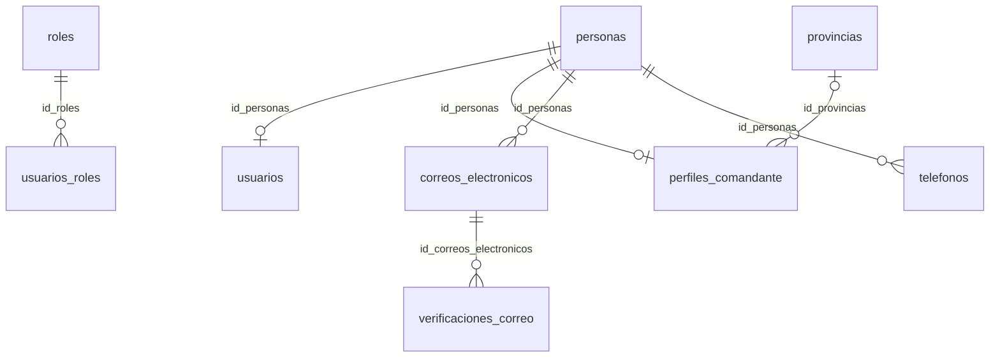
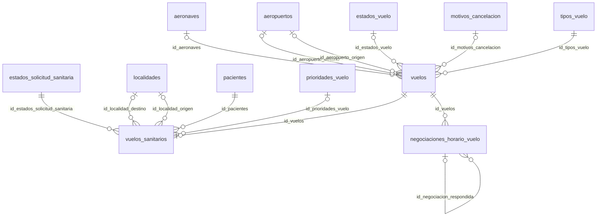
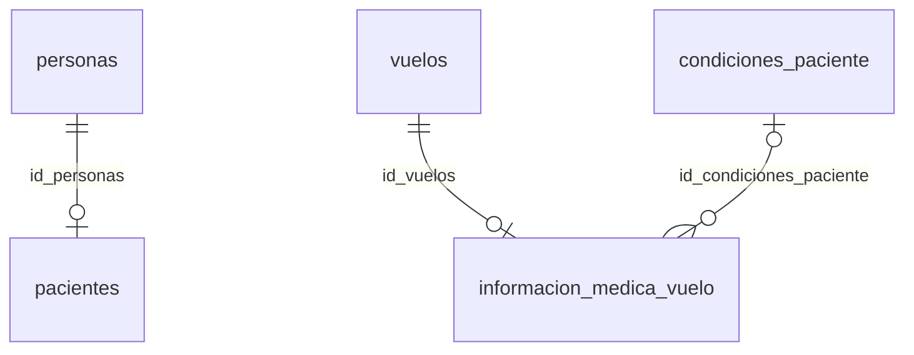
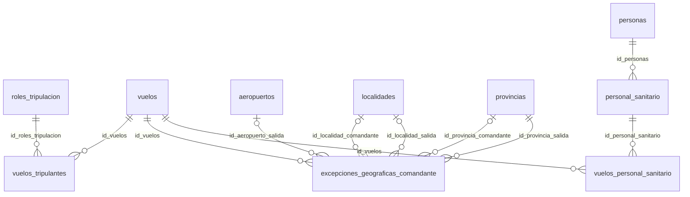
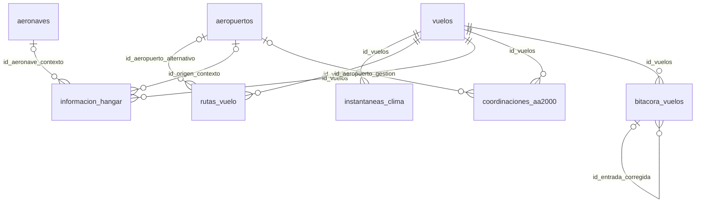
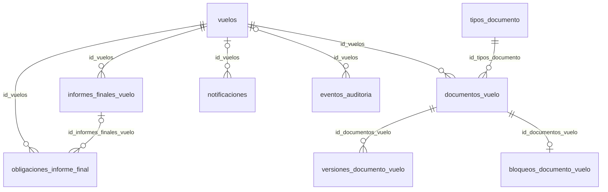
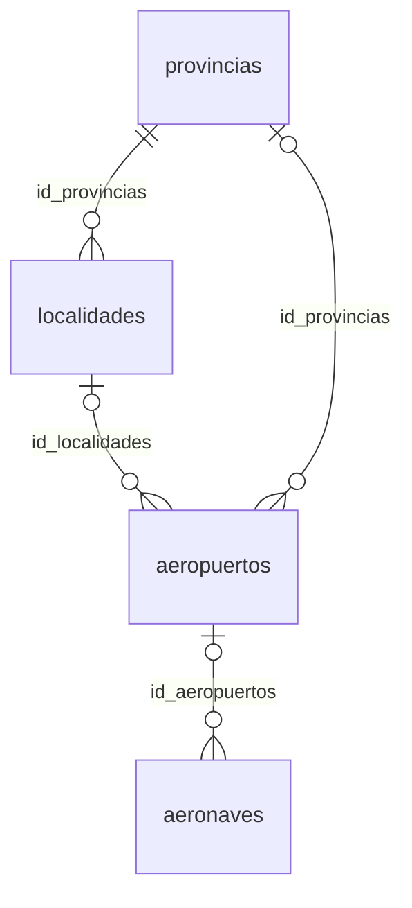
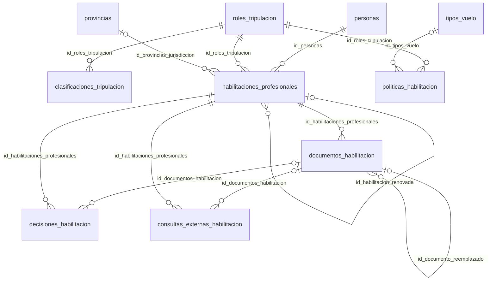

# Informe de tablas de la base de datos — Sistema Vuelos Sanitarios

> Informe de **todas las tablas y columnas vigentes** del esquema `dbo` de SQL Server tras la migración **V68**, reconstruido a partir de las migraciones Flyway del repositorio. Es el complemento detallado del [informe del estado actual de la aplicación](INFORME_ESTADO_ACTUAL_APLICACION.md); aquí sólo se describe la base de datos.

## 1. Resumen

**Resultado.** Después de V68 el esquema tiene **49 tablas** y **519 columnas**: 48 tablas de negocio (509 columnas) más `flyway_schema_history` (10 columnas), que Flyway crea y mantiene. Seis de las 48 tablas de negocio están **retiradas del flujo funcional desde V66** (sólo historial) y 42 son las que usa la aplicación.

| Concepto | Valor |
|---|---|
| Fecha del informe | 2026-11-24 |
| Versión del esquema | V68 (`V68__catalogo_condiciones_paciente`), última migración del repositorio |
| Commit base | `11f9cdf` (HEAD de `main`; el árbol de trabajo contiene cambios de documentación ajenos a este informe) |
| Método | Reconstrucción desde las migraciones: 68 versiones sin huecos: 64 scripts SQL y 4 migraciones Java (V16, V17, V26, V65). Detalle en la sección 1.1 |
| Tablas | **49** = 48 de negocio + `flyway_schema_history` |
| Columnas | **519** = 509 de negocio + 10 de Flyway |
| Claves foráneas | 124 (15 con `ON DELETE CASCADE`, el resto `NO ACTION`) |
| Restricciones UNIQUE e índices únicos | 55 (sin contar las claves primarias) |
| Índices no únicos | 170 |
| Restricciones CHECK | 70 |
| Triggers | 11 (ninguno agregado por V66–V68) |
| Tablas con entidad JPA | 42 (todas las de negocio no retiradas) |

Cambios que reflejan este informe respecto de la versión anterior (V66): **V67** eliminó `contactos_coordinacion_traslado` y **V68** agregó `condiciones_paciente` y la columna `informacion_medica_vuelo.id_condiciones_paciente`. V66 (tripulación y personal sanitario) agregó `personal_sanitario` y `vuelos_personal_sanitario` y retiró del flujo seis tablas, **sin borrarlas**.

### 1.1 Cómo se calcularon los conteos

1. **Tablas.** Se listaron todos los `CREATE TABLE`, `DROP TABLE` y `sp_rename` de las migraciones y se aplicaron en orden de versión. V1–V7 crean tablas con nombres en inglés que V8 renombra; V4 reemplaza `flight_documents`; V22 crea `documentos_vuelo_texto_legacy` y V32 la elimina; V51 crea `contactos_coordinacion_traslado` y V67 la elimina. Resultado: 48 tablas de negocio vigentes.
2. **Cruce de tablas.** Las tablas de este informe (48 + Flyway) coinciden una a una con las 48 que resultan de las migraciones, y con las 42 entidades `@Table` de `backend-java/src/main/java` más las seis retiradas.
3. **Columnas.** Muchas migraciones (V8, V24, V27, V28) renombran columnas y reconstruyen claves con SQL dinámico, por lo que la lista de columnas no puede obtenerse sólo con un análisis estático de los scripts. Se partió del diccionario del esquema vivo en V66 del informe anterior (534 columnas en 50 tablas, incluidas `sysdiagrams`, ajena a Flyway, y la tabla eliminada en V67), se aplicaron las diferencias de V67 y V68 leyendo las migraciones, y se contrastó: (a) cada columna con las migraciones (todas aparecen por nombre, salvo las claves `id_<tabla>` que V24/V27 generan dinámicamente) y (b) cada tabla con su entidad JPA (35 de 42 coinciden columna a columna; las 7 diferencias son columnas que sólo existen en la base: `row_version`, `fecha_creacion`/`version_fila` de obligaciones, `numero_licencia_normalizada`, `origen_solicitado_legacy` y `destino_solicitado_legacy`, más las dos de V68 que se verificaron en la migración).
4. **Aritmética.** 534 − 5 (`sysdiagrams`) − 16 (`contactos_coordinacion_traslado`) + 5 (`condiciones_paciente`) + 1 (`informacion_medica_vuelo.id_condiciones_paciente`) = **519**.
5. **Quién escribe.** Se toma del encabezado «ACCESO A BASE DE DATOS» de cada repositorio en `backend-java/src/main/java/com/vuelossanitarios/backend/repository/`, que lista los servicios que llaman a `save`/`delete`.

No se consultó ninguna base de datos al elaborar este informe. Los puntos que no pudieron confirmarse están en la sección 9.

## 2. Convenciones del esquema

| Convención | Observación |
|---|---|
| Esquema | Todas las tablas están en `dbo`. |
| Nombres | Tablas y columnas en español, en minúsculas con guion bajo (renombrado en V8, contextualizado en V28). |
| Clave primaria | `id_<tabla>` `BIGINT IDENTITY(1,1)` (V24/V27), con restricción `pk_<tabla>`. Excepciones: `flyway_schema_history` (`installed_rank`). V24 reemplazó los identificadores UUID de V1–V7 por `BIGINT`. |
| Claves foráneas | Llevan el nombre de la tabla padre (`id_vuelos`) o el rol que cumplen (`id_usuario_baja`, `id_usuario_asignador`, `id_usuario_comandante`). Restricción `fk_<tabla>_<detalle>`. |
| Nombres de restricciones | `pk_`, `fk_`, `uq_`/`ux_` (único), `ck_` (CHECK), `df_` (DEFAULT) en las migraciones recientes. Algunas tablas heredadas conservan nombres generados por SQL Server (por ejemplo `FK__consultas__id_do__1B1EE1BE`, `ck_vuelos_1378103950`). |
| Fechas | `DATETIME2(3)` con `DEFAULT SYSDATETIME()` en `fecha_creacion`/`fecha_actualizacion`. Algunas tablas de auditoría y plazos usan UTC o `DATETIMEOFFSET`. |
| Auditoría de filas | `fecha_creacion` y `fecha_actualizacion` en la mayoría de las tablas con estado; el registro de acciones está en `eventos_auditoria` (inmutable) y `bitacora_vuelos`. |
| Borrado lógico | No se borran filas de negocio: `fecha_baja` + `id_usuario_baja` + `motivo_baja` (contactos, usuarios, tripulantes, documentos, personal sanitario en vuelos) o `esta_activo`/`esta_activa` (catálogos y personal sanitario). Varios CHECK de baja exigen que los tres campos de baja se informen juntos. |
| Versionado de filas | `version` + `es_version_actual` + índice único filtrado `WHERE es_version_actual = 1` (rutas, hangar, coordinaciones, informes, versiones de documento). |
| Concurrencia optimista | `version_identidad`, `version_contacto`, `version_registro`, `version_credenciales` (mapeadas con `@Version` o actualizadas por el servicio). |
| Unicidad parcial | Índices únicos filtrados para «vigente» (por ejemplo `ux_vuelos_personal_sanitario_vigente WHERE fecha_baja IS NULL`). |
| Inmutabilidad | Triggers `AFTER UPDATE, DELETE` que rechazan cambios en `eventos_auditoria`, `bitacora_vuelos` y en las tablas de decisiones, consultas y políticas de habilitación. |
| Migraciones | Flyway: SQL `Vn__descripcion.sql` y Java `db.migration`. 68 versiones sin huecos (V1–V68): 64 scripts SQL en `backend-java/src/main/resources/db/migration` y 4 clases Java (V16, V17, V26, V65) en `backend-java/src/main/java/db/migration`. |

## 3. Mapa de dominios

Cada tabla se asigna a un único dominio. El número entre paréntesis es la cantidad de columnas.

| Dominio | Tablas |
|---|---|
| 1. Identidad, cuentas y contactos (9 tablas, 88 columnas) | `personas` (8), `usuarios` (13), `roles` (6), `usuarios_roles` (4), `perfiles_comandante` (9), `activaciones_cuenta` (9), `correos_electronicos` (13), `telefonos` (13), `verificaciones_correo` (13) |
| 2. Solicitudes y vuelos (3 tablas, 50 columnas) | `vuelos` (24), `vuelos_sanitarios` (17), `negociaciones_horario_vuelo` (9) |
| 3. Pacientes y datos clínicos (3 tablas, 18 columnas) | `pacientes` (4), `informacion_medica_vuelo` (9), `condiciones_paciente` (5) |
| 4. Tripulación y personal sanitario (4 tablas, 41 columnas) | `vuelos_tripulantes` (9), `excepciones_geograficas_comandante` (14), `personal_sanitario` (10), `vuelos_personal_sanitario` (8) |
| 5. Planificación y ejecución del vuelo (5 tablas, 79 columnas) | `instantaneas_clima` (7), `rutas_vuelo` (22), `informacion_hangar` (14), `coordinaciones_aa2000` (21), `bitacora_vuelos` (15) |
| 6. Cierre del vuelo, documentos, notificaciones y auditoría (7 tablas, 80 columnas) | `informes_finales_vuelo` (19), `obligaciones_informe_final` (20), `documentos_vuelo` (10), `versiones_documento_vuelo` (9), `bloqueos_documento_vuelo` (5), `notificaciones` (8), `eventos_auditoria` (9) |
| 7. Recursos, geografía y catálogos (11 tablas, 66 columnas) | `aeronaves` (10), `aeropuertos` (14), `provincias` (4), `localidades` (7), `estados_vuelo` (4), `estados_solicitud_sanitaria` (4), `prioridades_vuelo` (5), `tipos_vuelo` (4), `tipos_documento` (4), `roles_tripulacion` (3), `motivos_cancelacion` (7) |
| 8. Historial retirado del flujo (V66) (6 tablas, 87 columnas) | `clasificaciones_tripulacion` (8), `habilitaciones_profesionales` (18), `documentos_habilitacion` (24), `decisiones_habilitacion` (8), `consultas_externas_habilitacion` (11), `politicas_habilitacion` (18) |
| 9. Infraestructura (1 tablas, 10 columnas) | `flyway_schema_history` (10) |

**Cómo se lee el modelo.** Una `persona` puede tener una cuenta (`usuarios`) con roles, ser paciente, ser comandante (`perfiles_comandante`) o figurar en el catálogo de personal sanitario de un DTS (`personal_sanitario`). El DTS crea una solicitud (`vuelos` + `vuelos_sanitarios` + `informacion_medica_vuelo`) y negocia el horario (`negociaciones_horario_vuelo`); luego se asignan aeronave, comandante y copiloto (`vuelos_tripulantes`, con `excepciones_geograficas_comandante` si hace falta) y el personal sanitario (`vuelos_personal_sanitario`). La planificación genera clima, ruta, hangar y coordinaciones; el cierre, un informe final y su obligación. Documentos, notificaciones, bitácora y auditoría cuelgan del vuelo o de los usuarios. Para el flujo funcional completo véase el [informe del estado actual](INFORME_ESTADO_ACTUAL_APLICACION.md).

## 4. Diagramas entidad-relación

Se muestran las relaciones estructurales entre tablas, un diagrama por dominio (sólo las claves foráneas de las tablas del dominio). Para mantener los diagramas legibles se **omiten las 53 claves foráneas hacia `usuarios`** (autor, responsable, actor, baja, etc.); figuran en la ficha de cada tabla. Notación: `||` obligatoria, `|o` opcional (columna que admite NULL); `o{` muchos y `o|` cero o uno (clave foránea con UNIQUE). Las 71 relaciones restantes aparecen una sola vez entre todos los diagramas.

### 4.1 Identidad, cuentas y contactos

### 4.2 Solicitudes y vuelos

### 4.3 Pacientes y datos clínicos

### 4.4 Tripulación y personal sanitario

### 4.5 Planificación y ejecución del vuelo

### 4.6 Cierre del vuelo, documentos, notificaciones y auditoría

### 4.7 Recursos, geografía y catálogos

### 4.8 Historial retirado del flujo (V66)

## 5. Fichas por tabla

Cada ficha contiene: propósito, migración de origen, quién escribe, columnas en orden físico y restricciones. En la columna «Restricciones» de las columnas, «FK→» abrevia la clave foránea; el detalle (borrado y nombre de la restricción) está bajo «Claves foráneas». Las descripciones de las columnas provienen del diccionario del esquema V66 y se corrigieron donde V67 o V68 las modifican.

### 5.1 Identidad, cuentas y contactos

#### 1. `personas`

**Propósito.** `personas` guarda **quién es** alguien: nombre, apellido, DNI y fecha de nacimiento. No dice qué hace esa persona en el sistema: eso lo dicen las tablas que la referencian. Una persona puede ser a la vez **titular de una cuenta** (`usuarios`), **paciente** (`pacientes`), **comandante** (`perfiles_comandante`), **personal sanitario** de un DTS (`personal_sanitario`, V66) y —hasta V65— titular de **habilitaciones profesionales** (`habilitaciones_profesionales`, hoy sólo historial), y todas apuntan a la misma fila.

**Origen.** Creada en V4 (como `persons`, con id UNIQUEIDENTIFIER). Cambios posteriores: V8 (renombre a `personas` y columnas al español), V11 (DNI único sólo si informado, retira `telefono`), V12/V13 (DNI canónico sólo dígitos), V24/V27 (id BIGINT IDENTITY `id_personas`), V28 (`nombre_persona`/`apellido_persona`), V47 (índice único filtrado de DNI), V48 (`version_identidad`).

**Escribe.** AuthService, HealthStaffService, PatientDirectoryService, PatientService, PersonIdentityService (`save`/`delete` de JpaRepository).

| # | Columna | Tipo | Nulo | Default | Restricciones | Descripción |
|---|---|---|---|---|---|---|
| 1 | `nombre_persona` | `nvarchar(100)` | no | — | — | Nombre de pila de la persona. |
| 2 | `apellido_persona` | `nvarchar(100)` | no | — | — | Apellido de la persona. |
| 3 | `dni` | `nvarchar(20)` | sí | — | único filtrado; CHECK ck_personas_dni_solo_digitos | Documento Nacional de Identidad: clave natural de la persona. |
| 4 | `fecha_nacimiento` | `date` | sí | — | — | Fecha de nacimiento de la persona. |
| 5 | `fecha_creacion` | `datetime2(3)` | no | `sysdatetime()` | — | Registra el instante en que la persona se incorporó al sistema. |
| 6 | `fecha_actualizacion` | `datetime2(3)` | no | `sysdatetime()` | — | Instante de la última modificación de los datos de la persona. |
| 7 | `id_personas` | `bigint` | no | IDENTITY(1,1) | PK; IDENTITY | Clave primaria de la tabla: identifica de forma única cada fila y es el valor que otras tablas, la API y la auditoría usan para referirse a ella. |
| 8 | `version_identidad` | `bigint` | no | `(0)` | — | Contador de versión para control de concurrencia optimista. |

**Clave primaria:** `id_personas`.

**Claves foráneas:** ninguna.

**Unicidad**

| Nombre | Tipo | Columnas | Filtro |
|---|---|---|---|
| `uq_personas_dni` | índice único | dni | `(dni IS NOT NULL)` |

**CHECK**

- `ck_personas_dni_solo_digitos`: `([dni] IS NULL OR NOT [dni] like N'%[^0-9]%')`

**Triggers:** ninguno.

#### 2. `usuarios`

**Propósito.** `usuarios` representa la **cuenta con la que alguien entra al sistema**: nombre de usuario, contraseña (siempre BCrypt, nunca en claro), estado de la cuenta (pendiente de activación, activa, desactivada) y la información necesaria para invalidar sesiones. Es, además, la tabla más referenciada del esquema: cada acción con consecuencias (crear una solicitud, aprobar, asignar, cancelar, revisar un informe) guarda *quién* la hizo con una clave foránea a esta tabla.

**Origen.** Creada en V1 (como `users`, UNIQUEIDENTIFIER). Cambios posteriores: V4 (datos personales a `personas`), V8 (renombre), V11 (estado_cuenta, debe_cambiar_contrasena; usuario y hash pasan a NULL), V12 (licencia a `perfiles_comandante`), V14 (nombre de usuario único sólo si informado), V19 (version_credenciales, fecha_baja), V24/V27/V28 (BIGINT IDENTITY, nombres), V47 (id_usuario_baja, motivo_baja, índice único de nombre).

**Escribe.** AuthService (`save`/`delete` de JpaRepository).

**Nota.** Una persona tiene como máximo una cuenta (UNIQUE sobre `id_personas`).

| # | Columna | Tipo | Nulo | Default | Restricciones | Descripción |
|---|---|---|---|---|---|---|
| 1 | `nombre_usuario` | `nvarchar(50)` | sí | — | único filtrado | Nombre con el que la persona inicia sesión. |
| 2 | `hash_contrasena` | `nvarchar(255)` | sí | — | — | Hash BCrypt de la contraseña. |
| 3 | `esta_activo` | `bit` | no | `(1)` | — | Indicador de si la cuenta puede operar. |
| 4 | `fecha_creacion` | `datetime2(3)` | no | `sysdatetime()` | — | Registra el instante en que la cuenta se incorporó al sistema. |
| 5 | `fecha_actualizacion` | `datetime2(3)` | no | `sysdatetime()` | — | Último cambio de la fila de la cuenta. |
| 6 | `estado_cuenta` | `nvarchar(24)` | no | `N'ACTIVO'` | CHECK ck_usuarios_estado_cuenta | Estado del ciclo de vida de la cuenta. |
| 7 | `debe_cambiar_contrasena` | `bit` | no | `(0)` | — | Marca que obliga a cambiar la contraseña en el próximo ingreso. |
| 8 | `version_credenciales` | `bigint` | no | `(1)` | CHECK ck_usuarios_version_credenciales_positiva | Versión de las credenciales de la cuenta. |
| 9 | `fecha_baja` | `datetime2(3)` | sí | — | — | Momento de la baja administrativa. |
| 10 | `id_usuarios` | `bigint` | no | IDENTITY(1,1) | PK; IDENTITY | Clave primaria de la tabla: identifica de forma única cada fila y es el valor que otras tablas, la API y la auditoría usan para referirse a ella. |
| 11 | `id_personas` | `bigint` | no | — | FK→personas.id_personas; UNIQUE | Referencia a la persona titular de la cuenta. |
| 12 | `id_usuario_baja` | `bigint` | sí | — | FK→usuarios.id_usuarios | Administrador que dio de baja la cuenta. |
| 13 | `motivo_baja` | `nvarchar(500)` | sí | — | — | Texto del motivo de la baja. |

**Clave primaria:** `id_usuarios`.

**Claves foráneas**

| Columna | Referencia | Al borrar | Restricción |
|---|---|---|---|
| `id_personas` | `personas`.`id_personas` | NO ACTION | `fk_usuarios_id_personas` |
| `id_usuario_baja` | `usuarios`.`id_usuarios` | NO ACTION | `fk_usuarios_usuario_baja` |

**Unicidad**

| Nombre | Tipo | Columnas | Filtro |
|---|---|---|---|
| `uq_usuarios_5` | UNIQUE (constraint) | id_personas | — |
| `uq_usuarios_nombre_usuario` | índice único | nombre_usuario | `(nombre_usuario IS NOT NULL)` |

**CHECK**

- `ck_usuarios_estado_cuenta`: `([estado_cuenta]=N'DESACTIVADO' OR [estado_cuenta]=N'ACTIVO' OR [estado_cuenta]=N'PENDIENTE_ACTIVACION')`
- `ck_usuarios_version_credenciales_positiva`: `([version_credenciales]>=(1))`

**Índices no únicos**

| Columnas | Filtro | Incluye | Nombres |
|---|---|---|---|
| id_personas | — | — | `idx_usuarios_id_personas`, `idx_usuarios_persona_id` (duplicados) |
| id_usuario_baja | (id_usuario_baja IS NOT NULL) | — | `idx_usuarios_id_usuario_baja` |

**Triggers:** ninguno.

#### 3. `roles`

**Propósito.** `roles` lista los **perfiles de acceso** que Spring Security usa en las anotaciones `@PreAuthorize`: DTS, OPERACIONES, CENTRO_OPERACIONES, COMANDANTE y ADMINISTRADOR. Cada fila define un código estable y un nombre legible. Qué puede hacer cada rol no está en la tabla sino en el código de los controladores.

**Origen.** Creada en V1. Cambios posteriores: V5 (ADMINISTRADOR), V12 (CENTRO_OPERACIONES), V8/V24/V27/V28 (nombres e identificadores), V25 (resiembra tras el corte V24).

**Escribe.** Ninguno desde la aplicación: repositorio de sólo lectura; el contenido lo siembra la migración (sección 6).

| # | Columna | Tipo | Nulo | Default | Restricciones | Descripción |
|---|---|---|---|---|---|---|
| 1 | `codigo_rol` | `nvarchar(30)` | no | — | UNIQUE | Código estable del rol. |
| 2 | `nombre_rol` | `nvarchar(100)` | no | — | — | Nombre legible del rol para pantallas. |
| 3 | `descripcion_rol` | `nvarchar(MAX)` | sí | — | — | Descripción libre del rol. |
| 4 | `esta_activo` | `bit` | no | `(1)` | — | Indica si el rol está disponible para asignarse. |
| 5 | `fecha_creacion` | `datetime2(3)` | no | `sysdatetime()` | — | Registra el instante en que el rol se incorporó al sistema. |
| 6 | `id_roles` | `bigint` | no | IDENTITY(1,1) | PK; IDENTITY | Clave primaria de la tabla: identifica de forma única cada fila y es el valor que otras tablas, la API y la auditoría usan para referirse a ella. |

**Clave primaria:** `id_roles`.

**Claves foráneas:** ninguna.

**Unicidad**

| Nombre | Tipo | Columnas | Filtro |
|---|---|---|---|
| `uq_roles_2` | UNIQUE (constraint) | codigo_rol | — |

**Triggers:** ninguno.

#### 4. `usuarios_roles`

**Propósito.** Registra **qué roles tiene cada cuenta**. Un usuario puede tener varios roles (p. ej. COMANDANTE más DTS) salvo ADMINISTRADOR, que es exclusivo. Cuando el login arma el JWT, lee esta tabla para devolver los roles.

**Origen.** Creada en V1 (como `user_roles` con PK compuesta). Cambios posteriores: V8 (renombre), V24/V27 (id BIGINT IDENTITY propio `id_usuarios_roles`), V11/V12 (trigger de exclusividad creado y luego retirado).

**Escribe.** AuthService (`save`/`delete` de JpaRepository).

| # | Columna | Tipo | Nulo | Default | Restricciones | Descripción |
|---|---|---|---|---|---|---|
| 1 | `fecha_asignacion` | `datetime2(3)` | no | `sysdatetime()` | — | Momento en que el rol quedó asignado a la cuenta. |
| 2 | `id_usuarios` | `bigint` | no | — | FK→usuarios.id_usuarios (CASCADE); UNIQUE (id_usuarios, id_roles) | Cuenta que recibe el rol. |
| 3 | `id_roles` | `bigint` | no | — | FK→roles.id_roles (CASCADE); UNIQUE (id_usuarios, id_roles) | Rol asignado. |
| 4 | `id_usuarios_roles` | `bigint` | no | IDENTITY(1,1) | PK; IDENTITY | Clave primaria de la tabla: identifica de forma única cada fila y es el valor que otras tablas, la API y la auditoría usan para referirse a ella. |

**Clave primaria:** `id_usuarios_roles`.

**Claves foráneas**

| Columna | Referencia | Al borrar | Restricción |
|---|---|---|---|
| `id_roles` | `roles`.`id_roles` | CASCADE | `fk_usuarios_roles_id_roles` |
| `id_usuarios` | `usuarios`.`id_usuarios` | CASCADE | `fk_usuarios_roles_id_usuarios` |

**Unicidad**

| Nombre | Tipo | Columnas | Filtro |
|---|---|---|---|
| `uq_usuarios_roles_id_usuarios_id_roles` | UNIQUE (constraint) | id_usuarios, id_roles | — |

**Índices no únicos**

| Columnas | Filtro | Incluye | Nombres |
|---|---|---|---|
| id_roles | — | — | `idx_usuarios_roles_id_roles`, `idx_usuarios_roles_rol_id` (duplicados) |
| id_usuarios | — | — | `idx_usuarios_roles_id_usuarios`, `idx_usuarios_roles_usuario_id` (duplicados) |

**Triggers:** ninguno.

#### 5. `perfiles_comandante`

**Propósito.** Guarda lo que sólo tiene sentido para una persona con rol COMANDANTE: su **número de licencia aeronáutica** y la **provincia donde se encuentra actualmente**. La licencia identifica al piloto ante la autoridad; la provincia actual permite a Operaciones asignarle vuelos que despeguen cerca de donde está.

**Origen.** Creada en V12. Cambios posteriores: V20 (provincia actual), V24/V27 (renombres, ids), V57 (restablece el índice único de licencia perdido en V24), V63 (agrega `fecha_ubicacion_actual`, `id_usuario_ubicacion` y —luego retirada— `id_localidades_actual`), V64 (retira la localidad y agrega el CHECK que exige fecha y responsable juntos).

**Escribe.** AuthService, CommanderLocationService, FlightService (`save`/`delete` de JpaRepository).

| # | Columna | Tipo | Nulo | Default | Restricciones | Descripción |
|---|---|---|---|---|---|---|
| 1 | `numero_licencia` | `nvarchar(50)` | no | — | CHECK ck_perfiles_comandante_licencia_alphanumerica | Número de licencia aeronáutica del comandante. |
| 2 | `numero_licencia_normalizada` | `nvarchar(50)` | sí | — | calculada: (upper(ltrim(rtrim([numero_licencia])))) PERSISTED; único | Forma canónica de la licencia para comparar. |
| 3 | `fecha_creacion` | `datetime2(3)` | no | `sysdatetime()` | — | Registra el instante en que el perfil de comandante se incorporó al sistema. |
| 4 | `fecha_actualizacion` | `datetime2(3)` | no | `sysdatetime()` | — | Último cambio del perfil (licencia o provincia). |
| 5 | `id_personas` | `bigint` | no | — | FK→personas.id_personas; UNIQUE | Persona que es comandante. |
| 6 | `id_provincias` | `bigint` | sí | — | FK→provincias.id_provincias | Provincia o CABA donde se encuentra hoy el comandante (jurisdicción operativa). |
| 7 | `id_perfiles_comandante` | `bigint` | no | IDENTITY(1,1) | PK; IDENTITY | Clave primaria de la tabla: identifica de forma única cada fila y es el valor que otras tablas, la API y la auditoría usan para referirse a ella. |
| 8 | `fecha_ubicacion_actual` | `datetime2(3)` | sí | — | CHECK ck_perfiles_comandante_ubicacion_responsable | Momento de la última actualización de la ubicación operativa. |
| 9 | `id_usuario_ubicacion` | `bigint` | sí | — | FK→usuarios.id_usuarios; CHECK ck_perfiles_comandante_ubicacion_responsable | Usuario que fijó por última vez la ubicación. |

**Clave primaria:** `id_perfiles_comandante`.

**Claves foráneas**

| Columna | Referencia | Al borrar | Restricción |
|---|---|---|---|
| `id_personas` | `personas`.`id_personas` | NO ACTION | `fk_perfiles_comandante_id_personas` |
| `id_provincias` | `provincias`.`id_provincias` | NO ACTION | `fk_perfiles_comandante_id_provincias` |
| `id_usuario_ubicacion` | `usuarios`.`id_usuarios` | NO ACTION | `fk_perfiles_comandante_usuario_ubicacion` |

**Unicidad**

| Nombre | Tipo | Columnas | Filtro |
|---|---|---|---|
| `uq_perfiles_comandante_id_personas` | UNIQUE (constraint) | id_personas | — |
| `uq_perfiles_comandante_numero_licencia` | índice único | numero_licencia_normalizada | — |

**CHECK**

- `ck_perfiles_comandante_licencia_alphanumerica`: `(NOT [numero_licencia] like N'%[^0-9A-Za-z]%')`
- `ck_perfiles_comandante_ubicacion_responsable`: `([fecha_ubicacion_actual] IS NULL AND [id_usuario_ubicacion] IS NULL OR [fecha_ubicacion_actual] IS NOT NULL AND [id_usuario_ubicacion] IS NOT NULL)`

**Índices no únicos**

| Columnas | Filtro | Incluye | Nombres |
|---|---|---|---|
| id_personas | — | — | `idx_perfiles_comandante_id_personas`, `idx_perfiles_comandante_persona_id` (duplicados) |
| id_provincias | — | — | `idx_perfiles_comandante_id_provincias`, `idx_perfiles_comandante_provincia_actual_id` (duplicados) |
| id_usuario_ubicacion | (id_usuario_ubicacion IS NOT NULL) | — | `ix_perfiles_comandante_usuario_ubicacion` |

**Triggers:** ninguno.

#### 6. `activaciones_cuenta`

**Propósito.** Cada fila es un **código de activación**: el Administrador crea una cuenta sin contraseña y entrega al titular un código de 6 dígitos; el titular lo ingresa junto a su DNI para elegir usuario y contraseña. La tabla guarda el *hash* del código (nunca el código), su vencimiento, cuántos intentos fallidos lleva y cuándo se usó o se cerró.

**Origen.** Creada en V11. Cambios posteriores: V24/V27 (ids), V62 (codigo_numerico, intentos_fallidos, vigencia de 10 minutos).

**Escribe.** AuthService (`save`/`delete` de JpaRepository).

| # | Columna | Tipo | Nulo | Default | Restricciones | Descripción |
|---|---|---|---|---|---|---|
| 1 | `token_hash` | `nvarchar(255)` | no | — | — | Hash BCrypt del código de activación. |
| 2 | `fecha_creacion` | `datetime2(3)` | no | `sysdatetime()` | CHECK ck_activaciones_cuenta_fechas | Instante de emisión del código. |
| 3 | `fecha_expiracion` | `datetime2(3)` | no | — | CHECK ck_activaciones_cuenta_fechas | Instante límite de uso. |
| 4 | `fecha_utilizacion` | `datetime2(3)` | sí | — | — | Cierre del código: usado, vencido, agotado o reemplazado. |
| 5 | `id_activaciones_cuenta` | `bigint` | no | IDENTITY(1,1) | PK; IDENTITY | Clave primaria de la tabla: identifica de forma única cada fila y es el valor que otras tablas, la API y la auditoría usan para referirse a ella. |
| 6 | `id_usuarios` | `bigint` | no | — | FK→usuarios.id_usuarios; único filtrado | Cuenta que se activará con este código. |
| 7 | `id_usuario_administrador_creador` | `bigint` | sí | — | FK→usuarios.id_usuarios | Administrador que emitió el código. |
| 8 | `codigo_numerico` | `bit` | no | `(0)` | CHECK ck_activaciones_cuenta_fechas | Indica si el código es el OTP decimal de 6 dígitos (1) o un código antiguo alfanumérico (0, legado). |
| 9 | `intentos_fallidos` | `int` | no | `(0)` | CHECK ck_activaciones_cuenta_intentos | Cantidad de códigos erróneos ingresados. |

**Clave primaria:** `id_activaciones_cuenta`.

**Claves foráneas**

| Columna | Referencia | Al borrar | Restricción |
|---|---|---|---|
| `id_usuario_administrador_creador` | `usuarios`.`id_usuarios` | NO ACTION | `fk_activaciones_cuenta_id_usuario_administrador_creador` |
| `id_usuarios` | `usuarios`.`id_usuarios` | NO ACTION | `fk_activaciones_cuenta_id_usuarios` |

**Unicidad**

| Nombre | Tipo | Columnas | Filtro |
|---|---|---|---|
| `uq_activaciones_cuenta_usuario_vigente` | índice único | id_usuarios | `(fecha_utilizacion IS NULL)` |

**CHECK**

- `ck_activaciones_cuenta_fechas`: `([codigo_numerico]=(1) AND [fecha_expiracion]=dateadd(minute,(10),[fecha_creacion]) OR [codigo_numerico]=(0) AND [fecha_expiracion]=dateadd(hour,(24),[fecha_creacion]))`
- `ck_activaciones_cuenta_intentos`: `([intentos_fallidos]>=(0) AND [intentos_fallidos]<=(5))`

**Índices no únicos**

| Columnas | Filtro | Incluye | Nombres |
|---|---|---|---|
| id_usuario_administrador_creador | — | — | `idx_activaciones_cuenta_administrador_creador_id`, `idx_activaciones_cuenta_id_usuario_administrador_creador` (duplicados) |
| id_usuarios | — | — | `idx_activaciones_cuenta_id_usuarios`, `idx_activaciones_cuenta_usuario_id` (duplicados) |

**Triggers:** ninguno.

#### 7. `correos_electronicos`

**Propósito.** Almacena las **direcciones de correo de cada persona** (una persona puede tener varias; una es la principal). Se usan para identificar un contacto y, desde V54, para verificar que la dirección pertenece realmente a su titular mediante un código de 6 dígitos (`verificaciones_correo`). El titular las gestiona desde «Mi cuenta».

**Origen.** Creada en V11. Cambios posteriores: V8/V24/V27/V28 (renombres), V49 (normalizado, versión, baja lógica, unicidad vigente), V50 (corrección de principales), V54 (fecha_verificacion).

**Escribe.** AuthService, EmailVerificationService, PersonContactService (`save`/`delete` de JpaRepository).

| # | Columna | Tipo | Nulo | Default | Restricciones | Descripción |
|---|---|---|---|---|---|---|
| 1 | `direccion` | `nvarchar(150)` | no | — | CHECK ck_correos_electronicos_direccion | Dirección de correo tal como la ingresó la persona. |
| 2 | `tipo_correo_electronico` | `nvarchar(30)` | no | `N'PERSONAL'` | — | Clasificación del correo (PERSONAL o LABORAL). |
| 3 | `es_principal` | `bit` | no | `(0)` | CHECK ck_correos_electronicos_baja | Marca el correo principal de la persona. |
| 4 | `fecha_creacion` | `datetime2(3)` | no | `sysdatetime()` | — | Registra el instante en que el correo se incorporó al sistema. |
| 5 | `fecha_actualizacion` | `datetime2(3)` | no | `sysdatetime()` | — | Último cambio del contacto. |
| 6 | `id_correos_electronicos` | `bigint` | no | IDENTITY(1,1) | PK; IDENTITY | Clave primaria de la tabla: identifica de forma única cada fila y es el valor que otras tablas, la API y la auditoría usan para referirse a ella. |
| 7 | `id_personas` | `bigint` | no | — | FK→personas.id_personas; único filtrado; único (id_personas, direccion_normalizada) filtrado | Persona titular del correo. |
| 8 | `direccion_normalizada` | `nvarchar(150)` | no | — | único (id_personas, direccion_normalizada) filtrado | Forma canónica (minúsculas, sin espacios) para comparar. |
| 9 | `version_contacto` | `bigint` | no | `(0)` | — | Contador de edición del contacto. |
| 10 | `fecha_baja` | `datetime2(7)` | sí | — | CHECK ck_correos_electronicos_baja | Momento del retiro del contacto. |
| 11 | `id_usuario_baja` | `bigint` | sí | — | FK→usuarios.id_usuarios; CHECK ck_correos_electronicos_baja | Usuario que retiró el contacto. |
| 12 | `motivo_baja` | `nvarchar(30)` | sí | — | CHECK ck_correos_electronicos_baja | Causa de la baja. |
| 13 | `fecha_verificacion` | `datetime2(7)` | sí | — | — | Instante en que el titular confirmó el código recibido en esa dirección. |

**Clave primaria:** `id_correos_electronicos`.

**Claves foráneas**

| Columna | Referencia | Al borrar | Restricción |
|---|---|---|---|
| `id_personas` | `personas`.`id_personas` | NO ACTION | `fk_correos_electronicos_id_personas` |
| `id_usuario_baja` | `usuarios`.`id_usuarios` | NO ACTION | `fk_correos_electronicos_usuario_baja` |

**Unicidad**

| Nombre | Tipo | Columnas | Filtro |
|---|---|---|---|
| `uq_correos_electronicos_principal_por_persona` | índice único | id_personas | `(es_principal=(1))` |
| `uq_correos_electronicos_vigente_por_persona` | índice único | id_personas, direccion_normalizada | `(fecha_baja IS NULL)` |

**CHECK**

- `ck_correos_electronicos_baja`: `([fecha_baja] IS NULL AND [id_usuario_baja] IS NULL AND [motivo_baja] IS NULL OR [fecha_baja] IS NOT NULL AND [es_principal]=(0) AND ([motivo_baja]=N'RETIRO' AND [id_usuario_baja] IS NOT NULL OR [motivo_baja]=N'DUPLICADO_MIGRACION' AND [id_usuario_baja] IS NULL))`
- `ck_correos_electronicos_direccion`: `(len(ltrim(rtrim([direccion])))>(2))`

**Índices no únicos**

| Columnas | Filtro | Incluye | Nombres |
|---|---|---|---|
| id_personas | — | — | `idx_correos_electronicos_id_personas`, `idx_correos_electronicos_persona_id` (duplicados) |
| id_usuario_baja | (id_usuario_baja IS NOT NULL) | — | `idx_correos_electronicos_id_usuario_baja` |

**Triggers:** ninguno.

#### 8. `telefonos`

**Propósito.** Guarda los **teléfonos de una persona** (cuenta o paciente): número tal como se muestra, su forma internacional canónica (E.164), el país con cuyas reglas se validó y si es el principal.

**Origen.** Creada en V11. Cambios posteriores: V8/V24/V27/V28 (renombres), V49 (normalizado, versión, baja lógica), V54 (codigo_pais y formato E.164).

**Escribe.** AuthService, PersonContactService (`save`/`delete` de JpaRepository).

| # | Columna | Tipo | Nulo | Default | Restricciones | Descripción |
|---|---|---|---|---|---|---|
| 1 | `numero` | `nvarchar(30)` | no | — | CHECK ck_telefonos_numero | Número en formato internacional legible. |
| 2 | `tipo_telefono` | `nvarchar(30)` | no | `N'PERSONAL'` | — | Uso del teléfono (PERSONAL/LABORAL). |
| 3 | `es_principal` | `bit` | no | `(0)` | CHECK ck_telefonos_baja | Teléfono principal de la persona. |
| 4 | `fecha_creacion` | `datetime2(3)` | no | `sysdatetime()` | — | Registra el instante en que el teléfono se incorporó al sistema. |
| 5 | `fecha_actualizacion` | `datetime2(3)` | no | `sysdatetime()` | — | Último cambio del contacto. |
| 6 | `id_telefonos` | `bigint` | no | IDENTITY(1,1) | PK; IDENTITY | Clave primaria de la tabla: identifica de forma única cada fila y es el valor que otras tablas, la API y la auditoría usan para referirse a ella. |
| 7 | `id_personas` | `bigint` | no | — | FK→personas.id_personas; único filtrado; único (id_personas, numero_normalizado) filtrado | Persona titular. |
| 8 | `numero_normalizado` | `nvarchar(30)` | no | — | único (id_personas, numero_normalizado) filtrado; CHECK ck_telefonos_validacion_internacional | Número en E.164 (+, país y dígitos). |
| 9 | `version_contacto` | `bigint` | no | `(0)` | — | Contador de edición. |
| 10 | `fecha_baja` | `datetime2(7)` | sí | — | CHECK ck_telefonos_baja | Momento del retiro. |
| 11 | `id_usuario_baja` | `bigint` | sí | — | FK→usuarios.id_usuarios; CHECK ck_telefonos_baja | Usuario que retiró el contacto. |
| 12 | `motivo_baja` | `nvarchar(30)` | sí | — | CHECK ck_telefonos_baja | Causa de la baja. |
| 13 | `codigo_pais` | `varchar(2)` | sí | — | CHECK ck_telefonos_validacion_internacional | País (ISO 3166-1 alfa-2) con cuyas reglas se validó el número. |

**Clave primaria:** `id_telefonos`.

**Claves foráneas**

| Columna | Referencia | Al borrar | Restricción |
|---|---|---|---|
| `id_personas` | `personas`.`id_personas` | NO ACTION | `fk_telefonos_id_personas` |
| `id_usuario_baja` | `usuarios`.`id_usuarios` | NO ACTION | `fk_telefonos_usuario_baja` |

**Unicidad**

| Nombre | Tipo | Columnas | Filtro |
|---|---|---|---|
| `uq_telefonos_principal_por_persona` | índice único | id_personas | `(es_principal=(1))` |
| `uq_telefonos_vigente_por_persona` | índice único | id_personas, numero_normalizado | `(fecha_baja IS NULL)` |

**CHECK**

- `ck_telefonos_baja`: `([fecha_baja] IS NULL AND [id_usuario_baja] IS NULL AND [motivo_baja] IS NULL OR [fecha_baja] IS NOT NULL AND [es_principal]=(0) AND ([motivo_baja]=N'RETIRO' AND [id_usuario_baja] IS NOT NULL OR [motivo_baja]=N'DUPLICADO_MIGRACION' AND [id_usuario_baja] IS NULL))`
- `ck_telefonos_numero`: `(len(ltrim(rtrim([numero])))>(2))`
- `ck_telefonos_validacion_internacional`: `([codigo_pais] IS NULL OR len([codigo_pais])=(2) AND NOT ([codigo_pais]) collate Latin1_General_BIN2 like N'%[^A-Z]%' AND [numero_normalizado] like N'+[1-9]%' AND NOT substring([numero_normalizado],(2),(30)) like N'%[^0-9]%' AND (len([numero_normalizado])>=(8) AND len([numero_normalizado])<=(16)))`

**Índices no únicos**

| Columnas | Filtro | Incluye | Nombres |
|---|---|---|---|
| id_personas | — | — | `idx_telefonos_id_personas`, `idx_telefonos_persona_id` (duplicados) |
| id_usuario_baja | (id_usuario_baja IS NOT NULL) | — | `idx_telefonos_id_usuario_baja` |

**Triggers:** ninguno.

#### 9. `verificaciones_correo`

**Propósito.** Cada fila es **un código de un solo uso** enviado a una dirección de correo para demostrar que su titular tiene acceso a ella. Guarda sólo el HMAC del código, la dirección a la que se envió, cuándo se creó, venció, se envió, se usó o se invalidó (y por qué), cuántos intentos erróneos hubo y una huella del origen de red para limitar abusos.

**Origen.** Creada en V54. Cambios posteriores: V61 (OTP decimal, origen_huella, máximo 5 intentos).

**Escribe.** EmailVerificationService (`save`/`delete` de JpaRepository).

| # | Columna | Tipo | Nulo | Default | Restricciones | Descripción |
|---|---|---|---|---|---|---|
| 1 | `id_verificaciones_correo` | `bigint` | no | IDENTITY(1,1) | PK; IDENTITY | Clave primaria de la tabla: identifica de forma única cada fila y es el valor que otras tablas, la API y la auditoría usan para referirse a ella. |
| 2 | `id_correos_electronicos` | `bigint` | no | — | FK→correos_electronicos.id_correos_electronicos; único filtrado | Correo que se está verificando. |
| 3 | `direccion_normalizada` | `nvarchar(150)` | no | — | — | Dirección a la que se envió el código. |
| 4 | `codigo_hash` | `varchar(64)` | no | — | — | HMAC del código enviado. |
| 5 | `intentos_fallidos` | `tinyint` | no | `(0)` | CHECK ck_verificaciones_correo_intentos | Cantidad de códigos erróneos. |
| 6 | `fecha_creacion` | `datetime2(7)` | no | — | CHECK ck_verificaciones_correo_vigencia | Instante de emisión. |
| 7 | `fecha_vencimiento` | `datetime2(7)` | no | — | CHECK ck_verificaciones_correo_vigencia | Instante límite de validez. |
| 8 | `fecha_envio` | `datetime2(7)` | sí | — | — | Momento en que el servidor SMTP aceptó el mensaje. |
| 9 | `fecha_uso` | `datetime2(7)` | sí | — | CHECK ck_verificaciones_correo_cierre | Momento en que se ingresó el código correcto. |
| 10 | `fecha_invalidacion` | `datetime2(7)` | sí | — | CHECK ck_verificaciones_correo_cierre; CHECK ck_verificaciones_correo_intentos | Momento en que el código se anuló sin usarse. |
| 11 | `motivo_invalidacion` | `nvarchar(30)` | sí | — | CHECK ck_verificaciones_correo_cierre | Causa de la anulación. |
| 12 | `id_usuario_solicitante` | `bigint` | no | — | FK→usuarios.id_usuarios | Usuario que pidió el código. |
| 13 | `origen_huella` | `varchar(64)` | no | `'LEGACY'` | — | Huella HMAC del origen de red directo. |

**Clave primaria:** `id_verificaciones_correo`.

**Claves foráneas**

| Columna | Referencia | Al borrar | Restricción |
|---|---|---|---|
| `id_correos_electronicos` | `correos_electronicos`.`id_correos_electronicos` | NO ACTION | `fk_verificaciones_correo_correo` |
| `id_usuario_solicitante` | `usuarios`.`id_usuarios` | NO ACTION | `fk_verificaciones_correo_solicitante` |

**Unicidad**

| Nombre | Tipo | Columnas | Filtro |
|---|---|---|---|
| `uq_verificaciones_correo_abierta` | índice único | id_correos_electronicos | `(fecha_uso IS NULL AND fecha_invalidacion IS NULL)` |

**CHECK**

- `ck_verificaciones_correo_cierre`: `([fecha_invalidacion] IS NULL AND [motivo_invalidacion] IS NULL OR [fecha_invalidacion] IS NOT NULL AND [fecha_uso] IS NULL AND ([motivo_invalidacion]=N'CORREO_VERIFICADO' OR [motivo_invalidacion]=N'ENVIO_FALLIDO' OR [motivo_invalidacion]=N'CORREO_RETIRADO' OR [motivo_invalidacion]=N'CORREO_MODIFICADO' OR [motivo_invalidacion]=N'AGOTADO' OR [motivo_invalidacion]=N'VENCIDO' OR [motivo_invalidacion]=N'REEMPLAZADO'))`
- `ck_verificaciones_correo_intentos`: `([intentos_fallidos]<=(5) OR [fecha_invalidacion] IS NOT NULL)`
- `ck_verificaciones_correo_vigencia`: `([fecha_vencimiento]>[fecha_creacion])`

**Índices no únicos**

| Columnas | Filtro | Incluye | Nombres |
|---|---|---|---|
| id_correos_electronicos, fecha_creacion | — | — | `idx_verificaciones_correo_correo_fecha` |
| id_usuario_solicitante, fecha_creacion | — | — | `idx_verificaciones_correo_id_usuario_solicitante` |
| origen_huella, fecha_creacion | — | — | `idx_verificaciones_correo_origen_fecha` |

**Triggers:** ninguno.

### 5.2 Solicitudes y vuelos

#### 10. `vuelos`

**Propósito.** `vuelos` es **el eje del sistema**: un vuelo es el hecho operativo (qué aeronave, qué comandante, de qué aeropuerto a cuál, cuándo despegó y aterrizó, si se canceló y por qué). Es *común* a todos los tipos de vuelo; lo propio de un vuelo **sanitario** (paciente, urgencia, solicitud del DTS) vive en la extensión 1:0..1 `vuelos_sanitarios` y los datos clínicos en `informacion_medica_vuelo`.

**Origen.** Creada en V1 (como `flights`, UNIQUEIDENTIFIER). Cambios posteriores: V2 (cancelación), V3/V4/V7/V21/V27/V30/V42/V43/V44 (triggers del ciclo de vida), V5/V6/V15/V23 (los datos de la solicitud pasan a `vuelos_sanitarios`), V8 (renombre), V18 (índice aeronave-estado), V21 (catálogo de motivos de cancelación), V23 (tipo de vuelo, estado de vuelo, creador; separación sanitario/operativo), V24/V27/V28/V29 (BIGINT y nombres), V64 (estado de los aeropuertos: `estado_aeropuerto_origen/destino`, `id_usuario_aeropuertos`, `fecha_aeropuertos`, dos CHECK).

**Escribe.** FinalReportWorkflowService, FlightService, HealthStaffService (`save`/`delete` de JpaRepository).

**Nota.** Es el eje del modelo: de él cuelgan, por clave foránea, casi todas las tablas operativas.

| # | Columna | Tipo | Nulo | Default | Restricciones | Descripción |
|---|---|---|---|---|---|---|
| 1 | `codigo_vuelo` | `nvarchar(30)` | no | — | UNIQUE | Código legible del vuelo. |
| 2 | `motivo_vuelo` | `nvarchar(MAX)` | no | — | — | Razón del vuelo. |
| 3 | `fecha_planificada_salida` | `datetime2(3)` | sí | — | CHECK ck_vuelos_1378103950 | Fecha y hora previstas de despegue. |
| 4 | `fecha_planificada_llegada` | `datetime2(3)` | sí | — | CHECK ck_vuelos_1378103950 | Fecha y hora previstas de aterrizaje. |
| 5 | `fecha_salida_real` | `datetime2(3)` | sí | — | CHECK ck_vuelos_1394104007 | Instante real de despegue. |
| 6 | `fecha_llegada_real` | `datetime2(3)` | sí | — | CHECK ck_vuelos_1394104007 | Instante real de aterrizaje. |
| 7 | `fecha_creacion` | `datetime2(3)` | no | `sysdatetime()` | — | Registra el instante en que el vuelo se incorporó al sistema. |
| 8 | `fecha_actualizacion` | `datetime2(3)` | no | `sysdatetime()` | — | Último cambio de la fila. |
| 9 | `fecha_cancelacion` | `datetime2(3)` | sí | — | — | Instante en que se canceló el vuelo. |
| 10 | `motivo_cancelacion_personalizado` | `nvarchar(MAX)` | sí | — | — | Texto libre del motivo cuando el catálogo no alcanza (OTRO). |
| 11 | `id_vuelos` | `bigint` | no | IDENTITY(1,1) | PK; IDENTITY | Clave primaria de la tabla: identifica de forma única cada fila y es el valor que otras tablas, la API y la auditoría usan para referirse a ella. |
| 12 | `id_aeronaves` | `bigint` | sí | — | FK→aeronaves.id_aeronaves | Aeronave asignada. |
| 13 | `id_usuario_comandante` | `bigint` | sí | — | FK→usuarios.id_usuarios | Comandante principal responsable del vuelo. |
| 14 | `id_aeropuerto_origen` | `bigint` | sí | — | FK→aeropuertos.id_aeropuertos; CHECK ck_vuelos_2021582240; CHECK ck_vuelos_estado_aeropuerto_origen | Aeropuerto de salida. |
| 15 | `id_aeropuerto_destino` | `bigint` | sí | — | FK→aeropuertos.id_aeropuertos; CHECK ck_vuelos_2021582240; CHECK ck_vuelos_estado_aeropuerto_destino | Aeropuerto de llegada. |
| 16 | `id_usuario_cancelador` | `bigint` | sí | — | FK→usuarios.id_usuarios | Quién canceló el vuelo. |
| 17 | `id_motivos_cancelacion` | `bigint` | sí | — | FK→motivos_cancelacion.id_motivos_cancelacion | Motivo normalizado de la cancelación. |
| 18 | `id_tipos_vuelo` | `bigint` | no | — | FK→tipos_vuelo.id_tipos_vuelo | Clase de vuelo (SANITARIO, REGRESO_BASE, REPOSICIONAMIENTO, TRASLADO_OPERATIVO, ENTRENAMIENTO, OTRO). |
| 19 | `id_estados_vuelo` | `bigint` | sí | — | FK→estados_vuelo.id_estados_vuelo | Estado operativo del vuelo. |
| 20 | `id_usuario_creador` | `bigint` | no | — | FK→usuarios.id_usuarios | Quién creó el vuelo. |
| 21 | `estado_aeropuerto_origen` | `nvarchar(12)` | sí | — | CHECK ck_vuelos_estado_aeropuerto_origen | Si el aeropuerto de salida es sólo PROPUESTO o ya está CONFIRMADO. |
| 22 | `estado_aeropuerto_destino` | `nvarchar(12)` | sí | — | CHECK ck_vuelos_estado_aeropuerto_destino | Si el aeropuerto de llegada es sólo PROPUESTO o ya está CONFIRMADO. |
| 23 | `id_usuario_aeropuertos` | `bigint` | sí | — | FK→usuarios.id_usuarios | Último usuario que propuso o confirmó aeropuertos. |
| 24 | `fecha_aeropuertos` | `datetime2(3)` | sí | — | — | Momento de la última propuesta o confirmación de aeropuertos. |

**Clave primaria:** `id_vuelos`.

**Claves foráneas**

| Columna | Referencia | Al borrar | Restricción |
|---|---|---|---|
| `id_aeronaves` | `aeronaves`.`id_aeronaves` | NO ACTION | `fk_vuelos_id_aeronaves` |
| `id_aeropuerto_destino` | `aeropuertos`.`id_aeropuertos` | NO ACTION | `fk_vuelos_id_aeropuerto_destino` |
| `id_aeropuerto_origen` | `aeropuertos`.`id_aeropuertos` | NO ACTION | `fk_vuelos_id_aeropuerto_origen` |
| `id_estados_vuelo` | `estados_vuelo`.`id_estados_vuelo` | NO ACTION | `fk_vuelos_id_estados_vuelo` |
| `id_motivos_cancelacion` | `motivos_cancelacion`.`id_motivos_cancelacion` | NO ACTION | `fk_vuelos_id_motivos_cancelacion` |
| `id_tipos_vuelo` | `tipos_vuelo`.`id_tipos_vuelo` | NO ACTION | `fk_vuelos_id_tipos_vuelo` |
| `id_usuario_cancelador` | `usuarios`.`id_usuarios` | NO ACTION | `fk_vuelos_id_usuario_cancelador` |
| `id_usuario_comandante` | `usuarios`.`id_usuarios` | NO ACTION | `fk_vuelos_id_usuario_comandante` |
| `id_usuario_creador` | `usuarios`.`id_usuarios` | NO ACTION | `fk_vuelos_id_usuario_creador` |
| `id_usuario_aeropuertos` | `usuarios`.`id_usuarios` | NO ACTION | `fk_vuelos_usuario_aeropuertos` |

**Unicidad**

| Nombre | Tipo | Columnas | Filtro |
|---|---|---|---|
| `uq_vuelos_2` | UNIQUE (constraint) | codigo_vuelo | — |

**CHECK**

- `ck_vuelos_1378103950`: `([fecha_planificada_salida] IS NULL OR [fecha_planificada_llegada] IS NULL OR [fecha_planificada_llegada]>[fecha_planificada_salida])`
- `ck_vuelos_1394104007`: `([fecha_salida_real] IS NULL OR [fecha_llegada_real] IS NULL OR [fecha_llegada_real]>[fecha_salida_real])`
- `ck_vuelos_2021582240`: `([id_aeropuerto_origen] IS NULL OR [id_aeropuerto_destino] IS NULL OR [id_aeropuerto_origen]<>[id_aeropuerto_destino])`
- `ck_vuelos_estado_aeropuerto_destino`: `([id_aeropuerto_destino] IS NULL AND [estado_aeropuerto_destino] IS NULL OR [id_aeropuerto_destino] IS NOT NULL AND ([estado_aeropuerto_destino]=N'CONFIRMADO' OR [estado_aeropuerto_destino]=N'PROPUESTO'))`
- `ck_vuelos_estado_aeropuerto_origen`: `([id_aeropuerto_origen] IS NULL AND [estado_aeropuerto_origen] IS NULL OR [id_aeropuerto_origen] IS NOT NULL AND ([estado_aeropuerto_origen]=N'CONFIRMADO' OR [estado_aeropuerto_origen]=N'PROPUESTO'))`

**Índices no únicos**

| Columnas | Filtro | Incluye | Nombres |
|---|---|---|---|
| id_aeronaves | — | — | `idx_vuelos_aeronave_id`, `idx_vuelos_id_aeronaves` (duplicados) |
| id_usuario_cancelador | — | — | `idx_vuelos_cancelado_por_usuario_id`, `idx_vuelos_id_usuario_cancelador` (duplicados) |
| id_usuario_comandante | — | — | `idx_vuelos_comandante_usuario_id`, `idx_vuelos_id_usuario_comandante` (duplicados) |
| id_usuario_creador | — | — | `idx_vuelos_creado_por_usuario_id`, `idx_vuelos_id_usuario_creador` (duplicados) |
| id_aeropuerto_destino | — | — | `idx_vuelos_destino_id`, `idx_vuelos_id_aeropuerto_destino` (duplicados) |
| id_estados_vuelo | — | — | `idx_vuelos_estado_vuelo_id`, `idx_vuelos_id_estados_vuelo` (duplicados) |
| id_aeropuerto_origen | — | — | `idx_vuelos_id_aeropuerto_origen`, `idx_vuelos_origen_id` (duplicados) |
| id_motivos_cancelacion | — | — | `idx_vuelos_id_motivos_cancelacion`, `idx_vuelos_motivo_cancelacion_id` (duplicados) |
| id_tipos_vuelo | — | — | `idx_vuelos_id_tipos_vuelo`, `idx_vuelos_tipo_vuelo_id` (duplicados) |
| id_usuario_aeropuertos | (id_usuario_aeropuertos IS NOT NULL) | — | `ix_vuelos_usuario_aeropuertos` |

**Triggers**

- ``trg_vuelos_coherencia_sanitaria`` (AFTER UPDATE): Un vuelo sanitario sólo avanza con la solicitud APROBADA y sólo está CANCELADO con la solicitud CANCELADA (error 51046).
- ``trg_vuelos_validar_ciclo_vida`` (AFTER INSERT,UPDATE): Coherencia de la cancelación: CANCELADO exige fecha, actor y motivo válido; otros estados no pueden tenerlos; no se cancela desde EN_CURSO/FINALIZADO/COMPLETADO (error 51000).
- ``trg_vuelos_validar_cierre`` (AFTER UPDATE): Transiciones terminales del vuelo: COMPLETADO/CANCELADO inmutables; EN_CURSO y FINALIZADO sólo desde su estado previo con fecha real; COMPLETADO exige informe aprobado (error 51043).

#### 11. `vuelos_sanitarios`

**Propósito.** Contiene todo lo que **sólo existe en un traslado de paciente**: quién es el paciente, qué DTS lo solicitó, para cuándo, con qué prioridad y urgencia, entre qué localidades, y cómo avanza **la solicitud** (SOLICITADO → PENDIENTE_RESPUESTA_DTS → APROBADO / RECHAZADO / CANCELADO). La solicitud tiene su propio ciclo, distinto del estado operativo del vuelo.

**Origen.** Creada en V23. Cambios posteriores: V24/V27/V28 (BIGINT y nombres), V44 (estado CANCELADO y máquina de estados en SQL).

**Escribe.** FlightService (`save`/`delete` de JpaRepository).

| # | Columna | Tipo | Nulo | Default | Restricciones | Descripción |
|---|---|---|---|---|---|---|
| 1 | `fecha_solicitada` | `datetime2(3)` | no | — | — | Fecha y hora para la que el DTS pide el traslado. |
| 2 | `extrema_urgencia` | `bit` | no | `(0)` | CHECK ck_vuelos_sanitarios_urgencia | Indica que el traslado debe ocurrir hoy/mañana con un plazo límite. |
| 3 | `justificacion_extrema_urgencia` | `nvarchar(MAX)` | sí | — | CHECK ck_vuelos_sanitarios_urgencia | Motivo por el cual el traslado es de extrema urgencia. |
| 4 | `fecha_limite_traslado` | `datetime2(3)` | sí | — | CHECK ck_vuelos_sanitarios_urgencia | Horario máximo aceptable para el traslado urgente. |
| 5 | `origen_solicitado_legacy` | `nvarchar(100)` | sí | — | — | Texto libre de la ciudad de origen del esquema anterior. |
| 6 | `destino_solicitado_legacy` | `nvarchar(100)` | sí | — | — | Texto libre de la ciudad de destino del esquema anterior. |
| 7 | `fecha_evaluacion` | `datetime2(3)` | sí | — | — | Momento en que Operaciones evaluó la solicitud. |
| 8 | `motivo_rechazo` | `nvarchar(MAX)` | sí | — | — | Texto del motivo del rechazo (nombre del motivo de catálogo o texto si OTRO). |
| 9 | `id_vuelos` | `bigint` | no | — | FK→vuelos.id_vuelos (CASCADE); UNIQUE | Vuelo al que extiende. |
| 10 | `id_pacientes` | `bigint` | no | — | FK→pacientes.id_pacientes | Paciente trasladado. |
| 11 | `id_usuario_solicitante` | `bigint` | no | — | FK→usuarios.id_usuarios | DTS que hizo la solicitud. |
| 12 | `id_prioridades_vuelo` | `bigint` | sí | — | FK→prioridades_vuelo.id_prioridades_vuelo | Prioridad operativa declarada. |
| 13 | `id_localidad_origen` | `bigint` | sí | — | FK→localidades.id_localidades | Localidad de origen del paciente. |
| 14 | `id_localidad_destino` | `bigint` | sí | — | FK→localidades.id_localidades | Localidad de destino del traslado. |
| 15 | `id_estados_solicitud_sanitaria` | `bigint` | no | — | FK→estados_solicitud_sanitaria.id_estados_solicitud_sanitaria | Estado de la solicitud. |
| 16 | `id_usuario_evaluador` | `bigint` | sí | — | FK→usuarios.id_usuarios | Operador de Operaciones que evaluó la solicitud. |
| 17 | `id_vuelos_sanitarios` | `bigint` | no | IDENTITY(1,1) | PK; IDENTITY | Clave primaria de la tabla: identifica de forma única cada fila y es el valor que otras tablas, la API y la auditoría usan para referirse a ella. |

**Clave primaria:** `id_vuelos_sanitarios`.

**Claves foráneas**

| Columna | Referencia | Al borrar | Restricción |
|---|---|---|---|
| `id_estados_solicitud_sanitaria` | `estados_solicitud_sanitaria`.`id_estados_solicitud_sanitaria` | NO ACTION | `fk_vuelos_sanitarios_id_estados_solicitud_sanitaria` |
| `id_localidad_destino` | `localidades`.`id_localidades` | NO ACTION | `fk_vuelos_sanitarios_id_localidad_destino` |
| `id_localidad_origen` | `localidades`.`id_localidades` | NO ACTION | `fk_vuelos_sanitarios_id_localidad_origen` |
| `id_pacientes` | `pacientes`.`id_pacientes` | NO ACTION | `fk_vuelos_sanitarios_id_pacientes` |
| `id_prioridades_vuelo` | `prioridades_vuelo`.`id_prioridades_vuelo` | NO ACTION | `fk_vuelos_sanitarios_id_prioridades_vuelo` |
| `id_usuario_evaluador` | `usuarios`.`id_usuarios` | NO ACTION | `fk_vuelos_sanitarios_id_usuario_evaluador` |
| `id_usuario_solicitante` | `usuarios`.`id_usuarios` | NO ACTION | `fk_vuelos_sanitarios_id_usuario_solicitante` |
| `id_vuelos` | `vuelos`.`id_vuelos` | CASCADE | `fk_vuelos_sanitarios_id_vuelos` |

**Unicidad**

| Nombre | Tipo | Columnas | Filtro |
|---|---|---|---|
| `uq_vuelos_sanitarios_id_vuelos` | UNIQUE (constraint) | id_vuelos | — |

**CHECK**

- `ck_vuelos_sanitarios_urgencia`: `([extrema_urgencia]=(0) AND [justificacion_extrema_urgencia] IS NULL AND [fecha_limite_traslado] IS NULL OR [extrema_urgencia]=(1) AND nullif(ltrim(rtrim([justificacion_extrema_urgencia])),N'') IS NOT NULL AND [fecha_limite_traslado] IS NOT NULL)`

**Índices no únicos**

| Columnas | Filtro | Incluye | Nombres |
|---|---|---|---|
| id_estados_solicitud_sanitaria | — | — | `idx_vuelos_sanitarios_estado_solicitud_id`, `idx_vuelos_sanitarios_id_estados_solicitud_sanitaria` (duplicados) |
| id_usuario_evaluador | — | — | `idx_vuelos_sanitarios_evaluado_por_usuario_id`, `idx_vuelos_sanitarios_id_usuario_evaluador` (duplicados) |
| id_localidad_destino | — | — | `idx_vuelos_sanitarios_id_localidad_destino`, `idx_vuelos_sanitarios_localidad_destino_id` (duplicados) |
| id_localidad_origen | — | — | `idx_vuelos_sanitarios_id_localidad_origen`, `idx_vuelos_sanitarios_localidad_origen_id` (duplicados) |
| id_pacientes | — | — | `idx_vuelos_sanitarios_id_pacientes`, `idx_vuelos_sanitarios_paciente_id` (duplicados) |
| id_prioridades_vuelo | — | — | `idx_vuelos_sanitarios_id_prioridades_vuelo`, `idx_vuelos_sanitarios_prioridad_id` (duplicados) |
| id_usuario_solicitante | — | — | `idx_vuelos_sanitarios_id_usuario_solicitante`, `idx_vuelos_sanitarios_solicitado_por_usuario_id` (duplicados) |
| id_vuelos | — | — | `idx_vuelos_sanitarios_id_vuelos`, `idx_vuelos_sanitarios_vuelo_id` (duplicados) |

**Triggers**

- ``trg_vuelos_sanitarios_validar_estado`` (AFTER UPDATE): Máquina de estados de la solicitud sanitaria (error 51045).

#### 12. `negociaciones_horario_vuelo`

**Propósito.** Registra, como una **cadena de hechos inmutables**, cada paso de la negociación del horario: la propuesta inicial del DTS, la aceptación o contrapropuesta de Operaciones, la respuesta del DTS y —en vuelos operativos— la aceptación, propuesta o rechazo del comandante y la respuesta de Operaciones.

**Origen.** Creada en V20. Cambios posteriores: V23 (llegada propuesta, tipos del comandante), V24/V27/V29 (BIGINT, `tipo_negociacion`, `motivo_negociacion`), V44 (`id_negociacion_respondida`).

**Escribe.** FlightService (`save`/`delete` de JpaRepository).

| # | Columna | Tipo | Nulo | Default | Restricciones | Descripción |
|---|---|---|---|---|---|---|
| 1 | `tipo_negociacion` | `nvarchar(40)` | no | — | CHECK ck_negociaciones_horario_tipo | Clase del hecho registrado. |
| 2 | `fecha_hora_propuesta` | `datetime2(3)` | sí | — | — | Salida propuesta en ese paso. |
| 3 | `motivo_negociacion` | `nvarchar(MAX)` | sí | — | — | Explicación de una contrapropuesta, rechazo o propuesta del comandante. |
| 4 | `fecha_ocurrencia` | `datetime2(3)` | no | `sysdatetime()` | — | Instante del hecho. |
| 5 | `fecha_hora_llegada_propuesta` | `datetime2(3)` | sí | — | — | Llegada propuesta por el comandante. |
| 6 | `id_negociaciones_horario_vuelo` | `bigint` | no | IDENTITY(1,1) | PK; IDENTITY | Clave primaria de la tabla: identifica de forma única cada fila y es el valor que otras tablas, la API y la auditoría usan para referirse a ella. |
| 7 | `id_vuelos` | `bigint` | no | — | FK→vuelos.id_vuelos | Vuelo negociado. |
| 8 | `id_usuario_actor` | `bigint` | sí | — | FK→usuarios.id_usuarios | Quién realizó el paso. |
| 9 | `id_negociacion_respondida` | `bigint` | sí | — | FK→negociaciones_horario_vuelo.id_negociaciones_horario_vuelo; único filtrado | Propuesta que esta fila responde o reemplaza. |

**Clave primaria:** `id_negociaciones_horario_vuelo`.

**Claves foráneas**

| Columna | Referencia | Al borrar | Restricción |
|---|---|---|---|
| `id_usuario_actor` | `usuarios`.`id_usuarios` | NO ACTION | `fk_negociaciones_horario_vuelo_id_usuario_actor` |
| `id_vuelos` | `vuelos`.`id_vuelos` | NO ACTION | `fk_negociaciones_horario_vuelo_id_vuelos` |
| `id_negociacion_respondida` | `negociaciones_horario_vuelo`.`id_negociaciones_horario_vuelo` | NO ACTION | `fk_negociaciones_horario_vuelo_respondida` |

**Unicidad**

| Nombre | Tipo | Columnas | Filtro |
|---|---|---|---|
| `ux_negociaciones_horario_vuelo_respondida` | índice único | id_negociacion_respondida | `(id_negociacion_respondida IS NOT NULL)` |

**CHECK**

- `ck_negociaciones_horario_tipo`: `([tipo_negociacion]=N'CO_RECHAZA_PROPUESTA_COMANDANTE' OR [tipo_negociacion]=N'CO_ACEPTA_PROPUESTA_COMANDANTE' OR [tipo_negociacion]=N'COMANDANTE_PROPONE_HORARIO' OR [tipo_negociacion]=N'COMANDANTE_RECHAZA_ASIGNACION' OR [tipo_negociacion]=N'COMANDANTE_ACEPTA_ASIGNACION' OR [tipo_negociacion]=N'CO_RECHAZO_DIRECTO' OR [tipo_negociacion]=N'DTS_RECHAZA_CONTRAPROPUESTA' OR [tipo_negociacion]=N'DTS_ACEPTA_CONTRAPROPUESTA' OR [tipo_negociacion]=N'CO_CONTRAPROPUESTA' OR [tipo_negociacion]=N'CO_ACEPTA_PROPUESTA' OR [tipo_negociacion]=N'DTS_PROPUESTA')`

**Índices no únicos**

| Columnas | Filtro | Incluye | Nombres |
|---|---|---|---|
| id_usuario_actor | — | — | `idx_negociaciones_horario_vuelo_actor_usuario_id`, `idx_negociaciones_horario_vuelo_id_usuario_actor` (duplicados) |
| id_vuelos | — | — | `idx_negociaciones_horario_vuelo_id_vuelos`, `idx_negociaciones_horario_vuelo_vuelo_id` (duplicados) |

**Triggers:** ninguno.

### 5.3 Pacientes y datos clínicos

#### 13. `pacientes`

**Propósito.** Marca que una persona es **paciente** del sistema: es la ficha que una solicitud sanitaria referencia. No contiene datos personales (están en `personas`) ni clínicos (están **por traslado** en `informacion_medica_vuelo`): sólo la pertenencia y las fechas.

**Origen.** Creada en V1 (como `patients`). Cambios posteriores: V4 (datos personales y clínicos salen de la tabla), V8/V24/V27 (renombres e ids).

**Escribe.** PatientService (`save`/`delete` de JpaRepository).

| # | Columna | Tipo | Nulo | Default | Restricciones | Descripción |
|---|---|---|---|---|---|---|
| 1 | `fecha_creacion` | `datetime2(3)` | no | `sysdatetime()` | — | Registra el instante en que la ficha de paciente se incorporó al sistema. |
| 2 | `fecha_actualizacion` | `datetime2(3)` | no | `sysdatetime()` | — | Instante de la última modificación de la ficha. |
| 3 | `id_pacientes` | `bigint` | no | IDENTITY(1,1) | PK; IDENTITY | Clave primaria de la tabla: identifica de forma única cada fila y es el valor que otras tablas, la API y la auditoría usan para referirse a ella. |
| 4 | `id_personas` | `bigint` | no | — | FK→personas.id_personas; UNIQUE | Persona que es paciente. |

**Clave primaria:** `id_pacientes`.

**Claves foráneas**

| Columna | Referencia | Al borrar | Restricción |
|---|---|---|---|
| `id_personas` | `personas`.`id_personas` | NO ACTION | `fk_pacientes_id_personas` |

**Unicidad**

| Nombre | Tipo | Columnas | Filtro |
|---|---|---|---|
| `uq_pacientes_2` | UNIQUE (constraint) | id_personas | — |

**Índices no únicos**

| Columnas | Filtro | Incluye | Nombres |
|---|---|---|---|
| id_personas | — | — | `idx_pacientes_id_personas`, `idx_pacientes_persona_id` (duplicados) |

**Triggers:** ninguno.

#### 14. `informacion_medica_vuelo`

**Propósito.** Guarda el **estado clínico del paciente para ese traslado**: diagnóstico, condición médica, si requiere equipamiento especial y observaciones. Es el dato que Operaciones usa para elegir una aeronave equipada (el servicio de aeronaves impide quitar el equipamiento médico a una aeronave asignada a un vuelo que lo requiere).

**Origen.** Creada en V4 (como `flight_medical_info`). Cambios posteriores: V8 (renombre), V24/V27 (BIGINT), V28 (`observaciones_medicas`), V68 (`id_condiciones_paciente`, FK e índice filtrado).

**Escribe.** FlightService (`save`/`delete` de JpaRepository).

**Nota.** V68 agregó `id_condiciones_paciente` (FK al catálogo) y mantiene `condicion_medica` sólo como historial.

| # | Columna | Tipo | Nulo | Default | Restricciones | Descripción |
|---|---|---|---|---|---|---|
| 1 | `diagnostico` | `nvarchar(MAX)` | sí | — | — | Diagnóstico o cuadro clínico relevante para el vuelo. |
| 2 | `condicion_medica` | `nvarchar(100)` | sí | — | — | Texto libre heredado de antes de V68; se conserva como historial. Las solicitudes nuevas no lo escriben: usan `id_condiciones_paciente`. |
| 3 | `requiere_equipamiento_especial` | `bit` | no | `(0)` | — | Indica si el paciente necesita equipamiento especial a bordo. |
| 4 | `observaciones_medicas` | `nvarchar(MAX)` | sí | — | — | Notas clínicas adicionales. |
| 5 | `fecha_creacion` | `datetime2(3)` | no | `sysdatetime()` | — | Registra el instante en que el registro clínico se incorporó al sistema. |
| 6 | `fecha_actualizacion` | `datetime2(3)` | no | `sysdatetime()` | — | Último cambio del registro. |
| 7 | `id_informacion_medica_vuelo` | `bigint` | no | IDENTITY(1,1) | PK; IDENTITY | Clave primaria de la tabla: identifica de forma única cada fila y es el valor que otras tablas, la API y la auditoría usan para referirse a ella. |
| 8 | `id_vuelos` | `bigint` | no | — | FK→vuelos.id_vuelos (CASCADE); UNIQUE | Vuelo al que pertenece el registro. |
| 9 | `id_condiciones_paciente` | `bigint` | sí | — | FK→condiciones_paciente.id_condiciones_paciente (V68) | Condición del paciente elegida del catálogo. Las filas anteriores a V68 se vincularon sólo si su texto coincidía con una entrada (sin distinguir mayúsculas, tildes, espacios ni guiones bajos). |

**Clave primaria:** `id_informacion_medica_vuelo`.

**Claves foráneas**

| Columna | Referencia | Al borrar | Restricción |
|---|---|---|---|
| `id_vuelos` | `vuelos`.`id_vuelos` | CASCADE | `fk_informacion_medica_vuelo_id_vuelos` |
| `id_condiciones_paciente` | `condiciones_paciente`.`id_condiciones_paciente` | NO ACTION | `fk_informacion_medica_vuelo_condicion_paciente` |

**Unicidad**

| Nombre | Tipo | Columnas | Filtro |
|---|---|---|---|
| `uq_informacion_medica_vuelo_2` | UNIQUE (constraint) | id_vuelos | — |

**Índices no únicos**

| Columnas | Filtro | Incluye | Nombres |
|---|---|---|---|
| id_vuelos | — | — | `idx_informacion_medica_vuelo_id_vuelos`, `idx_informacion_medica_vuelo_vuelo_id` (duplicados) |
| id_condiciones_paciente | (id_condiciones_paciente IS NOT NULL) | — | `ix_informacion_medica_vuelo_condicion_paciente` |

**Triggers:** ninguno.

#### 15. `condiciones_paciente`

**Propósito.** Catálogo de referencia del estado del paciente en una solicitud sanitaria. El DTS elige la condición de esta lista en lugar de escribir texto libre.

**Origen.** Creada en V68. Cambios posteriores: Ninguna.

**Escribe.** Ninguno desde la aplicación: repositorio de sólo lectura; el contenido lo siembra la migración (sección 6).

**Nota.** Alta en V68. La aplicación sólo la lee (`CatalogController` en `GET /patient-conditions` y `FlightService` al validar el código recibido). `informacion_medica_vuelo.id_condiciones_paciente` la referencia.

| # | Columna | Tipo | Nulo | Default | Restricciones | Descripción |
|---|---|---|---|---|---|---|
| 1 | `id_condiciones_paciente` | `bigint` | no | IDENTITY(1,1) | PK; IDENTITY | Clave primaria de la condición. |
| 2 | `codigo_condicion_paciente` | `nvarchar(30)` | no | — | UNIQUE uq_condiciones_paciente_codigo | Código estable de la condición (BUENO, REGULAR, GRAVE_ESTABLE, GRAVE_INESTABLE, CRITICO, EXTREMA_GRAVEDAD, ESTABLE); es el valor que envía el cliente. |
| 3 | `nombre_condicion_paciente` | `nvarchar(100)` | no | — | — | Nombre visible de la condición. |
| 4 | `esta_activa` | `bit` | no | `1` | — | Indica si la condición se ofrece al DTS para nuevas solicitudes. |
| 5 | `orden` | `smallint` | no | — | UNIQUE uq_condiciones_paciente_orden | Orden de presentación en la lista desplegable. |

**Clave primaria:** `id_condiciones_paciente`.

**Claves foráneas:** ninguna.

**Unicidad**

| Nombre | Tipo | Columnas | Filtro |
|---|---|---|---|
| `uq_condiciones_paciente_codigo` | UNIQUE (constraint) | codigo_condicion_paciente | — |
| `uq_condiciones_paciente_orden` | UNIQUE (constraint) | orden | — |

**Triggers:** ninguno.

### 5.4 Tripulación y personal sanitario

#### 16. `vuelos_tripulantes`

**Propósito.** Dice **quién integra la tripulación con cuenta de cada vuelo y con qué función**. Desde V66 sólo se asignan dos funciones: **COMANDANTE** (entra automáticamente al asignarse recursos) y **COPILOTO** (otro usuario con rol COMANDANTE que Centro de Operaciones/Operaciones agrega al vuelo). Las funciones MEDICO y ENFERMERO siguen existiendo en `roles_tripulacion` y en las filas históricas, pero ya no se asignan aquí: el personal sanitario es un registro sin cuenta que administra el DTS (`personal_sanitario` / `vuelos_personal_sanitario`).

**Origen.** Creada en V1 (como `flight_crew`). Cambios posteriores: V4 (unicidad por usuario), V8/V24/V27 (renombre, BIGINT), V45 (baja lógica: `fecha_baja`, `id_usuario_baja`, `motivo_baja` e índice único de asignación vigente). V66 no cambia su estructura pero sí su uso: sólo se asignan COMANDANTE y COPILOTO..

**Escribe.** CrewManagementService, FlightService (`save`/`delete` de JpaRepository).

**Nota.** Desde V66 sólo se asignan las funciones COMANDANTE y COPILOTO; el copiloto es un usuario con rol COMANDANTE asignado con función COPILOTO. Una persona no puede ser comandante y copiloto del mismo vuelo (índice único filtrado `ux_vuelos_tripulantes_asignacion_vigente`).

| # | Columna | Tipo | Nulo | Default | Restricciones | Descripción |
|---|---|---|---|---|---|---|
| 1 | `fecha_creacion` | `datetime2(3)` | no | `sysdatetime()` | — | Registra el instante en que la asignación se incorporó al sistema. |
| 2 | `id_vuelos_tripulantes` | `bigint` | no | IDENTITY(1,1) | PK; IDENTITY | Clave primaria de la tabla: identifica de forma única cada fila y es el valor que otras tablas, la API y la auditoría usan para referirse a ella. |
| 3 | `id_vuelos` | `bigint` | no | — | FK→vuelos.id_vuelos (CASCADE); único (id_vuelos, id_usuarios) filtrado | Vuelo al que se asigna. |
| 4 | `id_usuarios` | `bigint` | no | — | FK→usuarios.id_usuarios; único (id_vuelos, id_usuarios) filtrado | Persona asignada (cuenta). |
| 5 | `id_roles_tripulacion` | `bigint` | no | — | FK→roles_tripulacion.id_roles_tripulacion | Función que cumple en el vuelo. |
| 6 | `id_usuario_asignador` | `bigint` | sí | — | FK→usuarios.id_usuarios | Quién hizo la asignación. |
| 7 | `fecha_baja` | `datetime2(7)` | sí | — | CHECK ck_vuelos_tripulantes_baja | Momento de la baja de la asignación. |
| 8 | `id_usuario_baja` | `bigint` | sí | — | FK→usuarios.id_usuarios; CHECK ck_vuelos_tripulantes_baja | Quién dio de baja. |
| 9 | `motivo_baja` | `nvarchar(30)` | sí | — | CHECK ck_vuelos_tripulantes_baja | Causa de la baja. |

**Clave primaria:** `id_vuelos_tripulantes`.

**Claves foráneas**

| Columna | Referencia | Al borrar | Restricción |
|---|---|---|---|
| `id_roles_tripulacion` | `roles_tripulacion`.`id_roles_tripulacion` | NO ACTION | `fk_vuelos_tripulantes_id_roles_tripulacion` |
| `id_usuario_asignador` | `usuarios`.`id_usuarios` | NO ACTION | `fk_vuelos_tripulantes_id_usuario_asignador` |
| `id_usuarios` | `usuarios`.`id_usuarios` | NO ACTION | `fk_vuelos_tripulantes_id_usuarios` |
| `id_vuelos` | `vuelos`.`id_vuelos` | CASCADE | `fk_vuelos_tripulantes_id_vuelos` |
| `id_usuario_baja` | `usuarios`.`id_usuarios` | NO ACTION | `fk_vuelos_tripulantes_usuario_baja` |

**Unicidad**

| Nombre | Tipo | Columnas | Filtro |
|---|---|---|---|
| `ux_vuelos_tripulantes_asignacion_vigente` | índice único | id_vuelos, id_usuarios | `(fecha_baja IS NULL)` |

**CHECK**

- `ck_vuelos_tripulantes_baja`: `([fecha_baja] IS NULL AND [id_usuario_baja] IS NULL AND [motivo_baja] IS NULL OR [fecha_baja] IS NOT NULL AND [id_usuario_baja] IS NOT NULL AND ([motivo_baja]=N'CAMBIO_COMANDANTE' OR [motivo_baja]=N'REEMPLAZO' OR [motivo_baja]=N'RETIRO'))`

**Índices no únicos**

| Columnas | Filtro | Incluye | Nombres |
|---|---|---|---|
| id_usuario_asignador | — | — | `idx_vuelos_tripulantes_asignado_por_usuario_id`, `idx_vuelos_tripulantes_id_usuario_asignador` (duplicados) |
| id_roles_tripulacion | — | — | `idx_vuelos_tripulantes_id_roles_tripulacion`, `idx_vuelos_tripulantes_rol_tripulacion_id` (duplicados) |
| id_usuarios | — | — | `idx_vuelos_tripulantes_id_usuarios`, `idx_vuelos_tripulantes_usuario_id` (duplicados) |
| id_vuelos | — | — | `idx_vuelos_tripulantes_id_vuelos`, `idx_vuelos_tripulantes_vuelo_id` (duplicados) |
| id_usuarios | (fecha_baja IS NULL) | id_vuelos | `ix_vuelos_tripulantes_usuario_vigente` |

**Triggers:** ninguno.

#### 17. `excepciones_geograficas_comandante`

**Propósito.** `excepciones_geograficas_comandante` guarda **la constancia de que Centro de Operaciones autorizó asignar a un comandante (o copiloto) que no estaba en la jurisdicción del aeropuerto de salida**: quién lo autorizó, por qué (motivo de al menos 15 caracteres), dónde estaba la persona y desde qué provincia/aeropuerto salía el vuelo.

**Origen.** Creada en V63. Cambios posteriores: V64 (`id_aeropuerto_salida`, `id_provincia_salida`; `id_localidad_salida` pasa a NULL; nuevo CHECK de tipos), V66 (`funcion`).

**Escribe.** FlightService (`save`/`delete` de JpaRepository).

**Nota.** V66 agregó `funcion` (COMANDANTE o COPILOTO). `id_localidad_salida` e `id_localidad_comandante` son columnas del modelo V63 que desde V64 quedan como historial.

| # | Columna | Tipo | Nulo | Default | Restricciones | Descripción |
|---|---|---|---|---|---|---|
| 1 | `id_excepciones_geograficas` | `bigint` | no | IDENTITY(1,1) | PK; IDENTITY | Identificador de la excepción. |
| 2 | `id_vuelos` | `bigint` | no | — | FK→vuelos.id_vuelos | Vuelo al que se asignó a la persona excepcionalmente. |
| 3 | `id_usuario_comandante` | `bigint` | no | — | FK→usuarios.id_usuarios | Persona (comandante principal o copiloto) asignada fuera de jurisdicción. |
| 4 | `id_localidad_salida` | `bigint` | sí | — | FK→localidades.id_localidades | Localidad del paciente contra la que se decidió la excepción (modelo V63). |
| 5 | `id_localidad_comandante` | `bigint` | sí | — | FK→localidades.id_localidades | Localidad del comandante en el modelo V63. |
| 6 | `id_provincia_comandante` | `bigint` | sí | — | FK→provincias.id_provincias | Provincia en la que se prevé que estará la persona al despegar. |
| 7 | `tipo_excepcion` | `nvarchar(40)` | no | — | CHECK ck_excepcion_geografica_tipo | Tipo: UBICACION_DESCONOCIDA, OTRA_PROVINCIA (vigentes desde V64) y UBICACION_INCOMPLETA, LOCALIDAD_DESHABILITADA, OTRA_LOCALIDAD (sólo históricas). |
| 8 | `motivo` | `nvarchar(500)` | no | — | CHECK ck_excepcion_geografica_motivo | Justificación escrita por Centro de Operaciones. |
| 9 | `id_usuario_autoriza` | `bigint` | no | — | FK→usuarios.id_usuarios | Usuario que autorizó la excepción. |
| 10 | `fecha_autorizacion` | `datetime2(3)` | no | — | CHECK ck_excepcion_geografica_reemplazo | Momento de la autorización. |
| 11 | `fecha_reemplazo` | `datetime2(3)` | sí | — | CHECK ck_excepcion_geografica_reemplazo | Momento en que la excepción dejó de aplicar. |
| 12 | `id_aeropuerto_salida` | `bigint` | sí | — | FK→aeropuertos.id_aeropuertos | Aeropuerto de salida vigente al autorizar. |
| 13 | `id_provincia_salida` | `bigint` | no | — | FK→provincias.id_provincias | Provincia o CABA desde la que despega el vuelo. |
| 14 | `funcion` | `nvarchar(20)` | no | `N'COMANDANTE'` | CHECK ck_excepcion_geografica_funcion | Función a la que se aplica la excepción: COMANDANTE o COPILOTO. |

**Clave primaria:** `id_excepciones_geograficas`.

**Claves foráneas**

| Columna | Referencia | Al borrar | Restricción |
|---|---|---|---|
| `id_aeropuerto_salida` | `aeropuertos`.`id_aeropuertos` | NO ACTION | `fk_excepcion_geografica_aeropuerto_salida` |
| `id_usuario_autoriza` | `usuarios`.`id_usuarios` | NO ACTION | `fk_excepcion_geografica_autoriza` |
| `id_usuario_comandante` | `usuarios`.`id_usuarios` | NO ACTION | `fk_excepcion_geografica_comandante` |
| `id_localidad_comandante` | `localidades`.`id_localidades` | NO ACTION | `fk_excepcion_geografica_loc_comandante` |
| `id_provincia_comandante` | `provincias`.`id_provincias` | NO ACTION | `fk_excepcion_geografica_prov_comandante` |
| `id_provincia_salida` | `provincias`.`id_provincias` | NO ACTION | `fk_excepcion_geografica_provincia_salida` |
| `id_localidad_salida` | `localidades`.`id_localidades` | NO ACTION | `fk_excepcion_geografica_salida` |
| `id_vuelos` | `vuelos`.`id_vuelos` | NO ACTION | `fk_excepcion_geografica_vuelo` |

**CHECK**

- `ck_excepcion_geografica_funcion`: `([funcion]=N'COPILOTO' OR [funcion]=N'COMANDANTE')`
- `ck_excepcion_geografica_motivo`: `(len(ltrim(rtrim([motivo])))>=(15))`
- `ck_excepcion_geografica_reemplazo`: `([fecha_reemplazo] IS NULL OR [fecha_reemplazo]>=[fecha_autorizacion])`
- `ck_excepcion_geografica_tipo`: `([tipo_excepcion]=N'OTRA_LOCALIDAD' OR [tipo_excepcion]=N'LOCALIDAD_DESHABILITADA' OR [tipo_excepcion]=N'UBICACION_INCOMPLETA' OR [tipo_excepcion]=N'OTRA_PROVINCIA' OR [tipo_excepcion]=N'UBICACION_DESCONOCIDA')`

**Índices no únicos**

| Columnas | Filtro | Incluye | Nombres |
|---|---|---|---|
| id_aeropuerto_salida | (id_aeropuerto_salida IS NOT NULL) | — | `ix_excepcion_geografica_aeropuerto` |
| id_usuario_autoriza | — | — | `ix_excepcion_geografica_autoriza` |
| id_usuario_comandante | — | — | `ix_excepcion_geografica_comandante` |
| id_provincia_salida | — | — | `ix_excepcion_geografica_provincia` |
| id_localidad_salida | — | — | `ix_excepcion_geografica_salida` |
| id_vuelos, fecha_autorizacion | — | — | `ix_excepcion_geografica_vuelo` |

**Triggers:** ninguno.

#### 18. `personal_sanitario`

**Propósito.** `personal_sanitario` guarda **a qué médicos y enfermeros puede asignar cada DTS a sus traslados**. Cada fila dice: esta persona (`personas`) es un médico o un enfermero, con tal matrícula, registrado por tal usuario DTS (`id_usuario_dts`) y todavía disponible o no (`esta_activo`).

**Origen.** Creada en V66. Cambios posteriores: Ninguna (V66 es su única migración).

**Escribe.** HealthStaffService (`save`/`delete` de JpaRepository).

**Nota.** V66. Son registros administrativos de personas asociadas a un DTS: no son usuarios ni tienen cuenta, contraseña, rol ni sesión. La matrícula es un dato declarado que la aplicación no verifica ante ningún organismo.

| # | Columna | Tipo | Nulo | Default | Restricciones | Descripción |
|---|---|---|---|---|---|---|
| 1 | `id_personal_sanitario` | `bigint` | no | IDENTITY(1,1) | PK; IDENTITY | Identificador del registro de personal sanitario. |
| 2 | `id_personas` | `bigint` | no | — | FK→personas.id_personas; UNIQUE (id_usuario_dts, id_personas) | Persona que es el profesional. |
| 3 | `id_usuario_dts` | `bigint` | no | — | FK→usuarios.id_usuarios; UNIQUE (id_usuario_dts, id_personas); UNIQUE (id_usuario_dts, tipo_profesional, matricula) | Usuario DTS que registró y administra al profesional. |
| 4 | `tipo_profesional` | `nvarchar(20)` | no | — | UNIQUE (id_usuario_dts, tipo_profesional, matricula); CHECK ck_personal_sanitario_tipo | Tipo de profesional: MEDICO o ENFERMERO. |
| 5 | `matricula` | `nvarchar(50)` | no | — | UNIQUE (id_usuario_dts, tipo_profesional, matricula); CHECK ck_personal_sanitario_matricula | Matrícula profesional declarada. |
| 6 | `esta_activo` | `bit` | no | `(1)` | CHECK ck_personal_sanitario_desactivacion | Indica si el profesional puede seleccionarse para nuevos vuelos. |
| 7 | `fecha_desactivacion` | `datetime2(3)` | sí | — | CHECK ck_personal_sanitario_desactivacion | Momento en que se desactivó al profesional. |
| 8 | `version_registro` | `bigint` | no | `(0)` | — | Número de versión del registro (`@Version`). |
| 9 | `fecha_creacion` | `datetime2(3)` | no | `sysdatetime()` | — | Momento de registro del profesional. |
| 10 | `fecha_actualizacion` | `datetime2(3)` | no | `sysdatetime()` | — | Momento de la última modificación. |

**Clave primaria:** `id_personal_sanitario`.

**Claves foráneas**

| Columna | Referencia | Al borrar | Restricción |
|---|---|---|---|
| `id_usuario_dts` | `usuarios`.`id_usuarios` | NO ACTION | `fk_personal_sanitario_dts` |
| `id_personas` | `personas`.`id_personas` | NO ACTION | `fk_personal_sanitario_persona` |

**Unicidad**

| Nombre | Tipo | Columnas | Filtro |
|---|---|---|---|
| `uq_personal_sanitario_dts_persona` | UNIQUE (constraint) | id_usuario_dts, id_personas | — |
| `uq_personal_sanitario_dts_tipo_matricula` | UNIQUE (constraint) | id_usuario_dts, tipo_profesional, matricula | — |

**CHECK**

- `ck_personal_sanitario_desactivacion`: `([esta_activo]=(1) AND [fecha_desactivacion] IS NULL OR [esta_activo]=(0) AND [fecha_desactivacion] IS NOT NULL)`
- `ck_personal_sanitario_matricula`: `(len(ltrim(rtrim([matricula])))>=(1))`
- `ck_personal_sanitario_tipo`: `([tipo_profesional]=N'ENFERMERO' OR [tipo_profesional]=N'MEDICO')`

**Índices no únicos**

| Columnas | Filtro | Incluye | Nombres |
|---|---|---|---|
| id_personas | — | — | `ix_personal_sanitario_persona` |

**Triggers:** ninguno.

#### 19. `vuelos_personal_sanitario`

**Propósito.** `vuelos_personal_sanitario` dice **qué médicos y enfermeros del catálogo de un DTS viajan en cada vuelo sanitario**. Es la relación N:M entre `vuelos` y `personal_sanitario`, con atributos propios: quién lo asignó y cuándo, y —si se lo retiró o reemplazó— quién, cuándo y por qué.

**Origen.** Creada en V66. Cambios posteriores: Ninguna (V66 es su única migración).

**Escribe.** HealthStaffService (`save`/`delete` de JpaRepository).

**Nota.** V66. La función (médico o enfermero) se deduce de `personal_sanitario.tipo_profesional`; retirar o sustituir da de baja la fila y la conserva como historial.

| # | Columna | Tipo | Nulo | Default | Restricciones | Descripción |
|---|---|---|---|---|---|---|
| 1 | `id_vuelos_personal_sanitario` | `bigint` | no | IDENTITY(1,1) | PK; IDENTITY | Identificador de la participación. |
| 2 | `id_vuelos` | `bigint` | no | — | FK→vuelos.id_vuelos; único (id_vuelos, id_personal_sanitario) filtrado | Vuelo (sanitario) en que participa el profesional. |
| 3 | `id_personal_sanitario` | `bigint` | no | — | FK→personal_sanitario.id_personal_sanitario; único (id_vuelos, id_personal_sanitario) filtrado | Profesional del catálogo del DTS que participa. |
| 4 | `id_usuario_asignador` | `bigint` | no | — | FK→usuarios.id_usuarios | DTS que asignó al profesional al vuelo. |
| 5 | `fecha_creacion` | `datetime2(3)` | no | `sysdatetime()` | — | Momento en que se asignó al profesional. |
| 6 | `fecha_baja` | `datetime2(3)` | sí | — | CHECK ck_vuelos_personal_sanitario_baja | Momento en que se retiró o reemplazó al profesional. |
| 7 | `id_usuario_baja` | `bigint` | sí | — | FK→usuarios.id_usuarios; CHECK ck_vuelos_personal_sanitario_baja | DTS que retiró o reemplazó al profesional. |
| 8 | `motivo_baja` | `nvarchar(30)` | sí | — | CHECK ck_vuelos_personal_sanitario_baja | Motivo de la baja: RETIRO o REEMPLAZO. |

**Clave primaria:** `id_vuelos_personal_sanitario`.

**Claves foráneas**

| Columna | Referencia | Al borrar | Restricción |
|---|---|---|---|
| `id_usuario_asignador` | `usuarios`.`id_usuarios` | NO ACTION | `fk_vuelos_personal_sanitario_asignador` |
| `id_usuario_baja` | `usuarios`.`id_usuarios` | NO ACTION | `fk_vuelos_personal_sanitario_baja` |
| `id_personal_sanitario` | `personal_sanitario`.`id_personal_sanitario` | NO ACTION | `fk_vuelos_personal_sanitario_personal` |
| `id_vuelos` | `vuelos`.`id_vuelos` | NO ACTION | `fk_vuelos_personal_sanitario_vuelo` |

**Unicidad**

| Nombre | Tipo | Columnas | Filtro |
|---|---|---|---|
| `ux_vuelos_personal_sanitario_vigente` | índice único | id_vuelos, id_personal_sanitario | `(fecha_baja IS NULL)` |

**CHECK**

- `ck_vuelos_personal_sanitario_baja`: `([fecha_baja] IS NULL AND [id_usuario_baja] IS NULL AND [motivo_baja] IS NULL OR [fecha_baja] IS NOT NULL AND [id_usuario_baja] IS NOT NULL AND ([motivo_baja]=N'REEMPLAZO' OR [motivo_baja]=N'RETIRO'))`

**Índices no únicos**

| Columnas | Filtro | Incluye | Nombres |
|---|---|---|---|
| id_usuario_asignador | — | — | `ix_vuelos_personal_sanitario_asignador` |
| id_usuario_baja | (id_usuario_baja IS NOT NULL) | — | `ix_vuelos_personal_sanitario_baja` |
| id_personal_sanitario | (fecha_baja IS NULL) | id_vuelos | `ix_vuelos_personal_sanitario_personal_vigente` |

**Triggers:** ninguno.

### 5.5 Planificación y ejecución del vuelo

#### 20. `instantaneas_clima`

**Propósito.** Cada fila es **una constancia del comandante** sobre el clima antes de volar: qué condiciones observó, si las considera favorables y observaciones. No consulta ningún servicio externo: es una declaración manual (V21 retiró la integración prevista con una API).

**Origen.** Creada en V1 (como `weather_snapshots`). Cambios posteriores: V8 (renombre), V21 (clima manual: `condiciones`, `favorable`; se retiran fuente, proveedor_api, datos_clima y apto_para_volar), V24/V27/V28.

**Escribe.** FlightService (`save`/`delete` de JpaRepository).

| # | Columna | Tipo | Nulo | Default | Restricciones | Descripción |
|---|---|---|---|---|---|---|
| 1 | `fecha_registro` | `datetime2(3)` | no | `sysdatetime()` | — | Instante en que el comandante registró el clima. |
| 2 | `observaciones_clima` | `nvarchar(MAX)` | sí | — | — | Notas adicionales. |
| 3 | `condiciones` | `nvarchar(MAX)` | sí | — | — | Descripción del clima observado. |
| 4 | `favorable` | `bit` | sí | — | — | Juicio del comandante: apto o no apto. |
| 5 | `id_instantaneas_clima` | `bigint` | no | IDENTITY(1,1) | PK; IDENTITY | Clave primaria de la tabla: identifica de forma única cada fila y es el valor que otras tablas, la API y la auditoría usan para referirse a ella. |
| 6 | `id_vuelos` | `bigint` | no | — | FK→vuelos.id_vuelos (CASCADE) | Vuelo evaluado. |
| 7 | `id_usuario_registrador` | `bigint` | no | — | FK→usuarios.id_usuarios | Comandante que registró. |

**Clave primaria:** `id_instantaneas_clima`.

**Claves foráneas**

| Columna | Referencia | Al borrar | Restricción |
|---|---|---|---|
| `id_usuario_registrador` | `usuarios`.`id_usuarios` | NO ACTION | `fk_instantaneas_clima_id_usuario_registrador` |
| `id_vuelos` | `vuelos`.`id_vuelos` | CASCADE | `fk_instantaneas_clima_id_vuelos` |

**Índices no únicos**

| Columnas | Filtro | Incluye | Nombres |
|---|---|---|---|
| id_usuario_registrador | — | — | `idx_instantaneas_clima_id_usuario_registrador`, `idx_instantaneas_clima_registrado_por_usuario_id` (duplicados) |
| id_vuelos | — | — | `idx_instantaneas_clima_id_vuelos`, `idx_instantaneas_clima_vuelo_id` (duplicados) |

**Triggers:** ninguno.

#### 21. `rutas_vuelo`

**Propósito.** Guarda **la ruta que planificó el comandante** (recorrido, altitud, distancia, tiempo estimado, aeropuerto alternativo) y **el resultado de su revisión por Operaciones**. Cada guardado crea una **versión nueva**; la versión vigente debe estar APROBADA para poder iniciar el vuelo. Además registra el *contexto* con que se planificó (origen, destino, horarios, aeronave, comandante): si cambia alguno, la aprobación pierde validez (REQUIERE_REVISION) sin perder la versión.

**Origen.** Creada en V2 (como `flight_routes`). Cambios posteriores: V4 (unicidad de versión), V8/V24/V27/V28, V37 (recorrido, alternativo, contexto operativo), V55 (estado de revisión y trazabilidad), V56 (índice por aeropuerto alternativo).

**Escribe.** FlightRouteService (`save`/`delete` de JpaRepository).

| # | Columna | Tipo | Nulo | Default | Restricciones | Descripción |
|---|---|---|---|---|---|---|
| 1 | `version` | `int` | no | `(1)` | UNIQUE (id_vuelos, version); CHECK ck_rutas_vuelo_1426104121 | Número de versión de la ruta del vuelo. |
| 2 | `es_version_actual` | `bit` | no | `(1)` | — | Marca la versión vigente. |
| 3 | `altitud_pies` | `decimal(8,2)` | sí | — | — | Altitud de crucero planificada. |
| 4 | `distancia_nm` | `decimal(8,2)` | sí | — | — | Distancia total en millas náuticas. |
| 5 | `tiempo_estimado_minutos` | `int` | sí | — | — | Duración estimada en minutos. |
| 6 | `observaciones_ruta` | `nvarchar(MAX)` | sí | — | — | Notas del comandante. |
| 7 | `fecha_creacion` | `datetime2(3)` | no | `sysdatetime()` | — | Registra el instante en que la versión de la ruta se incorporó al sistema. |
| 8 | `id_rutas_vuelo` | `bigint` | no | IDENTITY(1,1) | PK; IDENTITY | Clave primaria de la tabla: identifica de forma única cada fila y es el valor que otras tablas, la API y la auditoría usan para referirse a ella. |
| 9 | `id_vuelos` | `bigint` | no | — | FK→vuelos.id_vuelos (CASCADE); UNIQUE (id_vuelos, version); único filtrado | Vuelo al que pertenece. |
| 10 | `id_usuario_creador` | `bigint` | no | — | FK→usuarios.id_usuarios | Comandante autor de la versión. |
| 11 | `recorrido_planificado` | `nvarchar(MAX)` | sí | — | — | Descripción del recorrido (puntos, aerovías). |
| 12 | `id_aeropuerto_alternativo` | `bigint` | sí | — | FK→aeropuertos.id_aeropuertos | Aeropuerto alternativo previsto. |
| 13 | `contexto_operativo` | `nvarchar(300)` | sí | — | — | Huella de las condiciones del vuelo al planificar. |
| 14 | `estado_revision` | `varchar(25)` | no | — | CHECK ck_rutas_vuelo_decision; CHECK ck_rutas_vuelo_devolucion; CHECK ck_rutas_vuelo_estado_revision; CHECK ck_rutas_vuelo_invalidacion; CHECK ck_rutas_vuelo_presentacion | Estado de revisión de esta versión. |
| 15 | `motivo_modificacion` | `nvarchar(500)` | sí | — | — | Por qué se modificó una ruta ya presentada. |
| 16 | `id_usuario_presenta` | `bigint` | sí | — | FK→usuarios.id_usuarios; CHECK ck_rutas_vuelo_presentacion; CHECK ck_rutas_vuelo_revisor_distinto | Comandante que presentó la versión. |
| 17 | `fecha_presentacion` | `datetime2(3)` | sí | — | CHECK ck_rutas_vuelo_presentacion | Cuándo se presentó. |
| 18 | `id_usuario_revisor` | `bigint` | sí | — | FK→usuarios.id_usuarios; CHECK ck_rutas_vuelo_decision; CHECK ck_rutas_vuelo_revisor_distinto | Operador que decidió. |
| 19 | `fecha_revision` | `datetime2(3)` | sí | — | CHECK ck_rutas_vuelo_decision | Cuándo se decidió. |
| 20 | `observaciones_revision` | `nvarchar(1000)` | sí | — | CHECK ck_rutas_vuelo_devolucion | Comentario del revisor. |
| 21 | `fecha_invalidacion` | `datetime2(3)` | sí | — | CHECK ck_rutas_vuelo_invalidacion | Cuándo la versión perdió validez. |
| 22 | `causa_invalidacion` | `nvarchar(500)` | sí | — | CHECK ck_rutas_vuelo_invalidacion | Qué cambió en el vuelo. |

**Clave primaria:** `id_rutas_vuelo`.

**Claves foráneas**

| Columna | Referencia | Al borrar | Restricción |
|---|---|---|---|
| `id_aeropuerto_alternativo` | `aeropuertos`.`id_aeropuertos` | NO ACTION | `FK_rutas_vuelo_aeropuerto_alternativo` |
| `id_usuario_creador` | `usuarios`.`id_usuarios` | NO ACTION | `fk_rutas_vuelo_id_usuario_creador` |
| `id_vuelos` | `vuelos`.`id_vuelos` | CASCADE | `fk_rutas_vuelo_id_vuelos` |
| `id_usuario_presenta` | `usuarios`.`id_usuarios` | NO ACTION | `fk_rutas_vuelo_usuario_presenta` |
| `id_usuario_revisor` | `usuarios`.`id_usuarios` | NO ACTION | `fk_rutas_vuelo_usuario_revisor` |

**Unicidad**

| Nombre | Tipo | Columnas | Filtro |
|---|---|---|---|
| `uq_rutas_vuelo_4` | UNIQUE (constraint) | id_vuelos, version | — |
| `uq_rutas_vuelo_actual` | índice único | id_vuelos | `(es_version_actual=(1))` |

**CHECK**

- `ck_rutas_vuelo_1426104121`: `([version]>(0))`
- `ck_rutas_vuelo_decision`: `(NOT ([estado_revision]='DEVUELTA' OR [estado_revision]='APROBADA') OR [id_usuario_revisor] IS NOT NULL AND [fecha_revision] IS NOT NULL)`
- `ck_rutas_vuelo_devolucion`: `([estado_revision]<>'DEVUELTA' OR [observaciones_revision] IS NOT NULL AND len(ltrim(rtrim([observaciones_revision])))>(0))`
- `ck_rutas_vuelo_estado_revision`: `([estado_revision]='SIN_REVISION' OR [estado_revision]='REQUIERE_REVISION' OR [estado_revision]='DEVUELTA' OR [estado_revision]='APROBADA' OR [estado_revision]='PENDIENTE_REVISION' OR [estado_revision]='BORRADOR')`
- `ck_rutas_vuelo_invalidacion`: `([estado_revision]<>'REQUIERE_REVISION' OR [fecha_invalidacion] IS NOT NULL AND [causa_invalidacion] IS NOT NULL)`
- `ck_rutas_vuelo_presentacion`: `(NOT ([estado_revision]='DEVUELTA' OR [estado_revision]='APROBADA' OR [estado_revision]='PENDIENTE_REVISION') OR [id_usuario_presenta] IS NOT NULL AND [fecha_presentacion] IS NOT NULL)`
- `ck_rutas_vuelo_revisor_distinto`: `([id_usuario_revisor] IS NULL OR [id_usuario_presenta] IS NULL OR [id_usuario_revisor]<>[id_usuario_presenta])`

**Índices no únicos**

| Columnas | Filtro | Incluye | Nombres |
|---|---|---|---|
| id_aeropuerto_alternativo | — | — | `idx_rutas_vuelo_aeropuerto_alternativo` |
| id_usuario_creador | — | — | `idx_rutas_vuelo_creado_por_usuario_id`, `idx_rutas_vuelo_id_usuario_creador` (duplicados) |
| estado_revision, id_vuelos | (es_version_actual=(1)) | — | `idx_rutas_vuelo_estado_revision_actual` |
| id_vuelos | — | — | `idx_rutas_vuelo_id_vuelos`, `idx_rutas_vuelo_vuelo_id` (duplicados) |

**Triggers:** ninguno.

#### 22. `informacion_hangar`

**Propósito.** Registra **si el vuelo requiere hangar y si la preparación de salida está completa**, con observaciones de Operaciones y, aparte, del comandante. Cada cambio es una versión nueva. Guarda la aeronave, el origen y el comandante vigentes en ese momento (*contexto*): si cambian, el registro pasa a «requiere revisión».

**Origen.** Creada en V2 (como `hangar_info`). Cambios posteriores: V4 (unicidad), V8/V24/V27/V28, V21 (retira el checklist JSON), V39 (requiere_hangar, observaciones del comandante, contexto), V40 (restablece la versión vigente única), V56 (índice por origen de contexto).

**Escribe.** HangarInfoService (`save`/`delete` de JpaRepository).

| # | Columna | Tipo | Nulo | Default | Restricciones | Descripción |
|---|---|---|---|---|---|---|
| 1 | `version` | `int` | no | `(1)` | UNIQUE (id_vuelos, version) | Número de versión. |
| 2 | `es_version_actual` | `bit` | no | `(1)` | — | Marca la versión vigente. |
| 3 | `combustible_litros` | `decimal(10,2)` | sí | — | — | Combustible cargado en litros. |
| 4 | `preparacion_completa` | `bit` | no | `(0)` | — | Marca que la preparación de salida está lista. |
| 5 | `observaciones_hangar` | `nvarchar(MAX)` | sí | — | — | Observaciones de Operaciones. |
| 6 | `fecha_creacion` | `datetime2(3)` | no | `sysdatetime()` | — | Registra el instante en que la versión del hangar se incorporó al sistema. |
| 7 | `id_informacion_hangar` | `bigint` | no | IDENTITY(1,1) | PK; IDENTITY | Clave primaria de la tabla: identifica de forma única cada fila y es el valor que otras tablas, la API y la auditoría usan para referirse a ella. |
| 8 | `id_vuelos` | `bigint` | no | — | FK→vuelos.id_vuelos (CASCADE); UNIQUE (id_vuelos, version); único filtrado | Vuelo. |
| 9 | `id_usuario_registrador` | `bigint` | no | — | FK→usuarios.id_usuarios | Quién registró la versión. |
| 10 | `requiere_hangar` | `bit` | sí | — | — | Si el vuelo requiere hangar. |
| 11 | `observaciones_comandante` | `nvarchar(MAX)` | sí | — | — | Observación del comandante. |
| 12 | `id_aeronave_contexto` | `bigint` | sí | — | FK→aeronaves.id_aeronaves | Aeronave del vuelo al registrar. |
| 13 | `id_origen_contexto` | `bigint` | sí | — | FK→aeropuertos.id_aeropuertos | Origen del vuelo al registrar. |
| 14 | `id_comandante_contexto` | `bigint` | sí | — | FK→usuarios.id_usuarios | Comandante del vuelo al registrar. |

**Clave primaria:** `id_informacion_hangar`.

**Claves foráneas**

| Columna | Referencia | Al borrar | Restricción |
|---|---|---|---|
| `id_aeronave_contexto` | `aeronaves`.`id_aeronaves` | NO ACTION | `FK_hangar_aeronave_contexto` |
| `id_comandante_contexto` | `usuarios`.`id_usuarios` | NO ACTION | `FK_hangar_comandante_contexto` |
| `id_origen_contexto` | `aeropuertos`.`id_aeropuertos` | NO ACTION | `FK_hangar_origen_contexto` |
| `id_usuario_registrador` | `usuarios`.`id_usuarios` | NO ACTION | `fk_informacion_hangar_id_usuario_registrador` |
| `id_vuelos` | `vuelos`.`id_vuelos` | CASCADE | `fk_informacion_hangar_id_vuelos` |

**Unicidad**

| Nombre | Tipo | Columnas | Filtro |
|---|---|---|---|
| `uq_informacion_hangar_4` | UNIQUE (constraint) | id_vuelos, version | — |
| `uq_informacion_hangar_version_actual` | índice único | id_vuelos | `(es_version_actual=(1))` |

**Índices no únicos**

| Columnas | Filtro | Incluye | Nombres |
|---|---|---|---|
| id_usuario_registrador | — | — | `idx_informacion_hangar_id_usuario_registrador`, `idx_informacion_hangar_registrado_por_usuario_id` (duplicados) |
| id_vuelos | — | — | `idx_informacion_hangar_id_vuelos`, `idx_informacion_hangar_vuelo_id` (duplicados) |
| id_origen_contexto | — | — | `idx_informacion_hangar_origen_contexto` |

**Triggers:** ninguno.

#### 23. `coordinaciones_aa2000`

**Propósito.** Registra las **gestiones de Operaciones con el operador aeroportuario (AA2000)**: pedido de slot, autorización de aterrizaje u otras. Cada gestión tiene su propio identificador y sus propias versiones; cada versión documenta aeropuerto, finalidad, descripción, canal y fecha de la comunicación, respuesta, fuente y referencia externa.

**Origen.** Creada en V2 (como `aa2000_coordination`). Cambios posteriores: V4 (unicidad), V8/V24/V27/V28, V41 (gestiones independientes: aeropuerto, finalidad, comunicación, respuesta; estados de seguimiento), V56 (índice por aeropuerto).

**Escribe.** Aa2000CoordinationService (`save`/`delete` de JpaRepository).

| # | Columna | Tipo | Nulo | Default | Restricciones | Descripción |
|---|---|---|---|---|---|---|
| 1 | `version` | `int` | no | `(1)` | UNIQUE (identificador_gestion, version); CHECK ck_coordinaciones_aa2000_1458104235 | Versión de la gestión. |
| 2 | `es_version_actual` | `bit` | no | `(1)` | — | Versión vigente de la gestión. |
| 3 | `fecha_slot` | `datetime2(3)` | sí | — | — | Horario de slot acordado o solicitado. |
| 4 | `contacto_aa2000` | `nvarchar(150)` | sí | — | — | Contacto del operador aeroportuario. |
| 5 | `estado_autorizacion` | `nvarchar(30)` | no | `N'PENDIENTE'` | CHECK ck_coordinacion_estado_seguimiento | Estado de la gestión. |
| 6 | `observaciones_coordinacion` | `nvarchar(MAX)` | sí | — | — | Observaciones libres. |
| 7 | `fecha_creacion` | `datetime2(3)` | no | `sysdatetime()` | — | Registra el instante en que la versión de la gestión se incorporó al sistema. |
| 8 | `id_coordinaciones_aa2000` | `bigint` | no | IDENTITY(1,1) | PK; IDENTITY | Clave primaria de la tabla: identifica de forma única cada fila y es el valor que otras tablas, la API y la auditoría usan para referirse a ella. |
| 9 | `id_vuelos` | `bigint` | no | — | FK→vuelos.id_vuelos (CASCADE) | Vuelo. |
| 10 | `id_usuario_registrador` | `bigint` | no | — | FK→usuarios.id_usuarios | Quién registró la versión. |
| 11 | `identificador_gestion` | `uniqueidentifier` | no | — | único filtrado; UNIQUE (identificador_gestion, version) | Identificador (UUID) de la gestión. |
| 12 | `id_aeropuerto_gestion` | `bigint` | sí | — | FK→aeropuertos.id_aeropuertos | Aeropuerto de la gestión. |
| 13 | `finalidad_gestion` | `nvarchar(200)` | sí | — | — | Para qué es la gestión. |
| 14 | `descripcion_gestion` | `nvarchar(MAX)` | sí | — | — | Detalle de lo gestionado. |
| 15 | `canal_comunicacion` | `nvarchar(100)` | sí | — | — | Medio usado (correo, teléfono…). |
| 16 | `fecha_comunicacion` | `datetime2(3)` | sí | — | — | Cuándo se comunicó el pedido. |
| 17 | `fecha_respuesta` | `datetime2(3)` | sí | — | — | Cuándo respondió el operador. |
| 18 | `fuente_respuesta` | `nvarchar(250)` | sí | — | — | Evidencia verificable de la respuesta. |
| 19 | `referencia_externa` | `nvarchar(250)` | sí | — | — | Número de trámite externo. |
| 20 | `contexto_planificacion` | `nvarchar(500)` | sí | — | — | Huella de la planificación al registrar. |
| 21 | `motivo_cambio` | `nvarchar(1000)` | sí | — | — | Por qué se creó la nueva versión. |

**Clave primaria:** `id_coordinaciones_aa2000`.

**Claves foráneas**

| Columna | Referencia | Al borrar | Restricción |
|---|---|---|---|
| `id_aeropuerto_gestion` | `aeropuertos`.`id_aeropuertos` | NO ACTION | `FK_coordinacion_aeropuerto` |
| `id_usuario_registrador` | `usuarios`.`id_usuarios` | NO ACTION | `fk_coordinaciones_aa2000_id_usuario_registrador` |
| `id_vuelos` | `vuelos`.`id_vuelos` | CASCADE | `fk_coordinaciones_aa2000_id_vuelos` |

**Unicidad**

| Nombre | Tipo | Columnas | Filtro |
|---|---|---|---|
| `uq_coordinacion_gestion_actual` | índice único | identificador_gestion | `(es_version_actual=(1))` |
| `uq_coordinacion_gestion_version` | UNIQUE (constraint) | identificador_gestion, version | — |

**CHECK**

- `ck_coordinacion_estado_seguimiento`: `([estado_autorizacion]=N'CANCELADO' OR [estado_autorizacion]=N'RECHAZADO' OR [estado_autorizacion]=N'CONFIRMADO' OR [estado_autorizacion]=N'EN_SEGUIMIENTO' OR [estado_autorizacion]=N'PENDIENTE')`
- `ck_coordinaciones_aa2000_1458104235`: `([version]>(0))`

**Índices no únicos**

| Columnas | Filtro | Incluye | Nombres |
|---|---|---|---|
| id_aeropuerto_gestion | — | — | `idx_coordinaciones_aa2000_aeropuerto_gestion` |
| id_usuario_registrador | — | — | `idx_coordinaciones_aa2000_id_usuario_registrador`, `idx_coordinaciones_aa2000_registrado_por_usuario_id` (duplicados) |
| id_vuelos | — | — | `idx_coordinaciones_aa2000_id_vuelos`, `idx_coordinaciones_aa2000_vuelo_id` (duplicados) |

**Triggers:** ninguno.

#### 24. `bitacora_vuelos`

**Propósito.** Es el **libro de novedades del vuelo**: lo que ocurre durante el vuelo registrado por el comandante u Operaciones (preparación, demoras, incidencias, meteorología, aeronave, ejecución, cierre) y los hitos automáticos (INICIO, FINALIZACION, CANCELACION). Las entradas no se corrigen editándolas: se **corrige agregando una nueva entrada que referencia la anterior**.

**Origen.** Creada en V1 (como `flight_audit_log`, auditoría por campo). Cambios posteriores: V8 (renombre), V24/V27, V38 (bitácora operativa: acontecimientos manuales y automáticos, correcciones, inmutabilidad).

**Escribe.** FlightLogService (`save`/`delete` de JpaRepository).

| # | Columna | Tipo | Nulo | Default | Restricciones | Descripción |
|---|---|---|---|---|---|---|
| 1 | `id_bitacora_vuelos` | `bigint` | no | IDENTITY(1,1) | PK; IDENTITY | Clave primaria de la tabla: identifica de forma única cada fila y es el valor que otras tablas, la API y la auditoría usan para referirse a ella. |
| 2 | `campo` | `nvarchar(100)` | no | — | — | Etiqueta del campo (diseño V1) o 'ACONTECIMIENTO_OPERATIVO' en las filas nuevas. |
| 3 | `valor_anterior` | `nvarchar(MAX)` | sí | — | — | Valor previo del campo auditado (diseño V1). |
| 4 | `valor_nuevo` | `nvarchar(MAX)` | sí | — | — | Valor nuevo del campo auditado (diseño V1). |
| 5 | `fecha_cambio` | `datetime2(3)` | no | `sysdatetime()` | — | Instante de inserción de la fila. |
| 6 | `id_vuelos` | `bigint` | no | — | FK→vuelos.id_vuelos (CASCADE); único (id_vuelos, tipo_acontecimiento) filtrado | Vuelo de la bitácora. |
| 7 | `id_usuarios` | `bigint` | sí | — | FK→usuarios.id_usuarios | Autor de la entrada. |
| 8 | `tipo_acontecimiento` | `nvarchar(40)` | sí | — | único (id_vuelos, tipo_acontecimiento) filtrado; CHECK CK_bitacora_operativa | Clase de novedad. |
| 9 | `descripcion_operativa` | `nvarchar(4000)` | sí | — | CHECK CK_bitacora_operativa | Texto de la novedad. |
| 10 | `fecha_acontecimiento` | `datetimeoffset(3)` | sí | — | CHECK CK_bitacora_operativa | Cuándo ocurrió el suceso. |
| 11 | `fecha_registro_operativo` | `datetimeoffset(3)` | sí | — | — | Cuándo se registró. |
| 12 | `origen_acontecimiento` | `nvarchar(12)` | sí | — | CHECK CK_bitacora_operativa | MANUAL o AUTOMATICO. |
| 13 | `importancia` | `nvarchar(12)` | sí | — | — | NORMAL o IMPORTANTE. |
| 14 | `id_entrada_corregida` | `bigint` | sí | — | FK→bitacora_vuelos.id_bitacora_vuelos | Entrada que esta nueva fila corrige. |
| 15 | `motivo_correccion` | `nvarchar(1000)` | sí | — | — | Motivo de la corrección. |

**Clave primaria:** `id_bitacora_vuelos`.

**Claves foráneas**

| Columna | Referencia | Al borrar | Restricción |
|---|---|---|---|
| `id_entrada_corregida` | `bitacora_vuelos`.`id_bitacora_vuelos` | NO ACTION | `FK_bitacora_correccion` |
| `id_usuarios` | `usuarios`.`id_usuarios` | NO ACTION | `fk_bitacora_vuelos_id_usuarios` |
| `id_vuelos` | `vuelos`.`id_vuelos` | CASCADE | `fk_bitacora_vuelos_id_vuelos` |

**Unicidad**

| Nombre | Tipo | Columnas | Filtro |
|---|---|---|---|
| `UX_bitacora_transicion` | índice único | id_vuelos, tipo_acontecimiento | `(origen_acontecimiento=N'AUTOMATICO')` |

**CHECK**

- `CK_bitacora_operativa`: `([origen_acontecimiento] IS NULL OR ([origen_acontecimiento]=N'AUTOMATICO' OR [origen_acontecimiento]=N'MANUAL') AND [tipo_acontecimiento] IS NOT NULL AND [descripcion_operativa] IS NOT NULL AND [fecha_acontecimiento] IS NOT NULL AND [fecha_registro_operativo] IS NOT NULL AND [id_usuarios] IS NOT NULL AND [importancia] IS NOT NULL AND ([importancia]=N'IMPORTANTE' OR [importancia]=N'NORMAL') AND ([id_entrada_corregida] IS NULL AND [motivo_correccion] IS NULL OR [id_entrada_corregida] IS NOT NULL AND [motivo_correccion] IS NOT NULL AND [origen_acontecimiento]=N'MANUAL'))`

**Índices no únicos**

| Columnas | Filtro | Incluye | Nombres |
|---|---|---|---|
| id_usuarios | — | — | `idx_bitacora_vuelos_id_usuarios`, `idx_bitacora_vuelos_usuario_id` (duplicados) |
| id_vuelos | — | — | `idx_bitacora_vuelos_id_vuelos`, `idx_bitacora_vuelos_vuelo_id` (duplicados) |
| id_vuelos, fecha_acontecimiento DESC, id_bitacora_vuelos DESC | (origen_acontecimiento IS NOT NULL) | — | `IX_bitacora_operativa_cronologia` |

**Triggers**

- ``tr_bitacora_operativa_inmutable`` (AFTER UPDATE,DELETE): Impide UPDATE y DELETE de los acontecimientos operativos de la bitácora (error 51001).

### 5.6 Cierre del vuelo, documentos, notificaciones y auditoría

#### 25. `informes_finales_vuelo`

**Propósito.** Cada fila es **una presentación del informe final** de un vuelo: horas de vuelo, combustible consumido, incidentes y resumen, con un PDF opcional. Si Operaciones lo devuelve, el comandante presenta una **versión nueva** (la anterior se conserva marcada como no vigente). Sólo cuando la versión vigente es aprobada el vuelo pasa a COMPLETADO.

**Origen.** Creada en V2 (como `flight_final_reports`). Cambios posteriores: V4 (unicidad), V8/V24/V27, V42 (estado de revisión por versión, revisor, índice de versión vigente), V43 (procedencia de la decisión, adjunto PDF, contenido obligatorio).

**Escribe.** FinalReportWorkflowService (`save`/`delete` de JpaRepository).

| # | Columna | Tipo | Nulo | Default | Restricciones | Descripción |
|---|---|---|---|---|---|---|
| 1 | `version` | `int` | no | `(1)` | UNIQUE (id_vuelos, version); CHECK ck_informes_finales_vuelo_1474104292 | Número de la presentación. |
| 2 | `es_version_actual` | `bit` | no | `(1)` | — | Marca la versión vigente. |
| 3 | `horas_vuelo` | `decimal(5,2)` | sí | — | — | Horas efectivamente voladas. |
| 4 | `combustible_consumido_litros` | `decimal(10,2)` | sí | — | — | Combustible consumido. |
| 5 | `incidentes` | `nvarchar(MAX)` | sí | — | — | Incidentes ocurridos. |
| 6 | `resumen` | `nvarchar(MAX)` | sí | — | CHECK ck_informes_finales_vuelo_contenido | Texto del informe. |
| 7 | `fecha_creacion` | `datetime2(3)` | no | `sysdatetime()` | — | Registra el instante en que la versión del informe se incorporó al sistema. |
| 8 | `id_informes_finales_vuelo` | `bigint` | no | IDENTITY(1,1) | PK; IDENTITY | Clave primaria de la tabla: identifica de forma única cada fila y es el valor que otras tablas, la API y la auditoría usan para referirse a ella. |
| 9 | `id_vuelos` | `bigint` | no | — | FK→vuelos.id_vuelos (CASCADE); UNIQUE (id_vuelos, version); único filtrado | Vuelo informado. |
| 10 | `id_usuario_creador` | `bigint` | no | — | FK→usuarios.id_usuarios | Comandante autor. |
| 11 | `estado_revision` | `nvarchar(40)` | no | `N'PRESENTADO'` | CHECK ck_informes_finales_vuelo_revision | Estado de revisión de esta versión. |
| 12 | `motivo_devolucion` | `nvarchar(MAX)` | sí | — | — | Qué debe corregirse. |
| 13 | `fecha_revision` | `datetimeoffset(3)` | sí | — | — | Cuándo se decidió. |
| 14 | `id_usuario_revisor` | `bigint` | sí | — | FK→usuarios.id_usuarios | Quién decidió. |
| 15 | `origen_decision` | `nvarchar(40)` | no | `N'FLUJO_ACTUAL'` | CHECK ck_informes_finales_vuelo_contenido; CHECK ck_informes_finales_vuelo_revision | Procedencia de la decisión (flujo actual o histórica). |
| 16 | `adjunto_nombre_original` | `nvarchar(255)` | sí | — | CHECK ck_informes_finales_vuelo_adjunto | Nombre original del PDF. |
| 17 | `adjunto_ubicacion` | `nvarchar(255)` | sí | — | único filtrado; CHECK ck_informes_finales_vuelo_adjunto; CHECK ck_informes_finales_vuelo_contenido | Clave del archivo en el almacenamiento. |
| 18 | `adjunto_tamanio_bytes` | `bigint` | sí | — | CHECK ck_informes_finales_vuelo_adjunto | Tamaño del PDF. |
| 19 | `adjunto_sha256` | `char(64)` | sí | — | CHECK ck_informes_finales_vuelo_adjunto | Huella SHA-256. |

**Clave primaria:** `id_informes_finales_vuelo`.

**Claves foráneas**

| Columna | Referencia | Al borrar | Restricción |
|---|---|---|---|
| `id_usuario_creador` | `usuarios`.`id_usuarios` | NO ACTION | `fk_informes_finales_vuelo_id_usuario_creador` |
| `id_vuelos` | `vuelos`.`id_vuelos` | CASCADE | `fk_informes_finales_vuelo_id_vuelos` |
| `id_usuario_revisor` | `usuarios`.`id_usuarios` | NO ACTION | `fk_informes_finales_vuelo_revisor` |

**Unicidad**

| Nombre | Tipo | Columnas | Filtro |
|---|---|---|---|
| `uq_informes_finales_vuelo_4` | UNIQUE (constraint) | id_vuelos, version | — |
| `ux_informes_finales_vuelo_actual` | índice único | id_vuelos | `(es_version_actual=(1))` |
| `ux_informes_finales_vuelo_adjunto_ubicacion` | índice único | adjunto_ubicacion | `(adjunto_ubicacion IS NOT NULL)` |

**CHECK**

- `ck_informes_finales_vuelo_1474104292`: `([version]>(0))`
- `ck_informes_finales_vuelo_adjunto`: `([adjunto_nombre_original] IS NULL AND [adjunto_ubicacion] IS NULL AND [adjunto_tamanio_bytes] IS NULL AND [adjunto_sha256] IS NULL OR [adjunto_nombre_original] IS NOT NULL AND [adjunto_ubicacion] IS NOT NULL AND [adjunto_tamanio_bytes]>(0) AND [adjunto_sha256] IS NOT NULL AND len([adjunto_sha256])=(64))`
- `ck_informes_finales_vuelo_contenido`: `([origen_decision]<>N'FLUJO_ACTUAL' OR [adjunto_ubicacion] IS NOT NULL OR len(ltrim(rtrim(isnull([resumen],N''))))>(0))`
- `ck_informes_finales_vuelo_revision`: `(([estado_revision]=N'HISTORICO_SIN_DECISION' OR [estado_revision]=N'REEMPLAZADO' OR [estado_revision]=N'APROBADO' OR [estado_revision]=N'DEVUELTO' OR [estado_revision]=N'PRESENTADO') AND ([origen_decision]=N'HISTORICA_SIN_EVIDENCIA' OR [origen_decision]=N'HISTORICA_OBLIGACION_AUDITADA' OR [origen_decision]=N'HISTORICA_OBLIGACION' OR [origen_decision]=N'FLUJO_ACTUAL') AND ([estado_revision]=N'DEVUELTO' AND [motivo_devolucion] IS NOT NULL AND len(ltrim(rtrim([motivo_devolucion])))>(0) AND [fecha_revision] IS NOT NULL AND [id_usuario_revisor] IS NOT NULL AND [origen_decision]<>N'HISTORICA_SIN_EVIDENCIA' OR [estado_revision]=N'APROBADO' AND [fecha_revision] IS NOT NULL AND [id_usuario_revisor] IS NOT NULL AND [origen_decision]<>N'HISTORICA_SIN_EVIDENCIA' OR [estado_revision]=N'PRESENTADO' AND [origen_decision]<>N'HISTORICA_SIN_EVIDENCIA' OR ([estado_revision]=N'HISTORICO_SIN_DECISION' OR [estado_revision]=N'REEMPLAZADO') AND [origen_decision]=N'HISTORICA_SIN_EVIDENCIA' AND [fecha_revision] IS NULL AND [id_usuario_revisor] IS NULL))`

**Índices no únicos**

| Columnas | Filtro | Incluye | Nombres |
|---|---|---|---|
| id_usuario_creador | — | — | `idx_informes_finales_vuelo_creado_por_usuario_id`, `idx_informes_finales_vuelo_id_usuario_creador` (duplicados) |
| id_vuelos | — | — | `idx_informes_finales_vuelo_id_vuelos`, `idx_informes_finales_vuelo_vuelo_id` (duplicados) |
| id_usuario_revisor | (id_usuario_revisor IS NOT NULL) | — | `ix_informes_finales_vuelo_revisor` |

**Triggers:** ninguno.

#### 26. `obligaciones_informe_final`

**Propósito.** Cuando Operaciones finaliza un vuelo se crea una **obligación del comandante de presentar el informe final en 48 horas**. La fila lleva el estado (PENDIENTE, PRESENTADO, DEVUELTO, APROBADO), el plazo original y vigente, si se usó la prórroga de 24 horas, quién la devolvió o aprobó, qué versión del informe la sostiene y quién finalizó el vuelo. Un comandante con una obligación vencida **queda bloqueado**: sólo puede presentar los informes pendientes.

**Origen.** Creada en V7 (como `final_report_obligations`). Cambios posteriores: V8 (renombre), V9 (`fecha_creacion`), V10 (índice por comandante), V24/V27/V28, V42 (índice de abiertas), V43 (`id_usuario_finalizador` y trigger de aprobación).

**Escribe.** FinalReportWorkflowService (`save`/`delete` de JpaRepository).

| # | Columna | Tipo | Nulo | Default | Restricciones | Descripción |
|---|---|---|---|---|---|---|
| 1 | `numero_obligacion` | `int` | no | — | UNIQUE (id_vuelos, numero_obligacion) | Número de la obligación dentro del vuelo. |
| 2 | `estado_obligacion` | `nvarchar(20)` | no | — | CHECK ck_obligaciones_informe_final_estado; CHECK ck_obligaciones_informe_final_revision | Estado de la obligación. |
| 3 | `vencimiento_original` | `datetimeoffset(3)` | no | — | CHECK ck_obligaciones_informe_final_fechas | Plazo original de 48 h. |
| 4 | `vencimiento` | `datetimeoffset(3)` | no | — | CHECK ck_obligaciones_informe_final_fechas | Plazo vigente. |
| 5 | `prorroga_utilizada` | `bit` | no | `(0)` | CHECK ck_obligaciones_informe_final_fechas | Si ya se usó la prórroga. |
| 6 | `fecha_prorroga` | `datetimeoffset(3)` | sí | — | — | Cuándo se concedió. |
| 7 | `fecha_presentacion` | `datetimeoffset(3)` | sí | — | — | Cuándo se presentó. |
| 8 | `fecha_devolucion` | `datetimeoffset(3)` | sí | — | — | Cuándo se devolvió. |
| 9 | `motivo_devolucion` | `nvarchar(MAX)` | sí | — | CHECK ck_obligaciones_informe_final_revision | Qué corregir. |
| 10 | `fecha_aprobacion` | `datetimeoffset(3)` | sí | — | CHECK ck_obligaciones_informe_final_revision | Cuándo se aprobó. |
| 11 | `es_actual` | `bit` | no | `(1)` | — | Marca la obligación vigente del vuelo. |
| 12 | `version_fila` | `timestamp` | no | — | — | Marca de versión que mantiene SQL Server (rowversion). |
| 13 | `fecha_creacion` | `datetimeoffset(3)` | no | `sysutcdatetime()` | — | Cuándo se creó la obligación. |
| 14 | `id_obligaciones_informe_final` | `bigint` | no | IDENTITY(1,1) | PK; IDENTITY | Clave primaria de la tabla: identifica de forma única cada fila y es el valor que otras tablas, la API y la auditoría usan para referirse a ella. |
| 15 | `id_vuelos` | `bigint` | no | — | FK→vuelos.id_vuelos; UNIQUE (id_vuelos, numero_obligacion); único filtrado | Vuelo finalizado. |
| 16 | `id_usuario_comandante` | `bigint` | no | — | FK→usuarios.id_usuarios | Comandante obligado. |
| 17 | `id_informes_finales_vuelo` | `bigint` | sí | — | FK→informes_finales_vuelo.id_informes_finales_vuelo; CHECK ck_obligaciones_informe_final_revision | Versión del informe vinculada. |
| 18 | `id_usuario_devolvedor` | `bigint` | sí | — | FK→usuarios.id_usuarios | Operador que devolvió. |
| 19 | `id_usuario_aprobador` | `bigint` | sí | — | FK→usuarios.id_usuarios; CHECK ck_obligaciones_informe_final_revision | Operador que aprobó. |
| 20 | `id_usuario_finalizador` | `bigint` | sí | — | FK→usuarios.id_usuarios | Quién finalizó el vuelo. |

**Clave primaria:** `id_obligaciones_informe_final`.

**Claves foráneas**

| Columna | Referencia | Al borrar | Restricción |
|---|---|---|---|
| `id_usuario_finalizador` | `usuarios`.`id_usuarios` | NO ACTION | `fk_obligaciones_informe_final_finalizador` |
| `id_informes_finales_vuelo` | `informes_finales_vuelo`.`id_informes_finales_vuelo` | NO ACTION | `fk_obligaciones_informe_final_id_informes_finales_vuelo` |
| `id_usuario_aprobador` | `usuarios`.`id_usuarios` | NO ACTION | `fk_obligaciones_informe_final_id_usuario_aprobador` |
| `id_usuario_comandante` | `usuarios`.`id_usuarios` | NO ACTION | `fk_obligaciones_informe_final_id_usuario_comandante` |
| `id_usuario_devolvedor` | `usuarios`.`id_usuarios` | NO ACTION | `fk_obligaciones_informe_final_id_usuario_devolvedor` |
| `id_vuelos` | `vuelos`.`id_vuelos` | NO ACTION | `fk_obligaciones_informe_final_id_vuelos` |

**Unicidad**

| Nombre | Tipo | Columnas | Filtro |
|---|---|---|---|
| `uq_obligaciones_informe_final_2` | UNIQUE (constraint) | id_vuelos, numero_obligacion | — |
| `uq_obligaciones_informe_final_actual` | índice único | id_vuelos | `(es_actual=(1))` |

**CHECK**

- `ck_obligaciones_informe_final_estado`: `([estado_obligacion]=N'APROBADO' OR [estado_obligacion]=N'DEVUELTO' OR [estado_obligacion]=N'PRESENTADO' OR [estado_obligacion]=N'PENDIENTE')`
- `ck_obligaciones_informe_final_fechas`: `([vencimiento]>=[vencimiento_original] OR [prorroga_utilizada]=(1))`
- `ck_obligaciones_informe_final_revision`: `([estado_obligacion]=N'APROBADO' AND [id_informes_finales_vuelo] IS NOT NULL AND [fecha_aprobacion] IS NOT NULL AND [id_usuario_aprobador] IS NOT NULL OR [estado_obligacion]=N'DEVUELTO' AND [motivo_devolucion] IS NOT NULL AND len(ltrim(rtrim([motivo_devolucion])))>(0) AND [fecha_devolucion] IS NOT NULL AND [id_usuario_devolvedor] IS NOT NULL OR ([estado_obligacion]=N'PRESENTADO' OR [estado_obligacion]=N'PENDIENTE'))`

**Índices no únicos**

| Columnas | Filtro | Incluye | Nombres |
|---|---|---|---|
| id_usuario_aprobador | — | — | `idx_obligaciones_informe_final_aprobado_por_usuario_id`, `idx_obligaciones_informe_final_id_usuario_aprobador` (duplicados) |
| id_usuario_comandante | — | — | `idx_obligaciones_informe_final_comandante_usuario_id`, `idx_obligaciones_informe_final_id_usuario_comandante` (duplicados) |
| id_usuario_devolvedor | — | — | `idx_obligaciones_informe_final_devuelto_por_usuario_id`, `idx_obligaciones_informe_final_id_usuario_devolvedor` (duplicados) |
| id_informes_finales_vuelo | — | — | `idx_obligaciones_informe_final_id_informes_finales_vuelo`, `idx_obligaciones_informe_final_informe_id` (duplicados) |
| id_vuelos | — | — | `idx_obligaciones_informe_final_id_vuelos`, `idx_obligaciones_informe_final_vuelo_id` (duplicados) |
| vencimiento, id_usuario_comandante | (es_actual=(1) AND (estado_obligacion IN (N'PENDIENTE', N'DEVUELTO'))) | — | `ix_obligaciones_informe_final_abiertas_vencimiento` |
| id_usuario_finalizador | (id_usuario_finalizador IS NOT NULL) | — | `ix_obligaciones_informe_final_finalizador` |

**Triggers**

- ``trg_obligaciones_informe_validar_aprobacion`` (AFTER INSERT,UPDATE): Una obligación sólo pasa a APROBADO con el vuelo FINALIZADO/COMPLETADO y el informe enlazado aprobado (error 51044).

#### 27. `documentos_vuelo`

**Propósito.** Un **documento lógico** es «el parte médico», «la autorización» o «el plan de vuelo» de un vuelo: tiene nombre, tipo y estado (activo o retirado), pero **su contenido está en sus versiones** (`versiones_documento_vuelo`), cada una un archivo PDF. Subir una corrección no crea otro documento: agrega una versión.

**Origen.** Creada en V4 (como `flight_document_items`). Cambios posteriores: V8, V22 (el documento es una identidad lógica y cada versión un PDF), V24/V27/V28, V52 (baja lógica trazable), V53 (compatibilidad con tipo de vuelo en `tipos_documento`).

**Escribe.** DocumentService (`save`/`delete` de JpaRepository).

| # | Columna | Tipo | Nulo | Default | Restricciones | Descripción |
|---|---|---|---|---|---|---|
| 1 | `nombre_documento` | `nvarchar(255)` | no | — | — | Nombre del documento lógico. |
| 2 | `esta_activo` | `bit` | no | `(1)` | CHECK ck_documentos_vuelo_baja | Si el documento está en uso o fue retirado. |
| 3 | `row_version` | `timestamp` | no | — | — | Marca de versión de SQL Server. |
| 4 | `fecha_creacion` | `datetime2(3)` | no | `sysdatetime()` | — | Registra el instante en que el documento se incorporó al sistema. |
| 5 | `id_documentos_vuelo` | `bigint` | no | IDENTITY(1,1) | PK; IDENTITY | Clave primaria de la tabla: identifica de forma única cada fila y es el valor que otras tablas, la API y la auditoría usan para referirse a ella. |
| 6 | `id_vuelos` | `bigint` | no | — | FK→vuelos.id_vuelos (CASCADE) | Vuelo al que pertenece. |
| 7 | `id_tipos_documento` | `bigint` | no | — | FK→tipos_documento.id_tipos_documento | Tipo del documento. |
| 8 | `fecha_baja` | `datetime2(3)` | sí | — | CHECK ck_documentos_vuelo_baja | Cuándo se retiró. |
| 9 | `id_usuario_baja` | `bigint` | sí | — | FK→usuarios.id_usuarios; CHECK ck_documentos_vuelo_baja | Quién lo retiró. |
| 10 | `motivo_baja` | `nvarchar(500)` | sí | — | CHECK ck_documentos_vuelo_baja | Por qué se retiró. |

**Clave primaria:** `id_documentos_vuelo`.

**Claves foráneas**

| Columna | Referencia | Al borrar | Restricción |
|---|---|---|---|
| `id_tipos_documento` | `tipos_documento`.`id_tipos_documento` | NO ACTION | `fk_documentos_vuelo_id_tipos_documento` |
| `id_vuelos` | `vuelos`.`id_vuelos` | CASCADE | `fk_documentos_vuelo_id_vuelos` |
| `id_usuario_baja` | `usuarios`.`id_usuarios` | NO ACTION | `fk_documentos_vuelo_usuario_baja` |

**CHECK**

- `ck_documentos_vuelo_baja`: `([esta_activo]=(1) AND [fecha_baja] IS NULL AND [id_usuario_baja] IS NULL AND [motivo_baja] IS NULL OR [esta_activo]=(0) AND [fecha_baja] IS NOT NULL AND [id_usuario_baja] IS NOT NULL AND [motivo_baja] IS NOT NULL AND len(ltrim(rtrim([motivo_baja])))>(0))`

**Índices no únicos**

| Columnas | Filtro | Incluye | Nombres |
|---|---|---|---|
| id_tipos_documento | — | — | `idx_documentos_vuelo_id_tipos_documento`, `idx_documentos_vuelo_tipo_documento_id` (duplicados) |
| id_vuelos | — | — | `idx_documentos_vuelo_id_vuelos`, `idx_documentos_vuelo_vuelo_id` (duplicados) |
| id_vuelos, esta_activo | — | — | `idx_documentos_vuelo_vuelo_activo` |

**Triggers:** ninguno.

#### 28. `versiones_documento_vuelo`

**Propósito.** Cada fila es **una versión concreta del archivo PDF** de un documento: su nombre original, la clave con la que el archivo está guardado en el almacenamiento, su tamaño y quién la subió. El contenido no está en la base de datos sino en el disco (`DocumentStorage`); la base sólo conserva su ubicación.

**Origen.** Creada en V4 (como `flight_documents`). Cambios posteriores: V8, V22 (sólo PDF: `numero_version`, `nombre_archivo_original`, `ubicacion_almacenamiento`; retira texto y MIME), V24/V27/V28.

**Escribe.** DocumentService (`save`/`delete` de JpaRepository).

| # | Columna | Tipo | Nulo | Default | Restricciones | Descripción |
|---|---|---|---|---|---|---|
| 1 | `numero_version` | `int` | no | — | UNIQUE (id_documentos_vuelo, numero_version); CHECK ck_versiones_documento_vuelo_numero | Número de la versión. |
| 2 | `es_version_actual` | `bit` | no | `(1)` | — | Marca la versión vigente. |
| 3 | `nombre_archivo_original` | `nvarchar(255)` | no | — | — | Nombre del archivo subido. |
| 4 | `ubicacion_almacenamiento` | `nvarchar(255)` | no | — | — | Clave del archivo en el almacenamiento. |
| 5 | `tamanio_bytes` | `bigint` | no | — | — | Tamaño del archivo. |
| 6 | `fecha_creacion` | `datetime2(3)` | no | `sysdatetime()` | — | Registra el instante en que la versión se incorporó al sistema. |
| 7 | `id_versiones_documento_vuelo` | `bigint` | no | IDENTITY(1,1) | PK; IDENTITY | Clave primaria de la tabla: identifica de forma única cada fila y es el valor que otras tablas, la API y la auditoría usan para referirse a ella. |
| 8 | `id_documentos_vuelo` | `bigint` | no | — | FK→documentos_vuelo.id_documentos_vuelo (CASCADE); único filtrado; UNIQUE (id_documentos_vuelo, numero_version) | Documento lógico. |
| 9 | `id_usuario_creador` | `bigint` | no | — | FK→usuarios.id_usuarios | Quién subió la versión. |

**Clave primaria:** `id_versiones_documento_vuelo`.

**Claves foráneas**

| Columna | Referencia | Al borrar | Restricción |
|---|---|---|---|
| `id_documentos_vuelo` | `documentos_vuelo`.`id_documentos_vuelo` | CASCADE | `fk_versiones_documento_vuelo_id_documentos_vuelo` |
| `id_usuario_creador` | `usuarios`.`id_usuarios` | NO ACTION | `fk_versiones_documento_vuelo_id_usuario_creador` |

**Unicidad**

| Nombre | Tipo | Columnas | Filtro |
|---|---|---|---|
| `uq_versiones_documento_vuelo_actual` | índice único | id_documentos_vuelo | `(es_version_actual=(1))` |
| `uq_versiones_documento_vuelo_numero` | UNIQUE (constraint) | id_documentos_vuelo, numero_version | — |

**CHECK**

- `ck_versiones_documento_vuelo_numero`: `([numero_version]>(0))`

**Índices no únicos**

| Columnas | Filtro | Incluye | Nombres |
|---|---|---|---|
| id_usuario_creador | — | — | `idx_versiones_documento_vuelo_creado_por_usuario_id`, `idx_versiones_documento_vuelo_id_usuario_creador` (duplicados) |
| id_documentos_vuelo | — | — | `idx_versiones_documento_vuelo_documento_vuelo_id`, `idx_versiones_documento_vuelo_id_documentos_vuelo` (duplicados) |

**Triggers:** ninguno.

#### 29. `bloqueos_documento_vuelo`

**Propósito.** Impide que dos personas guarden **a la vez** nuevas versiones del mismo documento. Quien va a editar **adquiere un bloqueo** de 300 segundos (configurable); mientras esté vigente, otro usuario no puede adquirirlo ni subir versiones. Puede renovarlo o liberarlo; si vence, otro puede recuperarlo.

**Origen.** Creada en V31 (ya con id BIGINT IDENTITY). Cambios posteriores: Sin cambios estructurales posteriores identificados.

**Escribe.** DocumentService (`save`/`delete` de JpaRepository).

| # | Columna | Tipo | Nulo | Default | Restricciones | Descripción |
|---|---|---|---|---|---|---|
| 1 | `id_bloqueos_documento_vuelo` | `bigint` | no | IDENTITY(1,1) | PK; IDENTITY | Clave primaria de la tabla: identifica de forma única cada fila y es el valor que otras tablas, la API y la auditoría usan para referirse a ella. |
| 2 | `id_documentos_vuelo` | `bigint` | no | — | FK→documentos_vuelo.id_documentos_vuelo; único | Documento bloqueado. |
| 3 | `id_usuario_propietario` | `bigint` | no | — | FK→usuarios.id_usuarios | Quien tiene el bloqueo. |
| 4 | `fecha_adquisicion` | `datetime2(3)` | no | — | CHECK ck_bloqueos_documento_vuelo_vencimiento | Cuándo se adquirió o recuperó. |
| 5 | `fecha_vencimiento` | `datetime2(3)` | no | — | CHECK ck_bloqueos_documento_vuelo_vencimiento | Cuándo caduca. |

**Clave primaria:** `id_bloqueos_documento_vuelo`.

**Claves foráneas**

| Columna | Referencia | Al borrar | Restricción |
|---|---|---|---|
| `id_documentos_vuelo` | `documentos_vuelo`.`id_documentos_vuelo` | NO ACTION | `fk_bloqueos_documento_vuelo_documento` |
| `id_usuario_propietario` | `usuarios`.`id_usuarios` | NO ACTION | `fk_bloqueos_documento_vuelo_propietario` |

**Unicidad**

| Nombre | Tipo | Columnas | Filtro |
|---|---|---|---|
| `uq_bloqueos_documento_vuelo_documento` | índice único | id_documentos_vuelo | — |

**CHECK**

- `ck_bloqueos_documento_vuelo_vencimiento`: `([fecha_vencimiento]>[fecha_adquisicion])`

**Índices no únicos**

| Columnas | Filtro | Incluye | Nombres |
|---|---|---|---|
| fecha_vencimiento | — | — | `idx_bloqueos_documento_vuelo_vencimiento` |

**Triggers:** ninguno.

#### 30. `notificaciones`

**Propósito.** Cada fila es **un aviso dirigido a un usuario** (nueva solicitud, horario propuesto, asignación pendiente, ruta pendiente de revisión, informe vencido, aeropuertos propuestos o cambiados, itinerario de tripulación a revisar, tripulante retirado…; los avisos de vencimiento de habilitación ya no se generan desde V66) con tipo, mensaje y marca de leído. El usuario las ve en su panel de notificaciones y puede marcarlas leídas.

**Origen.** Creada en V1 (como `notifications`). Cambios posteriores: V8/V24/V27/V28 (renombres), V42 (clave_evento y deduplicación).

**Escribe.** NotificationService (`save`/`delete` de JpaRepository) (incluye actualización masiva @Modifying).

| # | Columna | Tipo | Nulo | Default | Restricciones | Descripción |
|---|---|---|---|---|---|---|
| 1 | `tipo_notificacion` | `nvarchar(50)` | no | — | — | Clase de aviso. |
| 2 | `mensaje` | `nvarchar(MAX)` | no | — | — | Texto mostrado al usuario. |
| 3 | `leido` | `bit` | no | `(0)` | — | Si el destinatario ya la vio. |
| 4 | `fecha_creacion` | `datetime2(3)` | no | `sysdatetime()` | — | Registra el instante en que la notificación se incorporó al sistema. |
| 5 | `id_notificaciones` | `bigint` | no | IDENTITY(1,1) | PK; IDENTITY | Clave primaria de la tabla: identifica de forma única cada fila y es el valor que otras tablas, la API y la auditoría usan para referirse a ella. |
| 6 | `id_usuarios` | `bigint` | no | — | FK→usuarios.id_usuarios (CASCADE); único (id_usuarios, clave_evento) filtrado | Destinatario. |
| 7 | `id_vuelos` | `bigint` | sí | — | FK→vuelos.id_vuelos (CASCADE) | Vuelo asociado. |
| 8 | `clave_evento` | `nvarchar(160)` | sí | — | único (id_usuarios, clave_evento) filtrado | Clave de deduplicación del hecho. |

**Clave primaria:** `id_notificaciones`.

**Claves foráneas**

| Columna | Referencia | Al borrar | Restricción |
|---|---|---|---|
| `id_usuarios` | `usuarios`.`id_usuarios` | CASCADE | `fk_notificaciones_id_usuarios` |
| `id_vuelos` | `vuelos`.`id_vuelos` | CASCADE | `fk_notificaciones_id_vuelos` |

**Unicidad**

| Nombre | Tipo | Columnas | Filtro |
|---|---|---|---|
| `ux_notificaciones_usuario_clave_evento` | índice único | id_usuarios, clave_evento | `(clave_evento IS NOT NULL)` |

**Índices no únicos**

| Columnas | Filtro | Incluye | Nombres |
|---|---|---|---|
| id_usuarios | — | — | `idx_notificaciones_id_usuarios`, `idx_notificaciones_usuario_id` (duplicados) |
| id_vuelos | — | — | `idx_notificaciones_id_vuelos`, `idx_notificaciones_vuelo_id` (duplicados) |

**Triggers:** ninguno.

#### 31. `eventos_auditoria`

**Propósito.** Es el **registro de auditoría del sistema**: cada operación con consecuencias (crear o activar un usuario, aprobar una solicitud, asignar recursos, presentar una ruta, proponer aeropuertos, autorizar una excepción geográfica, asignar personal sanitario…) deja un evento con tipo de entidad, operación, valores anteriores y posteriores (JSON), actor, vuelo (si aplica) y fecha en UTC. Sólo se escribe en la misma transacción que la operación, de modo que **ningún cambio queda sin su evento ni un evento sin su cambio**.

**Origen.** Creada en V4 (como `audit_events`). Cambios posteriores: V8 (renombre), V24/V27/V28 (nombres y BIGINT), V46 (índices de consulta y trigger de inmutabilidad).

**Escribe.** AuditService (`save`/`delete` de JpaRepository).

**Nota.** Inmutable por trigger. Conserva eventos históricos con `tipo_entidad` TRANSFER_CONTACT (V67 no los toca).

| # | Columna | Tipo | Nulo | Default | Restricciones | Descripción |
|---|---|---|---|---|---|---|
| 1 | `id_eventos_auditoria` | `bigint` | no | IDENTITY(1,1) | PK; IDENTITY | Clave primaria de la tabla: identifica de forma única cada fila y es el valor que otras tablas, la API y la auditoría usan para referirse a ella. |
| 2 | `tipo_entidad` | `nvarchar(80)` | no | — | — | Clase del objeto afectado. |
| 3 | `operacion` | `nvarchar(40)` | no | — | — | Acción realizada. |
| 4 | `valores_anteriores` | `nvarchar(MAX)` | sí | — | CHECK ck_eventos_auditoria_json | Estado previo en JSON. |
| 5 | `valores_nuevos` | `nvarchar(MAX)` | sí | — | CHECK ck_eventos_auditoria_json | Estado posterior en JSON. |
| 6 | `fecha_ocurrencia` | `datetime2(3)` | no | `sysdatetime()` | — | Instante del hecho (UTC). |
| 7 | `id_vuelos` | `bigint` | sí | — | FK→vuelos.id_vuelos | Vuelo relacionado. |
| 8 | `id_usuario_actor` | `bigint` | sí | — | FK→usuarios.id_usuarios | Quién ejecutó la acción. |
| 9 | `entidad_id` | `bigint` | sí | — | — | Identificador del objeto afectado. |

**Clave primaria:** `id_eventos_auditoria`.

**Claves foráneas**

| Columna | Referencia | Al borrar | Restricción |
|---|---|---|---|
| `id_usuario_actor` | `usuarios`.`id_usuarios` | NO ACTION | `fk_eventos_auditoria_id_usuario_actor` |
| `id_vuelos` | `vuelos`.`id_vuelos` | NO ACTION | `fk_eventos_auditoria_id_vuelos` |

**CHECK**

- `ck_eventos_auditoria_json`: `(([valores_anteriores] IS NULL OR isjson([valores_anteriores])=(1)) AND ([valores_nuevos] IS NULL OR isjson([valores_nuevos])=(1)))`

**Índices no únicos**

| Columnas | Filtro | Incluye | Nombres |
|---|---|---|---|
| id_usuario_actor, fecha_ocurrencia DESC, id_eventos_auditoria DESC | — | — | `idx_eventos_auditoria_actor_fecha` |
| id_usuario_actor | — | — | `idx_eventos_auditoria_actor_usuario_id`, `idx_eventos_auditoria_id_usuario_actor` (duplicados) |
| tipo_entidad, entidad_id, fecha_ocurrencia DESC | — | — | `idx_eventos_auditoria_entidad_fecha` |
| fecha_ocurrencia DESC, id_eventos_auditoria DESC | — | — | `idx_eventos_auditoria_fecha` |
| id_vuelos | — | — | `idx_eventos_auditoria_id_vuelos`, `idx_eventos_auditoria_vuelo_id` (duplicados) |
| tipo_entidad, operacion | — | — | `idx_eventos_auditoria_tipo_operacion` |
| id_vuelos, fecha_ocurrencia DESC, id_eventos_auditoria DESC | — | — | `idx_eventos_auditoria_vuelo_fecha` |

**Triggers**

- ``tr_eventos_auditoria_inmutable`` (AFTER UPDATE,DELETE): Impide UPDATE y DELETE de eventos de auditoría (error 51046).

### 5.7 Recursos, geografía y catálogos

#### 32. `aeronaves`

**Propósito.** Cada fila es **una aeronave** de la flota: matrícula, modelo, tipo, capacidades de pacientes y de tripulación, equipamiento médico, si está activa y **dónde se encuentra** (aeropuerto actual). La disponibilidad no se guarda: se **deriva** de los vuelos que la reservan o la tienen en curso (V18: «sólo se persiste la ubicación física administrativa»).

**Origen.** Creada en V1 (como `aircraft`). Cambios posteriores: V4 (capacidades positivas), V8/V24/V27/V28 (nombres), V18 (ubicación: `id_aeropuertos` = aeropuerto actual).

**Escribe.** AircraftAdminService, FlightService (`save`/`delete` de JpaRepository).

| # | Columna | Tipo | Nulo | Default | Restricciones | Descripción |
|---|---|---|---|---|---|---|
| 1 | `matricula` | `nvarchar(20)` | no | — | UNIQUE | Matrícula de la aeronave. |
| 2 | `modelo` | `nvarchar(100)` | no | — | — | Modelo. |
| 3 | `tipo_aeronave` | `nvarchar(50)` | no | — | — | Clase (ala fija, helicóptero…). |
| 4 | `capacidad_pacientes` | `smallint` | no | `(1)` | CHECK ck_aeronaves_1362103893 | Cantidad de pacientes que admite. |
| 5 | `capacidad_tripulacion` | `smallint` | no | `(2)` | CHECK ck_aeronaves_1362103893 | Cantidad de tripulantes que admite. |
| 6 | `equipamiento_medico` | `nvarchar(MAX)` | sí | — | — | Descripción del equipamiento médico. |
| 7 | `esta_activa` | `bit` | no | `(1)` | — | Si la aeronave puede operar. |
| 8 | `fecha_creacion` | `datetime2(3)` | no | `sysdatetime()` | — | Registra el instante en que la aeronave se incorporó al sistema. |
| 9 | `id_aeronaves` | `bigint` | no | IDENTITY(1,1) | PK; IDENTITY | Clave primaria de la tabla: identifica de forma única cada fila y es el valor que otras tablas, la API y la auditoría usan para referirse a ella. |
| 10 | `id_aeropuertos` | `bigint` | sí | — | FK→aeropuertos.id_aeropuertos | Aeropuerto donde se encuentra la aeronave. |

**Clave primaria:** `id_aeronaves`.

**Claves foráneas**

| Columna | Referencia | Al borrar | Restricción |
|---|---|---|---|
| `id_aeropuertos` | `aeropuertos`.`id_aeropuertos` | NO ACTION | `fk_aeronaves_id_aeropuertos` |

**Unicidad**

| Nombre | Tipo | Columnas | Filtro |
|---|---|---|---|
| `uq_aeronaves_2` | UNIQUE (constraint) | matricula | — |

**CHECK**

- `ck_aeronaves_1362103893`: `([capacidad_pacientes]>(0) AND [capacidad_tripulacion]>(0))`

**Índices no únicos**

| Columnas | Filtro | Incluye | Nombres |
|---|---|---|---|
| id_aeropuertos | — | — | `idx_aeronaves_aeropuerto_actual_id`, `idx_aeronaves_id_aeropuertos` (duplicados) |

**Triggers:** ninguno.

#### 33. `aeropuertos`

**Propósito.** Lista los **aeródromos** que pueden ser origen, destino o alternativo de un vuelo: códigos OACI/IATA y oficial, nombre, tipo, coordenadas y su pertenencia a una provincia y localidad oficiales. Se sembró desde el dataset de aeródromos del Ministerio de Transporte (566 filas) y el Administrador puede agregar o editar.

**Origen.** Creada en V1 (como `airports`). Cambios posteriores: V8, V15 (código oficial, provincia, localidad, tipo), V16/V17/V26 (siembra desde dataset oficial), V20 (normalización), V24/V27/V28 (nombres), V56 (índices).

**Escribe.** CatalogController, GeographicCatalogService (`save`/`delete` de JpaRepository).

| # | Columna | Tipo | Nulo | Default | Restricciones | Descripción |
|---|---|---|---|---|---|---|
| 1 | `codigo_oaci` | `nvarchar(4)` | sí | — | — | Código OACI. |
| 2 | `codigo_iata` | `nvarchar(3)` | sí | — | — | Código IATA. |
| 3 | `nombre_aeropuerto` | `nvarchar(150)` | no | — | — | Nombre. |
| 4 | `ciudad` | `nvarchar(100)` | sí | — | — | Ciudad en texto libre. |
| 5 | `provincia` | `nvarchar(100)` | sí | — | — | Nombre de la provincia en texto. |
| 6 | `pais` | `nvarchar(100)` | no | `N'Argentina'` | — | País. |
| 7 | `latitud` | `decimal(9,6)` | sí | — | — | Latitud decimal. |
| 8 | `longitud` | `decimal(9,6)` | sí | — | — | Longitud decimal. |
| 9 | `esta_activo` | `bit` | no | `(1)` | — | Si es utilizable. |
| 10 | `codigo_oficial` | `nvarchar(20)` | sí | — | — | Código del dataset oficial. |
| 11 | `tipo_aeropuerto` | `nvarchar(30)` | sí | — | — | Clase (aeródromo, helipuerto…). |
| 12 | `id_aeropuertos` | `bigint` | no | IDENTITY(1,1) | PK; IDENTITY | Clave primaria de la tabla: identifica de forma única cada fila y es el valor que otras tablas, la API y la auditoría usan para referirse a ella. |
| 13 | `id_provincias` | `bigint` | sí | — | FK→provincias.id_provincias | Provincia oficial. |
| 14 | `id_localidades` | `bigint` | sí | — | FK→localidades.id_localidades | Localidad oficial. |

**Clave primaria:** `id_aeropuertos`.

**Claves foráneas**

| Columna | Referencia | Al borrar | Restricción |
|---|---|---|---|
| `id_localidades` | `localidades`.`id_localidades` | NO ACTION | `fk_aeropuertos_id_localidades` |
| `id_provincias` | `provincias`.`id_provincias` | NO ACTION | `fk_aeropuertos_id_provincias` |

**Índices no únicos**

| Columnas | Filtro | Incluye | Nombres |
|---|---|---|---|
| id_localidades | — | — | `idx_aeropuertos_id_localidades`, `idx_aeropuertos_localidad_id` (duplicados) |
| id_provincias | — | — | `idx_aeropuertos_id_provincias`, `idx_aeropuertos_provincia_id` (duplicados) |

**Triggers:** ninguno.

#### 34. `provincias`

**Propósito.** Las **24 provincias** del país (código oficial y nombre). Es la unidad con la que el sistema exige que la aeronave y el comandante estén en la provincia de origen del traslado, y donde se ubica a cada comandante.

**Origen.** Creada en V15. Cambios posteriores: V16/V26 (siembra), V24/V27/V28 (nombres).

**Escribe.** GeographicCatalogService (`save`/`delete` de JpaRepository).

| # | Columna | Tipo | Nulo | Default | Restricciones | Descripción |
|---|---|---|---|---|---|---|
| 1 | `codigo_oficial` | `nvarchar(10)` | no | — | UNIQUE | Código oficial de la provincia. |
| 2 | `nombre_provincia` | `nvarchar(100)` | no | — | UNIQUE | Nombre de la provincia. |
| 3 | `esta_activa` | `bit` | no | `(1)` | — | Si está disponible. |
| 4 | `id_provincias` | `bigint` | no | IDENTITY(1,1) | PK; IDENTITY | Clave primaria de la tabla: identifica de forma única cada fila y es el valor que otras tablas, la API y la auditoría usan para referirse a ella. |

**Clave primaria:** `id_provincias`.

**Claves foráneas:** ninguna.

**Unicidad**

| Nombre | Tipo | Columnas | Filtro |
|---|---|---|---|
| `UQ__provinci__72AFBCC6741BFCC2` | UNIQUE (constraint) | nombre_provincia | — |
| `UQ__provinci__754AA10E7AC2D56D` | UNIQUE (constraint) | codigo_oficial | — |

**Triggers:** ninguno.

#### 35. `localidades`

**Propósito.** Las **localidades oficiales** (código y nombre dentro de una provincia). Son el origen y destino que el DTS elige al solicitar un traslado y la forma de ubicar un aeropuerto.

**Origen.** Creada en V15. Cambios posteriores: V16/V26 (siembra de 4037 localidades), V24/V27/V28, V63 (UNIQUE `uq_localidades_id_provincia`, base de una FK compuesta que luego V64 retiró), V64/V65 (columnas `latitud`/`longitud`; V65 las carga con la migración Java `V65__coordenadas_localidades`).

**Escribe.** GeographicCatalogService (`save`/`delete` de JpaRepository).

| # | Columna | Tipo | Nulo | Default | Restricciones | Descripción |
|---|---|---|---|---|---|---|
| 1 | `codigo_oficial` | `nvarchar(20)` | no | — | UNIQUE | Código oficial. |
| 2 | `nombre_localidad` | `nvarchar(200)` | no | — | — | Nombre. |
| 3 | `esta_activa` | `bit` | no | `(1)` | — | Si está disponible. |
| 4 | `id_localidades` | `bigint` | no | IDENTITY(1,1) | PK; IDENTITY; UNIQUE (id_localidades, id_provincias) | Clave primaria de la tabla: identifica de forma única cada fila y es el valor que otras tablas, la API y la auditoría usan para referirse a ella. |
| 5 | `id_provincias` | `bigint` | no | — | FK→provincias.id_provincias; UNIQUE (id_localidades, id_provincias) | Provincia a la que pertenece. |
| 6 | `latitud` | `decimal(9,6)` | sí | — | — | Latitud aproximada del centro de la localidad (grados decimales). |
| 7 | `longitud` | `decimal(9,6)` | sí | — | — | Longitud aproximada del centro de la localidad (grados decimales). |

**Clave primaria:** `id_localidades`.

**Claves foráneas**

| Columna | Referencia | Al borrar | Restricción |
|---|---|---|---|
| `id_provincias` | `provincias`.`id_provincias` | NO ACTION | `fk_localidades_id_provincias` |

**Unicidad**

| Nombre | Tipo | Columnas | Filtro |
|---|---|---|---|
| `UQ__localida__754AA10E44B985C6` | UNIQUE (constraint) | codigo_oficial | — |
| `uq_localidades_id_provincia` | UNIQUE (constraint) | id_localidades, id_provincias | — |

**Índices no únicos**

| Columnas | Filtro | Incluye | Nombres |
|---|---|---|---|
| id_provincias | — | — | `idx_localidades_id_provincias`, `idx_localidades_provincia_id` (duplicados) |

**Triggers:** ninguno.

#### 36. `estados_vuelo`

**Propósito.** Los **8 estados** posibles del vuelo: PENDIENTE_CONFIRMACION_COMANDANTE, PENDIENTE_RESPUESTA_OPERACIONES, PLANIFICADO, EN_CURSO, FINALIZADO, COMPLETADO, CANCELADO y PENDIENTE_REPLANIFICACION. Las transiciones no están en la tabla sino en el servicio y los triggers de `vuelos`.

**Origen.** Creada en V1 (como `flight_statuses`). Cambios posteriores: V7 (COMPLETADO), V20/V23 (nuevos estados), V25 (resiembra), V28 (nombres), V34 (PENDIENTE_REPLANIFICACION).

**Escribe.** Ninguno desde la aplicación: repositorio de sólo lectura; el contenido lo siembra la migración (sección 6).

| # | Columna | Tipo | Nulo | Default | Restricciones | Descripción |
|---|---|---|---|---|---|---|
| 1 | `codigo_estado_vuelo` | `nvarchar(50)` | no | — | UNIQUE | Código del estado. |
| 2 | `nombre_estado_vuelo` | `nvarchar(100)` | no | — | — | Nombre legible. |
| 3 | `orden` | `smallint` | no | — | — | Posición de presentación. |
| 4 | `id_estados_vuelo` | `bigint` | no | IDENTITY(1,1) | PK; IDENTITY | Clave primaria de la tabla: identifica de forma única cada fila y es el valor que otras tablas, la API y la auditoría usan para referirse a ella. |

**Clave primaria:** `id_estados_vuelo`.

**Claves foráneas:** ninguna.

**Unicidad**

| Nombre | Tipo | Columnas | Filtro |
|---|---|---|---|
| `uq_estados_vuelo_2` | UNIQUE (constraint) | codigo_estado_vuelo | — |

**Triggers:** ninguno.

#### 37. `estados_solicitud_sanitaria`

**Propósito.** Los **5 estados** de la solicitud del DTS: SOLICITADO, PENDIENTE_RESPUESTA_DTS, APROBADO, RECHAZADO, CANCELADO. Son distintos de los estados operativos del vuelo (V23).

**Origen.** Creada en V23. Cambios posteriores: V24/V27/V28, V44 (CANCELADO).

**Escribe.** Ninguno desde la aplicación: repositorio de sólo lectura; el contenido lo siembra la migración (sección 6).

| # | Columna | Tipo | Nulo | Default | Restricciones | Descripción |
|---|---|---|---|---|---|---|
| 1 | `codigo_estado_solicitud` | `nvarchar(40)` | no | — | UNIQUE | Código del estado. |
| 2 | `nombre_estado_solicitud` | `nvarchar(100)` | no | — | — | Nombre legible. |
| 3 | `orden` | `smallint` | no | — | — | Posición. |
| 4 | `id_estados_solicitud_sanitaria` | `bigint` | no | IDENTITY(1,1) | PK; IDENTITY | Clave primaria de la tabla: identifica de forma única cada fila y es el valor que otras tablas, la API y la auditoría usan para referirse a ella. |

**Clave primaria:** `id_estados_solicitud_sanitaria`.

**Claves foráneas:** ninguna.

**Unicidad**

| Nombre | Tipo | Columnas | Filtro |
|---|---|---|---|
| `uq_estados_solicitud_sanitaria_codigo` | UNIQUE (constraint) | codigo_estado_solicitud | — |

**Triggers:** ninguno.

#### 38. `prioridades_vuelo`

**Propósito.** Etiquetas **operativas** (no clínicas) para ordenar la atención: BAJA, MEDIA, ALTA y CRITICA.

**Origen.** Creada en V5 (como `flight_priorities`). Cambios posteriores: V8/V24/V27/V28, V25 (agrega CRITICA).

**Escribe.** Ninguno desde la aplicación: repositorio de sólo lectura; el contenido lo siembra la migración (sección 6).

| # | Columna | Tipo | Nulo | Default | Restricciones | Descripción |
|---|---|---|---|---|---|---|
| 1 | `codigo_prioridad_vuelo` | `nvarchar(30)` | no | — | UNIQUE | Código de prioridad. |
| 2 | `nombre_prioridad_vuelo` | `nvarchar(100)` | no | — | — | Nombre legible. |
| 3 | `esta_activa` | `bit` | no | `(1)` | — | Si se ofrece. |
| 4 | `orden` | `smallint` | no | — | — | Posición. |
| 5 | `id_prioridades_vuelo` | `bigint` | no | IDENTITY(1,1) | PK; IDENTITY | Clave primaria de la tabla: identifica de forma única cada fila y es el valor que otras tablas, la API y la auditoría usan para referirse a ella. |

**Clave primaria:** `id_prioridades_vuelo`.

**Claves foráneas:** ninguna.

**Unicidad**

| Nombre | Tipo | Columnas | Filtro |
|---|---|---|---|
| `uq_prioridades_vuelo_2` | UNIQUE (constraint) | codigo_prioridad_vuelo | — |

**Triggers:** ninguno.

#### 39. `tipos_vuelo`

**Propósito.** Las **6 clases** de vuelo: SANITARIO, REGRESO_BASE, REPOSICIONAMIENTO, TRASLADO_OPERATIVO, ENTRENAMIENTO y OTRO. Determina si existe extensión sanitaria, qué documentos son compatibles. Las políticas de habilitación que lo referenciaban (`politicas_habilitacion.id_tipos_vuelo`) se retiraron del flujo en V66.

**Origen.** Creada en V23. Cambios posteriores: V24/V27/V28, V25 (resiembra).

**Escribe.** Ninguno desde la aplicación: repositorio de sólo lectura; el contenido lo siembra la migración (sección 6).

| # | Columna | Tipo | Nulo | Default | Restricciones | Descripción |
|---|---|---|---|---|---|---|
| 1 | `codigo_tipo_vuelo` | `nvarchar(40)` | no | — | UNIQUE | Código del tipo. |
| 2 | `nombre_tipo_vuelo` | `nvarchar(100)` | no | — | — | Nombre legible. |
| 3 | `esta_activo` | `bit` | no | `(1)` | — | Si se puede usar. |
| 4 | `id_tipos_vuelo` | `bigint` | no | IDENTITY(1,1) | PK; IDENTITY | Clave primaria de la tabla: identifica de forma única cada fila y es el valor que otras tablas, la API y la auditoría usan para referirse a ella. |

**Clave primaria:** `id_tipos_vuelo`.

**Claves foráneas:** ninguna.

**Unicidad**

| Nombre | Tipo | Columnas | Filtro |
|---|---|---|---|
| `uq_tipos_vuelo_codigo` | UNIQUE (constraint) | codigo_tipo_vuelo | — |

**Triggers:** ninguno.

#### 40. `tipos_documento`

**Propósito.** Los **4 tipos** de documentos adjuntables: AUTORIZACION, PARTE_MEDICO, PLAN_DE_VUELO y OTRO. Cada tipo declara si sólo es compatible con vuelos sanitarios (PARTE_MEDICO lo es).

**Origen.** Creada en V1 (como `document_types`). Cambios posteriores: V2/V4 (más tipos, luego retirados), V8/V24/V27/V28, V25 (resiembra de 4), V53 (`solo_vuelo_sanitario`).

**Escribe.** Ninguno desde la aplicación: repositorio de sólo lectura; el contenido lo siembra la migración (sección 6).

| # | Columna | Tipo | Nulo | Default | Restricciones | Descripción |
|---|---|---|---|---|---|---|
| 1 | `codigo_tipo_documento` | `nvarchar(30)` | no | — | UNIQUE | Código del tipo. |
| 2 | `nombre_tipo_documento` | `nvarchar(100)` | no | — | — | Nombre legible. |
| 3 | `id_tipos_documento` | `bigint` | no | IDENTITY(1,1) | PK; IDENTITY | Clave primaria de la tabla: identifica de forma única cada fila y es el valor que otras tablas, la API y la auditoría usan para referirse a ella. |
| 4 | `solo_vuelo_sanitario` | `bit` | no | `(0)` | — | Si el tipo sólo corresponde a vuelos sanitarios. |

**Clave primaria:** `id_tipos_documento`.

**Claves foráneas:** ninguna.

**Unicidad**

| Nombre | Tipo | Columnas | Filtro |
|---|---|---|---|
| `uq_tipos_documento_2` | UNIQUE (constraint) | codigo_tipo_documento | — |

**Triggers:** ninguno.

#### 41. `roles_tripulacion`

**Propósito.** Las **4 funciones** registradas: COMANDANTE, COPILOTO, MEDICO y ENFERMERO. Desde V66 sólo COMANDANTE y COPILOTO se asignan como tripulación con cuenta (`vuelos_tripulantes`); MEDICO y ENFERMERO se conservan porque las filas históricas y las tablas de clasificaciones/habilitaciones retiradas las referencian, pero `CrewManagementService.role` las rechaza.

**Origen.** Creada en V1 (como `crew_roles`). Cambios posteriores: V8/V24/V27/V28, V25 (resiembra).

**Escribe.** Ninguno desde la aplicación: repositorio de sólo lectura; el contenido lo siembra la migración (sección 6).

**Nota.** Las funciones MEDICO y ENFERMERO se conservan por las filas históricas; la aplicación ya no las asigna como tripulación con cuenta.

| # | Columna | Tipo | Nulo | Default | Restricciones | Descripción |
|---|---|---|---|---|---|---|
| 1 | `codigo_rol_tripulacion` | `nvarchar(30)` | no | — | UNIQUE | Código de la función. |
| 2 | `nombre_rol_tripulacion` | `nvarchar(100)` | no | — | — | Nombre legible. |
| 3 | `id_roles_tripulacion` | `bigint` | no | IDENTITY(1,1) | PK; IDENTITY | Clave primaria de la tabla: identifica de forma única cada fila y es el valor que otras tablas, la API y la auditoría usan para referirse a ella. |

**Clave primaria:** `id_roles_tripulacion`.

**Claves foráneas:** ninguna.

**Unicidad**

| Nombre | Tipo | Columnas | Filtro |
|---|---|---|---|
| `uq_roles_tripulacion_2` | UNIQUE (constraint) | codigo_rol_tripulacion | — |

**Triggers:** ninguno.

#### 42. `motivos_cancelacion`

**Propósito.** Los **23 motivos** (clínicos, aeronáuticos, meteorológicos, de infraestructura, administrativos y «OTRO») que se pueden invocar al cancelar un vuelo o rechazar una solicitud. Sustituyó al texto libre de V2 para poder analizar causas.

**Origen.** Creada en V21. Cambios posteriores: V24/V27/V28.

**Escribe.** Ninguno desde la aplicación: repositorio de sólo lectura; el contenido lo siembra la migración (sección 6).

| # | Columna | Tipo | Nulo | Default | Restricciones | Descripción |
|---|---|---|---|---|---|---|
| 1 | `codigo_motivo_cancelacion` | `nvarchar(80)` | no | — | UNIQUE | Código del motivo. |
| 2 | `nombre_motivo_cancelacion` | `nvarchar(200)` | no | — | — | Nombre legible. |
| 3 | `descripcion_motivo_cancelacion` | `nvarchar(MAX)` | sí | — | — | Explicación del motivo. |
| 4 | `categoria` | `nvarchar(40)` | no | — | — | Familia del motivo. |
| 5 | `esta_activo` | `bit` | no | `(1)` | — | Si se ofrece. |
| 6 | `orden` | `smallint` | no | — | UNIQUE | Posición. |
| 7 | `id_motivos_cancelacion` | `bigint` | no | IDENTITY(1,1) | PK; IDENTITY | Clave primaria de la tabla: identifica de forma única cada fila y es el valor que otras tablas, la API y la auditoría usan para referirse a ella. |

**Clave primaria:** `id_motivos_cancelacion`.

**Claves foráneas:** ninguna.

**Unicidad**

| Nombre | Tipo | Columnas | Filtro |
|---|---|---|---|
| `uq_motivos_cancelacion_codigo` | UNIQUE (constraint) | codigo_motivo_cancelacion | — |
| `uq_motivos_cancelacion_orden` | UNIQUE (constraint) | orden | — |

**Triggers:** ninguno.

### 5.8 Historial retirado del flujo (V66)

#### 43. `clasificaciones_tripulacion`

**Propósito.** **Retirada del flujo funcional en V66 (sólo historial).** Descripción del funcionamiento anterior a V66: Registra **qué funciones de tripulación puede cumplir cada persona** (MEDICO, ENFERMERO, COPILOTO, COMANDANTE). Es una clasificación administrativa: la hace un Administrador y es el primer filtro para que Operaciones vea candidatos a asignar. Que alguien esté clasificado **no basta**: además debe tener una habilitación suficiente según las políticas (`habilitaciones_profesionales` + `politicas_habilitacion`). La aplicación ya no la lee ni la escribe; V66 sólo le agregó la propiedad extendida `MS_Description`.

**Origen.** Creada en V33. Cambios posteriores: V58 (baja lógica con historial; unicidad sólo entre vigentes).

**Escribe.** Ninguno. La aplicación no la lee ni la escribe desde V66 (no existe entidad, repositorio ni servicio); sólo conserva historial.

| # | Columna | Tipo | Nulo | Default | Restricciones | Descripción |
|---|---|---|---|---|---|---|
| 1 | `id_clasificaciones_tripulacion` | `bigint` | no | IDENTITY(1,1) | PK; IDENTITY | Clave primaria de la tabla: identifica de forma única cada fila y es el valor que otras tablas, la API y la auditoría usan para referirse a ella. |
| 2 | `id_usuarios` | `bigint` | no | — | FK→usuarios.id_usuarios; único (id_usuarios, id_roles_tripulacion) filtrado | Persona clasificada (cuenta). |
| 3 | `id_roles_tripulacion` | `bigint` | no | — | FK→roles_tripulacion.id_roles_tripulacion; único (id_usuarios, id_roles_tripulacion) filtrado | Función otorgada. |
| 4 | `id_usuario_clasificador` | `bigint` | no | — | FK→usuarios.id_usuarios | Administrador que clasificó. |
| 5 | `fecha_clasificacion` | `datetime2(3)` | no | `sysutcdatetime()` | — | Cuándo se otorgó. |
| 6 | `fecha_baja` | `datetime2(3)` | sí | — | CHECK ck_clasificacion_baja | Cuándo se retiró. |
| 7 | `id_usuario_baja` | `bigint` | sí | — | FK→usuarios.id_usuarios; CHECK ck_clasificacion_baja | Quién retiró. |
| 8 | `motivo_baja` | `nvarchar(200)` | sí | — | CHECK ck_clasificacion_baja | Motivo del retiro. |

**Clave primaria:** `id_clasificaciones_tripulacion`.

**Claves foráneas**

| Columna | Referencia | Al borrar | Restricción |
|---|---|---|---|
| `id_usuario_clasificador` | `usuarios`.`id_usuarios` | NO ACTION | `fk_clasificacion_actor` |
| `id_roles_tripulacion` | `roles_tripulacion`.`id_roles_tripulacion` | NO ACTION | `fk_clasificacion_funcion` |
| `id_usuarios` | `usuarios`.`id_usuarios` | NO ACTION | `fk_clasificacion_tripulante` |
| `id_usuario_baja` | `usuarios`.`id_usuarios` | NO ACTION | `fk_clasificacion_usuario_baja` |

**Unicidad**

| Nombre | Tipo | Columnas | Filtro |
|---|---|---|---|
| `ux_clasificacion_tripulacion_vigente` | índice único | id_usuarios, id_roles_tripulacion | `(fecha_baja IS NULL)` |

**CHECK**

- `ck_clasificacion_baja`: `([fecha_baja] IS NULL AND [id_usuario_baja] IS NULL AND [motivo_baja] IS NULL OR [fecha_baja] IS NOT NULL AND [id_usuario_baja] IS NOT NULL AND [motivo_baja] IS NOT NULL AND len(ltrim(rtrim([motivo_baja])))>(0))`

**Índices no únicos**

| Columnas | Filtro | Incluye | Nombres |
|---|---|---|---|
| id_roles_tripulacion, id_usuarios | (fecha_baja IS NULL) | — | `ix_clasificacion_tripulacion_rol_vigente` |

**Triggers:** ninguno.

#### 44. `habilitaciones_profesionales`

**Propósito.** **Retirada del flujo funcional en V66 (sólo historial).** Descripción del funcionamiento anterior a V66: Registra las **credenciales que acreditan a una persona para una función**: licencia de piloto, matrícula médica, etc., con tipo, número, organismo emisor, fechas, categoría de aeronave, jurisdicción, restricciones y su **estado administrativo** (PENDIENTE → VERIFICADA / RECHAZADA / CORRECCION_SOLICITADA; VERIFICADA → REVOCADA). Es una *revisión interna manual*: el sistema no consulta a ANAC ni a REFEPS/SISA (esas consultas son declarativas, en `consultas_externas_habilitacion`). La aplicación ya no la lee ni la escribe; V66 sólo le agregó la propiedad extendida `MS_Description`.

**Origen.** Creada en V35. Cambios posteriores: V36 (vencimiento_no_aplica), V59 (categoría, jurisdicción, restricciones, renovación; nuevos estados).

**Escribe.** Ninguno. La aplicación no la lee ni la escribe desde V66 (no existe entidad, repositorio ni servicio); sólo conserva historial.

| # | Columna | Tipo | Nulo | Default | Restricciones | Descripción |
|---|---|---|---|---|---|---|
| 1 | `id_habilitaciones_profesionales` | `bigint` | no | IDENTITY(1,1) | PK; IDENTITY | Clave primaria de la tabla: identifica de forma única cada fila y es el valor que otras tablas, la API y la auditoría usan para referirse a ella. |
| 2 | `id_personas` | `bigint` | no | — | FK→personas.id_personas | Titular de la habilitación. |
| 3 | `id_roles_tripulacion` | `bigint` | no | — | FK→roles_tripulacion.id_roles_tripulacion | Función que acredita. |
| 4 | `tipo_habilitacion` | `nvarchar(100)` | no | — | — | Tipo de credencial (p. ej. «Licencia de piloto»). |
| 5 | `numero_habilitacion` | `nvarchar(100)` | no | — | — | Número del documento. |
| 6 | `organismo_emisor` | `nvarchar(200)` | no | — | — | Quién la emitió. |
| 7 | `fecha_emision` | `date` | sí | — | CHECK ck_habilitacion_fechas | Fecha de emisión. |
| 8 | `fecha_vencimiento` | `date` | sí | — | CHECK ck_habilitacion_fechas | Fecha de vencimiento. |
| 9 | `estado_verificacion` | `varchar(25)` | no | `'PENDIENTE'` | CHECK ck_habilitacion_estado | Estado de la revisión interna. |
| 10 | `fecha_verificacion` | `datetime2(3)` | sí | — | — | Cuándo se tomó la última decisión. |
| 11 | `id_usuario_verificador` | `bigint` | sí | — | FK→usuarios.id_usuarios | Quién tomó la decisión. |
| 12 | `observaciones` | `nvarchar(MAX)` | sí | — | — | Notas del registro. |
| 13 | `fecha_creacion` | `datetime2(3)` | no | `sysutcdatetime()` | — | Registra el instante en que la habilitación se incorporó al sistema. |
| 14 | `vencimiento_no_aplica` | `bit` | no | `(0)` | — | Declaración de que la credencial no vence. |
| 15 | `categoria_aeronave` | `nvarchar(50)` | sí | — | — | Categoría de aeronave a la que aplica. |
| 16 | `id_provincias_jurisdiccion` | `bigint` | sí | — | FK→provincias.id_provincias | Jurisdicción provincial de la credencial. |
| 17 | `restricciones` | `nvarchar(1000)` | sí | — | — | Restricciones de la credencial. |
| 18 | `id_habilitacion_renovada` | `bigint` | sí | — | FK→habilitaciones_profesionales.id_habilitaciones_profesionales | Habilitación anterior a la que renueva. |

**Clave primaria:** `id_habilitaciones_profesionales`.

**Claves foráneas**

| Columna | Referencia | Al borrar | Restricción |
|---|---|---|---|
| `id_personas` | `personas`.`id_personas` | NO ACTION | `FK__habilitac__id_pe__28ADE706` |
| `id_roles_tripulacion` | `roles_tripulacion`.`id_roles_tripulacion` | NO ACTION | `FK__habilitac__id_ro__29A20B3F` |
| `id_usuario_verificador` | `usuarios`.`id_usuarios` | NO ACTION | `FK__habilitac__id_us__2B8A53B1` |
| `id_provincias_jurisdiccion` | `provincias`.`id_provincias` | NO ACTION | `fk_habilitacion_jurisdiccion` |
| `id_habilitacion_renovada` | `habilitaciones_profesionales`.`id_habilitaciones_profesionales` | NO ACTION | `fk_habilitacion_renovada` |

**CHECK**

- `ck_habilitacion_estado`: `([estado_verificacion]='CORRECCION_SOLICITADA' OR [estado_verificacion]='REVOCADA' OR [estado_verificacion]='RECHAZADA' OR [estado_verificacion]='VERIFICADA' OR [estado_verificacion]='PENDIENTE')`
- `ck_habilitacion_fechas`: `([fecha_emision] IS NULL OR [fecha_vencimiento] IS NULL OR [fecha_vencimiento]>=[fecha_emision])`

**Índices no únicos**

| Columnas | Filtro | Incluye | Nombres |
|---|---|---|---|
| id_personas, id_roles_tripulacion, estado_verificacion | — | — | `ix_habilitaciones_persona_funcion` |
| id_habilitacion_renovada | (id_habilitacion_renovada IS NOT NULL) | — | `ix_habilitaciones_renovada` |

**Triggers:** ninguno.

#### 45. `documentos_habilitacion`

**Propósito.** **Retirada del flujo funcional en V66 (sólo historial).** Descripción del funcionamiento anterior a V66: Cada fila es **un archivo PDF** que respalda una habilitación (copia de la licencia, constancia de consulta externa…): su clave en el almacenamiento, nombre, huella SHA-256, tamaño, propósito, versión, resultado del **análisis antimalware** y retiro con motivo. Un documento nuevo nace **EN_CUARENTENA** hasta que el analizador (ClamAV) lo declara LIMPIO o lo RECHAZA; sólo los limpios cuentan para verificar y se pueden descargar. La aplicación ya no la lee ni la escribe; V66 sólo le agregó la propiedad extendida `MS_Description`.

**Origen.** Creada en V35. Cambios posteriores: V59 (propósito, huella SHA-256, versión, análisis antimalware, baja, bloqueo de conservación), V60 (origen del registro, momento de la huella, regularización y trigger de integridad).

**Escribe.** Ninguno. La aplicación no la lee ni la escribe desde V66 (no existe entidad, repositorio ni servicio); sólo conserva historial.

| # | Columna | Tipo | Nulo | Default | Restricciones | Descripción |
|---|---|---|---|---|---|---|
| 1 | `id_documentos_habilitacion` | `bigint` | no | IDENTITY(1,1) | PK; IDENTITY | Clave primaria de la tabla: identifica de forma única cada fila y es el valor que otras tablas, la API y la auditoría usan para referirse a ella. |
| 2 | `id_habilitaciones_profesionales` | `bigint` | no | — | FK→habilitaciones_profesionales.id_habilitaciones_profesionales | Habilitación que respalda. |
| 3 | `clave_archivo` | `nvarchar(120)` | no | — | — | Clave del archivo en el almacenamiento. |
| 4 | `nombre_archivo` | `nvarchar(255)` | no | — | — | Nombre original. |
| 5 | `id_usuario_cargador` | `bigint` | no | — | FK→usuarios.id_usuarios | Quién subió. |
| 6 | `fecha_carga` | `datetime2(3)` | no | `sysutcdatetime()` | — | Cuándo se subió. |
| 7 | `proposito` | `varchar(25)` | no | `'EVIDENCIA'` | CHECK ck_dochab_proposito | Para qué se subió. |
| 8 | `hash_sha256` | `char(64)` | sí | — | CHECK ck_dochab_hash_coherente | Huella SHA-256 del archivo. |
| 9 | `tamano_bytes` | `bigint` | sí | — | — | Tamaño del archivo. |
| 10 | `numero_version` | `int` | no | `(1)` | — | Versión dentro de la habilitación. |
| 11 | `id_documento_reemplazado` | `bigint` | sí | — | FK→documentos_habilitacion.id_documentos_habilitacion | Documento al que sustituye. |
| 12 | `estado_analisis` | `varchar(25)` | no | `'EN_CUARENTENA'` | CHECK ck_dochab_analisis | Resultado del análisis antimalware. |
| 13 | `fecha_analisis` | `datetime2(3)` | sí | — | — | Cuándo se analizó. |
| 14 | `motor_analisis` | `nvarchar(100)` | sí | — | — | Motor que analizó (p. ej. clamav). |
| 15 | `detalle_analisis` | `nvarchar(500)` | sí | — | — | Detalle del resultado. |
| 16 | `fecha_baja` | `datetime2(3)` | sí | — | CHECK ck_dochab_baja | Cuándo se retiró. |
| 17 | `id_usuario_baja` | `bigint` | sí | — | FK→usuarios.id_usuarios; CHECK ck_dochab_baja | Quién retiró. |
| 18 | `motivo_baja` | `nvarchar(500)` | sí | — | CHECK ck_dochab_baja | Por qué se retiró. |
| 19 | `bloqueo_conservacion` | `bit` | no | `(0)` | CHECK ck_dochab_bloqueo | Impide retirar o reemplazar. |
| 20 | `motivo_bloqueo` | `nvarchar(500)` | sí | — | CHECK ck_dochab_bloqueo | Motivo del bloqueo. |
| 21 | `origen_registro` | `varchar(15)` | no | `'POSTERIOR_V59'` | CHECK ck_dochab_origen; CHECK ck_dochab_regularizacion | Si el documento es anterior o posterior a V59. |
| 22 | `hash_momento` | `varchar(15)` | sí | — | CHECK ck_dochab_hash_coherente; CHECK ck_dochab_hash_momento | Cuándo se calculó la huella. |
| 23 | `fecha_regularizacion` | `datetime2(3)` | sí | — | CHECK ck_dochab_regularizacion | Cuándo se regularizó un legado. |
| 24 | `id_usuario_regularizacion` | `bigint` | sí | — | FK→usuarios.id_usuarios; CHECK ck_dochab_regularizacion | Quién regularizó. |

**Clave primaria:** `id_documentos_habilitacion`.

**Claves foráneas**

| Columna | Referencia | Al borrar | Restricción |
|---|---|---|---|
| `id_habilitaciones_profesionales` | `habilitaciones_profesionales`.`id_habilitaciones_profesionales` | NO ACTION | `FK__documento__id_ha__31432D07` |
| `id_usuario_baja` | `usuarios`.`id_usuarios` | NO ACTION | `FK__documento__id_us__23B427BF` |
| `id_usuario_cargador` | `usuarios`.`id_usuarios` | NO ACTION | `FK__documento__id_us__32375140` |
| `id_documento_reemplazado` | `documentos_habilitacion`.`id_documentos_habilitacion` | NO ACTION | `fk_dochab_reemplazado` |
| `id_usuario_regularizacion` | `usuarios`.`id_usuarios` | NO ACTION | `fk_dochab_regularizo` |

**CHECK**

- `ck_dochab_analisis`: `([estado_analisis]='LEGADO_SIN_ANALISIS' OR [estado_analisis]='ERROR_ANALISIS' OR [estado_analisis]='RECHAZADO' OR [estado_analisis]='LIMPIO' OR [estado_analisis]='EN_CUARENTENA')`
- `ck_dochab_baja`: `([fecha_baja] IS NULL AND [id_usuario_baja] IS NULL AND [motivo_baja] IS NULL OR [fecha_baja] IS NOT NULL AND [id_usuario_baja] IS NOT NULL AND [motivo_baja] IS NOT NULL)`
- `ck_dochab_bloqueo`: `([bloqueo_conservacion]=(0) OR [motivo_bloqueo] IS NOT NULL)`
- `ck_dochab_hash_coherente`: `([hash_sha256] IS NULL AND [hash_momento] IS NULL OR [hash_sha256] IS NOT NULL AND [hash_momento] IS NOT NULL)`
- `ck_dochab_hash_momento`: `([hash_momento] IS NULL OR ([hash_momento]='REGULARIZACION' OR [hash_momento]='CARGA'))`
- `ck_dochab_origen`: `([origen_registro]='POSTERIOR_V59' OR [origen_registro]='ANTERIOR_V59')`
- `ck_dochab_proposito`: `([proposito]='CONSULTA_EXTERNA' OR [proposito]='CORRECCION' OR [proposito]='RENOVACION' OR [proposito]='EVIDENCIA')`
- `ck_dochab_regularizacion`: `([fecha_regularizacion] IS NULL AND [id_usuario_regularizacion] IS NULL OR [fecha_regularizacion] IS NOT NULL AND [id_usuario_regularizacion] IS NOT NULL AND [origen_registro]='ANTERIOR_V59')`

**Índices no únicos**

| Columnas | Filtro | Incluye | Nombres |
|---|---|---|---|
| id_habilitaciones_profesionales, numero_version | — | — | `ix_dochab_habilitacion` |
| origen_registro, estado_analisis | — | — | `ix_dochab_origen_analisis` |

**Triggers**

- ``tr_documentos_habilitacion_integridad`` (AFTER UPDATE,DELETE): Prohíbe DELETE y cambios de archivo, habilitación, origen, propósito, huella registrada y baja registrada (errores 51065–51066).

#### 46. `decisiones_habilitacion`

**Propósito.** **Retirada del flujo funcional en V66 (sólo historial).** Descripción del funcionamiento anterior a V66: Registra **cada decisión o hecho relevante** sobre una habilitación (registro, modificación, documento, verificación, rechazo, corrección, revocación, renovación, consulta externa, retiro y bloqueo de documentos, solicitudes de rectificación/supresión, análisis), con actor, fecha, motivo, estado resultante y documento de evidencia. Se escribe en la misma transacción que el cambio y se muestra en «Consultar historial». La aplicación ya no la lee ni la escribe; V66 sólo le agregó la propiedad extendida `MS_Description`.

**Origen.** Creada en V59. Cambios posteriores: V60 (trigger de inmutabilidad).

**Escribe.** Ninguno. La aplicación no la lee ni la escribe desde V66 (no existe entidad, repositorio ni servicio); sólo conserva historial.

| # | Columna | Tipo | Nulo | Default | Restricciones | Descripción |
|---|---|---|---|---|---|---|
| 1 | `id_decisiones_habilitacion` | `bigint` | no | IDENTITY(1,1) | PK; IDENTITY | Clave primaria de la tabla: identifica de forma única cada fila y es el valor que otras tablas, la API y la auditoría usan para referirse a ella. |
| 2 | `id_habilitaciones_profesionales` | `bigint` | no | — | FK→habilitaciones_profesionales.id_habilitaciones_profesionales | Habilitación afectada. |
| 3 | `tipo_decision` | `varchar(30)` | no | — | CHECK ck_decision_tipo | Clase de decisión o hecho. |
| 4 | `estado_resultante` | `varchar(25)` | no | — | — | Estado de la habilitación tras la acción. |
| 5 | `id_usuarios` | `bigint` | no | — | FK→usuarios.id_usuarios | Autor de la decisión. |
| 6 | `fecha_decision` | `datetime2(3)` | no | `sysutcdatetime()` | — | Cuándo ocurrió. |
| 7 | `motivo` | `nvarchar(4000)` | sí | — | — | Notas o motivo. |
| 8 | `id_documentos_habilitacion` | `bigint` | sí | — | FK→documentos_habilitacion.id_documentos_habilitacion | Documento de evidencia. |

**Clave primaria:** `id_decisiones_habilitacion`.

**Claves foráneas**

| Columna | Referencia | Al borrar | Restricción |
|---|---|---|---|
| `id_documentos_habilitacion` | `documentos_habilitacion`.`id_documentos_habilitacion` | NO ACTION | `FK__decisione__id_do__15660868` |
| `id_habilitaciones_profesionales` | `habilitaciones_profesionales`.`id_habilitaciones_profesionales` | NO ACTION | `FK__decisione__id_ha__12899BBD` |
| `id_usuarios` | `usuarios`.`id_usuarios` | NO ACTION | `FK__decisione__id_us__137DBFF6` |

**CHECK**

- `ck_decision_tipo`: `([tipo_decision]='ANALISIS_DOCUMENTO' OR [tipo_decision]='SOLICITUD_SUPRESION' OR [tipo_decision]='SOLICITUD_RECTIFICACION' OR [tipo_decision]='LIBERACION_BLOQUEO' OR [tipo_decision]='BLOQUEO_CONSERVACION' OR [tipo_decision]='RETIRO_DOCUMENTO' OR [tipo_decision]='CONSULTA_EXTERNA' OR [tipo_decision]='RENOVACION' OR [tipo_decision]='REVOCADA' OR [tipo_decision]='CORRECCION_SOLICITADA' OR [tipo_decision]='RECHAZADA' OR [tipo_decision]='VERIFICADA' OR [tipo_decision]='DOCUMENTO' OR [tipo_decision]='MODIFICACION' OR [tipo_decision]='REGISTRO')`

**Índices no únicos**

| Columnas | Filtro | Incluye | Nombres |
|---|---|---|---|
| id_habilitaciones_profesionales, fecha_decision | — | — | `ix_decisiones_habilitacion` |

**Triggers**

- ``tr_decisiones_habilitacion_inmutable`` (AFTER UPDATE,DELETE): Impide cualquier UPDATE o DELETE de las decisiones sobre habilitaciones (error 51060).

#### 47. `consultas_externas_habilitacion`

**Propósito.** **Retirada del flujo funcional en V66 (sólo historial).** Descripción del funcionamiento anterior a V66: Constancia de lo que un administrador **declara haber contrastado** en ANAC (personal aeronáutico) o REFEPS/SISA (sanitario) —u otra fuente—: número consultado, datos contrastados, resultado (COINCIDE, NO_COINCIDE, NO_ENCONTRADO, NO_CONCLUYENTE), fecha y evidencia. **No es una validación emitida por el organismo** ni cambia el estado administrativo; sólo condiciona la suficiencia si una política exige consulta externa. La aplicación ya no la lee ni la escribe; V66 sólo le agregó la propiedad extendida `MS_Description`.

**Origen.** Creada en V59. Cambios posteriores: V60 (trigger de inmutabilidad).

**Escribe.** Ninguno. La aplicación no la lee ni la escribe desde V66 (no existe entidad, repositorio ni servicio); sólo conserva historial.

| # | Columna | Tipo | Nulo | Default | Restricciones | Descripción |
|---|---|---|---|---|---|---|
| 1 | `id_consultas_externas_habilitacion` | `bigint` | no | IDENTITY(1,1) | PK; IDENTITY | Clave primaria de la tabla: identifica de forma única cada fila y es el valor que otras tablas, la API y la auditoría usan para referirse a ella. |
| 2 | `id_habilitaciones_profesionales` | `bigint` | no | — | FK→habilitaciones_profesionales.id_habilitaciones_profesionales | Habilitación consultada. |
| 3 | `organismo` | `varchar(20)` | no | — | CHECK ck_consulta_organismo | Fuente consultada. |
| 4 | `fecha_consulta` | `datetime2(3)` | no | — | — | Cuándo se consultó. |
| 5 | `id_usuario_responsable` | `bigint` | no | — | FK→usuarios.id_usuarios | Quién consultó. |
| 6 | `numero_consultado` | `nvarchar(100)` | no | — | — | Número que se consultó. |
| 7 | `datos_contrastados` | `nvarchar(1000)` | no | — | — | Qué se comparó. |
| 8 | `resultado` | `varchar(20)` | no | — | CHECK ck_consulta_resultado | Resultado del contraste. |
| 9 | `observaciones` | `nvarchar(2000)` | sí | — | — | Notas. |
| 10 | `id_documentos_habilitacion` | `bigint` | sí | — | FK→documentos_habilitacion.id_documentos_habilitacion | Documento de evidencia (captura de la consulta). |
| 11 | `fecha_registro` | `datetime2(3)` | no | `sysutcdatetime()` | — | Cuándo se registró. |

**Clave primaria:** `id_consultas_externas_habilitacion`.

**Claves foráneas**

| Columna | Referencia | Al borrar | Restricción |
|---|---|---|---|
| `id_documentos_habilitacion` | `documentos_habilitacion`.`id_documentos_habilitacion` | NO ACTION | `FK__consultas__id_do__1B1EE1BE` |
| `id_habilitaciones_profesionales` | `habilitaciones_profesionales`.`id_habilitaciones_profesionales` | NO ACTION | `FK__consultas__id_ha__1936994C` |
| `id_usuario_responsable` | `usuarios`.`id_usuarios` | NO ACTION | `FK__consultas__id_us__1A2ABD85` |

**CHECK**

- `ck_consulta_organismo`: `([organismo]='OTRO' OR [organismo]='REFEPS_SISA' OR [organismo]='ANAC')`
- `ck_consulta_resultado`: `([resultado]='NO_CONCLUYENTE' OR [resultado]='NO_ENCONTRADO' OR [resultado]='NO_COINCIDE' OR [resultado]='COINCIDE')`

**Índices no únicos**

| Columnas | Filtro | Incluye | Nombres |
|---|---|---|---|
| id_habilitaciones_profesionales, fecha_consulta | — | — | `ix_consultas_habilitacion` |

**Triggers**

- ``tr_consultas_externas_inmutable`` (AFTER UPDATE,DELETE): Impide cualquier UPDATE o DELETE de las consultas externas (error 51061).

#### 48. `politicas_habilitacion`

**Propósito.** **Retirada del flujo funcional en V66 (sólo historial).** Descripción del funcionamiento anterior a V66: Cada fila es **una combinación aceptada** que define cuándo una habilitación es *suficiente* para una función: función, tipo de vuelo (o cualquiera), categoría de aeronave (o cualquiera) y tipo de habilitación, más si exige jurisdicción o consulta externa. **Sin políticas activas para una función no hay suficiencia demostrable**: la elegibilidad responde POLITICA_HABILITACION_NO_CONFIGURADA. V59 no siembra ninguna regla: el contenido es una decisión de negocio. La aplicación ya no la lee ni la escribe; V66 sólo le agregó la propiedad extendida `MS_Description`.

**Origen.** Creada en V59. Cambios posteriores: V60 (referencia de aprobación, lote de activación, trigger de protección).

**Escribe.** Ninguno. La aplicación no la lee ni la escribe desde V66 (no existe entidad, repositorio ni servicio); sólo conserva historial.

| # | Columna | Tipo | Nulo | Default | Restricciones | Descripción |
|---|---|---|---|---|---|---|
| 1 | `id_politicas_habilitacion` | `bigint` | no | IDENTITY(1,1) | PK; IDENTITY | Clave primaria de la tabla: identifica de forma única cada fila y es el valor que otras tablas, la API y la auditoría usan para referirse a ella. |
| 2 | `id_roles_tripulacion` | `bigint` | no | — | FK→roles_tripulacion.id_roles_tripulacion; único (id_roles_tripulacion, id_tipos_vuelo, categoria_aeronave, tipo_habilitacion) filtrado | Función a la que aplica. |
| 3 | `id_tipos_vuelo` | `bigint` | sí | — | FK→tipos_vuelo.id_tipos_vuelo; único (id_roles_tripulacion, id_tipos_vuelo, categoria_aeronave, tipo_habilitacion) filtrado | Tipo de vuelo al que aplica. |
| 4 | `categoria_aeronave` | `nvarchar(50)` | sí | — | único (id_roles_tripulacion, id_tipos_vuelo, categoria_aeronave, tipo_habilitacion) filtrado | Categoría de aeronave. |
| 5 | `tipo_habilitacion` | `nvarchar(100)` | no | — | único (id_roles_tripulacion, id_tipos_vuelo, categoria_aeronave, tipo_habilitacion) filtrado | Tipo de habilitación aceptado. |
| 6 | `requiere_jurisdiccion` | `bit` | no | `(0)` | — | Exige jurisdicción en la habilitación. |
| 7 | `requiere_consulta_externa` | `bit` | no | `(0)` | — | Exige una consulta externa COINCIDE. |
| 8 | `origen` | `varchar(30)` | no | `'CONFIGURACION_INTERNA'` | CHECK ck_politica_fuente; CHECK ck_politica_origen | De dónde proviene la regla. |
| 9 | `fuente_referencia` | `nvarchar(500)` | sí | — | CHECK ck_politica_fuente | Cita de la fuente oficial. |
| 10 | `observaciones` | `nvarchar(1000)` | sí | — | — | Notas. |
| 11 | `activa` | `bit` | no | `(1)` | CHECK ck_politica_baja | Si está vigente. |
| 12 | `id_usuario_alta` | `bigint` | no | — | FK→usuarios.id_usuarios | Quién la creó. |
| 13 | `fecha_alta` | `datetime2(3)` | no | `sysutcdatetime()` | — | Cuándo se creó. |
| 14 | `id_usuario_baja` | `bigint` | sí | — | FK→usuarios.id_usuarios; CHECK ck_politica_baja | Quién la dio de baja. |
| 15 | `fecha_baja` | `datetime2(3)` | sí | — | CHECK ck_politica_baja | Cuándo se dio de baja. |
| 16 | `motivo_baja` | `nvarchar(500)` | sí | — | CHECK ck_politica_baja | Motivo de la baja. |
| 17 | `referencia_aprobacion` | `nvarchar(500)` | sí | — | — | Referencia de la aprobación del lote (acta, expediente). |
| 18 | `lote_activacion` | `varchar(36)` | sí | — | — | Identificador (UUID) del lote que la activó. |

**Clave primaria:** `id_politicas_habilitacion`.

**Claves foráneas**

| Columna | Referencia | Al borrar | Restricción |
|---|---|---|---|
| `id_roles_tripulacion` | `roles_tripulacion`.`id_roles_tripulacion` | NO ACTION | `FK__politicas__id_ro__052FA09F` |
| `id_tipos_vuelo` | `tipos_vuelo`.`id_tipos_vuelo` | NO ACTION | `FK__politicas__id_ti__0623C4D8` |
| `id_usuario_alta` | `usuarios`.`id_usuarios` | NO ACTION | `FK__politicas__id_us__0AE879F5` |
| `id_usuario_baja` | `usuarios`.`id_usuarios` | NO ACTION | `FK__politicas__id_us__0CD0C267` |

**Unicidad**

| Nombre | Tipo | Columnas | Filtro |
|---|---|---|---|
| `ux_politica_habilitacion_activa` | índice único | id_roles_tripulacion, id_tipos_vuelo, categoria_aeronave, tipo_habilitacion | `(activa=(1))` |

**CHECK**

- `ck_politica_baja`: `([activa]=(1) AND [fecha_baja] IS NULL OR [activa]=(0) AND [fecha_baja] IS NOT NULL AND [id_usuario_baja] IS NOT NULL AND [motivo_baja] IS NOT NULL)`
- `ck_politica_fuente`: `([origen]<>'FUENTE_OFICIAL_CITADA' OR [fuente_referencia] IS NOT NULL)`
- `ck_politica_origen`: `([origen]='FUENTE_OFICIAL_CITADA' OR [origen]='CONFIGURACION_INTERNA')`

**Índices no únicos**

| Columnas | Filtro | Incluye | Nombres |
|---|---|---|---|
| lote_activacion | (lote_activacion IS NOT NULL) | — | `ix_politicas_lote_activacion` |

**Triggers**

- ``tr_politicas_habilitacion_proteccion`` (AFTER UPDATE,DELETE): No se eliminan políticas, no cambia su definición y una baja no se revierte (errores 51062–51064).

### 5.9 Infraestructura

#### 49. `flyway_schema_history`

**Propósito.** Es la **tabla de control de Flyway**: una fila por migración aplicada (versión, descripción, tipo SQL o JDBC, nombre del script, suma de verificación, quién la instaló, cuándo, cuánto tardó y si tuvo éxito). Flyway la consulta al arrancar para saber qué migraciones faltan y detectar scripts modificados (checksum).

**Origen.** Creada en Flyway la crea al ejecutar la primera migración (V1). Cambios posteriores: Sin cambios por migraciones propias del proyecto; la estructura la define Flyway.

**Escribe.** Flyway, al aplicar cada migración. La aplicación no la escribe.

| # | Columna | Tipo | Nulo | Default | Restricciones | Descripción |
|---|---|---|---|---|---|---|
| 1 | `installed_rank` | `int` | no | — | PK | Posición de la migración en la secuencia aplicada. |
| 2 | `version` | `nvarchar(50)` | sí | — | — | Versión de la migración. |
| 3 | `description` | `nvarchar(200)` | sí | — | — | Descripción derivada del nombre del script. |
| 4 | `type` | `nvarchar(20)` | no | — | — | Tipo de migración (SQL o JDBC). |
| 5 | `script` | `nvarchar(1000)` | no | — | — | Nombre del archivo o clase. |
| 6 | `checksum` | `int` | sí | — | — | Suma de verificación del script. |
| 7 | `installed_by` | `nvarchar(100)` | no | — | — | Cuenta de base de datos que la instaló. |
| 8 | `installed_on` | `datetime` | no | `getdate()` | — | Fecha y hora de instalación. |
| 9 | `execution_time` | `int` | no | — | — | Duración en milisegundos. |
| 10 | `success` | `bit` | no | — | — | Si terminó bien. |

**Clave primaria:** `installed_rank`.

**Claves foráneas:** ninguna.

**Índices no únicos**

| Columnas | Filtro | Incluye | Nombres |
|---|---|---|---|
| success | — | — | `ix_flyway_schema_history_2` |

**Triggers:** ninguno.

## 6. Catálogos y datos semilla

Las tablas siguientes se siembran por migración y la aplicación sólo las lee (excepto los catálogos geográficos `provincias`, `localidades` y `aeropuertos`, que escribe `GeographicCatalogService`). Los valores se tomaron de los `INSERT` de las migraciones.

| Tabla | Filas sembradas | Valores (código) | Migraciones |
|---|---|---|---|
| `roles` | 5 | DTS, OPERACIONES, CENTRO_OPERACIONES, COMANDANTE, ADMINISTRADOR | V1, V5, V25 (resiembra) |
| `roles_tripulacion` | 4 | COMANDANTE, COPILOTO, MEDICO, ENFERMERO | V1, V25 |
| `estados_vuelo` | 8 | PENDIENTE_CONFIRMACION_COMANDANTE, PENDIENTE_RESPUESTA_OPERACIONES, PLANIFICADO, EN_CURSO, FINALIZADO, COMPLETADO, CANCELADO (V25) y PENDIENTE_REPLANIFICACION (V34, orden 8) | V25, V34 |
| `estados_solicitud_sanitaria` | 5 | SOLICITADO, PENDIENTE_RESPUESTA_DTS, APROBADO, RECHAZADO (V25) y CANCELADO (V44) | V25, V44 |
| `prioridades_vuelo` | 4 | BAJA, MEDIA, ALTA, CRITICA | V5, V25 |
| `tipos_vuelo` | 6 | SANITARIO, REGRESO_BASE, REPOSICIONAMIENTO, TRASLADO_OPERATIVO, ENTRENAMIENTO, OTRO | V23, V25 |
| `tipos_documento` | 4 | AUTORIZACION, PARTE_MEDICO, PLAN_DE_VUELO, OTRO | V1, V25 |
| `motivos_cancelacion` | 23 | Categorías CLINICO (6), AERONAUTICO (5), METEOROLOGICO (3), OPERATIVO_INFRAESTRUCTURA (5), ADMINISTRATIVO_SEGURIDAD (3) y OTRO (1); el código OTRO exige texto personalizado | V21, V25 |
| **`condiciones_paciente`** | **7** | **BUENO (1), REGULAR (2), GRAVE_ESTABLE (3), GRAVE_INESTABLE (4), CRITICO (5), EXTREMA_GRAVEDAD (6), ESTABLE (7)** | **V68** |
| `provincias` | 24 | Dataset `catalogos/provincias-georef-2026-09-28.json` (24 registros) | V16, V26 (Java) |
| `localidades` | 4037 | Dataset `catalogos/localidades-georef-2026-09-28.json` (4037 registros); V64 agregó `latitud`/`longitud` y V65 las completó con el centroide del dataset | V16, V26, V64, V65 (Java) |
| `aeropuertos` | No verificado | V16/V17 cargan el CSV `aerodromos-mintrans-2026-09-28.csv` (693 filas de datos) con filtros; el informe V66 contó 566 filas en la base habitual | V16, V17 (Java) |

**Condiciones de paciente (V68).** Los valores sembrados son siete, con `nombre_condicion_paciente` «Bueno», «Regular», «Grave estable», «Grave inestable», «Crítico», «Extrema gravedad» y «Estable». La migración vincula las filas previas de `informacion_medica_vuelo` cuyo texto `condicion_medica` coincide con un código o nombre del catálogo (sin distinguir mayúsculas, tildes, espacios ni guiones bajos); las demás conservan su texto y quedan con `id_condiciones_paciente` NULL. La aplicación valida el código recibido contra las condiciones activas (`FlightService.patientCondition`) y expone la lista en `GET /patient-conditions`.

**Observación sobre `roles`.** V25 siembra `OPERACIONES` y `CENTRO_OPERACIONES` con el mismo `nombre_rol` («Centro de Operaciones»); son dos roles distintos por código.

## 7. Cambios recientes que afectan el esquema (V60–V68)

| Versión | Cambio |
|---|---|
| V60 | Endurece las tablas de habilitaciones (hoy retiradas): `politicas_habilitacion.referencia_aprobacion` y `lote_activacion`, columnas de análisis en `documentos_habilitacion` y triggers de inmutabilidad en decisiones, consultas, políticas y documentos de habilitación. |
| V61 | OTP decimal de seis dígitos para verificar correos: agrega `verificaciones_correo.origen_huella` y un índice por origen y fecha; invalida los códigos pendientes anteriores. |
| V62 | OTP decimal de seis dígitos para activar cuentas: agrega `activaciones_cuenta.codigo_numerico` e `intentos_fallidos` y reemplaza el CHECK `ck_activaciones_cuenta_fechas`. |
| V63 | Crea `excepciones_geograficas_comandante` y agrega a `perfiles_comandante` `id_localidades_actual`, `fecha_ubicacion_actual` e `id_usuario_ubicacion`. |
| V64 | La ubicación del comandante pasa a ser sólo provincia/CABA (retira `id_localidades_actual`); `excepciones_geograficas_comandante` agrega `id_aeropuerto_salida` e `id_provincia_salida`; `vuelos` agrega `estado_aeropuerto_origen`, `estado_aeropuerto_destino`, `id_usuario_aeropuertos` y `fecha_aeropuertos`; `localidades` agrega `latitud` y `longitud`. |
| V65 | Migración Java: completa `localidades.latitud`/`longitud` con el centroide del dataset versionado (sólo datos, sin cambio de estructura). |
| V66 | Crea `personal_sanitario` y `vuelos_personal_sanitario`; agrega `excepciones_geograficas_comandante.funcion` (COMANDANTE o COPILOTO); marca con `MS_Description` como retiradas del flujo `clasificaciones_tripulacion`, `habilitaciones_profesionales`, `documentos_habilitacion`, `decisiones_habilitacion`, `consultas_externas_habilitacion` y `politicas_habilitacion`. **No borra ninguna tabla ni fila.** |
| V67 | Elimina `contactos_coordinacion_traslado` (con sus restricciones e índices). Los eventos de auditoría históricos con `tipo_entidad` TRANSFER_CONTACT se conservan. |
| V68 | Crea `condiciones_paciente` (7 condiciones), agrega `informacion_medica_vuelo.id_condiciones_paciente` con FK `fk_informacion_medica_vuelo_condicion_paciente` e índice filtrado `ix_informacion_medica_vuelo_condicion_paciente`, y vincula las filas previas que coinciden. |

## 8. Referencias y consultas de demostración

- [Informe del estado actual de la aplicación](INFORME_ESTADO_ACTUAL_APLICACION.md): flujos, roles y funcionalidades (se está elaborando en paralelo a este informe).
- [Consultas de demostración](taller-iii-entrega/CONSULTAS_DEMOSTRACION.sql): script de sólo lectura de la entrega. Migraciones: `backend-java/src/main/resources/db/migration` y `backend-java/src/main/java/db/migration`.

**Compatibilidad de `CONSULTAS_DEMOSTRACION.sql` con el esquema V68.** Se comparó cada nombre de columna con las fichas de la sección 5. Dos de las cinco consultas son válidas; tres fallarían con «Invalid column name». El script no se modificó.

| Consulta | Resultado | Motivo |
|---|---|---|
| 1. Versión Flyway | Válida | `version`, `description`, `installed_on`, `success`, `installed_rank` existen en `flyway_schema_history`. |
| 2. Vuelo y referencias principales | **Falla** | `vuelos.codigo` es `codigo_vuelo`; `vuelos.id_comandante` es `id_usuario_comandante`; `estados_vuelo.codigo` es `codigo_estado_vuelo`; `tipos_vuelo.codigo` es `codigo_tipo_vuelo` (renombres de V24/V27 y V28). |
| 3. Historial de rutas | Válida | Las columnas de `rutas_vuelo` existen. `:ID_VUELO` es un parámetro ficticio que debe reemplazarse por un valor. |
| 4. Tripulación y roles | **Falla** | `roles_tripulacion.codigo` es `codigo_rol_tripulacion`; `vuelos_tripulantes.activo` no existe: la baja lógica es `fecha_baja IS NULL` (V45). |
| 5. Auditoría del vuelo | **Falla** | En `eventos_auditoria` no existen `fecha_evento`, `accion` ni `id_usuarios`: son `fecha_ocurrencia`, `operacion` e `id_usuario_actor`. |

## 9. Limitaciones y puntos no verificados

**Diferencias entre los documentos de ejemplo y las migraciones** (se siguió lo que dicen las migraciones):

- `docs/INFORME_COMPLETO_BASE_DATOS.md` (V66) contaba 50 tablas, 534 columnas, 126 claves foráneas, 75 CHECK y 11 triggers; incluía `contactos_coordinacion_traslado` (eliminada por V67) y `sysdiagrams` (artefacto de SSMS, ajeno a las migraciones). Este informe cuenta 49 tablas, 519 columnas, 124 claves foráneas y 70 CHECK.
- `docs/taller-iii-entrega/DICCIONARIO_DATOS.md` y `MODELO_DATOS_ACTUALIZADO.md` describían un corte V47/V60 (40–46 tablas) y listaban `contactos_coordinacion_traslado`; no incluyen `excepciones_geograficas_comandante`, `personal_sanitario`, `vuelos_personal_sanitario` ni `condiciones_paciente`.
- `MODELO_DATOS_ACTUALIZADO.md` dibuja `USUARIOS ||--o{ HABILITACIONES_PROFESIONALES`, pero la clave foránea de esa tabla apunta a `personas` (`id_personas`), no a `usuarios`.
- El informe V66 describía `informacion_medica_vuelo.condicion_medica` como categoría rápida del estado; desde V68 es texto heredado y la condición vigente es `id_condiciones_paciente`.
- Las seis tablas de habilitaciones y clasificaciones siguen presentes tras V66: la migración no las elimina, sólo las marca como retiradas.

**No verificado:**

- Los nombres exactos de índices y la lista de columnas física provienen del diccionario del esquema vivo V66 del informe anterior; las migraciones renombran con SQL dinámico (V8, V24, V27, V28), por lo que no se reprodujeron estáticamente. No se aplicaron las migraciones a una base vacía.
- Los 63 grupos de índices no únicos duplicados (por ejemplo `idx_vuelos_aeronave_id` y `idx_vuelos_id_aeronaves`) se marcan «duplicados» según el informe V66; no se confirmó su origen en un script concreto.
- Siete índices de V18–V23 que V24 eliminó al reconstruir las tablas no figuran en este informe, por la misma razón.
- La cantidad de filas de `aeropuertos` (V16/V17 filtran el CSV de 693 filas de datos); no se consultó la base.
- Las columnas sólo presentes en la base y no en las entidades JPA (`documentos_vuelo.row_version`, `obligaciones_informe_final.fecha_creacion` y `version_fila`, `perfiles_comandante.numero_licencia_normalizada`, `vuelos_sanitarios.origen_solicitado_legacy` y `destino_solicitado_legacy`): su finalidad proviene del informe V66.
- La columna «Descripción» de cada ficha reproduce el diccionario V66, salvo las correcciones de V67/V68; no se reverificó cada texto contra el código.
- `condiciones_paciente`: las columnas y el orden físico provienen del `CREATE TABLE` de V68; no se consultó el catálogo de una base real.
