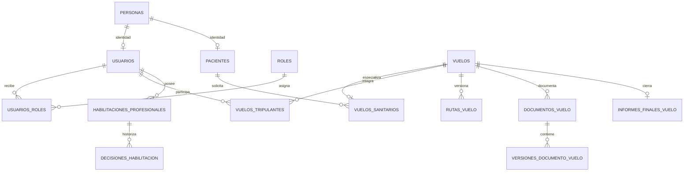

# Modelo de datos actualizado

## Corte de verdad

El modelo del código termina en Flyway V60. Una evidencia de SQL Server E2E aislado del 28/10/2026 concilia 46 tablas físicas (45 negocio + historial Flyway). La instancia habitual activa queda en V47; no se migró para este trabajo. Por tanto, el diagrama describe el objetivo V60 y no afirma que cada tabla esté aplicada en la base habitual.

## Mapa por dominios

## Inventario

| # | Tabla | Finalidad |
|---:|---|---|
| 1 | `activaciones_cuenta` | códigos y ciclo de activación de cuentas |
| 2 | `aeronaves` | recurso aéreo, disponibilidad y ubicación |
| 3 | `aeropuertos` | catálogo de aeropuertos y referencia geográfica |
| 4 | `bitacora_vuelos` | asientos operativos del vuelo |
| 5 | `bloqueos_documento_vuelo` | lease temporal para edición documental |
| 6 | `clasificaciones_tripulacion` | historial de clasificación de personas de tripulación |
| 7 | `consultas_externas_habilitacion` | constancia manual e inmutable de consulta externa |
| 8 | `contactos_coordinacion_traslado` | contactos propios de una solicitud sanitaria |
| 9 | `coordinaciones_aa2000` | coordinaciones aeroportuarias por vuelo |
| 10 | `correos_electronicos` | contactos de correo de identidad |
| 11 | `decisiones_habilitacion` | historial inmutable de decisiones de habilitación |
| 12 | `documentos_habilitacion` | archivos de evidencia profesional y su análisis |
| 13 | `documentos_vuelo` | documento lógico asociado al vuelo |
| 14 | `estados_solicitud_sanitaria` | catálogo de estados de solicitud |
| 15 | `estados_vuelo` | catálogo de estados operativos |
| 16 | `eventos_auditoria` | auditoría de eventos de aplicación |
| 17 | `habilitaciones_profesionales` | habilitaciones de tripulantes |
| 18 | `informacion_hangar` | información operativa del hangar |
| 19 | `informacion_medica_vuelo` | datos sanitarios específicos de un traslado |
| 20 | `informes_finales_vuelo` | informe de cierre |
| 21 | `instantaneas_clima` | observaciones climáticas registradas |
| 22 | `localidades` | catálogo geográfico |
| 23 | `motivos_cancelacion` | catálogo de motivos |
| 24 | `negociaciones_horario_vuelo` | propuestas y decisión de negociación horaria |
| 25 | `notificaciones` | bandeja persistente por usuario |
| 26 | `obligaciones_informe_final` | obligación y plazos de informe |
| 27 | `pacientes` | subtipo paciente de una persona |
| 28 | `perfiles_comandante` | perfil operativo de comandante |
| 29 | `personas` | identidad civil compartida |
| 30 | `politicas_habilitacion` | reglas configurables de suficiencia |
| 31 | `prioridades_vuelo` | catálogo de prioridad |
| 32 | `provincias` | catálogo geográfico |
| 33 | `roles` | roles de autorización |
| 34 | `roles_tripulacion` | roles funcionales de tripulación |
| 35 | `rutas_vuelo` | versiones y revisión de ruta |
| 36 | `telefonos` | contactos telefónicos de identidad |
| 37 | `tipos_documento` | catálogo documental |
| 38 | `tipos_vuelo` | catálogo de tipos |
| 39 | `usuarios` | cuenta autenticable |
| 40 | `usuarios_roles` | asociación usuario-rol |
| 41 | `verificaciones_correo` | códigos de verificación de correo |
| 42 | `versiones_documento_vuelo` | versiones PDF de documento |
| 43 | `vuelos` | agregado principal del vuelo |
| 44 | `vuelos_sanitarios` | especialización sanitaria de un vuelo |
| 45 | `vuelos_tripulantes` | asignaciones e historial de tripulación |

## Relaciones y cardinalidades

* Uno a uno opcional: `personas` a `usuarios` y `personas` a `pacientes`, por identificadores únicos de subtipo.
* Uno a muchos: `vuelos` a `rutas_vuelo`, documentos, bitácora, notificaciones y tripulación.
* Muchos a muchos: usuarios y roles mediante `usuarios_roles`; el registro de asignación conserva su propio contexto.
* Especialización: `vuelos_sanitarios` extiende `vuelos`; impide que información médica y de solicitud se guarde en todo vuelo.

## Normalización e integridad

La evaluación se limita a dependencias observables. Catálogos y entidades se separan de hechos para evitar repetir nombres/estados. El modelo conserva snapshots de auditoría y de contexto de ruta para permitir reconstrucción histórica: es una desnormalización intencional. PK/FK/UNIQUE/CHECK y triggers sostienen reglas en SQL; servicios transaccionales sostienen transiciones, autorización y disponibilidad.

## Fuente de diagramas

Los fuentes Mermaid están en `diagramas/arquitectura.mmd` y `diagramas/modelo-dominios.mmd`.
