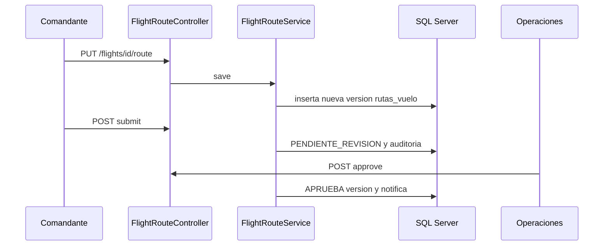

# Operaciones de extremo a extremo

## Convención

Las rutas y clases citadas son comprobadas en el código. Las tablas se citan con su nombre físico español. Las respuestas concretas pueden variar según la regla; no se exponen datos reales.

## 1 Solicitud sanitaria

**Interacción y frontend.** DTS trabaja en el módulo de solicitudes de `frontend-react/src/main.jsx`; sus pruebas están en `requests.test.jsx` y `dts.test.jsx`.

**Backend.** `FlightController` recibe rutas bajo `/api/flights`; la lógica se concentra en `SanitaryRequestRegistrationService` y `FlightService`. DTOs están en `api/dto`.

**Persistencia.** Inserta/consulta el agregado `vuelos` y, para el tipo sanitario, `vuelos_sanitarios`, `informacion_medica_vuelo`, paciente, catálogos y potencialmente contactos de coordinación. Auditoría y notificaciones son efectos de dominio cuando se configuran.

**Integridad.** Validación de DTO, rol DTS, catálogos activos, relación paciente/solicitud y reglas de urgencia. Faltantes dan 400/404/409 según la condición; falta de rol 403.

## 2 Asignación y planificación

Operaciones usa endpoints de `FlightController` y `CatalogController`; intervienen `FlightService`, `AircraftAdminService` y `CrewManagementService`. Tablas: `vuelos`, `aeronaves`, `vuelos_tripulantes`, `perfiles_comandante`, `clasificaciones_tripulacion`, `habilitaciones_profesionales`, `notificaciones` y `eventos_auditoria`. Los servicios usan locks/repositorios y transacciones para evitar doble asignación y revisan la disponibilidad/estado.

## 3 Ruta

`FlightRouteController` expone GET/PUT y POST `submit`, `approve`, `return`; `FlightRouteService` es el único flujo de versión/revisión. Comandante crea/presenta; Operaciones revisa. `rutas_vuelo` almacena versión, contexto y decisión. Una modificación material del vuelo llama `reassess`, invalidando la ruta. Inicio exige ruta aprobada por `requireApprovedForStart`.

## 4 Cierre e informe

`FinalReportWorkflowService`, `CommanderReportAccessService` y `ReportAttachmentService` controlan el cierre. Tablas: `obligaciones_informe_final`, `informes_finales_vuelo`, `vuelos`, documentos/adjuntos, auditoría y notificaciones. El sistema verifica acceso del comandante, condición de estado y plazos. Las migraciones V7 y V42-V43 son la fuente de restricciones físicas e historial.

## 5 Habilitación profesional

`ProfessionalCredentialController` sólo admite `ADMINISTRADOR`. `ProfessionalCredentialService`, `CredentialDocumentService`, `CredentialPolicyService` y `CredentialPolicyActivationService` modifican `habilitaciones_profesionales`, `documentos_habilitacion`, `decisiones_habilitacion`, `consultas_externas_habilitacion` y `politicas_habilitacion`. V60 rechaza modificaciones/bajas físicas sobre decisiones y consultas. Sin política activa aprobada, la elegibilidad no se presume.

## Consultas de comprobación

Usar exclusivamente `CONSULTAS_DEMOSTRACION.sql`. Ejecutarlas con cuenta de sólo lectura o la cuenta de aplicación, sin datos clínicos en pantalla.
